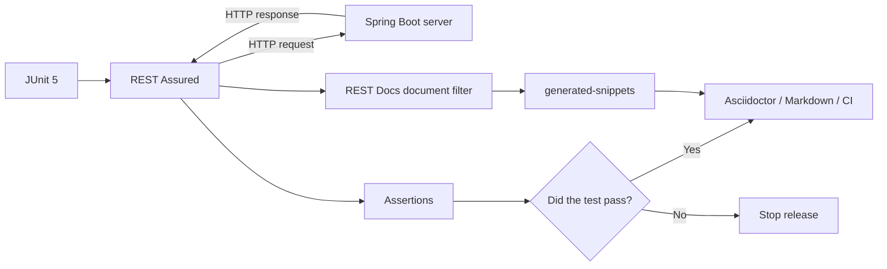

# Documenting Real Endpoint Requests and Responses with REST Assured

## 1. Goal: Documentation That Accurately Reflects the HTTP Handled by the API

**Spring REST Docs** generates REST API documentation from repeatable HTTP tests. In the **REST Assured** chapter, we use REST Assured to call an endpoint on a running HTTP server, verify the result with assertions, and let Spring REST Docs generate snippets for requests, responses, payloads, parameters, and headers. Snippets are compiled with Asciidoctor or Markdown tooling and integrated into the build/CI pipeline.

"Real endpoint" here means **an HTTP server receives the request and returns a response**. The test does not hand-craft a fake JSON string and label it as a response. To keep practice repeatable, the endpoint can use fixed sample data or a test database; there is no need to call production or third-party APIs.

A verifiable workflow consists of four steps:

1. Start the application on the test environment's HTTP server.
2. Use REST Assured to send a real request to the right URL, method, headers, and body.
3. Use `.filter(document("...", ...))` to generate snippets from the HTTP exchange while using `.then()` to assert status, headers, and response content.
4. Only use snippets for compilation/publishing when the related tests have passed.



| What to Verify | How REST Assured / Spring REST Docs Handles It |
| --- | --- |
| Server returns the right HTTP status | `.then().statusCode(200)` or `statusCode(201)` |
| Response has the right business data | `.then().body(...)` with matchers |
| Request sends the right path/headers/body | `given(...)` and the actual HTTP request snippet |
| JSON structure description is accurate | `requestFields(...)` and `responseFields(...)` |
| Documentation is generated from the current run | `document("identifier", ...)` and a pipeline checking test results |

Snippets **do not replace assertions**. A filter can write files during the HTTP exchange even if an assertion in the subsequent `then()` step fails. Therefore, seeing an `.adoc` file is not enough to conclude the documentation is valid.

## 2. Preparing a Realistic Endpoint with Stable Data

The self-contained example below targets **Java 17 and Spring Boot 3.x**. The application exposes two endpoints:

| Method and Path | Expected Result |
| --- | --- |
| `GET /api/books/42` | HTTP 200 and JSON describing book 42 |
| `GET /api/books/999` | HTTP 404, no business payload |
| `POST /api/books` | HTTP 201, JSON response and `Location` header |

In a learning application, you can create `src/main/java/com/example/docs/DocsExampleApplication.java` as follows:

```java
package com.example.docs;

import java.net.URI;
import org.springframework.boot.SpringApplication;
import org.springframework.boot.autoconfigure.SpringBootApplication;
import org.springframework.http.ResponseEntity;
import org.springframework.web.bind.annotation.GetMapping;
import org.springframework.web.bind.annotation.PathVariable;
import org.springframework.web.bind.annotation.PostMapping;
import org.springframework.web.bind.annotation.RequestBody;
import org.springframework.web.bind.annotation.RequestMapping;
import org.springframework.web.bind.annotation.RestController;

@SpringBootApplication
public class DocsExampleApplication {

    public static void main(String[] args) {
        SpringApplication.run(DocsExampleApplication.class, args);
    }

    public record BookResponse(long id, String title, boolean available) {}
    public record CreateBookRequest(String title) {}

    @RestController
    @RequestMapping("/api/books")
    public static class BookController {

        @GetMapping("/{id}")
        public ResponseEntity<BookResponse> find(@PathVariable long id) {
            if (id != 42L) {
                return ResponseEntity.notFound().build();
            }
            return ResponseEntity.ok(
                    new BookResponse(42L, "Spring REST Docs", true));
        }

        @PostMapping
        public ResponseEntity<BookResponse> create(
                @RequestBody CreateBookRequest request) {
            BookResponse created = new BookResponse(100L, request.title(), true);
            return ResponseEntity
                    .created(URI.create("/api/books/100"))
                    .body(created);
        }
    }
}
```

This is a **real controller receiving HTTP requests** when Spring Boot runs. The returned data is fixed so the demonstration test stays stable. In a production project, endpoints typically call a service/repository, persist data, enforce authorization, and handle input validation; when writing documentation via tests, you still need fixtures so expected results are predictable and verifiable. The example above is a learning sample—it does not persist books or perform input validation.

With Gradle using the Spring Boot plugin and corresponding dependency management, you need these dependencies:

```groovy
dependencies {
    implementation 'org.springframework.boot:spring-boot-starter-web'

    testImplementation 'org.springframework.boot:spring-boot-starter-test'
    testImplementation 'io.rest-assured:rest-assured'
    testImplementation 'org.springframework.restdocs:spring-restdocs-restassured'
}

tasks.named('test') {
    useJUnitPlatform()
}
```

If using Maven, the test artifacts belong in `<scope>test</scope>`, while `spring-boot-starter-web` is an application dependency. When there is no Spring Boot BOM/parent managing versions, declare compatible versions. In a project that already has real endpoints, you do not need to create this example controller; pick an endpoint with reproducible test data.

## 3. Starting the Server and Configuring Spring REST Docs

`@SpringBootTest(webEnvironment = RANDOM_PORT)` runs the application on a random HTTP port. `@LocalServerPort` injects that port into the test; REST Assured uses the actual port to send requests. `RestDocumentationExtension` manages the documentation context for each JUnit 5 test.

In `@BeforeEach`, build `RequestSpecification` and attach the configuration filter using `documentationConfiguration(restDocumentation)`:

```java
private RequestSpecification specification;

@BeforeEach
void setUp(RestDocumentationContextProvider restDocumentation) {
    this.specification = new RequestSpecBuilder()
            .setBaseUri("http://localhost")
            .setPort(this.port)
            .addFilter(documentationConfiguration(restDocumentation))
            .build();
}
```

Two easily confused APIs serve distinct roles:

- `documentationConfiguration(...)` configures REST Docs for the request specification and test context; typically attached once when preparing each test.
- `document("books-get", ...)` attaches to **the request to document**; `books-get` is the identifier, i.e., the snippet directory name for that documentation run.

Statements configuring the request—such as `.pathParam(...)`, `.header(...)`, `.contentType(...)`, `.body(...)`, and `.filter(document(...))`—belong inside `given(...)` **before `when()`**. The HTTP call happens at `when().get(...)` or `when().post(...)`. `.then()` assertions run after the response is received.

## 4. GET Test: Documenting Both the Request and the Received Response

Below is a test class you can place at `src/test/java/com/example/docs/BookApiDocumentationTest.java`. It sends HTTP requests to the running application and documents path parameters, request headers, response headers, and JSON fields. The code matches the controller in Section 2:

```java
package com.example.docs;

import io.restassured.builder.RequestSpecBuilder;
import io.restassured.http.ContentType;
import io.restassured.specification.RequestSpecification;
import org.junit.jupiter.api.BeforeEach;
import org.junit.jupiter.api.Test;
import org.junit.jupiter.api.extension.ExtendWith;
import org.springframework.boot.test.context.SpringBootTest;
import org.springframework.boot.test.web.server.LocalServerPort;
import org.springframework.restdocs.RestDocumentationContextProvider;
import org.springframework.restdocs.RestDocumentationExtension;

import static io.restassured.RestAssured.given;
import static org.hamcrest.Matchers.equalTo;
import static org.springframework.restdocs.headers.HeaderDocumentation.headerWithName;
import static org.springframework.restdocs.headers.HeaderDocumentation.requestHeaders;
import static org.springframework.restdocs.headers.HeaderDocumentation.responseHeaders;
import static org.springframework.restdocs.payload.PayloadDocumentation.fieldWithPath;
import static org.springframework.restdocs.payload.PayloadDocumentation.requestFields;
import static org.springframework.restdocs.payload.PayloadDocumentation.responseFields;
import static org.springframework.restdocs.request.RequestDocumentation.parameterWithName;
import static org.springframework.restdocs.request.RequestDocumentation.pathParameters;
import static org.springframework.restdocs.restassured.RestAssuredRestDocumentation.document;
import static org.springframework.restdocs.restassured.RestAssuredRestDocumentation.documentationConfiguration;

@SpringBootTest(webEnvironment = SpringBootTest.WebEnvironment.RANDOM_PORT)
@ExtendWith(RestDocumentationExtension.class)
class BookApiDocumentationTest {

    @LocalServerPort
    private int port;

    private RequestSpecification specification;

    @BeforeEach
    void setUp(RestDocumentationContextProvider restDocumentation) {
        this.specification = new RequestSpecBuilder()
                .setBaseUri("http://localhost")
                .setPort(this.port)
                .addFilter(documentationConfiguration(restDocumentation))
                .build();
    }

    @Test
    void documentGetBook() {
        given(this.specification)
                .accept(ContentType.JSON)
                .pathParam("id", 42)
                .filter(document("books-get",
                        requestHeaders(
                                headerWithName("Accept")
                                        .description("Response media type accepted by the client")),
                        pathParameters(
                                parameterWithName("id")
                                        .description("ID of the book to retrieve")),
                        responseHeaders(
                                headerWithName("Content-Type")
                                        .description("Returned media type")),
                        responseFields(
                                fieldWithPath("id")
                                        .description("Book ID"),
                                fieldWithPath("title")
                                        .description("Book title"),
                                fieldWithPath("available")
                                        .description("Whether the book is available"))))
        .when()
                .get("/api/books/{id}")
        .then()
                .statusCode(200)
                .contentType(ContentType.JSON)
                .body("id", equalTo(42))
                .body("title", equalTo("Spring REST Docs"))
                .body("available", equalTo(true));
    }

    @Test
    void documentCreateBook() {
        given(this.specification)
                .contentType(ContentType.JSON)
                .accept(ContentType.JSON)
                .body("{\"title\":\"REST Docs Documentation\"}")
                .filter(document("books-create",
                        requestFields(
                                fieldWithPath("title")
                                        .description("Title of the book to create")),
                        responseHeaders(
                                headerWithName("Location")
                                        .description("URI of the newly created resource")),
                        responseFields(
                                fieldWithPath("id").description("New book ID"),
                                fieldWithPath("title").description("New book title"),
                                fieldWithPath("available")
                                        .description("Book availability status"))))
        .when()
                .post("/api/books")
        .then()
                .statusCode(201)
                .contentType(ContentType.JSON)
                .header("Location", "/api/books/100")
                .body("id", equalTo(100))
                .body("title", equalTo("REST Docs Documentation"));
    }
}
```

In the GET test, REST Assured sends **`GET /api/books/42` to the running server**. With the example controller, an illustrative HTTP exchange looks like this (some headers/formatting may vary by server):

```http
GET /api/books/42 HTTP/1.1
Host: localhost:PORT
Accept: application/json

HTTP/1.1 200 OK
Content-Type: application/json

{"id":42,"title":"Spring REST Docs","available":true}
```

REST Assured receives the response and `.then()` checks status, content type, ID, title, and availability status. Meanwhile, Spring REST Docs generates snippets from the **actual request/response observed by the filter**, not from the illustrative HTTP block above.

In the POST test, the request carries `Content-Type: application/json` and a JSON body. The server receives the body via `@RequestBody` and returns HTTP 201, `Location: /api/books/100`, and the resulting JSON. `requestFields(...)` describes the request body; `responseHeaders(...)` describes `Location`; `responseFields(...)` describes the response body. The test also directly asserts the important values.

The two tests use two distinct identifiers, **`books-get`** and **`books-create`**, so their snippet groups do not overwrite each other. In an existing application, name identifiers by endpoint and business scenario, such as `books-get-200`, `books-get-404`, and `books-create-201`.

## 5. Where Is Each Snippet Generated From?

After passing tests, Spring REST Docs typically writes snippets to `build/generated-snippets` (Gradle) or `target/generated-snippets` (Maven), unless the project configures another location.

```text
build/generated-snippets/
├── books-get/
│   ├── curl-request.adoc
│   ├── http-request.adoc
│   ├── http-response.adoc
│   ├── request-headers.adoc
│   ├── path-parameters.adoc
│   ├── response-headers.adoc
│   └── response-fields.adoc
└── books-create/
    ├── http-request.adoc
    ├── http-response.adoc
    ├── request-fields.adoc
    ├── response-headers.adoc
    └── response-fields.adoc
```

The directory tree lists only **a few representative files**. Depending on version and configuration, REST Docs may generate additional default snippets such as `httpie-request.adoc`, `request-body.adoc`, and `response-body.adoc`.

| Snippet | Data Source | Meaning |
| --- | --- | --- |
| `http-request.adoc` | Actual HTTP request sent | Method, URI, headers, and body as recorded. |
| `http-response.adoc` | Actual HTTP response received | Status, headers, and payload in the response. |
| `curl-request.adoc` | Executed HTTP request | Example `curl` command to reproduce the operation. |
| `path-parameters.adoc` | `pathParameters(...)` | Table describing URI template variables such as `{id}`. |
| `request-headers.adoc` | `requestHeaders(...)` | Table describing client headers. |
| `request-fields.adoc` | `requestFields(...)` | Table describing input JSON structure. |
| `response-headers.adoc` | `responseHeaders(...)` | Table describing returned headers. |
| `response-fields.adoc` | `responseFields(...)` | Table describing output JSON structure. |

`requestFields(...)` and `responseFields(...)` validate descriptor coverage against JSON fields by default. Adding a new field to the response without documenting it, or missing a required documented field, can cause snippet generation to fail the test. You can use `.optional()` for genuinely optional fields or `.ignored()` for fields you want validated without appearing in the table; only use relaxed descriptor mechanisms when you thoroughly understand the API contract.

## 6. How to Document Error Endpoints or Empty Responses

Not every real endpoint returns HTTP 200 with JSON. For instance, the controller in Section 2 returns HTTP 404 when `id` is not `42`. For this case, you can add a dedicated test to `BookApiDocumentationTest`:

```java
@Test
void documentBookNotFound() {
    given(this.specification)
            .pathParam("id", 999)
            .filter(document("books-get-404",
                    pathParameters(
                            parameterWithName("id")
                                    .description("Non-existent book ID"))))
    .when()
            .get("/api/books/{id}")
    .then()
            .statusCode(404);
}
```

`ResponseEntity.notFound().build()` in the example produces no business JSON payload, so **do not** add `responseFields(...)` expecting `id`, `title`, and `available`. In a real API, if error responses use `ProblemDetail` or a custom JSON envelope, document the **exact** fields of the error response rather than reusing success-response descriptors.

Similarly, for `204 No Content`, you can document the HTTP status and response headers without applying JSON descriptors to an empty body. For a `POST` endpoint returning `201 Created`, a real `Location` header value should be verified if it is part of the API contract.

## 7. Ensuring Reproducible Sample Requests and Responses

Real endpoints often depend on databases, system clocks, auth tokens, or external services. Using unstable data makes tests flaky and causes snippets to drift unexpectedly.

### 7.1. Preparing Stable State and Assertions

- **Fixture data:** create books before tests or use a dedicated test dataset; avoid relying on records that happen to exist in someone else's database.
- **Server port:** use `RANDOM_PORT` and `@LocalServerPort` instead of hard-coding 8080 to reduce collisions.
- **Test isolation:** each test should prepare its own data, especially for POST/DELETE and parallel execution.
- **Meaningful assertions:** verify status, headers, and key fields; if IDs are randomly generated by the system, use matchers checking type/format or retrieve the ID from the fixture instead of hard-coding.
- **Clear failures:** a test failing due to wrong status, wrong body, or wrong descriptor is a signal to resolve before publishing documentation.

### 7.2. Normalizing HTTP Examples Before Publishing

Snippets may contain random ports, internal hostnames, tokens, or headers carrying sensitive values. Spring REST Docs supports preprocessing with `OperationPreprocessor`, for example:

```java
import static org.springframework.restdocs.operation.preprocess.Preprocessors.modifyHeaders;
import static org.springframework.restdocs.operation.preprocess.Preprocessors.modifyUris;
import static org.springframework.restdocs.operation.preprocess.Preprocessors.preprocessRequest;
import static org.springframework.restdocs.operation.preprocess.Preprocessors.preprocessResponse;
import static org.springframework.restdocs.operation.preprocess.Preprocessors.prettyPrint;
```

```java
.filter(document("books-get-public",
        preprocessRequest(
                modifyUris().scheme("https").host("api.example.com").removePort(),
                modifyHeaders().remove("Authorization")),
        preprocessResponse(prettyPrint()),
        pathParameters(
                parameterWithName("id").description("Book ID")),
        responseFields(
                fieldWithPath("id").description("Book ID"),
                fieldWithPath("title").description("Book title"),
                fieldWithPath("available").description("Availability status"))))
```

This illustrates a **replacement for the `document(...)` filter in the GET test**, not an extra call to attach alongside the old filter on the same request. `modifyUris(...)` rewrites the example URL to a public domain, `modifyHeaders().remove("Authorization")` strips the token from the snippet, and `prettyPrint()` merely formats the response for readability. For safety, also review cookies, body fields, and other headers; always use dummy credentials in tests. Preprocessing changes the rendered snippet content without altering the real HTTP logic the server just processed.

## 8. Integrating HTTP Documentation into Asciidoctor/Markdown and CI

Example `src/docs/asciidoc/api.adoc` including snippets from the GET and POST tests:

```asciidoc
= Books API

== Get Book by ID

=== Request
include::{snippets}/books-get/http-request.adoc[]

=== Path parameters
include::{snippets}/books-get/path-parameters.adoc[]

=== Response fields
include::{snippets}/books-get/response-fields.adoc[]

=== Response
include::{snippets}/books-get/http-response.adoc[]

== Create Book

=== Request fields
include::{snippets}/books-create/request-fields.adoc[]

=== Response headers
include::{snippets}/books-create/response-headers.adoc[]

=== Response fields
include::{snippets}/books-create/response-fields.adoc[]
```

The `{snippets}` attribute must be configured to point to the actual `generated-snippets` directory. The `include::...[]` directives use Asciidoctor syntax; if the project authors docs in Markdown, a conversion step or suitable content-embedding tool is required.

For CI to publish accurate documentation, the task order should be:

```text
Run application in test + REST Assured HTTP tests
    -> Verify all assertions and descriptors
    -> Confirm tests pass
    -> Consume generated-snippets from the current build
    -> Run Asciidoctor / Markdown processing
    -> Package or publish documentation
```

In Gradle, the Asciidoctor step should depend on the snippet-generating test task; in Maven, bind plugins to lifecycle phases so tests complete before documentation assembly. If tests fail, CI should stop and never publish leftover snippet files from an earlier run.

## 9. Common Errors and How to Verify

| Symptom | Potential Cause | How to Check |
| --- | --- | --- |
| `Connection refused` | No HTTP server running or wrong test port. | Use `@SpringBootTest(RANDOM_PORT)` with `@LocalServerPort`, check base URI. |
| Unexpected HTTP 404 | Wrong path, path parameter, base path, or missing fixture data. | Read `http-request.adoc` and compare with the running endpoint. |
| Response received but no snippets created | Request lacks `.filter(document(...))`, missing REST Docs config, or wrong specification used. | Check `documentationConfiguration(...)`, `document(...)`, and output directory. |
| `RestDocumentationContextProvider` not injected | Missing JUnit 5 extension/appropriate test configuration. | Register `@ExtendWith(RestDocumentationExtension.class)`; check JUnit Jupiter. |
| Test fails when adding a JSON field | `responseFields(...)` descriptor does not cover the payload or a required field is absent. | Compare actual payload and descriptors; update API or docs to match the desired contract. |
| POST test returns 400/415 | Body/headers do not match server requirements. | Check `@RequestBody`, `.body(...)`, `.contentType(ContentType.JSON)`, and validation. |
| Snippets contain internal host/port or token | Data not normalized before compiling docs. | Use REST Docs preprocessors and dummy data; inspect snippets manually. |
| Snippet files exist yet test is red | Filter may write files before assertions fail. | Rely on JUnit test results, not just the existence of `.adoc` files. |
| Asciidoctor reports file not found | Wrong identifier, snippet directory, or build order. | Check `{snippets}`, filenames, and task dependency between tests and docs. |

### Completion Checklist

- [ ] Endpoint runs in a test HTTP server or reproducible integration environment.
- [ ] REST Assured sends the right method, path, headers, and body to the real endpoint.
- [ ] `RequestSpecification` includes `documentationConfiguration(...)` and documented requests attach `document("identifier", ...)`.
- [ ] `requestFields`, `responseFields`, parameters, and headers are documented from actual HTTP traffic rather than guessing JSON.
- [ ] Assertions verify status, headers, and key business data.
- [ ] GET, POST, and error scenarios use distinct identifiers when documented.
- [ ] Inspected snippets to remove sensitive data and normalize displayed URLs.
- [ ] Only compile/publish documentation from builds where tests pass.

When REST Assured calls a real endpoint and Spring REST Docs records that exact HTTP exchange, API documentation gains a clear source of verification. Combining descriptors, assertions, stable test data, and build/CI ensures that any change to requests or responses without corresponding documentation updates is caught promptly.
