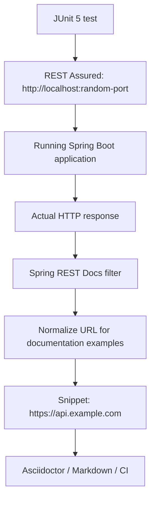

# Configuring Host, Port, and Scheme for Spring REST Docs with REST Assured

## 1. Distinguishing the API Call Address from the Documented Address

In **Spring REST Docs**, API documentation data comes from executed HTTP tests. The request client can be **MockMvc**, **WebTestClient**, or **REST Assured**; this chapter uses REST Assured to call a server over real HTTP and generate snippets for requests, responses, payloads, parameters, and headers.

When running integration tests, a Spring Boot application typically listens on a random port, such as:

```text
http://localhost:51327/api/greetings/42
```

However, documentation readers need the API address they will use in the public environment:

```text
https://api.example.com/api/greetings/42
```

**You do not need to send test requests to the public address just so the documentation displays it.** REST Assured determines where the actual connection goes; Spring REST Docs lets you configure or preprocess the URL shown in generated snippets.

| URL Component | Example in HTTP Test | Example to Publish | Meaning |
| --- | --- | --- | --- |
| Scheme | `http` | `https` | URL protocol used by clients. |
| Host | `localhost` | `api.example.com` | Target hostname, excluding scheme or port. |
| Port | `51327` | `443` or omitted when default | Service port. |
| Path | `/api/greetings/42` | `/api/greetings/42` | REST resource being called. |

In this article's examples, `api.example.com` is an **illustrative domain name**. In a real project, use the hostname provided by the API operations team and verify the path and protocol in the published environment.



URL normalization should affect only the **documentation record**. Assertions must still evaluate the response of the actual executed HTTP request.

## 2. Three Configuration Layers to Understand

In a REST Assured test, host/port/scheme can be declared across the following layers:

| Layer | Representative API | Effect |
| --- | --- | --- |
| REST Assured, actual connection | `RequestSpecBuilder.setBaseUri(...)`, `setPort(...)`, `setBasePath(...)` | The address that actually receives the test's HTTP requests. |
| Spring REST Docs, documentation URI | `documentationConfiguration(provider).uris().withScheme(...).withHost(...).withPort(...)` | The address used in URI examples generated by REST Docs. |
| Spring REST Docs, preprocessing | `preprocessRequest(modifyUris().scheme(...).host(...).removePort())` | Adjusts the URI recorded in the snippet of a specific request. |

Some examples also use global `RestAssured.baseURI` or `RestAssured.port`. For parallel test suites, creating a `RequestSpecification` in `@BeforeEach` is usually easier to control because it does not depend on global state that another test could overwrite.

**Key relationship:** `setBaseUri` is for **connecting**; `withHost` or `modifyUris().host` is for **presenting documentation**. Do not change `setBaseUri("http://localhost")` to `setBaseUri("https://api.example.com")` merely to change the URL in snippets, as that causes tests to send HTTP traffic to a different server.

## 3. Preparing a Spring Boot Example with a Real Endpoint

This example uses **Java 17, Spring Boot 3.x, JUnit Jupiter, and REST Assured**. If the Spring Boot parent/BOM manages project versions, declare in `build.gradle`:

```groovy
dependencies {
    implementation 'org.springframework.boot:spring-boot-starter-web'

    testImplementation 'org.springframework.boot:spring-boot-starter-test'
    testImplementation 'io.rest-assured:rest-assured'
    testImplementation 'org.springframework.restdocs:spring-restdocs-restassured'
}

tasks.named('test') {
    useJUnitPlatform()
}
```

In Maven, use the corresponding dependencies, placing `spring-boot-starter-test`, `rest-assured`, and `spring-restdocs-restassured` in `<scope>test</scope>`. If not using the Spring Boot BOM or dependency management, specify compatible library versions explicitly.

Create a minimal endpoint in `src/main/java/com/example/docs/DocsApplication.java`:

```java
package com.example.docs;

import org.springframework.boot.SpringApplication;
import org.springframework.boot.autoconfigure.SpringBootApplication;
import org.springframework.http.ResponseEntity;
import org.springframework.web.bind.annotation.GetMapping;
import org.springframework.web.bind.annotation.PathVariable;
import org.springframework.web.bind.annotation.RestController;

@SpringBootApplication
public class DocsApplication {

    public static void main(String[] args) {
        SpringApplication.run(DocsApplication.class, args);
    }

    public record Greeting(long id, String message) {}

    @RestController
    public static class GreetingController {
        @GetMapping("/api/greetings/{id}")
        public ResponseEntity<Greeting> get(@PathVariable long id) {
            if (id != 42L) {
                return ResponseEntity.notFound().build();
            }
            return ResponseEntity.ok(new Greeting(42L, "Hello"));
        }
    }
}
```

This is a testable HTTP endpoint with fixed response data for easy reproducibility. In a real application, data typically comes from a service/database; in that case, prepare fixtures before each test to avoid depending on random environment state.

## 4. Configuring the Real HTTP Connection Address in REST Assured

To run tests against the embedded server, use `@SpringBootTest(webEnvironment = RANDOM_PORT)` and `@LocalServerPort`. Request setup goes in `@BeforeEach`:

```java
@LocalServerPort
private int port;

private RequestSpecification specification;

@BeforeEach
void setUp(RestDocumentationContextProvider restDocumentation) {
    this.specification = new RequestSpecBuilder()
            .setBaseUri("http://localhost")
            .setPort(this.port)
            .setBasePath("/api")
            .addFilter(documentationConfiguration(restDocumentation))
            .build();
}
```

Meaning:

1. `setBaseUri("http://localhost")` sets the **HTTP scheme** and **local host** for the connection.
2. `setPort(this.port)` uses the actual port assigned to the Spring Boot server.
3. `setBasePath("/api")` prepends `/api` to paths in tests; requests only need to call `/greetings/{id}`.
4. `documentationConfiguration(restDocumentation)` registers the REST Docs configuration filter; by itself, it does not specify which requests generate snippets.
5. `document("greetings-get", ...)` will be attached in tests via `.filter(...)` before `when()`.

Once `basePath` is `/api`, do not call `.get("/api/greetings/{id}")` as it would produce a duplicated path `/api/api/greetings/{id}`.

In a project calling a **real HTTPS server**, the connection address must use `https://...` and a valid HTTPS port:

```java
new RequestSpecBuilder()
        .setBaseUri("https://staging-api.example.com")
        .setPort(8443)
        .build();
```

That example is only suitable when an actual staging server exists at that address and port and tests have valid TLS certificate configuration. Setting a **published scheme** in documentation does not turn a local HTTP server into an HTTPS server.

## 5. Option 1: Setting Scheme, Host, and Port in `documentationConfiguration`

Using REST Docs' `uris()` configuration API, you can set the snippet URI directly when building `RequestSpecification`:

```java
this.specification = new RequestSpecBuilder()
        .setBaseUri("http://localhost")
        .setPort(this.port)
        .setBasePath("/api")
        .addFilter(documentationConfiguration(restDocumentation)
                .uris()
                    .withScheme("https")
                    .withHost("api.example.com")
                    .withPort(443))
        .build();
```

This call order shows a clear separation:

- **The real request** still goes to `http://localhost:<random-port>/api/...` via `setBaseUri` and `setPort`.
- **The URL in documentation** is configured with `https`, `api.example.com`, and HTTPS port `443` via `uris()`.
- `443` is the standard HTTPS port. How default ports render in specific snippets depends on the snippet generator; when you want to guarantee `:port` is omitted, see the `removePort()` approach in Section 7.

This configuration style fits when **multiple HTTP tests in the same class or module share a documentation address**. If a module has multiple public hostnames, test suites can configure different hostnames per API scope; never apply the wrong address across all services.

**Do not confuse with DNS or reverse proxies:** `api.example.com` here is strictly an example hostname for presentation. REST Docs does not verify that the domain actually points to production servers and does not validate TLS certificates. Domain/scheme details must be confirmed against API deployment configuration.

## 6. Full Test: Local Request, Public Host in Snippets

Place the following class at `src/test/java/com/example/docs/GreetingDocumentationTest.java`:

```java
package com.example.docs;

import io.restassured.builder.RequestSpecBuilder;
import io.restassured.http.ContentType;
import io.restassured.specification.RequestSpecification;
import org.junit.jupiter.api.BeforeEach;
import org.junit.jupiter.api.Test;
import org.junit.jupiter.api.extension.ExtendWith;
import org.springframework.boot.test.context.SpringBootTest;
import org.springframework.boot.test.web.server.LocalServerPort;
import org.springframework.restdocs.RestDocumentationContextProvider;
import org.springframework.restdocs.RestDocumentationExtension;

import static io.restassured.RestAssured.given;
import static org.hamcrest.Matchers.equalTo;
import static org.springframework.restdocs.payload.PayloadDocumentation.fieldWithPath;
import static org.springframework.restdocs.payload.PayloadDocumentation.responseFields;
import static org.springframework.restdocs.request.RequestDocumentation.parameterWithName;
import static org.springframework.restdocs.request.RequestDocumentation.pathParameters;
import static org.springframework.restdocs.restassured.RestAssuredRestDocumentation.document;
import static org.springframework.restdocs.restassured.RestAssuredRestDocumentation.documentationConfiguration;

@SpringBootTest(webEnvironment = SpringBootTest.WebEnvironment.RANDOM_PORT)
@ExtendWith(RestDocumentationExtension.class)
class GreetingDocumentationTest {

    @LocalServerPort
    private int port;

    private RequestSpecification specification;

    @BeforeEach
    void setUp(RestDocumentationContextProvider restDocumentation) {
        this.specification = new RequestSpecBuilder()
                // Actual HTTP calls the local server on a random port.
                .setBaseUri("http://localhost")
                .setPort(this.port)
                .setBasePath("/api")
                // URI displayed in documentation.
                .addFilter(documentationConfiguration(restDocumentation)
                        .uris()
                            .withScheme("https")
                            .withHost("api.example.com")
                            .withPort(443))
                .build();
    }

    @Test
    void documentGetGreetingWithPublicUri() {
        given(this.specification)
                .accept(ContentType.JSON)
                .pathParam("id", 42)
                .filter(document("greetings-get",
                        pathParameters(
                                parameterWithName("id")
                                        .description("Greeting ID")),
                        responseFields(
                                fieldWithPath("id")
                                        .description("Greeting ID"),
                                fieldWithPath("message")
                                        .description("Greeting message"))))
        .when()
                .get("/greetings/{id}")
        .then()
                .statusCode(200)
                .contentType(ContentType.JSON)
                .body("id", equalTo(42))
                .body("message", equalTo("Hello"));
    }
}
```

When executed, the test performs the following steps in order:

1. Spring Boot starts the HTTP server and assigns a free port for this test run.
2. REST Assured sends a request to `http://localhost:<port>/api/greetings/42`.
3. `document("greetings-get", ...)` processes the real request/response, validates descriptors, and generates snippets.
4. REST Docs applies the public URI configuration when rendering URIs in relevant snippets, such as the `curl` example.
5. Assertions verify HTTP 200 and JSON with `id = 42` and `message = "Hello"`.

This example requires the exact endpoint and data shown in Section 3. If your project uses a Spring Boot version other than 3.x, the `@LocalServerPort` import path and testing API details may differ—check against your version.

In the `curl-request.adoc` snippet, an expected illustrative URL is:

```bash
curl 'https://api.example.com/api/greetings/42' -i -X GET \
    -H 'Accept: application/json'
```

This is an **illustrative output**, not a byte-for-byte guarantee across every Spring REST Docs version. Filenames, layout, and port rendering can vary by configuration. The key thing to verify is that the published URL uses `https://api.example.com` instead of `http://localhost:<random-port>`.

## 7. Option 2: Normalizing the URI with a Request Preprocessor

Another option is to keep the basic REST Docs configuration in `@BeforeEach` and use an `OperationRequestPreprocessor` per request. This approach works well if only certain endpoints or scenarios need a different display URL.

To illustrate, replace the **`document(...)` filter in the GET test** with:

```java
given(this.specification)
        .accept(ContentType.JSON)
        .pathParam("id", 42)
        .filter(document("greetings-get",
                preprocessRequest(
                        modifyUris()
                                .scheme("https")
                                .host("api.example.com")
                                .removePort()),
                preprocessResponse(prettyPrint()),
                pathParameters(
                        parameterWithName("id")
                                .description("Greeting ID")),
                responseFields(
                        fieldWithPath("id")
                                .description("Greeting ID"),
                        fieldWithPath("message")
                                .description("Greeting message"))))
.when()
        .get("/greetings/{id}")
.then()
        .statusCode(200)
        .body("id", equalTo(42));
```

Add the static imports:

```java
import static org.springframework.restdocs.operation.preprocess.Preprocessors.modifyUris;
import static org.springframework.restdocs.operation.preprocess.Preprocessors.preprocessRequest;
import static org.springframework.restdocs.operation.preprocess.Preprocessors.preprocessResponse;
import static org.springframework.restdocs.operation.preprocess.Preprocessors.prettyPrint;
```

Explanation of each operation:

| API | Effect on Snippet |
| --- | --- |
| `modifyUris().scheme("https")` | Displays the HTTPS protocol in the documented URL. |
| `.host("api.example.com")` | Replaces the local hostname with the example domain. |
| `.removePort()` | Removes the random port from the documented URI. |
| `preprocessResponse(prettyPrint())` | Formats the response snippet payload for readability when supported by the format. |

When using Option 2, `@BeforeEach` only needs:

```java
.addFilter(documentationConfiguration(restDocumentation))
```

There is no need to combine both `uris().with...` configuration and `modifyUris()` for the same purpose. If a project intentionally uses both, understand the transformation order and precedence, then inspect the resulting snippets.

**Boundary of preprocessors:** they transform content written to documentation; they do not change where REST Assured connects, do not configure TLS on the server, and do not verify that the published hostname is reachable. For tokens, cookies, or sensitive data, add appropriate preprocessors to remove/mask values before publishing. Never place real credentials in tests.

## 8. Common Pitfalls with Scheme, Host, and Port

### 8.1. Public HTTPS Running Behind a Reverse Proxy

In many systems, external clients call:

```text
https://api.example.com/api/greetings/42
```

While the internal service receives forwarded HTTP traffic from a proxy:

```text
http://127.0.0.1:8080/api/greetings/42
```

Client-facing API documentation should use the **guaranteed public URL**. Do not infer the public URL from the embedded server address or a header that happened to be sent in a test. Reverse proxy configuration, `X-Forwarded-Proto`, and `Forwarded` are deployment infrastructure concerns; snippet URIs should match the contract clients actually use.

### 8.2. Default Ports vs. Non-Default Ports

| Desired URL | Scheme | Host | Port |
| --- | --- | --- | --- |
| `https://api.example.com/books` | `https` | `api.example.com` | Default `443`; normally omitted from URLs. |
| `http://api.example.com/books` | `http` | `api.example.com` | Default `80`; normally omitted from URLs. |
| `https://api.example.com:8443/books` | `https` | `api.example.com` | `8443`, must be shown when clients need to connect on this port. |

When documenting a non-default port, set `withPort(8443)` explicitly or keep the appropriate port during preprocessing. When you want default ports omitted, `modifyUris().removePort()` expresses that intent clearly.

### 8.3. Base Path and Full URL

With `setBasePath("/api")`, calling `.get("/greetings/{id}")` is appropriate. If you already write the full `/api/greetings/{id}` in `.get(...)`, omit `setBasePath`. If the public backend uses a `/v1` prefix that internal tests do not have, changing **host/scheme/port** alone is not enough: design how public paths are documented, verify gateway rewrite rules, and configure matching preprocessors. Never alter paths without verifying actual routing.

### 8.4. Accidentally Calling the Public Environment

```java
// Do not use this just to change the address shown in documentation.
new RequestSpecBuilder()
        .setBaseUri("https://api.example.com")
        .build();
```

This configuration sends real HTTP test traffic externally. It is only right if you intentionally run integration tests against a public server with proper access and isolated test data. If the goal is merely to normalize examples, keep the local/staging connection address and use Spring REST Docs' URI APIs.

## 9. Verifying Snippets and Including Them in Asciidoctor/Markdown

After running tests, Spring REST Docs typically writes files under `build/generated-snippets` (Gradle) or `target/generated-snippets` (Maven); the location can be changed via build configuration:

```text
build/generated-snippets/greetings-get/
  curl-request.adoc
  http-request.adoc
  http-response.adoc
  path-parameters.adoc
  response-fields.adoc
  ...
```

**How to properly verify host/port/scheme normalization:**

1. Open `curl-request.adoc`; verify the URL uses `https://api.example.com` and the published path.
2. Open `http-request.adoc`; check the URI and `Host` header according to the generated snippet format. Do not assume every snippet file renders URLs identically.
3. Open `http-response.adoc`; verify status and JSON come from the real endpoint, without hand-editing the response to make examples look "pretty."
4. Confirm `path-parameters.adoc` and `response-fields.adoc` reflect the request/response descriptors.
5. Confirm **the entire test suite passed**. File existence alone does not prove assertions succeeded.

Example Asciidoctor document `src/docs/asciidoc/api.adoc`:

```asciidoc
= Greeting API

== Get Greeting

=== HTTP request
include::{snippets}/greetings-get/http-request.adoc[]

=== curl
include::{snippets}/greetings-get/curl-request.adoc[]

=== Path parameters
include::{snippets}/greetings-get/path-parameters.adoc[]

=== Response
include::{snippets}/greetings-get/http-response.adoc[]

=== Response fields
include::{snippets}/greetings-get/response-fields.adoc[]
```

The `{snippets}` attribute must point to the exact generated snippets directory produced by the current build. If the project publishes documentation in Markdown, you need an AsciiDoc conversion/embedding step; plain Markdown does not process `include::...[]` natively.

In **CI**, preserve this dependency order:

```text
Start test application and run REST Assured
  -> Confirm assertions and snippet descriptors succeed
  -> Verify published URIs / no leaked sensitive data
  -> Compile Asciidoctor or Markdown
  -> Package / publish documentation
```

If tests fail, the pipeline must stop before publishing to avoid shipping stale or unverified snippets into official documentation.

## 10. Common Errors

| Symptom | Possible Cause | Resolution |
| --- | --- | --- |
| Snippet shows `localhost:<random-port>` | Configured `setBaseUri/setPort` on REST Assured without normalizing REST Docs URIs. | Use `documentationConfiguration(...).uris()` or `preprocessRequest(modifyUris()...)`. |
| Test gets `Connection refused` | `setPort(...)` does not match the running server port or server did not start. | Use `RANDOM_PORT` with `@LocalServerPort`, check base URI. |
| Test accidentally calls public API | Put the published host in `setBaseUri` instead of snippet configuration. | Restore the test environment base URI; normalize URIs inside REST Docs. |
| Docs show `http` instead of `https` | Did not call `withScheme("https")` or `modifyUris().scheme("https")`. | Update documentation scheme and re-check `curl-request.adoc`. |
| Published URL still has random port | Port was not handled or test's actual port is still used. | Use `withPort(...)` for the public port or `removePort()` to omit it. |
| `curl` command in docs returns 404 | Wrong base path or gateway rewrites paths differently from internal service. | Cross-check public URL against actual routing. |
| Missing `greetings-get` directory | Missing `document(...)` filter, test did not run, or different output directory. | Check `RestDocumentationExtension`, `documentationConfiguration`, `document`, and build output. |
| Snippets exist yet test is red | Filter ran before a failing assertion or descriptors mismatched. | Check JUnit results; fix API/test/descriptors before publishing. |
| Snippets contain tokens, cookies, or internal hosts | Published content was not preprocessed and reviewed. | Add appropriate preprocessors, use dummy data, and inspect snippets. |

## 11. Practice Checklist

- [ ] Identified both the **server address tests actually call** and the **published API address**.
- [ ] Configured `setBaseUri(...)`, `setPort(...)`, and `setBasePath(...)` accurately for the test environment.
- [ ] Attached `documentationConfiguration(restDocumentation)` to REST Assured's specification.
- [ ] Used `uris().withScheme(...).withHost(...).withPort(...)` or `modifyUris()` to normalize the documented address.
- [ ] Attached `document("identifier", ...)` before `when()` and verified HTTP status/body with assertions.
- [ ] Verified `curl-request.adoc` and `http-request.adoc` contain the right published scheme, host, port, and path.
- [ ] Confirmed response data and descriptors are recorded from real HTTP traffic.
- [ ] Removed sensitive data and ensured build/CI publishes documentation only from passing tests.

An HTTP test can run safely against `http://localhost:<random-port>` while documentation presents `https://api.example.com`. Separating **connection address** from **snippet address** is essential for producing stable, user-friendly, and verifiable REST API documentation with Spring REST Docs.
