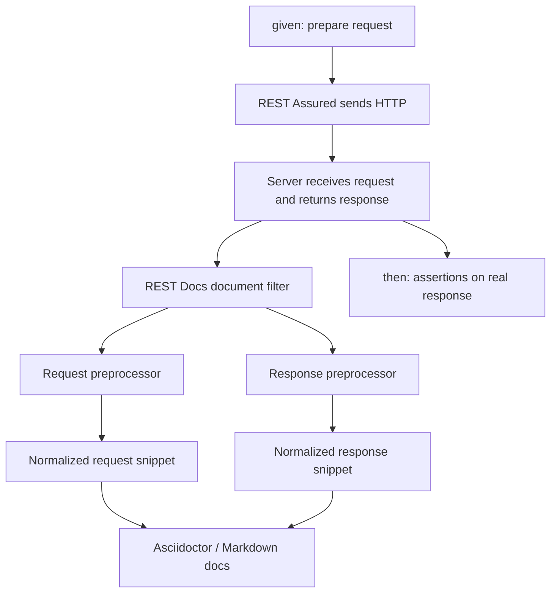

# Preprocessing Requests and Responses in the REST Assured Filter

## 1. Why Preprocess Before Writing Documentation?

**Spring REST Docs** generates REST API documentation from HTTP tests executed with MockMvc, WebTestClient, or REST Assured. With REST Assured, the `document(...)` filter observes the request sent and the response received, then generates snippets for requests, responses, payloads, parameters, and headers.

In practice, raw HTTP data is sometimes unsuitable for inclusion verbatim in documentation. Requests may contain `Authorization` headers, session cookies, internal hostnames, or per-run tracing values. Responses may contain randomly generated IDs, internal links, or unformatted JSON. Spring REST Docs provides **Operation Preprocessors** to transform the documented request/response copy before generating snippets.

An important distinction: a preprocessor transforms the record used for **documentation**; it does not alter the request sent to the server or the response returned by the application. REST Assured assertions still evaluate the real HTTP exchange.



Common scenarios requiring preprocessing:

| Scenario | Appropriate Handling |
| --- | --- |
| Remove tokens from documentation | `preprocessRequest(modifyHeaders().remove("Authorization"))` |
| Format JSON for readability | `preprocessRequest(prettyPrint())` or `preprocessResponse(prettyPrint())` |
| Normalize host, scheme, port | `modifyUris()` in a request/response preprocessor |
| Replace sensitive values in content | `replacePattern(...)` or custom `ContentModifier` |
| Remove or normalize headers | `modifyHeaders()` with `remove`, `set`, `add` |
| Mask hypermedia links to emphasize link relations | `maskLinks(...)` |

## 2. Two Ways to Configure Preprocessors

Spring REST Docs supports applying preprocessors at two scopes:

**Per request:** pass an `OperationRequestPreprocessor` and/or `OperationResponsePreprocessor` directly to a `document(...)` overload. This fits well when only one endpoint needs token masking, hostname replacement, or payload normalization.

**Defaults for all tests sharing a configuration:** add request/response defaults to `documentationConfiguration(...).operationPreprocessors()` in `@BeforeEach`. This fits well when every snippet in a test class follows the same rules, such as always stripping `Authorization` and pretty-printing responses.

| Scope | Advantages | Considerations |
| --- | --- | --- |
| Inside `document(...)` | Rules are visible right at the test and customizable per endpoint. | Easy to repeat if many tests share the same rule. |
| Configuration defaults | Shares rules and reduces boilerplate. | Applies to every snippet using that specification; must ensure rules are safe for all endpoints. |

Both approaches can be combined: configure shared normalization steps in defaults and add endpoint-specific steps in `document(...)` when needed. Check application order and snippet output to avoid a later step inadvertently overwriting an earlier transformation.

## 3. Dependencies and Basic REST Assured Setup

Examples use Spring Boot 3.x, JUnit Jupiter, and REST Assured. When the project already has the Spring Boot BOM managing versions, declare in Gradle:

```groovy
dependencies {
    testImplementation 'org.springframework.boot:spring-boot-starter-test'
    testImplementation 'io.rest-assured:rest-assured'
    testImplementation 'org.springframework.restdocs:spring-restdocs-restassured'
}

tasks.named('test') {
    useJUnitPlatform()
}
```

In Maven, the corresponding test dependencies belong in `<scope>test</scope>`. If the project does not use a BOM/parent to manage versions, declare compatible versions across Spring Boot, Spring REST Docs, and REST Assured.

With JUnit 5, REST Assured needs a `RequestSpecification` configured with the REST Docs filter:

```java
@SpringBootTest(webEnvironment = SpringBootTest.WebEnvironment.RANDOM_PORT)
@ExtendWith(RestDocumentationExtension.class)
class AccountDocumentationTest {

    @LocalServerPort
    private int port;

    private RequestSpecification specification;

    @BeforeEach
    void setUp(RestDocumentationContextProvider restDocumentation) {
        this.specification = new RequestSpecBuilder()
                .setBaseUri("http://localhost")
                .setPort(this.port)
                .setBasePath("/api")
                .addFilter(documentationConfiguration(restDocumentation))
                .build();
    }
}
```

`RANDOM_PORT` starts the HTTP server for the test; `@LocalServerPort` provides the actual port. `documentationConfiguration(restDocumentation)` sets up the Spring REST Docs context. Each request to document attaches `document(...)` inside `given(...)`, before `when()`.

## 4. Per-Request Preprocessing with `document(...)`

Common static imports:

```java
import static org.springframework.restdocs.operation.preprocess.Preprocessors.modifyHeaders;
import static org.springframework.restdocs.operation.preprocess.Preprocessors.prettyPrint;
import static org.springframework.restdocs.operation.preprocess.Preprocessors.preprocessRequest;
import static org.springframework.restdocs.operation.preprocess.Preprocessors.preprocessResponse;
```

Example: an API handles `GET /api/accounts/42`. The real request carries an `Authorization` header, but public documentation must not include the token:

```java
@Test
void documentAccount() {
    given(this.specification)
            .accept(ContentType.JSON)
            .header("Authorization", "Bearer test-secret-token")
            .filter(document("accounts-get",
                    preprocessRequest(
                            modifyHeaders().remove("Authorization")),
                    preprocessResponse(prettyPrint()),
                    pathParameters(
                            parameterWithName("id").description("Account ID")),
                    responseFields(
                            fieldWithPath("id").description("Account ID"),
                            fieldWithPath("displayName").description("Display name"))))
    .when()
            .get("/accounts/{id}", 42)
    .then()
            .statusCode(200)
            .body("id", equalTo(42));
}
```

In this example:

1. REST Assured sends the real request with `Authorization: Bearer test-secret-token` to the server.
2. `preprocessRequest(modifyHeaders().remove("Authorization"))` strips the header from the request copy used for documentation.
3. `preprocessResponse(prettyPrint())` formats the response body before writing snippets.
4. `pathParameters(...)` and `responseFields(...)` generate snippets describing request/response structure.
5. `.then()` still validates the real response. If the server returns the wrong status or data, the test still fails.

The REST Assured overload has the form `document(identifier, requestPreprocessor, responsePreprocessor, snippets...)`. You can pass only one preprocessor if you only need to process the request or the response. Snippet descriptors can follow after the preprocessors.

**Note:** the token value in the example is dummy data. Never use real tokens, passwords, cookies, or personal data in test fixtures. Removing one header from a snippet does not guarantee copies of that value do not appear in the body, URL, logs, or other headers; inspect all documented output.

## 5. Configuring Default Preprocessors for All Requests/Responses

If a test class wants every request to strip `Authorization` and every response to be pretty-printed, configure defaults when building the specification:

```java
@BeforeEach
void setUp(RestDocumentationContextProvider restDocumentation) {
    this.specification = new RequestSpecBuilder()
            .setBaseUri("http://localhost")
            .setPort(this.port)
            .setBasePath("/api")
            .addFilter(documentationConfiguration(restDocumentation)
                    .operationPreprocessors()
                        .withRequestDefaults(
                                modifyHeaders().remove("Authorization"))
                        .withResponseDefaults(prettyPrint()))
            .build();
}
```

Each test then only needs to declare its specific descriptors:

```java
given(this.specification)
        .filter(document("accounts-get",
                pathParameters(
                        parameterWithName("id").description("Account ID")),
                responseFields(
                        fieldWithPath("id").description("Account ID"),
                        fieldWithPath("displayName").description("Display name"))))
.when()
        .get("/accounts/{id}", 42)
.then()
        .statusCode(200);
```

`withRequestDefaults(...)` registers steps applied to every request documented through this configurer; `withResponseDefaults(...)` registers default steps for responses. This API belongs to `RestDocumentationConfigurer` and is supported in the REST Assured integration.

Only put rules into defaults that hold true for all endpoints. For example, do not strip every `Content-Type` header if documentation needs to show request/response formats. If one test needs to document `Authorization` in controlled internal docs, configure a separate scope rather than letting default rules conflict.

## 6. Common Built-In Preprocessors

### 6.1. Formatting JSON with `prettyPrint()`

`prettyPrint()` formats request or response payloads so snippets are easy to read. It can be applied individually:

```java
.filter(document("orders-get",
        preprocessResponse(prettyPrint()),
        responseFields(
                fieldWithPath("id").description("Order ID"),
                fieldWithPath("status").description("Status"))))
```

Or use `preprocessRequest(prettyPrint())` if the request body also needs formatting. Pretty-printing only changes how the recorded content is presented; it does not alter the response the application sent to the client.

### 6.2. Adding, Setting, or Removing Headers with `modifyHeaders()`

`modifyHeaders()` supports transforming request/response headers. For example:

```java
preprocessRequest(
        modifyHeaders()
                .remove("Authorization")
                .remove("Cookie")
                .set("Host", "api.example.com"))
```

In public documentation, consider whether to keep a normalized `Host` header. Only add or set headers to accurately reflect the contract clients must use; do not produce an example request whose headers contradict its URL.

### 6.3. Normalizing URIs with `modifyUris()`

When tests send requests to `http://localhost:<random-port>`, documentation often needs to display the public address:

```java
preprocessRequest(
        modifyUris()
                .scheme("https")
                .host("api.example.com")
                .removePort())
```

The preprocessor updates the URI in snippets; it does not change where REST Assured connects. The domain `api.example.com` is just an example and should be replaced with the API's confirmed domain.

### 6.4. Replacing Patterns with `replacePattern(...)`

For data inside the body, regular expressions can replace strings with a predictable structure. The example below redacts a hypothetical API key string:

```java
preprocessRequest(
        replacePattern(
                Pattern.compile("api-key-[A-Za-z0-9]+"),
                "api-key-[REDACTED]"))
```

Import `java.util.regex.Pattern` and statically import `replacePattern`. Verify that the regex matches all sensitive values without corrupting valid data. Regex is not a JSON parser: if payload structure is complex or field names vary, consider a custom content modifier for targeted handling.

### 6.5. Masking Hypermedia Links with `maskLinks(...)`

For HAL/hypermedia responses, if you want to guide readers to use link relations rather than hard-coding URLs, `maskLinks(...)` can replace `href` values in links. For example:

```java
preprocessResponse(maskLinks())
```

You can specify a custom replacement string via the API's overload. Use this only with responses whose link structure Spring REST Docs recognizes; do not mask all URLs if clients need concrete example URLs to integrate.

## 7. Combining Multiple Steps and Execution Order

A single preprocessor can chain multiple operations. For instance, a request needs token removal, URL normalization, and JSON formatting; the response needs content formatting:

```java
.filter(document("orders-create",
        preprocessRequest(
                modifyHeaders().remove("Authorization"),
                modifyUris().scheme("https").host("api.example.com").removePort(),
                prettyPrint()),
        preprocessResponse(prettyPrint()),
        requestFields(
                fieldWithPath("productId").description("Product ID"),
                fieldWithPath("quantity").description("Quantity")),
        responseFields(
                fieldWithPath("id").description("Order ID"),
                fieldWithPath("status").description("Order status"))))
```

Operations run in the order passed. Choose an order so later transformations do not break earlier ones. For instance, adjust headers before writing snippets and modify URIs before generating `curl` examples.

Never use preprocessors to make descriptors "appear valid" when an endpoint returns wrong data. If the real response has `status = PENDING` while business assertions require `CONFIRMED`, the test must fail; never use pretty-printing or pattern replacement to hide contract bugs.

## 8. Writing a Custom Preprocessor When Built-Ins Are Not Enough

If you need structured content transformations, implement `ContentModifier` and wrap it in `ContentModifyingOperationPreprocessor`, or implement `OperationPreprocessor` if you need to modify request/response metadata as well. The example below illustrates a simple `ContentModifier` that replaces an email address in the body:

```java
import java.nio.charset.StandardCharsets;
import java.nio.charset.Charset;
import org.springframework.http.MediaType;
import org.springframework.restdocs.operation.preprocess.ContentModifier;

public class EmailRedactionModifier implements ContentModifier {

    @Override
    public byte[] modifyContent(byte[] originalContent, MediaType contentType) {
        Charset charset = contentType != null && contentType.getCharset() != null
                ? contentType.getCharset()
                : StandardCharsets.UTF_8;
        String body = new String(originalContent, charset);
        String sanitized = body.replace("private@example.test", "user@example.test");
        return sanitized.getBytes(charset);
    }
}
```

Use it with the content-modifying preprocessor:

```java
import org.springframework.restdocs.operation.preprocess.ContentModifyingOperationPreprocessor;
import static org.springframework.restdocs.operation.preprocess.Preprocessors.preprocessResponse;

preprocessResponse(
        new ContentModifyingOperationPreprocessor(new EmailRedactionModifier()))
```

`ContentModifier` receives `byte[] originalContent` and `MediaType contentType`; the content type parameter can be `null`. The example uses the media type's charset when present and defaults to UTF-8. In real systems, a modifier must account for JSON escaping, repeated values, and nested fields. Do not use raw string replacement on binary payloads or multipart content. For complex JSON, consider parsing into a JSON tree, updating nodes by field name, and serializing back.

If you need to modify the operation's method, URI, headers, or metadata, implement `OperationPreprocessor` and process `OperationRequest`/`OperationResponse` using the API. Preserve attributes that do not need changes and write dedicated unit tests for custom preprocessors before applying them broadly.

## 9. Verifying Snippet Output and Protecting Data

After tests run, snippets are typically created under:

```text
build/generated-snippets/accounts-get/       # Gradle
target/generated-snippets/accounts-get/      # Maven
```

Check at least the following:

| File | What to Check |
| --- | --- |
| `http-request.adoc` | Whether `Authorization`/`Cookie` are removed; whether URI/Host match the published version. |
| `curl-request.adoc` | Whether URL and headers work as a client example; whether any token is leaked. |
| `request-body.adoc` | Whether sensitive data in the payload is properly masked. |
| `http-response.adoc` | Whether status, headers, and body still accurately describe the received response. |
| `response-body.adoc` | Whether JSON is readable and values are properly normalized. |
| `request-fields.adoc` / `response-fields.adoc` | Whether descriptors match the API schema without masking schema errors. |

Preprocessing for publication does not replace test security. Use dummy tokens, non-sensitive fixture data, and mask only values unsuitable for documentation. Never write real credentials to logs, snippets, CI artifacts, or repositories.

A sound workflow:

1. Send the real request with REST Assured.
2. Let the filter capture the request/response record.
3. Preprocess the content used for documentation.
4. Validate descriptors and assertions against the HTTP exchange.
5. Inspect the final snippets to confirm data was stripped/normalized as intended.
6. Promote snippets into official documentation only when all tests pass.

## 10. Integrating with Asciidoctor and CI

An Asciidoctor document can include the snippets:

```asciidoc
= Accounts API

== Get Account

=== HTTP request
include::{snippets}/accounts-get/http-request.adoc[]

=== Request headers
include::{snippets}/accounts-get/request-headers.adoc[]

=== HTTP response
include::{snippets}/accounts-get/http-response.adoc[]

=== Response fields
include::{snippets}/accounts-get/response-fields.adoc[]
```

The `{snippets}` attribute must point to the directory generated by the build. If publishing in Markdown, you need a conversion step or suitable mechanism for embedding AsciiDoc snippets; `include::...[]` directives are Asciidoctor syntax.

In CI, preserve this order:

```text
REST Assured HTTP tests
    -> document filter + preprocessors
    -> generated-snippets
    -> test result validation
    -> Asciidoctor / Markdown conversion
    -> package / publish
```

The build must halt if tests or descriptors fail. Because the filter can write files before final assertions mark a test as failed, never publish solely based on the presence of the snippet directory. Use artifacts strictly from the current build, avoiding leftover snippets from previous runs.

## 11. Common Errors

| Symptom | Possible Cause | Resolution |
| --- | --- | --- |
| Cannot find `preprocessRequest` | Missing static import or incorrect Spring REST Docs dependency. | Check `org.springframework.restdocs.operation.preprocess.Preprocessors`. |
| Sensitive header still appears | Preprocessor placed on response by mistake, wrong header name, or test uses another filter. | Use `preprocessRequest(modifyHeaders().remove("Authorization"))` in the right `document(...)`; re-check `http-request.adoc`. |
| Response JSON remains on a single line | `preprocessResponse(prettyPrint())` not applied or content type not recognized as JSON. | Check the actual content type, add the response preprocessor, and inspect the snippet. |
| Documented URL still shows localhost | `modifyUris()` not used or preprocessor applied to the wrong request. | Check `curl-request.adoc` and the request URI after preprocessing. |
| Regex misses some sensitive data | Pattern does not cover variations in value format or escaping. | Write tests for the pattern; consider structural payload parsing instead of regex. |
| Response snippet drops needed values | Remove/replace rules are too broad or applied in the wrong order. | Narrow the preprocessor scope and inspect payload after each step. |
| Defaults affect unintended endpoints | Rules placed in `withRequestDefaults`/`withResponseDefaults` even though only one API needs them. | Move those rules to that endpoint's individual `document(...)` call. |
| Snippets exist yet test failed | Filter wrote snippets before assertions or descriptors finished. | Read JUnit results; never publish documentation from failing tests. |

## 12. Practice Checklist

- [ ] Distinguished real HTTP traffic from the request/response copy used for documentation.
- [ ] Decided whether preprocessors apply per request or as defaults.
- [ ] Placed request preprocessors in `preprocessRequest(...)` and response preprocessors in `preprocessResponse(...)`.
- [ ] Used built-ins appropriately, such as `prettyPrint`, `modifyHeaders`, `modifyUris`, `replacePattern`, or `maskLinks`.
- [ ] Inspected headers, URIs, and bodies in snippets after preprocessing.
- [ ] Kept assertions on real responses and ensured descriptors reflect the actual API schema.
- [ ] Used dummy data and avoided exposing tokens/cookies/PII in test artifacts.
- [ ] Compiled and published documentation only when both tests and build succeed.

Preprocessing enables Spring REST Docs to generate readable, consistent, and safe-to-publish HTTP examples while preserving verification against real requests and responses. With REST Assured, simply pass preprocessors to `document(...)` or configure defaults in `documentationConfiguration(...)`; assertions continue verifying API behavior.

## References

- [Spring REST Docs – Customizing requests and responses](https://docs.spring.io/spring-restdocs/reference/customizing-requests-and-responses.html)
- [Spring REST Docs – Reference documentation](https://docs.spring.io/spring-restdocs/docs/current/reference/htmlsingle/)
- [Spring REST Docs 3.0.6 – RestAssuredRestDocumentation API](https://docs.spring.io/spring-restdocs/docs/current/api/org/springframework/restdocs/restassured/RestAssuredRestDocumentation.html)
- [Spring REST Docs 3.0.6 – Preprocessors API](https://docs.spring.io/spring-restdocs/docs/current/api/org/springframework/restdocs/operation/preprocess/Preprocessors.html)
- [Spring REST Docs – OperationPreprocessor API](https://docs.spring.io/spring-restdocs/docs/current/api/org/springframework/restdocs/operation/preprocess/OperationPreprocessor.html)
