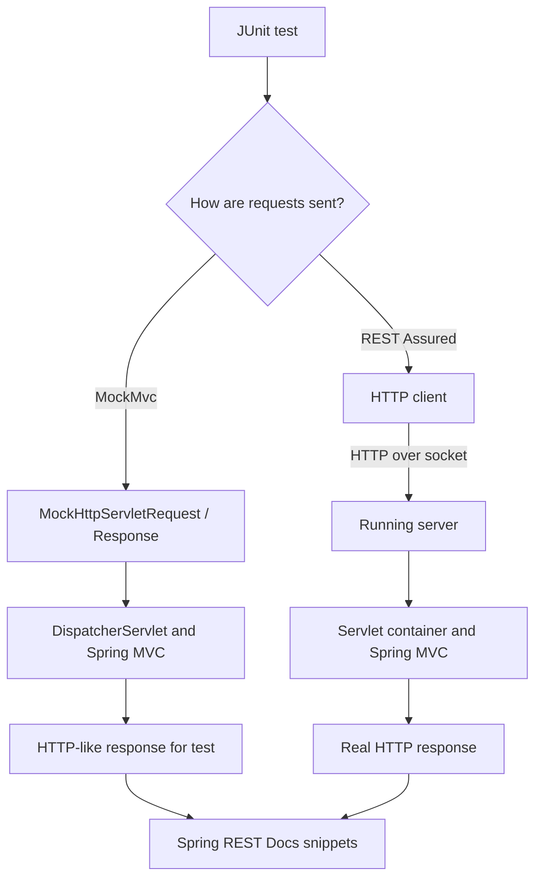

# Distinguishing Integration Tests and MockMvc Tests

## 1. Two Ways to Test HTTP with Different Coverage

In Spring REST Docs, REST API documentation is generated from HTTP tests written with **MockMvc**, **WebTestClient**, or **REST Assured**. Both approaches covered here can exercise controllers and generate snippets describing requests/responses, but they test the system at different boundaries.

- **MockMvc** executes Spring MVC's request-handling pipeline through `DispatcherServlet`, using `spring-test` mock request/response objects. It does not require a running Servlet container and does not send HTTP traffic over sockets.
- **REST Assured against a running server** acts as a real HTTP client: it sends requests to the application's host/port, reads responses over HTTP, and asserts results using the `given / when / then` DSL.

Accordingly, MockMvc is well-suited for fast web-layer verification and documentation at the Spring MVC level. REST Assured combined with `@SpringBootTest(webEnvironment = RANDOM_PORT)` is well-suited when you need to verify the application over HTTP with a real running server/container.



**Core distinction:** MockMvc is not a fake HTTP server opening a port for clients to connect to. It invokes Spring MVC's request-handling infrastructure directly using mock Servlet objects. REST Assured in this article sends requests to a server listening on a real address.

## 2. Comparing by Testing Goal

| Criterion | MockMvc | REST Assured + Live Server |
| --- | --- | --- |
| How requests are sent | Constructs requests via the Spring MVC Test API. | HTTP client sends over host/port to a running server. |
| HTTP server/container | Does not need to start a container. | Requires a running application/server, typically an embedded server. |
| Spring MVC dispatch | Yes, through `DispatcherServlet`. | Yes, through the real server. |
| Network, TCP, and TLS | Does not test real network transport. | Can test HTTP/TLS communication within the test environment scope. |
| Web filters and configuration | Tests filters configured on MockMvc; does not automatically prove every production container setting. | Tests the request path through the server and filters/container enabled in the test application config. |
| Speed and resources | Typically fast, no server/port startup needed. | Typically consumes more resources and time due to server startup and HTTP connections. |
| Container-dependent behavior | Does not fully represent real container behavior. | Can catch discrepancies from the embedded container and runtime configuration. |
| Test data | Can use `@WebMvcTest`, mocked services, or Spring context. | Typically uses `@SpringBootTest` with auxiliary database/containers or fixtures. |
| Spring REST Docs module | `spring-restdocs-mockmvc`. | `spring-restdocs-restassured`. |

MockMvc is still a form of **integration testing within Spring MVC's scope**, not merely calling controller methods directly like a pure unit test. Conversely, REST Assured itself only provides an HTTP client; the level of integration depends on the target server the test calls. In this article, "REST Assured integration test" refers to REST Assured calling a Spring Boot application started with a live server.

## 3. What MockMvc Tests and Its Limitations

MockMvc exercises Spring MVC request processing, so it can test:

- URL and HTTP method mapping to handlers.
- Binding of path/query parameters, headers, forms, and JSON bodies.
- Message converters, validation, `@ControllerAdvice`, `@ExceptionHandler`.
- Spring Security integration if the security filter chain is configured on MockMvc.
- Status codes, response headers, JSON/XML/body payloads, and Spring MVC models.
- Servlet Filters registered with MockMvc.

However, because there is no real server/container, MockMvc does not test TCP, TLS handshakes, server ports, reverse proxy connections, or Servlet container-specific behavior. Some differences can involve context paths, session cookies, async/error/forward dispatches, or JSP rendering. If your application depends on these factors, you need a live-server test to verify end-to-end behavior.

MockMvc has two common setup styles:

| Setup Style | Characteristics |
| --- | --- |
| `standaloneSetup(controller)` | Focuses on one or a few controllers; tests manually configure needed components such as controller advice, converters, or filters. Suitable for controlled web-layer testing. |
| `webAppContextSetup(context)` | Uses `WebApplicationContext` and the loaded Spring MVC configuration. Suitable for testing Spring MVC components configured in the application context. |

With Spring Boot, `@WebMvcTest` is commonly used for web-layer slice tests; `@AutoConfigureMockMvc` configures MockMvc within a broader test context such as `@SpringBootTest` with a mock web environment. Using `@SpringBootTest` does not automatically start a live server: you must choose `webEnvironment = RANDOM_PORT` or `DEFINED_PORT` if you want a live server.

## 4. What Else Does REST Assured with a Live Server Test?

REST Assured sends HTTP requests using a standard HTTP client. When combined with:

```java
@SpringBootTest(webEnvironment = SpringBootTest.WebEnvironment.RANDOM_PORT)
```

Spring Boot starts the application on a random port; `@LocalServerPort` provides that port to the test. REST Assured configures the base URI and port and sends requests to the server.

This approach additionally verifies components along the server request path:

- Server startup, port binding, and accepting HTTP connections.
- The actual Servlet container used by the application in tests.
- Serialization/deserialization and responses over a real HTTP client/server.
- Filter/container integration, session cookies, headers, and redirects in the running environment.
- Host, port, HTTPS/TLS, or reverse proxy settings if the test is configured to use them.

Do not conclude that a `RANDOM_PORT` test verifies production infrastructure if the test does not run reverse proxies, TLS termination, load balancers, databases, or external services matching production. Live-server testing has a wider boundary than MockMvc, yet its scope is still defined by the test environment.

## 5. Same Endpoint, Two Ways to Write Documentation Tests

Suppose the application exposes `GET /api/books/{id}`, returning JSON when the book exists:

```json
{
  "id": 42,
  "title": "Spring REST Docs"
}
```

Descriptors such as `pathParameters(...)` and `responseFields(...)` are Spring REST Docs `Snippet` instances. They can be passed directly into `document(...)` in each test as shown in the examples below.

### 5.1. Writing with MockMvc

The required integration dependencies in test scope are:

```groovy
testImplementation 'org.springframework.boot:spring-boot-starter-test'
testImplementation 'org.springframework.restdocs:spring-restdocs-mockmvc'
```

JUnit 5 example with `WebApplicationContext`:

```java
@SpringBootTest
@ExtendWith(RestDocumentationExtension.class)
class BookMockMvcDocumentationTest {

    @Autowired
    private WebApplicationContext context;

    private MockMvc mockMvc;

    @BeforeEach
    void setUp(RestDocumentationContextProvider restDocumentation) {
        this.mockMvc = MockMvcBuilders.webAppContextSetup(this.context)
                .apply(documentationConfiguration(restDocumentation))
                .build();
    }

    @Test
    void documentGetBook() throws Exception {
        this.mockMvc.perform(get("/api/books/{id}", 42)
                        .accept(MediaType.APPLICATION_JSON))
                .andExpect(status().isOk())
                .andExpect(jsonPath("$.id").value(42))
                .andDo(document("books-get-mockmvc",
                        pathParameters(
                                parameterWithName("id").description("Book ID")),
                        responseFields(
                                fieldWithPath("id").description("Book ID"),
                                fieldWithPath("title").description("Book title"))));
    }
}
```

Required static and standard imports:

```java
import static org.springframework.restdocs.mockmvc.MockMvcRestDocumentation.document;
import static org.springframework.restdocs.mockmvc.MockMvcRestDocumentation.documentationConfiguration;
import static org.springframework.test.web.servlet.request.MockMvcRequestBuilders.get;
import static org.springframework.test.web.servlet.result.MockMvcResultMatchers.jsonPath;
import static org.springframework.test.web.servlet.result.MockMvcResultMatchers.status;
import static org.springframework.restdocs.request.RequestDocumentation.parameterWithName;
import static org.springframework.restdocs.request.RequestDocumentation.pathParameters;
import static org.springframework.restdocs.payload.PayloadDocumentation.fieldWithPath;
import static org.springframework.restdocs.payload.PayloadDocumentation.responseFields;

import org.springframework.beans.factory.annotation.Autowired;
import org.springframework.boot.test.context.SpringBootTest;
import org.springframework.http.MediaType;
import org.springframework.restdocs.RestDocumentationExtension;
import org.springframework.restdocs.RestDocumentationContextProvider;
import org.springframework.test.web.servlet.setup.MockMvcBuilders;
import org.springframework.test.web.servlet.MockMvc;
import org.springframework.web.context.WebApplicationContext;
import org.junit.jupiter.api.BeforeEach;
```

This example needs no HTTP port because MockMvc processes requests with mock objects. Here `@SpringBootTest` loads the full context and the test builds MockMvc manually using `WebApplicationContext`. If you only need to test the controller, you can choose `@WebMvcTest(BookController.class)` and supply mocks for collaborators. Another option is letting Spring Boot auto-configure MockMvc with `@AutoConfigureMockMvc`; when combining with REST Docs, use either Spring Boot's REST Docs auto-configuration or manual setup consistently to avoid registering the same filter twice. Do not place both `@WebMvcTest` and `@SpringBootTest` on the same class.

### 5.2. Writing with REST Assured and a Live Server

Test dependencies switch to the REST Docs module for REST Assured:

```groovy
testImplementation 'org.springframework.boot:spring-boot-starter-test'
testImplementation 'io.rest-assured:rest-assured'
testImplementation 'org.springframework.restdocs:spring-restdocs-restassured'
```

Example:

```java
@SpringBootTest(webEnvironment = SpringBootTest.WebEnvironment.RANDOM_PORT)
@ExtendWith(RestDocumentationExtension.class)
class BookRestAssuredDocumentationTest {

    @LocalServerPort
    private int port;

    private RequestSpecification specification;

    @BeforeEach
    void setUp(RestDocumentationContextProvider restDocumentation) {
        this.specification = new RequestSpecBuilder()
                .setBaseUri("http://localhost")
                .setPort(this.port)
                .addFilter(documentationConfiguration(restDocumentation))
                .build();
    }

    @Test
    void documentGetBook() {
        given(this.specification)
                .accept(ContentType.JSON)
                .filter(document("books-get-restassured",
                        pathParameters(
                                parameterWithName("id").description("Book ID")),
                        responseFields(
                                fieldWithPath("id").description("Book ID"),
                                fieldWithPath("title").description("Book title"))))
        .when()
                .get("/api/books/{id}", 42)
        .then()
                .statusCode(200)
                .body("id", equalTo(42))
                .body("title", equalTo("Spring REST Docs"));
    }
}
```

Common static imports:

```java
import static io.restassured.RestAssured.given;
import static org.hamcrest.Matchers.equalTo;
import static org.springframework.restdocs.restassured.RestAssuredRestDocumentation.document;
import static org.springframework.restdocs.restassured.RestAssuredRestDocumentation.documentationConfiguration;
```

Required type/annotation imports include `RequestSpecBuilder`, `RequestSpecification`, `ContentType`, `SpringBootTest`, `LocalServerPort`, `RestDocumentationContextProvider`, `RestDocumentationExtension`, `BeforeEach`, and `Test`. The example requires the real endpoint exposed by the application and book `42` to exist.

**Note on identifiers:** the two tests use `books-get-mockmvc` and `books-get-restassured`. If both share the same output directory and identical identifier, snippets may overwrite each other or mix sources. When comparing both approaches, keep distinct identifiers or configure separate output directories.

## 6. Where Does Spring REST Docs Configuration Differ?

| Component | MockMvc | REST Assured |
| --- | --- | --- |
| Integration artifact | `spring-restdocs-mockmvc` | `spring-restdocs-restassured` |
| Documentation configuration | `MockMvcRestDocumentation.document(...)` and `documentationConfiguration(...)` applied to the MockMvc builder | `RestAssuredRestDocumentation.document(...)` and `documentationConfiguration(...)` attached to `RequestSpecification` |
| Attaching the document step | `.andDo(document("id", ...))` | `.filter(document("id", ...))` before `when()` |
| Executing the request | `mockMvc.perform(...)` | `given(...).when().get/post(...)` |
| Assertions | `.andExpect(...)` | `.then().statusCode(...).body(...)` |
| Request/response type | Mock Servlet API | Real HTTP request/response over a running server |

Descriptors such as `pathParameters`, `requestFields`, `responseFields`, `requestHeaders`, and `responseHeaders` are shared across Spring REST Docs from their respective packages. However, how you configure REST Docs and attach the filter depends on the integration module.

Do not use `RestAssuredRestDocumentation.document(...)` inside a `MockMvc.perform(...)` chain; likewise, do not use MockMvc's `.andDo(...)` on a REST Assured request. The two have different integration APIs.

## 7. Understanding `@AutoConfigureRestDocs` and `@AutoConfigureMockMvc`

With Spring Boot, `@AutoConfigureRestDocs` can automatically configure Spring REST Docs integration for auto-configured tests. Spring Boot provides support for MockMvc, REST Assured, and WebTestClient. This annotation can customize the output directory and documentation URI host/scheme/port via configuration properties.

However:

- `@AutoConfigureMockMvc` creates/configures MockMvc in the test context; it does not start a real HTTP server.
- `@SpringBootTest(webEnvironment = MOCK)` with MockMvc is still not equivalent to `RANDOM_PORT`.
- `@SpringBootTest(webEnvironment = RANDOM_PORT)` starts a live server; this is the right choice for REST Assured HTTP integration tests.
- Use `@AutoConfigureRestDocs` as supported by Spring Boot to reduce manual setup; do not configure two filters/beans for the same purpose simultaneously unless you fully understand the combination.

Spring Boot includes REST Docs auto-configuration for MockMvc, REST Assured, and WebTestClient. Check the documentation for your specific Spring Boot version because annotation attributes and test auto-configuration can change across release lines.

Choose one clear REST Docs configuration mechanism per test class. If using JUnit `RestDocumentationExtension` + manual `documentationConfiguration(...)`, keep that setup consistent. If using Spring Boot auto-configuration, follow the conventions of your module and Boot version.

## 8. When Should You Choose Which Approach?

| Situation | Usually Better Fit | Reason |
| --- | --- | --- |
| Many controllers needing mapping, validation, and JSON contract checks | MockMvc | Fast execution with fine-grained response control and Spring MVC assertions. |
| Isolating the web layer from external databases/services | MockMvc with mocked collaborators | Fast feedback and easy fault localization. |
| Verifying application startup, server port, and real HTTP exchange | REST Assured + `RANDOM_PORT` | Sends real requests to a running server. |
| Verifying cookies/sessions, container filters, or server redirects | REST Assured integration tests | Exercises the HTTP/Servlet path in the test runtime. |
| Testing TLS, reverse proxies, or API gateways | Tests against environments with those components | MockMvc does not test real transport/proxies. |
| Testing many JSON/validation cases at high speed | MockMvc | Avoids starting a server for each test group. |
| Verifying how external clients experience API calls | REST Assured | Uses an HTTP client to observe responses as an ordinary client would. |

You do not need to pick only one style for the entire project. A practical strategy often uses numerous MockMvc tests to cover controller contracts alongside a focused set of REST Assured integration tests verifying critical HTTP paths.

## 9. Combining Both in a Documentation Strategy

When the same endpoint is documented with both MockMvc and REST Assured, decide clearly which snippet source is authoritative. You can use:

- MockMvc to produce detailed documentation covering many statuses, validation cases, and response fields.
- REST Assured to produce a representative set of examples verifying requests/responses over real HTTP.

Never let two tests automatically write to the same identifier. For example:

```text
generated-snippets/
  books-get-mockmvc/
  books-get-restassured/
  books-create-mockmvc/
  books-create-restassured/
```

If published documentation needs only one example per endpoint, pick the appropriate source and include that snippet in Asciidoctor. If comparing both, clearly label in documentation which example comes from MockMvc and which comes from the live HTTP test. This helps readers understand the verification scope and prevents duplicate content.

## 10. Snippets, Asciidoctor, and CI

Spring REST Docs snippets are typically saved in `build/generated-snippets` (Gradle) or `target/generated-snippets` (Maven), depending on configuration. Include them in Asciidoctor:

```asciidoc
= Books API

== Get Book - Spring MVC test
include::{snippets}/books-get-mockmvc/http-request.adoc[]
include::{snippets}/books-get-mockmvc/http-response.adoc[]
include::{snippets}/books-get-mockmvc/response-fields.adoc[]

== Get Book - HTTP integration test
include::{snippets}/books-get-restassured/http-request.adoc[]
include::{snippets}/books-get-restassured/http-response.adoc[]
include::{snippets}/books-get-restassured/response-fields.adoc[]
```

If publishing only one source, omit the other to avoid bloating the API page unnecessarily. Plain Markdown does not process `include::{snippets}/...[]` syntax natively; an appropriate conversion/embedding step is required.

In CI, follow this order:

```text
MockMvc tests / REST Assured live-server tests
        -> descriptor validation and assertions
        -> generated snippets
        -> Asciidoctor / Markdown conversion
        -> publish documentation
```

Snippets can be written before a final assertion fails. Therefore, CI must check test results before compiling and publishing; never treat the mere presence of the snippet directory as proof that tests passed.

## 11. Common Errors

| Symptom | Cause | Fix |
| --- | --- | --- |
| Assuming MockMvc tests ports or TLS | MockMvc does not start a Servlet container or send over TCP. | Add REST Assured tests against a live server or test the deployment environment. |
| `Connection refused` with REST Assured | Server did not start or port is wrong. | Use `RANDOM_PORT` and `@LocalServerPort`; check host/base path. |
| MockMvc lacks a context path like the real server | Mock requests do not automatically reproduce full context/container behavior. | Configure matching request context or verify additionally with a live server. |
| Using the wrong `document(...)` API | Confusing `MockMvcRestDocumentation` with `RestAssuredRestDocumentation`. | Pick the right artifact and API for the testing client in use. |
| Snippets not found | REST Docs not configured or `andDo(document(...))`/`.filter(document(...))` not called. | Check the configuration filter and the document attachment point for the right module. |
| Snippets from two tests overwrite each other | Duplicate identifier and output directory. | Use distinct identifiers or separate output directories. |
| Using `@AutoConfigureMockMvc` expecting a live server | The annotation sets up MockMvc, not an HTTP listener. | Switch to `RANDOM_PORT` and REST Assured if a real server is needed. |
| Snippets exist yet test is red | The filter may write snippets before assertions fail. | Only publish after all tests pass. |

## 12. Strategy Selection Checklist

- [ ] Determined whether to verify Spring MVC request handling or HTTP exchanges over a live server.
- [ ] For MockMvc, used `spring-restdocs-mockmvc`, `MockMvcRestDocumentation.document(...)`, and `andDo(...)`.
- [ ] For REST Assured, used `spring-restdocs-restassured`, a live server, and `RestAssuredRestDocumentation.document(...)` inside `.filter(...)`.
- [ ] Did not confuse `@AutoConfigureMockMvc` with `@SpringBootTest(RANDOM_PORT)`.
- [ ] Assigned distinct identifiers/output directories when documenting the same endpoint with both approaches.
- [ ] Verified status, headers, payloads, and descriptors against real responses.
- [ ] CI compiles and publishes documentation only after all relevant tests succeed.

MockMvc and REST Assured are not competing tools trying to do the exact same job in every case. MockMvc helps verify Spring MVC request handling quickly and deterministically; REST Assured against a live server additionally verifies the HTTP path through a running server. Combining both within their proper scopes produces deep Spring REST Docs documentation while preserving test suite speed and reliability.

## References

- [Spring Framework – MockMvc vs End-to-End Tests](https://docs.spring.io/spring/reference/testing/mockmvc/vs-end-to-end-integration-tests.html)
- [Spring Framework – MockMvc](https://docs.spring.io/spring-framework/reference/6.2/testing/mockmvc.html)
- [Spring Boot – Auto-configured Spring REST Docs Tests](https://docs.spring.io/spring-boot/3.5/reference/testing/spring-boot-applications.html)
- [Spring REST Docs – Reference Documentation](https://docs.spring.io/spring-restdocs/docs/current/reference/htmlsingle/)
