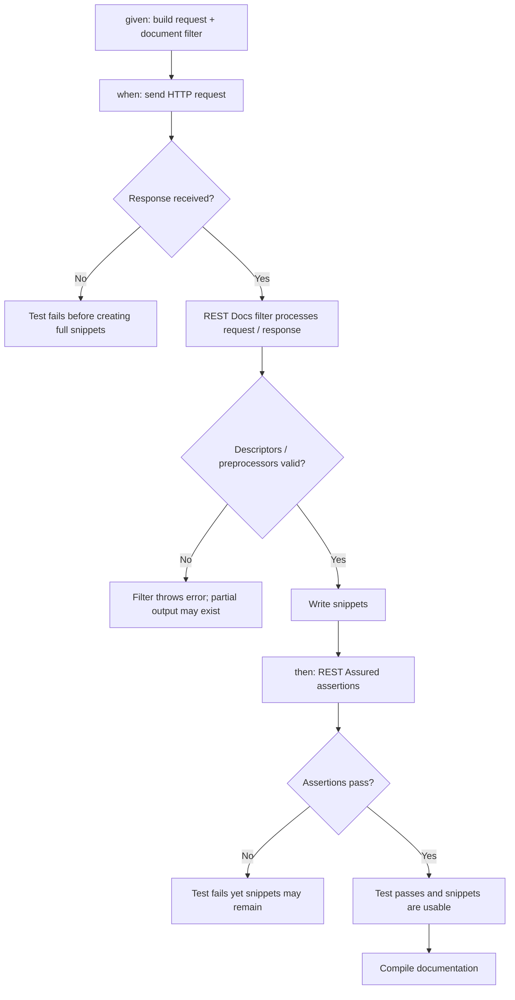
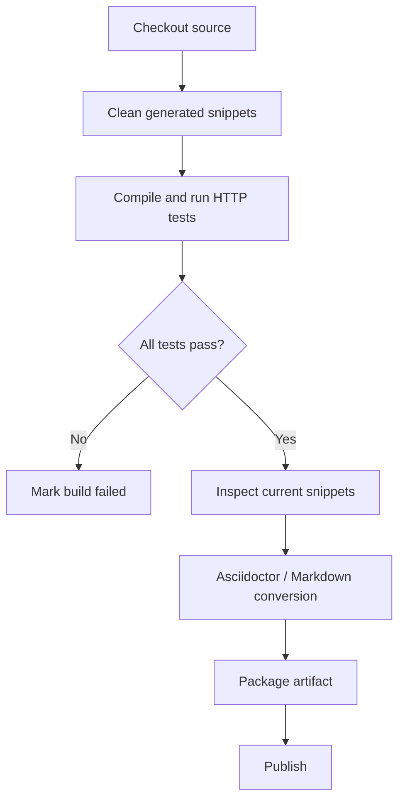

# Handling Snippet Artifacts When Assertions Fail

## 1. Why Do Snippets Still Exist When a Test Fails?

Spring REST Docs generates REST API documentation from HTTP tests using MockMvc, WebTestClient, or REST Assured. With REST Assured, the `document(...)` filter observes the HTTP request and response and generates snippets; REST Assured's `.then()` block then checks status, headers, and response content.

An easy point of confusion is that **snippets can be written before the final assertions are evaluated**. For example:

```java
given(this.specification)
        .filter(document("books-get"))
.when()
        .get("/api/books/42")
.then()
        .statusCode(200)
        .body("title", equalTo("Spring REST Docs"));
```

Once the server returns a response, the REST Docs filter may already have written `http-request.adoc`, `http-response.adoc`, and any requested snippets. Only afterward does REST Assured check the status and body. If the server returns HTTP 500 or an unexpected title, the test fails, yet the snippet files may remain on disk.

Therefore, you cannot infer "test passed" from seeing the `generated-snippets` directory or `.adoc` files. Distinguish the state of **the test** from the state of **documentation artifacts**.



## 2. Types of Failures and When They Occur

Not every failure produces the same artifact state. Identify which stage the failure happens in:

| Failure Type | Typical Stage | Impact on Snippets |
| --- | --- | --- |
| Cannot reach server, DNS error, or connection refused | REST Assured sends request | No complete HTTP exchange; usually no complete snippet set is created. |
| Server returns unexpected 4xx/5xx | Filter processes response before `.then()` | Request/response snippets may be written even though the later status assertion fails. |
| Status/body/header assertion fails | `.then()` after filter processes response | Snippets are usually already written; the test still fails. |
| Descriptor missing field or describing field absent from JSON | REST Docs processes operation | Filter may throw `SnippetException` or documentation error; previously written files may remain. |
| Request/response preprocessor fails | Inside filter before writing corresponding snippet | Snippets may not be created or only partially created. |
| Multiple tests share the same identifier | During or across multiple test runs | Files may be overwritten or reflect a later run; source becomes hard to trace. |
| Test skipped or not executed | JUnit test discovery / filtering | No new snippets for that test; stale files from earlier runs may remain on disk. |

Importantly, **REST Docs validating descriptors** and **REST Assured validating behavior** are two related yet distinct verification layers. `responseFields(...)` checks JSON structure against descriptors, while `.statusCode(200)` checks the HTTP status code. Keep both whenever they belong to the API contract.

## 3. Example: Assertion Fails Yet Snippets Were Written

Suppose an endpoint returns HTTP 200 with JSON:

```json
{
  "id": 42,
  "title": "Spring REST Docs"
}
```

The test below intentionally expects the wrong status to illustrate:

```java
@Test
void documentBookWithWrongAssertion() {
    given(this.specification)
            .accept(ContentType.JSON)
            .filter(document("books-get-demo",
                    responseFields(
                            fieldWithPath("id").description("Book ID"),
                            fieldWithPath("title").description("Book title"))))
    .when()
            .get("/api/books/42")
    .then()
            .statusCode(201); // Wrong: endpoint actually returns 200.
}
```

What happens step by step:

1. REST Assured sends GET to the server and receives HTTP 200.
2. The REST Docs filter processes the operation and generates snippets for `books-get-demo`.
3. `.then().statusCode(201)` compares against the actual status 200 and throws an assertion error.
4. JUnit marks the test as failed; snippets already written are not automatically deleted.

In the output directory, you may still see `http-request.adoc`, `http-response.adoc`, `response-fields.adoc`, or other default snippets. They are merely artifacts captured during a failed test run; **never include them in published documentation**.

After demonstrating this, fix the assertion to match the API contract:

```java
.then()
        .statusCode(200)
        .body("id", equalTo(42))
        .body("title", equalTo("Spring REST Docs"));
```

Never alter assertions just to make tests green if the API actually has a bug. First determine the expected status and body per the contract, then fix the endpoint or test accordingly.

## 4. Descriptor Failures Can Also Leave Incomplete Output

REST Docs validates descriptors such as `requestFields(...)`, `responseFields(...)`, `pathParameters(...)`, and `requestHeaders(...)`. Suppose the actual response includes an extra `author` field, while the test only documents `id` and `title`:

```json
{
  "id": 42,
  "title": "Spring REST Docs",
  "author": "Example Author"
}
```

```java
given(this.specification)
        .filter(document("books-get-invalid-fields",
                responseFields(
                        fieldWithPath("id").description("Book ID"),
                        fieldWithPath("title").description("Book title"))))
.when()
        .get("/api/books/42")
.then()
        .statusCode(200);
```

With default strict descriptors, REST Docs reports an undocumented field. Similarly, if documentation declares a required field missing from the response, the operation fails as well. This failure happens during snippet generation, before or while processing the response, without necessarily waiting for `.then()`.

How to resolve:

- If `author` belongs to the response contract, add `fieldWithPath("author").description(...)`.
- If a field only appears in some responses, consider `.optional()` when it is genuinely optional.
- If a field should be validated without appearing in the documentation table, consider `.ignored()` and explain why in code comments.
- Use `relaxedResponseFields(...)` only when extra undocumented fields are intentionally accepted. Never use relaxed descriptors to hide an unreviewed schema change.

Complete descriptor example:

```java
responseFields(
        fieldWithPath("id").description("Book ID"),
        fieldWithPath("title").description("Book title"),
        fieldWithPath("author").description("Author"))
```

Once descriptors are updated, re-run the test against the real response to confirm both schema and business assertions pass.

## 5. Never Treat Leftover Snippet Files as Current-Run Output

A common cause of inaccurate documentation is **stale snippets remaining in the output directory**. For example:

1. Yesterday's build passed and generated `build/generated-snippets/books-get/http-response.adoc`.
2. Today the `books-get` test failed before writing new snippets.
3. Yesterday's file still sits on disk.
4. The Asciidoctor task or a developer mistakenly reads the old file and assumes today's test generated it.

Therefore, the output directory must be managed per build. Follow three principles:

**Clean auto-generated output before running tests that regenerate documentation.** Delete only the build-managed snippet directory, never handwritten `.adoc`, Markdown, or author documentation sources.

**Separate outputs per build/test suite when running in parallel.** For example, distinct test tasks can use separate directories to avoid overwriting snippets.

**Compile only from outputs of the current passing build.** Never reuse old files after a failed test run.

## 6. Cleaning Snippets Before Tests with Gradle

The example below defines an explicit snippet directory and a dedicated clean task. The `test` task depends on `cleanSnippets`, so the snippet directory is cleared before tests start:

```groovy
plugins {
    id 'java'
    id 'org.springframework.boot' version '3.5.0'
    id 'org.asciidoctor.jvm.convert' version '3.3.2'
}

def snippetsDir = layout.buildDirectory.dir('generated-snippets')

tasks.register('cleanSnippets', Delete) {
    delete snippetsDir
}

tasks.named('test') {
    dependsOn tasks.named('cleanSnippets')
    outputs.dir snippetsDir
    useJUnitPlatform()
}

tasks.named('asciidoctor') {
    dependsOn tasks.named('test')
    inputs.dir snippetsDir
    attributes 'snippets': snippetsDir.get().asFile.absolutePath
}
```

This illustrates task relationships; adjust Spring Boot/Asciidoctor plugin versions and dependencies to match your project. The Spring REST Docs/JUnit extension must be configured to write to this exact `snippetsDir`. With Spring REST Docs 3.0 defaults in Gradle, output typically lands in `build/generated-snippets`; if you change the location, keep the extension/configurer, test task, and Asciidoctor attributes aligned.

Common commands:

```bash
# Clean build and run tests before compiling documentation
./gradlew clean test asciidoctor

# Run a specific test group while still cleaning snippets beforehand
./gradlew cleanSnippets test --tests '*BookDocumentationTest'
```

Note: if another task also writes snippets into the same directory, include it in the same cleanup and build-ordering relationships. Avoid running two test tasks in parallel that write the same identifier into a shared directory.

## 7. Cleaning Snippets Before Tests with Maven

With Maven, the simplest and clearest approach is running the lifecycle starting from `clean`:

```bash
mvn clean test
mvn clean verify
```

`mvn clean` deletes the standard Maven `target` directory, including `target/generated-snippets` when using the default output path. Then `test` re-runs the tests; `verify` can run additional documentation compilation plugins/tasks bound to the lifecycle.

If the project writes snippets to a directory outside `target`, `mvn clean` will not remove it automatically. Configure the Maven Clean Plugin to delete that generated directory and verify it does not accidentally point to a source directory.

When running a single test selectively, still ensure snippets from skipped tests are not mistaken for fresh output. You can use per-execution/build directories or clean the snippet directory before the selective test run.

## 8. Allow Asciidoctor to Run Only When Tests Succeed

In Gradle, declaring that `asciidoctor` depends on `test` makes Gradle skip downstream tasks when `test` fails. Relationship:

```text
cleanSnippets -> test -> asciidoctor -> package/publish
```

In Maven, bind the documentation plugin after the appropriate test phase and preserve fail-fast behavior. Never place documentation compilation in an independent CI job that downloads stale snippets or unverified artifacts from a prior run.

A controllable CI pipeline:



If the pipeline uploads artifacts for debugging when tests fail, clearly label them as **diagnostic output**, not approved documentation. The publish job must depend on both passing tests and a successful documentation build.

## 9. Debugging Failures by Stage

When a documentation test fails, troubleshoot in order:

1. **Verify whether the test sent the request.** Check server logs, base URI, port, request method, and path. If connection failed, fix the server/connectivity first.
2. **Inspect the actual response.** Confirm status code, headers, `Content-Type`, and JSON. Do not rush to edit descriptors by guessing.
3. **Read Spring REST Docs exceptions.** If the error reports undocumented/missing fields, update descriptors or the API to match the agreed contract.
4. **Read REST Assured assertions.** If snippets exist for the response yet `.then()` failed, fix the API or test assertions per expected outcomes.
5. **Check the output directory.** Confirm files belong to the current run rather than stale leftovers.
6. **Re-run from a clean output directory.** Only when tests pass should Asciidoctor and publishing run.

| Message / Symptom | First Question to Ask |
| --- | --- |
| `Connection refused` | Has the server started and does the test use the right port? |
| `Expected status code <200> but was <500>` | What error did the server return, and what does the response snippet record? |
| `Field ... is not documented` | Does the response include a new field that has not been documented? |
| `Fields with the following paths were not found` | Does a descriptor require a field missing from the response? |
| `SnippetException` | Did the exception come from descriptors, preprocessors, identifiers, or file writing? |
| Asciidoctor cannot find include | Did the test run, is the identifier right, and is the output directory clean and accurate? |

## 10. Practices to Adopt

- Use distinct identifiers per endpoint and scenario (`books-get-200`, `books-get-404`).
- Keep assertions for status, business data, and headers; never rely solely on REST Docs descriptors.
- Do not use `relaxedResponseFields` just to turn tests green after an unreviewed schema change.
- Clean generated snippets before documentation test runs; never delete documentation source files.
- Use separate output directories when running test suites in parallel or generating docs for multiple API versions.
- Inspect snippets after preprocessing so tokens, cookies, or sensitive data are never exposed.
- Make Asciidoctor/package/publish tasks depend on passing test tasks.
- Never reuse snippet files from an older build to replace output from a failed test.

## 11. Failing-Test Troubleshooting Checklist

- [ ] Identified whether the failure occurred while sending the request, inside the REST Docs filter, or in `.then()` assertions.
- [ ] Inspected the actual response and read the full exception.
- [ ] Checked path/header/request-field/response-field descriptors against real data.
- [ ] Confirmed business assertions still reflect the API contract.
- [ ] Cleaned generated output before a fresh run or used per-build directories.
- [ ] Verified snippets were generated from the current run.
- [ ] Re-ran tests and confirmed all relevant tests pass.
- [ ] Compiled, packaged, and published documentation only afterward.

Snippets are intermediate artifacts written during HTTP processing, while test results are the authoritative signal deciding whether documentation is acceptable. By cleaning output properly, preserving assertions, and blocking publishing when tests fail, a project avoids shipping documentation that looks complete while actually originating from a broken test run.
