# `@AutoConfigureRestDocs` and Auto-Configuration in Tests

## 1. Context and Objectives

In the **Spring Boot** chapter of the **Spring REST Docs (`SPRING_REST_DOCS`)** module, the goal is to generate REST API documentation from executable HTTP tests that actually run. Whenever a test performs a request, verifies the response, and invokes Spring REST Docs, the framework generates *snippets* reflecting the HTTP interaction the application just processed. As a result, documentation can be verified alongside source code during builds and CI.

`@AutoConfigureRestDocs` is the Spring Boot integration point that prepares the Spring REST Docs environment for tests. You still write assertions and request/response descriptions, without having to repeat the manual setup of `RestDocumentationExtension` and `documentationConfiguration(...)` in every test class.

After this lesson, you will be able to:

- Explain what `@AutoConfigureRestDocs` auto-configures and what remains the test's responsibility.
- Combine this annotation appropriately with `@WebMvcTest`, `@WebFluxTest`, or `@SpringBootTest`.
- Configure the snippet output directory, the URI shown in the documentation, format, and snippet generation rules.
- Write tests that document path parameters, headers, and JSON responses; understand why inaccurate documentation causes tests to fail.
- Include snippets into Asciidoctor/Markdown and integrate the documentation generation step into builds and CI.
- Recognize differences between Spring Boot 3.x and Spring Boot 4.x.

## 2. What Problem Does `@AutoConfigureRestDocs` Solve?

Without Spring Boot auto-configuration, tests using Spring REST Docs typically need to create a `RestDocumentationContextProvider` via a JUnit extension and configure the test client manually (for example, `MockMvcBuilders.webAppContextSetup(context).apply(documentationConfiguration(restDocumentation))`). This approach is useful when full control over the test client is needed, but it causes repetitive configuration when already using Spring Boot Test.

With `@AutoConfigureRestDocs`, Spring Boot registers the Spring REST Docs integration into the test's `ApplicationContext` and customizes the Boot-managed test client. Typical flow:

```mermaid
flowchart LR
    A["JUnit + Spring Boot test"] --> B["@AutoConfigureRestDocs"]
    B --> C["MockMvc / WebTestClient"]
    C --> D["HTTP request + assertions"]
    D --> E["document(...) + descriptors"]
    E --> F["generated-snippets"]
    F --> G["Asciidoctor / Markdown"]
    G --> H["HTML/PDF in build, CI"]
```



Key point: **the annotation prepares the documentation generation environment, but does not write API descriptions automatically**. In standard configurations, you need to call `document(...)` during the request result-handling step. A special case in Section 6 allows configuring a `RestDocumentationResultHandler` to record default snippets for every request through `MockMvc`.

### What Is Configured and What Is Not

| Component | Role of Spring Boot / `@AutoConfigureRestDocs` | Responsibility of the Test Author |
| --- | --- | --- |
| Test context | Loads Spring REST Docs configuration into the test context. | Choose `@WebMvcTest`, `@WebFluxTest`, or `@SpringBootTest`. |
| HTTP test client | Integrates REST Docs with Boot-managed `MockMvc` or `WebTestClient`. | Inject the client and send requests. |
| Snippet output location | Defaults to `build/generated-snippets` (Gradle) or `target/generated-snippets` (Maven); overridable via `outputDir`. | Keep the path synchronized with the documentation generation task. |
| Displayed URI | Allows setting `uriScheme`, `uriHost`, `uriPort`. | Use meaningful host, scheme, and port values for documentation. |
| Documentation content | Provides the foundation for recording requests/responses. | Use `document(...)` and descriptors for fields, headers, and parameters. |
| HTML/Markdown output | Does not assemble a complete documentation page automatically. | Configure Asciidoctor or a Markdown pipeline. |

`@AutoConfigureRestDocs` **does not replace** `@WebMvcTest`, `@WebFluxTest`, `@AutoConfigureMockMvc`, or `@SpringBootTest`. Those annotations determine which application components and test clients are initialized; `@AutoConfigureRestDocs` adds the ability to record documentation.

## 3. Dependencies and Version Scope

The main Java examples in this lesson use **Spring Boot 3.5 and Spring REST Docs 3.x** with JUnit Jupiter. With Gradle (Groovy DSL), a Spring MVC application already using Spring Boot can add:

```groovy
dependencies {
    testImplementation 'org.springframework.boot:spring-boot-starter-test'
    testImplementation 'org.springframework.restdocs:spring-restdocs-mockmvc'
}
```

Spring Boot manages compatible versions through dependency management/BOM. For WebFlux, use `spring-restdocs-webtestclient`; for REST Assured, use `spring-restdocs-restassured`. Only add the integration you actually use, and ensure the corresponding HTTP starters (`spring-boot-starter-web` or `spring-boot-starter-webflux`) are present.

### Notes When Upgrading Spring Boot

| Topic | Spring Boot 3.5 | Spring Boot 4.x |
| --- | --- | --- |
| Import `@AutoConfigureRestDocs` | `org.springframework.boot.test.autoconfigure.restdocs.AutoConfigureRestDocs` | `org.springframework.boot.restdocs.test.autoconfigure.AutoConfigureRestDocs` |
| Import `@WebMvcTest` | `org.springframework.boot.test.autoconfigure.web.servlet.WebMvcTest` | `org.springframework.boot.webmvc.test.autoconfigure.WebMvcTest` |
| Import `@WebFluxTest` | `org.springframework.boot.test.autoconfigure.web.reactive.WebFluxTest` | `org.springframework.boot.webflux.test.autoconfigure.WebFluxTest` |
| REST Assured auto-configured by Boot via annotation | Provides a `RequestSpecification` configured for REST Docs when the appropriate dependency is present. | `@AutoConfigureRestDocs` focuses on `MockMvc` and `WebTestClient`; if using REST Assured, configure the integration using the Spring REST Docs API. |

When upgrading to Boot 4, update imports and declare test modules matching the running version. Do not copy Boot 3.x imports verbatim into Boot 4.x. Code in Sections 4–7 explicitly notes the applicable usage.

## 4. Complete Example: `@WebMvcTest` + `MockMvc`

Suppose there is an endpoint `GET /api/orders/{id}` returning JSON:

```json
{
  "id": 42,
  "status": "PAID"
}
```

Application classes (placed in the same package, e.g., `com.example.orders`):

```java
import org.springframework.web.bind.annotation.GetMapping;
import org.springframework.web.bind.annotation.PathVariable;
import org.springframework.web.bind.annotation.RequestMapping;
import org.springframework.web.bind.annotation.RestController;

@RestController
@RequestMapping("/api/orders")
class OrderController {
    private final OrderService orderService;

    OrderController(OrderService orderService) {
        this.orderService = orderService;
    }

    @GetMapping("/{id}")
    OrderResponse getById(@PathVariable long id) {
        return orderService.getById(id);
    }
}

interface OrderService {
    OrderResponse getById(long id);
}

record OrderResponse(long id, String status) {}
```

In the test, `@WebMvcTest` loads only the MVC slice related to the controller, so we mock `OrderService` to avoid connecting to a database or external system:

```java
import org.junit.jupiter.api.Test;
import org.springframework.beans.factory.annotation.Autowired;
import org.springframework.boot.test.autoconfigure.restdocs.AutoConfigureRestDocs;
import org.springframework.boot.test.autoconfigure.web.servlet.WebMvcTest;
import org.springframework.http.HttpHeaders;
import org.springframework.http.MediaType;
import org.springframework.test.context.bean.override.mockito.MockitoBean;
import org.springframework.test.web.servlet.MockMvc;

import static org.mockito.BDDMockito.given;
import static org.springframework.restdocs.headers.HeaderDocumentation.headerWithName;
import static org.springframework.restdocs.headers.HeaderDocumentation.requestHeaders;
import static org.springframework.restdocs.mockmvc.MockMvcRestDocumentation.document;
import static org.springframework.restdocs.mockmvc.RestDocumentationRequestBuilders.get;
import static org.springframework.restdocs.payload.PayloadDocumentation.fieldWithPath;
import static org.springframework.restdocs.payload.PayloadDocumentation.responseFields;
import static org.springframework.restdocs.request.RequestDocumentation.parameterWithName;
import static org.springframework.restdocs.request.RequestDocumentation.pathParameters;
import static org.springframework.test.web.servlet.result.MockMvcResultMatchers.jsonPath;
import static org.springframework.test.web.servlet.result.MockMvcResultMatchers.status;

@WebMvcTest(OrderController.class)
@AutoConfigureRestDocs(
    outputDir = "build/generated-snippets",
    uriScheme = "https",
    uriHost = "api.example.com",
    uriPort = 443
)
class OrderDocumentationTest {

    @Autowired
    MockMvc mockMvc;

    @MockitoBean
    OrderService orderService;

    @Test
    void getOrderById() throws Exception {
        given(orderService.getById(42L))
            .willReturn(new OrderResponse(42L, "PAID"));

        mockMvc.perform(
                get("/api/orders/{id}", 42L)
                    .accept(MediaType.APPLICATION_JSON)
            )
            .andExpect(status().isOk())
            .andExpect(jsonPath("$.id").value(42))
            .andExpect(jsonPath("$.status").value("PAID"))
            .andDo(document("orders-get",
                pathParameters(
                    parameterWithName("id").description("Order ID")
                ),
                requestHeaders(
                    headerWithName(HttpHeaders.ACCEPT)
                        .description("Desired response format")
                ),
                responseFields(
                    fieldWithPath("id").description("Order ID"),
                    fieldWithPath("status").description("Order status")
                )
            ));
    }
}
```

**Walking through the test:**

1. `@WebMvcTest(OrderController.class)` creates an MVC test slice; `@MockitoBean` replaces the controller's collaborator with a Mockito mock.
2. `@AutoConfigureRestDocs` connects Spring REST Docs to the injected `MockMvc`. `uriHost`, `uriScheme`, and `uriPort` specify how the URI appears in snippets; **they do not change the actual server address receiving the request**.
3. `RestDocumentationRequestBuilders.get(...)` retains the URI template `/api/orders/{id}` so `pathParameters(...)` can describe `id`. This is the safe choice when documenting path parameters with MockMvc.
4. `andExpect(...)` calls verify behavior; `andDo(document(...))` generates snippets and validates the fields described by the test.
5. The directory `build/generated-snippets/orders-get/` will contain the corresponding files describing the HTTP request/response, curl, path parameters, request headers, and response fields (in AsciiDoc format by default).

If the API later returns an extra JSON field while the test still uses `responseFields(...)` in strict mode, Spring REST Docs detects the undocumented field and fails the test. Similarly, documenting a required field that is missing from the response also causes an error. This mechanism ties documentation to actual behavior, though the test author still needs to ensure accurate assertions and descriptor semantics.

### Choosing the Right Test Type

| Test Type | When to Use | Common Configuration |
| --- | --- | --- |
| MVC slice | Documenting the HTTP contract of a controller whose dependencies can be mocked. | `@WebMvcTest(Controller.class)` + `@AutoConfigureRestDocs` |
| Full MVC application without opening a port | Need to test filters, security, serialization, or multiple collaborating beans. | `@SpringBootTest` + `@AutoConfigureMockMvc` + `@AutoConfigureRestDocs` |
| Reactive slice | WebFlux controller/handler without needing to start a real server. | `@WebFluxTest` + `@AutoConfigureRestDocs` |
| Real HTTP | Need to exercise the application's network stack on a random port. | `@SpringBootTest(webEnvironment = RANDOM_PORT)` and a suitable client; REST Assured auto-config in Boot 3.5. |

`@WebMvcTest` or `@WebFluxTest` usually run faster than full-application tests. However, if the API depends on security mechanisms, filters, or configurations outside the slice, include the relevant components in the test or use `@SpringBootTest` to verify the true request path.

## 5. Configuration Attributes

`@AutoConfigureRestDocs` supports the following primary attributes:

| Attribute | Meaning | Default |
| --- | --- | --- |
| `outputDir` | Directory where snippets are output. | Empty string: Boot selects the default directory based on the build tool. |
| `value` | Alias for `outputDir`; e.g., `@AutoConfigureRestDocs("build/generated-snippets")`. | Empty string. |
| `uriScheme` | Scheme in the generated documentation URI. | `http` |
| `uriHost` | Host in the generated documentation URI. | `localhost` |
| `uriPort` | Port in the generated documentation URI. | `8080` |

Example setting the documentation URI to a public address:

```java
@AutoConfigureRestDocs(
    outputDir = "build/generated-snippets",
    uriScheme = "https",
    uriHost = "api.example.com",
    uriPort = 443
)
```

This is **display metadata inside snippets**; it does not enable HTTPS for the application, does not alter `@LocalServerPort`, and does not cause test requests to be sent to `api.example.com`. Annotation attributes map to the `spring.test.restdocs` test configuration property group. Unless you have a specific reason, keep the default `outputDir` for compatibility with standard build configurations.

## 6. Advanced Customization for `MockMvc`

### 6.1. Changing Snippet Format and Writing Behavior

Annotation attributes only handle output paths and URIs. For deeper customization, define a bean implementing `RestDocsMockMvcConfigurationCustomizer`. For example, switching snippet templates to Markdown:

```java
import org.springframework.boot.test.autoconfigure.restdocs.RestDocsMockMvcConfigurationCustomizer;
import org.springframework.boot.test.context.TestConfiguration;
import org.springframework.restdocs.mockmvc.MockMvcRestDocumentationConfigurer;
import org.springframework.restdocs.templates.TemplateFormats;

@TestConfiguration(proxyBeanMethods = false)
class RestDocsMarkdownConfiguration
        implements RestDocsMockMvcConfigurationCustomizer {

    @Override
    public void customize(MockMvcRestDocumentationConfigurer configurer) {
        configurer.snippets().withTemplateFormat(TemplateFormats.markdown());
    }
}
```

Import the configuration into the test using `@Import(RestDocsMarkdownConfiguration.class)`. With Markdown format, snippets are written using Markdown templates; the documentation build pipeline must consume that exact format. If your main documentation is AsciiDoc using `include::{snippets}/.../*.adoc[]`, keep the default AsciiDoc templates.

### 6.2. Automatically Recording Default Snippets for Every `MockMvc` Request

You can register a `RestDocumentationResultHandler` bean:

```java
import org.springframework.boot.test.context.TestConfiguration;
import org.springframework.context.annotation.Bean;
import org.springframework.restdocs.mockmvc.RestDocumentationResultHandler;

import static org.springframework.restdocs.mockmvc.MockMvcRestDocumentation.document;

@TestConfiguration(proxyBeanMethods = false)
class DocumentEveryRequestConfiguration {

    @Bean
    RestDocumentationResultHandler restDocumentation() {
        return document("{class-name}/{method-name}");
    }
}
```

When this configuration is imported into a test, Spring Boot attaches the handler to `MockMvc` via `alwaysDo(...)`. As a result, every `perform(...)` call generates default snippets, with directory names based on the test class and method names. This is useful if you want broad documentation capture, but it does not replace descriptors such as `responseFields(...)` or `pathParameters(...)` for verifying the API contract. Choose stable directory names and avoid having two tests overwrite the same snippet location.

### 6.3. When Is Manual Configuration Needed?

If the application builds `MockMvc` manually via `MockMvcBuilders.standaloneSetup(...)` or `webAppContextSetup(...)` instead of injecting the Boot-managed client, `@AutoConfigureRestDocs` customizations will not automatically apply to the manually created instance. In that case, attach `MockMvcRestDocumentation.documentationConfiguration(restDocumentation)` directly and provide `RestDocumentationContextProvider` via `RestDocumentationExtension`, or switch back to using the Boot-injected `MockMvc`.

Do not mix both configuration mechanisms on the same client unless strictly necessary, as this may produce duplicate configurations or handlers.

## 7. Auto-Configuration with `WebTestClient` and REST Assured

### 7.1. WebFlux + `WebTestClient`

In reactive applications, `@AutoConfigureRestDocs` integrates with the Boot-managed `WebTestClient`. The example below targets Boot 3.5, assuming `StatusController` exposes a `GET /health` endpoint returning JSON `{"status":"UP"}`:

```java
import org.junit.jupiter.api.Test;
import org.springframework.beans.factory.annotation.Autowired;
import org.springframework.boot.test.autoconfigure.restdocs.AutoConfigureRestDocs;
import org.springframework.boot.test.autoconfigure.web.reactive.WebFluxTest;
import org.springframework.test.web.reactive.server.WebTestClient;

import static org.springframework.restdocs.payload.PayloadDocumentation.fieldWithPath;
import static org.springframework.restdocs.payload.PayloadDocumentation.responseFields;
import static org.springframework.restdocs.webtestclient.WebTestClientRestDocumentation.document;

@WebFluxTest(StatusController.class)
@AutoConfigureRestDocs
class StatusDocumentationTest {

    @Autowired
    WebTestClient webTestClient;

    @Test
    void health() {
        webTestClient.get().uri("/health")
            .exchange()
            .expectStatus().isOk()
            .expectBody()
            .jsonPath("$.status").isEqualTo("UP")
            .consumeWith(document("health",
                responseFields(
                    fieldWithPath("status").description("Service health status")
                )
            ));
    }
}
```

Like `MockMvc`, the test uses the injected client and calls `document(...)` in the response consumption step. To customize encoding or templates, use `RestDocsWebTestClientConfigurationCustomizer`. With a WebFlux slice, a real controller/handler must exist in the test context; `@AutoConfigureRestDocs` does not create endpoints on its own.

### 7.2. REST Assured with Spring Boot 3.5

Spring Boot 3.5 also includes auto-configuration integration for REST Assured. When `spring-restdocs-restassured` is added, the annotation provides a `RequestSpecification` bean preconfigured for REST Docs:

```java
import io.restassured.specification.RequestSpecification;
import org.junit.jupiter.api.Test;
import org.springframework.beans.factory.annotation.Autowired;
import org.springframework.boot.test.autoconfigure.restdocs.AutoConfigureRestDocs;
import org.springframework.boot.test.context.SpringBootTest;
import org.springframework.boot.test.web.server.LocalServerPort;

import static io.restassured.RestAssured.given;
import static org.springframework.restdocs.restassured.RestAssuredRestDocumentation.document;

@SpringBootTest(webEnvironment = SpringBootTest.WebEnvironment.RANDOM_PORT)
@AutoConfigureRestDocs
class HttpDocumentationTest {

    @Autowired
    RequestSpecification documentationSpec;

    @LocalServerPort
    int port;

    @Test
    void health() {
        given(documentationSpec)
            .filter(document("health-http"))
        .when()
            .port(port)
            .get("/health")
        .then()
            .statusCode(200);
    }
}
```

REST Assured calls a real HTTP server on a random port, unlike `MockMvc`, which processes requests inside the simulated MVC machinery. **On Spring Boot 4.x, do not assume that `@AutoConfigureRestDocs` will automatically provide a `RequestSpecification`**: Boot 4 documentation only describes auto-configuration for `MockMvc` and `WebTestClient`. When you need REST Assured on Boot 4, attach the documentation filter according to the instructions for the Spring REST Docs version you are using.

## 8. Including Snippets in Documentation and CI

The snippets produced by tests are only *fragments* of documentation. To publish a complete API page, you need a source document (typically AsciiDoc) containing an introduction, endpoint groups, and directives to include the snippets.

With Gradle using Spring Boot and the `org.asciidoctor.jvm.convert` plugin, you can wire the tasks together as shown in the illustrative configuration below:

```groovy
configurations {
    asciidoctorExt
}

dependencies {
    testImplementation 'org.springframework.restdocs:spring-restdocs-mockmvc'
    asciidoctorExt 'org.springframework.restdocs:spring-restdocs-asciidoctor'
}

ext {
    snippetsDir = file('build/generated-snippets')
}

tasks.named('test') {
    outputs.dir snippetsDir
}

tasks.named('asciidoctor') {
    inputs.dir snippetsDir
    configurations 'asciidoctorExt'
    dependsOn test
}
```

The snippet above is an addition to a build that already applies the Java, Spring Boot, and Asciidoctor plugins; choose Asciidoctor/AsciidoctorJ versions compatible with REST Docs. If using `@AutoConfigureRestDocs(outputDir = "...")`, that path must match `snippetsDir` in the build.

Example `src/docs/asciidoc/index.adoc`:

```asciidoc
= Orders API
:toc: left

== Get Order Details

=== Request
include::{snippets}/orders-get/http-request.adoc[]

=== Path parameters
include::{snippets}/orders-get/path-parameters.adoc[]

=== Request headers
include::{snippets}/orders-get/request-headers.adoc[]

=== Response
include::{snippets}/orders-get/http-response.adoc[]
include::{snippets}/orders-get/response-fields.adoc[]
```

Intended pipeline:

1. Run the documentation tests (`./gradlew test` or the Maven equivalent); stop if any assertion or descriptor fails.
2. Verify that snippets are written to `build/generated-snippets/orders-get/`.
3. Run `./gradlew asciidoctor` to combine the snippets with `.adoc` files and generate HTML.
4. In CI, re-run the documentation generation task from the current source code and tests; only publish artifacts when all preceding steps succeed.

For Markdown, you can use `TemplateFormats.markdown()` as shown in Section 6, then combine the `.md` snippets into the documentation using an appropriate build tool. Do not include an `.adoc` file directly where the system only understands Markdown.

## 9. Common Issues and Troubleshooting

| Symptom | Common Cause | Resolution |
| --- | --- | --- |
| No files in `generated-snippets` | `document(...)` was not called; tests did not run; missing `spring-restdocs-mockmvc`/`-webtestclient`. | Check dependencies, test runner, `andDo`/`consumeWith` placement, and the `outputDir` path. |
| `NullPointerException` when calling `mockMvc.perform(...)` | Client was not injected or test configuration does not initialize `MockMvc`. | Use `@WebMvcTest` or `@SpringBootTest` combined with `@AutoConfigureMockMvc`, then inject the client. |
| Test reports missing or newly appeared field in documentation | `responseFields(...)` does not match the actual JSON. | Update descriptors or update the API contract; use `optional()` and `ignored()` intentionally. |
| Cannot document `{id}` | Test does not preserve the URI template for the path parameter. | Use `RestDocumentationRequestBuilders.get("/.../{id}", id)`. |
| URI in `curl-request` is `http://localhost:8080` | Using the REST Docs default values. | Configure `uriScheme`, `uriHost`, and `uriPort` if you want a public URI. |
| `@WebMvcTest` does not load the controller's service | MVC test slice only loads part of the context. | Mock with `@MockitoBean`, import required configurations, or switch to `@SpringBootTest`. |
| Spring Boot 4 cannot find old imports | Test package paths changed. | Use the Boot 4 imports from the version table and the corresponding test dependencies. |
| REST Assured on Boot 4 cannot inject `RequestSpecification` | No longer has the same auto-configuration as Boot 3.5. | Configure the REST Docs filter for REST Assured directly. |
| Asciidoctor cannot find snippet | Mismatch in `document("...")` name, directory, or build task. | Compare the actual path with `include::{snippets}/...[]` and make `asciidoctor` depend on `test`. |

A good documentation test should verify the HTTP status, important business payload content, and the API contract description. When an endpoint adds a new field or renames a parameter, a failing test is a signal to review either the documentation or the API implementation, not a reason to switch all descriptors to `relaxed` mode by default.

## 10. Practice Exercise

Extend the orders example with the endpoint `GET /api/orders?status=PAID`. Write a test using `@WebMvcTest` and `@AutoConfigureRestDocs`, using `queryParameters(parameterWithName("status").description(...))` to document the query parameter and `responseFields(...)` to describe each field in the resulting JSON array. Verify three scenarios:

1. A passing test generates `query-parameters.adoc` and `response-fields.adoc` snippets in the endpoint's named directory.
2. Change the request query parameter to `state` while keeping the `status` descriptor: the documentation test must detect the mismatch.
3. Update the descriptor to match the API and run the Asciidoctor build so the output page reflects the new information.

**Completion criteria:** tests run with a single build command; each snippet has a stable name; undocumented API contract changes cause tests to fail; HTML/Markdown documentation pulls content from newly generated snippets rather than manually copying requests/responses.

## References

- [Spring Boot 3.5 — Auto-configured Spring REST Docs Tests](https://docs.spring.io/spring-boot/3.5/reference/testing/spring-boot-applications.html#testing.spring-boot-applications.auto-configured-spring-rest-docs)
- [Spring Boot 3.5 — `AutoConfigureRestDocs` API](https://docs.spring.io/spring-boot/3.5/api/java/org/springframework/boot/test/autoconfigure/restdocs/AutoConfigureRestDocs.html)
- [Spring Boot 4.x — Testing Spring Boot Applications](https://docs.spring.io/spring-boot/reference/testing/spring-boot-applications.html)
- [Spring Boot 4.x — `AutoConfigureRestDocs` API](https://docs.spring.io/spring-boot/api/java/org/springframework/boot/restdocs/test/autoconfigure/AutoConfigureRestDocs.html)
- [Spring REST Docs — Getting Started](https://docs.spring.io/spring-restdocs/tutorial/getting-started/index.html)
- [Spring REST Docs — Documenting Query Parameters](https://docs.spring.io/spring-restdocs/reference/documenting-your-api/query-parameters.html)
