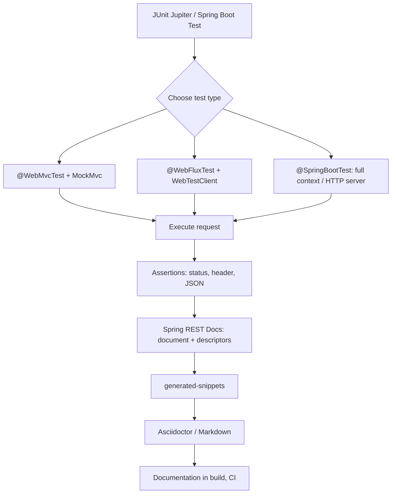

# Integrating Spring Boot Test with Spring REST Docs

## 1. Learning Objectives and Scope

In the **Spring Boot** chapter of the **Spring REST Docs (`SPRING_REST_DOCS`)** module, this lesson covers how to integrate REST API documentation generation into the same lifecycle as Spring Boot HTTP tests. Spring REST Docs produces small documentation fragments (*snippets*) from the requests and responses that tests actually send and receive; the development team then uses Asciidoctor or Markdown to assemble those snippets into publishable documentation.

The strength of this approach is that **documentation is bound to tests**: if an endpoint changes a JSON field, path/query parameter, or header and the test descriptions are not updated, the test can fail immediately in the build or CI. However, Spring REST Docs does not understand business semantics on its own; test authors must still assert the right behavior and write accurate descriptions.

After studying this lesson, you will be able to:

- Choose the right Spring Boot Test environment for MVC APIs, WebFlux APIs, and APIs running over real HTTP.
- Add the Spring REST Docs modules corresponding to `MockMvc`, `WebTestClient`, and REST Assured.
- Configure test slices or full application tests, inject HTTP clients, mock dependencies, and generate snippets.
- Document requests/responses, path/query parameters, request/response headers, and JSON payloads.
- Configure Gradle or Maven to build Asciidoctor/Markdown documentation from snippets and integrate checks into CI.
- Diagnose common errors: missing snippets, drifted documentation, missing beans, incorrect URI templates, or builds reusing stale snippets.

The complete Java examples below primarily target **Spring Boot 3.5, Spring REST Docs 3.x, Java 17+, and JUnit Jupiter**. Spring Boot 4.x restructures several test packages and modules; Section 3 explains how to migrate so you avoid copying incompatible imports.

## 2. Where Does Integration Fit in the Testing Lifecycle?

Spring Boot Test is responsible for initializing the application or a slice of it and providing a client to execute HTTP requests. Spring REST Docs attaches to this client, captures the executed request/response, and outputs snippets when the test invokes `document(...)`.



A documentation test has three related yet distinct responsibilities:

1. **Set up test data and environment:** instantiate the required controller/service, mock dependencies, or boot the full Spring Boot context.
2. **Assert HTTP behavior:** verify status codes, JSON payloads, headers, or returned errors; never treat snippet generation as the sole proof of correctness.
3. **Describe the API contract:** declare `pathParameters(...)`, `queryParameters(...)`, `requestFields(...)`, `responseFields(...)`, `requestHeaders(...)`, and `responseHeaders(...)` inside `document(...)`.

HTTP request/response blocks, cURL examples, and field tables are written to the snippets directory. The HTML or Markdown generation step reads these files, while CI re-runs tests to catch documentation that no longer matches the API.

### Choosing the Test Type

| Test Type | When to Use | Common Client | Characteristics |
| --- | --- | --- | --- |
| `@WebMvcTest(Controller.class)` | Testing the HTTP contract of a Spring MVC controller with mocked backing services. | `MockMvc` | Fast, initializes only the necessary MVC slice; does not test full database/infrastructure integration. |
| `@SpringBootTest` + `@AutoConfigureMockMvc` | Need filters, security, beans, and Spring MVC configuration of the full application without opening a real port. | `MockMvc` | Closer to production application configuration; initializes a larger context. |
| `@WebFluxTest(Controller.class)` | Testing a Spring WebFlux controller with mocked dependencies. | `WebTestClient` | Focused on the reactive web slice without opening a real HTTP port. |
| `@SpringBootTest(webEnvironment = RANDOM_PORT)` | Need to test HTTP over a real server, container networking, filters, or end-to-end serialization. | REST Assured, `WebTestClient`, or a suitable HTTP client | Slower and requires managing test data, random ports, and external dependencies. |

**Selection rule:** use test slices for many small endpoint contracts, then add a few full integration tests when risks lie in security, filters, converters, or runtime configuration. You do not need to start a real server just to generate snippets for every endpoint.

## 3. Setting Up Dependencies and Version Compatibility

### 3.1. Spring MVC + MockMvc with Gradle

In a Spring Boot 3.5 project with `spring-boot-starter-web` and the Spring Boot plugin, add the test dependencies:

```groovy
dependencies {
    implementation 'org.springframework.boot:spring-boot-starter-web'

    testImplementation 'org.springframework.boot:spring-boot-starter-test'
    testImplementation 'org.springframework.restdocs:spring-restdocs-mockmvc'
}

tasks.named('test') {
    useJUnitPlatform()
}
```

`spring-boot-starter-test` provides Spring Test, JUnit Jupiter, MockMvc, and Mockito in a Spring MVC environment; `spring-restdocs-mockmvc` provides the documentation recording integration. When using Spring Boot's dependency management/BOM, compatible versions are managed automatically, so you do not need to pin versions on individual artifacts.

With Maven, the corresponding core dependencies are:

```xml
<dependency>
    <groupId>org.springframework.boot</groupId>
    <artifactId>spring-boot-starter-test</artifactId>
    <scope>test</scope>
</dependency>
<dependency>
    <groupId>org.springframework.restdocs</groupId>
    <artifactId>spring-restdocs-mockmvc</artifactId>
    <scope>test</scope>
</dependency>
```

Other options:

| Client Used in Tests | Spring REST Docs Integration Library | Typical Spring Boot Test Configuration |
| --- | --- | --- |
| `MockMvc` | `spring-restdocs-mockmvc` | `@WebMvcTest` or `@SpringBootTest` + `@AutoConfigureMockMvc` |
| `WebTestClient` | `spring-restdocs-webtestclient` | `@WebFluxTest` or reactive `@SpringBootTest` |
| REST Assured | `spring-restdocs-restassured` | `@SpringBootTest(webEnvironment = RANDOM_PORT)` |

The libraries above represent **different integration mechanisms**. You do not need to add all three to a module just to document an API with one client.

### 3.2. `@AutoConfigureRestDocs` and Spring Boot 3.5/4.x

In Spring Boot 3.5, use:

```java
import org.springframework.boot.test.autoconfigure.restdocs.AutoConfigureRestDocs;
import org.springframework.boot.test.autoconfigure.web.servlet.WebMvcTest;
import org.springframework.boot.test.autoconfigure.web.servlet.AutoConfigureMockMvc;
```

Spring Boot 4.x reorganized test modules/packages; the equivalent imports become:

```java
import org.springframework.boot.restdocs.test.autoconfigure.AutoConfigureRestDocs;
import org.springframework.boot.webmvc.test.autoconfigure.WebMvcTest;
import org.springframework.boot.webmvc.test.autoconfigure.AutoConfigureMockMvc;
```

For WebFlux applications, Boot 3.5 places `WebFluxTest` in `org.springframework.boot.test.autoconfigure.web.reactive`; Boot 4.x moves it to `org.springframework.boot.webflux.test.autoconfigure`. When upgrading, cross-check the test documentation and dependencies for the **exact Spring Boot version** in use. The `@AutoConfigureRestDocs` examples in Sections 4–7 use Boot 3.5 imports.

The purpose of `@AutoConfigureRestDocs` is to integrate Spring REST Docs with the Boot-managed test client and allow configuring the snippets directory as well as the URI scheme/host/port in documentation. The annotation **does not create descriptors or HTML pages on its own**. Tests must still call `document(...)`, unless you explicitly configure a default result handler to record snippets for every request.

## 4. End-to-End Example: Spring MVC Controller and Two Documentation Tests

Suppose a book management API has two endpoints:

- `GET /api/books/{id}?view=full` — returns book information; documents path/query parameters, request headers, and JSON response.
- `POST /api/books` — accepts JSON and creates a book; documents request payload, response payload, and the `Location` header.

These two endpoints are sufficient to illustrate the key snippet groups in Spring REST Docs without needing a real database.

### 4.1. Sample Controller

Create `BookController.java` in the `com.example.books` package:

```java
package com.example.books;

import java.net.URI;
import org.springframework.http.ResponseEntity;
import org.springframework.web.bind.annotation.GetMapping;
import org.springframework.web.bind.annotation.PathVariable;
import org.springframework.web.bind.annotation.PostMapping;
import org.springframework.web.bind.annotation.RequestBody;
import org.springframework.web.bind.annotation.RequestMapping;
import org.springframework.web.bind.annotation.RequestParam;
import org.springframework.web.bind.annotation.RestController;

@RestController
@RequestMapping("/api/books")
public class BookController {
    private final BookService books;

    public BookController(BookService books) {
        this.books = books;
    }

    @GetMapping("/{id}")
    public BookResponse find(
            @PathVariable long id,
            @RequestParam(defaultValue = "full") String view) {
        return books.find(id, view);
    }

    @PostMapping
    public ResponseEntity<BookResponse> create(
            @RequestBody NewBookRequest request) {
        BookResponse result = books.create(request);
        return ResponseEntity.created(
            URI.create("/api/books/" + result.id())
        ).body(result);
    }

    public record NewBookRequest(String title, String author) {}
    public record BookResponse(long id, String title, String author) {}
}

interface BookService {
    BookController.BookResponse find(long id, String view);
    BookController.BookResponse create(BookController.NewBookRequest request);
}
```

In this example, `BookService` is just an interface so the test can mock it. In a real application, the service has its own implementation and may call repositories or other services.

### 4.2. GET Test with `@WebMvcTest` + `MockMvc`

```java
package com.example.books;

import org.junit.jupiter.api.Test;
import org.springframework.beans.factory.annotation.Autowired;
import org.springframework.boot.test.autoconfigure.restdocs.AutoConfigureRestDocs;
import org.springframework.boot.test.autoconfigure.web.servlet.WebMvcTest;
import org.springframework.http.HttpHeaders;
import org.springframework.http.MediaType;
import org.springframework.test.context.bean.override.mockito.MockitoBean;
import org.springframework.test.web.servlet.MockMvc;

import static org.mockito.BDDMockito.given;
import static org.springframework.restdocs.headers.HeaderDocumentation.headerWithName;
import static org.springframework.restdocs.headers.HeaderDocumentation.requestHeaders;
import static org.springframework.restdocs.mockmvc.MockMvcRestDocumentation.document;
import static org.springframework.restdocs.mockmvc.RestDocumentationRequestBuilders.get;
import static org.springframework.restdocs.payload.PayloadDocumentation.fieldWithPath;
import static org.springframework.restdocs.payload.PayloadDocumentation.responseFields;
import static org.springframework.restdocs.request.RequestDocumentation.parameterWithName;
import static org.springframework.restdocs.request.RequestDocumentation.pathParameters;
import static org.springframework.restdocs.request.RequestDocumentation.queryParameters;
import static org.springframework.test.web.servlet.result.MockMvcResultMatchers.jsonPath;
import static org.springframework.test.web.servlet.result.MockMvcResultMatchers.status;

@WebMvcTest(BookController.class)
@AutoConfigureRestDocs(outputDir = "build/generated-snippets")
class BookDocumentationTest {

    @Autowired
    MockMvc mockMvc;

    @MockitoBean
    BookService bookService;

    @Test
    void findBook() throws Exception {
        given(bookService.find(42L, "full"))
            .willReturn(new BookController.BookResponse(
                42L, "Clean Code", "Robert C. Martin"
            ));

        mockMvc.perform(
                get("/api/books/{id}", 42L)
                    .queryParam("view", "full")
                    .accept(MediaType.APPLICATION_JSON)
            )
            .andExpect(status().isOk())
            .andExpect(jsonPath("$.id").value(42))
            .andExpect(jsonPath("$.title").value("Clean Code"))
            .andDo(document("books-find",
                pathParameters(
                    parameterWithName("id")
                        .description("Book identifier")
                ),
                queryParameters(
                    parameterWithName("view")
                        .description("View mode; full is the default")
                ),
                requestHeaders(
                    headerWithName(HttpHeaders.ACCEPT)
                        .description("Response format accepted by the client")
                ),
                responseFields(
                    fieldWithPath("id").description("Book ID"),
                    fieldWithPath("title").description("Book title"),
                    fieldWithPath("author").description("Author")
                )
            ));
    }
}
```

Key explanations:

1. `@WebMvcTest(BookController.class)` creates only the MVC test slice. `@MockitoBean` replaces `BookService` with a mock, keeping responses deterministic and database-independent.
2. `@AutoConfigureRestDocs` attaches REST Docs to the Spring Boot-created `MockMvc`. `outputDir` specifies where snippets are written.
3. `RestDocumentationRequestBuilders.get(...)` preserves the `/api/books/{id}` URI template. This lets `pathParameters(...)` know where `id` appears; using standard HTTP builders that do not retain template metadata can cause errors when documenting path parameters.
4. `andExpect(...)` verifies actual HTTP values; `andDo(document(...))` generates snippets and validates the declared descriptors.
5. `responseFields(...)` is strict by default: an unexpected undocumented field or a missing required field causes the test to fail.

When the test succeeds, `build/generated-snippets/books-find/` contains snippets such as `http-request.adoc`, `http-response.adoc`, `curl-request.adoc`, `path-parameters.adoc`, `query-parameters.adoc`, `request-headers.adoc`, and `response-fields.adoc`.

### 4.3. POST Test to Document Request/Response Payloads and Headers

In the same `BookDocumentationTest`, add the following method along with the required static imports:

```java
import static org.springframework.restdocs.headers.HeaderDocumentation.responseHeaders;
import static org.springframework.restdocs.mockmvc.RestDocumentationRequestBuilders.post;
import static org.springframework.restdocs.payload.PayloadDocumentation.requestFields;
import static org.springframework.restdocs.operation.preprocess.Preprocessors.preprocessRequest;
import static org.springframework.restdocs.operation.preprocess.Preprocessors.preprocessResponse;
import static org.springframework.restdocs.operation.preprocess.Preprocessors.prettyPrint;
import static org.springframework.test.web.servlet.result.MockMvcResultMatchers.header;

@Test
void createBook() throws Exception {
    String payload = """
        {"title":"Clean Code","author":"Robert C. Martin"}
        """;

    given(bookService.create(
        new BookController.NewBookRequest(
            "Clean Code", "Robert C. Martin"
        )
    )).willReturn(new BookController.BookResponse(
        42L, "Clean Code", "Robert C. Martin"
    ));

    mockMvc.perform(
            post("/api/books")
                .contentType(MediaType.APPLICATION_JSON)
                .accept(MediaType.APPLICATION_JSON)
                .content(payload)
        )
        .andExpect(status().isCreated())
        .andExpect(header().string(HttpHeaders.LOCATION, "/api/books/42"))
        .andExpect(jsonPath("$.id").value(42))
        .andDo(document("books-create",
            preprocessRequest(prettyPrint()),
            preprocessResponse(prettyPrint()),
            requestFields(
                fieldWithPath("title").description("Book title"),
                fieldWithPath("author").description("Author")
            ),
            responseHeaders(
                headerWithName(HttpHeaders.LOCATION)
                    .description("URI of the newly created resource")
            ),
            responseFields(
                fieldWithPath("id").description("New book ID"),
                fieldWithPath("title").description("Book title"),
                fieldWithPath("author").description("Author")
            )
        ));
}
```

`requestFields(...)` validates the request body structure, while `responseFields(...)` validates the response body. `responseHeaders(...)` documents `Location` in the `201 Created` response. `preprocessRequest(prettyPrint())` and `preprocessResponse(prettyPrint())` make JSON in the documentation readable without altering the request data processed by the controller.

Use `optional()` only for truly optional fields; `ignored()` for fields that are present but should not be displayed; and `relaxedRequestFields(...)` or `relaxedResponseFields(...)` only when intentionally tolerating extra fields. Overusing `relaxed` mode defeats the ability to detect contract changes.

## 5. Full Application Test: `@SpringBootTest` + `@AutoConfigureMockMvc`

Slice tests in Section 4 enable fast iteration. When a request needs to traverse the full filter chain, security, or runtime configuration, you can switch to a full-application context test:

```java
import org.junit.jupiter.api.Test;
import org.springframework.beans.factory.annotation.Autowired;
import org.springframework.boot.test.autoconfigure.restdocs.AutoConfigureRestDocs;
import org.springframework.boot.test.autoconfigure.web.servlet.AutoConfigureMockMvc;
import org.springframework.boot.test.context.SpringBootTest;
import org.springframework.test.web.servlet.MockMvc;

import static org.springframework.restdocs.mockmvc.MockMvcRestDocumentation.document;
import static org.springframework.test.web.servlet.request.MockMvcRequestBuilders.get;
import static org.springframework.test.web.servlet.result.MockMvcResultMatchers.status;

@SpringBootTest
@AutoConfigureMockMvc
@AutoConfigureRestDocs
class ApplicationDocumentationTest {

    @Autowired
    MockMvc mockMvc;

    @Test
    void health() throws Exception {
        mockMvc.perform(get("/actuator/health"))
            .andExpect(status().isOk())
            .andDo(document("application-health"));
    }
}
```

This example **assumes the application has enabled the `/actuator/health` endpoint for tests**, includes the Actuator dependency, and has security rules permitting calls to that endpoint. Without those conditions, replace the request with an endpoint present in your application.

`@SpringBootTest` boots the full application context, while `@AutoConfigureMockMvc` creates a `MockMvc` client for in-process testing, usually without opening an HTTP port. `@AutoConfigureRestDocs` integrates the documentation recorder into this client.

When Spring Security is enabled, do not disable filters by default just to make tests pass. Configure an appropriate identity/mock authentication (for example, `spring-security-test` utilities) and document `401/403` responses if they are part of the API contract. Separate error, authorization, and success tests so snippets stay clear.

## 6. Integrating with Spring WebFlux and `WebTestClient`

Reactive applications use `spring-boot-starter-webflux` alongside `spring-restdocs-webtestclient`. With `@WebFluxTest` and `@AutoConfigureRestDocs`, Spring Boot provides a `WebTestClient` configured for Spring REST Docs to record snippets.

Suppose the application has a controller:

```java
import java.util.Map;
import org.springframework.web.bind.annotation.GetMapping;
import org.springframework.web.bind.annotation.RestController;
import reactor.core.publisher.Mono;

@RestController
class StatusController {
    @GetMapping("/api/status")
    Mono<Map<String, String>> status() {
        return Mono.just(Map.of("status", "UP"));
    }
}
```

Documentation test:

```java
import org.junit.jupiter.api.Test;
import org.springframework.beans.factory.annotation.Autowired;
import org.springframework.boot.test.autoconfigure.restdocs.AutoConfigureRestDocs;
import org.springframework.boot.test.autoconfigure.web.reactive.WebFluxTest;
import org.springframework.test.web.reactive.server.WebTestClient;

import static org.springframework.restdocs.payload.PayloadDocumentation.fieldWithPath;
import static org.springframework.restdocs.payload.PayloadDocumentation.responseFields;
import static org.springframework.restdocs.webtestclient.WebTestClientRestDocumentation.document;

@WebFluxTest(StatusController.class)
@AutoConfigureRestDocs
class StatusDocumentationTest {

    @Autowired
    WebTestClient client;

    @Test
    void status() {
        client.get().uri("/api/status")
            .exchange()
            .expectStatus().isOk()
            .expectBody()
            .jsonPath("$.status").isEqualTo("UP")
            .consumeWith(document("status-get",
                responseFields(
                    fieldWithPath("status")
                        .description("Current status of the service")
                )
            ));
    }
}
```

Difference compared to `MockMvc`: `WebTestClient` executes requests via the reactive `exchange()` API, performs assertions with `expectStatus()/expectBody()`, and writes snippets via `consumeWith(document(...))`. In WebFlux projects with reactive filters or complex security, you still need to ensure the test slice loads all required configuration under test.

## 7. REST Assured When a Real HTTP Server Is Needed

REST Assured is appropriate when you want to test the API over a real port, including network layers that `MockMvc` bypasses. Add:

```groovy
dependencies {
    testImplementation 'org.springframework.restdocs:spring-restdocs-restassured'
}
```

You can integrate directly with Spring REST Docs using `RestDocumentationExtension` and the `documentationConfiguration(...)` filter. This approach does not depend on whether a specific Spring Boot version auto-configures a REST Assured `RequestSpecification` bean.

The example below assumes the application exposes `GET /api/status` returning status `200`:

```java
import io.restassured.builder.RequestSpecBuilder;
import io.restassured.specification.RequestSpecification;
import org.junit.jupiter.api.BeforeEach;
import org.junit.jupiter.api.Test;
import org.junit.jupiter.api.extension.ExtendWith;
import org.springframework.boot.test.context.SpringBootTest;
import org.springframework.boot.test.web.server.LocalServerPort;
import org.springframework.restdocs.RestDocumentationContextProvider;
import org.springframework.restdocs.junit.jupiter.RestDocumentationExtension;

import static io.restassured.RestAssured.given;
import static org.hamcrest.Matchers.equalTo;
import static org.springframework.restdocs.restassured.RestAssuredRestDocumentation.document;
import static org.springframework.restdocs.restassured.RestAssuredRestDocumentation.documentationConfiguration;

@SpringBootTest(webEnvironment = SpringBootTest.WebEnvironment.RANDOM_PORT)
@ExtendWith(RestDocumentationExtension.class)
class StatusHttpDocumentationTest {

    @LocalServerPort
    int port;

    RequestSpecification specification;

    @BeforeEach
    void setUp(RestDocumentationContextProvider documentation) {
        this.specification = new RequestSpecBuilder()
            .addFilter(documentationConfiguration(documentation))
            .build();
    }

    @Test
    void statusOverHttp() {
        given(this.specification)
            .port(port)
            .filter(document("status-over-http"))
        .when()
            .get("/api/status")
        .then()
            .statusCode(200)
            .body("status", equalTo("UP"));
    }
}
```

In the example, `@SpringBootTest(RANDOM_PORT)` starts a real server; `@LocalServerPort` receives the assigned port to avoid conflicts on build machines; `RequestSpecBuilder` attaches the documentation recording filter. Because real HTTP is used, the test needs predictable data and must not implicitly depend on external environment state.

**Version note:** Spring Boot 3.5 supports REST Assured within the Spring REST Docs auto-configuration ecosystem. When upgrading to Spring Boot 4.x, check the specific auto-configuration guide; the explicit filter setup shown above works directly.

## 8. Configuring Snippets and Building Documentation Pages

### 8.1. Paths, URIs, and Naming Conventions

With Gradle, Spring REST Docs normally writes snippets to `build/generated-snippets`; with Maven, `target/generated-snippets`. You can specify the target directly on the annotation:

```java
@AutoConfigureRestDocs(
    outputDir = "build/generated-snippets",
    uriScheme = "https",
    uriHost = "api.example.com",
    uriPort = 443
)
```

The `uriScheme`, `uriHost`, and `uriPort` attributes control how URIs are rendered in snippets, for example so `curl-request.adoc` shows a public host. They **do not change the endpoint the test actually calls**, do not enable TLS, and do not redirect the client to an external server.

Name `document("books-find")` IDs after the endpoint/behavior rather than arbitrary test names. For parameterized tests, avoid having multiple tests write to the same directory unless sharing output is intentional. Do not commit old snippets as the source of truth if CI can regenerate them from tests.

### 8.2. Compiling Asciidoctor with Gradle

Apply the `org.asciidoctor.jvm.convert` plugin compatible with your build version and add the following configuration to `build.gradle`:

```groovy
configurations {
    asciidoctorExt
}

dependencies {
    asciidoctorExt 'org.springframework.restdocs:spring-restdocs-asciidoctor'
}

ext {
    snippetsDir = file('build/generated-snippets')
}

tasks.named('test') {
    outputs.dir snippetsDir
}

tasks.named('asciidoctor') {
    configurations 'asciidoctorExt'
    inputs.dir snippetsDir
    dependsOn tasks.named('test')
}
```

`spring-restdocs-asciidoctor` enables Asciidoctor to recognize snippets and render field/parameter/header tables when included. Keep `snippetsDir` synchronized with the `outputDir` configured in tests; changing one while forgetting the other will prevent Asciidoctor from finding snippets.

Create `src/docs/asciidoc/index.adoc`:

```asciidoc
= Books API
:toc: left

== Get Book Details

=== HTTP request
include::{snippets}/books-find/http-request.adoc[]

=== Path and query parameters
include::{snippets}/books-find/path-parameters.adoc[]
include::{snippets}/books-find/query-parameters.adoc[]

=== Headers
include::{snippets}/books-find/request-headers.adoc[]

=== HTTP response
include::{snippets}/books-find/http-response.adoc[]
include::{snippets}/books-find/response-fields.adoc[]

== Create Book

=== HTTP request
include::{snippets}/books-create/http-request.adoc[]
include::{snippets}/books-create/request-fields.adoc[]

=== HTTP response
include::{snippets}/books-create/http-response.adoc[]
include::{snippets}/books-create/response-headers.adoc[]
include::{snippets}/books-create/response-fields.adoc[]
```

Run `./gradlew clean test asciidoctor`. `test` generates snippets; `asciidoctor` combines them into HTML. Running `clean` when verifying the pipeline prevents documentation from accidentally reusing leftover snippets from a previous build. In CI with build caching enabled, declare inputs/outputs accurately so Gradle knows when tasks must re-run.

### 8.3. With Maven or Markdown

In Maven, tie the test phase (Surefire/Failsafe depending on test tiering) to the `asciidoctor-maven-plugin`, using `target/generated-snippets` as the source directory for Asciidoctor. Configure the plugin execution phase to run **after** the tests that generate snippets, and package/publish the HTML as a CI artifact.

If your product requires Markdown instead of AsciiDoc, Spring REST Docs lets you switch snippet templates using `TemplateFormats.markdown()` via the test integration's customizer, then combine the `.md` files in your pipeline. The `include::{snippets}/...adoc[]` directives above belong to Asciidoctor, so you cannot pass them directly to a standard Markdown processor and expect them to resolve.

## 9. Test Data, Stability, and Documentation Security

Documentation tests must be **reproducible** both locally and in CI:

- **Do not depend on random IDs or current timestamps** in snippets without stabilizing the data; use stubs/mocks or known seed data.
- **Do not leak secrets into snippets**: `Authorization` values, cookies, tokens, API keys, and personal data must be masked or removed from displayed requests/responses. You can use `OperationPreprocessor` utilities such as `modifyHeaders()` or `modifyParameters()` when needed, while keeping assertions verifying actual business logic.
- **Do not bypass authentication just to get a 200 status**: when an endpoint requires permissions, set up a valid security context and also test denied scenarios appropriately.
- **Do not let documentation generation run before tests**: HTML pages could be built from stale snippets even when current tests have failed.
- **Do not choose full context for every case**: leverage `@WebMvcTest`/`@WebFluxTest` when only contract testing is needed; run full integration tests when verifying system-wide configuration.

In addition to happy paths, add tests for `400 Bad Request` (validation), `401 Unauthorized`/`403 Forbidden` (security), `404 Not Found`, and business error cases if they are part of the public API contract. They can use distinct documentation IDs such as `books-find-not-found` so readers can distinguish successful requests from error responses.

## 10. Common Issues

| Symptom | Possible Cause | Resolution |
| --- | --- | --- |
| No `generated-snippets` | `document(...)` not called, tests did not run, or missing corresponding REST Docs module. | Check test reports, dependencies, `andDo(...)`/`consumeWith(...)`, and `outputDir`. |
| `MockMvc` cannot be injected | Using `@SpringBootTest` without `@AutoConfigureMockMvc`, or not running in an MVC test context. | Add the appropriate annotation and avoid manually creating a client missing configuration. |
| `@WebMvcTest` reports missing service bean | Slice does not load regular services. | Use `@MockitoBean` or import the bean under test; consider full context if needed. |
| Documentation test reports missing path parameter | Request builder does not preserve URI template. | Use `RestDocumentationRequestBuilders.get("/.../{id}", id)`. |
| Test reports undocumented field | `responseFields(...)` or `requestFields(...)` is missing a descriptor, or the API changed. | Inspect the actual JSON, add/update descriptors, or adjust the API. |
| Asciidoctor reports missing `.adoc` file | Test did not generate the snippet, `document(...)` ID is wrong, or the build points to the wrong directory. | Verify the actual directory and `dependsOn test` wiring. |
| URI in cURL is `localhost:8080` | Using the REST Docs defaults. | Set `uriScheme`, `uriHost`, and `uriPort` to the URI you want to display. |
| After upgrading Boot, REST Docs test imports fail | Spring Boot 4 relocated test packages/modules. | Update imports and dependencies per the documentation for the exact major version. |
| Secured endpoint unexpectedly returns `401/403` | Test did not create an appropriate principal or token. | Configure test authentication and verify security filters. |
| REST Assured hardcoded port causes CI conflicts | Multiple tests run in parallel or port is already bound. | Use `RANDOM_PORT` and obtain the port via `@LocalServerPort`. |

## 11. Practice Exercise

From the `BookController` example, implement `GET /api/books?author=...` and `DELETE /api/books/{id}`. Build two layers of documentation tests: use `@WebMvcTest` to describe the endpoints with a mocked service, and use at least one `@SpringBootTest` to verify application filters/security.

Proceed in order:

1. Add a `GET /api/books?author=...` test documenting `queryParameters(...)` and the returned book list structure with `responseFields(...)`.
2. Add a `DELETE` test asserting `204 No Content`, documenting the path parameter, and verifying an empty response body.
3. Intentionally change a JSON field in the controller while keeping the old descriptor, and observe the documentation test fail.
4. Update the descriptor, run `./gradlew clean test asciidoctor`, open the HTML, and verify the new sections.
5. Add a CI job that runs tests and generates documentation, publishing the HTML only when all steps succeed.

**Completion criteria:** every endpoint has HTTP tests and stable snippets; request/response, parameter, payload, and header documentation are generated from tests; un-updated contract changes are caught by CI; no real sensitive data appears in snippets.

## 12. References

- [Spring Boot — Testing Spring Boot Applications](https://docs.spring.io/spring-boot/reference/testing/spring-boot-applications.html)
- [Spring Boot 3.5 — Spring REST Docs auto-configuration](https://docs.spring.io/spring-boot/3.5/reference/testing/spring-boot-applications.html)
- [Spring REST Docs — Reference](https://docs.spring.io/spring-restdocs/reference/)
- [Spring REST Docs — Getting Started](https://docs.spring.io/spring-restdocs/tutorial/getting-started/index.html)
- [Spring REST Docs — Documenting Your API](https://docs.spring.io/spring-restdocs/reference/documenting-your-api/index.html)
- [Spring REST Docs — Customizing Requests and Responses](https://docs.spring.io/spring-restdocs/reference/customizing-requests-and-responses.html)
