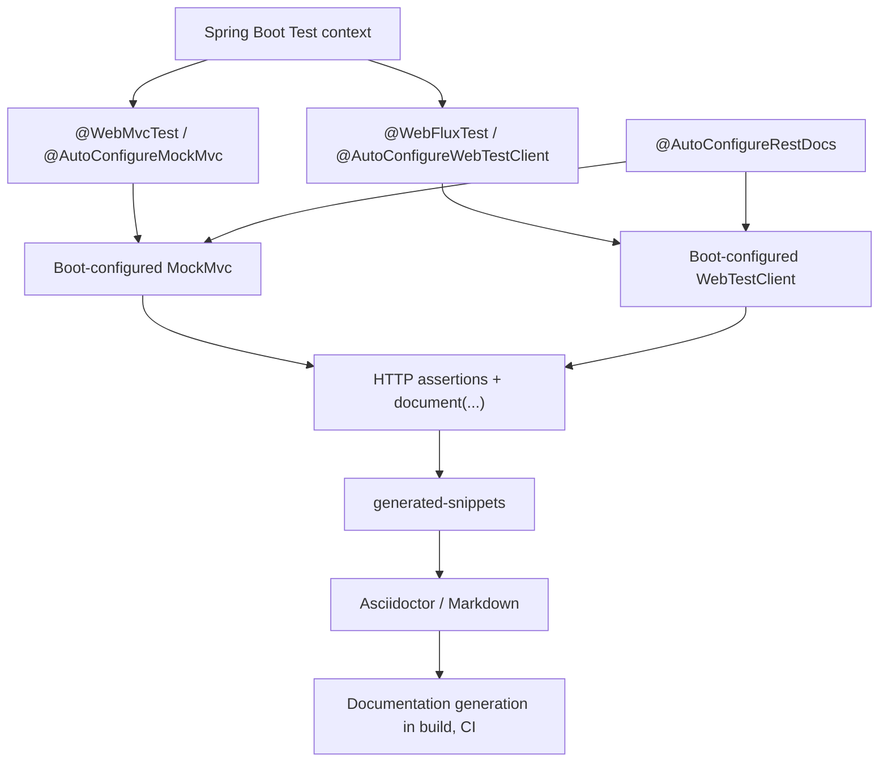

# Configuring Boot-Provided MockMvc or WebTestClient

## 1. Context and Objectives

In the **Spring Boot** chapter of the **Spring REST Docs (`SPRING_REST_DOCS`)** module, we use HTTP tests to produce verifiable REST API documentation. Instead of building a fresh HTTP client in every test, Spring Boot Test can **provide a `MockMvc` or `WebTestClient` already integrated with Spring REST Docs**. As a result, testing status codes, headers, bodies, and path/query parameters and generating snippets happen in a single execution flow.

This lesson focuses on the question: *when should you use a Spring Boot-provided client and where should you configure it?* The content applies to writing request/response/payload snippets, assembling Asciidoctor/Markdown documentation, and integrating documentation into builds or CI. Java examples use **Spring Boot 3.5, Spring REST Docs 3.x, JUnit Jupiter, and Java 17+**; a dedicated section explains differences in Boot 4.x.

After this lesson, you will be able to:

- Choose `@WebMvcTest`/`@AutoConfigureMockMvc` or `@WebFluxTest`/`@AutoConfigureWebTestClient` appropriate for the application type.
- Understand how `@AutoConfigureRestDocs` affects the client configured by Spring Boot.
- Distinguish between customizing URIs/snippet output directories and deeper customization via `RestDocsMockMvcConfigurationCustomizer` and `RestDocsWebTestClientConfigurationCustomizer`.
- Establish common snippet-handling rules across multiple tests while keeping contract-verifying descriptors.
- Avoid common pitfalls when manually constructing `MockMvc`/`WebTestClient` (which loses REST Docs filters) or migrating between Spring Boot 3.x and 4.x.

## 2. Distinguishing the HTTP Client, Spring Boot Configuration, and REST Docs Configuration

`MockMvc` simulates the Spring MVC request/response lifecycle inside the application without opening a server port. `WebTestClient` is a reactive-oriented HTTP testing API: it can bind to a WebFlux application in memory or connect to a running server.

Spring Boot typically prepares the client based on the test type. `@AutoConfigureRestDocs` **adds the documentation recorder to the Boot-managed client**; this annotation does not replace client creation, does not create endpoints, and does not automatically infer which fields to describe.



### Test Client Configuration Matrix

| Test Target | Annotations Initializing Context/Client | Client Injected via `@Autowired` | Real Server Needed? |
| --- | --- | --- | --- |
| Individual Spring MVC controller | `@WebMvcTest(MyController.class)` + `@AutoConfigureRestDocs` | `MockMvc` | No |
| Full Spring MVC application | `@SpringBootTest` + `@AutoConfigureMockMvc` + `@AutoConfigureRestDocs` | `MockMvc` | No |
| Individual Spring WebFlux controller | `@WebFluxTest(MyController.class)` + `@AutoConfigureRestDocs` | `WebTestClient` | No |
| Full Spring WebFlux application, mock web | `@SpringBootTest` + `@AutoConfigureWebTestClient` + `@AutoConfigureRestDocs` | `WebTestClient` | No |
| Application over real HTTP | `@SpringBootTest(webEnvironment = RANDOM_PORT)`, suitably configured client, and REST Docs | `WebTestClient` or REST Assured | Yes |

The annotations above illustrate typical usage. `@WebMvcTest` loads only the MVC slice, while `@WebFluxTest` loads only the WebFlux slice. If a controller needs services, repositories, or configurations outside the slice, use mocks/test configuration or switch to a full-context test. Note that `@SpringBootTest` alone does not guarantee `MockMvc` is available: to inject it, add `@AutoConfigureMockMvc`.

> **Important boundary:** using the client injected by Spring Boot leverages the customizers applied by Boot. If you call `MockMvcBuilders.standaloneSetup(...)` or `WebTestClient.bindToController(...)` manually, that new instance does not automatically inherit the REST Docs integration applied to the Boot-created client.

## 3. Preparing Dependencies by Application Type

For a Spring MVC application using Gradle (Groovy DSL) and Spring Boot 3.5:

```groovy
dependencies {
    implementation 'org.springframework.boot:spring-boot-starter-web'
    testImplementation 'org.springframework.boot:spring-boot-starter-test'
    testImplementation 'org.springframework.restdocs:spring-restdocs-mockmvc'
}

tasks.named('test') {
    useJUnitPlatform()
}
```

For a reactive WebFlux application, replace `spring-boot-starter-web` with `spring-boot-starter-webflux` and `spring-restdocs-mockmvc` with `spring-restdocs-webtestclient`. Use Spring Boot's dependency management or BOM to keep test libraries compatible.

| Client Type | Spring REST Docs Dependency | API Call to Generate Documentation |
| --- | --- | --- |
| `MockMvc` | `org.springframework.restdocs:spring-restdocs-mockmvc` | `.andDo(document("id", ...))` |
| `WebTestClient` | `org.springframework.restdocs:spring-restdocs-webtestclient` | `.expectBody().consumeWith(document("id", ...))` |
| REST Assured (for comparison) | `org.springframework.restdocs:spring-restdocs-restassured` | `given(...).filter(document("id", ...))` |

REST Assured sends requests over real HTTP; it does not use `MockMvc` or `WebTestClient` as the client. This lesson focuses on the first two clients and Spring Boot's configuration path.

## 4. Basic Configuration with `@AutoConfigureRestDocs`

`@AutoConfigureRestDocs` sets up Spring REST Docs integration on the Boot-configured client. It supports several options directly on the test class:

```java
@AutoConfigureRestDocs(
    outputDir = "build/generated-snippets",
    uriScheme = "https",
    uriHost = "api.example.com",
    uriPort = 443
)
```

| Attribute | Purpose | Default Value |
| --- | --- | --- |
| `outputDir` | Directory where snippets from tests are saved. | For Gradle typically `build/generated-snippets`; for Maven, `target/generated-snippets`. |
| `value` | Short alias for `outputDir`. | Empty string; Boot chooses the default path. |
| `uriScheme` | Scheme displayed in documented URIs. | `http` |
| `uriHost` | Host displayed in snippets. | `localhost` |
| `uriPort` | Port displayed in snippets. | `8080` |

Setting `uriScheme="https"` and `uriPort=443` renders URIs such as `https://api.example.com/api/items` in snippets; it does **not** make tests connect to that host, enable TLS, or change the application's actual port. For default scheme ports (80 for HTTP, 443 for HTTPS), REST Docs may omit `:port` when rendering the URL.

Annotation attributes map to the `spring.test.restdocs` property group in Spring Boot's test configuration mechanism. When using Asciidoctor, keep `outputDir` aligned with the directory used by the documentation build task.

### When Is the Client Configured?

1. JUnit starts the test and Spring Test builds the `ApplicationContext` according to annotations like `@WebMvcTest` or `@WebFluxTest`.
2. Spring Boot creates `MockMvc`/`WebTestClient` and applies the corresponding test configuration.
3. `@AutoConfigureRestDocs` loads REST Docs support and applies `documentationConfiguration(...)` to Boot's client. With this setup, you normally do not need to add `RestDocumentationExtension` to the test class.
4. The test injects the client, sends requests, and verifies responses.
5. Calling `document(...)` writes snippets for the verified request/response.

Spring REST Docs **does not automatically generate descriptions for every request just because the annotation is present**. To produce contract-specific snippets, call `document(...)`, or register a default recording handler for every interaction as shown in Section 7.

## 5. Example Using Boot-Provided MockMvc

Suppose a Spring MVC application exposes `GET /api/catalog/{id}`. In package `com.example.catalog`, a minimal controller:

```java
package com.example.catalog;

import org.springframework.web.bind.annotation.GetMapping;
import org.springframework.web.bind.annotation.PathVariable;
import org.springframework.web.bind.annotation.RequestMapping;
import org.springframework.web.bind.annotation.RestController;

@RestController
@RequestMapping("/api/catalog")
class CatalogController {

    @GetMapping("/{id}")
    ItemResponse find(@PathVariable long id) {
        return new ItemResponse(id, "Mechanical keyboard");
    }

    record ItemResponse(long id, String name) {}
}
```

A `@WebMvcTest` using the `MockMvc` already registered in the context:

```java
package com.example.catalog;

import org.junit.jupiter.api.Test;
import org.springframework.beans.factory.annotation.Autowired;
import org.springframework.boot.test.autoconfigure.restdocs.AutoConfigureRestDocs;
import org.springframework.boot.test.autoconfigure.web.servlet.WebMvcTest;
import org.springframework.http.HttpHeaders;
import org.springframework.http.MediaType;
import org.springframework.test.web.servlet.MockMvc;

import static org.springframework.restdocs.headers.HeaderDocumentation.headerWithName;
import static org.springframework.restdocs.headers.HeaderDocumentation.requestHeaders;
import static org.springframework.restdocs.mockmvc.MockMvcRestDocumentation.document;
import static org.springframework.restdocs.mockmvc.RestDocumentationRequestBuilders.get;
import static org.springframework.restdocs.payload.PayloadDocumentation.fieldWithPath;
import static org.springframework.restdocs.payload.PayloadDocumentation.responseFields;
import static org.springframework.restdocs.request.RequestDocumentation.parameterWithName;
import static org.springframework.restdocs.request.RequestDocumentation.pathParameters;
import static org.springframework.test.web.servlet.result.MockMvcResultMatchers.jsonPath;
import static org.springframework.test.web.servlet.result.MockMvcResultMatchers.status;

@WebMvcTest(CatalogController.class)
@AutoConfigureRestDocs(
    uriScheme = "https",
    uriHost = "api.example.com",
    uriPort = 443
)
class CatalogDocumentationTest {

    @Autowired
    MockMvc mockMvc;

    @Test
    void find() throws Exception {
        mockMvc.perform(
                get("/api/catalog/{id}", 7)
                    .accept(MediaType.APPLICATION_JSON)
            )
            .andExpect(status().isOk())
            .andExpect(jsonPath("$.id").value(7))
            .andExpect(jsonPath("$.name").value("Mechanical keyboard"))
            .andDo(document("catalog-find",
                pathParameters(
                    parameterWithName("id")
                        .description("Item identifier")
                ),
                requestHeaders(
                    headerWithName(HttpHeaders.ACCEPT)
                        .description("Desired response format")
                ),
                responseFields(
                    fieldWithPath("id").description("Item ID"),
                    fieldWithPath("name").description("Item name")
                )
            ));
    }
}
```

The test above uses the `MockMvc` injected by Boot. `RestDocumentationRequestBuilders.get(...)` retains the URI template so `pathParameters(...)` knows `id` is a path parameter. `andExpect(...)` calls verify the response, while `andDo(document(...))` generates documentation and validates the descriptors.

With Gradle, after the test passes, files in `build/generated-snippets/catalog-find/` may include:

```text
catalog-find/
  curl-request.adoc
  http-request.adoc
  http-response.adoc
  httpie-request.adoc
  request-body.adoc
  response-body.adoc
  path-parameters.adoc
  request-headers.adoc
  response-fields.adoc
```

The six default snippets (`curl-request`, `http-request`, `http-response`, `httpie-request`, `request-body`, `response-body`) are generated by default; `path-parameters`, `request-headers`, and `response-fields` appear when the test declares the corresponding descriptor sets. If the JSON response adds an undocumented field, `responseFields(...)` in strict mode detects the discrepancy and fails the test.

### When a Full Application Context Is Needed

For filters, Spring Security, or converters configured at the application level, use:

```java
@SpringBootTest
@AutoConfigureMockMvc
@AutoConfigureRestDocs
class FullCatalogDocumentationTest {
    @Autowired
    MockMvc mockMvc;
    // Write perform/andExpect/andDo tests as in the example above.
}
```

`@SpringBootTest` loads more beans than `@WebMvcTest`, so tests are typically slower, but they can verify the real components used at runtime. If security is enabled, requests may require an appropriate mock user/token; `@AutoConfigureRestDocs` does not bypass authentication filters.

## 6. Customizing REST Docs for `MockMvc` with Boot Beans

When `@AutoConfigureRestDocs` attributes are not enough, Spring Boot provides the `RestDocsMockMvcConfigurationCustomizer` interface. A bean implementing this interface is invoked **before the REST Docs configuration is attached to `MockMvc`**, allowing you to standardize encoding, templates, default snippets, or preprocessors across multiple tests.

Example test-only configuration class:

```java
package com.example.catalog;

import org.springframework.boot.test.autoconfigure.restdocs.RestDocsMockMvcConfigurationCustomizer;
import org.springframework.boot.test.context.TestConfiguration;
import org.springframework.http.HttpHeaders;
import org.springframework.restdocs.mockmvc.MockMvcRestDocumentationConfigurer;

import static org.springframework.restdocs.operation.preprocess.Preprocessors.modifyHeaders;
import static org.springframework.restdocs.operation.preprocess.Preprocessors.prettyPrint;

@TestConfiguration(proxyBeanMethods = false)
class CatalogRestDocsConfiguration
        implements RestDocsMockMvcConfigurationCustomizer {

    @Override
    public void customize(MockMvcRestDocumentationConfigurer configurer) {
        configurer.snippets().withEncoding("UTF-8");
        configurer.operationPreprocessors()
            .withRequestDefaults(
                modifyHeaders().remove(HttpHeaders.AUTHORIZATION)
            )
            .withResponseDefaults(prettyPrint());
    }
}
```

Import it into the test class:

```java
import org.springframework.context.annotation.Import;

@WebMvcTest(CatalogController.class)
@AutoConfigureRestDocs
@Import(CatalogRestDocsConfiguration.class)
class CatalogDocumentationTest {
    // ...
}
```

Meaning of these customizations:

- `withEncoding("UTF-8")` sets the snippet encoding.
- `modifyHeaders().remove(HttpHeaders.AUTHORIZATION)` strips the Authorization header from the request **recorded in documentation**, preventing token leakage in snippets; it does not disable authentication or alter the request processed by the controller.
- `withResponseDefaults(prettyPrint())` formats formattable response bodies (such as JSON) for better readability.

To use Markdown templates instead of AsciiDoc, replace the snippet configuration with:

```java
import org.springframework.restdocs.templates.TemplateFormats;

// Inside customize(...):
configurer.snippets()
    .withEncoding("UTF-8")
    .withTemplateFormat(TemplateFormats.markdown());
```

After changing the format, the build must pull the corresponding `.md` files; Asciidoctor `include::{snippets}/...adoc[]` directives will no longer match. Choose one consistent format for both tests and the documentation publishing pipeline.

**Bean scope note:** `@TestConfiguration` outside a test class is not loaded automatically like normal application configuration; use `@Import(...)` so slice tests or full-context tests pick up the customizer. This ensures snippet customizations affect only the intended group of documentation tests.

## 7. Recording Default Snippets for Every `MockMvc` Operation

In Section 5, each test explicitly called `andDo(document(...))`. When you want every `mockMvc.perform(...)` operation to emit the six basic snippets, you can declare a `RestDocumentationResultHandler` bean:

```java
import org.springframework.boot.test.context.TestConfiguration;
import org.springframework.context.annotation.Bean;
import org.springframework.restdocs.mockmvc.RestDocumentationResultHandler;

import static org.springframework.restdocs.mockmvc.MockMvcRestDocumentation.document;

@TestConfiguration(proxyBeanMethods = false)
class AutomaticMvcSnippetConfiguration {

    @Bean
    RestDocumentationResultHandler automaticDocumentation() {
        return document("{class-name}/{method-name}");
    }
}
```

When this configuration is imported into a context with `@AutoConfigureRestDocs`, Spring Boot uses `MockMvc`'s `alwaysDo(...)` to register the handler. For example, `find()` in `CatalogDocumentationTest` generates snippets in a directory named after the test class and method even without an explicit `andDo(...)` call.

This mechanism is helpful when you want to capture requests/responses for all tests in a group. However:

- It only records **default snippets**; it does not infer `pathParameters`, `responseFields`, or business semantics.
- Tests still need clear assertions and descriptors for published APIs. You can also add `andDo(document("catalog-find", ...))` for detailed documentation, though a single request may then write two sets of snippets to two directories.
- The `{class-name}/{method-name}` naming pattern works for ordinary tests; parameterized tests or multiple writes within one method need conventions to avoid overwriting the same output location.

For tests documenting a public API contract, **explicitly calling `document("endpoint-id", descriptors...)`** is usually easier to manage when mapping one endpoint to one section of documentation.

## 8. Boot-Provided WebTestClient: Configuration and Snippet Generation

Separate WebFlux example using the `com.example.status` package to avoid mixing MVC and reactive applications. Controller:

```java
package com.example.status;

import java.util.Map;
import org.springframework.web.bind.annotation.GetMapping;
import org.springframework.web.bind.annotation.RestController;
import reactor.core.publisher.Mono;

@RestController
class StatusController {

    @GetMapping("/api/status")
    Mono<Map<String, String>> status() {
        return Mono.just(Map.of("status", "UP"));
    }
}
```

Test using Boot-injected `WebTestClient`:

```java
package com.example.status;

import org.junit.jupiter.api.Test;
import org.springframework.beans.factory.annotation.Autowired;
import org.springframework.boot.test.autoconfigure.restdocs.AutoConfigureRestDocs;
import org.springframework.boot.test.autoconfigure.web.reactive.WebFluxTest;
import org.springframework.http.MediaType;
import org.springframework.test.web.reactive.server.WebTestClient;

import static org.springframework.restdocs.payload.PayloadDocumentation.fieldWithPath;
import static org.springframework.restdocs.payload.PayloadDocumentation.responseFields;
import static org.springframework.restdocs.webtestclient.WebTestClientRestDocumentation.document;

@WebFluxTest(StatusController.class)
@AutoConfigureRestDocs
class StatusDocumentationTest {

    @Autowired
    WebTestClient client;

    @Test
    void status() {
        client.get().uri("/api/status")
            .accept(MediaType.APPLICATION_JSON)
            .exchange()
            .expectStatus().isOk()
            .expectBody()
            .jsonPath("$.status").isEqualTo("UP")
            .consumeWith(document("status-get",
                responseFields(
                    fieldWithPath("status")
                        .description("Current status of the service")
                )
            ));
    }
}
```

`MockMvc` ends with `.andDo(document(...))`, whereas `WebTestClient` uses `.consumeWith(document(...))` on the body result. In both cases, assertions must verify behavior before or alongside snippet generation.

### Customizing REST Docs for `WebTestClient`

For shared settings such as encoding, templates, or preprocessors, use `RestDocsWebTestClientConfigurationCustomizer`:

```java
package com.example.status;

import org.springframework.boot.test.autoconfigure.restdocs.RestDocsWebTestClientConfigurationCustomizer;
import org.springframework.boot.test.context.TestConfiguration;
import org.springframework.restdocs.webtestclient.WebTestClientRestDocumentationConfigurer;

import static org.springframework.restdocs.operation.preprocess.Preprocessors.prettyPrint;

@TestConfiguration(proxyBeanMethods = false)
class StatusRestDocsConfiguration
        implements RestDocsWebTestClientConfigurationCustomizer {

    @Override
    public void customize(WebTestClientRestDocumentationConfigurer configurer) {
        configurer.snippets().withEncoding("UTF-8");
        configurer.operationPreprocessors()
            .withResponseDefaults(prettyPrint());
    }
}
```

And import the configuration class into the test:

```java
import org.springframework.context.annotation.Import;

@WebFluxTest(StatusController.class)
@AutoConfigureRestDocs
@Import(StatusRestDocsConfiguration.class)
class StatusDocumentationTest {
    // ...
}
```

This customizer targets **the Spring REST Docs configurer**. If you need to modify the client builder itself (for example, configuring timeouts, base URLs for a suitable client, or default consumers), Spring Boot also provides `WebTestClientBuilderCustomizer`. These two interfaces serve two different configuration layers.

### Recording Snippets on Every `WebTestClient` Exchange

Spring Boot can apply a `WebTestClientBuilderCustomizer` bean to attach a consumer after every exchange result:

```java
import org.springframework.boot.test.context.TestConfiguration;
import org.springframework.boot.test.web.reactive.server.WebTestClientBuilderCustomizer;
import org.springframework.context.annotation.Bean;

import static org.springframework.restdocs.webtestclient.WebTestClientRestDocumentation.document;

@TestConfiguration(proxyBeanMethods = false)
class AutomaticWebTestClientSnippetConfiguration {

    @Bean
    WebTestClientBuilderCustomizer automaticDocumentation() {
        return builder -> builder.entityExchangeResultConsumer(
            document("{class-name}/{method-name}")
        );
    }
}
```

Import this bean into a test with `@AutoConfigureRestDocs` to receive default snippets for exchanges executed by the Boot-built client. Similar to `alwaysDo(...)` in MockMvc, this approach **does not automatically generate descriptors verifying request/response fields**. When documenting specific APIs, still write `consumeWith(document("status-get", responseFields(...)))` with intentional IDs.

### WebTestClient Bound to a Real Server

With `@SpringBootTest(webEnvironment = RANDOM_PORT)`, `WebTestClient` can send HTTP requests to the application's local port instead of invoking controllers in memory. In this setup, verify that the client is properly configured by Boot, `spring-webflux` is on the classpath, and the REST Docs recording mechanism is applied. Especially important distinctions:

- A client **bound to the application context** is suitable when testing handlers/controllers without opening a port.
- A client **bound to a running server** is suitable when verifying the HTTP network stack; the scheme/host/port values appearing in documentation must be handled so you do not accidentally publish `localhost` and a random port.
- For requests to a real server, `OperationPreprocessor` utilities like `modifyUris()` can change the address displayed in snippets without changing the address the client actually accessed.

## 9. When Should You Create the Client Manually?

Boot auto-configuring the client is convenient when using Spring Boot Test annotations. However, some projects construct `MockMvc` or `WebTestClient` directly to customize test components:

```java
// Manually built MockMvc:
MockMvc manualMvc = MockMvcBuilders.standaloneSetup(controller).build();

// Manually built WebTestClient:
WebTestClient manualClient = WebTestClient.bindToController(controller).build();
```

**Neither instance in the example is configured with Spring REST Docs.** `@AutoConfigureRestDocs` only customizes the client created and managed by Spring Boot; it does not inspect and modify every client created manually in tests.

When you need custom client setup, there are two options:

1. Prefer adjusting the test design to use Boot-created `@Autowired MockMvc` or `@Autowired WebTestClient`, then apply customizers/beans as needed.
2. If you must build the client manually, configure Spring REST Docs explicitly:
   - `MockMvcBuilders...apply(MockMvcRestDocumentation.documentationConfiguration(restDocumentation))`.
   - `WebTestClient.bindTo...configureClient().filter(WebTestClientRestDocumentation.documentationConfiguration(restDocumentation)).build()`.

With standard manual configuration, `restDocumentation` is the `RestDocumentationContextProvider` supplied to JUnit Jupiter by `RestDocumentationExtension`. When mixing with `@AutoConfigureRestDocs`, be explicit about which client receives which configuration so snippets are not written twice or to colliding paths.

## 10. Connecting Snippets to Documentation and CI

After tests pass, Spring REST Docs writes default AsciiDoc snippets to `build/generated-snippets` or `target/generated-snippets`. An Asciidoctor source file can include those sections:

```asciidoc
= Catalog API
:toc: left

== Get Item

=== HTTP request
include::{snippets}/catalog-find/http-request.adoc[]

=== Path parameters
include::{snippets}/catalog-find/path-parameters.adoc[]

=== Request headers
include::{snippets}/catalog-find/request-headers.adoc[]

=== HTTP response
include::{snippets}/catalog-find/http-response.adoc[]
include::{snippets}/catalog-find/response-fields.adoc[]
```

If using Gradle with the `org.asciidoctor.jvm.convert` plugin, configure the snippets directory as an input to `asciidoctor` and make it depend on `test`:

```groovy
configurations {
    asciidoctorExt
}

dependencies {
    asciidoctorExt 'org.springframework.restdocs:spring-restdocs-asciidoctor'
}

ext {
    snippetsDir = file('build/generated-snippets')
}

tasks.named('test') {
    outputs.dir snippetsDir
}

tasks.named('asciidoctor') {
    configurations 'asciidoctorExt'
    inputs.dir snippetsDir
    dependsOn tasks.named('test')
}
```

The configuration above is an **addition** to a build that already has the Java, Spring Boot, and Asciidoctor plugins plus the `spring-restdocs-mockmvc` or `spring-restdocs-webtestclient` dependency. With Maven, the idea is the same: run tests to generate `target/generated-snippets`, then run the Asciidoctor Maven Plugin in the appropriate phase.

In CI, a reliable order is: checkout source → run documentation tests → build documentation → package/publish HTML. When verifying the entire pipeline, try a clean build (`./gradlew clean test asciidoctor`) to avoid HTML pages silently picking up stale snippets from an earlier run. Ensure documentation includes use the exact `document("...")` names and output directory written by tests.

## 11. Common Configuration Errors

| Symptom | Possible Cause | Resolution |
| --- | --- | --- |
| Injecting `MockMvc` fails in `@SpringBootTest` | `@AutoConfigureMockMvc` is not enabled. | Add the annotation and confirm the application uses Spring MVC. |
| No snippets after running tests | `document(...)` was not called, Spring REST Docs dependency is missing, or a manually built client lacks configuration. | Check `andDo`/`consumeWith`, dependencies, which client is used, and `outputDir`. |
| `RestDocsMockMvcConfigurationCustomizer` has no effect | The configuration bean is not in the test context. | Add `@Import(...)` or place `@TestConfiguration` within the proper test scope. |
| `RestDocsWebTestClientConfigurationCustomizer` does not run | Test uses a manually created `WebTestClient` instance, or customizer is not loaded. | Inject the Boot-provided client and verify the bean in the context. |
| `MockMvc` in tests bypasses expected filters | Using a slice or `standaloneSetup` without runtime filters/security configured. | Use `@SpringBootTest` + `@AutoConfigureMockMvc` or register the filters under test. |
| Test reports path parameter not found | Request builder does not preserve the URI template. | Use `RestDocumentationRequestBuilders.get("/.../{id}", id)`. |
| Test reports undocumented field | `responseFields`/`requestFields` does not match the actual payload. | Check the JSON and update descriptors or the API contract; do not disable validation arbitrarily. |
| Two sets of snippets generated for one request | Both default handler/consumer and manual `document(...)` are active. | Plan directory structure and choose how each test group generates snippets. |
| `.adoc` files not found after switching to Markdown | `TemplateFormats.markdown()` writes `.md` files while Asciidoctor includes `.adoc`. | Keep templates and the documentation authoring tool in sync. |
| URI in cURL is `localhost` and a test port | Display URI not configured, or testing a real server on a random port. | Set `uriScheme/uriHost/uriPort` or use an appropriate preprocessor. |
| Boot 4 cannot find Boot 3 packages | Auto-configuration/test modules and packages changed. | Update imports and dependencies for the exact version. |

## 12. Notes for Spring Boot 4.x

Spring Boot 4 reorganizes several modules and packages. Some familiar annotation and interface names remain, but **their import paths change**:

| Type | Spring Boot 3.5 | Spring Boot 4.x |
| --- | --- | --- |
| `@AutoConfigureRestDocs` | `org.springframework.boot.test.autoconfigure.restdocs.AutoConfigureRestDocs` | `org.springframework.boot.restdocs.test.autoconfigure.AutoConfigureRestDocs` |
| `RestDocsMockMvcConfigurationCustomizer` | `org.springframework.boot.test.autoconfigure.restdocs.RestDocsMockMvcConfigurationCustomizer` | `org.springframework.boot.restdocs.test.autoconfigure.RestDocsMockMvcConfigurationCustomizer` |
| `RestDocsWebTestClientConfigurationCustomizer` | `org.springframework.boot.test.autoconfigure.restdocs.RestDocsWebTestClientConfigurationCustomizer` | `org.springframework.boot.restdocs.test.autoconfigure.RestDocsWebTestClientConfigurationCustomizer` |
| `@WebMvcTest` | `org.springframework.boot.test.autoconfigure.web.servlet.WebMvcTest` | `org.springframework.boot.webmvc.test.autoconfigure.WebMvcTest` |
| `@WebFluxTest` | `org.springframework.boot.test.autoconfigure.web.reactive.WebFluxTest` | `org.springframework.boot.webflux.test.autoconfigure.WebFluxTest` |

Spring Boot 4.x introduces a dedicated Spring REST Docs test module with artifact `org.springframework.boot:spring-boot-restdocs`; ensure this module and the corresponding web test dependencies are included on the test classpath. Boot 4's `@AutoConfigureRestDocs` supports `MockMvc` and `WebTestClient` integration; if you need REST Assured, configure the Spring REST Docs filter via its API rather than assuming Boot provides an automatic `RequestSpecification` bean as in Boot 3.5.

When upgrading major versions, check the API, Gradle/Maven dependencies, and compatible Spring REST Docs version together. Changing imports alone may not be enough when starter or test module structures change.

## 13. Practice Exercise

Extend the `CatalogController` example with `GET /api/catalog?category=keyboard` returning a list of two items. Complete the following steps:

1. Write a `@WebMvcTest` injecting `MockMvc` and `@AutoConfigureRestDocs` to document `queryParameters(...)` and `responseFields(...)`; assert status and JSON before calling `document(...)`.
2. Create a `RestDocsMockMvcConfigurationCustomizer` setting UTF-8 encoding and pretty-printing responses; import the bean into the test class and verify snippets are formatted accordingly.
3. Configure `uriScheme=https`, `uriHost=api.example.com`, `uriPort=443`. Compare `curl-request.adoc` before/after and confirm the test request is still handled inside `MockMvc`.
4. Build an equivalent endpoint using `WebFlux` and `WebTestClient` in a reactive module, using `RestDocsWebTestClientConfigurationCustomizer`. Compare `andDo(...)` with `consumeWith(...)`.
5. Intentionally add a JSON field not declared in `responseFields(...)` and re-run the test. After observing the failure, update the descriptor and run the Asciidoctor build to regenerate documentation.

**Completion criteria:** both test types use the Boot-injected client; snippets have stable names and match requests/responses; custom configuration takes effect; parameters/headers/payloads are documented; build/CI fails when documentation tests fail and publishes documentation only after tests pass.

## 14. References

- [Spring Boot 3.5 — Testing Spring Boot Applications, Auto-configured Spring REST Docs Tests](https://docs.spring.io/spring-boot/3.5/reference/testing/spring-boot-applications.html)
- [Spring Boot 3.5 — AutoConfigureRestDocs API](https://docs.spring.io/spring-boot/3.5/api/java/org/springframework/boot/test/autoconfigure/restdocs/AutoConfigureRestDocs.html)
- [Spring Boot 3.5 — RestDocsMockMvcConfigurationCustomizer](https://docs.spring.io/spring-boot/3.5/api/java/org/springframework/boot/test/autoconfigure/restdocs/RestDocsMockMvcConfigurationCustomizer.html)
- [Spring Boot 3.5 — RestDocsWebTestClientConfigurationCustomizer](https://docs.spring.io/spring-boot/3.5/api/java/org/springframework/boot/test/autoconfigure/restdocs/RestDocsWebTestClientConfigurationCustomizer.html)
- [Spring Boot 4 — Testing Spring Boot Applications](https://docs.spring.io/spring-boot/reference/testing/spring-boot-applications.html)
- [Spring Boot 4 — AutoConfigureRestDocs API](https://docs.spring.io/spring-boot/api/java/org/springframework/boot/restdocs/test/autoconfigure/AutoConfigureRestDocs.html)
- [Spring REST Docs — Configuration: Default Snippets](https://docs.spring.io/spring-restdocs/reference/configuration/default-snippets.html)
- [Spring REST Docs — Configuration: Documented URIs](https://docs.spring.io/spring-restdocs/reference/configuration/uris.html)
- [Spring REST Docs — Customizing Requests and Responses](https://docs.spring.io/spring-restdocs/reference/customizing-requests-and-responses.html)
