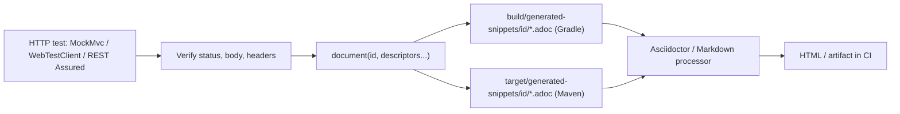

# Default Snippet Directories in Gradle and Maven

## 1. Why Understand the Snippet Directory?

In the **Spring Boot** chapter of the **Spring REST Docs (`SPRING_REST_DOCS`)** module, REST API documentation is generated from executable HTTP tests running via `MockMvc`, `WebTestClient`, or REST Assured. These tests both verify requests/responses and produce *snippets* for assembling Asciidoctor or Markdown documentation during builds and CI. If tests write snippets to one path while the documentation tool reads from another, the pipeline fails or reuses stale output.

With standard Spring Boot Test integration, the default snippet output directory depends on the build tool:

| Build Tool | Default Snippet Directory | Example File |
| --- | --- | --- |
| **Gradle** | `build/generated-snippets` | `build/generated-snippets/books-get/http-response.adoc` |
| **Maven** | `target/generated-snippets` | `target/generated-snippets/books-get/http-response.adoc` |

This is **test-generated output**, residing under the build directory of the module running the tests. It is distinct from documentation source files such as `src/docs/asciidoc/index.adoc` and from Asciidoctor's HTML output. The `generated-snippets` directory is created or updated when tests configured with Spring REST Docs and `document(...)` execute successfully.

After this lesson, you will be able to:

- Identify Gradle/Maven default directories and read the folder structure organized by operation ID.
- Write tests that generate snippets for requests, responses, path/query parameters, headers, and JSON payloads.
- Connect test output to Asciidoctor using Gradle or Maven, ensuring the test → documentation execution order.
- Change `outputDir` properly and understand its impact on documentation, build caching, and CI.
- Diagnose path mismatches, multi-module setups, parallel test runs, and leftover snippets.

Java examples use **Spring Boot 3.5**, Spring REST Docs 3.x, Java 17+, and JUnit Jupiter. On Spring Boot 4.x, import paths for certain test annotations change; use dependencies and APIs matching your application version.

## 2. Path from Test Execution to Documentation Files



Two components determine the path of each snippet:

1. **Root directory**: configured by the Spring REST Docs integration; with standard Spring Boot Test setups, this is `build/generated-snippets` on Gradle and `target/generated-snippets` on Maven unless overridden.
2. **Operation name**: the first argument to `document(...)`, for example `document("books-get", ...)`. This call writes files inside `generated-snippets/books-get/`.

The resulting path has the form:

```text
<build-dir>/generated-snippets/<operation-id>/<snippet-name>.adoc
```

For instance, `document("books/get-success")` creates a nested directory `generated-snippets/books/get-success/`. A `/` in the operation ID acts as part of a subpath; documentation authors must use the exact matching path when including files.

### Which Snippets Are Generated?

| Snippet Group | Examples | Condition |
| --- | --- | --- |
| HTTP request and response | `http-request.adoc`, `http-response.adoc` | Default snippets when `document(...)` is called. |
| Example CLI commands | `curl-request.adoc`, `httpie-request.adoc` | Default snippets for the AsciiDoc format. |
| Request/response body | `request-body.adoc`, `response-body.adoc` | Default snippets; content may be empty for requests/responses without a body. |
| Path/query parameters | `path-parameters.adoc`, `query-parameters.adoc` | When the test declares `pathParameters(...)` or `queryParameters(...)`. |
| Headers | `request-headers.adoc`, `response-headers.adoc` | When the test declares `requestHeaders(...)` or `responseHeaders(...)`. |
| JSON payload fields | `request-fields.adoc`, `response-fields.adoc` | When the test declares `requestFields(...)` or `responseFields(...)`. |

If a test only calls `document("books-get")`, Spring REST Docs does not infer descriptions for fields or headers. They must be declared in corresponding descriptors. Descriptors also validate the presence and match of the documented API parts so unexpected changes can fail the test.

## 3. Spring Boot Example Generating Snippets with Default Paths

Create a simple Spring MVC controller in `src/main/java/com/example/books/BookController.java`:

```java
package com.example.books;

import org.springframework.web.bind.annotation.GetMapping;
import org.springframework.web.bind.annotation.PathVariable;
import org.springframework.web.bind.annotation.RequestMapping;
import org.springframework.web.bind.annotation.RestController;

@RestController
@RequestMapping("/api/books")
public class BookController {
    @GetMapping("/{id}")
    public BookResponse find(@PathVariable long id) {
        return new BookResponse(id, "Clean Code");
    }

    public record BookResponse(long id, String title) {}
}
```

Write the test in `src/test/java/com/example/books/BookDocumentationTest.java`:

```java
package com.example.books;

import org.junit.jupiter.api.Test;
import org.springframework.beans.factory.annotation.Autowired;
import org.springframework.boot.test.autoconfigure.restdocs.AutoConfigureRestDocs;
import org.springframework.boot.test.autoconfigure.web.servlet.WebMvcTest;
import org.springframework.http.MediaType;
import org.springframework.test.web.servlet.MockMvc;

import static org.springframework.restdocs.mockmvc.MockMvcRestDocumentation.document;
import static org.springframework.restdocs.mockmvc.RestDocumentationRequestBuilders.get;
import static org.springframework.restdocs.payload.PayloadDocumentation.fieldWithPath;
import static org.springframework.restdocs.payload.PayloadDocumentation.responseFields;
import static org.springframework.restdocs.request.RequestDocumentation.parameterWithName;
import static org.springframework.restdocs.request.RequestDocumentation.pathParameters;
import static org.springframework.test.web.servlet.result.MockMvcResultMatchers.jsonPath;
import static org.springframework.test.web.servlet.result.MockMvcResultMatchers.status;

@WebMvcTest(BookController.class)
@AutoConfigureRestDocs // Let Boot select the default snippets directory.
class BookDocumentationTest {

    @Autowired
    MockMvc mockMvc;

    @Test
    void findBook() throws Exception {
        mockMvc.perform(
                get("/api/books/{id}", 42)
                    .accept(MediaType.APPLICATION_JSON)
            )
            .andExpect(status().isOk())
            .andExpect(jsonPath("$.id").value(42))
            .andExpect(jsonPath("$.title").value("Clean Code"))
            .andDo(document("books-get",
                pathParameters(
                    parameterWithName("id").description("Book ID")
                ),
                responseFields(
                    fieldWithPath("id").description("Book identifier"),
                    fieldWithPath("title").description("Book title")
                )
            ));
    }
}
```

With Gradle, add the required dependencies to `build.gradle` (Groovy DSL):

```groovy
dependencies {
    implementation 'org.springframework.boot:spring-boot-starter-web'
    testImplementation 'org.springframework.boot:spring-boot-starter-test'
    testImplementation 'org.springframework.restdocs:spring-restdocs-mockmvc'
}

tasks.named('test') {
    useJUnitPlatform()
}
```

When running `./gradlew test`, if tests pass, the files appear under `build/generated-snippets/books-get/`. With Maven and equivalent dependencies, running `./mvnw test` writes them under `target/generated-snippets/books-get/`.

Key points in the test:

- `@WebMvcTest` requests a Spring MVC test context, and `@AutoConfigureRestDocs` attaches Spring REST Docs to the Boot-created `MockMvc`. No manual `MockMvcBuilders` setup is needed.
- `RestDocumentationRequestBuilders.get(...)` preserves the URI template so `pathParameters(...)` can describe the `id` variable.
- `andExpect(...)` verifies response behavior; `andDo(document(...))` writes snippets under ID `books-get` and checks declared fields.
- The annotation **omits `outputDir`**. Spring Boot selects the default path for the build environment instead of forcing every project to hardcode a `build` directory name.

## 4. Directory Structure After Running Tests

Gradle example:

```text
book-service/
├── build.gradle
├── src/
│   ├── main/java/com/example/books/BookController.java
│   ├── test/java/com/example/books/BookDocumentationTest.java
│   └── docs/asciidoc/index.adoc
└── build/
    └── generated-snippets/
        └── books-get/
            ├── curl-request.adoc
            ├── http-request.adoc
            ├── http-response.adoc
            ├── httpie-request.adoc
            ├── request-body.adoc
            ├── response-body.adoc
            ├── path-parameters.adoc
            └── response-fields.adoc
```

Corresponding Maven example:

```text
book-service/
├── pom.xml
├── src/
│   └── ...
└── target/
    └── generated-snippets/
        └── books-get/
            ├── http-request.adoc
            ├── http-response.adoc
            ├── path-parameters.adoc
            └── response-fields.adoc
```

The Maven diagram omits a few files for readability; given the same snippet configuration and tests, the generated file set follows the same rules as Gradle.

Paths to distinguish:

| Element | Decided By | Example |
| --- | --- | --- |
| Module build directory | Gradle/Maven and project configuration. | `build/`, `target/` |
| Root snippet directory | REST Docs integration; configurable via `outputDir`. | `build/generated-snippets/` |
| Operation ID | `document("...")` call in the test. | `books-get/` |
| Snippet file | Selected snippet type and template format. | `response-fields.adoc` |
| Source documentation | Documentation author. | `src/docs/asciidoc/index.adoc` |
| Final documentation | Asciidoctor/Markdown build task. | `build/docs/asciidoc/` or `target/generated-docs/` |

**Do not manually edit files inside `generated-snippets`.** These are test-regenerable artifacts and may be overwritten on the next run. Long explanations, introductions, business rules, and usage guides belong in source AsciiDoc/Markdown files.

## 5. Using `{snippets}` to Include Files in Asciidoctor

Create `src/docs/asciidoc/index.adoc`:

```asciidoc
= Books API
:toc: left

== Get Book Details

=== HTTP request
include::{snippets}/books-get/http-request.adoc[]

=== Path parameters
include::{snippets}/books-get/path-parameters.adoc[]

=== HTTP response
include::{snippets}/books-get/http-response.adoc[]

=== Response fields
include::{snippets}/books-get/response-fields.adoc[]
```

`{snippets}` is an Asciidoctor attribute configured to point to the **root snippets directory**. It is neither a Spring Boot literal nor an endpoint URL. If you are using Gradle and the file is at `build/generated-snippets/books-get/http-response.adoc`, the attribute must resolve to `build/generated-snippets`; the remainder `books-get/http-response.adoc` comes from the include directive itself.

When changing the operation ID from `document("books-get")` to `document("books/get-by-id")`, update the include to:

```asciidoc
include::{snippets}/books/get-by-id/http-response.adoc[]
```

Use stable IDs named after the endpoint and business outcome, such as `books/get-success`, `books/get-not-found`, or `books/create-success`. Avoid names tied to easily renamed test methods unless you have a clear automated naming convention.

## 6. Gradle: Linking Test Output and Asciidoctor

Assuming the project already applies the Java, Spring Boot, and `org.asciidoctor.jvm.convert` plugins at compatible versions, you can add this configuration to `build.gradle`:

```groovy
configurations {
    asciidoctorExt
}

dependencies {
    testImplementation 'org.springframework.restdocs:spring-restdocs-mockmvc'
    asciidoctorExt 'org.springframework.restdocs:spring-restdocs-asciidoctor'
}

def snippetsDir = layout.buildDirectory.dir('generated-snippets')

tasks.named('test') {
    useJUnitPlatform()
    outputs.dir snippetsDir
}

tasks.named('asciidoctor') {
    dependsOn tasks.named('test')
    inputs.dir snippetsDir
    configurations 'asciidoctorExt'
    attributes 'snippets': snippetsDir.get().asFile
}
```

Three critical relationships:

1. `outputs.dir snippetsDir` declares that tests write files into the snippets directory. When using Gradle caching or up-to-date checks, this metadata is part of the task model.
2. `dependsOn tasks.named('test')` ensures tests execute before building documentation. If a specialized task like `integrationTest` generates snippets, depend on that task instead.
3. `inputs.dir snippetsDir` and the `snippets` attribute help Asciidoctor track changes and locate the included files accurately.

Run a full pass from a clean state:

```bash
./gradlew clean test asciidoctor
```

`clean` removes old project outputs, `test` regenerates snippets, and `asciidoctor` builds the HTML. The HTML location depends on plugin configuration—typically `build/docs/asciidoc/` with standard defaults. To package the HTML into the JAR, configure an additional copy task from Asciidoctor output into resources or `bootJar`; this **does not happen automatically** just from generating snippets.

### If the Project Uses Kotlin DSL

The snippets above use Groovy DSL syntax; in `build.gradle.kts`, task wiring looks like:

```kotlin
val snippetsDir = layout.buildDirectory.dir("generated-snippets")

tasks.test {
    useJUnitPlatform()
    outputs.dir(snippetsDir)
}

tasks.named("asciidoctor") {
    dependsOn(tasks.test)
    inputs.dir(snippetsDir)
}
```

This Kotlin DSL snippet shows the task relationship; configuring the Asciidoctor extension and the `snippets` attribute uses the Kotlin DSL API matching the installed plugin version.

## 7. Maven: Reading Snippets from `target/generated-snippets`

With Maven, declare the test dependencies in `pom.xml`:

```xml
<dependencies>
    <dependency>
        <groupId>org.springframework.boot</groupId>
        <artifactId>spring-boot-starter-test</artifactId>
        <scope>test</scope>
    </dependency>
    <dependency>
        <groupId>org.springframework.restdocs</groupId>
        <artifactId>spring-restdocs-mockmvc</artifactId>
        <scope>test</scope>
    </dependency>
</dependencies>
```

The Asciidoctor plugin snippet below is an example for a Maven project that manages the Spring REST Docs version via the `spring-restdocs.version` property (e.g., through Spring Boot parent):

```xml
<build>
    <plugins>
        <plugin>
            <groupId>org.asciidoctor</groupId>
            <artifactId>asciidoctor-maven-plugin</artifactId>
            <version>3.1.1</version>
            <dependencies>
                <dependency>
                    <groupId>org.springframework.restdocs</groupId>
                    <artifactId>spring-restdocs-asciidoctor</artifactId>
                    <version>${spring-restdocs.version}</version>
                </dependency>
            </dependencies>
            <executions>
                <execution>
                    <id>build-api-docs</id>
                    <phase>prepare-package</phase>
                    <goals>
                        <goal>process-asciidoc</goal>
                    </goals>
                    <configuration>
                        <sourceDirectory>${project.basedir}/src/docs/asciidoc</sourceDirectory>
                        <outputDirectory>${project.build.directory}/generated-docs</outputDirectory>
                        <backend>html</backend>
                        <attributes>
                            <snippets>${project.build.directory}/generated-snippets</snippets>
                        </attributes>
                    </configuration>
                </execution>
            </executions>
        </plugin>
    </plugins>
</build>
```

`${project.build.directory}` typically resolves to `target`. Because the Asciidoctor plugin is bound to `prepare-package`, it runs after the `test` phase in the standard Maven lifecycle—appropriate when snippet-generating tests belong to the Surefire test suite. Supply a valid `spring-restdocs.version` value if the project does not inherit this property, and select an Asciidoctor Maven Plugin version compatible with your build.

Run:

```bash
# Run tests to generate snippets:
./mvnw clean test

# Run lifecycle including documentation build step:
./mvnw clean verify
```

When using Failsafe to run integration tests in the `integration-test`/`verify` phases, note that `prepare-package` runs **before** those phases. If snippets are produced by integration tests, do not bind Asciidoctor to `prepare-package`; instead configure documentation generation after those tests or invoke the documentation goal explicitly after `mvn verify`. Avoid having `prepare-package` accidentally read leftover snippets from an earlier build.

On Windows, run `mvnw.cmd` if the project uses Maven Wrapper. To publish HTML after the build, collect it from `target/generated-docs` per the illustrative configuration.

## 8. Changing `outputDir` and Synchronizing Paths

The default paths are convenient, though not mandatory. You can change the directory right on the Spring Boot test class:

```java
@WebMvcTest(BookController.class)
@AutoConfigureRestDocs(outputDir = "build/custom-rest-docs")
class BookDocumentationTest {
    // ...
}
```

At this point, Gradle tests no longer write snippets to `build/generated-snippets`; tests write to `build/custom-rest-docs` relative to the execution working directory. You must update the directory in the documentation build configuration to match:

```groovy
def snippetsDir = file('build/custom-rest-docs')

tasks.named('test') {
    outputs.dir snippetsDir
}

tasks.named('asciidoctor') {
    inputs.dir snippetsDir
    dependsOn tasks.named('test')
    attributes 'snippets': snippetsDir
}
```

With Maven, the equivalent configuration is `@AutoConfigureRestDocs(outputDir = "target/custom-rest-docs")` and Asciidoctor attribute `<snippets>${project.build.directory}/custom-rest-docs</snippets>`. Crucially, **the test's `outputDir` value and the authoring tool's input path must match**.

To reconfigure the URI shown in snippets while keeping the same directory, use:

```java
@AutoConfigureRestDocs(
    uriScheme = "https",
    uriHost = "api.example.com",
    uriPort = 443
)
```

`uriScheme`, `uriHost`, and `uriPort` only alter how URLs are recorded in snippets. They do not change the output directory, do not require starting a real server, and do not make `MockMvc` send requests to a public host.

### Distinguishing Output Directory from Template Format

| Question | Configuration Part |
| --- | --- |
| Are snippets written to `build` or `target`? | Build tool and Spring REST Docs output directory. |
| Which subdirectory are snippets placed in? | Operation ID passed to `document("...")`. |
| Do snippets use `.adoc` or `.md`? | Template format, defaulting to AsciiDoc. |
| Where is HTML output written? | Asciidoctor output directory, independent of snippet output. |

To generate Markdown snippets, configure `TemplateFormats.markdown()` using `RestDocsMockMvcConfigurationCustomizer` (or the appropriate customizer for WebTestClient). When switching templates to Markdown, the root directory can remain `build/generated-snippets`; only the format and file extensions change to `.md`. Your Markdown tool needs a pipeline to assemble those files; Asciidoctor will not resolve old `.adoc` include statements automatically.

## 9. Multi-Module Projects and Parallel Test Execution

In a multi-module Gradle project:

```text
system/
├── settings.gradle
├── catalog-service/
│   ├── build.gradle
│   └── build/generated-snippets/catalog-get/...
└── order-service/
    ├── build.gradle
    └── build/generated-snippets/orders-get/...
```

Tests running in `catalog-service` normally create snippets inside `catalog-service/build/generated-snippets`, not `system/build/generated-snippets`. Multi-module Maven follows the same principle: each module has its own `target/generated-snippets` directory.

In multi-service systems, two patterns are common:

- **Per-module documentation:** each module has its own tests and Asciidoctor task/plugin reading snippets from its own directory. This keeps builds independent.
- **Aggregated documentation:** a dedicated documentation module reads snippets from other modules. Declare task dependencies and use multiple attributes such as `{catalog-snippets}` and `{order-snippets}` rather than assuming everything was copied into the root directory.

Avoid having two parallel tests write to the same operation ID in the same output directory—for example, two tests both calling `document("books-get")` with different requests. They can overwrite each other's files or produce nondeterministic results. Name IDs per scenario: `books/get-success`, `books/get-not-found`, `books/create-success`. If dedicated tests run in an `integrationTest` task, consider a separate output directory and wire the snippet-generating task directly to the documentation build task.

## 10. CI Integration: Tests Must Precede Documentation Generation

A reliable documentation pipeline should:

1. Start from the current source code and build configuration, preferring a clean workspace when verifying the pipeline.
2. Run tests containing `document(...)`. If any assertion or descriptor fails, the job must stop.
3. Read snippets generated by **the tests that just ran** and generate HTML or Markdown.
4. Store or publish documentation artifacts only when both tests and compilation succeed.

Example GitHub Actions workflow for a single-module Gradle project with the `asciidoctor` task configured:

```yaml
name: Build REST API docs
on:
  push:
  pull_request:

jobs:
  documentation:
    runs-on: ubuntu-latest
    steps:
      - uses: actions/checkout@v4
      - uses: actions/setup-java@v4
        with:
          distribution: temurin
          java-version: '17'
      - name: Test and build documentation
        run: ./gradlew --no-daemon clean test asciidoctor
      - name: Upload documentation artifact
        uses: actions/upload-artifact@v4
        with:
          name: rest-api-docs
          path: build/docs/asciidoc/
```

The artifact path assumes Asciidoctor writes to `build/docs/asciidoc`. Multi-module projects or custom output paths must adjust the path to match actual output. With Maven, you can run `./mvnw -B clean verify` once documentation is bound to the right phase; the artifact resides in `target/generated-docs` when using the configuration in Section 7.

Running a clean build helps eliminate stale snippets from previous runs. Even when using Gradle build cache or incremental Maven plugins, declare snippet sources and task ordering accurately. Never publish documentation from a job running `-x test` or `-DskipTests` if required snippets are only generated by tests.

## 11. Common Path Errors

| Symptom | Common Cause | Resolution |
| --- | --- | --- |
| No `generated-snippets` directory | `document(...)` not called, tests didn't run, missing dependency, or REST Docs not integrated with client. | Check test reports, `andDo(...)`/`consumeWith(...)` placement, `@AutoConfigureRestDocs`, and dependencies. |
| `http-response.adoc` exists, but `response-fields.adoc` is missing | Test did not declare `responseFields(...)`. | Add the appropriate descriptors and re-run tests. |
| Gradle puts snippets in `build`, but Asciidoctor looks in `target` | Copied Maven configuration or wrong attribute. | Point the `snippets` attribute to `build/generated-snippets`. |
| Maven puts snippets in `target`, but Asciidoctor looks in `build` | Copied Gradle configuration. | Use `${project.build.directory}/generated-snippets`. |
| Snippets appear inside a submodule | Tests ran from a subproject/submodule. | Check `<module>/build` or `<module>/target`; update documentation source paths. |
| Asciidoctor include target does not exist | `document(...)` ID changed; include directory name was not updated. | Compare actual files against the `include::{snippets}/...[]` string. |
| HTML contains stale data | Tests did not re-run, output was not cleaned, or documentation task does not depend on tests. | Run a clean build; configure task dependencies and inputs/outputs. |
| Parallel tests corrupt each other's snippets | Same operation ID and same output directory. | Separate operation IDs or directories by scenario/module. |
| No `.adoc` files after switching to Markdown | Templates now generate `.md`. | Keep templates and the Markdown include/build system in sync. |
| CI only includes a few endpoints | Snippet-generating tests in other modules/tasks were not invoked. | Bind all snippet-generating tasks into the documentation build. |

### Diagnosing a Specific Case

Suppose a test configures:

```java
@AutoConfigureRestDocs(outputDir = "build/api-snippets")

// Inside the test method:
.andDo(document("books/get",
    responseFields(
        fieldWithPath("id").description("Book ID")
    )
));
```

Yet the documentation still includes:

```asciidoc
include::{snippets}/books-get/response-fields.adoc[]
```

There are **two mismatches** here:

- The test's output root is `build/api-snippets`, while the build may still set `{snippets}` to `build/generated-snippets`.
- `document("books/get")` creates the directory `books/get`, not `books-get`.

Update the `snippets` attribute to point to `build/api-snippets` and update the include:

```asciidoc
include::{snippets}/books/get/response-fields.adoc[]
```

Inspect the actual generated files before modifying the build; do not guess paths from endpoint URLs or test method names.

## 12. Practice Exercise

Practice with `BookController` and `BookDocumentationTest` from Section 3:

1. Add the REST Docs MockMvc dependency and run `./gradlew clean test`; verify `build/generated-snippets/books-get/http-response.adoc` and `response-fields.adoc` exist.
2. Write `src/docs/asciidoc/index.adoc` including request, response, path parameters, and response fields. Wire the Asciidoctor plugin/task per Section 6 and run `./gradlew clean test asciidoctor`.
3. Change to `@AutoConfigureRestDocs(outputDir = "build/custom-rest-docs")`; test before and after updating `snippetsDir` in Gradle. Explain why changing only the annotation is insufficient.
4. Create an equivalent Maven project, run `./mvnw clean test`, and confirm snippets are written under `target/generated-snippets`. Add the Asciidoctor Maven Plugin to generate HTML from those files.
5. Add another test for `GET /api/books/{id}` when the book is not found, using operation ID `books/get-not-found`, and verify the two scenarios do not overwrite each other's snippets.
6. Add the test and documentation build tasks to CI; intentionally add an undocumented JSON field to ensure the test fails and the job does not publish broken documentation.

**Completion criteria:** can distinguish Gradle and Maven default snippet directories; locate files accurately by operation ID; tests generate snippets with assertions and descriptors; Asciidoctor/Markdown consumes files directly from test output; path or API contract changes are verified in builds and CI.

## 13. References

- [Spring Boot 3.5 — Testing Spring Boot Applications](https://docs.spring.io/spring-boot/3.5/reference/testing/spring-boot-applications.html)
- [Spring Boot 3.5 — AutoConfigureRestDocs API](https://docs.spring.io/spring-boot/3.5/api/java/org/springframework/boot/test/autoconfigure/restdocs/AutoConfigureRestDocs.html)
- [Spring REST Docs — Getting Started](https://docs.spring.io/spring-restdocs/tutorial/getting-started/index.html)
- [Spring REST Docs — Configuration: Default Snippets](https://docs.spring.io/spring-restdocs/reference/configuration/default-snippets.html)
- [Spring REST Docs — Documenting Your API](https://docs.spring.io/spring-restdocs/reference/documenting-your-api/index.html)
- [Spring REST Docs — Asciidoctor integration](https://docs.spring.io/spring-restdocs/reference/)
