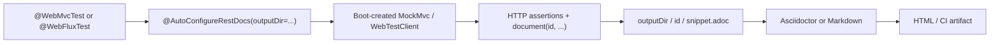

# Configuring the Output Directory in Test Slices

## 1. The Problem: Where Do Test Slices Write Snippets?

In the **Spring Boot** chapter of the **Spring REST Docs (`SPRING_REST_DOCS`)** module, we produce verifiable REST API documentation from executable HTTP tests running with `MockMvc`, `WebTestClient`, or REST Assured. Tests use `document(...)` to emit snippets for requests, responses, JSON payloads, path/query parameters, and headers. Asciidoctor or a Markdown pipeline then assembles those snippets into documentation pages and integrates them into builds and CI.

When using a **test slice** such as `@WebMvcTest` or `@WebFluxTest`, an important question arises: *which directory will Spring REST Docs write those snippets into, and how do we ensure the documentation build tool reads from that exact directory?*

Common paths with standard Spring Boot Test configurations:

| Build Tool | Default Snippet Directory | When Separating a Test Group |
| --- | --- | --- |
| Gradle | `build/generated-snippets` | Example: `build/generated-snippets/catalog-mvc` |
| Maven | `target/generated-snippets` | Example: `target/generated-snippets/catalog-mvc` |

With Spring Boot, the `outputDir` attribute on `@AutoConfigureRestDocs` lets you specify the root snippet directory explicitly on a test class. If you set `@AutoConfigureRestDocs(outputDir = "build/generated-snippets/catalog-mvc")`, snippets from operations like `document("products-find")` are written under `build/generated-snippets/catalog-mvc/products-find/`. This configuration **does not alter the endpoint, HTTP response, or the scope of beans loaded by the test slice**.

**Lesson objectives:** know how to choose output paths for MVC and WebFlux test slices; inspect actual generated files after running tests; synchronize the output directory across Gradle, Maven, Asciidoctor, and CI; prevent snippet overwrites when tests run in parallel; and resolve common path configuration errors.

Examples use **Spring Boot 3.5, Spring REST Docs 3.x, JUnit Jupiter, and Java 17+**. Spring Boot 4.x introduces changes to test packages and modules, covered separately in Section 10.

## 2. Path from Test Slice to Documentation



Two path levels must be distinguished:

1. **Output directory (root directory)** used by Spring REST Docs. In Spring Boot tests, this can be specified via `@AutoConfigureRestDocs(outputDir = "...")`.
2. **Operation ID** passed to `document("...")`. This becomes the subdirectory containing snippets for a single documented request/response.

Gradle example:

```java
@AutoConfigureRestDocs(outputDir = "build/generated-snippets/catalog-mvc")

// Inside a MockMvc test:
.andDo(document("products-find", responseFields(
    fieldWithPath("id").description("Product ID"),
    fieldWithPath("name").description("Product name")
)));
```

Typical output layout:

```text
build/
  generated-snippets/
    catalog-mvc/                  <- outputDir
      products-find/              <- document("products-find")
        curl-request.adoc
        http-request.adoc
        http-response.adoc
        httpie-request.adoc
        request-body.adoc
        response-body.adoc
        response-fields.adoc
```

By default, Spring REST Docs generates a core set of HTTP snippets when `document(...)` runs. Tabular snippets such as `response-fields.adoc`, `request-fields.adoc`, `path-parameters.adoc`, and `request-headers.adoc` only appear when the corresponding descriptors are provided.

**Do not confuse folder names with API URLs.** A request to `GET /api/products/27` does not automatically create an `api/products/27` folder. The subdirectory is named after the operation ID `products-find`, or whatever name the test author chooses.

### What Is a Test Slice, and What Stays Unchanged When Configuring the Directory?

| Test Slice | Application Part Loaded | Client Used for Documentation |
| --- | --- | --- |
| `@WebMvcTest(ProductController.class)` | The controller and MVC/web beans belonging to the slice; services normally need to be mocked or imported explicitly. | `MockMvc` |
| `@WebFluxTest(StatusController.class)` | The controller and reactive/web beans belonging to the slice; services normally need to be mocked or imported explicitly. | `WebTestClient` |

`@AutoConfigureRestDocs` integrates Spring REST Docs with the Boot-created client. `outputDir` only determines **where artifacts are written**. It does not turn `@WebMvcTest` into `@SpringBootTest`, does not start a real HTTP server, does not modify security filters, and does not automatically generate documentation descriptors.

## 3. Configuring an MVC Test Slice with `MockMvc`

### 3.1. Dependencies

With Gradle Groovy DSL in a Spring MVC application that already applies the Spring Boot plugin and dependency management:

```groovy
dependencies {
    implementation 'org.springframework.boot:spring-boot-starter-web'
    testImplementation 'org.springframework.boot:spring-boot-starter-test'
    testImplementation 'org.springframework.restdocs:spring-restdocs-mockmvc'
}

tasks.named('test') {
    useJUnitPlatform()
}
```

Spring Boot manages compatible test dependency versions when the project uses the appropriate BOM/parent. `spring-restdocs-mockmvc` connects REST Docs to `MockMvc`; generating snippets does not require running the application on a real port.

### 3.2. Sample Controller

Example file `src/main/java/com/example/catalog/ProductController.java`:

```java
package com.example.catalog;

import java.net.URI;
import org.springframework.http.ResponseEntity;
import org.springframework.web.bind.annotation.GetMapping;
import org.springframework.web.bind.annotation.PathVariable;
import org.springframework.web.bind.annotation.PostMapping;
import org.springframework.web.bind.annotation.RequestBody;
import org.springframework.web.bind.annotation.RequestMapping;
import org.springframework.web.bind.annotation.RequestParam;
import org.springframework.web.bind.annotation.RestController;

@RestController
@RequestMapping("/api/products")
class ProductController {

    @GetMapping("/{id}")
    ProductResponse find(
            @PathVariable long id,
            @RequestParam(defaultValue = "vi") String locale) {
        return new ProductResponse(id, "Fountain pen", locale);
    }

    @PostMapping
    ResponseEntity<ProductResponse> create(@RequestBody NewProduct request) {
        ProductResponse created =
            new ProductResponse(27L, request.name(), "vi");
        return ResponseEntity.created(
            URI.create("/api/products/" + created.id())
        ).body(created);
    }

    record NewProduct(String name) {}
    record ProductResponse(long id, String name, String locale) {}
}
```

Here the controller returns fixed data so tests are easily reproducible. In a real application, the controller might call a service or repository; because `@WebMvcTest` loads only part of the context, use `@MockitoBean` for services not created in the slice.

### 3.3. Test Setting a Dedicated Output Directory for the Slice

Create `src/test/java/com/example/catalog/ProductDocumentationTest.java`:

```java
package com.example.catalog;

import org.junit.jupiter.api.Test;
import org.springframework.beans.factory.annotation.Autowired;
import org.springframework.boot.test.autoconfigure.restdocs.AutoConfigureRestDocs;
import org.springframework.boot.test.autoconfigure.web.servlet.WebMvcTest;
import org.springframework.http.HttpHeaders;
import org.springframework.http.MediaType;
import org.springframework.test.web.servlet.MockMvc;

import static org.springframework.restdocs.headers.HeaderDocumentation.headerWithName;
import static org.springframework.restdocs.headers.HeaderDocumentation.requestHeaders;
import static org.springframework.restdocs.headers.HeaderDocumentation.responseHeaders;
import static org.springframework.restdocs.mockmvc.MockMvcRestDocumentation.document;
import static org.springframework.restdocs.mockmvc.RestDocumentationRequestBuilders.get;
import static org.springframework.restdocs.mockmvc.RestDocumentationRequestBuilders.post;
import static org.springframework.restdocs.payload.PayloadDocumentation.fieldWithPath;
import static org.springframework.restdocs.payload.PayloadDocumentation.requestFields;
import static org.springframework.restdocs.payload.PayloadDocumentation.responseFields;
import static org.springframework.restdocs.request.RequestDocumentation.parameterWithName;
import static org.springframework.restdocs.request.RequestDocumentation.pathParameters;
import static org.springframework.restdocs.request.RequestDocumentation.queryParameters;
import static org.springframework.test.web.servlet.result.MockMvcResultMatchers.header;
import static org.springframework.test.web.servlet.result.MockMvcResultMatchers.jsonPath;
import static org.springframework.test.web.servlet.result.MockMvcResultMatchers.status;

@WebMvcTest(ProductController.class)
@AutoConfigureRestDocs(
    outputDir = "build/generated-snippets/catalog-mvc"
)
class ProductDocumentationTest {

    @Autowired
    MockMvc mockMvc;

    @Test
    void findProduct() throws Exception {
        mockMvc.perform(
                get("/api/products/{id}", 27L)
                    .queryParam("locale", "vi")
                    .accept(MediaType.APPLICATION_JSON)
            )
            .andExpect(status().isOk())
            .andExpect(jsonPath("$.id").value(27))
            .andExpect(jsonPath("$.name").value("Fountain pen"))
            .andDo(document("products-find",
                pathParameters(
                    parameterWithName("id")
                        .description("Product ID")
                ),
                queryParameters(
                    parameterWithName("locale")
                        .description("Response language")
                ),
                requestHeaders(
                    headerWithName(HttpHeaders.ACCEPT)
                        .description("Desired response format")
                ),
                responseFields(
                    fieldWithPath("id").description("Product ID"),
                    fieldWithPath("name").description("Product name"),
                    fieldWithPath("locale").description("Response language")
                )
            ));
    }

    @Test
    void createProduct() throws Exception {
        mockMvc.perform(
                post("/api/products")
                    .contentType(MediaType.APPLICATION_JSON)
                    .accept(MediaType.APPLICATION_JSON)
                    .content("{\"name\":\"Fountain pen\"}")
            )
            .andExpect(status().isCreated())
            .andExpect(header().string(
                HttpHeaders.LOCATION, "/api/products/27"
            ))
            .andDo(document("products-create",
                requestFields(
                    fieldWithPath("name")
                        .description("Name of the product to create")
                ),
                responseHeaders(
                    headerWithName(HttpHeaders.LOCATION)
                        .description("URI of the newly created product")
                ),
                responseFields(
                    fieldWithPath("id").description("New product ID"),
                    fieldWithPath("name").description("Product name"),
                    fieldWithPath("locale").description("Response language")
                )
            ));
    }
}
```

After running the tests, both operations share **the same output root** while using **two distinct subdirectories**:

```text
build/generated-snippets/catalog-mvc/
  products-find/
    http-request.adoc
    http-response.adoc
    path-parameters.adoc
    query-parameters.adoc
    request-headers.adoc
    response-fields.adoc
    ...
  products-create/
    http-request.adoc
    http-response.adoc
    request-fields.adoc
    response-headers.adoc
    response-fields.adoc
    ...
```

Other default snippet files (such as cURL, HTTPie, and body snippets) are also created, though the diagram above lists only the key files to check.

**Key takeaways:**

1. `@WebMvcTest` creates the MVC slice; `@AutoConfigureRestDocs` integrates the snippet recorder and sets the output root. The two annotations have distinct responsibilities.
2. `@Autowired MockMvc` receives the Boot-managed client. If you manually construct an instance via `MockMvcBuilders.standaloneSetup(...)`, that instance will not automatically receive Boot's REST Docs configuration.
3. `RestDocumentationRequestBuilders.get(...)` retains the `/api/products/{id}` URI template, required by `pathParameters(...)`.
4. `andExpect(...)` verifies the response; `andDo(document(...))` generates snippets and validates descriptors. By default, `responseFields(...)` requires every non-ignored JSON field to be documented.
5. The `outputDir` value is shared across tests in the same class; operation IDs `products-find` and `products-create` determine separate folders per request.

## 4. WebFlux Test Slice with `WebTestClient`

For reactive applications, use `spring-boot-starter-webflux`, `spring-boot-starter-test`, and `spring-restdocs-webtestclient`. You do not need to change how `WebTestClient` works to configure the directory: still use `@AutoConfigureRestDocs(outputDir = "...")`, pointing to a path for the reactive group.

Controller in a separate `com.example.status` package:

```java
package com.example.status;

import java.util.Map;
import org.springframework.web.bind.annotation.GetMapping;
import org.springframework.web.bind.annotation.RestController;
import reactor.core.publisher.Mono;

@RestController
class StatusController {

    @GetMapping("/api/status")
    Mono<Map<String, String>> status() {
        return Mono.just(Map.of("status", "UP"));
    }
}
```

Test:

```java
package com.example.status;

import org.junit.jupiter.api.Test;
import org.springframework.beans.factory.annotation.Autowired;
import org.springframework.boot.test.autoconfigure.restdocs.AutoConfigureRestDocs;
import org.springframework.boot.test.autoconfigure.web.reactive.WebFluxTest;
import org.springframework.test.web.reactive.server.WebTestClient;

import static org.springframework.restdocs.payload.PayloadDocumentation.fieldWithPath;
import static org.springframework.restdocs.payload.PayloadDocumentation.responseFields;
import static org.springframework.restdocs.webtestclient.WebTestClientRestDocumentation.document;

@WebFluxTest(StatusController.class)
@AutoConfigureRestDocs(
    outputDir = "build/generated-snippets/status-webflux"
)
class StatusDocumentationTest {

    @Autowired
    WebTestClient client;

    @Test
    void status() {
        client.get().uri("/api/status")
            .exchange()
            .expectStatus().isOk()
            .expectBody()
            .jsonPath("$.status").isEqualTo("UP")
            .consumeWith(document("status-get",
                responseFields(
                    fieldWithPath("status")
                        .description("Service status")
                )
            ));
    }
}
```

Output is written under `build/generated-snippets/status-webflux/status-get/`. This is a Gradle example; Maven projects can specify `target/generated-snippets/status-webflux` accordingly.

Comparing the two clients:

| Characteristic | MockMvc | WebTestClient |
| --- | --- | --- |
| How the client is created in a slice | `@WebMvcTest` | `@WebFluxTest` |
| How responses are asserted | `andExpect(...)` | `expectStatus()`, `expectBody()` |
| Snippet writing step | `andDo(document(...))` | `consumeWith(document(...))` |
| Setting the output root | `@AutoConfigureRestDocs(outputDir = "...")` | Same annotation |
| Operation path | `outputDir` + `document("id")` | Same principle |

Do not drop this reactive example directly into a project that only includes `spring-boot-starter-web`; it requires the matching WebFlux runtime, dependencies, and test slice.

## 5. Choosing an Output Root: Shared Across the Module or Split per Test Slice?

A project can organize its output directories in two ways:

| Organization | Example | Benefit | What Must Be Controlled |
| --- | --- | --- | --- |
| **One shared directory** | `build/generated-snippets` | Easy to configure a single `{snippets}` attribute in Asciidoctor. | Operation IDs must be unique across all documentation tests. |
| **Separate directories per slice/test group** | `build/generated-snippets/catalog-mvc`, `build/generated-snippets/status-webflux` | Easy to isolate output across test groups or separate tasks. | Each directory needs an explicit source attribute or aggregation step. |

Most simple modules can use the default path and stable operation IDs. Split the output root only when there is a clear reason—for example, when two test groups run under independent tasks, execute in parallel, or publish into two separate documentation sets.

Example to avoid:

```java
// Two different tests sharing one output root and operation ID:
document("products-find", responseFields(/* version A */));
document("products-find", responseFields(/* version B */));
```

If both tests run concurrently, they can overwrite the same files. Even if they run sequentially, the final output can depend on execution order. Use distinct IDs (`products-find-success`, `products-find-not-found`) or separate output roots by meaningful test group.

### Relative or Absolute Paths?

`outputDir = "build/generated-snippets/catalog-mvc"` is a **relative path** resolved against the working directory of the test process. In typical Gradle setups, that is the project/module directory. Maven also normally runs tests in the module's context. However, if a test task customizes its working directory, this path may resolve elsewhere; inspect the actual generated files to confirm.

Absolute paths may work locally, but make tests non-reproducible across developer machines, Windows/Linux, and CI. Place output under each module's own build directory, avoiding writing into `src/main`, `src/test`, or committed source directories.

## 6. Synchronizing `outputDir` with Gradle Asciidoctor

Suppose the MVC tests in Section 3 write to `build/generated-snippets/catalog-mvc`. In `build.gradle` (Groovy DSL) with the Java, Spring Boot, and `org.asciidoctor.jvm.convert` plugins applied, add:

```groovy
configurations {
    asciidoctorExt
}

dependencies {
    testImplementation 'org.springframework.restdocs:spring-restdocs-mockmvc'
    asciidoctorExt 'org.springframework.restdocs:spring-restdocs-asciidoctor'
}

def catalogSnippets = layout.buildDirectory.dir(
    'generated-snippets/catalog-mvc'
)

tasks.named('test') {
    useJUnitPlatform()
    outputs.dir catalogSnippets
}

tasks.named('asciidoctor') {
    dependsOn tasks.named('test')
    inputs.dir catalogSnippets
    configurations 'asciidoctorExt'
    attributes 'snippets': catalogSnippets.get().asFile
}
```

Explanation of components:

- `outputs.dir catalogSnippets` declares where the test task writes files. This lets Gradle track task outputs and is critical for up-to-date checks and build caching.
- `dependsOn test` guarantees the documentation build task never runs before snippet-generating tests.
- `inputs.dir catalogSnippets` makes Gradle aware that Asciidoctor depends on snippets.
- `attributes 'snippets': ...` defines the Asciidoctor `{snippets}` attribute pointing to the root directory matching the test annotation.

This is supplemental configuration; the project must already apply the Asciidoctor plugin and required Spring Boot dependencies.

Create `src/docs/asciidoc/index.adoc`:

```asciidoc
= Catalog API
:toc: left

== Get Product

=== Request
include::{snippets}/products-find/http-request.adoc[]
include::{snippets}/products-find/path-parameters.adoc[]
include::{snippets}/products-find/query-parameters.adoc[]
include::{snippets}/products-find/request-headers.adoc[]

=== Response
include::{snippets}/products-find/http-response.adoc[]
include::{snippets}/products-find/response-fields.adoc[]

== Create Product

=== Request body
include::{snippets}/products-create/request-fields.adoc[]

=== Response
include::{snippets}/products-create/http-response.adoc[]
include::{snippets}/products-create/response-headers.adoc[]
include::{snippets}/products-create/response-fields.adoc[]
```

Because `{snippets}` already points to `build/generated-snippets/catalog-mvc`, include directives only need `products-find/...` and `products-create/...`. If a test changes `outputDir` while Gradle still uses the old path, Asciidoctor will not see the new snippets or may read leftover files from an earlier build.

Verify from a clean state:

```bash
./gradlew clean test asciidoctor
```

### When a Project Has Multiple Slices/Output Roots

If the same module contains both `catalog-mvc` and `status-webflux`, decide how to assemble documentation:

1. **One combined page:** declare two attributes such as `catalog-snippets` and `status-snippets`, and use the appropriate attribute in each include directive.
2. **Two separate documentation sets:** configure separate documentation tasks or setups for MVC and WebFlux, each taking its corresponding output root as input.

When choosing a single combined page, assuming the attributes are configured:

```asciidoc
include::{catalog-snippets}/products-find/http-response.adoc[]
include::{status-snippets}/status-get/http-response.adoc[]
```

Attribute names here are defined by your project. Asciidoctor does not automatically search every subdirectory containing snippets unless you configure where to look.

## 7. Synchronizing `outputDir` with Maven

Maven normally writes snippets by default under `target/generated-snippets`. To isolate an MVC slice, use a Maven-aligned path:

```java
@WebMvcTest(ProductController.class)
@AutoConfigureRestDocs(
    outputDir = "target/generated-snippets/catalog-mvc"
)
class ProductDocumentationTest {
    // Tests as in Section 3.
}
```

In the `pom.xml` of a Spring Boot application that already has a parent/BOM managing versions, declare the test dependencies:

```xml
<dependency>
    <groupId>org.springframework.boot</groupId>
    <artifactId>spring-boot-starter-test</artifactId>
    <scope>test</scope>
</dependency>
<dependency>
    <groupId>org.springframework.restdocs</groupId>
    <artifactId>spring-restdocs-mockmvc</artifactId>
    <scope>test</scope>
</dependency>
```

Example Asciidoctor Maven Plugin configuration (select a version suitable for your project and ensure the `spring-restdocs.version` property is set):

```xml
<build>
    <plugins>
        <plugin>
            <groupId>org.asciidoctor</groupId>
            <artifactId>asciidoctor-maven-plugin</artifactId>
            <version>3.1.1</version>
            <dependencies>
                <dependency>
                    <groupId>org.springframework.restdocs</groupId>
                    <artifactId>spring-restdocs-asciidoctor</artifactId>
                    <version>${spring-restdocs.version}</version>
                </dependency>
            </dependencies>
            <executions>
                <execution>
                    <id>api-docs</id>
                    <phase>prepare-package</phase>
                    <goals>
                        <goal>process-asciidoc</goal>
                    </goals>
                    <configuration>
                        <sourceDirectory>${project.basedir}/src/docs/asciidoc</sourceDirectory>
                        <outputDirectory>${project.build.directory}/generated-docs</outputDirectory>
                        <backend>html</backend>
                        <attributes>
                            <snippets>${project.build.directory}/generated-snippets/catalog-mvc</snippets>
                        </attributes>
                    </configuration>
                </execution>
            </executions>
        </plugin>
    </plugins>
</build>
```

In Maven, `${project.build.directory}` usually resolves to `target`. The `snippets` attribute is set to match the output root written by tests. Because Asciidoctor runs in `prepare-package`, it can consume snippets produced by tests executed by Surefire during the `test` phase.

**Note on integration tests:** if snippets are generated by Failsafe during the `integration-test`/`verify` phases, `prepare-package` happens too early. Move documentation generation after those tests (or invoke the documentation goal explicitly after `mvn verify`). Execution ordering matters more than directory names.

Run:

```bash
# Tests that generate snippets:
./mvnw clean test

# Full lifecycle up to documentation generation:
./mvnw clean verify
```

On Windows, use `mvnw.cmd` if the project uses Maven Wrapper.

## 8. Per-Test-Class Customization, Multi-Module Setups, and Custom Test Tasks

### Same Module, Multiple Test Classes

If multiple test classes share:

```java
@AutoConfigureRestDocs(
    outputDir = "build/generated-snippets/catalog-mvc"
)
```

then all of these classes write to the same output root. This works cleanly when `document("...")` names are unique, for example:

| Test Class | Operation ID | Subdirectory |
| --- | --- | --- |
| `ProductDocumentationTest` | `products-find` | `catalog-mvc/products-find` |
| `ProductErrorsDocumentationTest` | `products-not-found` | `catalog-mvc/products-not-found` |
| `ProductCreateDocumentationTest` | `products-create` | `catalog-mvc/products-create` |

If two tests both use `document("products-find")` while writing different responses, files can overwrite each other during parallel execution. Splitting operation IDs by success/failure outcome is one way to avoid collisions.

### Multi-Module Gradle/Maven Projects

In a Gradle multi-project build:

```text
system/
  catalog-service/
    build/generated-snippets/catalog-mvc/...
  billing-service/
    build/generated-snippets/billing-mvc/...
```

In a Maven reactor, each module normally has its own `target/generated-snippets` directory. Do not assume tests inside a submodule write snippets into `build/generated-snippets` or `target/generated-snippets` at the repository root.

When a dedicated `api-docs` module compiles centralized documentation, you must pass Asciidoctor the full paths to each module's output and ensure each module's test task runs beforehand. When publishing documentation per service, having each service consume its own output is simpler to maintain.

### Dedicated Test Tasks (e.g., `integrationTest`)

Suppose one test group writes snippets via an `integrationTest` task while `test` runs unit/slice tests. If the Asciidoctor task only depends on `test`, snippets from `integrationTest` may not exist yet. Declare the authoring task's dependencies explicitly:

```groovy
tasks.named('asciidoctor') {
    dependsOn tasks.named('test')
    dependsOn tasks.named('integrationTest')
}
```

The snippet above assumes the project **has already defined** the `integrationTest` task. Prefer separate output directories per task—such as `generated-snippets/unit` and `generated-snippets/integration`—and feed both as inputs to the documentation pipeline if needed. Avoid having concurrent tasks write the same operation ID to the same path.

## 9. Verifying and Diagnosing Paths

First, determine three values: **which module the test is running in**, **which `outputDir` is in effect**, and **which operation ID is passed to `document(...)`**.

Suppose an MVC test has:

```java
@AutoConfigureRestDocs(
    outputDir = "build/generated-snippets/catalog-mvc"
)

// In the test:
.andDo(document("products-find", responseFields(
    fieldWithPath("id").description("Product ID"),
    fieldWithPath("name").description("Product name"),
    fieldWithPath("locale").description("Language")
)));
```

Expected file after a passing test run:

```text
build/generated-snippets/catalog-mvc/products-find/response-fields.adoc
```

If `response-fields.adoc` does not appear, do not immediately change `outputDir`. Verify whether the test actually ran and whether `andDo(document(...))` was executed. If the test fails before reaching the documentation step, snippets are not guaranteed to be written.

| Symptom | Common Cause | Resolution |
| --- | --- | --- |
| Output folder not found | Test didn't run; missing REST Docs module; forgot `document(...)`; relative path resolved elsewhere. | Check test reports, dependencies, working directory, and actual `outputDir`. |
| Only `http-request.adoc`/`http-response.adoc` exist, missing `response-fields.adoc` | Forgot `responseFields(...)` or test wrote snippets under a different operation ID. | Add the right descriptors and verify the operation ID. |
| Asciidoctor reports missing files in `catalog-mvc` | `snippets` attribute still points to default folder or wrong subpath. | Align attribute with `outputDir`; check `document("...")` string. |
| Built HTML shows stale data | Documentation task does not depend on tests, or leftover snippets remain from an earlier build. | Run a clean build, declare inputs/outputs, and enforce task ordering. |
| Slice test fails to inject `MockMvc` | Not an MVC slice or client created via an incompatible mechanism. | Use `@WebMvcTest`; for full context add `@AutoConfigureMockMvc`. |
| WebFlux test generates no snippets | Manually constructed `WebTestClient` lacks REST Docs integration, or missing `consumeWith(document(...))`. | Inject Boot-created client, verify `@AutoConfigureRestDocs` and `spring-restdocs-webtestclient`. |
| Parallel runs produce inconsistent results | Multiple tests share the same output root and operation ID. | Assign distinct IDs or isolate output per task/slice. |
| After switching to Maven, output still goes under `build` | Annotation hardcodes `outputDir = "build/..."`. | Change to `target/...` or adopt a deliberate unified output strategy. |
| Tests generate `.md` while Asciidoctor includes `.adoc` | Template format was switched to Markdown. | Align template format with the documentation authoring tool. |
| CI only generates half the endpoints | Job did not execute all test tasks/modules containing relevant operations. | Add missing task dependencies and inspect artifacts after the build. |

### Mismatch in Both Output Root and Operation ID

Test:

```java
@AutoConfigureRestDocs(outputDir = "build/docs-snippets")

// ...
.andDo(document("products/find", responseFields(
    fieldWithPath("id").description("ID"),
    fieldWithPath("name").description("Name"),
    fieldWithPath("locale").description("Language")
)));
```

Yet Asciidoctor uses:

```asciidoc
include::{snippets}/products-find/response-fields.adoc[]
```

Two fixes are needed: point `{snippets}` to `build/docs-snippets`, and change the include path to:

```asciidoc
include::{snippets}/products/find/response-fields.adoc[]
```

To troubleshoot reliably, trace back from **the actual generated file** to the Asciidoctor configuration. Endpoint URLs, controller names, and test method names do not determine file locations when operation IDs are specified explicitly.

## 10. Version Compatibility and Snippet Formats

### Spring Boot 3.5 and Spring Boot 4.x

Examples in this lesson use Boot 3.5 imports:

```java
import org.springframework.boot.test.autoconfigure.restdocs.AutoConfigureRestDocs;
import org.springframework.boot.test.autoconfigure.web.servlet.WebMvcTest;
import org.springframework.boot.test.autoconfigure.web.reactive.WebFluxTest;
```

In Spring Boot 4.x, the corresponding packages are:

```java
import org.springframework.boot.restdocs.test.autoconfigure.AutoConfigureRestDocs;
import org.springframework.boot.webmvc.test.autoconfigure.WebMvcTest;
import org.springframework.boot.webflux.test.autoconfigure.WebFluxTest;
```

Spring Boot 4.x restructured its test modules; declare the right REST Docs, MVC, or WebFlux dependencies for your version. **The `outputDir` + operation ID mechanism remains unchanged**, but you cannot simply bump the version number while keeping all Boot 3.5 imports.

### AsciiDoc and Markdown

By default, Spring REST Docs emits snippets as `.adoc`. If you configure Markdown templates via `TemplateFormats.markdown()`, snippets are generated as `.md`, while **the output directory can remain unchanged**. This highlights three independent settings:

- `outputDir`: root folder where snippets are placed.
- `document("operation-id", ...)`: subfolder and descriptors deciding which snippets are generated.
- `TemplateFormats`: format of each snippet file.

When using Markdown, you need a dedicated Markdown assembly tool; `include::{snippets}/...adoc[]` directives are Asciidoctor syntax and will not be resolved automatically by standard Markdown viewers.

## 11. Integrating Output into CI

In CI, run snippet-generating tests and documentation compilation in the same pipeline so documentation never reads stale data:

```yaml
name: REST API documentation
on:
  push:
  pull_request:

jobs:
  docs:
    runs-on: ubuntu-latest
    steps:
      - uses: actions/checkout@v4
      - uses: actions/setup-java@v4
        with:
          distribution: temurin
          java-version: '17'
      - name: Run tests and build Asciidoctor output
        run: ./gradlew --no-daemon clean test asciidoctor
      - name: Upload documentation
        uses: actions/upload-artifact@v4
        with:
          name: rest-api-docs
          path: build/docs/asciidoc/
```

The example assumes the build defines an `asciidoctor` task outputting HTML to `build/docs/asciidoc/`. For multi-module projects or custom output paths, substitute the actual task and artifact path.

With Maven, run `./mvnw -B clean verify` once the compilation goal is bound to a phase after the necessary tests. If integration tests run later in the lifecycle, adjust the documentation build timing per Section 7.

Do not change output paths arbitrarily between local runs and CI because relative paths depend on the working directory. If an environment requires a different path, update the generation path, Asciidoctor configuration, and artifact upload path together in the same change.

## 12. Practice Exercise

Use `ProductController` and `ProductDocumentationTest` from Section 3:

1. Add `@AutoConfigureRestDocs(outputDir = "build/generated-snippets/catalog-mvc")`, run the tests, and confirm `products-find/http-response.adoc` and `products-create/request-fields.adoc` appear under the output root.
2. Create an Asciidoctor file `src/docs/asciidoc/index.adoc` with includes for both operations. Configure `attributes 'snippets'` to point to `catalog-mvc` and run `./gradlew clean test asciidoctor`.
3. Change the output root to `build/custom-rest-docs` while leaving the old Asciidoctor configuration untouched. Observe the difference, then update the snippet source path and run a clean build.
4. Write a WebFlux test using `@WebFluxTest` and output root `build/generated-snippets/status-webflux`. Compare how `MockMvc` and `WebTestClient` record snippets.
5. Try creating two operations with the same ID in the same directory; then separate the IDs to eliminate overwrite risk.
6. Port the sample project to Maven using `target/generated-snippets/catalog-mvc` and configure the corresponding Asciidoctor plugin. Verify HTML is built from the fresh test run's snippets.

**Completion criteria:** accurately identify the active output directory; locate snippets by operation ID; distinguish MVC/WebFlux test slice output roots from final documentation; keep Gradle/Maven/Asciidoctor paths synchronized; CI catches API contract mismatches rather than publishing stale snippets.

## 13. References

- [Spring Boot 3.5 — Testing Spring Boot Applications](https://docs.spring.io/spring-boot/3.5/reference/testing/spring-boot-applications.html)
- [Spring Boot 3.5 — AutoConfigureRestDocs API](https://docs.spring.io/spring-boot/3.5/api/java/org/springframework/boot/test/autoconfigure/restdocs/AutoConfigureRestDocs.html)
- [Spring Boot 4 — AutoConfigureRestDocs API](https://docs.spring.io/spring-boot/api/java/org/springframework/boot/restdocs/test/autoconfigure/AutoConfigureRestDocs.html)
- [Spring REST Docs — Getting Started](https://docs.spring.io/spring-restdocs/tutorial/getting-started/index.html)
- [Spring REST Docs — Documenting Your API](https://docs.spring.io/spring-restdocs/reference/documenting-your-api/index.html)
- [Spring REST Docs — Configuration: Default Snippets](https://docs.spring.io/spring-restdocs/reference/configuration/default-snippets.html)
- [Spring REST Docs — Configuration: Documented URIs](https://docs.spring.io/spring-restdocs/reference/configuration/uris.html)
