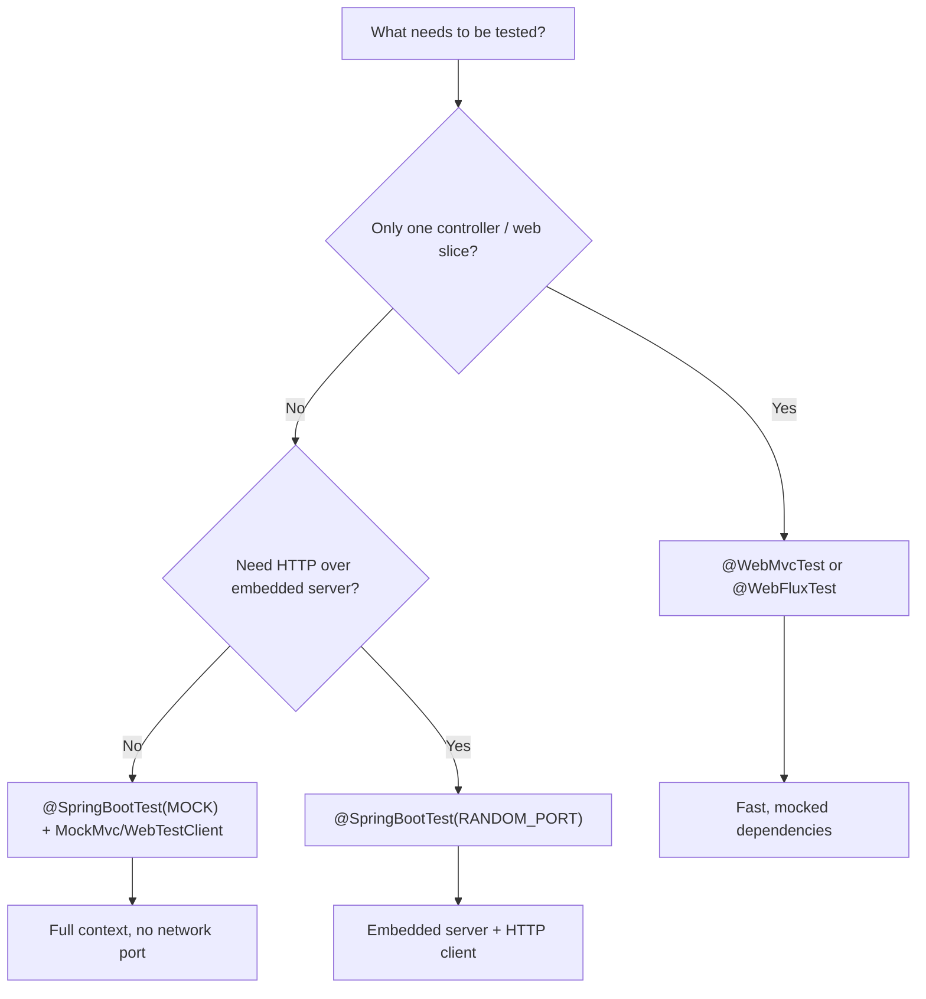
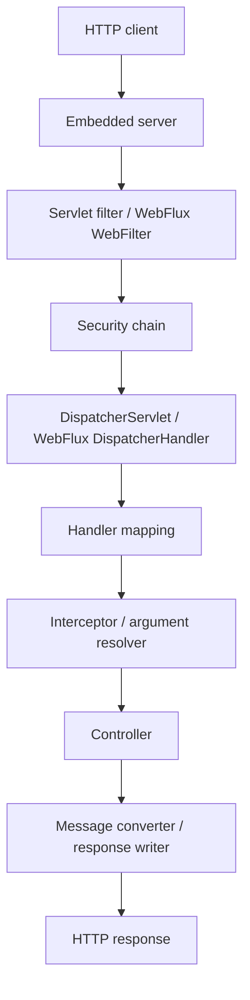

# Booting the Full Application When Real Routing Checks Are Needed

## 1. When Does a Test Need to Boot the Full Application?

In the **Spring Boot** chapter of the **Spring REST Docs (`SPRING_REST_DOCS`)** module, REST API documentation is generated from repeatable HTTP tests. With a test slice, we focus on a single controller and mock dependencies. However, some bugs only surface when requests traverse the actual application configuration: routes registered across multiple controllers, servlet filters, Spring Security, interceptors, converters, error handlers, WebFlux filter chains, or embedded server settings.

When you need to verify the request path through the fully assembled application, consider `@SpringBootTest` instead of relying solely on `@WebMvcTest` or `@WebFluxTest`. If the goal is to have the client send HTTP requests over an embedded server port, configure:

```java
@SpringBootTest(
    webEnvironment = SpringBootTest.WebEnvironment.RANDOM_PORT
)
```

`RANDOM_PORT` instructs Spring Boot to start the web server on a dynamically assigned port. The test client sends requests to that server through the application's HTTP stack. This is an important contrast to the default `MOCK` mode, which creates a mock web application context for tests without starting an embedded server listening on a network port.

In this lesson, we combine full-application tests with Spring REST Docs to verify real routing in an embedded server while generating snippets for requests, responses, parameters, headers, and payloads. The scope is routing inside the running application; verifying public DNS, load balancers, ingress, or external reverse proxies requires a separate integration environment.

After this lesson, you will be able to:

- Distinguish `MOCK`, `RANDOM_PORT`, `DEFINED_PORT`, and `NONE` on `@SpringBootTest`.
- Decide when a test slice suffices and when booting the full application is necessary.
- Write `RANDOM_PORT` tests with `WebTestClient` or REST Assured and generate snippets using Spring REST Docs.
- Test routes, filters, security, content negotiation, and error handling through an embedded server.
- Manage ports, test data, transactions, output directories, and CI for deterministic results.

Examples primarily use **Spring Boot 3.5, Spring REST Docs 3.x, JUnit Jupiter, and Java 17+**. Spring Boot 4.x changes test modules/packages, so use imports matching your major version.

## 2. Distinguishing Web Environment Modes

`@SpringBootTest` supports several modes for creating the web environment:

| Mode | What Is Initialized? | Embedded Server Listening on a Port? | When Appropriate |
| --- | --- | --- | --- |
| `MOCK` (default) | A mock web application context if the application has a web stack. | No. | Spring context integration tests, optionally paired with `MockMvc` or context-bound `WebTestClient`. |
| `RANDOM_PORT` | Application starts in an embedded server on a dynamically assigned port. | Yes. | Testing HTTP over the application's real server without hardcoding a port. |
| `DEFINED_PORT` | Application starts on the port configured in the environment. | Yes. | Test environments requiring a fixed, managed port. |
| `NONE` | Non-web application context. | No. | Testing configuration/service logic without HTTP. |

Decision flowchart:



**Checking routing does not automatically require `RANDOM_PORT`.** If you only need to confirm controller mappings in Spring MVC, `@WebMvcTest` may be enough. If you need all beans, filters, and configuration in one context without a socket, `@SpringBootTest` with `MOCK` and `@AutoConfigureMockMvc` still fits. Choose `RANDOM_PORT` when sending requests through the embedded server is itself part of what must be verified.

## 3. Routing Layers to Verify Through a Server

An HTTP request can pass through many layers before reaching a controller method:



In the servlet stack, filters can intercept requests before `DispatcherServlet`; Spring Security is typically integrated via the filter chain; handler mapping selects controllers by path, HTTP method, headers, and other conditions. In WebFlux, the corresponding components form a reactive pipeline. Full-application tests let all of these configurations participate in handling requests.

Examples that can only be verified fully with a server:

- Multiple controllers registering routes or creating mapping collisions.
- Actual filters adding/stripping headers, trace IDs, CORS, or rejecting requests.
- Spring Security enforcing authentication/authorization through the filter chain.
- Application-wide converter, serialization, content negotiation, or error handler configurations.
- Serving a context path, redirects, or container-dependent HTTP mechanics.

`RANDOM_PORT` only starts the application's embedded server. If your deployment architecture includes an API gateway, ingress, reverse proxy, service mesh, or load balancer, components outside the Spring Boot process are not automatically exercised. Verifying those requires an appropriate integration/e2e environment.

## 4. Dependencies and Example Structure

Servlet MVC example using Gradle Groovy DSL:

```groovy
dependencies {
    implementation 'org.springframework.boot:spring-boot-starter-web'
    testImplementation 'org.springframework.boot:spring-boot-starter-test'
    testImplementation 'org.springframework.restdocs:spring-restdocs-restassured'
}

tasks.named('test') {
    useJUnitPlatform()
}
```

In the MVC section below, REST Assured acts as the HTTP client sending requests to the embedded servlet server. Spring REST Docs provides the `spring-restdocs-restassured` module to create snippets from those calls. For reactive applications, use `spring-boot-starter-webflux` and `spring-restdocs-webtestclient`; Section 7 illustrates `WebTestClient` separately.

If using `WebTestClient` in a WebFlux application, swap the integration module:

```groovy
testImplementation 'org.springframework.restdocs:spring-restdocs-webtestclient'
```

Examples require JUnit Jupiter. Spring Boot dependency management should manage compatible artifact versions—avoid pinning a Spring REST Docs version incompatible with your Spring Boot version.

## 5. MVC Example: Full Application + `RANDOM_PORT` + REST Assured

Suppose the application has an endpoint for checking orders. Sample controller:

```java
package com.example.orders;

import org.springframework.http.HttpStatus;
import org.springframework.web.bind.annotation.GetMapping;
import org.springframework.web.bind.annotation.PathVariable;
import org.springframework.web.bind.annotation.RequestMapping;
import org.springframework.web.bind.annotation.RestController;
import org.springframework.web.server.ResponseStatusException;

@RestController
@RequestMapping("/api/orders")
class OrderController {

    @GetMapping("/{id}")
    OrderResponse find(@PathVariable long id) {
        if (id != 42L) {
            throw new ResponseStatusException(HttpStatus.NOT_FOUND);
        }
        return new OrderResponse(42L, "PAID");
    }

    record OrderResponse(long id, String status) {}
}
```

Assume the application has a Spring Boot configuration class discoverable from the root package `com.example.orders`. Full-application test:

```java
package com.example.orders;

import org.junit.jupiter.api.Test;
import org.springframework.beans.factory.annotation.Autowired;
import org.springframework.boot.test.context.SpringBootTest;
import org.springframework.boot.test.autoconfigure.restdocs.AutoConfigureRestDocs;
import io.restassured.specification.RequestSpecification;

import static io.restassured.RestAssured.given;
import static org.hamcrest.Matchers.equalTo;
import static org.springframework.restdocs.payload.PayloadDocumentation.fieldWithPath;
import static org.springframework.restdocs.payload.PayloadDocumentation.responseFields;
import static org.springframework.restdocs.request.RequestDocumentation.parameterWithName;
import static org.springframework.restdocs.request.RequestDocumentation.pathParameters;
import static org.springframework.restdocs.restassured.RestAssuredRestDocumentation.document;

@SpringBootTest(
    webEnvironment = SpringBootTest.WebEnvironment.RANDOM_PORT
)
@AutoConfigureRestDocs(outputDir = "build/generated-snippets/orders-http")
class OrderHttpDocumentationTest {

    @Autowired
    RequestSpecification documentationSpec;

    @Test
    void getOrder() {
        given(documentationSpec)
            .filter(document("orders-get",
                pathParameters(
                    parameterWithName("id").description("Order ID")
                ),
                responseFields(
                    fieldWithPath("id").description("Order identifier"),
                    fieldWithPath("status").description("Order status")
                )
            ))
        .when()
            .get("/api/orders/{id}", 42)
        .then()
            .statusCode(200)
            .body("id", equalTo(42))
            .body("status", equalTo("PAID"));
    }
}
```

In this example, `RANDOM_PORT` boots the application on a random port; `@AutoConfigureRestDocs` integrates Spring REST Docs with the `RequestSpecification` provided by Spring Boot when REST Assured is on the test classpath. REST Assured sends requests to the Boot-managed application port and the `document(...)` filter writes snippets. You do not need to hardcode a host or port in the test.

When request assertions succeed, snippets are written under:

```text
build/generated-snippets/
  orders-http/
    orders-get/
      http-request.adoc
      http-response.adoc
      path-parameters.adoc
      response-fields.adoc
      ...
```

### Testing a Non-Existent Route

Not-found routes are part of the HTTP contract worth verifying. You can add a dedicated test:

```java
@Test
void unknownOrderReturns404() {
    given(documentationSpec)
        .filter(document("orders-get-not-found"))
    .when()
        .get("/api/orders/{id}", 999)
    .then()
        .statusCode(404);
}
```

This example generates only default snippets for the error response. If your application uses a standard error structure such as `ProblemDetail` or a custom DTO, add response-field descriptors matching the Spring REST Docs REST Assured API of your version to document that contract.

## 6. Distinguishing `MOCK`, `RANDOM_PORT`, and `WebTestClient` Binding

Across projects, `WebTestClient` can be constructed in multiple ways. The client type is the same, yet the request path can differ:

| Usage | Where Is the Request Processed? | Tests the Embedded Server? |
| --- | --- | --- |
| `@WebFluxTest` + Boot-injected client | WebFlux test context/slice | No |
| `@SpringBootTest(MOCK)` + `@AutoConfigureWebTestClient` | Mock web environment | No port-listening server |
| `@SpringBootTest(RANDOM_PORT)` + `@AutoConfigureWebTestClient` | Running embedded server | Yes |
| `WebTestClient.bindToController(...)` | Controller bound directly in the test | No |
| `WebTestClient.bindToServer()` | Server at the base URL | Yes, if pointing to a real server |

Therefore, seeing `WebTestClient` in a test is not enough to conclude that requests went through a server. Inspect `webEnvironment` and how the client was created or bound.

`@LocalServerPort` is useful when a test must manually configure another HTTP client. Do not hardcode ports like `8080` in `RANDOM_PORT` tests, because the port is assigned dynamically by the system and may vary across runs.

## 7. Using `WebTestClient` When the Application Uses WebFlux

For reactive applications, use `spring-boot-starter-webflux` and `spring-restdocs-webtestclient`. `@SpringBootTest(RANDOM_PORT)` still starts the embedded server; `@AutoConfigureWebTestClient` provides the client targeting that server, and `@AutoConfigureRestDocs` attaches snippet recording.

```java
package com.example.orders;

import org.junit.jupiter.api.Test;
import org.springframework.beans.factory.annotation.Autowired;
import org.springframework.boot.test.context.SpringBootTest;
import org.springframework.boot.test.autoconfigure.restdocs.AutoConfigureRestDocs;
import org.springframework.boot.test.autoconfigure.web.reactive.AutoConfigureWebTestClient;
import org.springframework.test.web.reactive.server.WebTestClient;

import static org.springframework.restdocs.payload.PayloadDocumentation.fieldWithPath;
import static org.springframework.restdocs.payload.PayloadDocumentation.responseFields;
import static org.springframework.restdocs.webtestclient.WebTestClientRestDocumentation.document;

@SpringBootTest(
    webEnvironment = SpringBootTest.WebEnvironment.RANDOM_PORT
)
@AutoConfigureWebTestClient
@AutoConfigureRestDocs(outputDir = "build/generated-snippets/status-http")
class StatusHttpDocumentationTest {

    @Autowired
    WebTestClient webTestClient;

    @Test
    void getStatus() {
        webTestClient.get()
            .uri("/api/status")
            .exchange()
            .expectStatus().isOk()
            .expectBody()
            .jsonPath("$.status").isEqualTo("UP")
            .consumeWith(document("status-get",
                responseFields(
                    fieldWithPath("status")
                        .description("Current status of the service")
                )
            ));
    }
}
```

The example assumes a WebFlux application exposing `GET /api/status` returning JSON `{"status":"UP"}`. `WebTestClient` can target either a real server or a mock web context; the deciding factor here is `webEnvironment = RANDOM_PORT`, not just the client type. For the MVC servlet server in Section 5, REST Assured served as the main example.

## 8. Routing, Security, and Headers: Cases Worth Separate Tests

When the goal is verifying real routing through the full context, do not test only the happy path. A documentation test suite may include:

| Case | What to Verify | Useful Snippets |
| --- | --- | --- |
| Successful route | Correct path + method mapping, status, and JSON body. | `http-request`, `http-response`, `path-parameters`, `response-fields` |
| Wrong HTTP method | 404/405 per routing and error handling configuration. | `http-request`, `http-response` |
| Non-existent route | 404 and error schema if present. | `http-response`, `response-fields` |
| Unauthenticated | Security filter returns 401 or redirects per policy. | `http-request`, `http-response`, `response-headers` |
| Insufficient permissions | Security chain returns 403. | `http-request`, `http-response` |
| Header/content negotiation | `Accept`/`Content-Type` affect converters/response. | `request-headers`, `response-headers`, `http-response` |
| Context path or prefix | Request reaches the right route when the app has a base path. | `http-request`, `http-response` |

If Spring Security is enabled, tests must send valid authentication for the happy path (e.g., a test bearer token or appropriate test authentication mechanism). For `401/403` tests, omit credentials and document the exact response the client receives. Do not strip filters just to make all tests pass; doing so bypasses the exact routing/security behavior you want to test.

If documenting the `Authorization` header, never place real tokens in snippets. Use dedicated test dummy tokens and preprocessors to remove or mask sensitive values before writing documentation. Snippets are artifacts that may be stored in CI or published, so check both request headers and response bodies.

## 9. Configuring Snippet URIs When Using `RANDOM_PORT`

A random server does not have a fixed port. If you leave default URIs intact, snippets may contain `localhost` or an ephemeral test port; this is rarely the address public API readers should copy.

`@AutoConfigureRestDocs` can configure the displayed URI:

```java
@AutoConfigureRestDocs(
    outputDir = "build/generated-snippets/orders-http",
    uriScheme = "https",
    uriHost = "api.example.com",
    uriPort = 443
)
```

These values affect **the URI rendered in snippets**; they do not enable HTTPS on the embedded server, do not alter the listening port, and do not change the address the client actually called. When tests actually use HTTP on a random port while snippets describe a public HTTPS endpoint, this separates the test address from the published address.

With REST Assured or when custom URI transformations are needed, you can use an operation preprocessor like `modifyUris()`. You should also format payloads:

```java
import static org.springframework.restdocs.operation.preprocess.Preprocessors.preprocessRequest;
import static org.springframework.restdocs.operation.preprocess.Preprocessors.preprocessResponse;
import static org.springframework.restdocs.operation.preprocess.Preprocessors.prettyPrint;

// Inside document(...):
document("orders-get",
    preprocessRequest(prettyPrint()),
    preprocessResponse(prettyPrint()),
    responseFields(/* descriptors */)
)
```

Preprocessors only adjust the documented representation. Do not confuse masking headers or rewriting URIs in snippets with changing the application's actual requests or responses.

## 10. Test Data and Transaction Boundaries

A crucial difference between `MockMvc` running on the test thread and an HTTP client calling `RANDOM_PORT` is that requests are processed on a separate server thread. Therefore, never assume `@Transactional` on a test method will roll back data written by the server.

For example, a test creates an order via HTTP POST; the controller calls a service and a transaction opens on the request-handling thread. By the time the response returns, the request's transaction has likely committed. A test transaction wrapping the test method does not automatically encompass that independent transaction. If data is not cleaned up, subsequent runs may fail or return different results.

Strategies for stable tests:

- Use data with fixed IDs and test-specific namespaces, avoiding shared state dependencies.
- Clean up created data via cleanup APIs, repositories, or fixtures in appropriate teardown hooks.
- Use a dedicated test database (e.g., Testcontainers) when real persistence verification is required.
- Isolate parallel tests: avoid having two tests modify the same record or reuse the same operation ID for different snippets.
- Never call external production services; use mock servers or a controlled integration environment.

`RANDOM_PORT` is valuable when testing the real stack, but startup time and data state management cost more than test slices. There is no need to move every endpoint test to a full server; keep most fast tests in slices and reserve full integration tests for paths that require end-to-end verification.

## 11. Organizing Snippets, Asciidoctor, and CI

With Gradle, `@AutoConfigureRestDocs(outputDir = "build/generated-snippets/orders-http")` must match the Asciidoctor input directory:

```groovy
configurations {
    asciidoctorExt
}

dependencies {
    testImplementation 'org.springframework.restdocs:spring-restdocs-restassured'
    asciidoctorExt 'org.springframework.restdocs:spring-restdocs-asciidoctor'
}

def snippetsDir = layout.buildDirectory.dir(
    'generated-snippets/orders-http'
)

tasks.named('test') {
    useJUnitPlatform()
    outputs.dir snippetsDir
}

tasks.named('asciidoctor') {
    dependsOn tasks.named('test')
    inputs.dir snippetsDir
    configurations 'asciidoctorExt'
    attributes 'snippets': snippetsDir.get().asFile
}
```

Source document `src/docs/asciidoc/orders.adoc`:

```asciidoc
= Orders API
:toc: left

== Get an order

=== Request
include::{snippets}/orders-get/http-request.adoc[]
include::{snippets}/orders-get/path-parameters.adoc[]

=== Response
include::{snippets}/orders-get/http-response.adoc[]
include::{snippets}/orders-get/response-fields.adoc[]

== Order not found
include::{snippets}/orders-get-not-found/http-response.adoc[]
```

Run a clean pipeline:

```bash
./gradlew clean test asciidoctor
```

If full-server tests live in a separate task such as `integrationTest`, declare `asciidoctor` as depending on that task and mark the snippet directory as its output/input. If all tests run under the `test` task, verify that the task actually executes the `RANDOM_PORT` tests.

CI jobs should only upload HTML after documentation tests and Asciidoctor succeed. Never pass `-x test` or `-DskipTests` if current snippets are only generated by tests. When using dynamic ports, never hardcode a test run's ephemeral port into source documentation files; configure the published URI as shown in Section 9.

## 12. Common Errors When Testing Real Routing

| Symptom | Cause | Resolution |
| --- | --- | --- |
| `@LocalServerPort` is not injected | Test is not running with `RANDOM_PORT` or has no web server. | Use `@SpringBootTest(webEnvironment = RANDOM_PORT)` and verify the web application type. |
| Fixed port is already in use | Multiple tests or processes use the same port. | Use `RANDOM_PORT`; only use `DEFINED_PORT` when ports are explicitly managed. |
| `WebTestClient` is injected, but requests bypass the server | Client is bound to a mock context or controller instead of the server. | Check `webEnvironment` and how the client is created/bound. |
| Endpoint returns 404 even though controller exists | Component scanning, context path, servlet path, or profile configures a different route. | Check the root application class, mappings, context path, and test profile. |
| Endpoint returns 401/403 in tests | Security filter chain is active and the test is unauthenticated. | Supply a valid test identity/token or document the denied response explicitly. |
| Test-created data persists after the test finishes | The server request's transaction is outside the test method's transaction. | Clean up data explicitly, use test fixtures/databases, and avoid assuming automatic rollback. |
| Snippet contains a random port | Recording the actual test server URI. | Configure the documentation URI or use a URI-modifying preprocessor. |
| Asciidoctor cannot find snippet | Output directory or operation ID mismatch, or tests did not run. | Compare actual generated files against `{snippets}` and `include`. |
| Full-context tests are too slow | Booting a real server for every small endpoint. | Keep slice tests for controller checks and limit full integration tests. |
| Tests flake when run in parallel | Shared data or colliding operation IDs. | Isolate data, assign unique IDs, or intentionally limit concurrency. |

## 13. Practice Exercise

Extend `OrderController` to support:

- `GET /api/orders/{id}`: return order details.
- `POST /api/orders`: create an order, returning `201 Created` and a `Location` header.
- `GET /api/orders/{id}/items`: return a list of items.

Complete the following:

1. Write `@WebMvcTest` slice tests for the controller, verifying basic mappings/JSON and generating snippets.
2. Write a `@SpringBootTest(RANDOM_PORT)` full-application test using `WebTestClient`; verify at least one successful route, one non-existent route, and one response header.
3. If security is present, add `401/403` tests alongside valid authenticated requests. Do not disable filters in full-server tests.
4. Add a POST test that persists data to a test database; verify the data via the GET API and clean up after the test to prove you are not relying on test-transaction rollback.
5. Set a dedicated output directory under `build/generated-snippets/orders-http`, use a public URI in snippets, and wire Asciidoctor.
6. Run `./gradlew clean test asciidoctor` in CI. Intentionally alter a mapping or response field without updating descriptors to observe the pipeline failing.

**Completion criteria:** can explain why `RANDOM_PORT` is chosen over `MOCK`; real client sends requests through the embedded server; routing, filters, and responses are verified by assertions; snippets accurately describe the API contract; test data is isolated; CI publishes documentation only after tests pass.

## 14. References

- [Spring Boot 3.5 — Testing Spring Boot Applications](https://docs.spring.io/spring-boot/3.5/reference/testing/spring-boot-applications.html)
- [Spring Boot 3.5 — Auto-configured Spring REST Docs Tests](https://docs.spring.io/spring-boot/3.5/reference/testing/spring-boot-applications.html)
- [Spring Boot 3.5 — AutoConfigureWebTestClient API](https://docs.spring.io/spring-boot/3.5/api/java/org/springframework/boot/test/autoconfigure/web/reactive/AutoConfigureWebTestClient.html)
- [Spring REST Docs — Getting Started](https://docs.spring.io/spring-restdocs/tutorial/getting-started/index.html)
- [Spring REST Docs — Documenting Your API](https://docs.spring.io/spring-restdocs/reference/documenting-your-api/index.html)
- [Spring REST Docs — Customizing Requests and Responses](https://docs.spring.io/spring-restdocs/reference/customizing-requests-and-responses.html)
