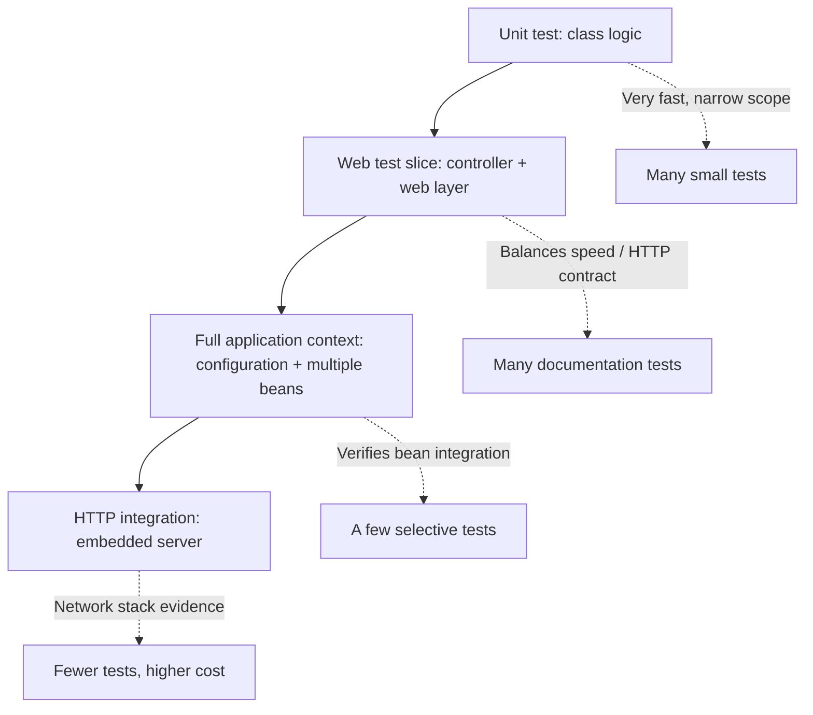

# Test Slices and the Trade-off Between Speed and Evidence

## 1. Why Choose the Right Testing Layer?

In the **Spring Boot** chapter of the **Spring REST Docs (`SPRING_REST_DOCS`)** module, HTTP tests produce snippets for requests, responses, payloads, parameters, and headers. Documentation built from snippets lets teams publish verifiable API contracts. However, the quality of the evidence in that documentation depends directly on the scope that the tests actually execute.

`@WebMvcTest` and `@WebFluxTest` are *test slices*: they initialize only the portion of the Spring `ApplicationContext` serving the web layer. By loading fewer beans than the full application, they typically run fast, stay well-isolated, and scale smoothly across many endpoints. In return, they do not prove that every service, repository, filter, production configuration, or embedded server works properly when wired together.

A test slice can demonstrate fairly well that:

- Routes are mapped accurately within the MVC/WebFlux context loaded by the test.
- The controller handles requests, parameters, headers, and payloads properly against mocked dependencies.
- Response statuses, JSON payloads, and REST Docs descriptors match what the controller returns.

However, a test slice does not by itself prove that:

- All real dependencies, databases, message brokers, or external services connect properly.
- Every application filter, security rule, or interceptor was loaded correctly.
- The real servlet container or reactive server handles network requests as expected.
- Other routes do not collide when the entire application boots.

Therefore, **test speed and breadth of evidence are two factors that must be balanced**. Do not pick a single test type for every purpose. Use test slices to check HTTP contracts at scale, and complement them with selective full-context or real HTTP tests at high-risk integration boundaries.

Examples use **Spring Boot 3.5, Spring REST Docs 3.x, JUnit Jupiter, and Java 17+**. In Boot 4.x, several test packages/modules changed; use imports matching your project's major version.

## 2. Four Common Levels of Evidence

| Level | Typical Configuration | Primary Evidence | Main Limitation |
| --- | --- | --- | --- |
| Unit logic test | JUnit + plain Java objects, no Spring context | Business logic of a class under controlled dependencies. | Does not test HTTP mappings or Spring configuration. |
| Web test slice | `@WebMvcTest` or `@WebFluxTest` | Controller, mappings, binding, serialization, and web advice loaded in the slice. | Most backing dependencies are mocked; does not prove the whole application. |
| Full application context, mock web | `@SpringBootTest` + `@AutoConfigureMockMvc` or `@AutoConfigureWebTestClient` | Multiple application beans/configurations created together and exercised via an in-context test client. | No real embedded server listening on a network port in `MOCK` mode. |
| HTTP integration test | `@SpringBootTest(webEnvironment = RANDOM_PORT)` + HTTP client | Requests traverse the embedded server and the application's HTTP stack. | Slower, harder to manage data/ports; still does not test out-of-process infrastructure. |

The diagram below illustrates how scope typically expands:



These levels do not completely replace one another. A real-server HTTP test can still miss a business bug if inputs are unrepresentative; a fast test slice remains highly valuable when it tests the right boundary with concrete assertions.

## 3. What Does a Test Slice Actually Initialize?

### 3.1. MVC Slice with `@WebMvcTest`

`@WebMvcTest(ProductController.class)` focuses on Spring MVC components—such as controllers, MVC infrastructure, message converters, and related web components. It does not automatically create every service or repository in the application. Controller dependencies are typically replaced with mocks or explicitly imported.

Example controller:

```java
package com.example.catalog;

import org.springframework.web.bind.annotation.GetMapping;
import org.springframework.web.bind.annotation.PathVariable;
import org.springframework.web.bind.annotation.RequestMapping;
import org.springframework.web.bind.annotation.RestController;

@RestController
@RequestMapping("/api/products")
class ProductController {
    private final ProductService service;

    ProductController(ProductService service) {
        this.service = service;
    }

    @GetMapping("/{id}")
    ProductResponse find(@PathVariable long id) {
        return service.find(id);
    }
}

interface ProductService {
    ProductResponse find(long id);
}

record ProductResponse(long id, String name) {}
```

Slice test mocking the service and documenting the response:

```java
package com.example.catalog;

import org.junit.jupiter.api.Test;
import org.springframework.beans.factory.annotation.Autowired;
import org.springframework.boot.test.autoconfigure.restdocs.AutoConfigureRestDocs;
import org.springframework.boot.test.autoconfigure.web.servlet.WebMvcTest;
import org.springframework.http.MediaType;
import org.springframework.test.context.bean.override.mockito.MockitoBean;
import org.springframework.test.web.servlet.MockMvc;

import static org.mockito.BDDMockito.given;
import static org.springframework.restdocs.mockmvc.MockMvcRestDocumentation.document;
import static org.springframework.restdocs.mockmvc.RestDocumentationRequestBuilders.get;
import static org.springframework.restdocs.payload.PayloadDocumentation.fieldWithPath;
import static org.springframework.restdocs.payload.PayloadDocumentation.responseFields;
import static org.springframework.restdocs.request.RequestDocumentation.parameterWithName;
import static org.springframework.restdocs.request.RequestDocumentation.pathParameters;
import static org.springframework.test.web.servlet.result.MockMvcResultMatchers.jsonPath;
import static org.springframework.test.web.servlet.result.MockMvcResultMatchers.status;

@WebMvcTest(ProductController.class)
@AutoConfigureRestDocs(outputDir = "build/generated-snippets/catalog-slice")
class ProductControllerDocumentationTest {

    @Autowired
    MockMvc mockMvc;

    @MockitoBean
    ProductService service;

    @Test
    void findProduct() throws Exception {
        given(service.find(27L))
            .willReturn(new ProductResponse(27L, "Fountain pen"));

        mockMvc.perform(
                get("/api/products/{id}", 27L)
                    .accept(MediaType.APPLICATION_JSON)
            )
            .andExpect(status().isOk())
            .andExpect(jsonPath("$.id").value(27))
            .andExpect(jsonPath("$.name").value("Fountain pen"))
            .andDo(document("products-find",
                pathParameters(
                    parameterWithName("id")
                        .description("Product identifier")
                ),
                responseFields(
                    fieldWithPath("id").description("Product ID"),
                    fieldWithPath("name").description("Product name")
                )
            ));
    }
}
```

The test above provides evidence for the controller's HTTP behavior inside the MVC slice given a predefined service result. It verifies the `GET /api/products/{id}` route, path variable binding, JSON response, status, and alignment of `responseFields`. It does **not** test the real `ProductService` implementation or database retrieval.

### 3.2. Reactive Slice with `@WebFluxTest`

For WebFlux, use `@WebFluxTest`, `WebTestClient`, and the `spring-restdocs-webtestclient` dependency. Example:

```java
package com.example.status;

import java.util.Map;
import org.springframework.web.bind.annotation.GetMapping;
import org.springframework.web.bind.annotation.RestController;
import reactor.core.publisher.Mono;

@RestController
class StatusController {
    @GetMapping("/api/status")
    Mono<Map<String, String>> status() {
        return Mono.just(Map.of("status", "UP"));
    }
}
```

Test:

```java
package com.example.status;

import org.junit.jupiter.api.Test;
import org.springframework.beans.factory.annotation.Autowired;
import org.springframework.boot.test.autoconfigure.restdocs.AutoConfigureRestDocs;
import org.springframework.boot.test.autoconfigure.web.reactive.WebFluxTest;
import org.springframework.test.web.reactive.server.WebTestClient;

import static org.springframework.restdocs.payload.PayloadDocumentation.fieldWithPath;
import static org.springframework.restdocs.payload.PayloadDocumentation.responseFields;
import static org.springframework.restdocs.webtestclient.WebTestClientRestDocumentation.document;

@WebFluxTest(StatusController.class)
@AutoConfigureRestDocs(outputDir = "build/generated-snippets/status-slice")
class StatusControllerDocumentationTest {

    @Autowired
    WebTestClient client;

    @Test
    void status() {
        client.get().uri("/api/status")
            .exchange()
            .expectStatus().isOk()
            .expectBody()
            .jsonPath("$.status").isEqualTo("UP")
            .consumeWith(document("status-get",
                responseFields(
                    fieldWithPath("status")
                        .description("Service status")
                )
            ));
    }
}
```

WebFlux slices have the same limitation: dependent services do not automatically appear in the context. Mock dependencies outside the web slice, and import only configurations genuinely relevant to what you are testing.

## 4. Why Do Test Slices Usually Run Faster?

Test slices typically instantiate fewer beans than `@SpringBootTest`. That can reduce context startup time, shrink test configuration, reduce external systems needed, and make failure root causes easier to isolate.

| Aspect | Test Slice | Full Application / Real HTTP |
| --- | --- | --- |
| Context startup | Selective web beans | Many application beans or full context |
| Backing dependencies | Usually mocked or selectively imported | Can use real implementations |
| Database/broker | Usually unnecessary | May be needed or run via containers |
| HTTP server | Mock web context | Can start an embedded server with `RANDOM_PORT` |
| Iteration speed | Usually faster | Usually slower |
| Test scope | Narrow, focused | Broader, more interactions |
| Failure isolation | Usually easier | May involve multiple beans/infrastructure |

This is a general tendency, not a fixed timing guarantee. A slice can become heavy if it imports many configurations; a full-context test can reuse its context across methods and run faster than expected. Measure actual build times rather than guessing solely from annotations.

## 5. The Trade-off: What Evidence Is Lost When Mocking Dependencies?

Mocking is useful for isolation, yet it changes the nature of what is being tested.

Example:

```java
given(service.find(27L))
    .willReturn(new ProductResponse(27L, "Fountain pen"));
```

The test can prove the controller maps the service's return value into the right JSON and status. However, it does not prove that:

- The real service queries data correctly.
- Repository mappings or transactions work.
- The database has a compatible schema and data.
- Business rules inside the service return the same result with production data.
- Real beans are wired properly by Spring in the full application context.

Accordingly, a test slice should not be described as end-to-end evidence for an endpoint. In internal engineering documentation, note which dependencies a test mocks and which behaviors are covered by separate integration tests.

On the other hand, mocks do not render REST Docs documentation valueless. When the test's goal is the controller's HTTP contract, controlled mock data keeps snippets stable and readable. Avoid overly simplistic mock data that hides important response branches—such as nulls, empty collections, validation errors, or not-found states.

## 6. Choosing Between Test Slices and Full Context

### 6.1. Use Test Slices When...

- You want to verify mappings, binding, validation, statuses, and the JSON contract of a controller.
- You want to generate snippets for many API routes with controlled data and frequent execution.
- Services/repositories can be mocked to focus on the HTTP layer.
- Failures to catch lie mainly in controllers, MVC/WebFlux configuration loaded in the slice, or web serialization.

### 6.2. Use Full Application Context When...

- You need to verify multiple beans wired together by Spring, such as controller → service → repository.
- Security/filters/interceptors are critical yet absent from slices, or you want to verify the real application-wide configuration.
- Multiple controllers/routes exist and you need to catch issues from global configuration.
- You need to confirm properties, profiles, converters, advice, or component scanning are active as expected.

Full context in `MOCK` mode still lacks an embedded server. When you want to test requests over a real port, choose `RANDOM_PORT` and an appropriate HTTP client.

### 6.3. Use HTTP Integration Tests When...

- Routing or filters depend on the servlet/reactive server.
- You need to verify the HTTP stack, port, context path, or server-specific behavior.
- The API needs to be called over the network by a real client.
- A bug only reproduces when requests pass through the full server chain.

There is no need to switch every test to `RANDOM_PORT`. Each real HTTP test may demand more data setup, port handling, cleanup, and boot time; reserve it for boundaries with high evidentiary value.

## 7. Organizing the Documentation Test Suite by Evidence Goal

A REST Docs test suite can be divided into groups with clear operation IDs:

| Group | Example Operation ID | Suitable Test Layer | What Needs to Be Proven |
| --- | --- | --- | --- |
| Successful API contract | `products-find-success` | Web slice | Mapping, binding, public JSON and headers |
| Validation errors | `products-create-invalid` | Web slice | 400, field errors, error payload |
| Missing resource | `products-find-not-found` | Web slice or full context depending on error handler | 404 and error schema |
| Security | `products-find-unauthenticated`, `products-find-forbidden` | Slice with proper security config or full context | 401/403, challenge/headers, and policy |
| Persistence integration | `products-create-persisted` | Full context or real HTTP + test database | Data is persisted and queried back |
| HTTP server behavior | `products-routing-http` | `RANDOM_PORT` | Filter chain/server/routing over a port |

Each operation ID should represent one meaningful documented scenario. Avoid letting slice tests and full integration tests write the same ID to the same output directory, as results may overwrite each other. Use separate directories such as `build/generated-snippets/slice` and `build/generated-snippets/http`, or assign clearly distinct operation IDs.

### Organizing Snippet Groups

```text
build/generated-snippets/
  slice/
    products-find-success/
      http-request.adoc
      http-response.adoc
      response-fields.adoc
    products-create-invalid/
      http-request.adoc
      http-response.adoc
  http/
    products-routing-http/
      http-request.adoc
      http-response.adoc
```

An Asciidoctor page can include both groups using distinct attributes:

```asciidoc
== Find product: contract test
include::{slice-snippets}/products-find-success/http-request.adoc[]
include::{slice-snippets}/products-find-success/http-response.adoc[]

== Routing via embedded server
include::{http-snippets}/products-routing-http/http-request.adoc[]
include::{http-snippets}/products-routing-http/http-response.adoc[]
```

You do not have to follow this exact example structure. What matters is that test tasks and build tasks use unambiguous paths without overwriting each other's outputs.

## 8. Does REST Docs Make Test Slices Stronger Evidence?

Spring REST Docs adds an important safeguard: descriptors can fail the test if the actual payload does not match documented fields. For example:

```java
responseFields(
    fieldWithPath("id").description("Product ID"),
    fieldWithPath("name").description("Product name")
)
```

If the controller starts returning an extra `price` field without the test describing it or intentionally marking it optional/ignored, snippet generation can fail. This helps detect documentation that is no longer complete relative to the response observed by the test.

However, REST Docs **does not expand test scope on its own**. If the service is mocked, descriptors only validate the response built by the controller from mock values. If the test slice does not load security filters, snippets do not prove the production security chain works either. REST Docs binds documentation content to the response observed in the test; it does not turn a test slice into a full integration test.

To improve evidence quality:

1. Include assertions for status codes, payloads, and required headers—do not merely call `document(...)`.
2. Add descriptors for fields, parameters, and headers belonging to the public contract.
3. Use test data covering both success responses and critical error responses.
4. Keep at least a few full-context/HTTP tests for boundaries not covered by slices.
5. Have CI re-run tests and build documentation from fresh snippets rather than stale ones.

## 9. Security and Filters: Avoiding Overbroad Conclusions

`@WebMvcTest` can often load relevant security configuration depending on dependencies and auto-configuration, yet you should not assume every application filter is active in a slice. Inspect which filters/chains are present in the test context; if you need to verify global security configuration, consider `@SpringBootTest` with `@AutoConfigureMockMvc` or `RANDOM_PORT`.

A sound strategy:

| Check | Suggested Layer | Evidence |
| --- | --- | --- |
| Controller returns 200 on valid data | Web slice | Controller contract |
| Validation returns 400 | Web slice | Binding/validation/error response |
| Service authorization rules | Unit/service test | Authorization rules in business logic |
| Security filter chain returns 401/403 | Full context or HTTP test | Authentication/authorization setup wired in the app |
| CORS/headers added by filters | Full context/HTTP test if filter is outside the slice | Filter actually processing responses |

When recording snippets containing `Authorization` or cookies, never use real credentials. Use dummy test-only tokens and strip/mask sensitive headers during preprocessing before saving snippets. Hiding tokens in documentation does not replace asserting that security filters enforced access control properly.

## 10. Cost, Stability, and Maintainability

| Factor | Test Slice | Full Context / Real HTTP |
| --- | --- | --- |
| Execution time | Usually low | Usually higher |
| Dependencies to set up | Few; many can be mocked | Potentially many |
| Isolation | High | Depends on configuration and data |
| Snippet stability | Easy to control with fixed mock data | Requires managing data, time, ports, and backing systems |
| Integration bug detection | Limited | Broader |
| Maintenance effort | Less config, though mocks must track service/contract changes | Requires fixtures, cleanup, environment setup, and build time |

To keep full integration tests stable:

- Use `RANDOM_PORT` instead of fixed ports when multiple processes/tests run on the same host.
- Pin test data or create isolated data per test; do not depend on uncleaned shared state.
- Do not assume test `@Transactional` rolls back transactions opened on the HTTP server's worker thread.
- Never call external production services; use reproducible databases/containers or mock servers.
- Assign unique operation IDs; never let parallel tests write to the same snippet folder.

For test slices, avoid mocking so heavily that you only test a canned response without verifying controller behavior. Mock at the proper dependency boundary while still testing binding, validation, mapping, and real responses from the MVC/WebFlux layer.

## 11. Configuring CI with a Tiered Testing Strategy

You can split tests into two groups:

| Task | Contents | When Run |
| --- | --- | --- |
| `test` | Unit tests and web slices generating contract snippets | Every pull request/commit |
| `integrationTest` | Full context or HTTP tests over `RANDOM_PORT` | Important pull requests, nightly, or pre-release depending on cost |
| `asciidoctor` | Combines snippets from the executed test groups | After the snippet-generating test tasks |

Gradle Groovy DSL example with separate outputs:

```groovy
def sliceSnippets = layout.buildDirectory.dir(
    'generated-snippets/slice'
)
def httpSnippets = layout.buildDirectory.dir(
    'generated-snippets/http'
)

tasks.named('test') {
    useJUnitPlatform()
    outputs.dir sliceSnippets
}

tasks.register('integrationTest', Test) {
    description = 'Runs full application HTTP integration tests.'
    group = 'verification'
    testClassesDirs = sourceSets.test.output.classesDirs
    classpath = sourceSets.test.runtimeClasspath
    useJUnitPlatform()
    outputs.dir httpSnippets
    shouldRunAfter tasks.named('test')
}

tasks.named('asciidoctor') {
    dependsOn tasks.named('test')
    dependsOn tasks.named('integrationTest')
    inputs.dir sliceSnippets
    inputs.dir httpSnippets
}
```

This configuration illustrates task and output relationships. In a real project, create a dedicated source set for `integrationTest` rather than sharing `sourceSets.test` as in this minimal snippet; then configure its test classpath, test classes, and matching `outputDir` annotations. If one test group does not run on pull requests, CI documentation should not include snippets produced exclusively by that group unless those artifacts are fetched from a verified build.

The pipeline can run:

```bash
./gradlew clean test integrationTest asciidoctor
```

If full integration tests are expensive, you can run a fast job on PRs and a broader job on a schedule or pre-release. When doing so, document clearly which evidence groups produced each job's documentation artifact and avoid merging unregenerated snippets.

## 12. Common Mistakes

| Mistake | Consequence | Fix |
| --- | --- | --- |
| Treating `@WebMvcTest` as a full-application test | Misses wiring/services/security/filters outside the slice. | Document test boundaries clearly; add full-context tests where needed. |
| Mocking all dependencies yet calling the result end-to-end | Evidence does not reflect real implementations behind the controller. | Label contract tests accurately; test services/repositories in separate layers. |
| Using `RANDOM_PORT` for every endpoint | Slow builds, harder data/port management. | Keep most endpoint tests in slices; reserve server tests for meaningful integration risks. |
| Generating snippets with no assertions | Documentation files exist, yet HTTP behavior may be wrong. | Assert status/body/headers before documenting. |
| Documenting only happy paths | Documentation omits critical 400/401/403/404 cases. | Add dedicated operation IDs for contract error responses. |
| Assuming REST Docs verifies mocked services | Confusion over evidence scope. | Recognize mock data boundaries and maintain independent service/integration tests. |
| Concluding security works from a slice lacking security filters | Misses real protection mechanisms. | Test with real security config in full context or over HTTP. |
| Two test groups writing the same operation ID | Snippets can overwrite each other during parallel runs. | Separate output roots or assign scenario-specific IDs. |
| Publishing snippets from an old build | Documentation drifts from current source/tests. | Run snippet-generating tests and doc builds in a pipeline with explicit dependencies. |

## 13. Practice Exercise

For the products API, create three groups of tests:

1. **Web slice contract:** use `@WebMvcTest` to test `GET /api/products/{id}`, `POST /api/products`, and validation errors. Mock the service while asserting status, JSON, headers, and REST Docs descriptors.
2. **Service integration:** use a full application context to test the service/repository against a test database, verifying business rules and transactions.
3. **HTTP integration:** pick a critical route to run with `@SpringBootTest(RANDOM_PORT)`, using REST Assured or `WebTestClient` matching your stack to verify filters/routing through the embedded server.

Assign distinct operation IDs for each case, such as `products-find-slice`, `products-create-invalid-slice`, and `products-create-http`. Create an Asciidoctor document with sections clearly noting which test layer generated each example. Run a clean build and record the execution time of each task.

**Completion criteria:** can explain what a test slice proves and does not prove; choose the right layer for each risk; snippets are backed by real assertions and descriptors; do not confuse tests with mocked dependencies for end-to-end tests; CI rebuilds documentation from valid test runs.

## 14. References

- [Spring Boot 3.5 — Testing Spring Boot Applications](https://docs.spring.io/spring-boot/3.5/reference/testing/spring-boot-applications.html)
- [Spring Boot 3.5 — Testing Slices](https://docs.spring.io/spring-boot/3.5/reference/testing/spring-boot-applications.html#testing.spring-boot-applications.autoconfigured-tests)
- [Spring Boot — @WebMvcTest API](https://docs.spring.io/spring-boot/3.5/api/java/org/springframework/boot/test/autoconfigure/web/servlet/WebMvcTest.html)
- [Spring Boot — @WebFluxTest API](https://docs.spring.io/spring-boot/3.5/api/java/org/springframework/boot/test/autoconfigure/web/reactive/WebFluxTest.html)
- [Spring REST Docs — Getting Started](https://docs.spring.io/spring-restdocs/tutorial/getting-started/index.html)
- [Spring REST Docs — Documenting Your API](https://docs.spring.io/spring-restdocs/reference/documenting-your-api/index.html)
- [Spring REST Docs — Customizing Requests and Responses](https://docs.spring.io/spring-restdocs/reference/customizing-requests-and-responses.html)
