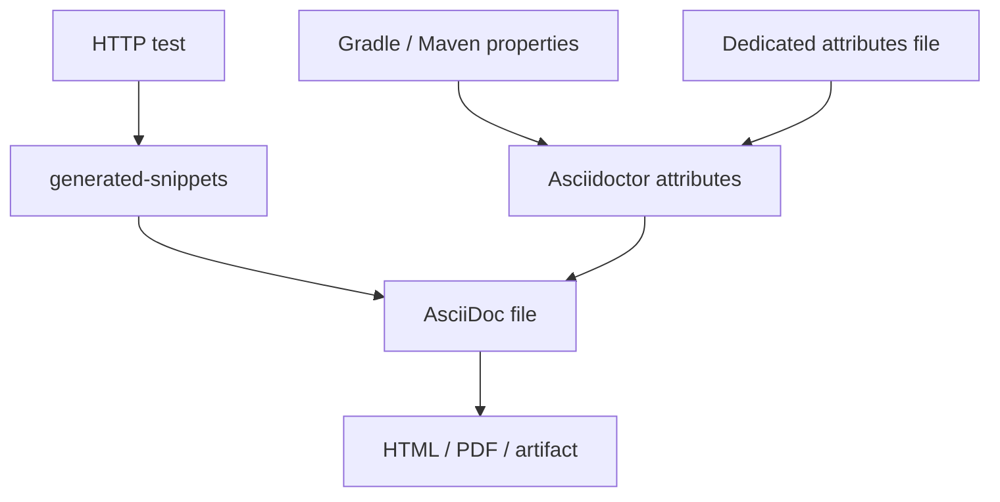

# Placing Documentation Attributes in the Build Instead of Business Code

## 1. Why Configure Documentation in the Build?

In the **Spring Boot** chapter of the **Spring REST Docs (SPRING_REST_DOCS)** module, HTTP tests generate snippets describing requests, responses, payloads, parameters, and headers. These snippets are typically assembled into documentation using Asciidoctor; projects can also generate Markdown from the same source data.

When authoring documentation, you often need values such as the snippets directory, service name, API version, public base URL, environment name, and template file paths. These are **attributes for authoring and packaging documentation**. They should be declared in the build (Gradle/Maven) or a dedicated attributes file and then passed to the Asciidoctor/Markdown processor. Controllers, services, and business logic should focus on application behavior and do not need to know which host the documentation will be published on.

| Data | Example | Proper Location |
| --- | --- | --- |
| Runtime configuration | Database URL, context path, feature flags affecting behavior | Spring configuration/profiles |
| HTTP test configuration | @ActiveProfiles("test"), RANDOM_PORT, mock data | Test classes and test configuration |
| Documentation presentation attributes | snippets, api-version, api-base-url, environment-label | Build script or attributes file |

Do not place api-base-url solely for documentation display into application.yml if the application does not use it to send requests or route traffic. If the application actually calls a partner service, that service's runtime base URL still belongs in application configuration. A value may appear in both places, yet each purpose needs its own configuration source.

After this lesson, you can distinguish Asciidoctor attributes from Spring Boot properties; pass the snippets directory, API version, and base URL from Gradle/Maven; use an attributes file to separate content from build scripts; override values per environment; and integrate attributes into CI without exposing secrets.

Examples use **Spring Boot 3.5, Spring REST Docs 3.x, Gradle, and Maven**. Plugin syntax may vary across build plugin versions, so align it with the version used in your project.

## 2. What Is an Asciidoctor Attribute?

An Asciidoctor attribute is a named variable substituted during document processing. It can be declared directly inside an AsciiDoc file:

```asciidoc
:doctype: book
:toc: left
:api-version: v1

= Catalog API {api-version}

This documentation describes API contract version {api-version}.
```

Or attributes can be passed from the command line or build plugin. The latter approach is useful when a single source document is built across multiple environments or API versions.

A source file can reference:

```asciidoc
= {service-name} API
:toc: left

API version: {api-version}
Base URL: {api-base-url}
Environment: {environment-label}
```

snippets is the attribute name typically used by the Spring REST Docs Asciidoctor extension to include snippets. Attributes such as service-name, api-version, or api-base-url are project-defined. Asciidoctor simply substitutes the supplied values; it does not infer business meaning for variables.



The build combines test-generated snippets with attributes provided by the build or config files. Output can carry different titles, versions, URLs, and environment labels without modifying controllers or services.

## 3. Keeping Documentation Attributes Out of Business Code

Controllers should focus on routes and request handling:

```java
@RestController
@RequestMapping("/api/catalog")
class CatalogController {
    @GetMapping("/{id}")
    CatalogItem find(@PathVariable long id) {
        return catalogService.find(id);
    }
}
```

Do not place constants solely for documentation presentation inside controllers:

```java
// Do not place documentation configuration in business code:
static final String DOCS_BASE_URL = "https://api.example.com";
static final String DOCS_VERSION = "v1";
```

Public hostnames and documentation version labels do not dictate how a controller handles requests. Place them in an attributes file:

```properties
service-name=Catalog
api-version=v1
api-base-url=https://api.example.com
environment-label=Public API
```

Source file index.adoc simply references:

```asciidoc
= {service-name} API {api-version}

Base URL: {api-base-url}

Documentation for: {environment-label}
```

When the API is deployed behind a gateway on a different host, only build attributes need to change. Controllers and services do not have to be edited if the application's HTTP contract has not changed.

## 4. Configuring Attributes in Gradle

Suppose Spring REST Docs tests write snippets to build/generated-snippets, and the build applies the org.asciidoctor.jvm.convert plugin alongside the spring-restdocs-asciidoctor dependency.

### Gradle Groovy DSL

Example in build.gradle:

```groovy
plugins {
    id 'java'
    id 'org.springframework.boot' version '3.5.0'
    id 'org.asciidoctor.jvm.convert' version '4.0.4'
}

configurations {
    asciidoctorExt
}

dependencies {
    testImplementation 'org.springframework.boot:spring-boot-starter-test'
    testImplementation 'org.springframework.restdocs:spring-restdocs-mockmvc'
    asciidoctorExt 'org.springframework.restdocs:spring-restdocs-asciidoctor'
}

def snippetsDir = layout.buildDirectory.dir('generated-snippets')

tasks.named('test') {
    useJUnitPlatform()
    outputs.dir snippetsDir
}

tasks.named('asciidoctor') {
    dependsOn tasks.named('test')
    inputs.dir snippetsDir
    configurations 'asciidoctorExt'

    attributes(
        'snippets': snippetsDir.get().asFile,
        'service-name': 'Catalog',
        'api-version': providers.gradleProperty('apiVersion').getOrElse('v1'),
        'api-base-url': providers.gradleProperty('apiBaseUrl')
            .getOrElse('https://api.example.com'),
        'environment-label': providers.gradleProperty('docsEnvironment')
            .getOrElse('Public API')
    )
}
```

Plugin versions in the example illustrate a specific setup; use the versions standardized by your project. Crucially, attributes(...) passes values into Asciidoctor; they do not become Spring properties and are not injected into the runtime application context.

Pass different values at execution time:

```bash
./gradlew clean test asciidoctor \
  -PapiVersion=v2 \
  -PapiBaseUrl=https://staging-api.example.com \
  -PdocsEnvironment="Staging API"
```

Gradle project properties can be read via providers.gradleProperty(...). Using Provider keeps configuration lazy and supplies defaults when callers omit parameters.

### Gradle Kotlin DSL

In build.gradle.kts, you can configure this similarly:

```kotlin
val snippetsDir = layout.buildDirectory.dir("generated-snippets")
val apiVersion = providers.gradleProperty("apiVersion").orElse("v1")
val apiBaseUrl = providers.gradleProperty("apiBaseUrl")
    .orElse("https://api.example.com")
val docsEnvironment = providers.gradleProperty("docsEnvironment")
    .orElse("Public API")

tasks.test {
    useJUnitPlatform()
    outputs.dir(snippetsDir)
}

tasks.named("asciidoctor") {
    dependsOn(tasks.test)
    inputs.dir(snippetsDir)
    attributes(
        mapOf(
            "snippets" to snippetsDir.get().asFile,
            "service-name" to "Catalog",
            "api-version" to apiVersion.get(),
            "api-base-url" to apiBaseUrl.get(),
            "environment-label" to docsEnvironment.get()
        )
    )
}
```

Overloads for attributes(...) may vary by Asciidoctor Gradle plugin version; use the API matching your installed plugin. The core idea stays the same: Gradle reads project properties and passes them as documentation attributes.

## 5. Using a Dedicated Attributes File

As the number of attributes grows or needs sharing across multiple files, place them in a dedicated configuration file such as src/docs/asciidoc/attributes.adoc:

```asciidoc
:service-name: Catalog
:api-version: v1
:api-base-url: https://api.example.com
:environment-label: Public API
```

Include it at the top of the document:

```asciidoc
include::attributes.adoc[]

= {service-name} API {api-version}

Base URL: {api-base-url}
```

This is helpful when documentation authors manage metadata alongside AsciiDoc sources. Across multiple environments, you can maintain separate local/staging/public attributes files, provided you strictly control which file each build includes.

Another option is a separate properties/YAML file read by the build script and forwarded as attributes. Avoid unconditionally including a file with production defaults in every environment if staging CI requires a different URL. Never place secrets inside attributes files since documentation may be packaged as artifacts and shared broadly.

To avoid conflicts across multiple sources, choose one default source; allow CI to override only designed keys; and avoid duplicate declarations across document headers, include files, and plugin config. When overriding, inspect the resulting HTML to confirm the final values.

## 6. Configuring Attributes for Maven

The Asciidoctor Maven Plugin accepts attributes in its configuration block. Suppose the project defines Maven properties api.version, api.base.url, and docs.environment:

```xml
<properties>
    <api.version>v1</api.version>
    <api.base.url>https://api.example.com</api.base.url>
    <docs.environment>Public API</docs.environment>
    <snippets.dir>${project.build.directory}/generated-snippets</snippets.dir>
</properties>

<build>
    <plugins>
        <plugin>
            <groupId>org.asciidoctor</groupId>
            <artifactId>asciidoctor-maven-plugin</artifactId>
            <version>3.1.1</version>
            <dependencies>
                <dependency>
                    <groupId>org.springframework.restdocs</groupId>
                    <artifactId>spring-restdocs-asciidoctor</artifactId>
                    <version>${spring-restdocs.version}</version>
                </dependency>
            </dependencies>
            <executions>
                <execution>
                    <id>generate-api-docs</id>
                    <phase>prepare-package</phase>
                    <goals>
                        <goal>process-asciidoc</goal>
                    </goals>
                    <configuration>
                        <sourceDirectory>
                            ${project.basedir}/src/docs/asciidoc
                        </sourceDirectory>
                        <outputDirectory>
                            ${project.build.directory}/generated-docs
                        </outputDirectory>
                        <backend>html</backend>
                        <attributes>
                            <snippets>${snippets.dir}</snippets>
                            <service-name>Catalog</service-name>
                            <api-version>${api.version}</api-version>
                            <api-base-url>${api.base.url}</api-base-url>
                            <environment-label>${docs.environment}</environment-label>
                        </attributes>
                    </configuration>
                </execution>
            </executions>
        </plugin>
    </plugins>
</build>
```

The spring-restdocs.version property must be managed by a parent/BOM or declared in the project. The plugin version above is illustrative; use the version compatible with your build.

Override from the command line:

```bash
./mvnw clean verify \
  -Dapi.version=v2 \
  -Dapi.base.url=https://staging-api.example.com \
  -Ddocs.environment="Staging API"
```

Maven properties apply when the documentation plugin executes. They do not automatically modify the Spring Environment of the application under test unless the same property is wired into Spring configuration separately.

Lifecycle note: prepare-package works when snippets are generated by tests running in the test phase (Surefire). If snippets come from integration tests running in integration-test/verify (Failsafe), move the Asciidoctor step after those tests or invoke the documentation goal after mvn verify.

## 7. Using Attributes in Documentation and Including Snippets

File src/docs/asciidoc/index.adoc can use:

```asciidoc
include::attributes.adoc[]

= {service-name} API
:toc: left

== Version Information

API version: {api-version}

Documentation environment: {environment-label}

Published base URL: {api-base-url}

== Find Product

=== Request
include::{snippets}/products-find/http-request.adoc[]
include::{snippets}/products-find/path-parameters.adoc[]

=== Response
include::{snippets}/products-find/http-response.adoc[]
include::{snippets}/products-find/response-fields.adoc[]
```

snippets is supplied by the Spring REST Docs Asciidoctor extension or build configuration. Remaining attributes are project-declared. They can be used in headings, paragraphs, and body content without adding corresponding variables to controllers.

### Attributes Do Not Automatically Rewrite URIs in HTTP Snippets

api-base-url in the introduction only substitutes text at that spot. It does **not** automatically rewrite URLs inside http-request.adoc or curl-request.adoc. To display a public host in HTTP snippets, configure Spring REST Docs URIs (uriScheme, uriHost, uriPort) or an operation preprocessor like modifyUris().

You can configure both:

- api-base-url for introductions, links, or handwritten examples.
- uriScheme, uriHost, uriPort for normalizing request snippets.

If both values describe the same public endpoint, keep them consistent. Derive them from one shared project property passed to both Asciidoctor attributes and test configuration rather than entering two independent values.

## 8. Attributes by Environment and Version

One AsciiDoc source can be compiled into multiple variants:

| Variant | api-version | api-base-url | environment-label |
| --- | --- | --- | --- |
| Local preview | v1 | http://localhost:8080 | Local |
| Staging | v2 | https://staging-api.example.com | Staging |
| Public | v2 | https://api.example.com | Public API |

Values are illustrative. Run Gradle with the staging variant:

```bash
./gradlew asciidoctor \
  -PapiVersion=v2 \
  -PapiBaseUrl=https://staging-api.example.com \
  -PdocsEnvironment="Staging"
```

Or Maven:

```bash
./mvnw asciidoctor:process-asciidoc \
  -Dapi.version=v2 \
  -Dapi.base.url=https://staging-api.example.com \
  -Ddocs.environment=Staging
```

If the task also runs tests to generate snippets, maintain an explicit relationship such as asciidoctor depending on test. If running only the authoring goal, ensure snippets have already been generated from matching tests for the same API version.

A staging label does not prove a production server behaves identically. If snippets come from mocked tests, never label them Production verified simply because api-base-url points to a production host. Attributes are presentation metadata, not proof that tests called that environment.

## 9. Security and Reproducibility

Documentation can leak sensitive data if request/response snippets inadvertently record tokens, cookies, personal data, or internal URLs. Attributes can also leak when rendered into HTML/PDF or printed in build logs.

- Never place passwords, API keys, bearer tokens, or client secrets in Asciidoctor attributes.
- Never pass secrets via -P/-D if they should not appear in artifacts or logs.
- Use a secret store/environment for runtime credentials; if requests need auth, use test-only dummy tokens and redact headers before writing snippets.
- Pass only publishable base URLs to api-base-url.
- Use safe defaults for local previews; never default to production when unspecified.
- When adding build metadata, avoid exposing unnecessary internal details.

For reproducible builds, required attributes need safe defaults or explicit CI inputs; the same commit and property set should produce identical content; URLs in snippets and prose should come from one shared source; builds must run snippet-generating tests before assembling documentation; and CI should publish only when both tests and compilation pass.

## 10. Common Errors

| Symptom | Cause | Fix |
| --- | --- | --- |
| Asciidoctor reports an undeclared attribute | Build did not pass the attribute or attributes file was not included. | Check keys and plugin configuration. |
| Attribute still appears verbatim | Wrong key name, syntax error, or include file did not run. | Cross-check attribute names and Asciidoctor warnings. |
| Paragraph shows the right URL, but cURL snippet is wrong | api-base-url does not configure REST Docs URIs. | Use uriScheme, uriHost, uriPort, or a preprocessor. |
| CI output is missing API version | Workflow omits property and no default exists. | Define a default or pass the property in the workflow. |
| Maven uses stale values | Wrong -D key or expression in plugin config. | Verify property keys and effective configuration. |
| Gradle ignores property | Read system property by mistake or wrong project property name. | Use providers.gradleProperty(...) with the exact -P key. |
| Staging docs carry a production label | Hardcoded metadata or URL and label sourced differently. | Derive both from the same set of build parameters. |
| Snippets missing when Asciidoctor runs | Authoring task does not depend on tests. | Declare dependsOn test and inputs.dir snippetsDir. |
| Secrets appear in HTML | Attributes or snippets contain real credentials. | Redact requests and remove secrets from attributes. |

## 11. Practice Exercise

Create documentation for the Catalog API with two variants, v1 and v2:

1. Write Spring REST Docs tests generating snippets for GET /api/products/{id}, including path parameters and response fields.
2. Write index.adoc using service-name, api-version, api-base-url, environment-label, and snippets.
3. Configure Gradle attributes from project properties; run the default build to produce v1 docs.
4. Re-run with -PapiVersion=v2 and a staging base URL; inspect the heading, base URL, and HTTP snippets.
5. Configure snippet URIs so curl-request.adoc displays a public host. Compare with paragraphs using api-base-url alone.
6. Extract shared metadata into a dedicated attributes file; test two environments and verify each build uses the intended value set.
7. Add tests and Asciidoctor to CI; try omitting a required property or breaking the output directory to observe errors before publishing.

**Completion criteria:** change document titles, versions, base URLs, and labels via build attributes without editing controllers/services; snippets are test-generated; URLs in snippets and prose stay consistent; CI is reproducible and contains no secrets.

## 12. References

- [Spring Boot 3.5 — Testing Spring Boot Applications](https://docs.spring.io/spring-boot/3.5/reference/testing/spring-boot-applications.html)
- [Spring REST Docs — Getting Started](https://docs.spring.io/spring-restdocs/tutorial/getting-started/index.html)
- [Spring REST Docs — Reference](https://docs.spring.io/spring-restdocs/reference/)
- [Asciidoctor — Attributes](https://docs.asciidoctor.org/asciidoc/latest/attributes/)
- [Asciidoctor Gradle Plugin — Configuration](https://docs.asciidoctor.org/gradle-plugin/latest/)
- [Asciidoctor Maven Plugin — Usage](https://docs.asciidoctor.org/maven-plugin/latest/)
