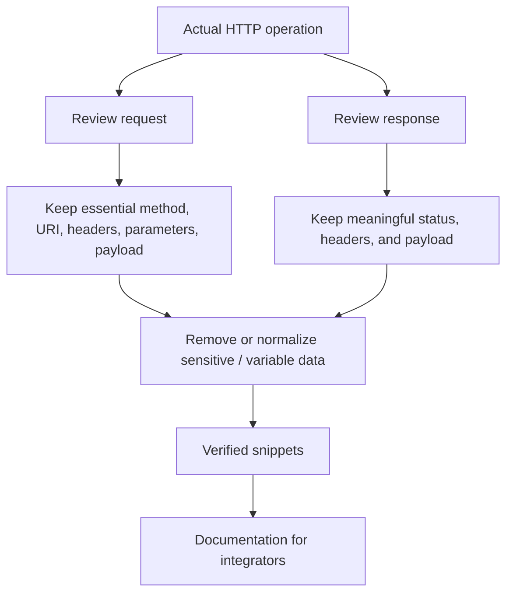

# Ensuring Documentation Does Not Obscure Essential Details

## 1. HTTP Documentation Must Provide Enough Information to Understand and Call the API

Spring REST Docs generates REST API documentation from HTTP tests using MockMvc, WebTestClient, or REST Assured. An HTTP operation is an exchange consisting of a request sent to the API and a response received back. When documenting an operation, keep enough detail for integrators to understand how to call the endpoint while avoiding publishing tokens, cookies, personal data, or unnecessary internal details.

Overly sparse documentation may look tidy yet be unusable. For instance, stripping all headers from a request can leave readers unsure whether the endpoint requires `Content-Type`, `Accept`, `If-Match`, or a routing header. Conversely, keeping `Authorization: Bearer ...` or session cookies intact risks leaking sensitive information. The task is **deliberate curation**: identify which details belong to the HTTP contract and which are test-run specifics, then apply preprocessors accordingly.

An operation should be reviewed across these categories:

| Information group | Questions to verify |
| --- | --- |
| Method and URI | Should users call `GET`, `POST`, `PUT`, `PATCH`, or `DELETE`? Are path and query accurate? |
| Request headers | Which headers are required or meaningful to the client? Which are only for internal auth or tracing? |
| Request parameters | Which path, query, form, and multipart parts need documentation? Are there defaults or limits? |
| Request body | What JSON/XML/form must the client send? Which fields are required, optional, or nested? |
| Response status | Which status does the API return on success, invalid input, not found, or no content? |
| Response headers | What do `Content-Type`, `Location`, `ETag`, `Cache-Control`, `Link`, or other headers signify? |
| Response body | Does the body contain complete fields, data types, and representative examples? |
| Sensitive/noisy values | Are there tokens, cookies, random IDs, internal hosts, or personal data to mask or normalize? |



## 2. Distinguishing API Contract Information from Test-Run Data

Never decide to keep or remove a header based solely on its name. Consider the header's role in the API contract and the specific value recorded.

| Information | Usually keep? | How to handle |
| --- | --- | --- |
| Request `Content-Type` | Yes, when the client needs to know the body format. | Keep as-is and describe with `requestHeaders(...)` if helpful. |
| `Accept` | Yes, when the API supports response format negotiation. | Keep a representative value such as `application/json`. |
| `If-Match` / `If-None-Match` | Yes, if the endpoint uses conditional requests or optimistic concurrency. | Keep header and explain meaning; use a stable sample ETag value. |
| `Authorization` | Usually do not publish real credential values. | Remove or replace the token with a placeholder; document auth flow separately. |
| `Cookie` / `Set-Cookie` | Never publish real session IDs. | Remove cookie values or replace with dummy examples if cookies are part of the contract. |
| `X-Request-Id` / trace ID | May need explanation, though randomly generated values rarely matter. | Keep header if required by the API; replace value with a fixed sample or remove if telemetry-only. |
| `Host` | Useful if clients must call a specific domain. | Normalize to a public hostname; do not expose container/local addresses. |
| `Location` | Usually keep for `201 Created` or redirects. | Keep the created resource path/URI; strip internal host if needed. |
| `ETag`, `Last-Modified`, `Cache-Control` | Yes, when documenting caching or conditional requests. | Keep and document accurately per contract. |

A helpful rule: if removing a detail makes readers unable to construct a valid request or interpret the response, that detail should not be removed completely. Sensitive values can be replaced with placeholders, provided you clearly explain how to substitute them when calling the API.

## 3. Starting from Raw Request/Response Before Preprocessing

Before adding preprocessors, inspect the request and response that the test actually sends and receives. Spring REST Docs generates default snippets such as:

| Snippet | Content |
| --- | --- |
| `curl-request.adoc` | `curl` command corresponding to the request. |
| `http-request.adoc` | HTTP request, including method, URI, headers, and body. |
| `http-response.adoc` | HTTP response, including status, headers, and body. |
| `httpie-request.adoc` | Request example using HTTPie. |
| `request-body.adoc` | Only the request body portion. |
| `response-body.adoc` | Only the response body portion. |

Additional snippets can be generated from descriptors, such as `path-parameters.adoc`, `query-parameters.adoc`, `request-headers.adoc`, `response-headers.adoc`, `request-fields.adoc`, and `response-fields.adoc`. The default snippet list can be configured per project; check your output directory and Spring REST Docs version. See [Default Snippets](https://docs.spring.io/spring-restdocs/reference/documenting-your-api/default-snippets.html).

Read `http-request.adoc` and `http-response.adoc` together as a complete protocol record. If documentation includes a field table without an overall HTTP example, readers may still not know the method, media type, or status code. If it includes only HTTP examples without field tables, readers must guess the meaning of each JSON property.

## 4. Example: Keeping Essential Headers, Replacing Only Credentials

Suppose an endpoint requires:

```http
GET /api/accounts/42 HTTP/1.1
Accept: application/json
Authorization: Bearer <access-token>
If-None-Match: "account-v3"
```

The response might be:

```http
HTTP/1.1 200 OK
Content-Type: application/json
ETag: "account-v3"
Cache-Control: private, max-age=60

{"id":42,"displayName":"An Nguyen"}
```

In public documentation, real token values are unnecessary; `Accept`, `If-None-Match`, `ETag`, and `Cache-Control` can be important parts of how clients use the API. You can remove only the authentication header in a preprocessor without stripping all request headers:

```java
given(this.specification)
        .accept(ContentType.JSON)
        .header("Authorization", "Bearer test-only-token")
        .header("If-None-Match", "\"account-v3\"")
        .filter(document("accounts-get",
                preprocessRequest(
                        modifyHeaders().remove("Authorization")),
                requestHeaders(
                        headerWithName("Accept")
                                .description("Response format accepted by the client"),
                        headerWithName("If-None-Match")
                                .description("Client's current ETag, used for conditional requests")),
                responseHeaders(
                        headerWithName("ETag")
                                .description("Representation version of the resource"),
                        headerWithName("Cache-Control")
                                .description("Caching policy of the response")),
                responseFields(
                        fieldWithPath("id").description("Account ID"),
                        fieldWithPath("displayName").description("Display name"))))
.when()
        .get("/api/accounts/42")
.then()
        .statusCode(200);
```

Key static imports:

```java
import static org.springframework.restdocs.operation.preprocess.Preprocessors.modifyHeaders;
import static org.springframework.restdocs.operation.preprocess.Preprocessors.preprocessRequest;
import static org.springframework.restdocs.headers.HeaderDocumentation.headerWithName;
import static org.springframework.restdocs.headers.HeaderDocumentation.requestHeaders;
import static org.springframework.restdocs.headers.HeaderDocumentation.responseHeaders;
import static org.springframework.restdocs.payload.PayloadDocumentation.fieldWithPath;
import static org.springframework.restdocs.payload.PayloadDocumentation.responseFields;
import static org.springframework.restdocs.restassured.RestAssuredRestDocumentation.document;
```

The example above assumes the server actually supports conditional requests and the stated headers. If an endpoint does not support `If-None-Match`, do not add that header to documentation merely because it appears in an example. When documentation succeeds, the request snippet omits the token while keeping required conditional headers; the response snippet preserves the ETag and caching policy.

## 5. Do Not Remove All Headers When Only One Value Needs Masking

An overly broad preprocessing example is:

```java
// Avoid if the other headers are required by the API contract.
preprocessRequest(modifyHeaders().remove("Authorization")
        .remove("Accept")
        .remove("Content-Type")
        .remove("If-Match"));
```

Removing `Accept` can hide the media type the client needs to send; removing `Content-Type` leaves readers unsure of the body format; removing `If-Match` can omit safe-update preconditions. Instead, remove or replace only the credential value and keep the remaining headers.

If the authentication header needs to be shown structurally, replace its value with a placeholder—such as `Authorization: Bearer <access-token>`—instead of dropping the entire header. Use the `modifyHeaders().set(...)` API appropriate for your Spring REST Docs version and inspect the resulting snippet afterwards. For public docs, showing a placeholder should be paired with guidance on obtaining a token via the proper OAuth/API key flow.

Not every header needs a descriptor table. `http-request.adoc` already displays the actual headers kept in the operation. `requestHeaders(...)` adds a table explaining meaning and whether each header is required or optional. Pick headers that help integrators understand API behavior; avoid long tables for automatic transport headers like `Connection` or `User-Agent` if they are not part of the contract.

## 6. Preserving Complete URI, Parameter, and Payload Information

A URI preprocessor can replace `localhost:<random-port>` with a public hostname, but must not lose the path or query parameters.

```java
preprocessRequest(
        modifyUris()
                .scheme("https")
                .host("api.example.com")
                .removePort())
```

After transforming, confirm that the URI still keeps `/api/accounts/42`, query strings such as `?expand=roles`, and parameters documented by `pathParameters(...)` or `queryParameters(...)`. Never replace the path with a prettier URL that does not match real routing.

Similarly, do not replace an entire JSON body with `{}` just to hide sensitive data. Preserve the structure and key fields, replacing only sensitive values with safe examples. For example:

```json
{
  "id": 42,
  "displayName": "Example User",
  "email": "user@example.test",
  "roles": ["READER"]
}
```

For JSON data, you can use a custom `ContentModifier` to replace a specific value, or design fixtures from the start using only dummy data. When responses have nested objects, arrays, nullable fields, or enums, the `responseFields(...)` table should describe the structure matching the actual payload. If a field is genuinely optional, use `.optional()`; if a field is present but does not belong in the table, consider `.ignored()` and explain why. Do not use `relaxedResponseFields(...)` simply to skip reviewing a field.

## 7. Keeping Critical Details in Response Status and Headers

Documentation is not just the body. Status codes and response headers often express part of the API contract:

| Case | Information to preserve |
| --- | --- |
| `200 OK` | Returned body and `Content-Type`. |
| `201 Created` | Body if present, plus `Location` if the API returns the new resource URI. |
| `202 Accepted` | Asynchronous processing semantics, task-tracking ID or URL if present. |
| `204 No Content` | Status, meaningful response headers; do not assume a body exists. |
| `304 Not Modified` | Status and ETag/cache validators; do not invent a success body. |
| `400 Bad Request` / `422 Unprocessable Content` | Error code, error structure, validation fields, and correlation ID if published. |
| `401 Unauthorized` / `403 Forbidden` | Distinction between unauthenticated and insufficient permissions; never record credentials. |
| `404 Not Found` | Status and error payload if the API uses a structured error response. |
| `429 Too Many Requests` | `Retry-After` or rate limit details if supported by the contract. |

Do not document only the happy path. For important endpoints, document error statuses and corresponding responses so integrators know how to handle them. Each scenario should have its own identifier, such as `accounts-get-200`, `accounts-get-404`, or `accounts-update-412`.

For bodyless responses like 204, do not declare `responseFields(...)` requiring JSON fields. Conversely, if an error response returns `ProblemDetail`, document the actual error fields rather than reusing descriptors from the 200 response.

## 8. Using Operation Snippets and Attributes Without Losing Context

Spring REST Docs includes default `http-request` and `http-response` snippets. When you need to customize rendering, `HttpDocumentation.httpRequest(...)` and `httpResponse(...)` can accept attributes for templates. Attributes add context during snippet generation; they do not replace the actual request/response.

An Asciidoctor example can group an operation with the snippets readers need:

```asciidoc
== Get Account

=== Request
include::{snippets}/accounts-get/http-request.adoc[]

=== Request headers
include::{snippets}/accounts-get/request-headers.adoc[]

=== Conditional request header
include::{snippets}/accounts-get/response-headers.adoc[]

=== Response fields
include::{snippets}/accounts-get/response-fields.adoc[]

=== Response
include::{snippets}/accounts-get/http-response.adoc[]
```

Select snippets based on the reader's journey. A typical API page should show a sample request, key parameters/headers, a sample response, and field tables. You do not need to embed every default file on every page, but never omit essential pieces that render the sample request unusable.

## 9. Review Process Before Accepting Snippets

Perform the review in the following order:

1. **Compare against real HTTP:** check method, URI, query, status, headers, and body in `http-request.adoc`/`http-response.adoc`.
2. **Check API callability:** does a client reading the documentation have the required method, URL, media type, parameters, and body to reconstruct the request?
3. **Inspect masked parts:** is every removed or replaced header/body/URI justified? Does it omit API conditions like `If-Match`, `Content-Type`, or `Location`?
4. **Check private data:** have tokens, cookies, personal emails, internal hostnames, random ports, or secret IDs been properly replaced/removed?
5. **Check descriptors:** do the header, parameter, and field tables accurately describe what is present in the request/response?
6. **Check multiple statuses:** does the endpoint have business errors worth documenting beyond 200/201?
7. **Check tests:** both assertions and descriptors pass; snippets come from a clean current run.
8. **Check composed output:** does Asciidoctor/Markdown embed all required snippets in the order readers expect?

## 10. Short Checklist Example for Reviewers

| Question | Passes when |
| --- | --- |
| Is the request reproducible? | Method, URI, media type, parameters, and required payload are present. |
| Are headers sufficient? | Contract headers are kept; tokens/cookies are hidden or safely replaced. |
| Is the response understandable? | Status, key headers, and representative sample body are included. |
| Are parameters accurate? | Path/query values in the request match descriptors and explanations. |
| Is the payload overly truncated? | Structure and fields needed to use the API remain intact. |
| Are replacement values consistent? | Placeholders are explained and not easily mistaken for literal values to send. |
| Are errors covered? | Important error statuses and error payloads are documented where needed. |
| Is it safe to publish? | No real secrets or live data remain; snippets come from passing tests. |

## 11. Common Pitfalls

| Mistake | Consequence | Fix |
| --- | --- | --- |
| Removing all headers | Readers do not know required `Content-Type`, `Accept`, or conditional headers. | Remove only sensitive headers; keep contract headers. |
| Generating only `responseFields` and omitting HTTP response | Readers do not know status, content type, and response headers. | Include both `http-response.adoc` and field tables. |
| Masking the entire payload | Loses data structure and examples clients need. | Use dummy fixtures or replace only sensitive values. |
| Rewriting URI but dropping query/path | Example fails to reflect the actual resource or API behavior. | Check the post-preprocessor URI against actual routing. |
| Removing `Location` or `ETag` | Loses resource creation details or caching/conditional request info. | Keep and document them if provided by the endpoint contract. |
| Using `relaxed...Fields` to ignore new fields | API schema can drift without documentation warnings. | Review new fields and update descriptors explicitly. |
| Using production values in fixtures | Secrets/PII can appear in snippets or CI artifacts. | Use dummy data and inspect snippets after preprocessing. |
| Embedding too many snippets indiscriminately | Long doc pages where key details are hard to find. | Pick snippets based on integrator needs while keeping essential request/response info. |

## 12. Completion Checklist

- [ ] Inspected both `http-request.adoc` and `http-response.adoc` for the operation.
- [ ] Method, URI, path/query parameters, and body do not omit essential details.
- [ ] Required/important headers are kept and documented; credentials/cookies are handled safely.
- [ ] Response status, `Content-Type`, `Location`, `ETag`, or necessary business headers are preserved.
- [ ] Sample payloads keep structure and important fields; examples use dummy data.
- [ ] Preprocessors modify only parts with a clearly documented reason.
- [ ] Descriptors accurately reflect actual payload/headers/parameters.
- [ ] Error status examples are included when part of the core API contract.
- [ ] Snippets come from passing tests and the final document embeds all needed snippets.

Well-documented HTTP operations give readers enough detail to understand and call the API without exposing test-environment internals. Preserve contract-level method, URI, status, headers, and payload structure; hide or normalize only values that should not be published. This keeps Spring REST Docs documentation both safe and practical for integrators.

## References

- [Spring REST Docs – Default Snippets](https://docs.spring.io/spring-restdocs/reference/documenting-your-api/default-snippets.html)
- [Spring REST Docs – Customizing requests and responses](https://docs.spring.io/spring-restdocs/reference/customizing-requests-and-responses.html)
- [Spring REST Docs 3.0.6 – HttpDocumentation API](https://docs.spring.io/spring-restdocs/docs/current/api/org/springframework/restdocs/http/HttpDocumentation.html)
- [Spring REST Docs 3.0.6 – RequestDocumentation API](https://docs.spring.io/spring-restdocs/docs/current/api/org/springframework/restdocs/request/RequestDocumentation.html)
