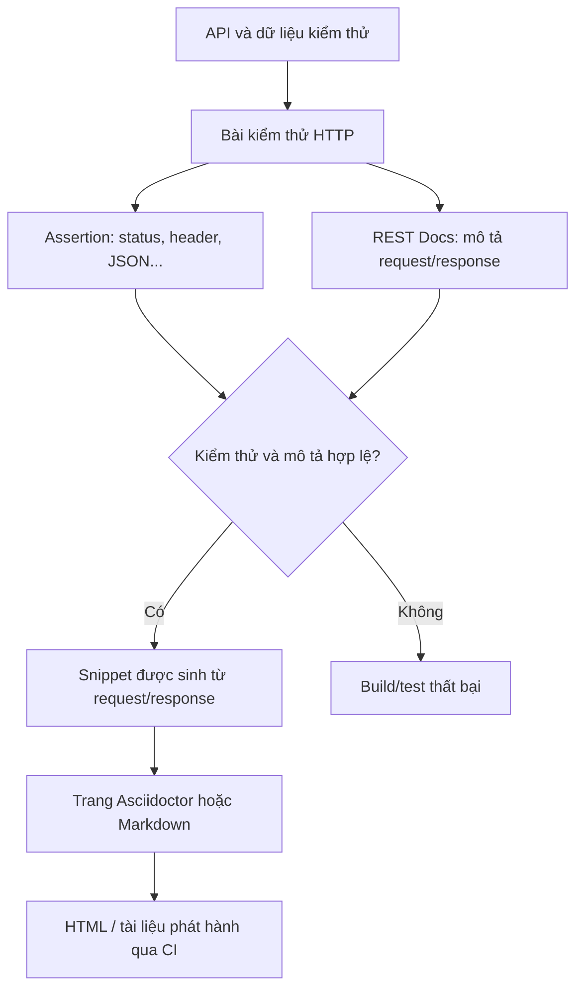
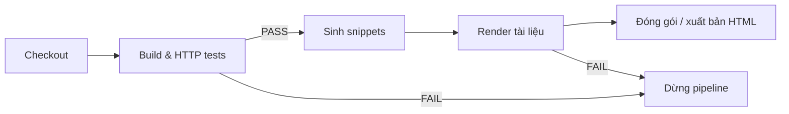

# Spring REST Docs là gì và giải quyết vấn đề tài liệu REST nào?

## Mục tiêu học tập

Sau bài này, bạn có thể:

- Giải thích **Spring REST Docs** là gì, vì sao tài liệu REST API dễ sai lệch so với hệ thống đang chạy và cách kiểm thử HTTP giúp giảm sai lệch đó.
- Mô tả luồng từ bài kiểm thử bằng **MockMvc**, **WebTestClient** hoặc **REST Assured** đến các *snippet* và tài liệu Asciidoctor/Markdown.
- Nhận biết các phần của một hợp đồng HTTP cần mô tả: phương thức, URL, path/query parameter, header, request body, response body và mã trạng thái.
- Phân biệt những gì Spring REST Docs xác minh được với những điều vẫn cần kiểm thử hoặc quản lý riêng; xác định vị trí phù hợp của nó trong build và CI.

## 1. Bài toán: tài liệu API và mã nguồn dễ đi lệch nhau

Giả sử nhóm phát triển công bố endpoint `GET /api/orders/{id}` với response:

```json
{
  "id": 42,
  "status": "PAID"
}
```

Một đợt sửa mã thay `status` bằng `paymentStatus`. API chạy theo cấu trúc mới, nhưng trang hướng dẫn vẫn có ví dụ cũ. Ứng dụng khách tiếp tục đọc `status` và gặp lỗi. Vấn đề không chỉ là người viết quên cập nhật: nếu tài liệu được sửa bằng tay, **không có cơ chế tự động buộc nội dung mô tả phải phù hợp với hành vi HTTP thực tế**.

Những sai lệch thường gặp gồm:

| Thành phần | Sai lệch thường thấy | Hệ quả đối với người sử dụng API |
| --- | --- | --- |
| URL và HTTP method | Tài liệu ghi `POST`, máy chủ nhận `PUT` | Client gọi sai endpoint hoặc nhận `405` |
| Path/query parameter | Thiếu tham số bắt buộc, sai tên hoặc ý nghĩa | Client tạo request không hợp lệ |
| Header | Bỏ sót `Content-Type`, `Accept` hoặc header nghiệp vụ | Lỗi nội dung hoặc không biết cách gửi request |
| Payload | Đổi tên trường, kiểu dữ liệu, cấu trúc lồng nhau | Client phân tích JSON sai |
| Status code | Ví dụ ghi `200`, thực tế trả `201` hay `404` | Client xử lý sai nhánh thành công/thất bại |
| Ví dụ request/response | Sao chép từ dữ liệu đã cũ | Người đọc không thể tái hiện thao tác |

**Spring REST Docs** giải quyết phần quan trọng của bài toán này bằng cách **tạo tài liệu từ các bài kiểm thử HTTP có chạy thật**. Một bài kiểm thử vừa gửi request, vừa kiểm tra response, vừa chỉ định những thành phần cần giải thích trong tài liệu. Khi cấu trúc thực tế thay đổi trái với các mô tả hoặc assertion đã khai báo, bài kiểm thử có thể thất bại trong quá trình build.

> Spring REST Docs **không tự chứng minh toàn bộ API đúng**. Nó gắn tài liệu với các tình huống đã được kiểm thử và các trường đã được mô tả. Endpoint chưa có test, trường bị bỏ qua, logic nghiệp vụ chưa được assertion kiểm tra hoặc ví dụ kiểm thử không đại diện vẫn có thể khiến tài liệu thiếu hoặc sai ý nghĩa.

## 2. Spring REST Docs là gì?

Spring REST Docs là thư viện thuộc hệ sinh thái Spring, hỗ trợ viết **tài liệu REST API dựa trên kiểm thử** (*test-driven API documentation*). Thay vì xem bản mô tả API là một tập tin độc lập hoàn toàn với ứng dụng, người viết đặt các lệnh tạo tài liệu ngay tại bài kiểm thử HTTP.

Một quy trình điển hình:



Các khái niệm nền tảng:

| Khái niệm | Ý nghĩa |
| --- | --- |
| **Test HTTP** | Bài kiểm thử tạo một request và quan sát response, chẳng hạn `GET /api/orders/42`. |
| **Assertion** | Điều kiện kiểm tra hành vi, ví dụ status `200`, JSON `id = 42`, header đúng. |
| **Descriptor** | Khai báo phần cần tài liệu hóa, ví dụ trường `status` hay tham số đường dẫn `id`, kèm mô tả. |
| **Snippet** | Mảnh tài liệu được tạo từ HTTP exchange và descriptor, như `http-request.adoc`, `response-fields.adoc`. |
| **Tài liệu hoàn chỉnh** | Trang được biên soạn từ phần giải thích nghiệp vụ do con người viết và các snippet được tạo tự động. |

Spring REST Docs tích hợp với ba cách kiểm thử HTTP phổ biến:

- **MockMvc:** Kiểm thử tầng Spring MVC không cần khởi chạy HTTP server thực; thuận tiện cho ứng dụng servlet/Spring MVC và tài liệu hóa controller.
- **WebTestClient:** HTTP test client dùng được trong hệ sinh thái reactive WebFlux và một số thiết lập kiểm thử server; phù hợp khi đã sử dụng `WebTestClient`.
- **REST Assured:** Cú pháp kiểm thử HTTP theo hướng request/response, thường dùng khi gửi request tới một server đang chạy trong bài kiểm thử tích hợp.

Cả ba đều có thể kết hợp assertion với bước ghi lại tài liệu; **chọn công cụ theo kiểu ứng dụng và tầng kiểm thử**, không cần sử dụng cả ba trong cùng dự án.

## 3. REST Docs kiểm chứng những gì?

Có hai cơ chế bổ sung cho nhau:

1. **Assertion của framework kiểm thử** xác nhận hành vi. Ví dụ `status().isOk()` kiểm tra mã `200`; `jsonPath("$.status").value("PAID")` kiểm tra giá trị trả về.
2. **REST Docs descriptor** ràng buộc nội dung tài liệu với cấu trúc request/response mà test đã quan sát. Ví dụ `fieldWithPath("status")` yêu cầu trường đó xuất hiện trong response, trừ khi khai báo tùy chọn tương ứng.

Theo mặc định, khi dùng các bộ mô tả trường *strict*, một trường response xuất hiện nhưng chưa được mô tả cũng có thể làm bước tạo tài liệu thất bại. Điều này giúp phát hiện việc thêm trường mà chưa cập nhật tài liệu. Có thể chủ động dùng `optional()`, `ignored()` hoặc biến thể `relaxed...` trong trường hợp thích hợp, nhưng mỗi lựa chọn đều giảm hoặc thay đổi mức độ ràng buộc.

**Phân biệt quan trọng:** mô tả `fieldWithPath("status").description("Trạng thái thanh toán")` **không tự kiểm tra** rằng giá trị `"PAID"` là đúng với nghiệp vụ. Muốn kiểm tra giá trị, quyền truy cập, phân trang hoặc trường hợp lỗi, phải viết assertion và test phù hợp.

Ví dụ ma trận kiểm thử tối thiểu cho endpoint truy vấn đơn hàng:

| Tình huống | HTTP dự kiến | Điều cần xác minh |
| --- | --- | --- |
| Đơn hàng tồn tại | `200 OK` | Trả về `id`, `status` đúng; mô tả response thành công |
| Không tìm thấy đơn hàng | `404 Not Found` | Định dạng lỗi và mã lỗi nghiệp vụ nếu có |
| Thiếu quyền truy cập | `401 Unauthorized` hoặc `403 Forbidden`, tùy trường hợp | Cơ chế bảo vệ và cấu trúc lỗi phù hợp |
| Path parameter sai định dạng | Thường là `400 Bad Request` nếu ứng dụng xử lý như vậy | Không giả định trạng thái; kiểm tra chính sách lỗi thực tế |

Tài liệu phản ánh chính xác hơn khi có test cho **từng kịch bản HTTP quan trọng**, không chỉ đường đi thành công.

## 4. Ví dụ thực hành: sinh tài liệu cho `GET /api/orders/{id}` bằng MockMvc

Giả định dự án sử dụng Java 17+, JUnit Jupiter, Spring MVC/Test, Jackson và dependency `spring-restdocs-mockmvc` tương thích với phiên bản Spring đang dùng. Ví dụ sau khai báo một controller nhỏ ngay trong test để tập trung vào cách REST Docs hoạt động.

```java
import java.util.Map;

import org.junit.jupiter.api.BeforeEach;
import org.junit.jupiter.api.Test;
import org.junit.jupiter.api.extension.ExtendWith;
import org.springframework.http.MediaType;
import org.springframework.restdocs.RestDocumentationContextProvider;
import org.springframework.restdocs.RestDocumentationExtension;
import org.springframework.test.web.servlet.MockMvc;
import org.springframework.test.web.servlet.setup.MockMvcBuilders;
import org.springframework.web.bind.annotation.GetMapping;
import org.springframework.web.bind.annotation.PathVariable;
import org.springframework.web.bind.annotation.RestController;

import static org.springframework.restdocs.mockmvc.MockMvcRestDocumentation.document;
import static org.springframework.restdocs.mockmvc.MockMvcRestDocumentation.documentationConfiguration;
import static org.springframework.restdocs.payload.PayloadDocumentation.fieldWithPath;
import static org.springframework.restdocs.payload.PayloadDocumentation.responseFields;
import static org.springframework.restdocs.request.RequestDocumentation.parameterWithName;
import static org.springframework.restdocs.request.RequestDocumentation.pathParameters;
import static org.springframework.test.web.servlet.request.MockMvcRequestBuilders.get;
import static org.springframework.test.web.servlet.result.MockMvcResultMatchers.jsonPath;
import static org.springframework.test.web.servlet.result.MockMvcResultMatchers.status;

@ExtendWith(RestDocumentationExtension.class)
class OrderDocumentationTest {
    private MockMvc mockMvc;

    @BeforeEach
    void setUp(RestDocumentationContextProvider restDocumentation) {
        mockMvc = MockMvcBuilders.standaloneSetup(new OrderController())
                .apply(documentationConfiguration(restDocumentation))
                .build();
    }

    @Test
    void documentGetOrder() throws Exception {
        mockMvc.perform(get("/api/orders/{id}", 42)
                        .accept(MediaType.APPLICATION_JSON))
                .andExpect(status().isOk())
                .andExpect(jsonPath("$.id").value(42))
                .andExpect(jsonPath("$.status").value("PAID"))
                .andDo(document("orders-get",
                        pathParameters(
                                parameterWithName("id")
                                        .description("Mã đơn hàng cần truy vấn")
                        ),
                        responseFields(
                                fieldWithPath("id").description("Mã đơn hàng"),
                                fieldWithPath("status")
                                        .description("Trạng thái thanh toán")
                        )
                ));
    }

    @RestController
    static class OrderController {
        @GetMapping(path = "/api/orders/{id}",
                    produces = MediaType.APPLICATION_JSON_VALUE)
        Map<String, Object> getOrder(@PathVariable("id") long id) {
            return Map.of("id", id, "status", "PAID");
        }
    }
}
```

Ý nghĩa của từng phần:

1. `RestDocumentationExtension` cung cấp ngữ cảnh và thư mục đầu ra cho REST Docs trong JUnit 5.
2. `documentationConfiguration(restDocumentation)` kết nối `MockMvc` với bộ tạo tài liệu.
3. `perform(...)` gửi HTTP request đến controller qua môi trường kiểm thử MVC.
4. `andExpect(...)` xác minh những hành vi quan trọng, thay vì chỉ tạo ví dụ minh họa.
5. `document("orders-get", ...)` đặt định danh cho bộ snippet của kịch bản này; `pathParameters(...)` và `responseFields(...)` mô tả thành phần HTTP.

Nếu test chạy thành công, thư mục snippet thường có cấu trúc tương tự (đường dẫn phụ thuộc cấu hình build):

```text
build/generated-snippets/
└── orders-get/
    ├── curl-request.adoc
    ├── http-request.adoc
    ├── http-response.adoc
    ├── path-parameters.adoc
    └── response-fields.adoc
```

Ở đây `http-request.adoc` và `http-response.adoc` thể hiện HTTP exchange đã xảy ra; `path-parameters.adoc` và `response-fields.adoc` chứa bảng mô tả từ descriptor. Snippet không thể xuất hiện khi test tương ứng chưa chạy thành công.

**Thử thay đổi:** đổi key `"status"` trong controller thành `"paymentStatus"` nhưng giữ nguyên test. Assertion `jsonPath("$.status")` sẽ thất bại. Kể cả bỏ assertion đó, descriptor `fieldWithPath("status")` vẫn không tìm được trường theo cấu trúc cũ, nên bước tạo tài liệu strict cũng thất bại. Đây là phản hồi sớm về nguy cơ lệch tài liệu so với API.

## 5. Các loại snippet cho request và response

Ngoài path parameter và response field, REST Docs cho phép mô tả nhiều phần của HTTP exchange:

| Phần HTTP | API mô tả thường dùng | Ví dụ |
| --- | --- | --- |
| Path parameter | `pathParameters(...)` | `/orders/{id}` với `id` là mã đơn hàng |
| Query parameter | `queryParameters(...)` | `?page=0&size=20` |
| Request header | `requestHeaders(...)` | `Content-Type`, header nghiệp vụ |
| Response header | `responseHeaders(...)` | `Location` sau khi tạo tài nguyên |
| JSON request body | `requestFields(...)` | `customerId`, `items[].quantity` |
| JSON response body | `responseFields(...)` | `id`, `status`, `items[].sku` |
| HTTP exchange | Các snippet request/response sinh mặc định | Method, URL, header, body thực tế |

Một phép tạo đơn hàng `POST /api/orders` có thể cần mô tả request body, response body, `Location` header và status `201 Created`; ngược lại một endpoint `GET /api/orders?page=0` cần query parameter. Hãy chọn descriptor phản ánh **đúng hợp đồng của từng endpoint**.

Ví dụ riêng cho một số descriptor (chỉ là phần đặt bên trong lệnh `document(...)`, không phải test độc lập):

```java
queryParameters(
    parameterWithName("page").description("Chỉ số trang, bắt đầu từ 0")
),
requestHeaders(
    headerWithName("X-Request-Id").description("Mã theo dõi yêu cầu")
),
requestFields(
    fieldWithPath("customerId").description("Mã khách hàng"),
    fieldWithPath("items[].sku").description("Mã sản phẩm"),
    fieldWithPath("items[].quantity").description("Số lượng đặt")
)
```

Các biểu thức trên cần import đúng các builder tương ứng. Mỗi mô tả cũng cần request thực tế trong test có chứa thành phần được khai báo; không thể thêm một header hoặc JSON field vào tài liệu chỉ bằng cách viết descriptor mà không gửi dữ liệu tương ứng.

## 6. Biên soạn thành tài liệu đọc được

Snippet mới là **mảnh tài liệu**. Một tài liệu API sử dụng được còn cần giải thích mục đích endpoint, điều kiện xác thực, quy tắc nghiệp vụ, ví dụ lỗi và cách phân biệt các trạng thái.

Với Asciidoctor, tác giả có thể tạo `src/docs/asciidoc/index.adoc` như sau:

```asciidoc
= Orders REST API
:toc: left
:sectnums:

== Tra cứu đơn hàng

Endpoint `GET /api/orders/{id}` trả về thông tin đơn hàng theo mã.

=== HTTP request
include::{snippets}/orders-get/http-request.adoc[]

=== Path parameters
include::{snippets}/orders-get/path-parameters.adoc[]

=== HTTP response
include::{snippets}/orders-get/http-response.adoc[]

=== Response fields
include::{snippets}/orders-get/response-fields.adoc[]
```

Biến `{snippets}` phải được khai báo trong cấu hình Asciidoctor/build để trỏ đến thư mục snippet; tích hợp `spring-restdocs-asciidoctor` giúp cấu hình việc chèn snippet theo cách thông dụng. Khi build tài liệu, công cụ ghép phần văn bản do con người biên soạn với dữ liệu HTTP đã được test sinh ra và xuất HTML.

**Markdown cũng là một hướng biên soạn**, nhưng cần chọn định dạng template snippet phù hợp và có công cụ kết hợp các mảnh tài liệu. Cú pháp `include::...[]` ở ví dụ trên là **của Asciidoctor**, không phải chức năng có sẵn của Markdown thông thường. Không nên đổi đuôi `.adoc` thành `.md` rồi kỳ vọng Markdown renderer tự xử lý các lệnh include.

## 7. Đưa tạo tài liệu vào build và CI

Trong một dự án dùng Gradle Groovy DSL, giả sử đã cấu hình Spring/JUnit và plugin `org.asciidoctor.jvm.convert`, phần tích hợp cốt lõi có thể được biểu diễn như sau:

```groovy
configurations {
    asciidoctorExt
}

dependencies {
    testImplementation 'org.springframework.restdocs:spring-restdocs-mockmvc'
    asciidoctorExt 'org.springframework.restdocs:spring-restdocs-asciidoctor'
}

def snippetsDir = file("$buildDir/generated-snippets")

tasks.named('test') {
    outputs.dir snippetsDir
}

tasks.named('asciidoctor') {
    configurations 'asciidoctorExt'
    inputs.dir snippetsDir
    dependsOn tasks.named('test')
}
```

Đây là phần cấu hình minh họa, không phải một `build.gradle` hoàn chỉnh: cần khai báo plugin, thư viện kiểm thử và quản lý **phiên bản REST Docs tương thích** với Spring đang dùng (thông qua BOM hoặc phiên bản cụ thể). Cấu hình snippet directory của test phải thống nhất với thư mục Asciidoctor đọc.

Chạy `./gradlew test asciidoctor` (trên Windows có thể dùng `gradlew.bat test asciidoctor`) sẽ thực hiện kiểm thử trước khi ghép tài liệu. Với Maven, ý tưởng tương đương là cho test sinh snippet trong `target/generated-snippets` rồi dùng Asciidoctor plugin ở bước tạo tài liệu.

Trong CI, một pipeline tối thiểu thường gồm:



Các quy tắc vận hành hữu ích:

- Bắt đầu từ workspace sạch để không sử dụng lại snippet cũ khi một test bị bỏ hoặc đổi tên.
- Đặt bước tạo tài liệu phụ thuộc bước kiểm thử; fail của test hoặc việc thiếu snippet phải làm build thất bại.
- Dùng dữ liệu kiểm thử ổn định; cố định hoặc chuẩn hóa ID, timestamp, token và giá trị ngẫu nhiên khi tạo ví dụ.
- Không đưa khóa truy cập, mật khẩu, access token thực hoặc dữ liệu cá nhân vào snippet và artifact. Có thể dùng dữ liệu giả và bộ tiền xử lý snippet để loại bỏ hoặc che giá trị nhạy cảm.
- Lưu hoặc phát hành HTML từ chính build được kiểm thử, và xem tài liệu như một artifact có thể truy vết theo phiên bản ứng dụng.

## 8. So sánh với tài liệu viết tay và OpenAPI

| Tiêu chí | Viết tài liệu hoàn toàn thủ công | Spring REST Docs | OpenAPI (cùng các công cụ liên quan) |
| --- | --- | --- | --- |
| Nguồn tạo nội dung | Tác giả tự nhập ví dụ và mô tả | HTTP test và descriptor do tác giả viết | Tài liệu đặc tả OpenAPI; có thể viết trước hoặc sinh từ mã/công cụ |
| Liên kết với bài kiểm thử | Phải tự tổ chức | Tích hợp trực tiếp; snippet phát sinh khi test chạy | Phụ thuộc quy trình và công cụ xác minh spec riêng |
| Khả năng nhận biết sai lệch | Phần lớn phải rà soát thủ công | Phát hiện sai lệch trong phạm vi test và descriptor | Có thể phát hiện qua contract/schema testing nếu được thiết lập |
| HTML có giải thích chi tiết | Do tác giả hoàn thiện | Phù hợp với trang Asciidoctor có nội dung tự viết | Có UI và renderer chuyên dụng như Swagger UI/Redoc |
| Sinh SDK/client tự động | Không phải thế mạnh | Không phải mục tiêu chính | Là thế mạnh của hệ sinh thái OpenAPI |

Không nhất thiết phải chọn một trong hai hướng Spring REST Docs và OpenAPI. Nếu tổ chức cần tài liệu giải thích sâu, ví dụ HTTP đã kiểm thử **và** một đặc tả máy đọc được để sinh SDK, có thể xây dựng quy trình kết hợp; tuy nhiên việc đồng bộ giữa chúng cần được thiết kế và kiểm tra rõ ràng.

## 9. Giới hạn và các lỗi thường gặp

**Giới hạn của cơ chế test-driven documentation:**

- **Không có test thì không có bảo đảm:** REST Docs không tự tìm mọi endpoint hoặc tự đảm bảo API đã được tài liệu hóa đầy đủ.
- **Test có thể kiểm tra chưa đủ:** assert `200` và khai báo hai field không chứng minh logic phân quyền, toàn bộ schema, trường hợp lỗi hay ý nghĩa nghiệp vụ là đúng.
- **Mô tả do con người viết vẫn có thể sai:** `description("Trạng thái thanh toán")` không chứng minh `status` thực sự đại diện cho trạng thái thanh toán.
- **Strict/relaxed là quyết định có đánh đổi:** tài liệu strict giúp phát hiện trường mới chưa mô tả; tài liệu relaxed giảm phiền nhiễu nhưng cũng dễ bỏ qua thay đổi.
- **Dữ liệu động gây tài liệu khó đọc:** UUID ngẫu nhiên, thời gian hiện tại hoặc header hạ tầng cần được kiểm soát/chuẩn hóa trước khi xuất bản.

| Biểu hiện | Kiểm tra trước tiên |
| --- | --- |
| Test thất bại vì trường chưa được tài liệu hóa | So sánh JSON thực tế với `responseFields(...)`/`requestFields(...)`; cập nhật descriptor hoặc cố ý đánh dấu bỏ qua nếu hợp lý |
| Không có `orders-get/response-fields.adoc` | Kiểm tra test đã được chạy, `document("orders-get", ...)` có được gọi và output directory có đúng không |
| Asciidoctor báo không tìm thấy file include | Kiểm tra `snippets` attribute, đường dẫn snippet và thứ tự `test` → `asciidoctor` |
| Ví dụ tài liệu chứa URL/ID/token lạ | Kiểm tra cấu hình host/scheme, dữ liệu fixture và bước preprocess tài liệu |
| Tài liệu có ví dụ thành công nhưng không có lỗi | Bổ sung HTTP test cho tình huống `4xx/5xx` có ý nghĩa, thay vì mong công cụ tự suy ra |

## 10. Bài tập tự kiểm tra

Với endpoint `POST /api/orders`, giả sử request là:

```http
POST /api/orders HTTP/1.1
Content-Type: application/json

{"customerId":7,"items":[{"sku":"BOOK-01","quantity":2}]}
```

Response mong đợi:

```http
HTTP/1.1 201 Created
Location: /api/orders/43
Content-Type: application/json

{"id":43,"status":"CREATED"}
```

Hãy xác định những phần nên có trong một documentation test: assertion cho status `201`, response header `Location`, ít nhất một assertion cho response body; `requestFields(...)` cho `customerId`, `items[].sku`, `items[].quantity`; `responseFields(...)` cho `id`, `status`; và `responseHeaders(...)` cho `Location`. Sau đó đặt snippet vào một mục Asciidoctor mô tả ý nghĩa nghiệp vụ của trạng thái `CREATED`.

**Câu hỏi kiểm tra tư duy:** Nếu test chỉ assert `201` nhưng API trả JSON sai giá trị, REST Docs có chắc chắn báo lỗi không? **Không chắc.** Việc phát hiện phụ thuộc vào assertion và descriptor thực tế; cần kiểm tra giá trị và các bất biến nghiệp vụ quan trọng bằng test.

## Kết luận

Spring REST Docs giúp gắn **tài liệu REST API với các bài kiểm thử HTTP**: request/response được quan sát qua MockMvc, WebTestClient hoặc REST Assured; các descriptor tạo snippet; Asciidoctor/Markdown kết hợp snippet với lời giải thích; build và CI phát hiện sai lệch trong phạm vi đã kiểm thử. Giá trị cốt lõi là làm cho tài liệu trở thành một phần có thể kiểm tra của quy trình phát triển. Độ tin cậy cuối cùng vẫn phụ thuộc vào chất lượng test, phạm vi endpoint được bao phủ và tính chính xác của phần diễn giải do con người viết.
