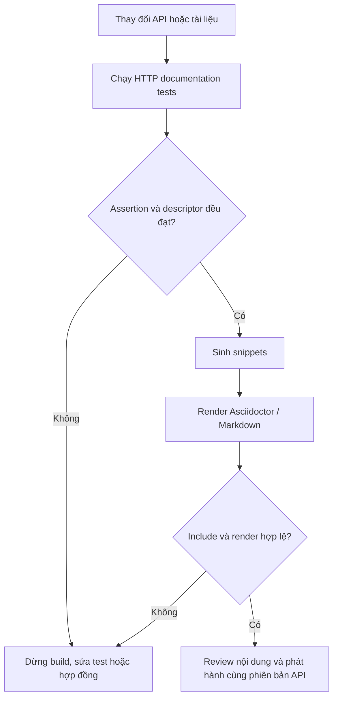

# Mục tiêu tài liệu chính xác, dễ đọc và có thể kiểm chứng

## Mục tiêu học tập

Khi hoàn thành bài này, bạn có thể:

- Phân biệt ba mục tiêu chất lượng của tài liệu REST API: **chính xác**, **dễ đọc** và **có thể kiểm chứng**.
- Biến các mục tiêu chung thành tiêu chí chấp nhận cụ thể cho endpoint, payload, tham số, header, mã HTTP và lỗi.
- Dùng **Spring REST Docs** kết hợp kiểm thử HTTP qua **MockMvc**, **WebTestClient** hoặc **REST Assured** để tạo bằng chứng về hành vi đã tài liệu hóa.
- Tổ chức snippet, phần giải thích Asciidoctor/Markdown và quy trình build, CI để tài liệu được kiểm tra mỗi khi API thay đổi.
- Nhận ra giới hạn của tài liệu sinh từ test và biết bổ sung assertion, tình huống kiểm thử và rà soát nội dung khi cần.

## 1. Vì sao tài liệu REST API cần cả ba mục tiêu?

Hình dung nhóm cung cấp API `POST /api/orders` cho ứng dụng bán hàng. Tài liệu nói rằng gửi một đơn hàng hợp lệ sẽ nhận `201 Created` và header `Location` chỉ đến tài nguyên mới. Nhưng sau một lần sửa, server thực tế trả `200 OK`; ví dụ request trong tài liệu vẫn dùng tên trường `customer` cũ, còn người mới tham gia không biết `quantity` tính theo đơn vị nào.

Cả ba vấn đề đều là lỗi tài liệu, nhưng thuộc các chiều chất lượng khác nhau:

| Mục tiêu | Câu hỏi cần trả lời | Khi thiếu mục tiêu này |
| --- | --- | --- |
| **Chính xác (accurate)** | Tài liệu có phản ánh đúng hành vi và hợp đồng của phiên bản API đang phát hành không? | Client xây dựng request/response sai, xử lý nhầm status hoặc trường JSON. |
| **Dễ đọc (readable, usable)** | Người tích hợp có hiểu mục đích, tiền điều kiện, luồng sử dụng và ý nghĩa từng thành phần không? | API có thể được mô tả đúng về kỹ thuật nhưng người đọc vẫn không biết dùng thế nào. |
| **Có thể kiểm chứng (verifiable)** | Có bằng chứng lặp lại được để phát hiện phần mô tả bị lệch khi mã thay đổi không? | Tài liệu đúng ở thời điểm viết nhưng không có tín hiệu đáng tin cậy khi API thay đổi. |

Ba mục tiêu hỗ trợ nhau. Một bảng trường JSON rất dễ nhìn vẫn vô dụng nếu sai tên trường; ngược lại, hàng loạt HTTP trace thật có thể chính xác nhưng khó dùng nếu thiếu hướng dẫn. Một trang chỉ có các khẳng định đúng hôm nay chưa chắc giữ được độ đúng sau nhiều lần triển khai nếu không có kiểm thử và CI.

Trong module **SPRING_REST_DOCS**, Spring REST Docs là công cụ gắn mô tả API với những request/response được thực thi trong test. Bản thân nó không thay thế việc thiết kế API, viết lời giải thích hoặc chọn đủ tình huống kiểm thử.

## 2. Mục tiêu thứ nhất: tài liệu chính xác

Tài liệu chính xác mô tả **hành vi đã được xác nhận của đúng phiên bản API**. Điều này bao gồm cả cấu trúc dữ liệu lẫn quy tắc mà client cần tuân theo.

### 2.1. Chính xác về hợp đồng HTTP

Với mỗi thao tác quan trọng, cần kiểm tra:

1. **Phương thức và đường dẫn:** `GET`, `POST`, `PUT`, `PATCH` hoặc `DELETE`; định dạng path, API version và biến đường dẫn.
2. **Đầu vào:** path/query parameter, request header, `Content-Type`, JSON body; trường bắt buộc/tùy chọn, kiểu dữ liệu, giới hạn và giá trị mặc định.
3. **Đầu ra:** status code, response header, cấu trúc JSON, kiểu trường, trường có thể `null`, đơn vị đo và ý nghĩa dữ liệu.
4. **Trường hợp không thành công:** lỗi xác thực, phân quyền, dữ liệu không hợp lệ, không tìm thấy, xung đột, giới hạn truy cập; mỗi trường hợp cần được mô tả theo hành vi thực tế.
5. **Ngữ nghĩa nghiệp vụ:** điều kiện để tạo/cập nhật tài nguyên, trạng thái hợp lệ, tính lặp lại an toàn của thao tác nếu API cam kết điều đó, quy tắc phân trang/lọc/sắp xếp.

Ví dụ, với một API trả:

```http
HTTP/1.1 201 Created
Location: /api/orders/43
Content-Type: application/json

{"id":43,"status":"CREATED"}
```

Không đủ nếu tài liệu chỉ ghi “tạo đơn hàng thành công”. Nó phải nói rõ `201` biểu thị tài nguyên mới đã được tạo, `Location` chứa URI tài nguyên, và `CREATED` mang ý nghĩa gì trong vòng đời đơn hàng của **ứng dụng này**.

### 2.2. Chọn nguồn sự thật và phạm vi phiên bản

Tài liệu đáng tin cần xác định được nó gắn với bản phát hành hoặc commit nào. Một ví dụ HTTP sinh từ test trên nhánh phát triển không tự động đại diện cho production, nhất là khi production đang chạy phiên bản cũ.

Quy tắc hữu ích là **tạo và phát hành tài liệu từ cùng bản build được kiểm thử để phát hành ứng dụng**. Nếu sản phẩm hỗ trợ nhiều phiên bản API, hãy ghi rõ phiên bản hoặc đường dẫn tương ứng; tránh trộn ví dụ từ hai phiên bản trên cùng trang.

### 2.3. Chính xác không đồng nghĩa với đầy đủ

Test kiểm chứng `GET /orders/42` trả `200` chỉ xác nhận một tình huống. Nó không chứng minh mọi ID đều cho kết quả đúng, lỗi `404` có cấu trúc như mô tả, hay người dùng không có quyền sẽ bị từ chối. Vì vậy, cần phân biệt:

- **Đúng trong một kịch bản**: request/response của test cụ thể đã được kiểm tra.
- **Bao phủ hợp đồng**: những tình huống quan trọng đều có test và tài liệu.
- **Đúng về nghiệp vụ**: các assertion thực sự phản ánh quy tắc sản phẩm, không chỉ kiểm tra JSON có tồn tại.

## 3. Mục tiêu thứ hai: tài liệu dễ đọc và dễ sử dụng

Tài liệu REST API có người đọc cụ thể: lập trình viên tích hợp, kỹ sư QA, nhóm vận hành hoặc đối tác. Họ thường đến với một nhiệm vụ: “Tạo đơn hàng”, “Lấy trang kết quả”, “Xử lý hết hạn token”. Vì vậy, nên tổ chức trang quanh **tác vụ người đọc muốn hoàn thành**, rồi mới giới thiệu các chi tiết kỹ thuật.

Một mục tài liệu endpoint có thể theo trình tự:

| Phần | Nội dung người đọc cần |
| --- | --- |
| Mục đích | Endpoint phục vụ tác vụ nào; khi nào nên gọi? |
| Điều kiện trước | Authentication, scope/role, dữ liệu cần có, quy tắc đặc biệt |
| Request | Method, URL, header, tham số và body kèm ví dụ có thể hiểu được |
| Thành công | Status, response header/body, ý nghĩa của các trường quan trọng |
| Thất bại | Các tình huống lỗi, status, cấu trúc lỗi và hướng xử lý |
| Ghi chú tích hợp | Pagination, giới hạn, retry/idempotency nếu API có hỗ trợ |

### 3.1. Viết mô tả có ngữ nghĩa thay vì lặp lại tên trường

So sánh:

| Mô tả sơ sài | Mô tả hữu ích hơn |
| --- | --- |
| `quantity`: Quantity | `quantity`: Số lượng sản phẩm trong một dòng đơn hàng; số nguyên lớn hơn 0 |
| `status`: Status | `status`: Trạng thái đơn hàng; `CREATED` nghĩa là đã ghi nhận, chưa hoàn tất thanh toán |
| `page`: Page | `page`: Chỉ số trang bắt đầu từ 0; mặc định 0 nếu không truyền |
| `X-Request-Id`: Header | `X-Request-Id`: Mã dùng để đối chiếu log giữa client và server |

Các câu mô tả cải thiện khả năng dùng tài liệu **chỉ khi chúng đúng với quy tắc API đang triển khai**. Không nên tự khẳng định giá trị mặc định, ràng buộc hoặc ý nghĩa nghiệp vụ chỉ vì đó là cách nhiều API khác hoạt động.

### 3.2. Ví dụ tốt cần tái hiện được

Nên dùng dữ liệu giả ổn định, không chứa thông tin cá nhân hay token thật. Ví dụ request phải khớp với header và payload mà endpoint chấp nhận; response phải tương thích với request đó. Khi cung cấp ví dụ cho nhiều kịch bản, đặt nhãn rõ ràng như “Tạo thành công”, “Thiếu trường bắt buộc” hoặc “Không tìm thấy”.

Người đọc cần biết các placeholder như `{orderId}`, `YOUR_TOKEN` là gì và thay bằng giá trị nào. Nếu body có ngày giờ, đơn vị tiền tệ hoặc enum, hãy nói rõ định dạng và tập giá trị thực sự được chấp nhận.

### 3.3. Đặt phần giải thích cạnh phần được sinh tự động

Spring REST Docs có thể tạo các snippet như `http-request`, `http-response`, `request-fields`, `response-fields`, `path-parameters`, `query-parameters`, `request-headers` và `response-headers`. Tuy nhiên, một trang chỉ ghép snippet vẫn thiếu bối cảnh: “Ai được gọi?”, “Khi nào nên gọi?”, “Phản hồi này có ý nghĩa gì?”. Hãy dùng **Asciidoctor hoặc Markdown** để viết phần dẫn giải; snippet là bằng chứng và ví dụ cụ thể cho phần đó.

## 4. Mục tiêu thứ ba: tài liệu có thể kiểm chứng

“Có thể kiểm chứng” nghĩa là các khẳng định quan trọng của tài liệu có cách xác minh rõ ràng và thực hiện lại được, tốt nhất ngay trong quá trình build.

Với Spring REST Docs, cần hiểu ba tầng khác nhau:

| Tầng | Cơ chế | Điều xác minh được | Điều không tự xác minh |
| --- | --- | --- | --- |
| **Kiểm thử hành vi** | Assertion của MockMvc/WebTestClient/REST Assured | Status, header, giá trị JSON, hành vi ở kịch bản test | Những kịch bản chưa được viết; quy tắc nghiệp vụ không có assertion |
| **Ràng buộc cấu trúc** | REST Docs descriptor, ví dụ `fieldWithPath("status")` | Trường/parameter/header được mô tả khớp HTTP exchange theo chế độ đã chọn | Mô tả bằng lời có thật sự đúng nghĩa hay không |
| **Tài liệu phát hành** | Render Asciidoctor/Markdown trong build | Include và liên kết snippet tồn tại, trang được kết xuất | Tính dễ hiểu, tính đầy đủ và mọi khẳng định thủ công |

Chẳng hạn:

```java
// Assertion kiểm tra hành vi cụ thể:
.andExpect(status().isCreated())
.andExpect(jsonPath("$.status").value("CREATED"))

// Descriptor tài liệu hóa cấu trúc đã ghi nhận:
responseFields(
    fieldWithPath("id").description("Mã đơn hàng mới"),
    fieldWithPath("status").description("Trạng thái đơn hàng")
)
```

Nếu response không có `status`, assertion và descriptor có thể phát hiện. Nhưng nếu một người viết mô tả `CREATED` nghĩa là “đã giao hàng”, trong khi hệ thống định nghĩa “đã ghi nhận đơn”, những dòng kiểm thử này không tự phát hiện sai sót ngữ nghĩa. Vấn đề đó cần review nội dung theo định nghĩa nghiệp vụ.

**Lưu ý về mức độ nghiêm ngặt:** các descriptor `requestFields(...)` và `responseFields(...)` ở chế độ strict thường báo lỗi khi có trường không được mô tả. `optional()`, `ignored()` hay các biến thể `relaxed...` có mục đích riêng, nhưng phải dùng có chủ ý để không che khuất thay đổi hợp đồng quan trọng.

## 5. Ví dụ xuyên suốt: tài liệu hóa API tạo đơn hàng

Giả sử ứng dụng hỗ trợ `POST /api/orders`. Hợp đồng của ví dụ học tập là:

- Request JSON chứa `customerId` và mảng `items`; mỗi phần tử có `sku`, `quantity`.
- Thành công trả `201 Created`, header `Location: /api/orders/43`, JSON `{"id":43,"status":"CREATED"}`.
- `CREATED` nghĩa là đơn hàng vừa được ghi nhận, chưa đồng nghĩa với việc đã thanh toán.

Ví dụ request:

```http
POST /api/orders HTTP/1.1
Content-Type: application/json
Accept: application/json

{
  "customerId": 7,
  "items": [
    {"sku": "BOOK-01", "quantity": 2}
  ]
}
```

### 5.1. Bài kiểm thử vừa xác nhận kết quả vừa sinh snippet

Đoạn minh họa dùng **JUnit Jupiter**, **Spring MVC Test**, **Spring REST Docs MockMvc** và Jackson trên Java 17+. Một controller giả lập cố định dữ liệu giúp tập trung vào cơ chế tài liệu; trong dự án thật, nên kiểm thử controller/service tương ứng và thêm các kịch bản nghiệp vụ.

```java
import java.net.URI;
import java.util.List;

import org.junit.jupiter.api.BeforeEach;
import org.junit.jupiter.api.Test;
import org.junit.jupiter.api.extension.ExtendWith;
import org.springframework.http.MediaType;
import org.springframework.http.ResponseEntity;
import org.springframework.restdocs.RestDocumentationContextProvider;
import org.springframework.restdocs.RestDocumentationExtension;
import org.springframework.test.web.servlet.MockMvc;
import org.springframework.test.web.servlet.setup.MockMvcBuilders;
import org.springframework.web.bind.annotation.PostMapping;
import org.springframework.web.bind.annotation.RequestBody;
import org.springframework.web.bind.annotation.RestController;

import static org.springframework.restdocs.mockmvc.MockMvcRestDocumentation.document;
import static org.springframework.restdocs.mockmvc.MockMvcRestDocumentation.documentationConfiguration;
import static org.springframework.restdocs.payload.PayloadDocumentation.fieldWithPath;
import static org.springframework.restdocs.payload.PayloadDocumentation.requestFields;
import static org.springframework.restdocs.payload.PayloadDocumentation.responseFields;
import static org.springframework.restdocs.headers.HeaderDocumentation.headerWithName;
import static org.springframework.restdocs.headers.HeaderDocumentation.requestHeaders;
import static org.springframework.restdocs.headers.HeaderDocumentation.responseHeaders;
import static org.springframework.test.web.servlet.request.MockMvcRequestBuilders.post;
import static org.springframework.test.web.servlet.result.MockMvcResultMatchers.header;
import static org.springframework.test.web.servlet.result.MockMvcResultMatchers.jsonPath;
import static org.springframework.test.web.servlet.result.MockMvcResultMatchers.status;

@ExtendWith(RestDocumentationExtension.class)
class CreateOrderDocumentationTest {
    private MockMvc mvc;

    @BeforeEach
    void setUp(RestDocumentationContextProvider context) {
        mvc = MockMvcBuilders.standaloneSetup(new OrderController())
                .apply(documentationConfiguration(context))
                .build();
    }

    @Test
    void createOrder() throws Exception {
        mvc.perform(post("/api/orders")
                        .contentType(MediaType.APPLICATION_JSON)
                        .accept(MediaType.APPLICATION_JSON)
                        .content("""
                            {
                              "customerId": 7,
                              "items": [{"sku":"BOOK-01","quantity":2}]
                            }
                            """))
                .andExpect(status().isCreated())
                .andExpect(header().string("Location", "/api/orders/43"))
                .andExpect(jsonPath("$.id").value(43))
                .andExpect(jsonPath("$.status").value("CREATED"))
                .andDo(document("orders-create",
                        requestHeaders(
                                headerWithName("Content-Type")
                                        .description("Định dạng JSON của request")
                        ),
                        requestFields(
                                fieldWithPath("customerId")
                                        .description("Mã khách hàng"),
                                fieldWithPath("items[].sku")
                                        .description("Mã sản phẩm"),
                                fieldWithPath("items[].quantity")
                                        .description("Số lượng sản phẩm")
                        ),
                        responseHeaders(
                                headerWithName("Location")
                                        .description("Đường dẫn tài nguyên mới")
                        ),
                        responseFields(
                                fieldWithPath("id")
                                        .description("Mã đơn hàng mới"),
                                fieldWithPath("status")
                                        .description("Trạng thái đơn hàng")
                        )
                ));
    }

    record OrderItem(String sku, int quantity) {}
    record OrderRequest(long customerId, List<OrderItem> items) {}
    record OrderResponse(long id, String status) {}

    @RestController
    static class OrderController {
        @PostMapping(
                path = "/api/orders",
                consumes = MediaType.APPLICATION_JSON_VALUE,
                produces = MediaType.APPLICATION_JSON_VALUE
        )
        ResponseEntity<OrderResponse> create(@RequestBody OrderRequest request) {
            return ResponseEntity.created(URI.create("/api/orders/43"))
                    .body(new OrderResponse(43, "CREATED"));
        }
    }
}
```

*Giải thích các tầng chất lượng trong ví dụ:*

1. `status().isCreated()`, `header().string(...)` và `jsonPath(...)` xác nhận hành vi trả về **201**, `Location` và các giá trị JSON. Đây là bằng chứng cho kịch bản thành công được test.
2. `requestHeaders(...)`, `requestFields(...)`, `responseHeaders(...)`, `responseFields(...)` ràng buộc các bảng mô tả với HTTP exchange thực. Trường đổi tên hoặc thiếu có thể khiến việc sinh tài liệu thất bại.
3. Tên `orders-create` nhóm các snippet của một tình huống. Output thường nằm trong `build/generated-snippets/orders-create/` với Gradle (hoặc `target/generated-snippets/` trong cấu hình Maven thông dụng).
4. Các chuỗi `description(...)` giúp người đọc hiểu hợp đồng nhưng vẫn cần được rà soát. Ví dụ “Mã khách hàng” có thể cần mở rộng thành quy tắc hợp lệ nếu đó là điều kiện tích hợp quan trọng.

Ví dụ dùng fixture tạo đơn hàng với ID cố định để snippet ổn định. Dự án thật phải kiểm thử logic nghiệp vụ riêng; controller giả lập này **không chứng minh** tính hợp lệ của khách hàng, số lượng, phân quyền hay lưu dữ liệu.

### 5.2. Kiểm chứng trường hợp lỗi và biến thể của API

Đừng dừng ở một test thành công. Hãy lập ma trận theo những điều tài liệu sẽ cam kết:

| Kịch bản cần xem xét | Kết quả cần khẳng định trong test | Nội dung cần đưa vào tài liệu |
| --- | --- | --- |
| Request hợp lệ | `201`, `Location`, `id`, `status` | Ví dụ tạo thành công, trường request/response |
| Thiếu `customerId` | Status và cấu trúc lỗi do API quy định | Trường bắt buộc, lỗi validation, hướng sửa |
| `quantity` không hợp lệ | Status và mã lỗi thực tế của ứng dụng | Giới hạn số lượng, thông điệp lỗi |
| Không được phép tạo đơn | `401` hay `403` tùy authentication/authorization thực tế | Phạm vi quyền, phản hồi từ chối |
| Gửi lại cùng request | Hành vi được định nghĩa bởi API | Có/không hỗ trợ idempotency hoặc khóa chống tạo trùng |

Không được điền mặc định `400`, `401`, `403` hay một cấu trúc lỗi bất kỳ chỉ vì chúng phổ biến. Cần **xác minh hành vi của chính ứng dụng** và bổ sung test tương ứng. Tương tự, nếu một endpoint dùng path parameter, query parameter hoặc header nghiệp vụ thì thêm descriptor như `pathParameters(...)`, `queryParameters(...)` hoặc `requestHeaders(...)` đúng với request của test đó.

## 6. Biên soạn tài liệu đọc được từ snippet

Snippet như `http-request.adoc`, `http-response.adoc`, `request-fields.adoc`, `response-fields.adoc` là những khối bằng chứng về HTTP; tác giả cần bao quanh chúng bằng lời giải thích.

Ví dụ file Asciidoctor:

```asciidoc
== Tạo đơn hàng

Sử dụng POST /api/orders để ghi nhận đơn hàng mới.
Trạng thái CREATED cho biết đơn đã được tiếp nhận, chưa thanh toán.

=== HTTP request
include::{snippets}/orders-create/http-request.adoc[]

=== Request fields
include::{snippets}/orders-create/request-fields.adoc[]

=== HTTP response
include::{snippets}/orders-create/http-response.adoc[]

=== Response headers
include::{snippets}/orders-create/response-headers.adoc[]

=== Response fields
include::{snippets}/orders-create/response-fields.adoc[]
```

Thuộc tính `{snippets}` phải được cấu hình trỏ tới output của test. Khi dùng Asciidoctor, build phải chạy test **trước khi render**, để đường dẫn include luôn tham chiếu các file hiện có.

Nếu dự án chọn **Markdown**, cần định dạng snippet phù hợp với Markdown và bước biên soạn/tích hợp nội dung thích hợp. Cú pháp `include::{snippets}/...` trong ví dụ là **cú pháp Asciidoctor**, không có sẵn trong Markdown chuẩn. Việc chọn công cụ phải bảo đảm nội dung tạo ra được nhúng hoặc liên kết đúng, tránh phải sao chép các ví dụ HTTP thủ công.

### Cách đọc một trang API để phát hiện thiếu thông tin

Hãy đặt mình vào vai client lần đầu tích hợp và thử trả lời: “Tôi gọi URL nào, gửi header/body gì, muốn biết thành công phải kiểm tra gì, lỗi thì xử lý ra sao, ví dụ có thể chạy lại với dữ liệu giả không?”. Nếu không thể trả lời từ tài liệu, thì dù mọi snippet đều sinh đúng, phần **dễ đọc và đủ để sử dụng** vẫn chưa đạt.

## 7. Làm cho tài liệu luôn kiểm chứng được trong build và CI

Pipeline nên biến thay đổi không tương thích thành tín hiệu thất bại sớm:



Một thiết lập đáng tin cậy nên bảo đảm:

1. **Quy trình có thứ tự:** documentation tests chạy trước bước render tài liệu; bước render khai báo phụ thuộc đầu vào snippet.
2. **Không dùng kết quả cũ:** xóa hoặc cô lập output tạm khi cần, để test bị bỏ không vô tình để lại snippet cũ trong gói tài liệu.
3. **Tính lặp lại:** fixture, clock, ID và thứ tự dữ liệu cần ổn định hoặc được chuẩn hóa; với dữ liệu khó cố định, dùng cơ chế tiền xử lý snippet thích hợp.
4. **Không rò rỉ bí mật:** dùng token và thông tin khách hàng giả; loại bỏ cookie, header xác thực, secret và dữ liệu cá nhân khỏi artifact được phát hành.
5. **Quản lý phiên bản:** artifact tài liệu được tạo từ commit/build tương ứng với phần mềm đang phát hành; khi nhiều phiên bản API tồn tại, lưu nhãn phiên bản rõ ràng.
6. **Review định tính:** người có hiểu biết nghiệp vụ kiểm tra câu chữ, các trường hợp lỗi và các ví dụ thực tế. Test không thể tự chấm độ rõ ràng của đoạn văn.

Với Gradle, lệnh triển khai thông dụng có dạng `./gradlew test asciidoctor` sau khi đã cài plugin, khai báo dependency REST Docs và cấu hình task; trên Windows có thể dùng `gradlew.bat test asciidoctor`. Với Maven, ý tưởng tương tự là cho các bài test sinh snippet rồi dùng plugin Asciidoctor để kết xuất tài liệu.

## 8. Ma trận truy vết: mỗi cam kết phải có cách kiểm tra

“Có thể kiểm chứng” trở nên rõ ràng hơn khi nối từng cam kết trong tài liệu với test và bằng chứng phù hợp:

| Cam kết trên trang API | Bằng chứng phù hợp | Cần review thủ công thêm? |
| --- | --- | --- |
| Tạo đơn thành công trả `201` | Assertion HTTP status của test `orders-create` | Không, nếu đó là trạng thái yêu cầu của hợp đồng |
| Response có `id` và `status` | `responseFields(...)` và assertion giá trị | Có, để xác nhận mô tả và ý nghĩa trạng thái |
| `Location` trỏ tới đơn vừa tạo | Assertion header; `responseHeaders(...)` | Có, nếu URI phải theo quy tắc public URL cụ thể |
| `quantity` phải lớn hơn 0 | Test validation cho `0`, số âm và giá trị hợp lệ | Có, đối chiếu quy tắc nghiệp vụ |
| Request không có quyền bị từ chối | Test security cho vai trò/token thích hợp | Có, rà soát mô tả quyền |
| Tài liệu HTML nhúng đúng snippet | Task render Asciidoctor/Markdown chạy thành công | Có, kiểm tra bố cục và tính dễ hiểu |

Không phải mọi câu trong tài liệu đều đòi hỏi một test riêng. Ma trận ưu tiên **những cam kết có thể gây lỗi tích hợp hoặc hành vi sai**. Một assertion chỉ kiểm tra `200` không thể được coi là bằng chứng cho quyền truy cập, kiểu dữ liệu và toàn bộ quy tắc nghiệp vụ.

### Thước đo chất lượng nên sử dụng

Đừng dùng số snippet hoặc tổng số test làm thước đo duy nhất. Hãy xem:

- **Độ bao phủ tình huống:** các thao tác và nhánh lỗi quan trọng đã có documentation test chưa?
- **Độ chặt của assertion:** test kiểm tra giá trị, status và header có ý nghĩa hay chỉ kiểm tra request không phát sinh exception?
- **Mức ràng buộc của descriptor:** các field quan trọng được mô tả ở chế độ strict hay bị bỏ qua không có lý do?
- **Khả năng tái hiện:** ví dụ có dùng dữ liệu giả, ổn định, phù hợp với cùng phiên bản API không?
- **Khả năng sử dụng:** người đọc có hoàn thành một nhiệm vụ tích hợp chỉ từ hướng dẫn trên trang không?

Đây là các tiêu chí để **review thực tế**, không phải cam kết rằng Spring REST Docs tự tính và bảo đảm mọi chỉ số.

## 9. Những lỗi phổ biến làm mất chất lượng tài liệu

| Biểu hiện | Nguyên nhân thường gặp | Cách xử lý |
| --- | --- | --- |
| Tài liệu vẫn render dù API thêm trường mới | Dùng descriptor relaxed hoặc `ignored()` quá rộng | Rà soát lại mức strict, chỉ bỏ qua có lý do |
| Ví dụ response thay đổi liên tục | ID, timestamp, thứ tự kết quả không cố định | Dùng fixture ổn định hoặc preprocess dữ liệu động |
| Chỉ có kịch bản `2xx` | Chưa có kế hoạch tài liệu hóa lỗi | Viết test cho validation, authentication và các nhánh lỗi quan trọng |
| Bảng field đúng nhưng giải thích sai | Mô tả viết bằng tay không được review nghiệp vụ | Đưa mô tả, enum và giới hạn vào quy trình review |
| Include thiếu file snippet | Test chưa chạy, đổi tên snippet hoặc cấu hình sai đường dẫn | Khai báo dependencies của task, kiểm tra đường dẫn và clean output |
| Ví dụ công khai chứa token hoặc dữ liệu thật | Lấy request từ môi trường thật hoặc không che header | Dùng fixture giả, lọc nội dung nhạy cảm |
| Tài liệu nói về hành vi chưa triển khai | Copy từ thiết kế tương lai mà không ghi trạng thái | Gắn với phiên bản đang phát hành, phân biệt rõ tính năng dự kiến |

Một sai lầm dễ gặp là nghĩ “test xanh thì tài liệu chắc chắn đúng”. Test chỉ xanh theo **điều kiện kiểm tra đã viết**. Chất lượng tài liệu vẫn phụ thuộc vào thiết kế case, mức độ quan sát, độ chính xác của mô tả và quá trình biên tập.

## 10. Bảng kiểm nghiệm thu một trang REST API

Trước khi đưa trang tài liệu vào gói phát hành, người viết có thể dùng checklist sau:

- [ ] Nêu rõ tác vụ, endpoint, method, phiên bản API và điều kiện xác thực.
- [ ] Có ví dụ request/response sinh từ kịch bản kiểm thử đã chạy; không chứa dữ liệu nhạy cảm.
- [ ] Mô tả đầy đủ trường, tham số, header quan trọng với kiểu dữ liệu và ràng buộc khi có.
- [ ] Phân biệt thành công với các lỗi thiết yếu; status code và cấu trúc lỗi khớp với test.
- [ ] Các khẳng định nghiệp vụ quan trọng có test hoặc được rà soát với người chịu trách nhiệm.
- [ ] Documentation tests và bước render đã chạy thành công từ build sạch.
- [ ] Người mới có thể hiểu và thực hiện lại luồng sử dụng bằng hướng dẫn đang công bố.
- [ ] Tài liệu có thể truy vết về bản phát hành/commit tương ứng.

**Bài tập:** Giả sử endpoint `GET /api/orders?page=0&size=20` có tài liệu mô tả `page` bắt đầu từ 1 nhưng server dùng chỉ số bắt đầu từ 0. Hãy đề xuất: (a) một assertion xác nhận hành vi ở trang đầu, (b) `queryParameters(...)` với mô tả đúng, (c) một test với trang kế tiếp và (d) cách bảo đảm tài liệu HTML được sinh lại sau khi sửa. Chú ý rằng sửa lời mô tả một mình không chứng minh việc phân trang hoạt động đúng; cần kiểm tra dữ liệu trả về theo từng trang.

## Kết luận

Tài liệu REST API tốt cần đồng thời **đúng với hợp đồng đang chạy**, **giúp người đọc thực hiện được tác vụ**, và **có bằng chứng tự động phát hiện sai lệch ở lần thay đổi tiếp theo**. Spring REST Docs giúp đạt mục tiêu này bằng cách kết nối kiểm thử HTTP (MockMvc, WebTestClient hoặc REST Assured), assertion, descriptor và snippet; Asciidoctor/Markdown hoàn thiện phần diễn giải, còn build và CI tái kiểm tra nội dung. Kiểm thử tạo nền tảng xác minh, trong khi lựa chọn đủ kịch bản và biên tập đúng ngữ nghĩa vẫn là trách nhiệm của nhóm phát triển.
