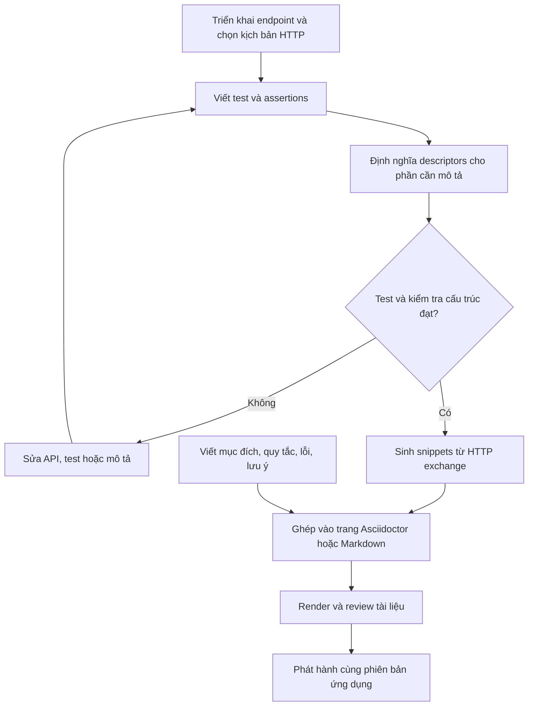
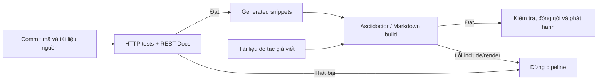

# Mối liên hệ giữa tài liệu viết tay và snippet sinh tự động

## Mục tiêu học tập

Sau bài này, bạn có thể:

- Phân biệt phần **tài liệu do tác giả viết** với phần **snippet được sinh từ bài kiểm thử HTTP** trong Spring REST Docs.
- Giải thích vì sao hai loại nội dung phải đi cùng nhau để tài liệu REST API vừa có bối cảnh, vừa phản ánh request/response đã được kiểm chứng.
- Tạo snippet từ một documentation test bằng **MockMvc** và chèn chúng vào tài liệu **Asciidoctor**.
- Hiểu cách áp dụng cùng nguyên tắc khi dùng **WebTestClient**, **REST Assured** hoặc chọn định dạng đầu ra Markdown.
- Xử lý những thay đổi API làm snippet, liên kết include hoặc lời giải thích thủ công trở nên không đồng bộ, đồng thời đưa các kiểm tra cần thiết vào build và CI.

## 1. Hai phần của một tài liệu REST API tốt

Hãy hình dung bạn được giao tích hợp endpoint `GET /api/orders?page=0&size=20`. Bạn cần biết cách gửi HTTP request, các trường trong response và mã trạng thái. Nhưng bạn cũng cần biết **khi nào nên gọi endpoint**, tham số `page` bắt đầu từ 0 hay 1, người dùng cần quyền gì và phải xử lý ra sao khi danh sách trống.

Đó là hai nhóm thông tin có nguồn gốc khác nhau:

1. **Tài liệu viết tay** (*handwritten documentation*) là phần con người biên soạn: mục đích nghiệp vụ, hướng dẫn tích hợp, điều kiện tiên quyết, giải thích quy tắc, các lưu ý và cách xử lý lỗi.
2. **Snippet sinh tự động** (*generated snippet*) là mảnh tài liệu lấy từ một request/response đã chạy trong bài kiểm thử Spring REST Docs, kết hợp với các khai báo mô tả (*descriptor*) mà người viết test cung cấp. Ví dụ: request HTTP, response HTTP, danh sách query parameter, request field hoặc response field.

Một trang đầy đủ thường có dạng:

```text
Trang "Liệt kê đơn hàng"                    ← Tác giả tổ chức và biên tập
├── Khi nào sử dụng endpoint?             ← Viết tay
├── Điều kiện xác thực và quy tắc lọc      ← Viết tay
├── Ví dụ HTTP request                     ← Snippet từ test
├── Bảng mô tả query parameter             ← Snippet từ test + descriptor
├── Ví dụ HTTP response                    ← Snippet từ test
├── Bảng mô tả response field              ← Snippet từ test + descriptor
├── Ý nghĩa trạng thái và phân trang       ← Viết tay
└── Trường hợp lỗi, lưu ý tích hợp         ← Viết tay + snippet/test tương ứng
```

Trong module **SPRING_REST_DOCS**, mục tiêu là tạo tài liệu REST API có thể kiểm chứng bằng **MockMvc**, **WebTestClient** hoặc **REST Assured**, sinh snippet cho request, response, payload, tham số và header, rồi biên soạn thành tài liệu Asciidoctor/Markdown trong quy trình build và CI.

**Điểm cốt lõi:** máy giúp ghi lại và kiểm tra điều đã xảy ra trong test; con người giải thích **ý nghĩa**, **cách sử dụng** và **phạm vi áp dụng** của hành vi đó. Spring REST Docs không tự viết một hướng dẫn tích hợp hoàn chỉnh chỉ từ tên controller hoặc DTO.

## 2. Ranh giới trách nhiệm: nội dung nào thuộc về đâu?

| Nội dung cần tài liệu hóa | Nguồn phù hợp | Vì sao? |
| --- | --- | --- |
| HTTP method, URL, header và body thực tế của một kịch bản | Snippet `http-request` / `curl-request` | Lấy từ request mà test đã thực hiện, hạn chế sao chép tay. |
| Status, header và JSON thực tế của response | Snippet `http-response` | Cho thấy dữ liệu server/test thực sự trả về trong kịch bản. |
| Tên và mô tả query/path parameter | Snippet `query-parameters` / `path-parameters` với descriptor | Ràng buộc danh sách tham số được mô tả với request tương ứng. |
| Tên và mô tả request/response field | Snippet `request-fields` / `response-fields` với descriptor | Có thể phát hiện một số sai lệch cấu trúc khi chạy test. |
| Header nghiệp vụ quan trọng | Snippet `request-headers` / `response-headers` với descriptor | Mô tả header được khai báo trong HTTP exchange. |
| Mục đích endpoint, tác vụ người đọc cần hoàn thành | Tài liệu viết tay | Test không hiểu mục tiêu sản phẩm. |
| Ý nghĩa trạng thái, quy tắc phân trang, quyền truy cập | Tài liệu viết tay, được kiểm chứng bằng test phù hợp | Những quy tắc này phải được diễn giải bằng ngôn ngữ nghiệp vụ. |
| Hướng dẫn retry, idempotency, giới hạn hệ thống | Tài liệu viết tay, có test và/hoặc nguồn đặc tả phù hợp | Không thể suy ra an toàn từ một ví dụ HTTP thành công. |
| Phạm vi phiên bản, mục thay đổi, liên hệ hỗ trợ | Tài liệu viết tay hoặc hệ thống tài liệu | Đây là thông tin quản trị, không xuất hiện tự nhiên trong response. |

Một snippet mô tả trường **không hoàn toàn tự động**: ví dụ `fieldWithPath("status").description("Trạng thái đơn hàng")` lấy tên trường từ descriptor do lập trình viên viết, còn nội dung mô tả cũng do con người cung cấp. REST Docs kiểm tra sự hiện diện và các ràng buộc cấu trúc nhất định, nhưng **không tự xác nhận câu mô tả bằng tiếng Việt có đúng nghiệp vụ hay không**.

### 2.1. Vì sao không viết toàn bộ HTTP ví dụ bằng tay?

Giả sử một trang viết tay có response:

```json
{"id": 42, "status": "PAID"}
```

Ứng dụng đổi tên trường thành `paymentStatus`. Nếu tài liệu không tham gia quy trình kiểm thử, ví dụ cũ có thể tồn tại qua nhiều lần phát hành. Khi response được lấy từ documentation test, snippet sẽ phản ánh HTTP exchange mà test chạy; nếu descriptor vẫn trỏ đến `status` và test dùng chế độ kiểm tra nghiêm ngặt, việc tạo tài liệu có thể thất bại và buộc nhóm xem xét thay đổi.

Tuy nhiên, **snippet tự sinh không bảo đảm toàn bộ tài liệu đúng**: nếu test chỉ chạy với một controller giả lập, API thật có thể hành xử khác; nếu assertion quá ít, giá trị trả về có thể sai nghiệp vụ; nếu đoạn văn thủ công ghi `page` bắt đầu từ 1 trong khi server bắt đầu từ 0, REST Docs không tự phát hiện câu đó.

### 2.2. Vì sao không chỉ ghép các snippet?

HTTP trace:

```http
GET /api/orders?page=0&size=2 HTTP/1.1
Accept: application/json
```

cho biết cách gọi ở một tình huống. Nó **không giải thích** khi nào nên dùng lọc theo trạng thái, giới hạn `size` tối đa là bao nhiêu, dữ liệu được sắp xếp theo gì hoặc quyền truy cập cần có. Những quy tắc này thuộc phần thuyết minh, và cần được kiểm tra với người phụ trách API. Trang chỉ chứa bảng field và ví dụ request có thể đúng kỹ thuật nhưng vẫn khó tích hợp.

## 3. Vòng đời từ bài kiểm thử đến tài liệu hoàn chỉnh



Các đầu việc có tính phụ thuộc:

- **HTTP test** quyết định kịch bản được ghi nhận. Assertion phải xác minh điều quan trọng như status, header và giá trị JSON.
- **Descriptor** quyết định phần được trình bày thành bảng. Ví dụ `responseFields(...)` yêu cầu khai báo đường dẫn trường và mô tả.
- **Snippet** là artifact trung gian, thường mang đuôi `.adoc` với định dạng Asciidoctor. Nó chưa phải trang hướng dẫn đầy đủ.
- **Tài liệu gốc** chứa nội dung do người viết biên soạn và các lệnh include/tham chiếu snippet.
- **Build** chạy test rồi render tài liệu; **CI** thực hiện lại các bước đó khi thay đổi mã.

Các bước này chỉ có ý nghĩa khi gắn với **cùng commit hoặc phiên bản build**. Một trang đã render ở phiên bản cũ không chứng minh rằng API của bản phát hành mới vẫn phù hợp.

## 4. Ví dụ thực hành: một test, nhiều snippet, một trang có ngữ cảnh

Xét endpoint ví dụ:

```http
GET /api/orders?page=0&size=2 HTTP/1.1
Accept: application/json
```

Response mong đợi:

```json
{
  "content": [
    {"id": 42, "status": "PAID"}
  ],
  "page": 0,
  "size": 2
}
```

Để tập trung vào Spring REST Docs, ví dụ dùng controller giả lập trả dữ liệu cố định. Trong ứng dụng thật, logic phân trang, sắp xếp, lọc và phân quyền cần được kiểm thử riêng.

### 4.1. Viết documentation test bằng MockMvc

Ví dụ dành cho Java 17+, JUnit Jupiter, Spring MVC Test, Jackson và dependency `spring-restdocs-mockmvc` tương thích. Mục tiêu của test là ghi nhận một kịch bản HTTP thực thi được và sinh bảng query parameter/response field.

```java
import java.util.List;

import org.junit.jupiter.api.BeforeEach;
import org.junit.jupiter.api.Test;
import org.junit.jupiter.api.extension.ExtendWith;
import org.springframework.http.MediaType;
import org.springframework.restdocs.RestDocumentationContextProvider;
import org.springframework.restdocs.RestDocumentationExtension;
import org.springframework.test.web.servlet.MockMvc;
import org.springframework.test.web.servlet.setup.MockMvcBuilders;
import org.springframework.web.bind.annotation.GetMapping;
import org.springframework.web.bind.annotation.RequestParam;
import org.springframework.web.bind.annotation.RestController;

import static org.springframework.restdocs.mockmvc.MockMvcRestDocumentation.document;
import static org.springframework.restdocs.mockmvc.MockMvcRestDocumentation.documentationConfiguration;
import static org.springframework.restdocs.payload.PayloadDocumentation.fieldWithPath;
import static org.springframework.restdocs.payload.PayloadDocumentation.responseFields;
import static org.springframework.restdocs.request.RequestDocumentation.parameterWithName;
import static org.springframework.restdocs.request.RequestDocumentation.queryParameters;
import static org.springframework.test.web.servlet.request.MockMvcRequestBuilders.get;
import static org.springframework.test.web.servlet.result.MockMvcResultMatchers.jsonPath;
import static org.springframework.test.web.servlet.result.MockMvcResultMatchers.status;

@ExtendWith(RestDocumentationExtension.class)
class OrdersListDocumentationTest {
    private MockMvc mvc;

    @BeforeEach
    void setUp(RestDocumentationContextProvider context) {
        mvc = MockMvcBuilders.standaloneSetup(new OrdersController())
                .apply(documentationConfiguration(context))
                .build();
    }

    @Test
    void listOrders() throws Exception {
        mvc.perform(get("/api/orders?page={page}&size={size}", 0, 2)
                        .accept(MediaType.APPLICATION_JSON))
                .andExpect(status().isOk())
                .andExpect(jsonPath("$.page").value(0))
                .andExpect(jsonPath("$.size").value(2))
                .andExpect(jsonPath("$.content[0].id").value(42))
                .andExpect(jsonPath("$.content[0].status").value("PAID"))
                .andDo(document("orders-list",
                        queryParameters(
                                parameterWithName("page")
                                        .description("Chỉ số trang, bắt đầu từ 0"),
                                parameterWithName("size")
                                        .description("Số phần tử yêu cầu trong một trang")
                        ),
                        responseFields(
                                fieldWithPath("content")
                                        .description("Danh sách đơn hàng trong trang"),
                                fieldWithPath("content[].id")
                                        .description("Mã đơn hàng"),
                                fieldWithPath("content[].status")
                                        .description("Trạng thái đơn hàng"),
                                fieldWithPath("page")
                                        .description("Chỉ số trang được trả về"),
                                fieldWithPath("size")
                                        .description("Kích thước trang được yêu cầu")
                        )
                ));
    }

    record Order(long id, String status) {}
    record OrderPage(List<Order> content, int page, int size) {}

    @RestController
    static class OrdersController {
        @GetMapping(path = "/api/orders",
                    produces = MediaType.APPLICATION_JSON_VALUE)
        OrderPage list(@RequestParam("page") int page,
                       @RequestParam("size") int size) {
            return new OrderPage(List.of(new Order(42, "PAID")), page, size);
        }
    }
}
```

Trong test này:

- `andExpect(...)` **kiểm tra hành vi**, bao gồm status và các giá trị trong response.
- `queryParameters(...)` **mô tả tham số** thực sự xuất hiện trong query string của request.
- `responseFields(...)` **mô tả trường JSON** mà kịch bản trả về. Các descriptor ở chế độ strict có thể phát hiện trường chưa được mô tả hoặc trường được khai báo nhưng không xuất hiện.
- `document("orders-list", ...)` **đặt tên ổn định** cho thư mục snippet; tài liệu sẽ tham chiếu tên này.

Test chạy thành công có thể tạo cấu trúc tương tự:

```text
build/generated-snippets/
└── orders-list/
    ├── curl-request.adoc
    ├── http-request.adoc
    ├── http-response.adoc
    ├── query-parameters.adoc
    └── response-fields.adoc
```

Tên file và định dạng tùy cấu hình template; trên Maven, thư mục thường là `target/generated-snippets`. Tập tin `query-parameters.adoc` không tự xuất hiện chỉ vì endpoint có query string: cần test ghi tài liệu với mô tả tương ứng.

### 4.2. Viết phần thuyết minh thủ công và include snippet

Tác giả tạo trang `src/docs/asciidoc/index.adoc`:

```asciidoc
= Orders API
:toc: left
:sectnums:

== Liệt kê đơn hàng

Sử dụng GET /api/orders để xem các đơn hàng được phép truy cập.
Ví dụ này minh họa phân trang bằng hai tham số page và size.

=== Điều kiện trước

Client cần đáp ứng cơ chế xác thực và phân quyền do hệ thống quy định.
Không suy ra quyền truy cập chỉ từ ví dụ HTTP thành công.

=== HTTP request
include::{snippets}/orders-list/http-request.adoc[]

=== Query parameters
include::{snippets}/orders-list/query-parameters.adoc[]

=== HTTP response
include::{snippets}/orders-list/http-response.adoc[]

=== Response fields
include::{snippets}/orders-list/response-fields.adoc[]

=== Cách xử lý kết quả

Trường page là chỉ số trang bắt đầu từ 0 trong ví dụ API này.
Client phải xử lý danh sách content rỗng theo hợp đồng thực tế.
```

Ở đây:

| Thành phần trang | Người tạo và bảo trì | Nguồn thay đổi |
| --- | --- | --- |
| Tiêu đề “Liệt kê đơn hàng” và đoạn giới thiệu | Người viết tài liệu | Mục tiêu và hành vi API được xác nhận |
| `http-request.adoc` | Spring REST Docs từ HTTP test | Request được thực thi trong test |
| `query-parameters.adoc` | Spring REST Docs + descriptor do người viết test khai báo | Tham số trong HTTP exchange và mô tả |
| `http-response.adoc` | Spring REST Docs | Response của kịch bản được test |
| `response-fields.adoc` | Spring REST Docs + descriptor | Payload thực tế và mô tả |
| Điều kiện xác thực, lưu ý nghiệp vụ, cách xử lý phân trang | Người viết tài liệu | Quy tắc sản phẩm, cần kiểm thử/review |

Biến Asciidoctor `{snippets}` cần được cấu hình trỏ đến thư mục snippet. Khi render, mỗi dòng `include::...[]` thay bằng nội dung snippet tương ứng. Nếu thiếu snippet, phải xử lý lỗi include thay vì đưa tài liệu thiếu ví dụ lên môi trường phát hành.

**Quan trọng:** phần văn bản về quyền truy cập ở ví dụ cố ý không khẳng định một cơ chế xác thực cụ thể, vì controller giả lập không thực thi security. Một tài liệu thật phải mô tả chính xác loại token, quyền, tình huống `401/403` cùng các test minh chứng.

### 4.3. Nếu dùng WebTestClient hoặc REST Assured thì sao?

Ba công cụ **MockMvc**, **WebTestClient** và **REST Assured** khác nhau ở cách dựng và chạy HTTP test; tư duy tài liệu vẫn giống nhau:

1. Chuẩn bị request đại diện cho một kịch bản tích hợp.
2. Kiểm tra status, header, payload và điều kiện nghiệp vụ quan trọng.
3. Gắn bước tạo tài liệu REST Docs, khai báo các descriptor cần thiết.
4. Sinh snippet với tên kịch bản ổn định rồi include vào trang chung.

Bạn nên chọn công cụ phù hợp với tầng kiểm thử: MockMvc cho Spring MVC, WebTestClient cho ứng dụng reactive hoặc môi trường có hỗ trợ client này, REST Assured cho kiểm thử HTTP với server chạy thực. Không cần trộn cả ba công cụ trong cùng test để có tài liệu tốt.

## 5. Mối quan hệ thay đổi: ai phải sửa phần nào?

Khi API thay đổi, **source of truth** cho các dữ kiện phải được xác định rõ. Hãy dùng bảng sau trong code review:

| Thay đổi | Test/assertion và descriptor | Snippet | Tài liệu viết tay |
| --- | --- | --- | --- |
| Đổi `status` thành `paymentStatus` | Cập nhật assertion/descriptor theo hợp đồng mới | Sinh lại từ response mới | Kiểm tra các đoạn nhắc tên trường cũ |
| Thêm query parameter `sort` | Bổ sung test và descriptor | Sinh bảng query parameter mới | Giải thích giá trị và thứ tự sắp xếp nếu có |
| Thay status thành công từ `200` sang `206` | Xác nhận thay đổi là đúng, cập nhật assertion | Sinh ví dụ response mới | Giải thích ngữ nghĩa mới, cập nhật hướng dẫn client |
| Thay quy tắc phân quyền | Viết test bảo mật ở tình huống phù hợp | Thêm snippet lỗi nếu được tài liệu hóa | Cập nhật điều kiện trước và hướng xử lý |
| Đổi tên `document("orders-list")` thành `document("list-orders")` | Đổi định danh snippet trong test | Thư mục đầu ra đổi tên | Cập nhật toàn bộ đường dẫn include |
| Thay đoạn giải thích nghiệp vụ nhưng HTTP không đổi | Có thể bổ sung test để bảo đảm quy tắc đúng | Không nhất thiết thay | Review và sửa lời giải thích |
| Bỏ hẳn một endpoint | Bỏ test tương ứng có chủ đích | Không được giữ bản snippet cũ | Gỡ hoặc đánh dấu rõ trạng thái không còn hỗ trợ |

Đặc biệt lưu ý: **một đoạn prose có thể trở nên cũ dù mọi snippet vẫn đúng**. Ví dụ test vẫn mô tả `page=0` hợp lệ, còn văn bản viết tay ghi “trang đầu tiên là 1”. Công cụ không hiểu sự mâu thuẫn ngữ nghĩa này. Code review, test phù hợp và kiểm tra trải nghiệm người tích hợp vẫn cần thiết.

### 5.1. Tránh hai nguồn dữ liệu bị trùng lặp

Một thực hành dễ gây lệch là dán nguyên bảng response fields do REST Docs sinh vào đoạn Markdown viết tay, rồi duy trì cả hai nơi. Khi thêm một trường mới, một bảng được cập nhật, bảng còn lại vẫn cũ.

Thay vào đó:

- Để snippet quản lý ví dụ HTTP và bảng field/parameter được tạo từ test.
- Dùng phần viết tay để giải thích **quy tắc và bối cảnh** chưa thể hiện rõ trong bảng.
- Khi buộc phải có một câu nêu tên trường hoặc status trong prose, coi đó là **cam kết cần rà soát mỗi khi API thay đổi**.
- Giữ nguyên các định danh snippet ổn định khi refactor tên test/phương thức để tránh làm hỏng include không cần thiết.

Đây là cách chia trách nhiệm theo *nguồn tạo dữ liệu* và *mục đích sử dụng*, không phải quy tắc cấm viết bất kỳ ví dụ nào bằng tay. Ví dụ giải thích mang tính giả định vẫn hữu ích nếu ghi rõ, nhưng ví dụ chuẩn để client sao chép nên liên kết với test.

## 6. Asciidoctor, Markdown và nơi biên soạn tài liệu

Spring REST Docs có template snippet phục vụ các định dạng tài liệu; **Asciidoctor** là quy trình thường gặp với snippet `.adoc` và cú pháp include. **Markdown** cũng có thể được sử dụng khi dự án cấu hình định dạng/template snippet thích hợp và có cơ chế ghép tài liệu trong build.

| Vấn đề | Asciidoctor | Markdown |
| --- | --- | --- |
| Mảnh nội dung thường thấy | `*.adoc` | `*.md` khi đã cấu hình template tương ứng |
| Chèn snippet | `include::{snippets}/...[]` | Cần tính năng include của công cụ build, script ghép hoặc cơ chế tham chiếu được hỗ trợ |
| Render | Asciidoctor xuất HTML/PDF tùy cấu hình | Công cụ Markdown renderer/site generator được chọn |
| Điều kiện để đáng tin | Test sinh snippet trước, include trỏ đúng output | Test sinh đúng định dạng, bước ghép/render dùng output mới |

Markdown chuẩn **không có** cú pháp `include::...[]` của Asciidoctor. Đổi tên `http-request.adoc` thành `http-request.md` mà không thay template hay pipeline cũng không làm nội dung trở thành Markdown hợp lệ.

Một tổ chức thư mục minh họa với Gradle và Asciidoctor:

```text
src/
├── test/java/.../OrdersListDocumentationTest.java   # Test + descriptors
└── docs/asciidoc/index.adoc                         # Phần biên soạn
build/
├── generated-snippets/orders-list/                  # Sinh khi chạy test
│   ├── http-request.adoc
│   ├── http-response.adoc
│   ├── query-parameters.adoc
│   └── response-fields.adoc
└── docs/asciidoc/                                   # HTML sau khi render
```

Không xem `build/generated-snippets` là nơi chỉnh sửa thủ công: chạy test lần sau có thể ghi đè mọi thay đổi. Mô tả cần sửa nên được cập nhật tại descriptor trong test; diễn giải bổ sung nên được cập nhật ở tài liệu nguồn.

## 7. Tích hợp test và phần biên soạn vào build, CI

Để duy trì mối liên hệ giữa hai phần, quy trình build cần thể hiện quan hệ phụ thuộc:



Với dự án Gradle đã cài plugin Asciidoctor và quản lý dependency phù hợp, phần nối task có thể được cấu hình như sau (Groovy DSL, **không phải file build hoàn chỉnh**):

```groovy
configurations {
    asciidoctorExt
}

dependencies {
    testImplementation 'org.springframework.restdocs:spring-restdocs-mockmvc'
    asciidoctorExt 'org.springframework.restdocs:spring-restdocs-asciidoctor'
}

def snippetsDir = file("$buildDir/generated-snippets")

tasks.named('test') {
    outputs.dir snippetsDir
}

tasks.named('asciidoctor') {
    configurations 'asciidoctorExt'
    inputs.dir snippetsDir
    dependsOn tasks.named('test')
}
```

Những dependency này cần phiên bản tương thích với Spring và Java của dự án thông qua BOM hoặc khai báo version. Plugin Asciidoctor, JUnit và thư viện Spring Test phải được khai báo trong cấu hình thực tế. Có thể chạy `./gradlew test asciidoctor`, hoặc `gradlew.bat test asciidoctor` trên Windows, sau khi thiết lập đầy đủ. Dự án Maven theo cùng tư duy: cho test sinh snippet rồi render tài liệu ở giai đoạn phù hợp.

Nên kiểm tra thêm:

1. **Artifact cũ:** một test bị xóa nhưng thư mục snippet cũ còn tồn tại có thể làm trang include tài liệu lỗi thời. Với pipeline phát hành, bảo đảm output sạch hoặc được cô lập đúng phiên build.
2. **Đường dẫn include:** tên kịch bản trong `document(...)` khớp với đường dẫn trong Asciidoctor/Markdown.
3. **Tính ổn định:** request/response dùng dữ liệu giả có thể tái hiện; normalize ngày giờ, ID ngẫu nhiên hoặc host nếu chúng gây nhiễu.
4. **Bảo mật:** không xuất bản token thật, cookie nhạy cảm hay dữ liệu khách hàng; dùng fixture giả hoặc preprocess snippet.
5. **Kiểm tra văn bản:** review lời giải thích, các trường hợp lỗi và giá trị nghiệp vụ song song với việc chạy test.
6. **Phiên bản phát hành:** tài liệu HTML nên được tạo từ cùng commit/build với API để người sử dụng nhận đúng hợp đồng.

Build xanh nghĩa là các kiểm tra đã **được cấu hình** đều đạt. Nó không thay thế việc rà soát cách dùng API hoặc việc bao phủ những endpoint chưa có documentation test.

## 8. Các lỗi thường gặp khi ghép tài liệu viết tay với snippet

| Dấu hiệu | Nguyên nhân có thể | Hướng kiểm tra |
| --- | --- | --- |
| Asciidoctor báo không tìm thấy `orders-list/http-response.adoc` | Test không chạy, đổi tên `document(...)` hoặc sai `{snippets}` | Xác nhận test sinh file, đường dẫn include và thứ tự task |
| Trang HTML vẫn có HTTP ví dụ cũ | Output snippet từ lần build trước | Thử build sạch và bảo đảm render dùng đúng thư mục đầu ra |
| Test thất bại do trường JSON chưa được mô tả | Descriptor strict chưa được cập nhật theo response mới | So sánh response thực với `responseFields(...)`; sửa theo hợp đồng |
| Trang có hai bảng field khác nhau | Một bảng từ snippet, một bảng copy vào prose | Chọn bảng snippet làm nguồn dữ liệu cấu trúc |
| Mô tả “`page` bắt đầu từ 1” nhưng test dùng 0 | Câu viết tay không được đối chiếu với quy tắc API | Review và thêm assertion xác nhận hành vi phân trang |
| Trang thiếu tình huống `400/401/404` | Chỉ có test thành công và snippet tương ứng | Bổ sung documentation test cho lỗi quan trọng |
| HTML chứa access token hoặc email thật | Fixture không phù hợp hoặc thiếu preprocess | Thay dữ liệu giả và lọc thông tin nhạy cảm |

## 9. Bài tập thực hành

Một nhóm có trang viết tay:

> “Dùng `GET /api/products/{id}` để xem sản phẩm. API trả mã 200 và giá tính bằng đồng.”

Nhưng tài liệu HTTP từ một test hiện có chỉ có:

```json
{"id": 10, "price": 125000}
```

Hãy thực hiện theo trình tự:

1. Bổ sung documentation test cho `GET /api/products/{id}` với assertion status `200`, giá trị `id`/`price` và các descriptor `pathParameters(...)`, `responseFields(...)`.
2. Đặt tên snippet ổn định, chẳng hạn `products-get`, và ghép `http-request`, `path-parameters`, `http-response`, `response-fields` vào tài liệu Asciidoctor.
3. Kiểm tra **đơn vị tiền tệ** bằng nguồn quy tắc nghiệp vụ và assertion/test phù hợp; không suy ra đơn vị chỉ từ số `125000`.
4. Thêm mô tả viết tay: ai được truy cập, ý nghĩa `price`, sản phẩm không tồn tại được xử lý ra sao; chỉ ghi những gì đã xác minh.
5. Giả sử API đổi `price` thành `unitPrice`, xác định chính xác test, descriptor, snippet và đoạn văn nào phải được xem xét lại.
6. Đưa các bước test, render và kiểm tra include vào build CI; thử một lần cố tình đổi tên trường để quan sát phản hồi của tài liệu hóa strict.

**Câu hỏi tự kiểm tra:** Nếu HTML render thành công, có thể khẳng định mọi câu viết tay đều đúng với API không? **Không.** Việc render chỉ chứng minh quá trình ghép tài liệu vận hành theo cấu hình. Những khẳng định về nghiệp vụ, quyền truy cập, giá trị mặc định và lỗi vẫn cần test, nguồn đặc tả tin cậy và review.

## Kết luận

**Tài liệu viết tay** giải thích cách dùng và ý nghĩa của REST API; **snippet sinh tự động** đưa vào những bằng chứng HTTP và bảng mô tả gắn với bài kiểm thử. Spring REST Docs kết nối hai phần đó: test bằng MockMvc, WebTestClient hoặc REST Assured sinh request/response, payload, parameter và header snippet; Asciidoctor/Markdown biên soạn thành trang có bối cảnh; build và CI kiểm tra quá trình lắp ghép. Khi API thay đổi, cần cập nhật đồng bộ **test, descriptor, snippet sinh lại và lời giải thích thủ công** để tài liệu vừa dễ đọc vừa phản ánh đúng phiên bản đang phát hành.
