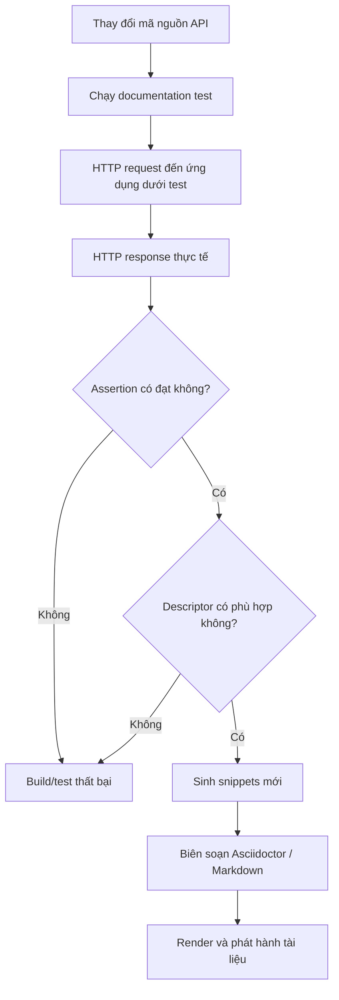
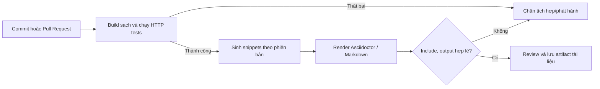

# Vì sao kiểm thử tạo tài liệu giúp phát hiện tài liệu lỗi thời

## Mục tiêu học tập

Sau bài học này, bạn có thể:

- Giải thích **tài liệu REST API lỗi thời** là gì và vì sao việc viết ví dụ request/response bằng tay dễ tạo ra sai lệch khi ứng dụng thay đổi.
- Phân biệt vai trò của **assertion HTTP**, **REST Docs descriptor** và **snippet sinh từ test** trong việc phát hiện sai lệch.
- Thực hiện một documentation test với **Spring REST Docs và MockMvc**, rồi thử các thay đổi có chủ đích để xem khi nào test thất bại.
- Xác định những thay đổi mà công cụ **không tự phát hiện**, chẳng hạn thiếu test, assertion yếu hoặc mô tả nghiệp vụ sai.
- Thiết kế quy trình kiểm thử, sinh snippet, biên soạn Asciidoctor/Markdown và chạy build/CI để tài liệu đi cùng phiên bản API.

## 1. Tài liệu lỗi thời xuất hiện như thế nào?

Giả sử phiên bản đầu tiên của endpoint `GET /api/orders/42` trả:

```http
HTTP/1.1 200 OK
Content-Type: application/json

{"id":42,"status":"PAID"}
```

Nhóm tích hợp đã viết client đọc trường `status`. Sau một lần nâng cấp, server đổi tên trường thành `paymentStatus`:

```http
HTTP/1.1 200 OK
Content-Type: application/json

{"id":42,"paymentStatus":"PAID"}
```

Server mới có thể hoạt động đúng với quyết định thiết kế mới, nhưng trang hướng dẫn vẫn chứa response cũ. Với người đọc, tài liệu trở thành một **hợp đồng sai**: làm theo tài liệu không còn tạo ra kết quả mô tả.

Một số kiểu sai lệch thường gặp:

| Thay đổi trong API | Nội dung tài liệu có thể lỗi thời | Hậu quả |
| --- | --- | --- |
| Đổi tên/thêm/xóa trường JSON | Bảng response field, ví dụ JSON | Client đọc sai dữ liệu hoặc bỏ sót trường quan trọng |
| Thay kiểu dữ liệu, tính bắt buộc hay cấu trúc lồng nhau | Mô tả payload và hướng dẫn validation | Client gửi dữ liệu không được chấp nhận |
| Thay HTTP status hoặc response header | Ví dụ thành công/thất bại, luồng tạo tài nguyên | Client rẽ nhánh xử lý sai |
| Đổi path, path/query parameter hoặc tên header | Mẫu URL và bảng tham số | Request trả lỗi hoặc truy cập sai tài nguyên |
| Thay hành vi phân trang, xác thực hoặc quy tắc nghiệp vụ | Đoạn giải thích, điều kiện trước và tình huống lỗi | Tích hợp hiểu sai dù JSON vẫn hợp lệ |
| Đổi tên hoặc bỏ test nhưng giữ output cũ | Liên kết đến snippet cũ trên trang HTML | Xuất bản tài liệu từ lần build trước |

**Gốc rễ:** mã nguồn và tài liệu được thay đổi ở những thời điểm, bởi những người hoặc quy trình khác nhau. Khi tài liệu là một tập ví dụ viết tay tách rời kiểm thử, không có bước bắt buộc nào báo lỗi nếu hành vi HTTP đổi mà tài liệu chưa đổi.

## 2. Ý tưởng của Spring REST Docs: biến tài liệu thành một phần của kiểm thử

Trong module **SPRING_REST_DOCS**, tài liệu REST API được tạo từ các bài kiểm thử HTTP bằng **MockMvc**, **WebTestClient** hoặc **REST Assured**. Bài kiểm thử vừa gửi request, vừa kiểm tra response, vừa khai báo những phần cần mô tả. Spring REST Docs ghi nhận HTTP exchange và sinh các **snippet** như `http-request`, `http-response`, `request-fields`, `response-fields`, `path-parameters`, `query-parameters` hoặc các snippet header.

Quy trình có thể hình dung như sau:



Khác biệt quan trọng nằm ở **điểm kiểm tra bắt buộc**: để sinh ra bộ snippet hợp lệ từ một test, bài kiểm thử phải vượt qua các assertion và điều kiện mà REST Docs được cấu hình để xác minh. Khi API thay đổi trái với những điều đó, quy trình tạo tài liệu không còn chạy thành công như trước. Sự cố được phát hiện trong lúc phát triển hoặc trên CI, trước khi trang mới được phát hành.

Tuy vậy, Spring REST Docs không tự quét mọi endpoint để bảo đảm toàn bộ hệ thống đã có tài liệu. **Lợi ích phát hiện lỗi chỉ có trong phạm vi test, descriptor và kiểm tra build thực sự được thiết lập.**

## 3. Ba cơ chế giúp nhận ra tài liệu không còn khớp

### 3.1. Assertion phát hiện hành vi HTTP thay đổi

Ví dụ một test xác minh:

```java
.andExpect(status().isOk())
.andExpect(jsonPath("$.id").value(42))
.andExpect(jsonPath("$.status").value("PAID"))
```

Những assertion này ghi lại **kỳ vọng có thể chạy lại**: status phải là `200 OK`, `id` là `42`, `status` là `PAID` trong kịch bản đã chọn.

Nếu API đổi status sang `206 Partial Content`, đổi giá trị trạng thái thành `REFUNDED` hoặc bỏ trường `status`, ít nhất một assertion liên quan sẽ thất bại. Nhóm phải xác định thay đổi là lỗi hay là yêu cầu mới; nếu là yêu cầu mới, cần chỉnh test, descriptor **và** tài liệu cho phù hợp.

Assertion chỉ bảo vệ những điều được kiểm tra: nếu chỉ có `status().isOk()`, một response JSON sai giá trị vẫn có thể qua test. Ngược lại, assertion chi tiết cần được gắn với quy tắc nghiệp vụ có chủ ý, tránh cố định những giá trị ngẫu nhiên không thuộc hợp đồng.

### 3.2. Descriptor phát hiện sai lệch cấu trúc

Spring REST Docs dùng các **descriptor** để mô tả trường, tham số và header. Ví dụ:

```java
responseFields(
    fieldWithPath("id").description("Mã đơn hàng"),
    fieldWithPath("status").description("Trạng thái đơn hàng")
)
```

Trong chế độ mô tả response field **strict** thông dụng, REST Docs đối chiếu cấu trúc response thực tế với các descriptor:

- Nếu tài liệu yêu cầu `status` nhưng response không có trường này, phần tạo tài liệu có thể thất bại vì trường được mô tả không xuất hiện.
- Nếu response thêm một trường `paymentStatus` mà không được mô tả, việc kiểm tra strict cũng có thể báo trường chưa được tài liệu hóa.
- Nếu cấu trúc đổi từ `status` thành `payment.status`, đường dẫn descriptor cũ không còn đúng.

Đó là khả năng phát hiện một loại lỗi mà người đọc tài liệu viết tay khó nhận ra sớm: **hợp đồng cấu trúc đã thay đổi nhưng bảng trường chưa được cập nhật**.

Cần hiểu ranh giới:

| Cơ chế | Thường phát hiện được | Không tự bảo đảm |
| --- | --- | --- |
| `responseFields(...)` / `requestFields(...)` strict | Trường thiếu, trường chưa mô tả, đường dẫn JSON không khớp | Giá trị nghiệp vụ đúng, thông điệp mô tả có đúng nghĩa |
| `pathParameters(...)` / `queryParameters(...)` | Tên/thành phần tham số được mô tả so với request test | Quy tắc phân trang/lọc nếu không có assertion và test tương ứng |
| `requestHeaders(...)` / `responseHeaders(...)` | Các header được mô tả so với exchange trong test | Hành vi xác thực, phân quyền của các tình huống không được kiểm thử |
| Assertion cho status/header/body | Điều kiện cụ thể mà test đã khai báo | Hành vi và trường hợp không được bao phủ |

Các tùy chọn như `optional()`, `ignored()`, `relaxedResponseFields(...)` hoặc `relaxedRequestFields(...)` có vai trò hợp lệ, nhưng sử dụng quá rộng sẽ làm giảm tín hiệu phát hiện thay đổi cấu trúc. Ví dụ, nếu dùng `relaxedResponseFields(...)`, việc thêm một trường chưa mô tả có thể không khiến test thất bại.

### 3.3. Snippet được tạo từ HTTP exchange đã chạy

Snippet HTTP request/response được tạo từ tương tác trong bài kiểm thử; người viết không cần sao chép lại ví dụ từ một response đã chụp nhiều tháng trước. Khi test chạy trên mã mới và đạt, bộ snippet mới phản ánh request/response của kịch bản đó.

Điều này giảm nguy cơ **ví dụ lỗi thời**, nhưng không phải cơ chế so sánh nội dung giữa hai phiên bản một cách tự động. Nếu test và descriptor đều chấp nhận hành vi mới, REST Docs có thể sinh ví dụ mới mà không báo lỗi. Nhóm vẫn cần xem sự thay đổi đó có tương thích hay cần thông báo cho client, đồng thời cập nhật phần giải thích viết tay.

## 4. Thực hành: tạo một điểm kiểm tra cho tài liệu bằng MockMvc

Ví dụ sau dùng Java 17+, JUnit Jupiter, Spring MVC Test, Jackson và `spring-restdocs-mockmvc`. Một controller mô phỏng được đặt trong test để minh họa cơ chế; **khi làm dự án thật, hãy thay bằng controller/ứng dụng đang cần bảo vệ và cấu hình các thành phần liên quan**, bởi test dùng controller giả không thể xác minh hành vi production.

### 4.1. Phiên bản ban đầu

```java
import java.util.Map;

import org.junit.jupiter.api.BeforeEach;
import org.junit.jupiter.api.Test;
import org.junit.jupiter.api.extension.ExtendWith;
import org.springframework.http.MediaType;
import org.springframework.restdocs.RestDocumentationContextProvider;
import org.springframework.restdocs.RestDocumentationExtension;
import org.springframework.test.web.servlet.MockMvc;
import org.springframework.test.web.servlet.setup.MockMvcBuilders;
import org.springframework.web.bind.annotation.GetMapping;
import org.springframework.web.bind.annotation.PathVariable;
import org.springframework.web.bind.annotation.RestController;

import static org.springframework.restdocs.mockmvc.MockMvcRestDocumentation.document;
import static org.springframework.restdocs.mockmvc.MockMvcRestDocumentation.documentationConfiguration;
import static org.springframework.restdocs.payload.PayloadDocumentation.fieldWithPath;
import static org.springframework.restdocs.payload.PayloadDocumentation.responseFields;
import static org.springframework.restdocs.request.RequestDocumentation.parameterWithName;
import static org.springframework.restdocs.request.RequestDocumentation.pathParameters;
import static org.springframework.test.web.servlet.request.MockMvcRequestBuilders.get;
import static org.springframework.test.web.servlet.result.MockMvcResultMatchers.jsonPath;
import static org.springframework.test.web.servlet.result.MockMvcResultMatchers.status;

@ExtendWith(RestDocumentationExtension.class)
class OrderDocumentationTest {
    private MockMvc mvc;

    @BeforeEach
    void setUp(RestDocumentationContextProvider documentation) {
        mvc = MockMvcBuilders.standaloneSetup(new OrderController())
                .apply(documentationConfiguration(documentation))
                .build();
    }

    @Test
    void getOrder() throws Exception {
        mvc.perform(get("/api/orders/{id}", 42)
                        .accept(MediaType.APPLICATION_JSON))
                .andExpect(status().isOk())
                .andExpect(jsonPath("$.id").value(42))
                .andExpect(jsonPath("$.status").value("PAID"))
                .andDo(document("orders-get",
                        pathParameters(
                                parameterWithName("id")
                                        .description("Mã đơn hàng cần tra cứu")
                        ),
                        responseFields(
                                fieldWithPath("id")
                                        .description("Mã đơn hàng"),
                                fieldWithPath("status")
                                        .description("Trạng thái thanh toán")
                        )
                ));
    }

    @RestController
    static class OrderController {
        @GetMapping(path = "/api/orders/{id}",
                    produces = MediaType.APPLICATION_JSON_VALUE)
        Map<String, Object> getOrder(@PathVariable("id") long id) {
            return Map.of("id", id, "status", "PAID");
        }
    }
}
```

Các bước trong test liên kết với nhau:

1. `get("/api/orders/{id}", 42)` thực thi request có mẫu URL chứa path variable.
2. `andExpect(...)` kiểm tra HTTP status và dữ liệu JSON mà client quan tâm.
3. `pathParameters(...)` và `responseFields(...)` buộc phần bảng mô tả tương ứng với dữ liệu trong exchange theo cấu hình.
4. `document("orders-get", ...)` sinh một nhóm snippet có định danh ổn định khi kiểm thử đạt.

Đường dẫn output thông dụng với Gradle:

```text
build/generated-snippets/
└── orders-get/
    ├── curl-request.adoc
    ├── http-request.adoc
    ├── http-response.adoc
    ├── path-parameters.adoc
    └── response-fields.adoc
```

Đây là ví dụ về cấu trúc mặc định thường gặp; đường dẫn và định dạng có thể thay đổi theo cách cấu hình build/template.

### 4.2. Thí nghiệm 1: đổi tên một trường nhưng không cập nhật test

Chỉ sửa phần trả về của controller từ:

```java
return Map.of("id", id, "status", "PAID");
```

thành:

```java
return Map.of("id", id, "paymentStatus", "PAID");
```

Giữ nguyên assertion `jsonPath("$.status")` và descriptor `fieldWithPath("status")`. Chạy lại test:

- Assertion cho `$.status` thất bại vì đường dẫn không còn tồn tại.
- Ngay cả khi bỏ assertion đó, descriptor strict vẫn không phù hợp với response mới: trường `status` không có, còn `paymentStatus` chưa được mô tả.
- Vì test không đạt, pipeline tài liệu có thể dừng trước khi phát hành HTML mới.

Đây là tình huống tiêu biểu mà **thay đổi mã nguồn làm hỏng “cam kết” được mã hóa trong documentation test**. Để chấp nhận thay đổi hợp lệ, nhóm phải cập nhật assertion, descriptor, các client liên quan và câu chữ về trường trong trang tài liệu.

### 4.3. Thí nghiệm 2: thêm trường JSON

Giả sử controller mới trả:

```json
{"id":42,"status":"PAID","currency":"VND"}
```

Các assertion cũ vẫn có thể đạt vì `id` và `status` không thay đổi. Tuy nhiên, với `responseFields(...)` strict, `currency` là trường response chưa được mô tả, nên bước tạo tài liệu sẽ thất bại. Nhóm cần quyết định có nên công bố trường mới, mô tả nó ra sao và có cần assertion kiểm tra giá trị hay không.

Trường hợp này cho thấy vì sao REST Docs **bổ sung giá trị ngoài các assertion thông thường**: strict descriptor có thể phát hiện một thay đổi cấu trúc dù các điều kiện kiểm tra giá trị cũ đều đạt.

### 4.4. Thí nghiệm 3: đổi ý nghĩa mà không đổi cấu trúc

Giả sử `status` vẫn là chuỗi `"PAID"`, nhưng người viết tài liệu sửa câu thành “đơn hàng đã giao đến khách”. Toàn bộ test và descriptor ở trên vẫn có thể đạt, vì chuỗi HTTP không đổi và công cụ không hiểu ý nghĩa nghiệp vụ của từ “đã giao”.

**Không có tín hiệu tự động nào trong ví dụ này chứng minh đoạn giải thích đúng.** Cần kiểm tra định nghĩa trạng thái trong hệ thống, bổ sung test nghiệp vụ khi có điều kiện quan sát phù hợp và yêu cầu review của người chịu trách nhiệm API.

## 5. Những loại thay đổi nào được phát hiện và trong điều kiện nào?

Bảng dưới giúp chọn test cho các cam kết của tài liệu, tránh cho rằng chỉ bật REST Docs là mọi sai lệch đều bị bắt:

| Thay đổi thực tế | Điều kiện để phát hiện | Điều gì xảy ra nếu thiếu điều kiện? |
| --- | --- | --- |
| `200` đổi thành `201` | Có assertion status mong đợi | Snippet `http-response` có thể được sinh lại với status mới mà không báo lỗi |
| `status` đổi thành `paymentStatus` | Có assertion JSON/descriptor strict trỏ đến trường cũ | Không phát hiện nếu không có test hoặc khai báo liên quan |
| Response thêm một field | `responseFields(...)` strict bao phủ cấu trúc | Có thể được bỏ qua nếu dùng relaxed descriptor |
| Request không còn chấp nhận query `size` | Test thực sự gửi `size` và kiểm tra hành vi phù hợp | Test không dùng `size` không cung cấp bằng chứng |
| Server thay header `Location` | Có assertion/descriptor cho header liên quan | Người đọc có thể gặp sai lệch nếu chỉ kiểm tra body |
| Thay quyền truy cập | Test bao gồm security filter và các trường hợp `401/403` phù hợp | MockMvc không gắn cấu hình security hoặc chỉ test thành công có thể bỏ sót |
| Thay mặc định của `page` | Có test bỏ `page` và assertion xác nhận giá trị/hành vi | Test luôn truyền `page=0` sẽ không kiểm tra mặc định |
| Thay định nghĩa nghiệp vụ của `PAID` | Có kiểm thử phản ánh quy tắc hoặc review nội dung | Descriptor không hiểu câu diễn giải thủ công |
| Thêm endpoint mới | Có quy trình kiểm kê endpoint và viết documentation test | REST Docs không tự phát hiện toàn bộ endpoint chưa có tài liệu |
| Bỏ test nhưng snippet cũ còn trên đĩa | Build sạch hoặc kiểm tra đầu vào/artifact chặt chẽ | Trang render có thể tiếp tục dùng snippet lỗi thời |

### 5.1. Phạm vi test quyết định phạm vi cam kết

Nếu dùng `MockMvcBuilders.standaloneSetup(new FakeController())` với dữ liệu cố định, test phản ánh **controller giả**. Nó thích hợp cho ví dụ học tập, nhưng không chứng minh endpoint trong ứng dụng thật vẫn hoạt động như tài liệu. Khi đưa vào dự án, hãy dùng controller của ứng dụng và wiring/fixture phù hợp; nếu muốn kiểm tra toàn bộ đường đi qua server, có thể kết hợp bài kiểm thử tích hợp bằng WebTestClient hoặc REST Assured.

Cần chọn các kịch bản đại diện: thành công, thiếu dữ liệu, sai định dạng, không có quyền, không tìm thấy, xung đột, trường hợp rỗng và các biên nghiệp vụ quan trọng. Không phải endpoint nào cũng có tất cả tình huống này; ma trận test phải dựa trên hợp đồng thực tế.

### 5.2. Chọn mức strict có chủ đích

Chế độ strict hữu ích khi yêu cầu tất cả trường quan trọng của payload được mô tả. Tuy nhiên, có thể có trường meta không cần giải thích chi tiết, hoặc một phần payload biến đổi linh hoạt. Khi dùng `ignored()`, `optional()` hoặc `relaxed...`:

- Ghi rõ **vì sao** cho phép bỏ qua một cấu trúc.
- Không dùng relaxed trên toàn bộ payload chỉ để tránh sửa test mỗi lần API thay đổi.
- Giữ assertion riêng cho các giá trị quan trọng, ngay cả khi descriptor cho phép trường tùy chọn.
- Xem lại quyết định này khi API thay đổi đáng kể hoặc khi client bắt đầu phụ thuộc vào field được bỏ qua.

Việc chọn strict không thay cho test các giá trị. REST Docs mô tả **hình dạng** HTTP exchange; assertion và test nghiệp vụ xác minh **hành vi**.

## 6. Biên soạn snippet mới với phần tài liệu viết tay

Để xuất bản trang có bối cảnh, tác giả thường tạo Asciidoctor, ví dụ `src/docs/asciidoc/index.adoc`:

```asciidoc
= Orders API
:toc: left

== Tra cứu đơn hàng

GET /api/orders/{id} tra cứu đơn hàng theo mã.
Trạng thái PAID cho biết đơn đã được ghi nhận là thanh toán.

=== Request
include::{snippets}/orders-get/http-request.adoc[]

=== Path parameters
include::{snippets}/orders-get/path-parameters.adoc[]

=== Response
include::{snippets}/orders-get/http-response.adoc[]

=== Response fields
include::{snippets}/orders-get/response-fields.adoc[]
```

Thuộc tính `{snippets}` phải được cấu hình đúng trong quá trình render. Các phần `include::...[]` đọc snippet sinh ra từ test, vì vậy khi response thay đổi và test vẫn đạt sau khi cập nhật hợp đồng, trang có thể được render lại với ví dụ mới.

Tuy nhiên, câu “Trạng thái PAID ...” vẫn do tác giả viết. Nếu ý nghĩa `PAID` thay đổi, build test có thể không phát hiện đoạn văn trở nên sai. Phần giải thích về điều kiện xác thực, hạn mức, quy tắc retry, quyền truy cập và những ngoại lệ cũng phải được rà soát thường xuyên.

**Với Markdown:** có thể chọn template snippet Markdown và cơ chế ghép tài liệu thích hợp trong pipeline. Markdown thông thường không tự hỗ trợ cú pháp `include::{snippets}/...[]` của Asciidoctor, nên phải cấu hình renderer hoặc bước biên soạn phù hợp. Không nên đổi đuôi `.adoc` thành `.md` rồi coi như đã chuyển định dạng.

Tài liệu tốt kết hợp hai nguồn:

| Nguồn | Lợi thế | Giới hạn |
| --- | --- | --- |
| Snippet từ test | Dữ liệu HTTP theo kịch bản đã thực thi; cấu trúc đối chiếu với descriptor | Không tự giải thích bối cảnh hoặc bảo đảm test bao phủ đủ |
| Văn bản biên soạn | Giải thích cách dùng, điều kiện và quyết định nghiệp vụ | Có thể lỗi thời nếu không được review khi API thay đổi |

## 7. Vì sao CI giúp ích hơn việc chỉ chạy test trên máy cá nhân?

Một người có thể quên chạy documentation test trước khi sửa trang API. CI biến kiểm tra thành bước lặp lại ở mỗi thay đổi hoặc trước phát hành, để quá trình tạo tài liệu có cơ hội báo lỗi ngay khi API và test không còn khớp.



Ở một dự án Gradle dùng plugin Asciidoctor, đoạn cấu hình ý tưởng sau liên kết bước test với bước render (cần khai báo plugin, dependency và phiên bản REST Docs tương thích với dự án):

```groovy
configurations {
    asciidoctorExt
}

dependencies {
    testImplementation 'org.springframework.restdocs:spring-restdocs-mockmvc'
    asciidoctorExt 'org.springframework.restdocs:spring-restdocs-asciidoctor'
}

def snippetsDir = file("$buildDir/generated-snippets")

tasks.named('test') {
    outputs.dir snippetsDir
}

tasks.named('asciidoctor') {
    configurations 'asciidoctorExt'
    inputs.dir snippetsDir
    dependsOn tasks.named('test')
}
```

Có thể chạy `./gradlew clean test asciidoctor` trong môi trường Unix hoặc `gradlew.bat clean test asciidoctor` trên Windows sau khi đã cấu hình đầy đủ. Với Maven, nguyên tắc tương đương: test sinh snippet trong output của phiên build, rồi plugin biên soạn tài liệu sử dụng các snippet đó.

**Lưu ý:** không phải mọi cấu hình Asciidoctor mặc định đều coi “missing include” là lỗi build. Nếu mục tiêu là ngăn phát hành tài liệu thiếu snippet, pipeline phải **cấu hình hoặc kiểm tra rõ** việc thiếu include/output làm CI thất bại. Cũng cần tránh lấy nhầm snippet từ thư mục cũ: xây dựng tài liệu phát hành từ workspace sạch hoặc output được cô lập theo build.

Các kiểm tra đáng có trong CI:

1. Chạy các documentation test liên quan đến API thật, bao gồm cả tình huống lỗi quan trọng.
2. Dùng dữ liệu kiểm thử ổn định hoặc bộ tiền xử lý snippet để hạn chế ID, timestamp, host ngẫu nhiên gây nhiễu.
3. Kiểm tra thiếu snippet và lỗi render, không chỉ quan sát test xanh.
4. Không đưa token thật, cookie xác thực, mật khẩu hoặc dữ liệu cá nhân vào snippet và artifact HTML.
5. Giữ tài liệu được phát hành cùng commit/phiên bản ứng dụng; có quy trình review thay đổi hợp đồng API.

CI giúp **phát hiện những sai lệch đã được mã hóa thành kiểm tra**. Nếu test bỏ sót kịch bản hay phần mô tả thủ công sai, CI không tự suy ra sự thật ngoài những gì đã được cấu hình.

## 8. Khi test vẫn xanh mà tài liệu vẫn lỗi thời

Để hiểu đúng giới hạn, xét năm tình huống:

**Tình huống A — Test giả lập không phản ánh production:** bài test dùng controller mô phỏng trả `status`, còn endpoint thật đã đổi thành `paymentStatus`. Test vẫn xanh. Cần test vào thành phần thực sự triển khai hoặc có kiểm thử hợp đồng ở tầng tích hợp thích hợp.

**Tình huống B — Assertion chỉ kiểm tra status:** API vẫn trả `200` nhưng thay nội dung JSON sai. Nếu không có assertion payload hoặc descriptor liên quan, test có thể xanh. Cần bổ sung kiểm tra phản ánh cam kết dữ liệu.

**Tình huống C — Dùng mô tả relaxed quá rộng:** response được thêm trường mới; descriptor cho phép trường chưa mô tả nên không thất bại. Cần quyết định nơi nào strict là quan trọng.

**Tình huống D — Câu chữ bị lỗi thời:** trang nói `page` bắt đầu từ 1, trong khi API đang dùng chỉ số từ 0. Nếu không có test kiểm tra hành vi tương ứng hoặc review prose, build có thể không phát hiện.

**Tình huống E — Artifact cũ còn được sử dụng:** test đã bị đổi tên hoặc gỡ bỏ, nhưng thư mục snippet từ build trước vẫn tồn tại; tài liệu được render mà không xác minh nguồn mới. Cần build sạch, kiểm tra include và truy vết artifact theo phiên bản.

Các tình huống này không phủ nhận lợi ích của Spring REST Docs. Chúng cho biết **phạm vi chứng cứ** cần được thiết kế cẩn thận. Một bản tài liệu “được sinh từ test” vẫn có thể thiếu nội dung nếu test và quy trình bao phủ chưa đủ.

## 9. Bảng kiểm để phát hiện tài liệu lỗi thời sớm

Trước khi chấp nhận một thay đổi API, nhóm có thể dùng bảng kiểm:

- [ ] Endpoint bị thay đổi có documentation test đang chạy trên thành phần thực tế hoặc lớp tích hợp đủ đại diện.
- [ ] Assertion kiểm tra status, header và giá trị payload quan trọng đối với client.
- [ ] Request/response field, path/query parameter và header cần công bố được mô tả bằng descriptor phù hợp.
- [ ] Những chỗ dùng `optional()`, `ignored()`, `relaxed...` đã được rà soát để tránh che thay đổi quan trọng.
- [ ] Kịch bản thành công và các kịch bản lỗi quan trọng được kiểm thử tương ứng.
- [ ] Snippet mới được sinh từ đúng build; không tái sử dụng output cũ một cách vô tình.
- [ ] Trang Asciidoctor/Markdown render từ snippet mới; CI kiểm tra thiếu include và artifact đầu ra.
- [ ] Nội dung viết tay về nghiệp vụ, quyền truy cập, ví dụ và lỗi đã được rà soát nếu hợp đồng thay đổi.
- [ ] Artifact tài liệu được liên kết với phiên bản API được phát hành.

Đây là một cách biến mục tiêu “tài liệu luôn cập nhật” thành các hành động và điều kiện có thể kiểm tra, thay vì kỳ vọng ai đó nhớ sửa tài liệu sau mỗi đợt phát triển.

## 10. Bài tập tự kiểm tra

Giả sử bạn duy trì endpoint `POST /api/orders`. Phiên bản hiện tại nhận:

```json
{"customerId":7,"quantity":2}
```

và trả:

```http
HTTP/1.1 201 Created
Location: /api/orders/43
Content-Type: application/json

{"id":43,"status":"CREATED"}
```

Đội phát triển đề xuất ba thay đổi: (1) đổi `quantity` thành `items[].quantity`, (2) thêm trường response `currency`, (3) sửa ý nghĩa nghiệp vụ của `CREATED`.

Hãy lập một danh sách các cập nhật cần thực hiện:

1. Viết test gửi request theo cấu trúc mới và kiểm tra status/header/body theo hợp đồng mới.
2. Dùng `requestFields(...)` để mô tả cấu trúc `items[].quantity`; dùng `responseFields(...)` để mô tả `currency` và các trường còn lại. Thử để descriptor cũ và quan sát lỗi strict.
3. Cập nhật snippet từ documentation test, rồi render lại trang bằng Asciidoctor/Markdown.
4. Xem phần prose nào giải thích `CREATED`; xác minh nghĩa mới với nguồn nghiệp vụ, thêm test nghiệp vụ tương ứng nếu có thể.
5. Chạy lại pipeline từ output sạch, bảo đảm HTML sử dụng snippet của cùng bản build.

**Câu hỏi:** nếu chỉ thêm trường `currency` mà tất cả assertion cũ vẫn đạt, Spring REST Docs có thể phát hiện không? **Có, nếu** bài kiểm thử thực sự nhận response mới và dùng descriptor `responseFields(...)` strict chưa mô tả `currency`. Nếu test không chạy, nhận dữ liệu giả cũ hoặc dùng relaxed descriptor cho trường chưa mô tả, thay đổi có thể không bị báo lỗi.

## Kết luận

**Kiểm thử tạo tài liệu giúp phát hiện tài liệu lỗi thời vì những cam kết quan trọng của API được đặt vào các phép kiểm tra lặp lại được.** Assertion phát hiện thay đổi hành vi HTTP; descriptor Spring REST Docs phát hiện nhiều thay đổi cấu trúc; snippet lấy ví dụ request/response từ test thay cho sao chép thủ công. Khi kết hợp với tài liệu Asciidoctor/Markdown, build và CI, các sai lệch trong phạm vi đã kiểm thử có cơ hội được phát hiện trước lúc phát hành. Chất lượng cuối cùng vẫn phụ thuộc vào việc dùng đúng thành phần ứng dụng, chọn đủ tình huống, viết assertion có ý nghĩa và review phần giải thích nghiệp vụ mà công cụ không thể tự xác minh.
