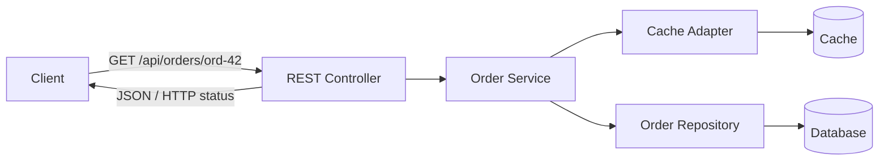
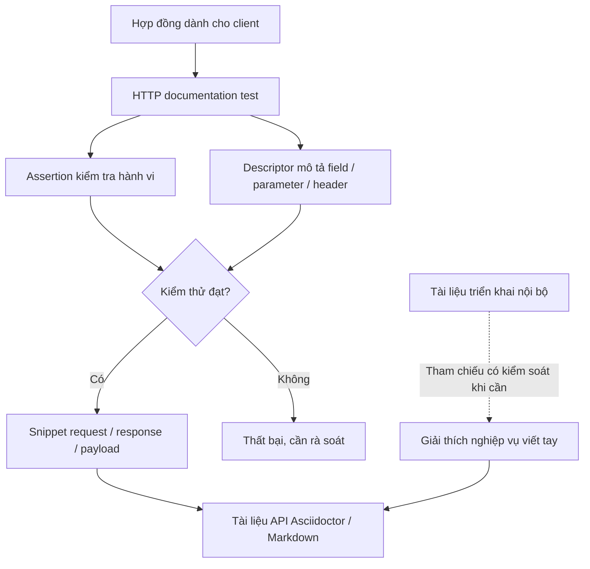
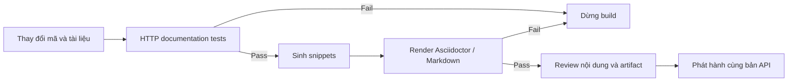

# Phân biệt tài liệu API với tài liệu chi tiết triển khai nội bộ

## Mục tiêu học tập

Sau bài học này, bạn có thể:

- Phân biệt **tài liệu hợp đồng REST API** dành cho người sử dụng API với **tài liệu thiết kế, triển khai và vận hành nội bộ** dành cho nhóm xây dựng hệ thống.
- Xác định thông tin nào nên xuất hiện trong tài liệu API: endpoint, phương thức HTTP, tham số, header, payload, mã trạng thái, lỗi và quy tắc tích hợp.
- Nhận biết những chi tiết thuộc tài liệu nội bộ: sơ đồ thành phần, database schema, cache, transaction, thuật toán, cấu hình hạ tầng và chiến lược vận hành.
- Dùng **Spring REST Docs** tạo snippet từ bài kiểm thử HTTP bằng MockMvc, WebTestClient hoặc REST Assured, đồng thời kết hợp chúng với phần giải thích Asciidoctor/Markdown.
- Đánh giá tác động của một thay đổi triển khai: khi nào phải cập nhật hợp đồng API, khi nào chỉ cần cập nhật tài liệu nội bộ và khi nào phải cập nhật cả hai.

## 1. Hai loại tài liệu phục vụ hai nhóm câu hỏi

Giả sử một ứng dụng bán hàng cung cấp endpoint:

```http
GET /api/orders/ord-42 HTTP/1.1
Accept: application/json
```

Người phát triển ứng dụng khách muốn biết: endpoint có trả về đơn hàng hay không, cần gửi header nào, response có những trường gì, xử lý `404` ra sao và quyền nào được phép truy cập.

Kỹ sư bảo trì dịch vụ lại muốn biết: dữ liệu đơn hàng nằm trong bảng nào, controller gọi service nào, repository dùng transaction ra sao, cache có TTL bao nhiêu, lúc cơ sở dữ liệu lỗi hệ thống retry thế nào.

Hai nhóm câu hỏi đều hợp lệ, nhưng **khác đối tượng và mục đích**.

| Tiêu chí | Tài liệu REST API | Tài liệu chi tiết triển khai nội bộ |
| --- | --- | --- |
| Người đọc chính | Client developer, đối tác tích hợp, QA hợp đồng, ứng dụng khác gọi API | Backend developer, maintainer, SRE/DevOps, kiến trúc sư, nhóm vận hành |
| Câu hỏi trung tâm | “Gọi API thế nào và có thể kỳ vọng điều gì?” | “Hệ thống thực hiện việc đó bằng cách nào và được duy trì ra sao?” |
| Đơn vị mô tả | Endpoint, HTTP method, URI, header, parameter, request/response, status, error | Controller/service, domain model, database, cache, queue, deployment, cấu hình |
| Tính ổn định kỳ vọng | Hợp đồng cần được quản lý tương thích với consumer | Có thể thay đổi khi refactor mà không tác động consumer |
| Ví dụ đặc trưng | `GET /api/orders/{id}` trả `200` với JSON đã xác định | `OrderController → OrderService → OrderRepository` |
| Phương pháp xác minh | HTTP test, contract test, Spring REST Docs descriptor, assertion | Unit/integration test, kiến trúc, benchmark, kiểm tra bảo mật, runbook |
| Mức chia sẻ | Theo đối tượng sử dụng; có thể công khai hoặc chỉ cấp quyền cho client nội bộ | Thường giới hạn cho người cần biết bên trong tổ chức |

**Không đồng nhất “API nội bộ” với “tài liệu triển khai nội bộ”.** Một endpoint chỉ gọi trong mạng công ty vẫn cần tài liệu API nếu có nhóm khác sử dụng. Ngược lại, sơ đồ cấu trúc repository của dịch vụ không trở thành tài liệu API chỉ vì nó được đăng trên cổng tài liệu.

Trong module **SPRING_REST_DOCS**, trọng tâm của Spring REST Docs là **tạo tài liệu REST API có thể kiểm chứng bằng HTTP test**, sau đó biên soạn snippet thành tài liệu Asciidoctor/Markdown và đưa vào build, CI. Công cụ này không nhằm mô tả mọi chi tiết thuật toán và hạ tầng đằng sau endpoint.

## 2. Tài liệu API là bản mô tả hợp đồng giữa provider và consumer

**Provider** là thành phần triển khai và phục vụ endpoint; **consumer** là client sử dụng endpoint. Hợp đồng API nói rõ client có thể gửi những gì và cần hiểu kết quả ra sao, độc lập với việc provider dùng Java, Spring, PostgreSQL hay một công nghệ khác.

Ví dụ hợp đồng đơn giản của `GET /api/orders/{id}` trong bài:

| Thành phần | Hợp đồng của ví dụ |
| --- | --- |
| Method và đường dẫn | `GET /api/orders/{id}` |
| Path parameter | `id` là mã đơn hàng dưới dạng chuỗi |
| Request header | `Accept: application/json` |
| Thành công | `200 OK` với response JSON |
| Response fields | `orderId`, `status`, `total.amount`, `total.currency` |
| Trường hợp không tồn tại | Cần document riêng status/error body theo hành vi thật của ứng dụng |
| Quyền truy cập | Cần mô tả cách xác thực/phân quyền thực tế của ứng dụng |

Response minh họa:

```json
{
  "orderId": "ord-42",
  "status": "PAID",
  "total": {
    "amount": 199000,
    "currency": "VND"
  }
}
```

Một client Python, JavaScript hay Java đều có thể đọc response trên theo hợp đồng JSON mà không cần biết tên `OrderEntity`, vị trí bảng database hoặc cấu trúc package bên server.

### 2.1. Những phần nên có trong một trang endpoint

1. **Mục đích và trường hợp sử dụng:** vì sao gọi endpoint, cần biết trước điều kiện gì.
2. **Phương thức, URL và phiên bản:** path parameter, query parameter, cách phân trang/lọc/sắp xếp khi có.
3. **Authentication và authorization:** cách cung cấp credential, phạm vi quyền theo chính sách thực tế; không công bố token thật.
4. **Request:** header, media type, body, tính bắt buộc và ràng buộc dữ liệu.
5. **Response thành công:** status, header, body, ý nghĩa trường và đơn vị đo.
6. **Response lỗi:** tình huống và mã HTTP thực tế; cấu trúc lỗi, khả năng retry và hành vi đặc biệt nếu API có cam kết.
7. **Giới hạn hợp đồng:** thứ tự dữ liệu, tính nhất quán, idempotency, versioning và rate limit nếu người dùng cần chúng.

Thông tin này nên được viết bằng ngôn ngữ của người tích hợp. Chẳng hạn `total.amount` nên được mô tả là “số tiền của đơn hàng, tính bằng đơn vị gắn với `total.currency`”, thay vì “giá trị được đọc từ cột `order_total_amount`”.

### 2.2. Hợp đồng HTTP có thể bị ảnh hưởng bởi triển khai

Mục tiêu không phải che giấu mọi đặc tính vận hành. Nếu việc phân tán dữ liệu khiến client phải dùng cursor phân trang, nếu một tác vụ xử lý bất đồng bộ trả `202 Accepted`, hay API yêu cầu header chống gửi lặp, **những hành vi client phải tuân theo thuộc hợp đồng API**.

Ranh giới là câu hỏi: **“Client có cần biết điều này để sử dụng đúng API không?”** Nếu có, hãy mô tả hành vi quan sát được, thay vì giải thích toàn bộ cơ chế triển khai.

Ví dụ, API có thể nói “sau khi tạo đơn, trạng thái ban đầu là `PENDING` và client có thể truy vấn lại cho đến khi hoàn tất” nếu đó là cam kết thật. Nó không nhất thiết phải nói backend dùng Kafka topic nào để xử lý đơn hàng.

## 3. Tài liệu triển khai nội bộ mô tả cách provider tạo ra hành vi

Một hệ thống Spring có thể xử lý cùng request qua nhiều tầng:



Trong sơ đồ, **đường từ client đến HTTP response** đại diện ranh giới hợp đồng cần tài liệu hóa. Các khối `Order Service`, `Order Repository`, cache và database thuộc thiết kế triển khai; chúng có thể thay thế hoặc tái cấu trúc mà không đổi contract trả về.

Tài liệu nội bộ có thể bao gồm:

- **Kiến trúc và phụ thuộc:** phân lớp, đường đi dữ liệu, sự kiện, giao tiếp giữa các service.
- **Mô hình lưu trữ:** schema, index, migration, cơ chế optimistic locking, mapping entity.
- **Quy tắc xử lý:** thuật toán tính tiền, transaction boundary, validation ở lớp domain.
- **Hiệu năng và độ tin cậy:** cache TTL, retry, circuit breaker, timeout hạ tầng, tính nhất quán.
- **Vận hành:** cách triển khai, biến môi trường, metric, alert, log correlation, runbook xử lý sự cố.
- **Bảo mật nội bộ:** quyền truy cập giữa các thành phần, quản lý secret, threat model và quy trình đổi khóa; thông tin nhạy cảm phải được lưu ở nơi có kiểm soát quyền phù hợp.

Ví dụ một đoạn tài liệu nội bộ:

```text
OrderController
  -> OrderQueryService
  -> OrderReadRepository
  -> OrderEntity (bảng orders)

Ghi chú:
- Query đường đọc sử dụng index theo order_id.
- Cache có cơ chế vô hiệu hóa sau khi cập nhật đơn.
- Lỗi phụ thuộc ngoài được ghi vào log với correlation ID.
```

Đây là **ví dụ kiến trúc giả định**, không phải nội dung cần đưa nguyên văn vào trang hướng dẫn `GET /api/orders/{id}`. Nếu người dùng API chỉ cần truyền mã đơn và đọc JSON, họ không nên phải hiểu repository hay index để gọi thành công.

### 3.1. Không biến chi tiết triển khai thành cam kết ngoài ý muốn

Một tài liệu API viết “đơn hàng được đọc từ PostgreSQL theo bảng `orders`” dễ khiến consumer phụ thuộc vào cách lưu trữ. Khi backend chuyển sang kho dữ liệu khác nhưng response vẫn vậy, tài liệu trở nên không chính xác dù hợp đồng HTTP không thay đổi.

Thay vì mô tả cơ chế nội bộ, hãy mô tả **hành vi có thể quan sát**:

| Câu mô tả phụ thuộc triển khai | Mô tả phù hợp với consumer hơn |
| --- | --- |
| “Controller gọi `OrderRepository.findById`.” | “Truy vấn đơn hàng theo mã trong đường dẫn.” |
| “Dữ liệu lấy từ bảng `orders` của PostgreSQL.” | “Trả thông tin đơn hàng mà caller có quyền xem.” |
| “Redis cache giữ bản ghi 60 giây.” | “Dữ liệu có thể có độ trễ cập nhật tối đa được hệ thống cam kết”, **nếu thực sự có cam kết đó** |
| “Kafka consumer xử lý yêu cầu sau khi ghi database.” | “Yêu cầu được tiếp nhận và xử lý bất đồng bộ”, **nếu đó là hợp đồng công bố** |
| “Service ném `OrderMissingException`.” | “Khi không tìm thấy đơn hàng, API trả status và error body được quy định.” |

Không tự suy ra độ trễ, tính nhất quán, quy tắc retry hay status từ công nghệ được sử dụng. Chúng phải có chủ đích trong thiết kế và được xác minh bằng test phù hợp.

## 4. Spring REST Docs kiểm chứng phần hợp đồng như thế nào?

Spring REST Docs hoạt động cùng một bài kiểm thử HTTP. Với MockMvc, WebTestClient hoặc REST Assured, test gửi request, kiểm tra response rồi sinh các **snippet**. Một số snippet chứa HTTP exchange; số khác là bảng mô tả được tạo từ **descriptor** do tác giả test khai báo.



Các snippet thường gặp:

| Snippet | Cung cấp gì cho tài liệu API? |
| --- | --- |
| `http-request`, `curl-request` | HTTP request hoặc lệnh gọi minh họa được ghi từ test |
| `http-response` | Status, header, body trả về ở kịch bản kiểm thử |
| `path-parameters`, `query-parameters` | Bảng tham số đường dẫn và query được mô tả |
| `request-headers`, `response-headers` | Bảng header được khai báo trong test |
| `request-fields`, `response-fields` | Bảng mô tả trường JSON của request hoặc response |

**Điều Spring REST Docs không tự tạo:** sơ đồ database, lý do chọn cache, chiến lược giao dịch, quyết định kiến trúc, runbook, hoặc hướng dẫn khôi phục hệ thống. Những phần đó phải được biên soạn và bảo trì trong tài liệu nội bộ bằng phương pháp phù hợp.

Ngay trong phần hợp đồng, REST Docs cũng không tự xác minh câu chữ mô tả là đúng nghiệp vụ. Ví dụ `description("Trạng thái đơn hàng")` là lời của tác giả; muốn xác nhận giá trị `PAID` có ý nghĩa gì, cần assertion, dữ liệu nghiệp vụ và review.

## 5. Ví dụ thực hành: giữ response công khai độc lập với model lưu trữ

Giả sử một hệ thống có entity nội bộ chứa `internalId`, `tenantKey`, `entityVersion` và các trường phục vụ lưu trữ. Consumer chỉ cần:

```json
{
  "orderId": "ord-42",
  "status": "PAID",
  "total": {
    "amount": 199000,
    "currency": "VND"
  }
}
```

Nên định nghĩa **DTO dành cho API** thay vì serialize trực tiếp entity persistence. Điều này giúp hợp đồng HTTP được thiết kế có chủ đích, tránh vô tình xuất hiện trường nội bộ khi entity thay đổi.

### 5.1. Documentation test với MockMvc

Ví dụ dưới đây dùng Java 17+, JUnit Jupiter, Spring MVC Test, Jackson và Spring REST Docs MockMvc. Controller minh họa trả dữ liệu cố định để bài học tự chứa; **khi triển khai thực tế, test phải gắn với controller/ứng dụng cần bảo vệ và có các test nghiệp vụ tương ứng**.

```java
import org.junit.jupiter.api.BeforeEach;
import org.junit.jupiter.api.Test;
import org.junit.jupiter.api.extension.ExtendWith;
import org.springframework.http.MediaType;
import org.springframework.restdocs.RestDocumentationContextProvider;
import org.springframework.restdocs.RestDocumentationExtension;
import org.springframework.test.web.servlet.MockMvc;
import org.springframework.test.web.servlet.setup.MockMvcBuilders;
import org.springframework.web.bind.annotation.GetMapping;
import org.springframework.web.bind.annotation.PathVariable;
import org.springframework.web.bind.annotation.RestController;

import static org.springframework.restdocs.headers.HeaderDocumentation.headerWithName;
import static org.springframework.restdocs.headers.HeaderDocumentation.requestHeaders;
import static org.springframework.restdocs.mockmvc.MockMvcRestDocumentation.document;
import static org.springframework.restdocs.mockmvc.MockMvcRestDocumentation.documentationConfiguration;
import static org.springframework.restdocs.payload.PayloadDocumentation.fieldWithPath;
import static org.springframework.restdocs.payload.PayloadDocumentation.responseFields;
import static org.springframework.restdocs.request.RequestDocumentation.parameterWithName;
import static org.springframework.restdocs.request.RequestDocumentation.pathParameters;
import static org.springframework.test.web.servlet.request.MockMvcRequestBuilders.get;
import static org.springframework.test.web.servlet.result.MockMvcResultMatchers.jsonPath;
import static org.springframework.test.web.servlet.result.MockMvcResultMatchers.status;

@ExtendWith(RestDocumentationExtension.class)
class OrderApiDocumentationTest {
    private MockMvc mvc;

    @BeforeEach
    void setUp(RestDocumentationContextProvider context) {
        mvc = MockMvcBuilders.standaloneSetup(new OrderController())
                .apply(documentationConfiguration(context))
                .build();
    }

    @Test
    void getOrderContract() throws Exception {
        mvc.perform(get("/api/orders/{id}", "ord-42")
                        .accept(MediaType.APPLICATION_JSON))
                .andExpect(status().isOk())
                .andExpect(jsonPath("$.orderId").value("ord-42"))
                .andExpect(jsonPath("$.status").value("PAID"))
                .andExpect(jsonPath("$.total.amount").value(199000))
                .andExpect(jsonPath("$.total.currency").value("VND"))
                .andDo(document("orders-get",
                        requestHeaders(
                                headerWithName("Accept")
                                        .description("Định dạng JSON mong muốn")
                        ),
                        pathParameters(
                                parameterWithName("id")
                                        .description("Mã đơn hàng cần truy vấn")
                        ),
                        responseFields(
                                fieldWithPath("orderId")
                                        .description("Mã đơn hàng công khai"),
                                fieldWithPath("status")
                                        .description("Trạng thái đơn hàng"),
                                fieldWithPath("total")
                                        .description("Tổng tiền của đơn hàng"),
                                fieldWithPath("total.amount")
                                        .description("Giá trị tổng tiền"),
                                fieldWithPath("total.currency")
                                        .description("Mã tiền tệ của tổng tiền")
                        )
                ));
    }

    record Money(long amount, String currency) {}
    record OrderResponse(String orderId, String status, Money total) {}

    @RestController
    static class OrderController {
        @GetMapping(path = "/api/orders/{id}",
                    produces = MediaType.APPLICATION_JSON_VALUE)
        OrderResponse getOrder(@PathVariable("id") String id) {
            return new OrderResponse(id, "PAID", new Money(199000L, "VND"));
        }
    }
}
```

Test này chỉ khẳng định hợp đồng của **kịch bản thành công được mô phỏng**. Trong ứng dụng thực, cần kiểm tra cách trả `404`, security, dữ liệu từ service, quy tắc trạng thái và các điều kiện khác theo thiết kế thật. Nó không kiểm tra database, cache, transaction hay cơ chế mapping nội bộ.

Vai trò của các thành phần:

- `andExpect(...)` xác minh các giá trị mà consumer nhìn thấy.
- `requestHeaders(...)` mô tả header có trong request của test.
- `pathParameters(...)` mô tả biến trong URI template.
- `responseFields(...)` mô tả hình dạng JSON mà consumer nhận, gồm trường lồng `total.amount` và `total.currency`.
- `document("orders-get", ...)` tạo thư mục snippet để trang tài liệu tham chiếu.

Thư mục snippet Gradle thường có dạng:

```text
build/generated-snippets/
└── orders-get/
    ├── curl-request.adoc
    ├── http-request.adoc
    ├── http-response.adoc
    ├── request-headers.adoc
    ├── path-parameters.adoc
    └── response-fields.adoc
```

Việc thêm một trường `entityVersion` vào **entity nội bộ** không nên tự động thêm nó vào `OrderResponse`. Nếu JSON công khai không đổi, tài liệu API không cần đổi chỉ vì entity thay đổi. Nếu trường `entityVersion` vô tình bị lộ trong JSON, một documentation test dùng `responseFields(...)` ở chế độ strict có thể phát hiện trường chưa được mô tả.

### 5.2. Biên soạn trang API bằng Asciidoctor

File tài liệu nguồn có thể là `src/docs/asciidoc/index.adoc`:

```asciidoc
= Orders REST API
:toc: left

== Tra cứu đơn hàng

Gọi GET /api/orders/{id} để lấy thông tin đơn hàng.
Các trường công khai mô tả mã, trạng thái và tổng tiền.

=== HTTP request
include::{snippets}/orders-get/http-request.adoc[]

=== Request headers
include::{snippets}/orders-get/request-headers.adoc[]

=== Path parameters
include::{snippets}/orders-get/path-parameters.adoc[]

=== HTTP response
include::{snippets}/orders-get/http-response.adoc[]

=== Response fields
include::{snippets}/orders-get/response-fields.adoc[]
```

Thuộc tính `{snippets}` phải trỏ đúng thư mục snippet sinh bởi test. Đoạn văn do con người viết cung cấp mục đích endpoint; các bảng và HTTP ví dụ do REST Docs sinh giúp giảm việc sao chép thủ công. Nếu có authentication hoặc cấu trúc lỗi, hãy thêm test tương ứng và phần thuyết minh đúng với ứng dụng.

Nếu dùng **Markdown**, cần cấu hình template snippet và cơ chế ghép nội dung mà Markdown renderer/site generator hỗ trợ. Cú pháp `include::...[]` nêu trên thuộc Asciidoctor, không phải cú pháp chuẩn của Markdown.

### 5.3. Còn WebTestClient và REST Assured?

Bạn có thể dùng **WebTestClient** trong hệ sinh thái WebFlux/Reactive hoặc môi trường hỗ trợ, và **REST Assured** khi kiểm thử qua HTTP server đang chạy. Dù API kiểm thử khác MockMvc, nguyên tắc không đổi: gửi request đến hệ thống cần xác minh, assert HTTP contract, khai báo descriptor, sinh snippet rồi ghép vào tài liệu API. Lựa chọn công cụ theo kiến trúc ứng dụng và tầng kiểm thử.

**Chọn tầng test phù hợp:** test controller cô lập bảo vệ response mapping của controller; integration test có thể bảo vệ luồng HTTP có security filter, serialization và wiring thực tế. Nếu bộ test chỉ dùng dữ liệu giả, không được tuyên bố rằng nó đã chứng minh toàn bộ hành vi hệ thống chạy production.

## 6. Thay đổi triển khai có buộc sửa tài liệu API không?

Không phải mọi commit đều làm thay đổi hợp đồng REST. Khi code được sửa, hãy phân tích **đầu vào/đầu ra và ngữ nghĩa mà client quan sát**, rồi quyết định tài liệu nào cần cập nhật.

| Thay đổi | Tài liệu API | Tài liệu triển khai nội bộ |
| --- | --- | --- |
| Đổi từ JDBC sang JPA, response giữ nguyên | Thông thường không cần đổi | Cập nhật lưu đồ, repository, migration nếu có |
| Thêm Redis cache nhưng cam kết bên ngoài không đổi | Thông thường không cần đổi | Cập nhật kiến trúc, invalidation, cấu hình, runbook |
| Đổi tên `OrderService` hoặc package Java | Không cần đổi | Cập nhật phần phụ thuộc đến tên/luồng nội bộ |
| Đổi JSON `status` thành `paymentStatus` | Cần cập nhật test, snippet, bảng field, hướng dẫn client; cân nhắc tương thích phiên bản | Cập nhật mapping DTO/service khi liên quan |
| Thêm query parameter `sort` được hỗ trợ | Cần mô tả giá trị, mặc định, ví dụ/test theo hợp đồng | Cập nhật truy vấn, index hoặc thuật toán nếu thay |
| Thay quy tắc xác thực hoặc quyền | Cập nhật precondition, lỗi, test security cho client | Cập nhật thiết kế security, policy và cấu hình |
| Đổi chiến lược xử lý bất đồng bộ khiến API trả `202` thay `201` | Cập nhật status, response và cách client theo dõi kết quả | Cập nhật kiến trúc job/queue/retry |
| Tối ưu index database nhưng không đổi kết quả hay cam kết độ trễ | Không cần đổi | Cập nhật tài liệu index, hiệu năng nếu đáng kể |
| Thay độ nhất quán hoặc giới hạn rate mà consumer phải dựa vào | Cập nhật nếu đó là hành vi hợp đồng | Cập nhật vận hành, monitoring, thiết kế liên quan |

### 6.1. Ví dụ một thay đổi chỉ thuộc nội bộ

Trước đây `OrderQueryService` đọc database. Nhóm thêm một tầng cache nhưng giữ nguyên HTTP method, URL, status, header và JSON. Khi đó:

- Tài liệu API vẫn mô tả đúng cách gọi; không nên thêm tên cache vào bảng response.
- Documentation test vẫn nên chạy để bảo vệ hành vi công khai.
- Tài liệu kiến trúc và vận hành phải phản ánh cache, TTL, cơ chế invalidation và kịch bản lỗi.
- Nếu cache khiến dữ liệu có thể trễ vượt một cam kết đã công bố, đây **không còn chỉ là thay đổi nội bộ**; hành vi API hoặc cách kiểm thử cần được xem xét.

### 6.2. Ví dụ thay đổi ảnh hưởng hợp đồng

Giả sử response chuyển từ:

```json
{"orderId":"ord-42","status":"PAID"}
```

sang:

```json
{"orderId":"ord-42","paymentStatus":"PAID"}
```

Đây là thay đổi mà consumer quan sát được, dù backend chỉ refactor mapping. Nếu giữ assertion và descriptor cũ, test strict có thể thất bại khi `status` không còn tồn tại hoặc `paymentStatus` chưa được mô tả. Nhóm phải quyết định chiến lược tương thích, thay đổi phiên bản nếu cần, cập nhật test và tài liệu; chỉ đổi tên trường trong trang HTML không giải quyết client đang phụ thuộc hợp đồng cũ.

## 7. Tổ chức hai loại tài liệu mà không tạo hai nguồn sai lệch

Một tổ chức tài liệu có thể gồm:

```text
docs/
├── api/
│   ├── orders.adoc            # Hợp đồng và hướng dẫn consumer
│   └── errors.adoc            # Mô tả lỗi API
└── internal/
    ├── architecture.md       # Thành phần và luồng xử lý
    ├── persistence.md        # Schema, migration, transaction
    ├── operations.md         # Deploy, alert, runbook
    └── decisions.md          # Các quyết định kỹ thuật
```

Cấu trúc trên chỉ mang tính ví dụ. Tài liệu nội bộ có thể nằm ở kho hoặc cổng riêng có phân quyền. Đừng đặt sơ đồ mạng nội bộ, credential, secret, thông tin đăng nhập database hay stack trace nhạy cảm vào trang API có thể phát hành rộng.

Nguyên tắc giảm trùng lặp:

1. **Ví dụ HTTP và bảng field/parameter** lấy từ snippet của documentation test; tránh sao chép nguyên bảng sang một file viết tay khác.
2. **Quy tắc dùng API** nằm trong nội dung dành cho consumer; nếu quy tắc cần kiểm chứng, thêm assertion/test thay vì chỉ ghi bằng văn bản.
3. **Thiết kế hệ thống và runbook** nằm trong tài liệu nội bộ; trang API có thể liên kết đến tài liệu liên quan khi người đọc được phép truy cập và có nhu cầu.
4. **Định nghĩa dùng chung** như mã lỗi hoặc enum cần có nguồn quản lý rõ ràng; khi thay đổi phải kiểm tra nơi chúng được sử dụng, kể cả snippet, văn bản hướng dẫn và code.
5. **Bảo mật theo đối tượng đọc:** một tài liệu API chỉ phục vụ ứng dụng nội bộ vẫn có thể cần hạn chế truy cập, nhưng không vì vậy mà bỏ qua việc kiểm soát thông tin triển khai.

### 7.1. Không nhầm tài liệu API với đặc tả OpenAPI

Spring REST Docs tạo snippet và hỗ trợ tài liệu hướng dẫn đọc được; **OpenAPI** là một định dạng đặc tả REST API có cấu trúc máy đọc được, hỗ trợ công cụ như Swagger UI và sinh client. Chúng có thể bổ sung nhau tùy mục tiêu dự án.

Đối với câu hỏi của bài này, cả tài liệu từ Spring REST Docs lẫn tài liệu từ OpenAPI đều có thể thuộc **tài liệu hợp đồng API**. Còn sơ đồ class, database schema, cách cache hoạt động và runbook vẫn là **tài liệu nội bộ**, bất kể tổ chức chọn công nghệ tạo API docs nào.

## 8. Đưa phần tài liệu hợp đồng vào build và CI

Vì hợp đồng REST là thứ client phụ thuộc, nên tài liệu API nên được kiểm chứng trong mỗi bản build liên quan. Quy trình thông dụng:



Ví dụ cấu hình một phần cho **Gradle Groovy DSL**, giả định dự án đã khai báo plugin Asciidoctor, Spring Test và JUnit tương ứng:

```groovy
configurations {
    asciidoctorExt
}

dependencies {
    testImplementation 'org.springframework.restdocs:spring-restdocs-mockmvc'
    asciidoctorExt 'org.springframework.restdocs:spring-restdocs-asciidoctor'
}

def snippetsDir = file("$buildDir/generated-snippets")

tasks.named('test') {
    outputs.dir snippetsDir
}

tasks.named('asciidoctor') {
    configurations 'asciidoctorExt'
    inputs.dir snippetsDir
    dependsOn tasks.named('test')
}
```

Đây là minh họa quan hệ giữa các task; file build hoàn chỉnh cần khai báo plugin, version dependency tương thích và attribute `{snippets}` cho bước render. Có thể chạy `./gradlew clean test asciidoctor` (hoặc `gradlew.bat clean test asciidoctor` trên Windows) sau khi cấu hình. Với Maven, mô hình tương tự: HTTP test sinh snippet rồi plugin tài liệu tạo output từ các snippet đó.

Để kết quả đáng tin:

- Dùng **workspace/output sạch** khi phát hành để snippet cũ không còn được include sau khi xóa/đổi tên test.
- Cấu hình kiểm tra **thiếu snippet hoặc include lỗi** làm build/CI thất bại; không mặc định cho rằng renderer nào cũng coi missing include là lỗi.
- Cố định dữ liệu fixture hoặc chuẩn hóa ID, thời gian, host và header không ổn định.
- Sử dụng dữ liệu giả, lọc header nhạy cảm và không đưa token, cookie hay dữ liệu khách hàng thật vào artifact.
- Render tài liệu từ cùng commit/build với bản ứng dụng được phát hành.
- Review phần chữ viết tay và thông tin nghiệp vụ song song với các kiểm tra HTTP.

**CI không tự kiểm chứng tài liệu triển khai nội bộ:** việc đổi schema, logic transaction hoặc cache cần quy trình review, test và kiểm tra vận hành phù hợp. CI chỉ tự động xác minh những điều đã được mô tả bằng kiểm tra.

## 9. Các nhầm lẫn phổ biến

| Nhầm lẫn | Cách hiểu đúng |
| --- | --- |
| “API nội bộ thì chỉ cần README kỹ thuật.” | Nếu có consumer độc lập, vẫn cần hợp đồng HTTP rõ ràng và có thể kiểm chứng. |
| “Spring REST Docs biết database schema nên tự sinh tài liệu thiết kế.” | REST Docs làm việc từ HTTP exchange và descriptor; không tự suy ra kiến trúc hệ thống. |
| “Controller và service đổi tên thì API docs phải đổi theo.” | Chỉ cập nhật API docs khi thông tin/behavior dành cho consumer thay đổi hoặc đoạn prose liên quan bị ảnh hưởng. |
| “Test xanh chứng minh mọi mô tả đều đúng.” | Test chỉ xác minh assertion/descriptor được khai báo và các kịch bản đã chạy. |
| “Cứ thêm tất cả trường entity vào JSON để tài liệu đầy đủ.” | DTO công khai nên chỉ chứa dữ liệu thuộc hợp đồng, tránh lộ hoặc buộc client phụ thuộc trường nội bộ. |
| “Tài liệu công khai phải mô tả Redis, Kafka, table, stack trace.” | Chỉ mô tả hành vi client cần biết; giữ chi tiết kiến trúc và vận hành tại tài liệu phù hợp. |
| “Đã có API docs thì không cần runbook.” | API docs không thay thế hướng dẫn deploy, khôi phục sự cố, migration hay giám sát. |

## 10. Bài tập áp dụng

Một nhóm đang duy trì `POST /api/payments`. Bản thiết kế triển khai có các thông tin:

1. Service dùng PostgreSQL với bảng `payment_attempts`.
2. Request bắt buộc có `Idempotency-Key`.
3. Thành công trả `201 Created` và trường `paymentId`.
4. Một tiến trình nền gửi sự kiện vào hàng đợi.
5. Client có thể gọi `GET /api/payments/{id}` để theo dõi trạng thái.
6. Hệ thống dùng retry nội bộ tối đa ba lần khi một dịch vụ phụ thuộc tạm lỗi.
7. Một số khách hàng nhận `429 Too Many Requests` khi vượt hạn mức API được công bố.

**Nhiệm vụ:**

- Phân loại thông tin nào cần có trong **tài liệu API** và thông tin nào nên ở **tài liệu nội bộ**. Một số thông tin có thể xuất hiện ở cả hai dưới hai góc nhìn khác nhau.
- Với thông tin thuộc hợp đồng, đề xuất **documentation test** và snippet tương ứng: `requestHeaders(...)` cho `Idempotency-Key`; assertion/status và `responseFields(...)` cho việc tạo thanh toán; test phản hồi trạng thái; test/thuyết minh `429` nếu đó là hành vi thật.
- Giải thích vì sao “retry nội bộ tối đa ba lần” thường thuộc runbook/thiết kế, còn **hành vi client nên làm gì khi nhận lỗi có thể retry** (nếu API có cam kết) phải được mô tả ở trang API.
- Giả sử nhóm thay PostgreSQL bằng hệ lưu trữ khác, hãy xác định tài liệu nào nhất thiết cần review và tại sao HTTP contract test vẫn nên chạy.

**Gợi ý đối chiếu:** mục 2, 3, 5 và 7 mô tả hành vi client cần biết; mục 1 và 4 chủ yếu liên quan triển khai; mục 6 là chi tiết nội bộ trừ khi nó ảnh hưởng trực tiếp cam kết quan sát được. Không tự suy ra status, thời gian xử lý hay khả năng retry chỉ từ tên công nghệ.

## Kết luận

**Tài liệu API mô tả điều consumer có thể gửi và kỳ vọng qua giao diện HTTP; tài liệu triển khai nội bộ mô tả provider tạo ra hành vi đó bằng kiến trúc và công nghệ nào.** Spring REST Docs phù hợp để tạo bằng chứng cho hợp đồng REST từ kiểm thử MockMvc, WebTestClient hoặc REST Assured: assert hành vi, khai báo descriptor, sinh snippet cho request/response/payload/tham số/header và ghép vào Asciidoctor/Markdown trong build, CI. Khi một thay đổi nội bộ không ảnh hưởng contract, tài liệu API có thể giữ nguyên; khi hành vi client nhìn thấy đổi, cần cập nhật test, snippet, phần giải thích và quản lý tính tương thích. Giữ rõ ranh giới này giúp tài liệu vừa hữu ích cho người tích hợp, vừa tránh rò rỉ hoặc ràng buộc không cần thiết vào chi tiết vận hành của server.
