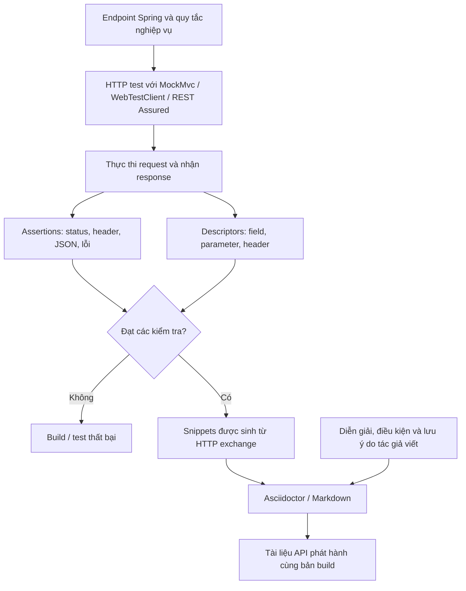
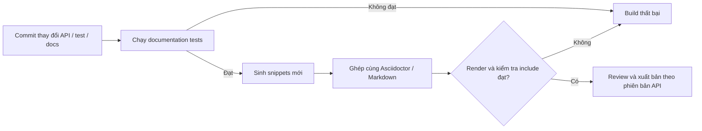

# Spring REST Docs và giới hạn của tài liệu sinh hoàn toàn từ mã

## Mục tiêu học tập

Sau bài này, bạn có thể:

- Giải thích tài liệu API **sinh từ mã nguồn** thường lấy thông tin từ đâu và vì sao chỉ đọc cấu trúc chương trình chưa đủ để chứng minh hành vi REST API.
- Phân biệt tài liệu *code-first* với cơ chế **test-driven documentation** của Spring REST Docs, tránh hiểu nhầm rằng Spring REST Docs tự phân tích toàn bộ source code để viết tài liệu.
- Nhận diện thông tin cần xác minh bằng HTTP test: status code, header, tham số, request/response payload và tình huống lỗi.
- Tạo một documentation test với **MockMvc**, đọc các snippet kết quả và ghép chúng với diễn giải do con người viết bằng **Asciidoctor**; hiểu cách áp dụng cùng nguyên tắc với **WebTestClient**, **REST Assured** và Markdown.
- Nêu được giới hạn của cả code generation và test-driven documentation, đồng thời đề xuất bước kiểm soát chất lượng trên build và CI.

## 1. "Sinh tài liệu từ mã" nghĩa là gì?

Một số công cụ tài liệu REST API đọc **mã nguồn, annotation, kiểu dữ liệu hoặc metadata** để tạo ra mô tả endpoint. Chẳng hạn, một ứng dụng Spring có controller:

```java
@GetMapping("/api/products/{id}")
public ProductResponse find(@PathVariable String id) {
    return productService.find(id);
}
```

Nhìn vào đoạn mã này, công cụ có thể nhận biết phương thức `GET`, đường dẫn `/api/products/{id}`, tên path parameter `id` và kiểu Java dự kiến của response. Nếu DTO có annotation mô tả trường hoặc validation, công cụ phù hợp có thể sử dụng các metadata đó để làm đặc tả phong phú hơn.

Tuy nhiên, **chỉ nhìn chữ ký phương thức không thể suy ra đầy đủ**:

- Endpoint trả `200`, `404`, `403` hay một lỗi nghiệp vụ trong tình huống cụ thể nào?
- Khi `id` không tồn tại, response lỗi có JSON với các trường gì?
- Security filter có yêu cầu token và scope nào, hay gateway có thay đổi header?
- Trường `price` dùng tiền tệ gì, có thể `null` không và có quy tắc làm tròn nào?
- DTO trả về thực tế có bị serializer, view, filter hoặc logic nghiệp vụ biến đổi không?
- Người dùng API nên gọi endpoint để giải quyết tác vụ gì?

Mã nguồn là một nguồn thông tin thiết yếu, nhưng **tài liệu hợp đồng REST cần mô tả hành vi mà client thực sự quan sát được**. Mức độ suy ra từ code tùy công cụ, annotation, plugin, cấu hình và việc có thêm test/đặc tả hay không.

Trong bài này, *tài liệu sinh hoàn toàn từ mã* chỉ cách dựa chủ yếu vào việc quét controller/DTO/annotation để tạo trang hoặc đặc tả, **không có lớp kiểm chứng HTTP độc lập và không có diễn giải nghiệp vụ được rà soát**. Điều này khác với việc dùng công cụ code-first trong một hệ thống đã có contract test và review tốt.

## 2. Cần phân biệt ba cách hình thành tài liệu REST API

| Hướng tiếp cận | Đầu vào chính | Ưu điểm | Rủi ro nếu dùng riêng lẻ |
| --- | --- | --- | --- |
| **Viết tay hoàn toàn** | Trang Markdown/Asciidoctor do người viết tạo | Giải thích nghiệp vụ và trải nghiệm tích hợp linh hoạt | Ví dụ HTTP và bảng field dễ lỗi thời sau khi mã thay đổi |
| **Code-first / annotation-driven** | Controller, DTO, annotation, schema, metadata | Tạo nhanh danh sách endpoint và cấu trúc dữ liệu, dễ tích hợp IDE/build | Có thể mô tả kiểu tĩnh nhưng bỏ sót hành vi động, lỗi, security và ý nghĩa |
| **Spring REST Docs: test-driven** | HTTP exchange được chạy trong test, assertions, descriptors | Các snippet gắn với hành vi ở kịch bản được kiểm thử; sai lệch cấu trúc có thể làm test lỗi | Chỉ bao phủ test đã viết; mô tả do con người cung cấp vẫn có thể sai |

Spring REST Docs không đơn giản là một công cụ quét annotation rồi sinh tài liệu đầy đủ. Nó kết hợp:

1. **Bài kiểm thử HTTP** bằng MockMvc, WebTestClient hoặc REST Assured.
2. **Assertion** để xác nhận status, header, body và các quy tắc đã chọn.
3. **Descriptor** do người viết test khai báo để mô tả parameter, header, payload và nội dung khác.
4. **Snippet sinh tự động** từ request/response trong test và descriptor.
5. **Trang tài liệu biên soạn** bằng Asciidoctor/Markdown với lời giải thích, ví dụ và snippet.

Đây cũng là mục tiêu của module **SPRING_REST_DOCS**: tạo tài liệu REST API có thể kiểm chứng từ các HTTP test, thay vì chỉ thu thập một danh mục các phương thức Java.

## 3. Những giới hạn thường gặp của tài liệu chỉ suy từ mã nguồn

### 3.1. Chữ ký controller chưa nói hết các đường đi của HTTP request

Xét:

```java
@PostMapping("/api/orders")
public ResponseEntity<OrderResponse> create(@RequestBody CreateOrderRequest input) {
    return orderService.create(input);
}
```

Kiểu trả về `ResponseEntity<OrderResponse>` không cho biết chắc chắn mọi nhánh chạy có status nào. Service có thể từ chối dữ liệu, domain logic có thể phát hiện xung đột, `@ControllerAdvice` có thể đổi exception thành lỗi JSON, còn security filter có thể chặn request trước khi controller được gọi.

Tài liệu API cần chỉ ra những **trường hợp client phải xử lý**: thành công, không hợp lệ, không có quyền, xung đột, không tìm thấy... Không nên ghi một ma trận status suy đoán từ tên phương thức; cần đối chiếu với API thật và kiểm thử từng kịch bản quan trọng.

### 3.2. Kiểu dữ liệu chưa giải thích được ý nghĩa nghiệp vụ

Một DTO:

```java
public record OrderResponse(
        String id,
        String status,
        long amount
) {}
```

cho biết các kiểu Java nhưng không trả lời: `status` có những giá trị nào? `amount` tính bằng đồng, xu hay đơn vị nhỏ nhất của một loại tiền? Giá trị này đã bao gồm thuế chưa? Liệu đơn hàng `PAID` đã được giao hay mới được xác nhận thanh toán?

Annotation mô tả có thể cải thiện tài liệu, nhưng nội dung annotation **vẫn do con người viết và cần được review**. Không có bộ sinh tài liệu nào tự suy ra đáng tin mọi ngữ nghĩa nghiệp vụ chỉ từ kiểu `String` hoặc `long`.

### 3.3. Cấu trúc trên source code không luôn giống JSON trên đường truyền

Request/response thật có thể bị ảnh hưởng bởi:

| Thành phần runtime | Khác biệt có thể xảy ra |
| --- | --- |
| Jackson serializer và các annotation JSON | Đổi tên trường, bỏ trường, đổi định dạng ngày/giờ, thay cấu trúc lồng |
| Validation | Từ chối dữ liệu sai với status và error body khác response thành công |
| Exception handler | Chuyển lỗi thành mã HTTP và payload chuẩn hóa |
| Authentication/authorization filter | Trả `401` hoặc `403` trước khi vào controller |
| Gateway/proxy | Thêm hoặc thay header, path prefix, quy tắc phân luồng |
| Feature flag, profile, dữ liệu hiện có | Tạo response khác nhau giữa môi trường hoặc nhánh xử lý |
| Phiên bản API | Những bản phát hành khác nhau có hợp đồng không giống nhau |

Một công cụ code-first tốt có thể hỗ trợ bổ sung metadata cho nhiều tình huống trên, nhưng **metadata chưa được kiểm thử không tự chứng minh** rằng HTTP exchange đúng như mô tả.

### 3.4. Ví dụ được dựng từ schema chưa chắc chạy được

Một mẫu JSON tự điền từ kiểu dữ liệu có thể hợp lệ về cú pháp nhưng vi phạm các điều kiện ẩn: mã khách hàng không tồn tại, số lượng vượt giới hạn, token thiếu scope hoặc trạng thái chuyển tiếp bị cấm. Người đọc sao chép ví dụ và nhận lỗi dù bảng schema trông hợp lý.

Snippet HTTP trong Spring REST Docs lấy từ một request/response **đã chạy trong test**. Đây là lợi thế thực tế, nhưng test vẫn phải sử dụng dữ liệu/fixture phù hợp với tầng triển khai cần xác minh.

## 4. Spring REST Docs thay đổi cách kiểm chứng tài liệu như thế nào?



Ba loại bằng chứng cần được hiểu đúng:

| Lớp | Ví dụ | Đóng góp cho độ tin cậy |
| --- | --- | --- |
| **Assertion hành vi** | `status().isOk()`, kiểm tra JSON `$.price.amount` | Báo lỗi nếu điều đã được test kỳ vọng không còn đúng |
| **Descriptor cấu trúc** | `responseFields(fieldWithPath("id"), ...)` | Ràng buộc bảng mô tả với các trường xuất hiện trong response |
| **Snippet thực thi** | `http-request.adoc`, `http-response.adoc` | Ghi ví dụ từ giao tiếp test, không sao chép tay từ ví dụ cũ |

Khi sử dụng `requestFields(...)` hoặc `responseFields(...)` dạng **strict**, Spring REST Docs có thể làm test thất bại nếu một field xuất hiện mà chưa được mô tả, hoặc một field bắt buộc trong descriptor không xuất hiện. Các tùy chọn `optional()`, `ignored()`, `relaxedRequestFields(...)` và `relaxedResponseFields(...)` thay đổi mức ràng buộc này; cần dùng có chủ ý.

Ví dụ, nếu response đổi trường `stockStatus` thành `availability`, test cũ có thể báo lỗi do assertion JSON cũ hoặc descriptor cũ không khớp. Nhưng nếu nhóm đồng thời cập nhật test để chấp nhận thay đổi không tương thích mà không review hợp đồng với consumer, **test xanh không chứng minh quyết định thay đổi API là đúng**.

## 5. Thực hành: tạo tài liệu từ một HTTP test thay vì chỉ đọc DTO

Giả sử endpoint truy vấn sản phẩm có response:

```http
GET /api/catalog/book-01 HTTP/1.1
Accept: application/json
```

```json
{
  "id": "book-01",
  "title": "Sổ tay",
  "availability": "AVAILABLE",
  "price": {
    "amount": 59000,
    "currency": "VND"
  }
}
```

Chỉ nhìn record `CatalogResponse` có thể biết các field, nhưng để có **ví dụ HTTP đã kiểm tra**, hãy viết documentation test.

### 5.1. MockMvc + JUnit Jupiter + Spring REST Docs

Ví dụ dành cho Java 17+, Spring MVC Test, Jackson, JUnit Jupiter và dependency `spring-restdocs-mockmvc` tương thích với phiên bản Spring của dự án. Controller được khai báo ngay trong test với dữ liệu cố định để thể hiện cơ chế; trong dự án thực phải thay bằng controller/ứng dụng cần bảo vệ.

```java
import org.junit.jupiter.api.BeforeEach;
import org.junit.jupiter.api.Test;
import org.junit.jupiter.api.extension.ExtendWith;
import org.springframework.http.MediaType;
import org.springframework.restdocs.RestDocumentationContextProvider;
import org.springframework.restdocs.RestDocumentationExtension;
import org.springframework.test.web.servlet.MockMvc;
import org.springframework.test.web.servlet.setup.MockMvcBuilders;
import org.springframework.web.bind.annotation.GetMapping;
import org.springframework.web.bind.annotation.PathVariable;
import org.springframework.web.bind.annotation.RestController;

import static org.springframework.restdocs.headers.HeaderDocumentation.headerWithName;
import static org.springframework.restdocs.headers.HeaderDocumentation.requestHeaders;
import static org.springframework.restdocs.headers.HeaderDocumentation.responseHeaders;
import static org.springframework.restdocs.mockmvc.MockMvcRestDocumentation.document;
import static org.springframework.restdocs.mockmvc.MockMvcRestDocumentation.documentationConfiguration;
import static org.springframework.restdocs.payload.PayloadDocumentation.fieldWithPath;
import static org.springframework.restdocs.payload.PayloadDocumentation.responseFields;
import static org.springframework.restdocs.request.RequestDocumentation.parameterWithName;
import static org.springframework.restdocs.request.RequestDocumentation.pathParameters;
import static org.springframework.test.web.servlet.request.MockMvcRequestBuilders.get;
import static org.springframework.test.web.servlet.result.MockMvcResultMatchers.jsonPath;
import static org.springframework.test.web.servlet.result.MockMvcResultMatchers.status;

@ExtendWith(RestDocumentationExtension.class)
class CatalogDocumentationTest {
    private MockMvc mvc;

    @BeforeEach
    void setUp(RestDocumentationContextProvider context) {
        mvc = MockMvcBuilders.standaloneSetup(new CatalogController())
                .apply(documentationConfiguration(context))
                .build();
    }

    @Test
    void documentGetCatalogItem() throws Exception {
        mvc.perform(get("/api/catalog/{id}", "book-01")
                        .accept(MediaType.APPLICATION_JSON))
                .andExpect(status().isOk())
                .andExpect(jsonPath("$.id").value("book-01"))
                .andExpect(jsonPath("$.availability").value("AVAILABLE"))
                .andExpect(jsonPath("$.price.amount").value(59000))
                .andExpect(jsonPath("$.price.currency").value("VND"))
                .andDo(document("catalog-get",
                        pathParameters(
                                parameterWithName("id")
                                        .description("Mã sản phẩm cần tra cứu")
                        ),
                        requestHeaders(
                                headerWithName("Accept")
                                        .description("Định dạng response mong muốn")
                        ),
                        responseHeaders(
                                headerWithName("Content-Type")
                                        .description("Định dạng response JSON")
                        ),
                        responseFields(
                                fieldWithPath("id")
                                        .description("Mã sản phẩm"),
                                fieldWithPath("title")
                                        .description("Tên sản phẩm"),
                                fieldWithPath("availability")
                                        .description("Trạng thái sẵn có"),
                                fieldWithPath("price")
                                        .description("Thông tin giá"),
                                fieldWithPath("price.amount")
                                        .description("Giá trị tiền theo quy ước của API"),
                                fieldWithPath("price.currency")
                                        .description("Mã tiền tệ")
                        )
                ));
    }

    record Price(long amount, String currency) {}
    record CatalogResponse(
            String id, String title, String availability, Price price) {}

    @RestController
    static class CatalogController {
        @GetMapping(path = "/api/catalog/{id}",
                    produces = MediaType.APPLICATION_JSON_VALUE)
        CatalogResponse find(@PathVariable("id") String id) {
            return new CatalogResponse(
                    id, "Sổ tay", "AVAILABLE", new Price(59000L, "VND"));
        }
    }
}
```

**Điểm mấu chốt của ví dụ:**

1. `get("/api/catalog/{id}", "book-01")` đưa request qua cơ chế xử lý của Spring MVC Test thay vì chỉ đọc chữ ký controller.
2. Các `andExpect(...)` xác minh những giá trị mà client thực sự nhìn thấy trong kịch bản này.
3. `pathParameters(...)`, `requestHeaders(...)`, `responseHeaders(...)` và `responseFields(...)` mô tả cấu trúc request/response quan sát được. Trường JSON lồng như `price.amount` được khai báo tường minh.
4. `document("catalog-get", ...)` yêu cầu sinh một nhóm snippet có định danh cố định.
5. Những lời mô tả trong `description(...)` **vẫn do người viết test quyết định**. Chẳng hạn, test chưa xác minh đơn vị nhỏ nhất của tiền tệ hay cơ chế làm tròn; không nên tự điền một quy tắc chưa được xác nhận.

Output Gradle thông dụng sau khi test đạt:

```text
build/generated-snippets/
└── catalog-get/
    ├── curl-request.adoc
    ├── http-request.adoc
    ├── http-response.adoc
    ├── path-parameters.adoc
    ├── request-headers.adoc
    ├── response-headers.adoc
    └── response-fields.adoc
```

Đường dẫn và phần mở rộng phụ thuộc cấu hình build/template; Maven thường dùng `target/generated-snippets`. Các snippet bảng chỉ được tạo nếu documentation test khai báo những mô tả tương ứng.

### 5.2. Thử thay đổi DTO để nhìn thấy giá trị của kiểm thử

Giả sử controller đổi `availability` thành `stockStatus` nhưng tài liệu chưa được cập nhật:

```json
{
  "id": "book-01",
  "title": "Sổ tay",
  "stockStatus": "AVAILABLE",
  "price": {"amount": 59000, "currency": "VND"}
}
```

Nếu dùng test trên:

- Assertion `jsonPath("$.availability")` sẽ thất bại vì field đó không còn xuất hiện.
- Nếu bỏ assertion nhưng vẫn giữ `responseFields(...)` strict, descriptor `availability` không tìm được field cũ, còn `stockStatus` là field chưa mô tả.
- Nhóm phải xác định đổi tên này có được phép trong hợp đồng không, chọn hướng tương thích phù hợp, sau đó cập nhật test, descriptor, phần văn bản và snippet mới.

Một công cụ quét DTO cũng có thể cập nhật schema sang `stockStatus`, nhưng **tự đổi schema không nhất thiết tạo ra cảnh báo về việc client đang phụ thuộc vào tên cũ**. Việc bảo vệ tính tương thích cần quy trình review/contract test riêng.

### 5.3. Những điều ví dụ vẫn chưa chứng minh

Controller giả lập luôn trả dữ liệu cho mọi ID nên test trên **không chứng minh**:

- `book-01` thật sự tồn tại trong kho dữ liệu production;
- sản phẩm không tồn tại sẽ trả `404` với error body nào;
- request không có quyền bị từ chối như thế nào;
- giá có quy tắc giảm giá, thuế hay làm tròn ra sao;
- trạng thái `AVAILABLE` có chính xác theo tồn kho thực;
- những tầng gateway, filter và cấu hình production tạo ra response giống ví dụ hay không.

Muốn có tài liệu đáng tin ở các nhánh đó, cần bổ sung test trên thành phần thật ở tầng thích hợp và viết phần giải thích nghiệp vụ tương ứng.

## 6. Vì sao snippet vẫn cần tài liệu viết tay?

Trong một trang REST API, snippet có thể giúp trả lời **“Request/response ở kịch bản được kiểm tra trông như thế nào?”**. Nó chưa đủ để trả lời **“Tôi nên dùng endpoint này trong tình huống nào, vì sao, và xử lý các trạng thái ra sao?”**.

Ví dụ Asciidoctor:

```asciidoc
= Catalog REST API
:toc: left

== Tra cứu sản phẩm

GET /api/catalog/{id} trả về thông tin một sản phẩm theo mã.

=== HTTP request
include::{snippets}/catalog-get/http-request.adoc[]

=== Path parameters
include::{snippets}/catalog-get/path-parameters.adoc[]

=== Request headers
include::{snippets}/catalog-get/request-headers.adoc[]

=== HTTP response
include::{snippets}/catalog-get/http-response.adoc[]

=== Response fields
include::{snippets}/catalog-get/response-fields.adoc[]

=== Lưu ý tích hợp

Client cần giải thích availability theo tập trạng thái do API công bố.
Quy tắc lỗi và xác thực cần được mô tả theo các test tương ứng.
```

Tại bước render, thuộc tính `{snippets}` phải trỏ đến output của documentation test. Phần giới thiệu và lưu ý tích hợp là **nội dung biên soạn**; những đoạn `include::...[]` là **snippet sinh từ test**. Trang hoàn chỉnh kết hợp cả hai nguồn.

Nếu dự án dùng **Markdown**, cần thiết lập template snippet phù hợp và một công cụ ghép/render hỗ trợ Markdown. Cú pháp `include::...[]` ở ví dụ thuộc Asciidoctor; Markdown chuẩn không tự nhận lệnh đó. Chỉ đổi tên file từ `.adoc` sang `.md` không tạo ra quy trình Markdown đúng.

### Thông tin nên giao cho người viết tài liệu

| Nội dung | Có thể sinh/kiểm chứng từ test không? | Phần còn cần con người làm |
| --- | --- | --- |
| Method, URI, ví dụ request/response | Có, với HTTP exchange của test | Xác định tình huống đại diện cho cách dùng thực tế |
| Path/query parameter và header | Có bảng snippet dựa trên descriptor | Viết ý nghĩa, giá trị mặc định, điều kiện áp dụng đúng nghiệp vụ |
| JSON fields | Có thể kiểm tra đường dẫn trường qua descriptor strict | Giải thích enum, đơn vị, ràng buộc logic, trường hợp `null` |
| Error status và body | Có, nếu viết test riêng cho lỗi | Nêu khi nào phát sinh lỗi và cách client nên xử lý |
| Authentication/authorization | Có thể test các kịch bản phù hợp | Viết luồng cấp quyền, phạm vi, chính sách access đúng |
| Giới hạn, idempotency, consistency | Chỉ trong phạm vi assertion/test được thiết kế | Xác định cam kết của hệ thống và giải thích cách tích hợp |

## 7. MockMvc, WebTestClient và REST Assured bảo vệ những lớp nào?

Spring REST Docs hỗ trợ nhiều kiểu HTTP test nhưng **độ bao phủ phụ thuộc cách dựng hệ thống dưới test**, không chỉ phụ thuộc tên công cụ.

| Công cụ | Cách dùng thường gặp | Điều cần lưu ý |
| --- | --- | --- |
| **MockMvc** | Kiểm thử Spring MVC theo hướng servlet, không cần HTTP server thật | `standaloneSetup` có thể bỏ qua filter/security hay bean wiring nếu không cấu hình; cần biết phạm vi test |
| **WebTestClient** | Kiểm thử HTTP trong hệ sinh thái WebFlux/reactive hoặc một số cấu hình server | Có thể bind tới handler/application context/server; từng chế độ bao phủ khác nhau |
| **REST Assured** | Gửi request HTTP trong integration test đến server đang chạy | Bao phủ nhiều thành phần runtime hơn nếu server, filter, gateway phù hợp được cấu hình; cần fixture ổn định |

Trong cả ba trường hợp, mục tiêu vẫn là **gửi request thực thi được, assert hành vi, mô tả các thành phần HTTP và sinh snippet**. Một controller mock với response giả không tự biến thành bằng chứng cho toàn bộ hệ thống production. Nếu hợp đồng quan trọng phụ thuộc security filter, Jackson configuration hay exception handler, nên kiểm thử qua tầng có các thành phần đó.

Để xác nhận tính nhất quán giữa tài liệu và API, có thể kết hợp các tầng test: test nhanh ở controller để tạo snippet và integration/contract test cho hành vi xuyên suốt. Không cần áp dụng đồng loạt mọi công cụ nếu một cách kiểm thử đủ đáp ứng mục tiêu.

## 8. Đưa tài liệu vào build và CI để phát hiện sai lệch

Một trang tài liệu đáng tin cần được **sinh lại và kiểm tra khi API thay đổi**. Mô hình cơ bản:



Đoạn cấu hình **Gradle Groovy DSL minh họa** dưới đây giả định dự án đã cài plugin Asciidoctor và các dependency Spring/JUnit phù hợp:

```groovy
configurations {
    asciidoctorExt
}

dependencies {
    testImplementation 'org.springframework.restdocs:spring-restdocs-mockmvc'
    asciidoctorExt 'org.springframework.restdocs:spring-restdocs-asciidoctor'
}

def snippetsDir = file("$buildDir/generated-snippets")

tasks.named('test') {
    outputs.dir snippetsDir
}

tasks.named('asciidoctor') {
    configurations 'asciidoctorExt'
    inputs.dir snippetsDir
    dependsOn tasks.named('test')
}
```

Đây **không phải file `build.gradle` hoàn chỉnh**: cần plugin, thư viện test, phiên bản REST Docs tương thích hoặc BOM, thiết lập thuộc tính `{snippets}` và cấu hình task thực tế. Sau khi hoàn tất, có thể chạy `./gradlew clean test asciidoctor` (hoặc `gradlew.bat clean test asciidoctor` trên Windows). Với Maven, nguyên lý tương tự: HTTP test sinh snippet, Asciidoctor plugin tạo tài liệu từ output của test.

### Những điều kiện quan trọng trên CI

1. **Chạy test trước khi render** và khai báo phụ thuộc giữa các task; không xuất bản trang nếu một documentation test thất bại.
2. **Không dùng snippet cũ** từ build trước: dùng workspace sạch hoặc output cô lập cho phiên bản đang phát hành.
3. **Phát hiện include lỗi**: thiết lập kiểm tra để thiếu snippet/đường dẫn include hoặc render không thành công làm CI thất bại; không giả định mọi renderer mặc định đã chặn đủ lỗi.
4. **Ổn định ví dụ**: dùng fixture giả và thống nhất thời gian/ID nếu có; chuẩn hóa giá trị không ổn định khi ghi snippet.
5. **Bảo vệ bí mật**: không để access token, cookie thật, mật khẩu, dữ liệu cá nhân hoặc header nội bộ nhạy cảm lọt vào artifact HTML.
6. **Gắn phiên bản**: tạo tài liệu từ cùng commit/build với API sẽ phát hành, phân biệt rõ các phiên bản hợp đồng nếu hệ thống hỗ trợ đồng thời.
7. **Rà soát phần viết tay**: status, enum, ý nghĩa trường, quyền, giới hạn và hướng xử lý lỗi có thể sai dù mọi snippet đều được sinh thành công.

CI không tự làm cho tài liệu đầy đủ; nó chỉ thực thi các điều kiện đã được tự động hóa. Nếu thiếu test cho `404`, không có bước CI nào suy ra chính xác response lỗi đó chỉ từ một test `200`.

## 9. Có nên kết hợp Spring REST Docs với công cụ OpenAPI code-first?

**Có thể**, nếu dự án thực sự cần cả hai loại đầu ra. Ví dụ:

- Một đặc tả **OpenAPI** có cấu trúc máy đọc được để công cụ sinh SDK/client hoặc hiển thị trên UI chuyên dụng.
- Các trang **Spring REST Docs + Asciidoctor** để hướng dẫn tích hợp theo nhiệm vụ với request/response đã kiểm thử.

Chúng không mặc nhiên đồng bộ. Nếu cả hai cùng tồn tại, phải chọn quy trình đối chiếu rõ ràng: review thay đổi hợp đồng, kiểm tra schema/HTTP contract khi phù hợp và bảo đảm cùng phiên bản API. Tránh duy trì hai bảng trường thủ công không có cơ chế đối chiếu.

**Không nên kết luận** tài liệu code-first luôn sai hoặc Spring REST Docs luôn đúng. Code-first có thể rất hữu ích khi annotation, schema và test được thiết kế chặt chẽ; REST Docs cũng có thể thiếu bao phủ và chứa mô tả sai. Giá trị thực sự phụ thuộc vào **nguồn sự thật, bằng chứng kiểm thử, phạm vi tình huống và quy trình review**.

## 10. Bảng kiểm chọn chiến lược tài liệu

Trước khi hoàn tất một endpoint, hãy kiểm tra:

- [ ] Có mục đích endpoint và luồng sử dụng rõ ràng cho consumer.
- [ ] Tài liệu mô tả method, URL, path/query parameter, header, request/response và status phù hợp.
- [ ] Các trường JSON quan trọng có descriptor và assertion có ý nghĩa.
- [ ] Những quy tắc mà code không thể tự suy ra (đơn vị, enum, validation, auth, idempotency, retry) có mô tả được xác nhận.
- [ ] Những tình huống lỗi quan trọng có test và snippet riêng khi cần.
- [ ] Tầng test phù hợp với phạm vi cần chứng minh; không dùng controller giả để suy luận về production.
- [ ] Nếu dùng descriptor relaxed hoặc ignored, lựa chọn đó có lý do.
- [ ] Tài liệu nguồn và snippet được render tự động trên CI, thiếu đầu vào làm build thất bại.
- [ ] Ví dụ không chứa thông tin nhạy cảm và gắn đúng phiên bản API.
- [ ] Có người review nội dung nghiệp vụ và thay đổi hợp đồng có khả năng làm hỏng client.

## 11. Bài tập tư duy và thực hành

Một dự án Spring có DTO:

```java
record CreatePaymentRequest(String accountId, long amount) {}
record PaymentResponse(String paymentId, String status) {}
```

Công cụ code-first đã sinh trang mô tả `POST /api/payments` với schema của hai record. Nhóm tích hợp vẫn đặt câu hỏi: số tiền dùng đơn vị gì; khi trùng yêu cầu thanh toán có tạo hai giao dịch không; cần header nào; lỗi không đủ quyền có JSON ra sao?

Hãy thiết kế một kế hoạch tài liệu:

1. Liệt kê những điều **có thể quan sát từ code** và những điều **chưa thể khẳng định** từ hai record.
2. Viết documentation test cho một request hợp lệ, assert status và response body theo hợp đồng ứng dụng; khai báo `requestFields(...)`, `responseFields(...)` và header descriptor khi có header bắt buộc.
3. Bổ sung các test cho tình huống lỗi, quyền truy cập và gửi trùng theo hợp đồng đã thống nhất. Không suy đoán status `400`/`401`/`409` hoặc cơ chế idempotency nếu chưa được thiết kế.
4. Dùng snippet để biên soạn trang Asciidoctor/Markdown, viết phần hướng dẫn về đơn vị tiền, quy tắc chống trùng và cách xử lý lỗi dựa trên thông tin xác minh được.
5. Thử đổi tên `paymentId` thành `id` trong response thật mà giữ descriptor strict cũ. Giải thích vì sao documentation test có thể thất bại và nhóm cần làm gì trước khi chấp nhận thay đổi API.
6. Đưa bước test, sinh snippet, render và kiểm tra include vào CI.

**Câu hỏi tự kiểm tra:** Nếu một trang OpenAPI sinh từ DTO liệt kê đúng tất cả field, có thể kết luận nó là toàn bộ tài liệu cần cho consumer không? **Không.** Nó có thể mô tả tốt cấu trúc dữ liệu nhưng chưa đủ thông tin về tình huống HTTP, ngữ nghĩa nghiệp vụ và quy trình sử dụng. Những phần đó cần được bổ sung và kiểm chứng tương xứng.

## Kết luận

Tài liệu sinh từ mã nguồn giúp tự động hóa việc liệt kê endpoint và cấu trúc, nhưng **mã tĩnh không tự kể đầy đủ hợp đồng REST đang vận hành**. Spring REST Docs bổ sung bằng chứng từ kiểm thử HTTP: MockMvc, WebTestClient hoặc REST Assured thực thi request; assertion kiểm tra hành vi; descriptor mô tả cấu trúc; snippet ghi lại request/response thực tế của kịch bản. Khi ghép với phần giải thích Asciidoctor/Markdown và quy trình build, CI, tài liệu trở nên dễ kiểm chứng hơn. Điều này không loại bỏ trách nhiệm của con người trong việc chọn đủ tình huống, xác định quy tắc nghiệp vụ, bảo vệ tính tương thích và rà soát những gì không thể suy ra từ mã hay một bài kiểm thử đơn lẻ.
