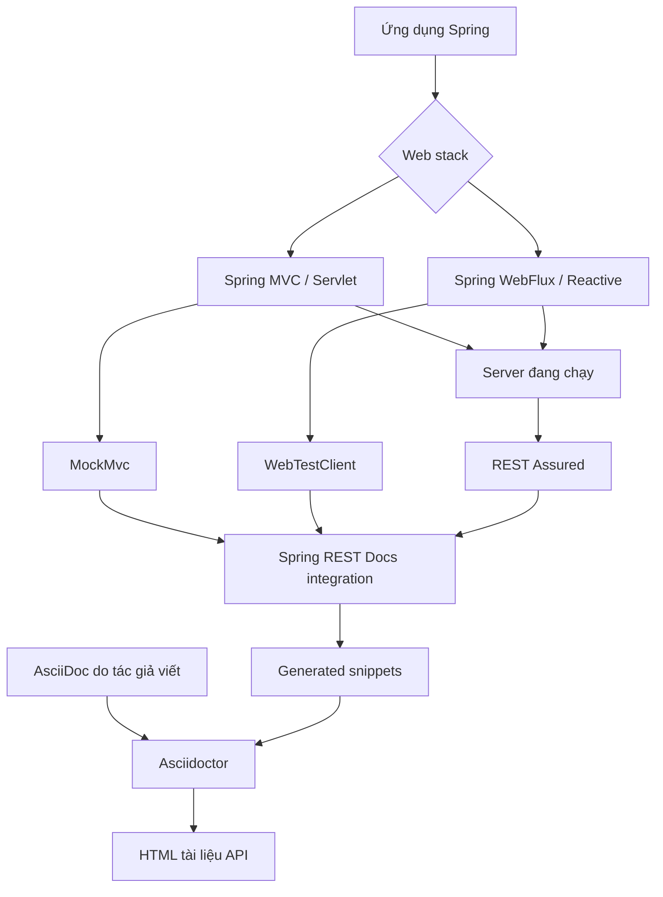
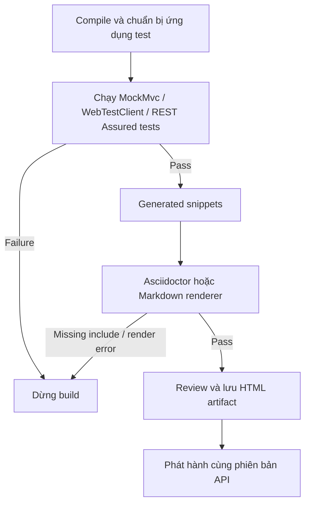

# Mối liên hệ với Spring MVC, WebFlux, REST Assured và Asciidoctor

## Mục tiêu học tập

Sau bài này, bạn có thể:

- Giải thích Spring REST Docs đứng ở đâu trong một dự án Spring và vì sao nó không thay thế Spring MVC, Spring WebFlux hay HTTP test client.
- Chọn **MockMvc** cho kiểm thử Spring MVC, **WebTestClient** cho ứng dụng reactive/WebFlux hoặc môi trường phù hợp, và **REST Assured** cho kiểm thử HTTP theo hướng gửi request tới server.
- Mô tả vai trò của các integration module Spring REST Docs tương ứng và cách chúng tạo snippet từ request/response đã được kiểm thử.
- Hiểu **Asciidoctor** là bước biên soạn/kết xuất tài liệu từ các snippet, không phải công cụ thực thi API test.
- Kết nối test, thư mục snippet, Asciidoctor và build/CI thành một luồng có thể lặp lại.

## 1. Bức tranh tổng thể: mỗi thành phần giải quyết một việc

Một dự án dùng Spring REST Docs thường kết hợp nhiều thư viện. Chúng không cạnh tranh nhau vì mỗi thư viện nằm ở một lớp công việc khác nhau:

| Thành phần | Vai trò | Nó không làm thay |
| --- | --- | --- |
| **Spring MVC** | Framework xử lý HTTP theo mô hình Servlet: mapping request, controller, argument binding, response | Không tự tạo tài liệu REST Docs |
| **Spring WebFlux** | Framework web reactive, hỗ trợ non-blocking/reactive streams và WebClient/WebTestClient | Không tự tạo snippet tài liệu |
| **MockMvc** | API kiểm thử Spring MVC qua môi trường mock Servlet, không cần khởi động HTTP server thực | Không tự viết mô tả API; phạm vi test phụ thuộc cách dựng application/filter |
| **WebTestClient** | HTTP test client tích hợp tốt với WebFlux; có thể bind tới controller, context hoặc server | Không mặc định chứng minh mọi tầng production nếu bind ở chế độ cô lập |
| **REST Assured** | Thư viện client/test DSL gửi request và xác minh HTTP response, thường dùng cho integration test qua server | Không phải web framework của ứng dụng |
| **Spring REST Docs** | Kết nối HTTP test với descriptor và sinh snippet từ exchange trong test | Không thay thế framework web hay tự phát hiện mọi endpoint |
| **Asciidoctor** | Biên soạn và kết xuất tài liệu từ file AsciiDoc, có thể include snippet REST Docs | Không gửi HTTP request hay kiểm thử API |

Mối liên hệ có thể hình dung:



**Ý chính:** Spring MVC/WebFlux xử lý request của ứng dụng; MockMvc/WebTestClient/REST Assured thực thi kiểm thử; Spring REST Docs ghi lại và mô tả các HTTP exchange đó; Asciidoctor ghép snippet với lời giải thích để tạo tài liệu đọc được.

## 2. Spring MVC và MockMvc: kiểm thử API theo mô hình Servlet

### 2.1. Spring MVC xử lý request như thế nào?

Trong ứng dụng Spring MVC, một request thường đi qua Servlet container và chuỗi xử lý của Spring MVC: mapping đến controller, bind parameter/body, gọi logic ứng dụng, rồi chuyển kết quả thành HTTP response. Một controller ví dụ:

```java
@RestController
@RequestMapping("/api/orders")
class OrderController {
    @GetMapping("/{id}")
    OrderResponse find(@PathVariable String id) {
        return orderService.find(id);
    }
}
```

Đoạn mã mô tả route và phương thức Java, nhưng chưa chứng minh endpoint thực tế trả status, header hay JSON nào trong từng tình huống. Test HTTP giúp thực thi đường đi phù hợp và xác minh kết quả.

### 2.2. MockMvc là gì?

**MockMvc** thuộc Spring Test, cung cấp API gửi request vào hạ tầng Spring MVC thông qua mock Servlet API. Nó cho phép kiểm tra mapping, argument binding, controller, converter và các thành phần được cấu hình mà không cần mở một cổng HTTP hoặc chạy Servlet container thực.

MockMvc hữu ích khi:

- Ứng dụng dùng Spring MVC/Servlet.
- Muốn có test nhanh cho controller và HTTP contract.
- Cần quan sát request/response để tạo snippet REST Docs.
- Có thể kiểm soát rõ những thành phần ứng dụng được đưa vào test.

MockMvc không tương đương với một request đi qua toàn bộ reverse proxy hoặc môi trường triển khai thật. Khi cần kiểm chứng security filter, cấu hình MVC, exception handler hay wiring thực, hãy dùng cấu hình test có các thành phần đó; nếu cần kiểm tra cả server/container và đường mạng, bổ sung integration test ở tầng phù hợp.

### 2.3. Kết hợp MockMvc với Spring REST Docs

Dependency integration thông dụng là `spring-restdocs-mockmvc`. Test sử dụng MockMvc gửi request; Spring REST Docs gắn bộ ghi tài liệu vào test thông qua `documentationConfiguration(...)` và thao tác `document(...)`.

Ví dụ minh họa (Java 17+, JUnit Jupiter, Spring MVC Test; phiên bản dependency cần tương thích với Spring của dự án):

```java
@ExtendWith(RestDocumentationExtension.class)
class OrderDocumentationTest {
    private MockMvc mvc;

    @BeforeEach
    void setUp(RestDocumentationContextProvider context) {
        mvc = MockMvcBuilders.standaloneSetup(new OrderController())
                .apply(documentationConfiguration(context))
                .build();
    }

    @Test
    void getOrder() throws Exception {
        mvc.perform(get("/api/orders/{id}", 42)
                        .accept(MediaType.APPLICATION_JSON))
                .andExpect(status().isOk())
                .andExpect(jsonPath("$.id").value(42))
                .andDo(document("orders-get",
                        pathParameters(
                                parameterWithName("id")
                                        .description("Mã đơn hàng")
                        ),
                        responseFields(
                                fieldWithPath("id")
                                        .description("Mã đơn hàng"),
                                fieldWithPath("status")
                                        .description("Trạng thái đơn hàng")
                        )
                ));
    }
}
```

Các import/build setup bị lược bỏ để tập trung vào integration. Trong bài test thực, `OrderController` là controller ứng dụng hoặc một cấu hình test được chọn rõ ràng; ví dụ cần khai báo các static import cho REST Docs và MockMvc như `document`, `pathParameters`, `responseFields`, `get`, `status` và `jsonPath`.

Luồng hoạt động:

1. `RestDocumentationExtension` cung cấp context của REST Docs cho JUnit Jupiter.
2. `documentationConfiguration(context)` gắn cấu hình REST Docs vào MockMvc.
3. `perform(...)` gửi HTTP request qua MVC test infrastructure.
4. `andExpect(...)` kiểm tra hành vi; khi assertion thất bại, test không hoàn tất như mong đợi.
5. `document("orders-get", ...)` ghi HTTP exchange và tạo snippet theo descriptor.

Nếu cấu trúc response thay đổi, assertion hoặc descriptor strict có thể báo lỗi. Đây là tín hiệu cần xem xét hợp đồng và cập nhật tài liệu.

## 3. Spring WebFlux và WebTestClient: kiểm thử ứng dụng reactive

### 3.1. WebFlux khác Spring MVC ở đâu?

**Spring WebFlux** là web framework reactive của Spring. Nó hỗ trợ mô hình non-blocking, reactive types và có thể chạy trên các server reactive như Reactor Netty; WebFlux cũng có thể hoạt động trên Servlet container tương thích.

Controller reactive có thể trả về `Mono<T>` hoặc `Flux<T>`:

```java
@RestController
@RequestMapping("/api/orders")
class ReactiveOrderController {
    @GetMapping("/{id}")
    Mono<OrderResponse> find(@PathVariable String id) {
        return orderService.findById(id);
    }
}
```

Điểm khác nhau quan trọng đối với người viết test là cách ứng dụng xử lý request và kiểu kết quả reactive. Spring REST Docs không biến ứng dụng MVC thành WebFlux hay ngược lại; bạn dùng integration phù hợp với stack đang kiểm thử.

### 3.2. WebTestClient là gì?

**WebTestClient** là HTTP test client của Spring, được thiết kế để làm việc với WebFlux và cũng có thể sử dụng trong một số môi trường kiểm thử khác. Tùy cách bind, nó có thể:

- Bind trực tiếp đến controller/handler (phạm vi cô lập).
- Bind đến application context để dùng nhiều cấu hình web của ứng dụng.
- Gửi request tới server đang chạy qua một base URL.

Ba kiểu này không có cùng mức bao phủ. Test bind trực tiếp handler không tự xác nhận mọi filter, server configuration hoặc network layer ở production.

### 3.3. Kết hợp WebTestClient với Spring REST Docs

Dependency integration thường dùng là `spring-restdocs-webtestclient`. API cấu hình REST Docs được nối qua WebTestClient filter:

```java
@ExtendWith(RestDocumentationExtension.class)
class ReactiveOrderDocumentationTest {
    private WebTestClient client;

    @BeforeEach
    void setUp(ApplicationContext context,
               RestDocumentationContextProvider restDocumentation) {
        client = WebTestClient.bindToApplicationContext(context)
                .configureClient()
                .filter(documentationConfiguration(restDocumentation))
                .build();
    }

    @Test
    void getOrder() {
        client.get()
                .uri("/api/orders/{id}", 42)
                .accept(MediaType.APPLICATION_JSON)
                .exchange()
                .expectStatus().isOk()
                .expectBody()
                .jsonPath("$.id").isEqualTo(42)
                .consumeWith(document("orders-get"));
    }
}
```

Đây là phác thảo luồng sử dụng; khi tài liệu hóa chi tiết, có thể truyền các snippet/descriptor vào overload phù hợp của `document(...)` và bổ sung các static import tương ứng. Cấu hình context cũng phải phù hợp với loại ứng dụng WebFlux và phiên bản REST Docs đang dùng.

Một số khác biệt so với MockMvc:

| Điểm so sánh | MockMvc | WebTestClient |
| --- | --- | --- |
| Tích hợp thường gặp | Spring MVC / Servlet | Spring WebFlux / Reactive |
| Cách thao tác | `perform(...).andExpect(...)` | `get()/post()...exchange().expect...` |
| Kết quả | MockMvc result actions | WebTestClient response/spec |
| REST Docs connection | Integration module MockMvc và cấu hình MockMvc | Integration module WebTestClient và filter |
| Dựng test | Mock Servlet environment | Bind handler/context hoặc kết nối server |

Nếu ứng dụng dùng Spring MVC truyền thống, MockMvc thường là lựa chọn trực tiếp. Nếu ứng dụng là WebFlux reactive, WebTestClient thường tự nhiên hơn. Không nên chọn WebTestClient chỉ vì nó mới hơn, cũng không nên ép MockMvc vào một hệ thống reactive không phù hợp.

## 4. REST Assured: kiểm thử HTTP hướng tới server

### 4.1. REST Assured khác MockMvc/WebTestClient ra sao?

**REST Assured** là thư viện Java với DSL cho HTTP testing. Nó cho phép thiết lập request (method, path, header, body), gửi tới base URI/port và xác minh response bằng các matcher.

Ví dụ cú pháp kiểm thử cơ bản:

```java
given()
    .accept("application/json")
.when()
    .get("/api/orders/{id}", 42)
.then()
    .statusCode(200)
    .body("id", equalTo(42));
```

REST Assured thường được dùng khi ứng dụng/server đã chạy trong integration test, do đó có thể kiểm tra nhiều thành phần runtime hơn một test chỉ bind trực tiếp vào controller. Mức bao phủ cuối cùng vẫn tùy server, database, security và môi trường mà test khởi động.

### 4.2. REST Assured kết hợp Spring REST Docs

Dependency tích hợp thông dụng là `spring-restdocs-restassured`. REST Docs cung cấp filter cho REST Assured để ghi lại exchange và sinh snippet:

```java
given(specification)
    .filter(document("orders-get"))
    .accept("application/json")
.when()
    .get("/api/orders/{id}", 42)
.then()
    .statusCode(200)
    .body("id", equalTo(42));
```

Trong test hoàn chỉnh, `specification` được tạo từ cấu hình REST Docs (ví dụ `documentationConfiguration(restDocumentation)`) và có thể gắn các snippet/descriptor vào lời gọi `document(...)`. Khi chạy, REST Assured gửi HTTP request đến server mà test đã khởi động; filter của REST Docs ghi exchange tương ứng.

Đặc điểm của hướng này:

- Phù hợp với test cần tương tác HTTP qua cổng server.
- Có thể bao phủ serialization, filter, controller mapping và một số tích hợp thực tế nếu môi trường test khởi tạo đủ.
- Chi phí chạy test thường cao hơn test MVC cô lập, đặc biệt khi cần khởi động server và dependency bên ngoài.
- Cần kiểm soát port, dữ liệu test, thứ tự và thời gian chạy để snippet ổn định.

### 4.3. Chọn công cụ theo phạm vi cần bảo vệ

| Nhu cầu | Lựa chọn thường hợp lý | Lý do |
| --- | --- | --- |
| Test controller Spring MVC nhanh và sinh snippet | MockMvc | Tích hợp trực tiếp với Spring MVC Test |
| Test handler/controller reactive WebFlux | WebTestClient | Có API reactive và integration WebFlux |
| Test qua server đã chạy với DSL HTTP quen thuộc | REST Assured | Gửi request như client HTTP và xác minh response |
| Kiểm tra đường đi đầy đủ qua security, serialization, server config | WebTestClient/REST Assured hoặc thiết lập MockMvc đầy đủ | Chọn cách test có đúng thành phần cần kiểm chứng |

Không cần dùng cả ba cho cùng một endpoint. Dự án có thể dùng MockMvc cho phần lớn documentation tests và chọn một số integration test bằng REST Assured cho hợp đồng cần xác minh ở tầng server.

## 5. Vai trò của Spring REST Docs trong cả ba cách kiểm thử

Ba integration module có cách gắn với test khác nhau nhưng đều hướng đến một đích: **từ một HTTP exchange đã được kiểm tra, tạo ra snippet có thể đưa vào tài liệu**.

| Integration | Dependency thường dùng | Cách gắn REST Docs |
| --- | --- | --- |
| MockMvc | `spring-restdocs-mockmvc` | `documentationConfiguration(context)` trên MockMvc; `document(...)` trong result action |
| WebTestClient | `spring-restdocs-webtestclient` | REST Docs documentation filter trên WebTestClient; gọi `consumeWith(document(...))` trong exchange |
| REST Assured | `spring-restdocs-restassured` | REST Docs filter gắn vào REST Assured request specification |

Tên dependency và API cụ thể cần đối chiếu với phiên bản Spring REST Docs tương thích. Không trộn class/method của các integration module một cách tùy tiện: ví dụ cấu hình MockMvc không thể dùng thay cho filter WebTestClient.

Các loại snippet có thể gặp:

| Nhóm | Ví dụ | Được tạo từ |
| --- | --- | --- |
| HTTP request/response | `http-request.adoc`, `http-response.adoc` | Request/response đã được ghi lại trong test |
| Curl | `curl-request.adoc` | Request được biểu diễn thành lệnh curl |
| Parameter | `path-parameters.adoc`, `query-parameters.adoc` | Descriptor và request thực tế |
| Header | `request-headers.adoc`, `response-headers.adoc` | Descriptor và các header trong exchange |
| Payload field | `request-fields.adoc`, `response-fields.adoc` | JSON/body và descriptor mô tả field |

Một descriptor như `fieldWithPath("status").description("Trạng thái đơn hàng")` có hai thành phần: đường dẫn field phải phù hợp exchange và lời giải thích do người viết cung cấp. REST Docs có thể kiểm tra một phần cấu trúc; nó không tự xác nhận ý nghĩa nghiệp vụ của câu mô tả.

## 6. Asciidoctor: từ snippet thành trang tài liệu

### 6.1. Asciidoctor làm gì?

**Asciidoctor** là công cụ biên soạn/kết xuất tài liệu từ ngôn ngữ đánh dấu AsciiDoc. Trong quy trình Spring REST Docs phổ biến:

1. Test chạy và sinh các snippet, thường dưới dạng `.adoc`.
2. Tác giả viết một trang `index.adoc` hoặc nhiều trang AsciiDoc.
3. Trang nguồn dùng directive `include::...[]` để chèn snippet.
4. Asciidoctor render tài liệu thành HTML (hoặc định dạng khác theo cấu hình).

Asciidoctor **không thực thi test**. Nó cần các snippet đã có; vì vậy build phải bảo đảm task kiểm thử chạy trước task render.

### 6.2. Ví dụ một trang AsciiDoc

Giả sử test của một trong ba integration module sinh thư mục `orders-get`:

```asciidoc
= Orders API
:toc: left
:sectnums:

== Tra cứu đơn hàng

Dùng GET /api/orders/{id} để xem một đơn hàng theo mã.
Endpoint này trả JSON theo hợp đồng của phiên bản đang phát hành.

=== HTTP request
include::{snippets}/orders-get/http-request.adoc[]

=== Path parameters
include::{snippets}/orders-get/path-parameters.adoc[]

=== HTTP response
include::{snippets}/orders-get/http-response.adoc[]

=== Response fields
include::{snippets}/orders-get/response-fields.adoc[]
```

Thuộc tính `{snippets}` cần được cấu hình trỏ vào thư mục snippet. Các đoạn giải thích trước/sau include do tác giả viết; phần HTTP exchange và bảng mô tả được lấy từ snippet. Nhờ vậy trang vừa có ngữ cảnh, vừa tránh việc copy request/response bằng tay.

### 6.3. Tổ chức thư mục gợi ý

```text
src/
├── test/java/.../OrderDocumentationTest.java
└── docs/asciidoc/
    ├── index.adoc
    └── images/
build/
└── generated-snippets/
    └── orders-get/
        ├── http-request.adoc
        ├── http-response.adoc
        ├── path-parameters.adoc
        └── response-fields.adoc
```

Output `build/generated-snippets` là artifact của test, không phải nơi sửa nội dung thủ công. Nếu cần đổi mô tả field, sửa descriptor trong test; nếu cần giải thích thêm nghiệp vụ, sửa file AsciiDoc nguồn.

## 7. Có thể dùng Markdown thay Asciidoctor không?

Có thể xây dựng tài liệu dạng **Markdown**, nếu cấu hình Spring REST Docs/template để sinh snippet ở định dạng phù hợp và có cơ chế ghép snippet mà Markdown renderer/site generator hỗ trợ.

Điểm cần nhớ:

- AsciiDoc thường dùng snippet `.adoc` và directive `include::{snippets}/...[]`.
- Markdown chuẩn không có cú pháp include của Asciidoctor.
- Đổi đuôi file từ `.adoc` sang `.md` không tự chuyển cú pháp hoặc template.
- Pipeline Markdown phải xác định nơi lấy snippet, cách nhúng snippet và cách báo lỗi nếu file được tham chiếu không tồn tại.

Nếu dự án đã sử dụng Asciidoctor, tiếp tục với AsciiDoc thường đơn giản hơn. Nếu cổng tài liệu hiện tại dùng Markdown, hãy đánh giá renderer/plugin hỗ trợ include trước khi quyết định định dạng snippet.

## 8. Build và CI: nối đúng thứ tự các bước

Luồng build tối thiểu:



Với Gradle Groovy DSL và Asciidoctor plugin, phần cấu hình ý tưởng:

```groovy
configurations {
    asciidoctorExt
}

dependencies {
    testImplementation 'org.springframework.restdocs:spring-restdocs-mockmvc'
    asciidoctorExt 'org.springframework.restdocs:spring-restdocs-asciidoctor'
}

def snippetsDir = file("$buildDir/generated-snippets")

tasks.named('test') {
    outputs.dir snippetsDir
}

tasks.named('asciidoctor') {
    configurations 'asciidoctorExt'
    inputs.dir snippetsDir
    dependsOn tasks.named('test')
}
```

Đây là minh họa các thành phần liên kết, không phải build script đầy đủ. Cần khai báo plugin, phiên bản REST Docs tương thích, dependency Spring/JUnit phù hợp, cấu hình thuộc tính `{snippets}` và output directory nhất quán. Khi dùng WebTestClient hoặc REST Assured, thay dependency integration bằng module tương ứng; không nhất thiết phải khai báo cả ba.

Sau khi cấu hình đầy đủ, lệnh thường dùng:

```bash
./gradlew clean test asciidoctor
```

Trên Windows có thể chạy:

```bat
gradlew.bat clean test asciidoctor
```

Một số thực hành để CI đáng tin:

1. **Build sạch:** tránh dùng snippet cũ khi test đã bị xóa/đổi tên hoặc không còn chạy.
2. **Task dependency rõ ràng:** render phải phụ thuộc test đã sinh snippet.
3. **Thiếu include là lỗi:** xác minh cấu hình renderer/pipeline thực sự làm build thất bại nếu snippet được tham chiếu không tồn tại; không mặc định mọi cấu hình đều làm vậy.
4. **Dữ liệu ổn định:** cố định ID, timestamp, thứ tự collection và các giá trị biến động; dùng preprocess nếu cần.
5. **Bảo vệ thông tin:** chỉ dùng dữ liệu giả; không xuất token, cookie, secret hoặc thông tin cá nhân vào snippet.
6. **Đúng phiên bản:** tài liệu được tạo từ cùng commit/build với API được phát hành.
7. **Review lời giải thích:** test và snippet không kiểm tra được toàn bộ ngữ nghĩa của nội dung viết tay.

## 9. Chọn tổ hợp phù hợp với dự án

| Loại dự án | Tổ hợp khởi đầu | Khi cần bổ sung |
| --- | --- | --- |
| Spring MVC, REST controller đồng bộ | MockMvc + `spring-restdocs-mockmvc` + Asciidoctor | Integration test cho security, serialization, gateway hoặc server thật |
| Spring WebFlux, controller reactive | WebTestClient + `spring-restdocs-webtestclient` + Asciidoctor | Test kết nối server thật khi cần kiểm chứng transport/configuration |
| Ứng dụng Spring khởi động server để test end-to-end | REST Assured + `spring-restdocs-restassured` + Asciidoctor | Fixture/service test riêng để cô lập nguyên nhân khi lỗi |
| Portal tài liệu dùng Markdown | Integration phù hợp với web stack + template snippet Markdown + renderer có include | Kiểm tra file snippet, liên kết và output HTML của portal |

Không có tổ hợp duy nhất đúng cho mọi dự án. Chọn test client theo stack và mức kiểm chứng muốn đạt; chọn Asciidoctor/Markdown theo hệ sinh thái tài liệu; giữ dependency và API cấu hình cùng phiên bản tương thích.

## 10. Những hiểu nhầm thường gặp

| Nhận định chưa chính xác | Cách hiểu đúng |
| --- | --- |
| “MockMvc là một web framework giống Spring MVC.” | Spring MVC xử lý request; MockMvc là công cụ test mô phỏng Servlet environment. |
| “WebTestClient chỉ dùng được với WebFlux.” | Nó được thiết kế cho WebFlux nhưng có các chế độ bind/client rộng hơn; cần chọn cấu hình phù hợp. |
| “REST Assured là đối thủ của Spring REST Docs.” | REST Assured gửi và assert request; REST Docs có integration để sinh snippet từ test đó. |
| “Asciidoctor gọi API để tạo snippet.” | Test và REST Docs tạo snippet; Asciidoctor chỉ biên soạn/kết xuất nội dung. |
| “Test xanh chứng minh cả tài liệu đúng.” | Test chỉ chứng minh assertion/descriptor và các kịch bản đã được cấu hình. |
| “Tất cả dependency integration đều cần có.” | Chỉ thêm module tương ứng với test client thực sự sử dụng. |
| “Dùng WebTestClient/REST Assured thì chắc chắn đã test production.” | Phạm vi bao phủ tùy cách bind, server và dependency được khởi tạo. |

## 11. Bài tập tự kiểm tra

Một dự án cung cấp hai API: module Spring MVC cho `GET /api/customers/{id}` và module WebFlux cho `GET /api/events/stream`. Nhóm cũng có một bài kiểm thử end-to-end khởi động server trên cổng ngẫu nhiên.

Hãy đề xuất thiết kế:

1. Chọn MockMvc cho endpoint MVC và giải thích tại sao đây là lựa chọn trực tiếp.
2. Chọn WebTestClient để kiểm thử handler reactive; xác định liệu test bind controller, application context hay server phù hợp với mục tiêu.
3. Chọn REST Assured cho bài end-to-end nếu nhóm đã có fixture khởi động server; nêu cách REST Docs filter ghi lại exchange.
4. Tổ chức snippet có định danh tách biệt, chẳng hạn `customers-get`, `events-stream-get` và `customers-e2e-get` nếu chúng đại diện các kịch bản khác nhau.
5. Viết một trang AsciiDoc include snippet thích hợp; ghi rõ điều kiện xác thực và định dạng stream theo hợp đồng thật.
6. Đưa test và Asciidoctor vào CI, kiểm tra output sạch và lỗi include.

**Câu hỏi:** Nếu `GET /api/events/stream` trả dữ liệu theo luồng vô hạn, có nên mô tả nó như một JSON response thông thường không? Không nên mặc định như vậy. Cần xác định media type, giao thức/định dạng từng event, cách kết thúc hoặc reconnect, và cách kiểm thử/ghi tài liệu phù hợp với contract thực tế. Một test client hỗ trợ reactive không tự quyết định nội dung hợp đồng thay cho nhóm thiết kế API.

## Kết luận

Spring MVC và WebFlux là web stack; MockMvc, WebTestClient và REST Assured là những lựa chọn để thực thi và kiểm tra HTTP; Spring REST Docs nối các test này với descriptor và snippet; **Asciidoctor** ghép snippet cùng lời giải thích thành tài liệu có thể phát hành. Chọn đúng integration theo ứng dụng giúp kiểm tra đúng tầng: MVC thường dùng MockMvc, WebFlux thường dùng WebTestClient, còn REST Assured phù hợp với test gửi request tới server. Sau khi test sinh snippet, Asciidoctor/Markdown render theo cấu hình build và CI. Mỗi thành phần có trách nhiệm riêng; hiểu ranh giới đó giúp tài liệu API vừa phản ánh request/response đã được kiểm chứng, vừa có bối cảnh để người tích hợp sử dụng.
