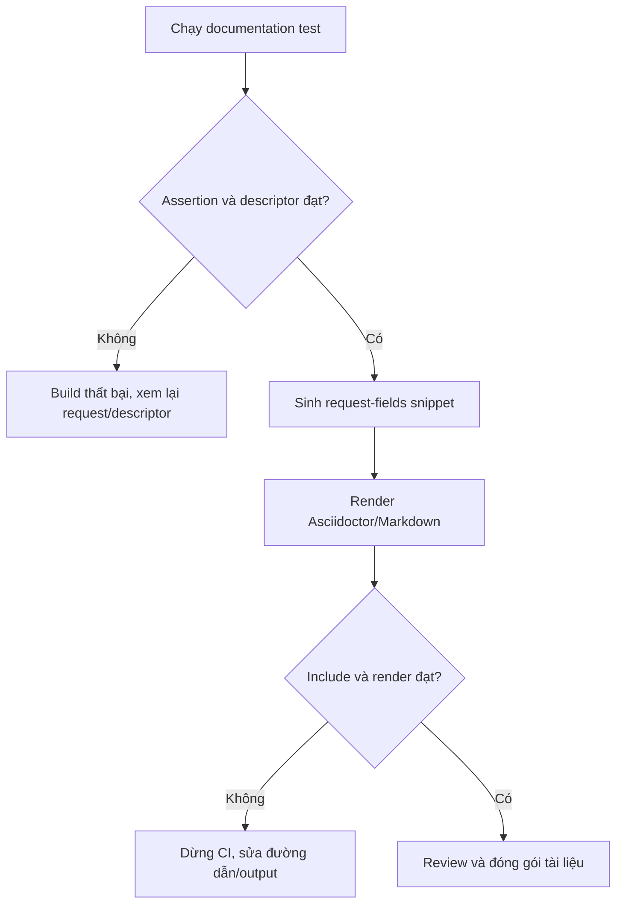

# Thiếu mô tả trường làm test tài liệu thất bại

## Mục tiêu học tập

Sau bài này, bạn có thể:

- Giải thích vì sao Spring REST Docs có thể làm documentation test thất bại khi request payload chứa trường chưa được mô tả.
- Phân biệt payload có field nhưng thiếu descriptor với descriptor khai báo field không xuất hiện trong payload.
- Đọc lỗi của requestFields, xác định đường dẫn JSON gây lỗi và cập nhật descriptor phù hợp.
- Sử dụng fieldWithPath, subsectionWithPath, optional và ignored đúng mục đích; hiểu tác động của relaxedRequestFields.
- Viết test request payload có thể lặp lại, kiểm tra cấu trúc và giá trị cần thiết, rồi sinh snippet request fields ổn định.

## 1. Vì sao thiếu mô tả field có thể làm test thất bại?

Spring REST Docs tạo snippet từ HTTP exchange của bài kiểm thử. Với request body, nhóm thường dùng requestFields để khai báo các trường JSON cần xuất hiện trong bảng tài liệu. Mỗi descriptor vừa chỉ ra đường dẫn field, vừa cung cấp nội dung mô tả cho người đọc.

Ví dụ API tạo đơn hàng nhận request:

```json
{
  "customerId": 7,
  "note": "Giao giờ hành chính",
  "items": [
    {
      "sku": "BOOK-01",
      "quantity": 2
    }
  ]
}
```

Test có thể khai báo:

```java
requestFields(
    fieldWithPath("customerId").description("Mã khách hàng"),
    fieldWithPath("items[].sku").description("Mã sản phẩm"),
    fieldWithPath("items[].quantity").description("Số lượng")
)
```

Descriptor trên chưa nói gì về trường note. Trong chế độ mặc định nghiêm ngặt của requestFields, REST Docs đối chiếu cấu trúc payload với danh sách field đã mô tả. Nếu một field xuất hiện trong payload mà không được mô tả, quá trình tạo snippet có thể ném SnippetException; test thất bại và build dừng.

Đây là một cơ chế bảo vệ hữu ích: khi API thêm trường request mới, nhóm phải quyết định trường đó có thuộc hợp đồng dành cho client hay không, rồi mô tả nó hoặc chủ động xử lý ngoại lệ. Nếu không có bước đối chiếu này, request fields snippet có thể thiếu thông tin trong khi payload thực tế đã thay đổi.

## 2. Hai dạng sai lệch cần phân biệt

### 2.1. Payload có field nhưng descriptor không khai báo

Payload chứa:

```json
{
  "customerId": 7,
  "note": "Giao giờ hành chính"
}
```

Descriptor chỉ có:

```java
requestFields(
    fieldWithPath("customerId").description("Mã khách hàng")
)
```

Trường note là một phần của request được test gửi nhưng chưa được tài liệu hóa. Ở chế độ strict, REST Docs báo phần payload chưa được mô tả. Cần hỏi: note có phải field công khai mà consumer được phép gửi không? Nếu có, thêm descriptor và giải thích. Nếu không, kiểm tra vì sao endpoint nhận hoặc test gửi field đó; không nên bỏ qua lỗi một cách máy móc.

### 2.2. Descriptor khai báo field không có trong payload

Payload thực tế:

```json
{
  "customerId": 7
}
```

Descriptor:

```java
requestFields(
    fieldWithPath("customerId").description("Mã khách hàng"),
    fieldWithPath("couponCode").description("Mã giảm giá")
)
```

Trong payload test này không có couponCode, nên descriptor không thể tìm thấy field để mô tả. REST Docs có thể báo descriptor trỏ tới field không tồn tại. Điều này thường xảy ra khi:

- Test fixture chưa được cập nhật sau khi descriptor thay đổi.
- Tên field bị viết sai hoặc khác quy tắc serialize.
- Field thực sự tùy chọn nhưng descriptor chưa đánh dấu optional.
- Field đã bị xóa khỏi request contract nhưng descriptor vẫn còn.

Không nên thêm field giả vào JSON chỉ để làm test xanh nếu client thực tế không được phép gửi field đó. Hãy xác minh hợp đồng rồi cập nhật test hoặc descriptor theo đúng hành vi.

### 2.3. Bảng đối chiếu nhanh

| Tình huống | Điều REST Docs phát hiện | Hướng xử lý |
| --- | --- | --- |
| Payload có note, descriptor không có note | Field trong payload chưa được mô tả | Thêm descriptor nếu field thuộc contract; nếu không, điều tra payload/test |
| Descriptor có couponCode, payload không có | Descriptor không khớp payload | Thêm field vào fixture nếu request test phải có; hoặc đánh dấu tùy chọn/xóa descriptor |
| Payload đổi customerId thành customer_id | Descriptor cũ không còn trỏ đúng đường dẫn | Xác định tên JSON thực tế và cập nhật contract/test/descriptor |
| Payload thêm object shippingAddress | Object hoặc các field con chưa được mô tả | Mô tả object và cấu trúc con phù hợp |
| Payload có trường động không thuộc phần tài liệu | Strict check báo field chưa mô tả | Xem xét ignored hoặc relaxed snippet với phạm vi rõ ràng |

## 3. Ví dụ thực hành bằng MockMvc

Giả sử endpoint POST /api/orders nhận customerId, note và danh sách items. Ta muốn tạo snippet request fields cho payload này. Ví dụ dùng JUnit Jupiter, Spring MVC Test, Jackson và dependency spring-restdocs-mockmvc tương thích với phiên bản Spring của dự án.

### 3.1. Test có descriptor thiếu field

```java
@ExtendWith(RestDocumentationExtension.class)
class CreateOrderDocumentationTest {
    private MockMvc mvc;

    @BeforeEach
    void setUp(RestDocumentationContextProvider context) {
        mvc = MockMvcBuilders.standaloneSetup(new OrderController())
                .apply(documentationConfiguration(context))
                .build();
    }

    @Test
    void createOrder() throws Exception {
        mvc.perform(post("/api/orders")
                        .contentType(MediaType.APPLICATION_JSON)
                        .accept(MediaType.APPLICATION_JSON)
                        .content("""
                            {
                              "customerId": 7,
                              "note": "Giao giờ hành chính",
                              "items": [
                                {"sku": "BOOK-01", "quantity": 2}
                              ]
                            }
                            """))
                .andExpect(status().isCreated())
                .andDo(document("orders-create",
                        requestFields(
                                fieldWithPath("customerId")
                                        .description("Mã khách hàng"),
                                fieldWithPath("items[].sku")
                                        .description("Mã sản phẩm"),
                                fieldWithPath("items[].quantity")
                                        .description("Số lượng sản phẩm")
                        )
                ));
    }
}
```

Đoạn trên cố ý bỏ descriptor note. Nếu request body đi tới bước tạo tài liệu và REST Docs kiểm tra payload theo chế độ strict, snippet request-fields không thể được tạo thành công vì note chưa được mô tả. Test có thể thất bại ngay ở bước andDo(document(...)), sau khi request và assertion HTTP đã chạy.

Để ví dụ biên dịch trong dự án, cần có controller và cấu hình test tương ứng, cùng các static import cần thiết như:

```java
import static org.springframework.restdocs.mockmvc.MockMvcRestDocumentation.document;
import static org.springframework.restdocs.mockmvc.MockMvcRestDocumentation.documentationConfiguration;
import static org.springframework.restdocs.payload.PayloadDocumentation.fieldWithPath;
import static org.springframework.restdocs.payload.PayloadDocumentation.requestFields;
import static org.springframework.test.web.servlet.request.MockMvcRequestBuilders.post;
import static org.springframework.test.web.servlet.result.MockMvcResultMatchers.status;
```

Ngoài ra cần import MockMvc, MockMvcBuilders, RestDocumentationExtension, RestDocumentationContextProvider, MediaType, BeforeEach, Test và ExtendWith. Ví dụ tập trung vào request payload; dự án thực tế cần khai báo response documentation nếu muốn mô tả response cùng test.

### 3.2. Sửa descriptor đúng cách

Nếu note là field hợp lệ của request contract, bổ sung mô tả:

```java
requestFields(
    fieldWithPath("customerId")
            .description("Mã khách hàng"),
    fieldWithPath("note")
            .description("Ghi chú giao hàng do khách hàng cung cấp"),
    fieldWithPath("items[].sku")
            .description("Mã sản phẩm"),
    fieldWithPath("items[].quantity")
            .description("Số lượng sản phẩm")
)
```

Khi đó descriptor bao phủ các field trong payload và có thể sinh request-fields.adoc. Mô tả phải phản ánh quy tắc thật: ví dụ ghi chú có giới hạn độ dài, có thể bỏ qua hay không, có được dùng để chỉ dẫn giao hàng hay chỉ để tham khảo. Không tự bịa các ràng buộc đó chỉ để làm bảng tài liệu trông đầy đủ.

### 3.3. Đọc snippet được tạo

Sau khi test đạt, output Gradle thường có cấu trúc:

```text
build/generated-snippets/
└── orders-create/
    ├── curl-request.adoc
    ├── http-request.adoc
    └── request-fields.adoc
```

Đường dẫn và tập snippet phụ thuộc cấu hình build/template. File request-fields.adoc chứa bảng field được khai báo. Không sửa trực tiếp output trong build/generated-snippets: lần chạy test sau có thể ghi đè. Sửa descriptor trong test, rồi tạo lại snippet.

## 4. Field lồng nhau, object và array

Request payload thực tế thường có cấu trúc lồng nhau:

```json
{
  "customer": {
    "id": 7,
    "contact": {
      "email": "lan@example.test"
    }
  },
  "items": [
    {
      "sku": "BOOK-01",
      "quantity": 2
    },
    {
      "sku": "PEN-02",
      "quantity": 3
    }
  ]
}
```

REST Docs dùng đường dẫn field để định vị các thành phần:

| Descriptor path | Field được mô tả |
| --- | --- |
| customer | Object thông tin khách hàng |
| customer.id | Mã khách hàng |
| customer.contact.email | Email liên hệ |
| items | Mảng dòng sản phẩm |
| items[].sku | SKU của từng phần tử |
| items[].quantity | Số lượng của từng phần tử |

Ví dụ:

```java
requestFields(
    fieldWithPath("customer").description("Thông tin khách hàng"),
    fieldWithPath("customer.id").description("Mã khách hàng"),
    fieldWithPath("customer.contact.email")
            .description("Email liên hệ"),
    fieldWithPath("items").description("Danh sách dòng sản phẩm"),
    fieldWithPath("items[].sku").description("Mã sản phẩm"),
    fieldWithPath("items[].quantity").description("Số lượng")
)
```

Các descriptor phải khớp cấu trúc JSON đã thực thi. Khi có nhiều cấp lồng nhau, hãy đọc body thực tế và xác định đường dẫn đúng, thay vì suy đoán tên path từ tên biến Java. Serializer có thể đổi tên field.

### 4.1. Khi nào dùng subsection descriptor?

Nếu một object hoặc subtree lớn được tài liệu hóa ở một snippet riêng, có thể cân nhắc subsectionWithPath(...) thay cho mô tả từng field ở cùng một bảng. Ví dụ:

```java
requestFields(
    fieldWithPath("customerId").description("Mã khách hàng"),
    subsectionWithPath("shippingAddress")
            .description("Thông tin địa chỉ giao hàng; xem mục địa chỉ")
)
```

Khi dùng subsection, tài liệu hiện tại mô tả phần object như một đơn vị; các field con có thể được mô tả ở snippet/mục riêng. Tránh vừa mô tả toàn bộ subtree như một subsection, vừa lặp lại cùng các field con trong cùng một descriptor set nếu cách kết hợp đó gây chồng lấp. Chọn một cách biểu diễn rõ ràng và kiểm tra với payload thực tế.

## 5. Field tùy chọn: dùng optional() khi nào?

Một field có thể không xuất hiện trong một số request hợp lệ. Ví dụ:

```json
{
  "customerId": 7,
  "items": [{"sku": "BOOK-01", "quantity": 2}]
}
```

Trong một request khác, người dùng cung cấp ghi chú:

```json
{
  "customerId": 7,
  "note": "Giao sau 17 giờ",
  "items": [{"sku": "BOOK-01", "quantity": 2}]
}
```

Nếu note thực sự là field có thể vắng mặt trong hợp đồng, descriptor có thể khai báo:

```java
fieldWithPath("note")
    .description("Ghi chú giao hàng")
    .optional()
```

optional() cho biết field có thể không xuất hiện trong payload được kiểm tra. Nó không đồng nghĩa với null, cũng không chứng minh field luôn được chấp nhận trong mọi trạng thái nghiệp vụ. Nếu contract cho phép cả vắng mặt lẫn null, hãy xác minh riêng cách serializer, binding và validation xử lý null.

### 5.1. Ba khái niệm không được đánh đồng

| Trường hợp | Ví dụ JSON | Ý nghĩa |
| --- | --- | --- |
| Field vắng mặt | {"customerId":7} | Không có key note |
| Field null | {"customerId":7,"note":null} | Có key, giá trị null |
| Field là chuỗi rỗng | {"customerId":7,"note":""} | Có key, giá trị chuỗi rỗng |

Một request test có field note: null vẫn chứa field note; điều này khác với payload không có field. Nếu API từ chối null, cần test/giải thích quy tắc đó. Không dùng optional() để che một khác biệt hợp đồng mà consumer cần hiểu.

## 6. Field không cần xuất hiện trong bảng: ignored() và relaxed snippet

Không phải mọi field trong payload test đều cần một hàng mô tả riêng. Có thể có metadata kỹ thuật, trường thử nghiệm hoặc phần được mô tả trong một tài liệu khác. Tuy nhiên, trước khi bỏ qua một field, cần hiểu vì sao nó có mặt trong request và liệu consumer có nên gửi nó hay không.

### 6.1. Dùng ignored() cho field được cố ý loại khỏi bảng mô tả

Ví dụ:

```java
requestFields(
    fieldWithPath("customerId").description("Mã khách hàng"),
    fieldWithPath("debugContext").ignored(),
    fieldWithPath("items[].sku").description("Mã sản phẩm"),
    fieldWithPath("items[].quantity").description("Số lượng")
)
```

ignored() khai báo rằng field được nhận biết nhưng không tạo nội dung mô tả thông thường cho field đó. Đây là quyết định rõ ràng trong descriptor; nó không có nghĩa field không tồn tại hoặc người dùng API được khuyến khích gửi dữ liệu tùy ý. Hãy giải thích lý do trong code review hoặc tài liệu nội bộ.

### 6.2. Dùng relaxedRequestFields() khi có lý do chấp nhận field chưa mô tả

REST Docs cũng có biến thể relaxed, ví dụ:

```java
relaxedRequestFields(
    fieldWithPath("customerId").description("Mã khách hàng")
)
```

Relaxed snippet cho phép payload chứa thêm các field chưa được khai báo mà không bắt buộc liệt kê toàn bộ chúng trong descriptor như chế độ strict. Điều này hữu ích khi chỉ muốn giới thiệu một phần payload, hoặc payload có phần mở rộng được quản lý riêng.

Đổi lại, thêm field mới có thể không còn làm test thất bại. Nếu một field công khai quan trọng xuất hiện, nhóm có thể không nhận được tín hiệu để cập nhật tài liệu. Vì vậy:

- Ưu tiên strict requestFields cho các request contract cần mô tả đầy đủ.
- Dùng relaxed khi phạm vi snippet chỉ là một phần có chủ đích.
- Ghi rõ phần nào bị bỏ qua và ở đâu có tài liệu đầy đủ hơn.
- Vẫn viết assertion/validation test cho field quan trọng; relaxed không thay thế kiểm tra hành vi.

## 7. Cách điều tra lỗi requestFields

Khi test thất bại ở bước document(...), không nên vội chuyển sang relaxed. Hãy đi theo thứ tự:

1. **Đọc chính xác lỗi:** xác định phần payload nào chưa được mô tả hay descriptor nào không tìm thấy trong payload.
2. **Đọc body thực tế:** xem JSON test gửi, kể cả field lồng nhau, array, field do helper tạo và dữ liệu được serialize.
3. **Kiểm tra JSON path:** so sánh key thực tế với descriptor; chú ý tên camelCase/snake_case, array [] và object lồng nhau.
4. **Xác nhận hợp đồng:** field mới có được phép gửi không, có bắt buộc hay tùy chọn, có null được không?
5. **Sửa đúng nguồn:** cập nhật descriptor, fixture hoặc request builder tùy nguyên nhân.
6. **Chạy lại test và đọc snippet:** bảo đảm bảng request-fields có nội dung đúng và không có trường vô tình bị công bố.

### 7.1. Bảng lỗi và cách xử lý

| Biểu hiện | Nguyên nhân có thể | Hướng xử lý |
| --- | --- | --- |
| Báo field note chưa được tài liệu hóa | Payload mới có note, descriptor chưa cập nhật | Thêm descriptor hoặc loại field khỏi request nếu không thuộc contract |
| Báo couponCode không tồn tại | Descriptor cũ còn field đã bỏ hoặc test chưa gửi field | Xác minh contract; xóa descriptor, thêm payload hoặc đánh dấu optional nếu đúng |
| Không tìm thấy items.sku | JSON dùng array nên đường dẫn cần phản ánh phần tử | Dùng path phù hợp như items[].sku |
| Không tìm thấy customer.email | JSON thật dùng contact.email hoặc serializer đổi tên | Đọc payload HTTP sau serialize và sửa path |
| Test chỉ fail ở môi trường CI | Fixture khác nhau hoặc output/snippet không ổn định | Làm fixture xác định, kiểm tra profile/serialization và build sạch |
| Test xanh nhưng bảng thiếu field mới | Dùng relaxed descriptor hoặc test không đi qua payload mới | Đánh giá lại mức strict và phạm vi test |

## 8. Mối quan hệ giữa request validation và request documentation

Request documentation không phải validation. Hai hoạt động có thể dùng chung một HTTP test nhưng trả lời hai câu hỏi khác nhau:

| Hoạt động | Câu hỏi |
| --- | --- |
| Validation của ứng dụng | Request này có hợp lệ theo quy tắc API/nghiệp vụ không? |
| Assertion trong test | Với request cụ thể, server có phản hồi theo kỳ vọng không? |
| REST Docs descriptor | Những thành phần nào của request được mô tả trong snippet? |

Ví dụ @NotNull, @NotBlank hoặc @Positive trên DTO có thể làm Spring Validation từ chối payload sai. Nhưng nếu test chỉ gửi request hợp lệ và không kiểm tra nhánh lỗi, tài liệu chưa nói được khi validation thất bại thì client nhận status/body nào.

Một kế hoạch kiểm thử hữu ích:

| Kịch bản | Assertion cần có | Tài liệu có thể cần |
| --- | --- | --- |
| Request hợp lệ đầy đủ field | Status thành công, ID và response field quan trọng | Request fields đầy đủ, HTTP request/response |
| Thiếu field bắt buộc | Status lỗi và error payload | Ví dụ validation error, quy tắc field bắt buộc |
| Field có định dạng sai | Status/error code theo contract | Ràng buộc định dạng và cách sửa |
| Field tùy chọn vắng mặt | Request vẫn hợp lệ, hành vi mặc định nếu có | Ghi rõ optional/default |
| Field bị gửi null | Kết quả thực tế theo contract | Phân biệt null với absent |
| Field không được hỗ trợ | Hệ thống từ chối hay bỏ qua theo thiết kế | Hành vi thực tế; không tự giả định |

Không suy ra rằng mọi field được đánh dấu optional trong REST Docs là optional trong validation, hoặc ngược lại. Một bên mô tả mức hiện diện trong payload snippet; bên kia là hành vi kiểm tra request của ứng dụng.

## 9. Ghép request-fields snippet vào tài liệu Asciidoctor

Sau khi test sinh snippet, tác giả có thể include vào trang:

```asciidoc
== Tạo đơn hàng

Gửi thông tin khách hàng và các dòng sản phẩm để tạo một đơn hàng.

=== HTTP request
include::{snippets}/orders-create/http-request.adoc[]

=== Request fields
include::{snippets}/orders-create/request-fields.adoc[]
```

Thuộc tính {snippets} phải trỏ đến thư mục snippet do test tạo. Khi descriptor được cập nhật và test chạy lại, file request-fields.adoc được sinh lại theo request contract đã kiểm tra.

Asciidoctor thực hiện ghép và render; nó không thực thi HTTP test. Với Markdown, cần template snippet và cơ chế include/ghép mà Markdown renderer hỗ trợ; cú pháp include::{snippets}/...[] ở trên thuộc Asciidoctor, không phải Markdown chuẩn.

Không chỉnh trực tiếp build/generated-snippets/orders-create/request-fields.adoc. Hãy sửa descriptor trong test rồi để build sinh lại. File được sinh là artifact trung gian; nguồn có thể chỉnh sửa là test và tài liệu AsciiDoc/Markdown.

## 10. Build và CI

Một luồng điển hình:



Với Gradle, cấu hình task cần bảo đảm test sinh snippet trước khi Asciidoctor đọc chúng. Ví dụ ý tưởng với Groovy DSL:

```groovy
def snippetsDir = file("$buildDir/generated-snippets")

tasks.named('test') {
    outputs.dir snippetsDir
}

tasks.named('asciidoctor') {
    inputs.dir snippetsDir
    dependsOn tasks.named('test')
}
```

Đây chỉ minh họa quan hệ task; dự án còn cần plugin Asciidoctor, REST Docs dependencies, phiên bản tương thích và cấu hình snippet attribute. Khi phát hành, nên chạy từ output sạch để tránh snippet cũ còn lại sau khi test hoặc descriptor đã bị xóa/đổi tên.

Một số kiểm tra hữu ích trong CI:

- Test strict cho các payload contract quan trọng.
- Có test cho request thành công và những lỗi validation cần công bố.
- Kiểm tra thư mục snippet của các kịch bản bắt buộc được tạo.
- Render tài liệu và cấu hình missing include thành lỗi build.
- Dùng dữ liệu giả; không ghi token, cookie, mật khẩu hoặc dữ liệu cá nhân vào snippet.
- Phát hành tài liệu từ cùng commit/build với phiên bản API.

## 11. Checklist xử lý khi thiếu mô tả field

- [ ] Đọc đầy đủ thông báo lỗi REST Docs và xác định payload/descriptor liên quan.
- [ ] Kiểm tra JSON body thực tế mà test gửi, không chỉ DTO Java.
- [ ] Xác định field path đúng, kể cả object lồng nhau và array.
- [ ] Xác nhận field thuộc contract và người dùng API có được gửi field đó không.
- [ ] Thêm descriptor có mô tả rõ nếu field cần công bố.
- [ ] Dùng optional chỉ khi field thực sự có thể vắng mặt.
- [ ] Dùng ignored/relaxed chỉ khi có lý do và phạm vi rõ ràng.
- [ ] Giữ assertion kiểm tra giá trị và validation cần thiết.
- [ ] Chạy lại test, đọc snippet sinh mới và render trang tài liệu.

## 12. Bài tập thực hành

Endpoint POST /api/customers nhận payload:

```json
{
  "name": "Lan",
  "email": "lan@example.test",
  "phone": "0900000000",
  "marketingConsent": false
}
```

Test hiện khai báo:

```java
requestFields(
    fieldWithPath("name").description("Tên khách hàng"),
    fieldWithPath("email").description("Địa chỉ email")
)
```

Hãy thực hiện các yêu cầu:

1. Giải thích vì sao descriptor trên có thể làm strict requestFields thất bại.
2. Bổ sung descriptor cho phone và marketingConsent, nêu rõ ý nghĩa dựa trên hợp đồng giả định đã được xác nhận.
3. Thay fixture để bỏ phone; nếu field này thực sự tùy chọn, đánh dấu descriptor phù hợp và kiểm tra test vẫn đạt.
4. Thử gửi phone: null, ghi nhận phản hồi thực tế và phân biệt với field bị thiếu.
5. Thêm một field metadata.source lồng nhau và viết descriptor đúng path.
6. Thử dùng relaxed snippet, quan sát field chưa mô tả được xử lý thế nào và giải thích trade-off khi dùng trong tài liệu công khai.

**Câu hỏi tự kiểm tra:** Nếu test thất bại vì payload có thêm marketingConsent, giải pháp tốt nhất luôn là dùng relaxedRequestFields phải không? Không. Trước hết phải xác định field có thuộc request contract không. Nếu client cần gửi và cần hiểu ý nghĩa, thêm descriptor là giải pháp rõ ràng hơn. Nếu field là phần mở rộng có chủ đích được mô tả ở nơi khác, relaxed có thể phù hợp, nhưng phải chấp nhận việc giảm phát hiện field chưa được tài liệu hóa.

## Kết luận

Strict requestFields giúp Spring REST Docs phát hiện khi request payload chứa field chưa có mô tả hoặc descriptor khai báo field không khớp payload. Lỗi này buộc nhóm xem xét lại hợp đồng: bổ sung descriptor, sửa fixture, đánh dấu optional, bỏ descriptor lỗi thời hoặc chủ động dùng relaxed/ignored khi có lý do. Hãy luôn phân biệt **field vắng mặt**, **field null** và **field không được mô tả**; chúng biểu thị các tình huống khác nhau. Khi kết hợp HTTP test, descriptor chính xác, snippet sinh mới và build/CI, bảng request fields trở thành một phần có thể kiểm tra của tài liệu REST API.
