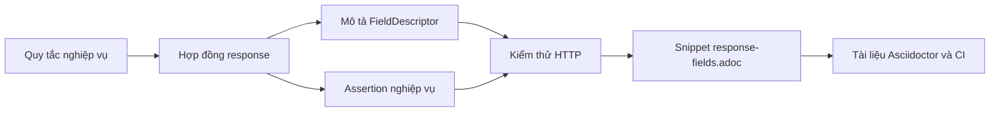

# Liên kết response field với ý nghĩa nghiệp vụ trong Spring REST Docs

## 1. Vì sao mô tả trường JSON phải phản ánh nghiệp vụ?

Trong chương **Response payload** của module **SPRING_REST_DOCS**, việc viết `responseFields(...)` có thể bắt đầu từ những mô tả như “Mã đơn hàng”, “Tổng tiền” hoặc “Trạng thái”. Tuy nhiên, một bảng chỉ có tên trường và kiểu JSON chưa đủ giúp người tích hợp sử dụng API đúng cách.

Ví dụ, hai trường đều có kiểu `NUMBER`:

```json
{
  "discountAmount": 50000,
  "payableAmount": 320000
}
```

Người đọc vẫn cần biết: số tiền được tính bằng đơn vị nào, `discountAmount` đã được trừ trong `payableAmount` chưa, khoản phí vận chuyển được tính trước hay sau giảm giá, và có trường hợp số tiền âm hay không. Tương tự, trường `status: "PAID"` cần gắn với trạng thái **đơn hàng** hay **giao dịch thanh toán**; hai khái niệm có thể khác nhau.

Spring REST Docs giải quyết phần tài liệu hóa bằng `fieldWithPath(...).description(...)` và tạo snippet từ **bài kiểm thử HTTP thực tế** qua MockMvc, WebTestClient hoặc REST Assured. Để tài liệu có thể kiểm chứng được, cần bổ sung assertion xác nhận các quy tắc nghiệp vụ liên quan đến trường đó.

Một quy trình hữu ích:



**Mục tiêu bài học:** biết chuyển đặc tả nghiệp vụ thành mô tả có ích cho client; phân biệt ý nghĩa của giá trị, đơn vị, trạng thái, thời gian và quan hệ giữa các trường; viết kiểm thử chứng minh các quy tắc quan trọng; và đưa snippet đã xác minh vào tài liệu REST API.

## 2. Ví dụ xuyên suốt: REST API trả thông tin đơn hàng

Giả sử hệ thống bán hàng cung cấp endpoint:

```http
GET /api/orders/ORD-2048 HTTP/1.1
Accept: application/json
```

Response `200 OK`:

```json
{
  "orderId": "ORD-2048",
  "status": "PAID",
  "customer": {
    "id": "CUS-17",
    "displayName": "Khách hàng 17"
  },
  "items": [
    {
      "sku": "B-01",
      "quantity": 2,
      "unitPrice": 125000
    },
    {
      "sku": "B-02",
      "quantity": 1,
      "unitPrice": 100000
    }
  ],
  "pricing": {
    "subtotalAmount": 350000,
    "discountAmount": 50000,
    "shippingFeeAmount": 20000,
    "payableAmount": 320000,
    "currency": "VND"
  },
  "payment": {
    "status": "CAPTURED",
    "paidAt": "2026-11-01T02:00:00Z",
    "providerReference": "TX-987"
  },
  "createdAt": "2026-11-01T01:30:00Z",
  "cancelReason": null
}
```

Trong **hợp đồng minh họa** của endpoint này:

- `orderId` và `customer.id` là các mã định danh dạng chuỗi. Client dùng chúng để tham chiếu tài nguyên, không tự suy ra quy luật tăng dần hay bóc tách ý nghĩa từ ký tự trong mã.
- `status` là **trạng thái đơn hàng**. Ví dụ hỗ trợ `CREATED`, `PAID` và `CANCELLED`. Cần xác nhận bộ giá trị thật trong API trước khi công bố.
- `payment.status` là **trạng thái xử lý thanh toán**. `CAPTURED` nghĩa là giao dịch đã được ghi nhận thành công theo quy tắc của hệ thống mẫu; nó không phải mã trạng thái của đơn hàng.
- `pricing.currency` là `VND` và tất cả số tiền trong `pricing` được biểu diễn bằng số nguyên **đồng Việt Nam** ở ví dụ này, không phải đồng thời dùng nhiều đơn vị.
- `pricing.subtotalAmount` là tổng tiền hàng **trước giảm giá và trước phí vận chuyển**. `pricing.discountAmount` là khoản giảm được trừ; `pricing.shippingFeeAmount` là phí giao hàng được cộng.
- `pricing.payableAmount` là tổng phải thanh toán sau khi trừ giảm giá và cộng phí giao.
- `createdAt` và `payment.paidAt` là thời điểm ISO 8601 có múi giờ. Ký hiệu `Z` trong dữ liệu mẫu là UTC.
- `cancelReason` **luôn có key** trong hợp đồng mẫu, nhưng có thể mang giá trị `null` khi đơn không ở trạng thái `CANCELLED`.

Các giá trị và quy tắc trên chỉ thuộc hệ thống ví dụ. Với API thực tế, phải kiểm tra đặc tả được thống nhất với đội nghiệp vụ; không lấy quy ước phổ biến làm cam kết nếu hệ thống chưa hỗ trợ.

## 3. Chuyển hợp đồng nghiệp vụ thành bảng mô tả trường

Trước khi viết code test, nên lập bảng với bốn câu hỏi: **trường này là gì**, **đơn vị/định dạng là gì**, **người đọc nên sử dụng thế nào**, và **quy tắc nào cần được kiểm thử**.

| Đường dẫn response | Kiểu JSON | Ý nghĩa nghiệp vụ cần nói rõ | Quy tắc nên xác minh |
| --- | --- | --- | --- |
| `orderId` | STRING | Mã tham chiếu đơn hàng, dùng khi truy vấn/tra cứu; coi là mã opaque | Không rỗng, khớp tài nguyên được yêu cầu |
| `status` | STRING | Giai đoạn xử lý **đơn hàng**, không đồng nhất với payment status | Thuộc tập trạng thái được hỗ trợ |
| `customer.id` | STRING | Mã khách hàng gắn với đơn; không phải email hoặc số điện thoại | Khớp chủ thể theo dữ liệu kiểm thử |
| `customer.displayName` | STRING | Tên hiển thị, không phải định danh duy nhất | Có ý nghĩa hiển thị, không dùng làm khóa |
| `items[].sku` | STRING | Mã sản phẩm trên từng dòng hàng | Có mặt trong dòng hàng mẫu |
| `items[].quantity` | NUMBER | Số đơn vị hàng được đặt ở một dòng | Số nguyên lớn hơn 0 theo hợp đồng mẫu |
| `items[].unitPrice` | NUMBER | Đơn giá mỗi sản phẩm, tính bằng VND | Không âm |
| `pricing.subtotalAmount` | NUMBER | Tổng tiền hàng trước giảm/phí, tính bằng VND | Bằng tổng `quantity × unitPrice` |
| `pricing.discountAmount` | NUMBER | Tổng giảm giá áp dụng cho đơn, tính bằng VND | Không âm; không vượt subtotal nếu hợp đồng yêu cầu |
| `pricing.shippingFeeAmount` | NUMBER | Phí vận chuyển cộng thêm, tính bằng VND | Không âm |
| `pricing.payableAmount` | NUMBER | Số tiền phải thanh toán, tính bằng VND | `subtotal - discount + shippingFee` |
| `pricing.currency` | STRING | Đơn vị tiền tệ của các trường `pricing.*Amount` | Bằng `VND` cho endpoint mẫu |
| `payment.status` | STRING | Kết quả quy trình thanh toán, độc lập với `status` | Khớp quy tắc đồng bộ đơn hàng/thanh toán |
| `payment.paidAt` | STRING | Thời điểm thanh toán thành công, dạng ISO 8601 UTC | Parse được; không trước `createdAt` ở tình huống này |
| `payment.providerReference` | STRING | Mã tra soát do hệ thống xử lý thanh toán cấp | Được công bố chỉ khi phù hợp phạm vi API |
| `createdAt` | STRING | Thời điểm tạo đơn, dạng ISO 8601 UTC | Parse được |
| `cancelReason` | STRING hoặc null | Lý do hủy; null nếu không hủy | Phù hợp với trạng thái đơn hàng |

Mô tả tốt không chỉ nhắc lại tên biến. Chẳng hạn:

```java
// Ít giá trị với người đọc: chỉ lặp lại tên trường.
fieldWithPath("pricing.payableAmount")
    .description("Số tiền phải trả");

// Có ích hơn: giải thích phép tính và đơn vị.
fieldWithPath("pricing.payableAmount")
    .description(
        "Tổng phải thanh toán bằng VND: tiền hàng "
        + "trừ giảm giá, cộng phí vận chuyển");
```

Nếu API có thuế, phí dịch vụ, làm tròn số hay hoàn tiền, phép tính cần được điều chỉnh cho đúng. Không đưa một công thức giản lược vào tài liệu nếu nó không mô tả đầy đủ hành vi thật.

## 4. Viết `responseFields` theo ý nghĩa nghiệp vụ

Từ payload ở mục 2, các descriptor có thể được viết như sau. Đoạn code là **danh sách đối số** dùng trong `responseFields(...)`:

```java
responseFields(
    fieldWithPath("orderId")
        .description("Mã định danh đơn hàng để tham chiếu tài nguyên"),

    fieldWithPath("status")
        .description(
            "Trạng thái xử lý đơn hàng; ví dụ CREATED, PAID, CANCELLED"),

    fieldWithPath("customer")
        .description("Thông tin khách hàng liên quan đến đơn hàng"),
    fieldWithPath("customer.id")
        .description("Mã khách hàng, dùng làm định danh tham chiếu"),
    fieldWithPath("customer.displayName")
        .description("Tên hiển thị của khách hàng"),

    fieldWithPath("items")
        .description("Các dòng hàng góp vào tiền hàng của đơn"),
    fieldWithPath("items[].sku")
        .description("Mã sản phẩm của từng dòng hàng"),
    fieldWithPath("items[].quantity")
        .description("Số lượng sản phẩm được đặt trên dòng hàng"),
    fieldWithPath("items[].unitPrice")
        .description("Đơn giá một sản phẩm tính bằng VND"),

    fieldWithPath("pricing")
        .description("Các thành phần tính tổng tiền đơn hàng"),
    fieldWithPath("pricing.subtotalAmount")
        .description("Tiền hàng trước giảm và trước phí giao, bằng VND"),
    fieldWithPath("pricing.discountAmount")
        .description("Khoản giảm trừ khỏi tiền hàng, bằng VND"),
    fieldWithPath("pricing.shippingFeeAmount")
        .description("Phí vận chuyển cộng thêm, bằng VND"),
    fieldWithPath("pricing.payableAmount")
        .description(
            "Tổng phải trả bằng VND = subtotal - discount + shipping fee"),
    fieldWithPath("pricing.currency")
        .description("Mã tiền tệ ISO 4217; ví dụ này dùng VND"),

    fieldWithPath("payment")
        .description("Thông tin giao dịch thanh toán cho đơn hàng"),
    fieldWithPath("payment.status")
        .description(
            "Trạng thái thanh toán; CAPTURED là giao dịch đã ghi nhận"),
    fieldWithPath("payment.paidAt")
        .description("Thời điểm ghi nhận thanh toán, ISO 8601 UTC"),
    fieldWithPath("payment.providerReference")
        .description("Mã tham chiếu phục vụ tra soát giao dịch"),

    fieldWithPath("createdAt")
        .description("Thời điểm tạo đơn, ISO 8601 UTC"),
    fieldWithPath("cancelReason")
        .type(JsonFieldType.STRING)
        .description(
            "Lý do hủy đơn; key có mặt nhưng null nếu không bị hủy")
)
```

Có vài lựa chọn có chủ đích:

1. `pricing`, `customer`, `items` và `payment` được mô tả ở cấp object/mảng, đồng thời khai báo cụ thể các trường con mà người tích hợp API cần biết.
2. `items[].unitPrice` chứa chữ “Price” nhưng phần mô tả ghi rõ **đơn giá** và **đơn vị VND**; thông tin này không thể suy ra từ `NUMBER`.
3. `status` và `payment.status` được mô tả bằng ngôn ngữ của hai quy trình nghiệp vụ khác nhau, tránh client dùng sai trường để quyết định trạng thái thanh toán.
4. `cancelReason` có giá trị `null` trong fixture nhưng kiểu nghiệp vụ khi có giá trị là chuỗi, nên đặt `.type(JsonFieldType.STRING)`. Trường này **không có `optional()`** vì hợp đồng mẫu yêu cầu key luôn xuất hiện, dù có thể null.
5. Các mô tả về giá trị enum, ISO 4217, thời gian và công thức đều là những cam kết cần được đối chiếu với hành vi thực tế.

Spring REST Docs sẽ dùng descriptor để sinh bảng trường trong `response-fields.adoc`. Chỉ viết mô tả như trên **không tự đảm bảo** phép tính tiền đúng hoặc bộ trạng thái hợp lệ; phần tiếp theo bổ sung kiểm thử.

## 5. Ví dụ MockMvc: mô tả và xác minh các quy tắc nghiệp vụ

Ví dụ dùng JUnit Jupiter, MockMvc, Spring REST Docs MockMvc, Jackson. Controller trả một payload cố định để bài học tập trung vào mối liên hệ giữa tài liệu và kiểm thử. Java 11+ là đủ cho `Map.of` và kiểu suy luận `var`.

```java
import java.time.Instant;
import java.util.LinkedHashMap;
import java.util.List;
import java.util.Map;

import com.fasterxml.jackson.databind.JsonNode;
import com.fasterxml.jackson.databind.ObjectMapper;
import org.junit.jupiter.api.BeforeEach;
import org.junit.jupiter.api.Test;
import org.junit.jupiter.api.extension.ExtendWith;
import org.springframework.http.MediaType;
import org.springframework.restdocs.RestDocumentationContextProvider;
import org.springframework.restdocs.junit.jupiter.RestDocumentationExtension;
import org.springframework.restdocs.payload.JsonFieldType;
import org.springframework.test.web.servlet.MockMvc;
import org.springframework.test.web.servlet.setup.MockMvcBuilders;
import org.springframework.web.bind.annotation.GetMapping;
import org.springframework.web.bind.annotation.PathVariable;
import org.springframework.web.bind.annotation.RestController;

import static org.junit.jupiter.api.Assertions.assertEquals;
import static org.junit.jupiter.api.Assertions.assertTrue;
import static org.springframework.restdocs.mockmvc.MockMvcRestDocumentation.document;
import static org.springframework.restdocs.mockmvc.MockMvcRestDocumentation.documentationConfiguration;
import static org.springframework.restdocs.payload.PayloadDocumentation.fieldWithPath;
import static org.springframework.restdocs.payload.PayloadDocumentation.responseFields;
import static org.springframework.test.web.servlet.request.MockMvcRequestBuilders.get;
import static org.springframework.test.web.servlet.result.MockMvcResultMatchers.jsonPath;
import static org.springframework.test.web.servlet.result.MockMvcResultMatchers.status;

@ExtendWith(RestDocumentationExtension.class)
class OrderBusinessResponseDocumentationTest {

    private MockMvc mockMvc;

    @BeforeEach
    void setUp(RestDocumentationContextProvider documentation) {
        mockMvc = MockMvcBuilders.standaloneSetup(new OrderController())
                .apply(documentationConfiguration(documentation))
                .build();
    }

    @Test
    void documentOrderFieldsAndBusinessRules() throws Exception {
        var result = mockMvc.perform(
                    get("/api/orders/{orderId}", "ORD-2048")
                        .accept(MediaType.APPLICATION_JSON))
                .andExpect(status().isOk())
                .andExpect(jsonPath("$.orderId").value("ORD-2048"))
                .andExpect(jsonPath("$.status").value("PAID"))
                .andExpect(jsonPath("$.payment.status").value("CAPTURED"))
                .andExpect(jsonPath("$.pricing.currency").value("VND"))
                .andDo(document("orders-business-response",
                    responseFields(
                        fieldWithPath("orderId")
                            .description("Mã đơn hàng dùng để tra cứu"),
                        fieldWithPath("status")
                            .description(
                                "Trạng thái đơn hàng: CREATED, PAID hoặc CANCELLED"),

                        fieldWithPath("customer")
                            .description("Khách hàng của đơn"),
                        fieldWithPath("customer.id")
                            .description("Mã tham chiếu khách hàng"),
                        fieldWithPath("customer.displayName")
                            .description("Tên hiển thị của khách hàng"),

                        fieldWithPath("items")
                            .description("Các dòng hàng thuộc đơn"),
                        fieldWithPath("items[].sku")
                            .description("Mã sản phẩm"),
                        fieldWithPath("items[].quantity")
                            .description("Số đơn vị mua của từng sản phẩm"),
                        fieldWithPath("items[].unitPrice")
                            .description("Đơn giá theo VND"),

                        fieldWithPath("pricing")
                            .description("Thông tin tính tiền đơn hàng"),
                        fieldWithPath("pricing.subtotalAmount")
                            .description("Tiền hàng trước giảm/phí, VND"),
                        fieldWithPath("pricing.discountAmount")
                            .description("Tổng tiền giảm giá, VND"),
                        fieldWithPath("pricing.shippingFeeAmount")
                            .description("Phí vận chuyển cộng thêm, VND"),
                        fieldWithPath("pricing.payableAmount")
                            .description(
                                "Tổng phải trả = subtotal - discount + shipping, VND"),
                        fieldWithPath("pricing.currency")
                            .description("Mã tiền tệ, ví dụ VND"),

                        fieldWithPath("payment")
                            .description("Thông tin thanh toán của đơn"),
                        fieldWithPath("payment.status")
                            .description(
                                "CAPTURED khi giao dịch được ghi nhận thành công"),
                        fieldWithPath("payment.paidAt")
                            .description("Thời điểm thanh toán, ISO 8601 UTC"),
                        fieldWithPath("payment.providerReference")
                            .description("Mã tra soát giao dịch"),

                        fieldWithPath("createdAt")
                            .description("Thời điểm tạo đơn, ISO 8601 UTC"),
                        fieldWithPath("cancelReason")
                            .type(JsonFieldType.STRING)
                            .description(
                                "Lý do hủy; null khi đơn không bị hủy")
                    )))
                .andReturn();

        JsonNode body = new ObjectMapper()
                .readTree(result.getResponse().getContentAsString());

        // Kiểm tra công thức tổng tiền thay vì chỉ mô tả nó.
        JsonNode pricing = body.path("pricing");
        long subtotal = pricing.path("subtotalAmount").asLong();
        long discount = pricing.path("discountAmount").asLong();
        long shipping = pricing.path("shippingFeeAmount").asLong();
        long payable = pricing.path("payableAmount").asLong();

        assertEquals(subtotal - discount + shipping, payable);
        assertTrue(discount >= 0 && discount <= subtotal);
        assertTrue(shipping >= 0);

        // Tổng tiền hàng bằng tổng đơn giá * số lượng.
        long calculatedSubtotal = 0;
        for (JsonNode item : body.path("items")) {
            long quantity = item.path("quantity").asLong();
            long unitPrice = item.path("unitPrice").asLong();
            assertTrue(quantity > 0);
            assertTrue(unitPrice >= 0);
            calculatedSubtotal += quantity * unitPrice;
        }
        assertEquals(calculatedSubtotal, subtotal);

        // Xác nhận các trường có ý nghĩa nghiệp vụ phụ thuộc nhau.
        if ("PAID".equals(body.path("status").asText())) {
            assertEquals("CAPTURED",
                    body.path("payment").path("status").asText());
            assertTrue(body.path("payment").path("paidAt").isTextual());
        }

        Instant created = Instant.parse(body.path("createdAt").asText());
        Instant paid = Instant.parse(
                body.path("payment").path("paidAt").asText());
        assertTrue(!paid.isBefore(created));

        // Contract mẫu: key luôn tồn tại, nhưng null khi không hủy.
        assertTrue(body.has("cancelReason"));
        assertTrue(body.get("cancelReason").isNull());
    }

    @RestController
    static class OrderController {

        @GetMapping(
            value = "/api/orders/{orderId}",
            produces = MediaType.APPLICATION_JSON_VALUE)
        Map<String, Object> getOrder(
                @PathVariable("orderId") String orderId) {

            Map<String, Object> response = new LinkedHashMap<>();
            response.put("orderId", orderId);
            response.put("status", "PAID");
            response.put("customer", Map.of(
                    "id", "CUS-17",
                    "displayName", "Khách hàng 17"));

            response.put("items", List.of(
                    Map.of("sku", "B-01",
                           "quantity", 2, "unitPrice", 125000),
                    Map.of("sku", "B-02",
                           "quantity", 1, "unitPrice", 100000)));

            response.put("pricing", Map.of(
                    "subtotalAmount", 350000,
                    "discountAmount", 50000,
                    "shippingFeeAmount", 20000,
                    "payableAmount", 320000,
                    "currency", "VND"));

            response.put("payment", Map.of(
                    "status", "CAPTURED",
                    "paidAt", "2026-11-01T02:00:00Z",
                    "providerReference", "TX-987"));
            response.put("createdAt", "2026-11-01T01:30:00Z");
            response.put("cancelReason", null);
            return response;
        }
    }
}
```

Trong ví dụ:

- `andExpect(...)` kiểm tra HTTP status và một số giá trị có ý nghĩa như mã đơn, đơn hàng đã thanh toán và đồng tiền.
- `andDo(document(...))` sinh `response-fields.adoc` khi mô tả trường phù hợp JSON được trả.
- Các assertion trên `JsonNode` chứng minh phép tính tổng tiền, quan hệ giữa số tiền hàng và các dòng hàng, tính hợp lệ của số lượng/đơn giá, cùng thứ tự thời gian.
- `body.has("cancelReason")` và `body.get("cancelReason").isNull()` xác minh sự khác biệt giữa **key vắng** và **key có giá trị null**.
- `LinkedHashMap` được dùng cho object gốc vì có thể lưu giá trị null; `Map.of(...)` của Java không hỗ trợ value null.

Bài kiểm thử trên minh họa một response `PAID`. Trong dự án thật, cần bổ sung các ca `CREATED`, `CANCELLED`, thanh toán thất bại, giảm giá bằng 0 và các mức giá biên để kiểm tra đầy đủ hợp đồng nghiệp vụ. Với `@WebMvcTest` hoặc `@SpringBootTest`, có thể thay controller mẫu bằng controller thật mà vẫn giữ kỹ thuật `responseFields` và assertion.

## 6. Đặt câu mô tả đủ sức hướng dẫn người dùng API

### 6.1. Mã định danh: công khai cách dùng, tránh suy diễn cấu trúc

Với `orderId: "ORD-2048"`, mô tả “Mã đơn hàng” còn thiếu cách sử dụng. Nếu client cần dùng giá trị để gọi endpoint khác, có thể viết:

```java
fieldWithPath("orderId")
    .description(
        "Mã tham chiếu đơn hàng; sử dụng nguyên chuỗi khi gọi "
        + "GET /api/orders/{orderId}");
```

Không hứa định dạng cố định như “`ORD-` + số tăng dần” chỉ dựa vào ví dụ. Client không nên phân tích chuỗi thành số để tự xác định thứ tự hay ngày tạo đơn khi hợp đồng không quy định.

### 6.2. Enum trạng thái: nêu quy trình và giá trị hợp lệ

`status` và `payment.status` có thể đều là `STRING` nhưng chứa hai ý nghĩa:

```java
fieldWithPath("status")
    .description(
        "Trạng thái đơn hàng: CREATED, PAID hoặc CANCELLED");

fieldWithPath("payment.status")
    .description(
        "Trạng thái giao dịch thanh toán; CAPTURED nghĩa là "
        + "thanh toán đã được ghi nhận");
```

Nếu có vòng đời trạng thái, cần mô tả các chuyển đổi hợp lệ hoặc liên kết đến tài liệu riêng:

```text
Đơn hàng: CREATED -> PAID
                   \-> CANCELLED

Thanh toán: PENDING -> CAPTURED
                     \-> FAILED
```

Sơ đồ này chỉ là **ví dụ đơn giản**, không phải mô hình chuẩn bắt buộc của mọi hệ thống. Có thể có trạng thái `REFUNDED`, `PARTIALLY_PAID`, `EXPIRED`, hoặc tình huống một đơn có nhiều giao dịch. Mô tả tài liệu phải theo đúng hợp đồng thực của API.

Điều quan trọng là **trạng thái nào thuộc đối tượng nào**, giá trị nào có thể xuất hiện và client nên đưa ra quyết định gì. Dùng assertion để kiểm tra các giá trị hợp lệ; `description(...)` chỉ trình bày cam kết.

### 6.3. Tiền tệ và đơn vị: ghi trên từng số tiền cần thiết

Đây là cặp mô tả dễ gây nhầm:

```java
// Không rõ đơn vị và cách tính.
fieldWithPath("pricing.payableAmount")
    .description("Số tiền thanh toán");

// Rõ đơn vị và thành phần.
fieldWithPath("pricing.payableAmount")
    .description(
        "Số nguyên VND phải thanh toán, bằng tiền hàng "
        + "trừ giảm giá cộng phí vận chuyển");
```

Với hệ thống đa tiền tệ, số tiền có thể biểu diễn bằng đơn vị nhỏ nhất của từng đồng tiền (minor units) hoặc dạng thập phân; không được mặc định tiền nào cũng có hai chữ số sau dấu phẩy. Nếu dùng `BigDecimal` hoặc chuyển đổi tỷ giá, hãy mô tả rõ quy tắc làm tròn, thời điểm quy đổi và loại tiền áp dụng.

Trong API minh họa, `currency: "VND"` áp dụng cho mọi `pricing.*Amount` và `unitPrice`. Nếu hệ thống dùng đồng tiền khác cho `unitPrice`, cần có trường currency riêng hoặc mô tả không mơ hồ.

### 6.4. Thời gian: phân biệt thời điểm, thời hạn và timezone

Hai trường cùng là chuỗi thời gian nhưng khác bản chất:

- `createdAt`: thời điểm đơn hàng được tạo.
- `payment.paidAt`: thời điểm giao dịch thanh toán được ghi nhận thành công.

Nên nêu **định dạng**, **múi giờ** và **sự kiện nghiệp vụ**:

```java
fieldWithPath("createdAt")
    .description("Thời điểm tạo đơn, ISO 8601 với múi giờ UTC");

fieldWithPath("payment.paidAt")
    .description(
        "Thời điểm xác nhận thanh toán thành công, "
        + "ISO 8601 với múi giờ UTC");
```

Không đồng nhất `paidAt` với ngày tiền về tài khoản ngân hàng nếu hệ thống có quy trình đối soát/thanh toán bù trừ riêng. Các thời điểm `updatedAt`, `expiresAt` và `completedAt` cũng cần giải thích sự kiện tương ứng.

Định dạng hiển thị trong fixture có `Z`, ví dụ `2026-11-01T02:00:00Z`. Kiểm thử có thể dùng `Instant.parse(...)` để bảo đảm chuỗi parse được và thứ tự thời gian hợp lý.

### 6.5. Nullable/optional: mô tả ý nghĩa của việc thiếu dữ liệu

Trong response mẫu, `cancelReason` luôn có key nhưng là `null` nếu không hủy:

```java
fieldWithPath("cancelReason")
    .type(JsonFieldType.STRING)
    .description("Lý do hủy; null khi trạng thái không phải CANCELLED");
```

Trường hợp này khác với hợp đồng cho phép **bỏ hẳn** key:

```java
fieldWithPath("cancelReason")
    .optional()
    .type(JsonFieldType.STRING)
    .description(
        "Có thể không trả về; khi có, ghi lý do hủy đơn");
```

Chỉ dùng `optional()` nếu API được phép thiếu trường. Modifier này cho phép path không xuất hiện trong kiểm thử tài liệu, nhưng không tự định nghĩa ý nghĩa của `null`. Khi cần bảo đảm “hủy đơn thì phải có lý do”, cần assertion kiểm tra kết hợp `status` và `cancelReason`.

### 6.6. Thông tin khách hàng: cách dùng và phạm vi công khai

Các trường liên quan đến khách hàng thường có hai nhiệm vụ khác nhau:

```java
fieldWithPath("customer.id")
    .description("Mã tham chiếu khách hàng gắn với đơn hàng");

fieldWithPath("customer.displayName")
    .description("Tên hiển thị cho giao diện, không dùng làm định danh");
```

Trường tên hiển thị có thể thay đổi, trùng giữa nhiều người hoặc bị ẩn theo quyền truy cập. Không nên gợi ý client dùng nó như khóa định danh. Với các trường nhạy cảm như email, số điện thoại, địa chỉ và token, mô tả cần nêu rõ phạm vi trả dữ liệu, cách che/masking và ý nghĩa với người tích hợp nếu API thực sự công bố chúng. Fixture tài liệu không nên chứa thông tin cá nhân thật.

## 7. Từ lời mô tả đến phép kiểm tra nghiệp vụ

Một tài liệu chính xác cần tương ứng với kiểm thử có khả năng phát hiện thay đổi gây sai hợp đồng.

| Cam kết trong mô tả | Kiểm tra minh họa | Điều kiện cần nghĩ thêm |
| --- | --- | --- |
| `payableAmount` = subtotal - discount + phí giao | `assertEquals(subtotal - discount + shipping, payable)` | Thuế, phí bổ sung, làm tròn, hoàn tiền |
| `subtotalAmount` là tổng tiền hàng | Cộng `quantity * unitPrice` qua từng item | Giá động, giảm giá theo dòng hàng |
| `quantity` phải dương | `assertTrue(quantity > 0)` trong vòng lặp | Phân biệt đơn hàng và phiếu trả hàng |
| `status` thuộc bộ enum nghiệp vụ | Dùng `Set.of(...).contains(status)` | Enum thay đổi theo phiên bản API |
| `payment.paidAt` có ý nghĩa khi đã thanh toán | Kiểm tra `payment.status` và `paidAt` cùng nhau | Thanh toán nhiều lần, hoàn tiền, thời điểm ghi sổ |
| `cancelReason` null khi không hủy | Kiểm tra `status` kết hợp `cancelReason` | Có cho phép giữ lý do sau khi phục hồi đơn? |
| `currency` biểu thị đơn vị của giá | Assert mã tiền tệ và parse các trường tiền | Hỗ trợ đa tiền tệ, số lẻ, đơn vị nhỏ nhất |

Ví dụ kiểm tra một tập enum trong bài kiểm thử:

```java
import java.util.Set;

String orderStatus = body.path("status").asText();
assertTrue(
    Set.of("CREATED", "PAID", "CANCELLED").contains(orderStatus));
```

Ví dụ kiểm tra quy tắc hủy đơn:

```java
String orderStatus = body.path("status").asText();
JsonNode reason = body.path("cancelReason");

if ("CANCELLED".equals(orderStatus)) {
    assertTrue(reason.isTextual() && !reason.asText().isBlank());
} else {
    assertTrue(reason.isNull());
}
```

Các đoạn trên là **ví dụ assertion độc lập**, giả định `body` là `JsonNode` được parse từ response; chúng phải được điều chỉnh theo hợp đồng API thật.

**Giới hạn của `responseFields(...)`:** descriptor thường phát hiện một số thay đổi về sự xuất hiện của trường, tên path và cấu trúc response, nhưng không thể tự chứng minh một phép tính đúng hay mọi phần tử của mảng đều đáp ứng nghiệp vụ. Khi cần, bổ sung assertion cho các nhánh, test dữ liệu biên, hoặc JSON Schema.

## 8. Tổ chức mô tả có thể tái sử dụng

Ở nhiều endpoint, cùng một khái niệm như `customer.id`, `pricing.currency` hay `items[].sku` xuất hiện lặp lại. Nếu ý nghĩa nghiệp vụ giống nhau, nên tránh mỗi nơi mô tả một kiểu.

Ví dụ, nhóm mô tả cho một dòng hàng:

```java
import org.springframework.restdocs.payload.FieldDescriptor;

import static org.springframework.restdocs.payload.PayloadDocumentation.fieldWithPath;
import static org.springframework.restdocs.payload.PayloadDocumentation.responseFields;

static FieldDescriptor[] itemDescriptors() {
    return new FieldDescriptor[] {
        fieldWithPath("sku")
            .description("Mã sản phẩm của dòng hàng"),
        fieldWithPath("quantity")
            .description("Số lượng sản phẩm được đặt"),
        fieldWithPath("unitPrice")
            .description("Đơn giá một đơn vị sản phẩm, bằng VND")
    };
}
```

Có thể gắn nhóm descriptor vào path lồng bằng `andWithPrefix(...)`:

```java
responseFields(
    fieldWithPath("items")
        .description("Các dòng hàng của đơn")
    // Cần bổ sung các trường còn lại của response.
).andWithPrefix("items[].", itemDescriptors());
```

Đoạn trên chỉ minh họa **cách ghép prefix**, không phải danh sách hoàn chỉnh của response ở mục 2. Nếu dùng `responseFields(...)` ở chế độ nghiêm ngặt, cần khai báo đầy đủ các trường còn lại, hoặc mô tả các subsection phù hợp.

Tái sử dụng descriptor chỉ đúng khi **ý nghĩa nghiệp vụ thực sự giống nhau**. Nếu `unitPrice` ở endpoint báo giá là đơn giá chưa thuế nhưng ở endpoint thanh toán là giá cuối cùng đã bao gồm thuế, cần có mô tả riêng để tránh tái sử dụng sai ngữ nghĩa.

### 8.1. Thêm metadata cho template tùy chỉnh

Ngoài `description`, có thể gắn attribute vào `FieldDescriptor` để xuất các cột như “Đơn vị”, “Bắt buộc”, “Quy tắc” trong template snippet riêng:

```java
import static org.springframework.restdocs.snippet.Attributes.key;

fieldWithPath("pricing.payableAmount")
    .description("Số tiền phải thanh toán")
    .attributes(
        key("unit").value("VND"),
        key("businessRule").value(
            "subtotal - discount + shippingFee")
    );
```

Các attribute này là **metadata cho template tùy chỉnh**, không mặc định hiển thị trong bảng `response-fields.adoc` và không tạo ra assertion. Muốn có cột tương ứng phải tự cấu hình template snippet. Dù có metadata, cần giữ quy tắc tính tiền được xác minh bằng test.

## 9. Tạo snippet và đưa vào tài liệu xuất bản

Từ lời gọi:

```java
.andDo(document(
    "orders-business-response",
    responseFields(/* Các FieldDescriptor */)
))
```

Spring REST Docs tạo snippet dưới thư mục generated snippets, ví dụ với cấu hình Gradle thông dụng:

```text
build/generated-snippets/
└── orders-business-response/
    ├── http-request.adoc
    ├── http-response.adoc
    └── response-fields.adoc
```

Đây là những tệp minh họa liên quan; cấu hình mặc định có thể tạo thêm snippet khác. Dự án Maven thường sử dụng `target/generated-snippets` hoặc đường dẫn được chỉ định trong cấu hình.

Một trang Asciidoctor có thể kết hợp **response mẫu**, **bảng mô tả field** và **quy tắc nghiệp vụ**:

```adoc
= Order API
:snippets: build/generated-snippets

== Xem thông tin đơn hàng

=== Response thực tế được kiểm thử
include::{snippets}/orders-business-response/http-response.adoc[]

=== Ý nghĩa các trường
include::{snippets}/orders-business-response/response-fields.adoc[]

=== Quy tắc tính tổng tiền
Trong ví dụ này, payableAmount bằng subtotalAmount
trừ discountAmount cộng shippingFeeAmount.
Mọi số tiền đều được biểu diễn theo VND.
```

Phần văn bản bổ sung trong trang Asciidoctor phải phù hợp với quy tắc được kiểm thử. Việc cập nhật nội dung Java/DTO mà không chạy lại kiểm thử có thể khiến tài liệu cũ. Vì thế build/CI cần:

1. Chạy kiểm thử HTTP có tích hợp Spring REST Docs.
2. Sinh snippet từ response đang được kiểm thử.
3. Dừng pipeline nếu response khác hợp đồng hoặc assertion nghiệp vụ thất bại.
4. Chạy bước Asciidoctor/đóng gói sau khi snippet đã được tạo.
5. Xuất bản phiên bản tài liệu gắn với cùng mã nguồn/phiên bản API.

Nếu muốn xuất bản Markdown, cần pipeline chuyển đổi hoặc template riêng thích hợp; `response-fields.adoc` là snippet Asciidoctor mặc định.

## 10. Những sai lầm phổ biến

| Tình huống | Vấn đề thực sự | Cách cải thiện |
| --- | --- | --- |
| `status` được mô tả đơn giản là “trạng thái” | Không biết trạng thái của đối tượng/quy trình nào | Viết rõ “trạng thái đơn hàng” và liệt kê các giá trị hợp lệ |
| `unitPrice` ghi “giá” | Thiếu đơn vị, giá theo dòng hay theo sản phẩm | Nêu “đơn giá một sản phẩm”, mã tiền tệ và quy tắc thuế khi có |
| `totalAmount` ghi “tổng tiền” | Không biết đã bao gồm giảm/phí/thuế chưa | Mô tả công thức đúng với nghiệp vụ và assert công thức |
| `orderId` được mô tả theo cấu trúc chuỗi từ fixture | Client dễ phụ thuộc vào định dạng nội bộ | Gọi đó là mã tham chiếu opaque, nêu endpoint tiêu thụ |
| `createdAt` và `paidAt` cùng mô tả là “ngày” | Đánh đồng thời điểm tạo với thời điểm thanh toán | Ghi sự kiện, định dạng, timezone |
| `cancelReason` null được đánh dấu `optional()` | Nhầm nullable với trường được phép vắng | Giữ required khi key luôn phải có; chỉ định `.type(STRING)` |
| Chỉ dùng `responseFields(...)` để kiểm tra tiền | Descriptor không xác nhận số học | Thêm assertion tổng tiền, số lượng, trạng thái |
| Mô tả `payment.status` giống `status` | Hai quy trình có vòng đời khác nhau | Tách tên nghiệp vụ và tập giá trị của từng trường |
| Copy mô tả từ một endpoint sang endpoint khác | Cùng tên trường có thể mang ý nghĩa khác | Tái sử dụng chỉ khi hợp đồng tương đương |
| Ví dụ docs chứa dữ liệu khách hàng thật | Fixture có thể bị đưa vào tài liệu xuất bản | Dùng dữ liệu giả lập, kiểm tra phạm vi công khai |
| Tài liệu nói có quy tắc nhưng test không kiểm tra | Lời hứa nghiệp vụ không được ràng buộc với CI | Viết assertion hoặc test schema/phân nhánh phù hợp |

## 11. Bài thực hành

Dùng response ở mục 2 và thực hiện theo thứ tự:

1. **Cải thiện mô tả:** thay các mô tả “ID”, “Giá”, “Trạng thái”, “Ngày” bằng mô tả có đối tượng, đơn vị, định dạng và cách sử dụng.
2. **Thay số tiền:** sửa `pricing.payableAmount` từ `320000` thành `325000` nhưng giữ các trường còn lại. Quan sát test tính toán bị lỗi; sửa fixture hoặc quy tắc nghiệp vụ cho nhất quán.
3. **Thêm thuế:** thêm `pricing.taxAmount` và `pricing.payableAmount` mới. Viết công thức mới trong description và assertion; nêu rõ thuế tính trước hay sau giảm giá theo hợp đồng giả định.
4. **Đổi trạng thái:** trả `status: "CANCELLED"` nhưng `payment.status: "CAPTURED"`. Xác định cần những quy tắc nào để coi dữ liệu hợp lệ, đặc biệt nếu có hoàn tiền hoặc hủy sau thanh toán.
5. **Kiểm tra thời điểm:** đổi `paidAt` thành thời điểm trước `createdAt`. Chạy assertion về thứ tự thời gian; thảo luận trường hợp nghiệp vụ nào có thể cho phép ngoại lệ.
6. **Thử giá trị null:** trả `cancelReason: null` khi `status: "CANCELLED"`. Bổ sung assertion kiểm tra điều kiện giữa hai trường.
7. **Thêm tiền tệ:** trả `currency: "USD"` nhưng vẫn giữ đơn vị VND trong description. Chỉ ra sự mâu thuẫn và thiết kế lại hợp đồng để mọi trường tiền có đơn vị nhất quán.
8. **Xuất tài liệu:** nhúng `response-fields.adoc` vào Asciidoctor; chạy kiểm thử sinh snippet trước bước biên soạn và xác nhận mô tả nghiệp vụ đúng với bản response mới nhất.

**Tiêu chí hoàn thành:** mỗi trường quan trọng trong response có mô tả đủ giúp client sử dụng đúng; các quy tắc liên trường được xác minh bằng assertion; tài liệu phản ánh đúng đơn vị tiền, thời gian, enum, quan hệ dữ liệu và ý nghĩa của null; snippet được tạo từ bài kiểm thử HTTP để build/CI phát hiện sai lệch hợp đồng.

## Tài liệu tham khảo

- [Spring REST Docs — Request and Response Payloads](https://docs.spring.io/spring-restdocs/reference/documenting-your-api/request-response-payloads.html): `responseFields`, `fieldWithPath`, kiểu dữ liệu và mô tả payload.
- [Spring REST Docs — PayloadDocumentation API](https://docs.spring.io/spring-restdocs/docs/current/api/org/springframework/restdocs/payload/PayloadDocumentation.html): API Java để khai báo descriptor, field và response snippet.
- [Spring Framework — MockMvc](https://docs.spring.io/spring-framework/reference/testing/spring-mvc-test-framework.html): xác minh HTTP response và tích hợp assertions trong kiểm thử.
