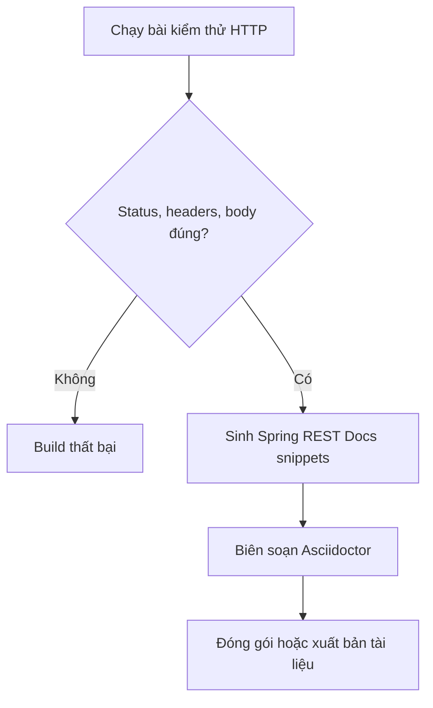

# Xử lý response rỗng hoặc không có body trong Spring REST Docs

## 1. Mục tiêu và vấn đề thực tế

Trong chương **Response payload** của module **SPRING_REST_DOCS**, phần lớn ví dụ tài liệu hóa API bắt đầu từ response JSON có các trường để khai báo bằng `responseFields(...)`. Nhưng một số HTTP endpoint **không trả nội dung body**: xóa tài nguyên thành công, làm mới trạng thái client, trả lời yêu cầu có điều kiện, hoặc chỉ trả metadata. Ngoài ra, body có thể có dữ liệu JSON nhưng mang cấu trúc rỗng như `[]` hoặc `{}`.

Đó là các tình huống **khác nhau về hợp đồng API**. Nếu xử lý không rõ ràng, bài kiểm thử hoặc tài liệu có thể tạo hiểu nhầm rằng server trả `null`, một mảng rỗng hay hoàn toàn không trả byte nào.

Sau bài học, bạn có thể:

- Phân biệt **không có response body**, **body có độ dài 0** và **JSON mang giá trị/cấu trúc rỗng**.
- Chọn và kiểm thử đúng các status như `204 No Content`, `205 Reset Content`, `304 Not Modified`, hoặc request `HEAD`; hiểu cả tình huống `200 OK` không có body.
- Tạo bài kiểm thử MockMvc xác nhận status, header và body thật sự rỗng.
- Dùng Spring REST Docs sinh `http-response.adoc` và snippet header mà không khai báo những trường payload không tồn tại.
- Tài liệu hóa JSON `{"items": []}` khác với response không có body.
- Đưa snippet vào Asciidoctor hoặc quy trình xuất bản Markdown, kiểm tra trong build/CI.

Cách mô tả hợp đồng cũng áp dụng cho WebTestClient và REST Assured. Mỗi công cụ có cú pháp kiểm thử HTTP và tích hợp REST Docs riêng, nhưng cùng cần dựa trên response thực tế.

## 2. Đầu tiên hãy phân biệt các loại “rỗng”

Câu “API trả response rỗng” có thể chỉ ít nhất sáu trường hợp:

| Trường hợp | Body thực tế | Số byte minh họa (UTF-8) | Ý nghĩa |
| --- | --- | ---: | --- |
| Không có body | Không có byte nào | 0 | Không có representation trong response |
| Body dài 0 byte | Chuỗi byte rỗng | 0 | Trên mức byte giống trường hợp trên; HTTP status/headers quyết định cách hiểu |
| JSON mảng rỗng | `[]` | 2 | Representation hợp lệ: tập hợp có 0 phần tử |
| JSON object rỗng | `{}` | 2 | Representation hợp lệ: object chưa có thuộc tính |
| JSON null | `null` | 4 | Representation JSON có giá trị `null` |
| JSON chuỗi rỗng | `""` | 2 | Representation JSON là một chuỗi có độ dài 0 |

Một vài ví dụ cụ thể:

```http
HTTP/1.1 204 No Content
X-Operation-Id: delete-99

```

Trong trường hợp này, dòng trống kết thúc headers; không có JSON sau đó.

```http
HTTP/1.1 200 OK
Content-Type: application/json

[]
```

Response thứ hai có **body gồm hai ký tự**. Dù danh sách không chứa phần tử, body vẫn hiện diện.

```http
HTTP/1.1 200 OK
Content-Type: application/json

null
```

Response thứ ba cũng có body. Chuỗi bốn byte `null` khác với việc body dài 0 byte.

> Không suy diễn “body không có” từ `null` trong DTO Java hoặc từ status `200`. Hãy kiểm tra status, headers và **byte thực sự được gửi**; mapper hoặc framework có thể serialize giá trị null thành `null`, hoặc không ghi body tùy vào cách trả response.

### 2.1. Phân biệt ý nghĩa đối với client

- `204` thường phù hợp khi thao tác hoàn thành và server không cần trả representation mới.
- `200` với `[]` phù hợp khi client yêu cầu một danh sách và danh sách đó hiện không có phần tử.
- `200` với `{}` chỉ phù hợp khi object rỗng là một giá trị hợp lệ theo hợp đồng.
- `200` với `null` phù hợp **chỉ khi API cố ý định nghĩa JSON null là representation hợp lệ**.
- `200` không body có thể đúng về mặt HTTP, nhưng nếu client trông đợi JSON thì rất dễ gây lỗi khi parse. Cần quy định rõ trong tài liệu.

Nếu endpoint danh sách đôi khi trả `[]`, đôi khi lại trả `204` chỉ vì không có kết quả, client phải có hai nhánh xử lý. Hãy chọn một hợp đồng nhất quán và chứng minh bằng kiểm thử.

## 3. Các trường hợp HTTP không được có nội dung body

### 3.1. `204 No Content`

`204` xác nhận server đã xử lý yêu cầu thành công nhưng không gửi response content. Ví dụ quen thuộc là `DELETE /api/items/99` thành công và không cần representation của tài nguyên bị xóa.

```http
HTTP/1.1 204 No Content
X-Operation-Id: delete-99

```

Điểm cần ghi nhớ:

- Response không có body JSON. Đừng thêm `"success": true` vào body của `204`.
- Vẫn có thể có headers có ý nghĩa, như mã thao tác hoặc metadata phù hợp.
- Không cần đặt `Content-Type: application/json` chỉ để thông báo kết quả nếu thực tế không có JSON.
- Không nhầm việc gửi header với việc gửi body; headers vẫn có thể được tài liệu hóa khi body vắng mặt.

### 3.2. `205 Reset Content`

`205` cũng không cho phép server tạo response content. Nó mang ý nghĩa yêu cầu user agent đặt lại trạng thái của giao diện/tài liệu liên quan, nên không nên chọn `205` chỉ vì thao tác trả body rỗng. Dùng `204` hoặc một status khác có ý nghĩa hơn nếu không có yêu cầu reset giao diện.

### 3.3. `304 Not Modified`

`304` thường được dùng khi client gửi yêu cầu có điều kiện, chẳng hạn `If-None-Match`, và server báo representation chưa thay đổi. Response có thể mang các header về cache/validator như `ETag` nhưng **không chứa body mới**. Khi tài liệu hóa endpoint dạng này, nên thể hiện headers và cơ chế cache thay vì mô tả fields của JSON đã không được truyền đi.

### 3.4. `HEAD`

`HEAD` yêu cầu server trả metadata tương ứng với một `GET`, nhưng **không gửi response content**. Tùy trường hợp, một số header liên quan tới representation, kể cả `Content-Length`, vẫn có thể phản ánh nội dung `GET` tương ứng. Vì vậy không thể dùng sự tồn tại của `Content-Length` để kết luận rằng request `HEAD` đã gửi body.

| Tình huống | Body trong response | Tài liệu trọng tâm |
| --- | --- | --- |
| `DELETE` thành công với `204` | Không có | Status, ý nghĩa thành công, headers |
| Thao tác có `205` | Không có | Ngữ nghĩa reset nội dung phía client |
| `GET` có điều kiện trả `304` | Không có | `ETag`, `Last-Modified`, quy tắc cache |
| `HEAD` | Không có | Status, representation headers |
| `GET` trả `200` và JSON `[]` | Có | Payload mảng/danh sách và ý nghĩa tập rỗng |

**Chú ý:** Các status `204`, `205`, `304` và phương thức `HEAD` có quy tắc riêng trong HTTP. Nội dung mẫu cần phản ánh quy tắc giao thức, không dựa trên việc một API framework vẫn có thể cố gắng ghi body.

## 4. MockMvc: tài liệu hóa một `204` không body

Bài kiểm thử cần xác nhận ba điều: **status đúng**, **body thật sự dài 0 byte**, và **header có ý nghĩa được mô tả**.

### 4.1. Controller trả `ResponseEntity<Void>`

```java
import org.springframework.http.ResponseEntity;
import org.springframework.web.bind.annotation.DeleteMapping;
import org.springframework.web.bind.annotation.PathVariable;
import org.springframework.web.bind.annotation.RestController;

@RestController
class ItemController {

    @DeleteMapping("/api/items/{id}")
    ResponseEntity<Void> deleteItem(@PathVariable("id") long id) {
        // Ví dụ minh họa: giả định thao tác xóa đã thành công.
        return ResponseEntity.noContent()
                .header("X-Operation-Id", "delete-" + id)
                .build();
    }
}
```

`ResponseEntity.noContent().build()` tạo response `204` không có nội dung body. Header `X-Operation-Id` là metadata minh họa cho việc tra cứu thao tác; trong hệ thống thật chỉ thêm nó nếu API thực sự có hợp đồng tương ứng.

### 4.2. Kiểm thử và sinh snippet

```java
import org.junit.jupiter.api.BeforeEach;
import org.junit.jupiter.api.Test;
import org.junit.jupiter.api.extension.ExtendWith;
import org.springframework.http.HttpHeaders;
import org.springframework.restdocs.RestDocumentationContextProvider;
import org.springframework.restdocs.junit.jupiter.RestDocumentationExtension;
import org.springframework.test.web.servlet.MockMvc;
import org.springframework.test.web.servlet.setup.MockMvcBuilders;

import static org.springframework.restdocs.headers.HeaderDocumentation.headerWithName;
import static org.springframework.restdocs.headers.HeaderDocumentation.responseHeaders;
import static org.springframework.restdocs.mockmvc.MockMvcRestDocumentation.document;
import static org.springframework.restdocs.mockmvc.MockMvcRestDocumentation.documentationConfiguration;
import static org.springframework.test.web.servlet.request.MockMvcRequestBuilders.delete;
import static org.springframework.test.web.servlet.result.MockMvcResultMatchers.content;
import static org.springframework.test.web.servlet.result.MockMvcResultMatchers.header;
import static org.springframework.test.web.servlet.result.MockMvcResultMatchers.status;

@ExtendWith(RestDocumentationExtension.class)
class ItemDeleteDocumentationTest {

    private MockMvc mockMvc;

    @BeforeEach
    void setUp(RestDocumentationContextProvider documentation) {
        mockMvc = MockMvcBuilders.standaloneSetup(new ItemController())
                .apply(documentationConfiguration(documentation))
                .build();
    }

    @Test
    void deleteItemReturnsNoContent() throws Exception {
        mockMvc.perform(delete("/api/items/{id}", 99))
                .andExpect(status().isNoContent())
                .andExpect(content().bytes(new byte[0]))
                .andExpect(header().doesNotExist(HttpHeaders.CONTENT_TYPE))
                .andExpect(header().string(
                        "X-Operation-Id", "delete-99"))
                .andDo(document("items-delete-no-content",
                        responseHeaders(
                                headerWithName("X-Operation-Id")
                                        .description(
                                                "Mã thao tác để tra cứu kết quả xóa")
                        )
                ));
    }
}
```

Giải thích:

1. `status().isNoContent()` xác nhận status là `204`.
2. `content().bytes(new byte[0])` xác nhận **không có byte body nào**. Đây là assertion trực tiếp, khác với kiểm tra JSON object/mảng rỗng.
3. `header().doesNotExist(HttpHeaders.CONTENT_TYPE)` kiểm tra ví dụ không gắn Content-Type không cần thiết với body không tồn tại.
4. `header().string(...)` khẳng định header mà hợp đồng công bố thực sự có giá trị mong đợi.
5. `document(..., responseHeaders(...))` sinh tài liệu response bao gồm các header có ý nghĩa. **Không truyền `responseFields(...)`**, vì không có JSON field nào để khai báo.

Khi không có header nghiệp vụ nào cần mô tả, có thể dùng dạng ngắn:

```java
.andExpect(status().isNoContent())
.andExpect(content().bytes(new byte[0]))
.andDo(document("items-delete-no-content"));
```

Đây là một phần chuỗi kiểm thử MockMvc, không phải chương trình Java độc lập. Khi đã tích hợp REST Docs, `document("...")` vẫn sinh các snippet HTTP mặc định phù hợp cấu hình, chẳng hạn `http-response.adoc`, để người đọc nhìn thấy status và headers.

> `responseFields(...)` dành cho payload có trường cần tài liệu hóa. Nếu áp descriptor bắt buộc như `fieldWithPath("id")` lên `204`, field đó không thể được tìm thấy. Việc đánh dấu hết các trường thành `optional()` để bỏ qua lỗi không mang lại tài liệu có ích cho một response không body.

## 5. Bài kiểm thử đầy đủ: phân biệt `204`, `200` body rỗng và `200` JSON rỗng

Ví dụ dưới đây tự chứa một controller với ba endpoint:

- `DELETE /api/items/{id}` trả `204`, không body.
- `GET /api/heartbeat` trả `200` nhưng body dài 0 byte.
- `GET /api/items` trả `200` và JSON có mảng `items` rỗng.

Ví dụ dùng JUnit Jupiter, MockMvc, Spring REST Docs MockMvc và Jackson. Java 9+ hỗ trợ `Map.of`/`List.of`; trong ứng dụng Spring Boot thông thường, các dependency kiểm thử tương ứng đã được cấu hình ở module test.

```java
import java.util.List;
import java.util.Map;

import org.junit.jupiter.api.BeforeEach;
import org.junit.jupiter.api.Test;
import org.junit.jupiter.api.extension.ExtendWith;
import org.springframework.http.HttpHeaders;
import org.springframework.http.MediaType;
import org.springframework.http.ResponseEntity;
import org.springframework.restdocs.RestDocumentationContextProvider;
import org.springframework.restdocs.junit.jupiter.RestDocumentationExtension;
import org.springframework.test.web.servlet.MockMvc;
import org.springframework.test.web.servlet.setup.MockMvcBuilders;
import org.springframework.web.bind.annotation.DeleteMapping;
import org.springframework.web.bind.annotation.GetMapping;
import org.springframework.web.bind.annotation.PathVariable;
import org.springframework.web.bind.annotation.RestController;

import static org.hamcrest.Matchers.hasSize;
import static org.springframework.restdocs.headers.HeaderDocumentation.headerWithName;
import static org.springframework.restdocs.headers.HeaderDocumentation.responseHeaders;
import static org.springframework.restdocs.mockmvc.MockMvcRestDocumentation.document;
import static org.springframework.restdocs.mockmvc.MockMvcRestDocumentation.documentationConfiguration;
import static org.springframework.restdocs.payload.PayloadDocumentation.fieldWithPath;
import static org.springframework.restdocs.payload.PayloadDocumentation.responseFields;
import static org.springframework.test.web.servlet.request.MockMvcRequestBuilders.delete;
import static org.springframework.test.web.servlet.request.MockMvcRequestBuilders.get;
import static org.springframework.test.web.servlet.result.MockMvcResultMatchers.content;
import static org.springframework.test.web.servlet.result.MockMvcResultMatchers.header;
import static org.springframework.test.web.servlet.result.MockMvcResultMatchers.jsonPath;
import static org.springframework.test.web.servlet.result.MockMvcResultMatchers.status;

@ExtendWith(RestDocumentationExtension.class)
class EmptyResponseDocumentationTest {

    private MockMvc mockMvc;

    @BeforeEach
    void setUp(RestDocumentationContextProvider documentation) {
        mockMvc = MockMvcBuilders.standaloneSetup(new DemoController())
                .apply(documentationConfiguration(documentation))
                .build();
    }

    @Test
    void deleteReturns204WithoutBody() throws Exception {
        mockMvc.perform(delete("/api/items/{id}", 99))
                .andExpect(status().isNoContent())
                .andExpect(content().bytes(new byte[0]))
                .andExpect(header().string("X-Operation-Id", "delete-99"))
                .andExpect(header().doesNotExist(HttpHeaders.CONTENT_TYPE))
                .andDo(document("items-delete-no-content",
                        responseHeaders(
                                headerWithName("X-Operation-Id")
                                        .description("Mã thao tác xóa")
                        )));
    }

    @Test
    void heartbeatReturns200WithZeroBytes() throws Exception {
        mockMvc.perform(get("/api/heartbeat"))
                .andExpect(status().isOk())
                .andExpect(content().bytes(new byte[0]))
                .andDo(document("heartbeat-empty-body"));
    }

    @Test
    void listReturns200WithEmptyJsonArray() throws Exception {
        mockMvc.perform(get("/api/items")
                        .accept(MediaType.APPLICATION_JSON))
                .andExpect(status().isOk())
                .andExpect(content().contentTypeCompatibleWith(
                        MediaType.APPLICATION_JSON))
                .andExpect(jsonPath("$.items").isArray())
                .andExpect(jsonPath("$.items", hasSize(0)))
                .andExpect(jsonPath("$.totalCount").value(0))
                .andDo(document("items-empty-collection",
                        responseFields(
                                fieldWithPath("items")
                                        .description(
                                                "Danh sách sản phẩm; mảng rỗng "
                                                + "khi không có kết quả"),
                                fieldWithPath("totalCount")
                                        .description(
                                                "Tổng số sản phẩm phù hợp, "
                                                + "bằng 0 khi không có kết quả")
                        )));
    }

    @RestController
    static class DemoController {

        @DeleteMapping("/api/items/{id}")
        ResponseEntity<Void> deleteItem(@PathVariable("id") long id) {
            return ResponseEntity.noContent()
                    .header("X-Operation-Id", "delete-" + id)
                    .build();
        }

        @GetMapping("/api/heartbeat")
        ResponseEntity<Void> heartbeat() {
            return ResponseEntity.ok().build();
        }

        @GetMapping(value = "/api/items",
                    produces = MediaType.APPLICATION_JSON_VALUE)
        Map<String, Object> listItems() {
            return Map.of(
                    "items", List.of(),
                    "totalCount", 0
            );
        }
    }
}
```

Ba test có mục tiêu khác nhau:

| Test | Kiểm tra chính | Cách sinh REST Docs |
| --- | --- | --- |
| `deleteReturns204WithoutBody` | `204`, 0 byte, header nghiệp vụ | `document(..., responseHeaders(...))` |
| `heartbeatReturns200WithZeroBytes` | `200` và đúng 0 byte | `document("...")`, không khai báo payload field |
| `listReturns200WithEmptyJsonArray` | `200`, JSON hợp lệ, `items` là mảng rỗng | `document(..., responseFields(...))` cho `items`, `totalCount` |

`200` rỗng ở `heartbeat` minh họa sự khác biệt về HTTP, không có nghĩa đó là lựa chọn tối ưu cho mọi API sức khỏe. Nếu endpoint cần trả trạng thái dịch vụ dưới dạng dữ liệu, hãy trả JSON có ý nghĩa và kiểm thử theo hợp đồng đó. Nếu việc thành công không cần representation, có thể cân nhắc `204` khi phù hợp ngữ nghĩa endpoint.

### 5.1. Vì sao test danh sách rỗng vẫn dùng `responseFields`?

Trong response:

```json
{
  "items": [],
  "totalCount": 0
}
```

Hai field `items` và `totalCount` **có mặt**, dù phần tử của mảng `items` bằng 0. Vì vậy có thể mô tả:

```java
responseFields(
    fieldWithPath("items")
        .description("Danh sách kết quả; có thể rỗng"),
    fieldWithPath("totalCount")
        .description("Số lượng kết quả phù hợp")
)
```

Không có `items[].id` hoặc `items[].name` trong fixture rỗng. Nếu khai báo các descriptor con bắt buộc này trong bài kiểm thử sinh tài liệu, path có thể không được tìm thấy. Hãy tạo một fixture **có phần tử đại diện** để sinh tài liệu cấu trúc phần tử, và kiểm thử danh sách rỗng như một ca riêng.

### 5.2. Còn response gốc là `[]` thì sao?

Với response:

```json
[]
```

Body không rỗng theo byte, nhưng **root là một array không có phần tử**. Có thể kiểm thử cụ thể:

```java
.andExpect(status().isOk())
.andExpect(content().contentTypeCompatibleWith(
        MediaType.APPLICATION_JSON))
.andExpect(content().json("[]"))
```

Nếu muốn tài liệu hóa chi tiết các trường như `[].id` và `[].name`, fixture `[]` không có phần tử để quan sát các path đó. Nên dùng response mẫu `[{"id":1,"name":"..."}]` trong bài test sinh tài liệu cho phần tử, đồng thời có test riêng xác minh ca rỗng. Với chính ca root array rỗng, `http-response.adoc` đủ để cho thấy payload; kèm phần giải thích ý nghĩa mảng rỗng trong tài liệu tổng hợp.

## 6. Không có body thì Spring REST Docs sinh được những gì?

Trong một kiểm thử dùng `document("identifier")`, Spring REST Docs có thể tạo những snippet mặc định như:

```text
build/generated-snippets/
└── items-delete-no-content/
    ├── http-request.adoc
    ├── http-response.adoc
    └── response-headers.adoc
```

Danh sách trên minh họa các tệp **liên quan trực tiếp** của test có khai báo `responseHeaders(...)`; tùy cấu hình, còn có các snippet mặc định khác. Một số snippet dành cho body có thể được tạo với nội dung trống hoặc không mang thông tin hữu ích; không nên nhúng chúng như thể có payload JSON. Với Maven, vị trí thường là `target/generated-snippets` thay vì `build/generated-snippets`; đường dẫn có thể tùy chỉnh.

Cần hiểu sự khác nhau giữa các snippet:

| Snippet | Dùng khi | Nội dung có ý nghĩa với response không body |
| --- | --- | --- |
| `http-response.adoc` | Muốn hiển thị HTTP response | Status line và headers; không giả lập JSON |
| `response-headers.adoc` | Có headers đã khai báo bằng `responseHeaders(...)` | Bảng tên header và mô tả |
| `response-fields.adoc` | Có payload với các field để mô tả | Không áp cho response thật sự không có body |
| `response-body.adoc` | Muốn hiển thị riêng phần nội dung response | Với response 0 byte sẽ không có JSON để trình bày |

Một endpoint vẫn có hợp đồng rõ ràng khi không có `response-fields.adoc`: hợp đồng của nó nằm ở **status, headers, điều kiện dẫn đến kết quả và việc vắng body**. Bài kiểm thử phải chứng minh các thuộc tính đó.

### 6.1. Tài liệu hóa status và trường hợp không body

Với response `204`, có thể viết trong trang API:

```adoc
== Xóa sản phẩm

`DELETE /api/items/{id}` trả `204 No Content` khi xóa thành công.
Response không chứa body.

=== Ví dụ HTTP response
include::{snippets}/items-delete-no-content/http-response.adoc[]

=== Headers trong response
include::{snippets}/items-delete-no-content/response-headers.adoc[]
```

Trong Asciidoctor thật, nên dùng cú pháp backtick cho tên phương thức/endpoint khi trình bày, ví dụ `+DELETE /api/items/{id}+` nếu muốn tránh nội suy. Các đoạn `include` cần nằm trong file `.adoc`, với biến `snippets` đã được khai báo phù hợp. Ví dụ đầy đủ:

```adoc
= Item API
:snippets: build/generated-snippets

== Xóa sản phẩm

Khi thao tác thành công, API trả 204 No Content.
Response không có body; header X-Operation-Id dùng để tra cứu thao tác.

=== HTTP response
include::{snippets}/items-delete-no-content/http-response.adoc[]

=== Response headers
include::{snippets}/items-delete-no-content/response-headers.adoc[]
```

Không nên tạo một bảng “Response JSON fields” rỗng rồi để người đọc tự đoán. Hãy viết rõ rằng endpoint **không trả body** và dùng HTTP snippet làm bằng chứng từ kiểm thử.

## 7. Phân biệt server không gửi body với client không đọc body

Một số lỗi không nằm ở server mà nằm ở cách kiểm thử hoặc client xử lý kết quả:

- Client parse JSON theo mặc định sau mọi response, kể cả `204`, dẫn tới lỗi parse chuỗi byte rỗng.
- Test chỉ kiểm tra `status().isNoContent()` mà không xác nhận body rỗng, bỏ sót hành vi framework/handler không mong muốn.
- Test chỉ kiểm tra body rỗng nhưng không kiểm tra status, nên không phân biệt `204` với `200` body rỗng.
- Server trả `200` cùng `Content-Type: application/json` nhưng body 0 byte; client xem đó là JSON không hợp lệ dù HTTP request đã thành công.
- Endpoint danh sách trả `204` khi không có phần tử, trong khi các lần khác trả `200` với mảng; client phải xử lý thêm một nhánh trạng thái.

Client thường cần nhánh xử lý kiểu:

```text
Nếu HTTP status = 204:
    xử lý thành công, không thử parse JSON
Ngược lại nếu status = 200 và Content-Type là application/json:
    parse JSON theo schema đã công bố
Ngược lại:
    xử lý theo hợp đồng HTTP của endpoint
```

Đây là sơ đồ xử lý minh họa. Client thực tế phải có thêm nhánh cho status lỗi, status có điều kiện, dữ liệu không hợp lệ và quy tắc nghiệp vụ riêng.

### 7.1. `Content-Type`, `Accept` và `Content-Length`

- `Accept: application/json` là **request header** thể hiện loại nội dung client mong muốn, không bắt buộc server luôn phải gửi body JSON trong mọi status.
- `Content-Type` cho biết loại nội dung được biểu diễn khi có representation. Với response không body, không nên dựa vào header này để quyết định có payload.
- `Content-Length` không phải là bằng chứng chung về body đã thực sự được truyền. Đặc biệt với `HEAD`, header này có thể phản ánh kích thước representation sẽ được trả ở `GET` tương ứng dù bản thân response `HEAD` không có content.

Vì vậy khi viết test cho body rỗng, `content().bytes(new byte[0])` trực tiếp hơn việc chỉ kiểm tra Content-Type hay Content-Length.

## 8. Ứng dụng với WebTestClient và REST Assured

Ba công cụ được module **SPRING_REST_DOCS** hỗ trợ là MockMvc, WebTestClient và REST Assured. Tư duy kiểm thử response không body giống nhau, nhưng cú pháp và cơ chế gắn REST Docs khác nhau:

| Công cụ | Cần kiểm tra | Cách tích hợp tài liệu |
| --- | --- | --- |
| MockMvc | `status().isNoContent()` và `content().bytes(new byte[0])` | `MockMvcRestDocumentation.document(...)` trong `andDo(...)` |
| WebTestClient | HTTP status và response body rỗng trong `expectBody()` | `WebTestClientRestDocumentation.document(...)` qua luồng tiêu thụ kết quả kiểm thử |
| REST Assured | Status code và body độ dài 0 bằng assertion phù hợp | REST Docs filter của REST Assured gắn với request/test |

Trong cả ba trường hợp, **không khai báo JSON response field cho response không có payload**. Nếu response có JSON `[]` hay `{"items": []}`, bạn vẫn có thể kiểm tra và tài liệu hóa body tương ứng, miễn fixture phù hợp với các descriptor.

Một cấu trúc kiểm thử hợp lý cho cùng một endpoint:

1. **Test hợp đồng không body:** gửi request gây ra `204`, kiểm tra status/headers/0 byte, sinh HTTP snippet.
2. **Test có payload:** gửi request gây ra `200` cùng JSON, kiểm tra schema/field và sinh `response-fields.adoc`.
3. **Test edge case:** xác minh response collection rỗng, cache validator, nhánh lỗi hoặc các điều kiện nghiệp vụ đặc biệt.

Các test có thể chia sẻ phần thiết lập REST Docs nhưng cần đặt identifier snippet rõ ràng theo từng kết quả, chẳng hạn `items-delete-no-content` và `items-empty-collection`.

## 9. Thiết kế contract rõ ràng cho endpoint có nhiều kết quả

Một endpoint có thể trả nhiều status, ví dụ:

| Điều kiện nghiệp vụ | Status minh họa | Body | Tài liệu cần có |
| --- | --- | --- | --- |
| Xóa thành công và không trả representation | `204` | Không có | Status, headers, hành vi idempotency nếu áp dụng |
| GET danh sách không có phần tử | `200` | `{"items":[],"totalCount":0}` | Mô tả mảng và tổng số kết quả |
| GET một tài nguyên tồn tại | `200` | Object JSON có các trường | `responseFields(...)` đầy đủ |
| Yêu cầu GET có điều kiện và cache còn hợp lệ | `304` | Không có | Quy tắc `ETag`/`If-None-Match`, headers |
| Xử lý không thành công theo hợp đồng ứng dụng | `4xx` hoặc `5xx` | Có thể có error body | Tài liệu hóa status và error representation nếu có |

Các status này phụ thuộc vào thiết kế API cụ thể. Không thể lấy bảng làm quy tắc áp dụng cho mọi hệ thống, chẳng hạn xử lý không đồng bộ có thể dùng `202 Accepted` với body trạng thái hoặc URL theo dõi.

Một cách tránh mâu thuẫn là tài liệu hóa mỗi nhánh bằng một bài kiểm thử riêng, sử dụng identifier rõ ràng:

```text
items-list-success
items-list-empty
items-delete-no-content
items-conditional-not-modified
```

Tên identifier nên phản ánh điều kiện được kiểm thử để người đọc không nhầm response body của nhánh `200` với nhánh `204`.

## 10. Đưa tài liệu vào build và CI

Giả sử test `deleteReturns204WithoutBody` đã sinh `items-delete-no-content/http-response.adoc` và `response-headers.adoc`. Một pipeline tài liệu thông thường có trình tự:



Đối với Spring REST Docs, chỉ nên chạy bước tạo Asciidoctor **sau** bước test sinh snippet. Nếu server bắt đầu trả JSON khi hợp đồng yêu cầu `204` không body, assertion `content().bytes(new byte[0])` phải phát hiện sai lệch trước khi tài liệu được xuất bản.

Khi xuất tài liệu Markdown, cần quy trình chuyển đổi phù hợp hoặc template tùy chỉnh. Đừng đổi đuôi `response-fields.adoc` thành `.md` vì cú pháp snippet mặc định là Asciidoctor.

## 11. Các lỗi thường gặp

| Hiện tượng | Nguyên nhân | Cách xử lý |
| --- | --- | --- |
| Dùng `responseFields(fieldWithPath("id"))` với `204` và test thất bại | Response không có field `id` nào | Bỏ descriptor body; mô tả status và headers |
| Tài liệu ghi “không có body” nhưng client nhận `null` | Server gửi JSON literal `null` (4 byte) | Phân biệt byte rỗng với chuỗi JSON; sửa implementation hoặc tài liệu |
| `200` body 0 byte gây lỗi JSON parser | Client mặc định parse JSON mọi `200` | Định nghĩa contract rõ ràng; cân nhắc `204` hoặc JSON representation hợp lệ |
| `204` được mô tả là `{"success":true}` | Nhầm status thành công với JSON body | Chỉ mô tả metadata/header; không tạo payload giả |
| Danh sách rỗng làm các descriptor `items[].id` không tìm thấy | Fixture không có phần tử | Dùng fixture có item để tài liệu hóa cấu trúc; test danh sách rỗng riêng |
| Dùng `content().string("")` làm điều kiện duy nhất | Không phân biệt `204` với `200` body rỗng | Kiểm tra cả status và byte body |
| Nhầm `[]` với body rỗng | `[]` là hai byte JSON hợp lệ | Kiểm tra JSON array, không gọi là “no body” |
| Không có bảng `response-fields.adoc` với `204` | Không khai báo field vì thực tế không có payload | Dùng `http-response.adoc` và tài liệu status/headers |
| Với `HEAD`, suy có body từ `Content-Length` | Header có thể mô tả representation của `GET` | Kiểm tra semantics của HEAD và byte body |
| Trang Asciidoctor thiếu snippet | Sai đường dẫn hoặc task tài liệu chạy trước test | Thiết lập đúng thư mục generated snippets và phụ thuộc task |

## 12. Bài thực hành

Hãy dùng controller và bài kiểm thử ở mục 5 để thực hiện các ca sau:

1. **Thêm body vào response `204`:** thử thay implementation để trả nội dung JSON trong một nhánh. Quan sát framework có thể xử lý response thế nào và kiểm tra rằng assertion 0 byte cùng hợp đồng HTTP vẫn được tôn trọng.
2. **Chuyển heartbeat sang `204`:** đổi `ResponseEntity.ok().build()` thành `ResponseEntity.noContent().build()`, cập nhật assertion, snippet và tài liệu.
3. **Thử JSON literal `null`:** tạo một endpoint trả `200` với body đúng chuỗi `null` và Content-Type JSON. So sánh số byte với endpoint `200` không body và kiểm tra client parse.
4. **Thử `{"items": []}`:** giữ `responseFields("items", "totalCount")` để mô tả object chứa mảng rỗng.
5. **Thêm item vào danh sách:** trả `{"items":[{"id":1,"name":"Bút"}],"totalCount":1}`, mở rộng descriptor thành `items[].id` và `items[].name`.
6. **Thử root array rỗng:** trả `[]`, kiểm tra `Content-Type` và nội dung JSON thực; so sánh với response hoàn toàn không body.
7. **Tài liệu hóa header:** thêm `X-Operation-Id` vào nhánh xóa, dùng `responseHeaders(...)` mô tả vai trò tra cứu mà không tạo field JSON.
8. **Thử nhánh có điều kiện:** thiết kế `GET` với `ETag`/`If-None-Match` để có thể nhận `304`. Kiểm tra status, headers và việc vắng body ở nhánh cache.
9. **Build tài liệu:** nhúng `http-response.adoc` và `response-headers.adoc` vào Asciidoctor, rồi xác minh test chạy trước task xuất bản.

**Tiêu chí hoàn thành:** bạn phân biệt được response không body với JSON rỗng/null, chọn đúng assertion cho status và byte body, không khai báo response fields giả cho `204`, vẫn tạo tài liệu có ích về headers và status, và khiến build/CI phát hiện những thay đổi trái hợp đồng.

## Tài liệu tham khảo

- [Spring REST Docs — Documenting your API](https://docs.spring.io/spring-restdocs/reference/documenting-your-api/index.html): cách tạo và chèn snippet từ HTTP test.
- [Spring REST Docs — Request and Response Payloads](https://docs.spring.io/spring-restdocs/reference/documenting-your-api/request-response-payloads.html): mô tả `responseFields` và cú pháp `fieldWithPath`.
- [Spring Framework — MockMvc](https://docs.spring.io/spring-framework/reference/testing/spring-mvc-test-framework.html): kiểm thử status, header và body của HTTP response.
- [RFC 9110 — HTTP Semantics](https://www.rfc-editor.org/rfc/rfc9110.html): ngữ nghĩa `204`, `205`, `304` và phương thức `HEAD`.
