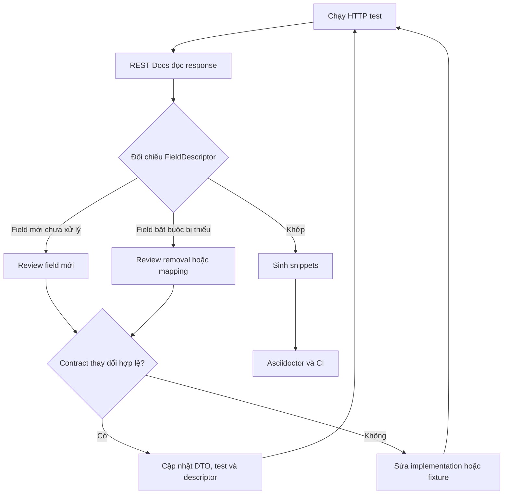
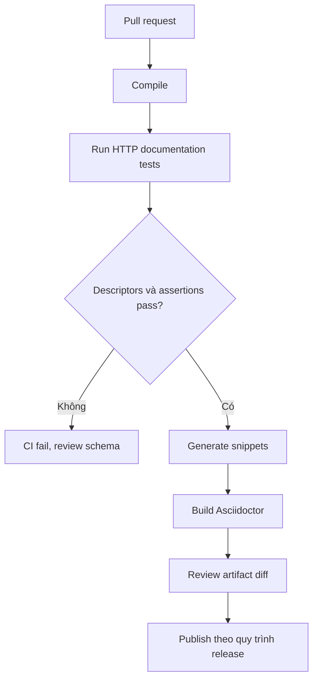

# Kiểm tra thay đổi schema làm test tài liệu thất bại

## 1. Schema drift trong response API

Trong module **SPRING_REST_DOCS**, tài liệu REST API được tạo từ các bài kiểm thử HTTP với MockMvc, WebTestClient hoặc REST Assured. Khi response payload thay đổi, endpoint vẫn có thể trả HTTP 200 nhưng test Spring REST Docs thất bại vì danh sách `FieldDescriptor` không còn khớp JSON được ghi nhận.

Hiện tượng này gọi là **schema drift**: hình dạng hoặc quy tắc dữ liệu response khác hợp đồng đã được tài liệu hóa và kiểm thử trước đó.

Response ban đầu:

```json
{
  "orderId": "ORD-501",
  "status": "CONFIRMED",
  "totalAmount": 250000
}
```

Response sau refactor:

```json
{
  "id": "ORD-501",
  "status": "CONFIRMED",
  "totalAmount": 250000,
  "currency": "VND"
}
```

`orderId` được đổi tên thành `id` và field `currency` mới xuất hiện. Descriptor cũ có thể báo path `orderId` không tìm thấy và `currency` chưa được tài liệu hóa. Strict `responseFields(...)` đưa những thay đổi này ra review; đây là tín hiệu cần đánh giá contract, không phải lý do để tự động nới test cho chạy qua.

Bài học giúp bạn nhận diện schema drift, đọc lỗi REST Docs, phân biệt thay đổi contract với lỗi implementation/fixture, cập nhật DTO, descriptor, assertion và snippet theo cùng quyết định, rồi bảo vệ quy trình bằng CI.

## 2. Các loại thay đổi schema thường gặp

| Loại thay đổi | Trước | Sau | Tác động thường gặp |
| --- | --- | --- | --- |
| Thêm field | Không có `currency` | Có `currency` | Strict test báo field chưa xử lý |
| Xóa field | Có `customer.email` | Không còn | Descriptor bắt buộc không tìm thấy path |
| Đổi tên | `orderId` | `id` | Path cũ mất, path mới chưa mô tả |
| Đổi kiểu | `quantity: 2` | `quantity: "2"` | Kiểu JSON đổi |
| Đổi cấu trúc | `customerName` | `customer.displayName` | Path/nesting thay đổi |
| Đổi nullability | `note: null` | Không có key `note` | Null khác missing |
| Đổi array thành object | `items: []` | `items: {}` | Cấu trúc JSON thay đổi |
| Đổi phần tử array | Có `items[].sku` | Bỏ `sku` | Descriptor path lặp không khớp |
| Đổi enum | `PAID` | `SETTLED` | Path còn, giá trị contract đổi |
| Đổi ngữ nghĩa | Tiền VND | Đơn vị nhỏ nhất | JSON type có thể giữ nhưng contract đổi |

Strict field validation chủ yếu kiểm soát path và việc field được xử lý. Nó không tự chứng minh kiểu, enum, đơn vị, công thức tiền hoặc mọi quy tắc nghiệp vụ. Những nội dung đó cần assertion hay schema validation bổ sung.

## 3. Strict responseFields phát hiện gì?

Descriptor ví dụ:

```java
responseFields(
    fieldWithPath("orderId").description("Mã đơn hàng"),
    fieldWithPath("status").description("Trạng thái đơn hàng"),
    fieldWithPath("totalAmount").description("Tổng tiền theo VND")
)
```

Có hai loại mismatch:

- **Payload có field chưa khai báo.** Ví dụ server thêm `currency`. Việc sinh snippet yêu cầu xử lý field mới bằng mô tả, ignore có lý do hoặc sửa implementation để không trả field.
- **Descriptor yêu cầu field không còn tồn tại.** Ví dụ `orderId` bị xóa hoặc đổi tên. REST Docs không tìm thấy path nếu descriptor chưa được điều chỉnh.

`optional()` chỉ phù hợp khi contract thật cho phép field vắng. `ignored()` ghi nhận field có mặt nhưng không cần đưa vào bảng. `relaxedResponseFields` cho phép field ngoài danh sách nên giảm khả năng phát hiện field mới. Không dùng các cơ chế này để che thay đổi chưa được review.



Test chỉ phản ánh response của fixture đã chạy. Nếu chỉ kiểm tra một nhánh response, field chỉ xuất hiện ở nhánh khác chưa được kiểm chứng.

## 4. Phân tích từng dạng drift

### 4.1. Thêm field mới

Response mới:

```json
{
  "orderId": "ORD-501",
  "status": "CONFIRMED",
  "totalAmount": 250000,
  "currency": "VND"
}
```

Trước khi sửa descriptor, xác định `currency` có thuộc public contract, có luôn xuất hiện, áp dụng cho số tiền nào và có phải metadata ngoài ý muốn do serializer/gateway tạo ra hay không.

Nếu là field public, thêm mô tả:

```java
fieldWithPath("currency")
    .description("Mã tiền tệ của các trường số tiền, ví dụ VND")
```

Nếu là metadata hợp lệ nhưng không cần công bố, cân nhắc `ignored()`. Nếu không nên xuất hiện trong response, sửa DTO/serializer và thêm assertion cấm field đó. Không ignore hoặc chuyển relaxed trước khi hiểu nguồn gốc.

### 4.2. Xóa field bắt buộc

Descriptor:

```java
fieldWithPath("customer.email")
    .description("Email liên hệ khách hàng")
```

Payload mới:

```json
{
  "customer": {
    "id": "CUS-17",
    "displayName": "Khách hàng 17"
  }
}
```

Path `customer.email` không tồn tại. Nếu email vẫn bắt buộc, implementation/mapping hoặc fixture đang sai. Nếu contract mới cho phép thiếu, khai báo optional và type rõ khi fixture không còn dữ liệu để suy luận:

```java
fieldWithPath("customer.email")
    .type(JsonFieldType.STRING)
    .optional()
    .description("Email khách hàng, có thể không được cung cấp")
```

Không đánh dấu tất cả field thành optional để làm test qua; như vậy sẽ che việc field bắt buộc bị mất.

### 4.3. Đổi tên field

`{"orderId":"ORD-501"}` đổi thành `{"id":"ORD-501"}` là thay đổi path, không phải thay đổi thứ tự key.

```java
fieldWithPath("id")
    .description("Mã tham chiếu đơn hàng")
```

Cần đánh giá tương thích ngược. Client cũ có thể vẫn đọc `orderId`; đổi tên trực tiếp có thể là breaking change. Tùy chính sách API, có thể cần version mới hoặc giai đoạn chuyển tiếp trả cả hai field.

### 4.4. Đổi kiểu dữ liệu

Trước `{"quantity": 2}`, sau `{"quantity": "2"}`. Path `quantity` vẫn tồn tại nhưng JSON type thay đổi. Thêm assertion:

```java
.andExpect(jsonPath("$.quantity").isNumber())
.andExpect(jsonPath("$.quantity").value(2))
```

Nếu contract mới thật sự yêu cầu chuỗi, cập nhật assertion và descriptor sau khi review tác động client. Chỉ đổi type trong descriptor không chứng minh thay đổi hợp lệ.

### 4.5. Null thành missing hoặc chuỗi rỗng

Ba payload khác nhau:

```json
{"note": null}
```

```json
{}
```

```json
{"note": ""}
```

Dùng assertion tương ứng:

```java
// Key có mặt và giá trị null.
.andExpect(jsonPath("$.note").hasJsonPath())
.andExpect(jsonPath("$.note").value(nullValue()))

// Key hoàn toàn vắng.
.andExpect(jsonPath("$.note").doesNotHaveJsonPath())
```

`optional()` cho phép path vắng trong fixture. Nó không tự định nghĩa nullability. Hãy mô tả và kiểm tra đúng hợp đồng null/missing.

### 4.6. Đổi cấu trúc object hoặc array

`{"customerName":"Khách hàng 17"}` đổi thành `{"customer":{"displayName":"Khách hàng 17"}}`. Path cũ `customerName` được thay bằng `customer.displayName`:

```java
fieldWithPath("customer")
    .description("Thông tin khách hàng"),
fieldWithPath("customer.displayName")
    .description("Tên hiển thị của khách hàng")
```

Nếu `items` từ array object thành array string, path `items[].sku` không còn đúng. Xác minh đây là thay đổi contract được chấp thuận hay lỗi mapping làm mất dữ liệu.

## 5. Quy trình phân tích lỗi

1. **Đọc response thực tế.** Xem body do MockMvc/WebTestClient/REST Assured ghi nhận. Không suy đoán chỉ từ DTO vì Jackson annotation, naming strategy và custom serializer có thể đổi JSON.
2. **Phân loại drift.** Field mới, mất, đổi tên, đổi kiểu, null/missing hay đổi cấu trúc?
3. **Đối chiếu contract.** Thay đổi có chủ đích không? Client nào đang dùng field đó?
4. **Quyết định implementation hay documentation.** Field public mới thì mô tả; field kỹ thuật thì ignore nếu phù hợp; field mất ngoài ý muốn thì sửa mapping; field không được phép public thì loại khỏi response; breaking change cần kế hoạch versioning.
5. **Cập nhật assertion.** Kiểm tra path, kiểu, giá trị, enum, nullability và quy tắc nghiệp vụ liên quan.
6. **Sinh lại snippet.** Chỉ sau khi payload và descriptor cùng phản ánh contract đã review.
7. **Review diff.** Xem response, descriptor và snippet; cân nhắc tương thích client trước khi publish.

## 6. Ví dụ MockMvc sau khi schema mới được chấp thuận

Ví dụ dùng JUnit Jupiter, MockMvc, Jackson và `spring-restdocs-mockmvc`. Controller trả schema mới có `currency`; field này đã được review là public.

```java
import java.util.LinkedHashMap;
import java.util.Map;

import org.junit.jupiter.api.BeforeEach;
import org.junit.jupiter.api.Test;
import org.junit.jupiter.api.extension.ExtendWith;
import org.springframework.http.MediaType;
import org.springframework.restdocs.RestDocumentationContextProvider;
import org.springframework.restdocs.junit.jupiter.RestDocumentationExtension;
import org.springframework.test.web.servlet.MockMvc;
import org.springframework.test.web.servlet.setup.MockMvcBuilders;
import org.springframework.web.bind.annotation.GetMapping;
import org.springframework.web.bind.annotation.PathVariable;
import org.springframework.web.bind.annotation.RestController;

import static org.springframework.restdocs.mockmvc.MockMvcRestDocumentation.document;
import static org.springframework.restdocs.mockmvc.MockMvcRestDocumentation.documentationConfiguration;
import static org.springframework.restdocs.payload.PayloadDocumentation.fieldWithPath;
import static org.springframework.restdocs.payload.PayloadDocumentation.responseFields;
import static org.springframework.test.web.servlet.request.MockMvcRequestBuilders.get;
import static org.springframework.test.web.servlet.result.MockMvcResultMatchers.jsonPath;
import static org.springframework.test.web.servlet.result.MockMvcResultMatchers.status;

@ExtendWith(RestDocumentationExtension.class)
class OrderSchemaChangeDocumentationTest {

    private MockMvc mockMvc;

    @BeforeEach
    void setUp(RestDocumentationContextProvider documentation) {
        mockMvc = MockMvcBuilders.standaloneSetup(new OrderController())
                .apply(documentationConfiguration(documentation))
                .build();
    }

    @Test
    void documentsReviewedSchemaWithCurrency() throws Exception {
        mockMvc.perform(get("/api/orders/{id}", 501)
                        .accept(MediaType.APPLICATION_JSON))
                .andExpect(status().isOk())
                .andExpect(jsonPath("$.orderId").value("ORD-501"))
                .andExpect(jsonPath("$.currency").value("VND"))
                .andExpect(jsonPath("$.totalAmount").isNumber())
                .andDo(document("orders-schema-v2",
                        responseFields(
                                fieldWithPath("orderId")
                                        .description("Mã tham chiếu đơn hàng"),
                                fieldWithPath("status")
                                        .description("Trạng thái đơn hàng"),
                                fieldWithPath("totalAmount")
                                        .description("Tổng tiền theo mã tiền tệ"),
                                fieldWithPath("currency")
                                        .description("Mã tiền tệ của số tiền")
                        )
                ));
    }

    @RestController
    static class OrderController {
        @GetMapping(value = "/api/orders/{id}",
                    produces = MediaType.APPLICATION_JSON_VALUE)
        Map<String, Object> getOrder(@PathVariable("id") long id) {
            Map<String, Object> body = new LinkedHashMap<>();
            body.put("orderId", "ORD-" + id);
            body.put("status", "CONFIRMED");
            body.put("totalAmount", 250000);
            body.put("currency", "VND");
            return body;
        }
    }
}
```

Để tái hiện lỗi trước cập nhật, giữ response có `currency` nhưng bỏ descriptor tương ứng. Strict verification sẽ báo field mới chưa được xử lý. Ứng dụng thực tế nên dùng `@WebMvcTest` hoặc `@SpringBootTest` để kiểm tra controller/service thật; controller độc lập ở đây chỉ minh họa.

## 7. Tránh cách sửa che drift

### Chuyển relaxed chỉ để build xanh

```java
relaxedResponseFields(
    fieldWithPath("orderId").description("Mã đơn hàng"),
    fieldWithPath("status").description("Trạng thái")
)
```

Relaxed cho phép field ngoài danh sách xuất hiện. Chỉ dùng khi có chủ đích tài liệu hóa một phần payload và có cơ chế khác kiểm soát phần còn lại.

### Đánh dấu mọi field optional

Nếu `orderId` là bắt buộc, `optional()` có thể che lỗi implementation/fixture làm mất mã đơn. Chỉ optional khi contract thật cho phép vắng mặt.

### Ignore field mới mà chưa hiểu

```java
fieldWithPath("accessToken").ignored()
```

Ignore chỉ loại field khỏi bảng snippet, không xóa khỏi HTTP response. Nếu token không được phép public, sửa implementation và viết assertion cấm xuất hiện.

### Đổi descriptor mà không review consumer

Đổi path để test qua có thể biến breaking change thành tài liệu mới mà không có kế hoạch migration. Cần đánh giá client, versioning và giai đoạn chuyển tiếp trước khi xuất bản.

## 8. Review diff snippet

Sau khi test chạy thành công, snippet có thể nằm tại:

```text
build/generated-snippets/
└── orders-schema-v2/
    ├── http-response.adoc
    └── response-fields.adoc
```

Diff `response-fields.adoc` có thể cho thấy field thêm/bỏ, tên path đổi, kiểu hiển thị hoặc mô tả cập nhật. Tuy nhiên snippet không thay thế diff code và đánh giá tương thích. Thay đổi enum hay công thức tiền có thể không đổi path; cần assertion và review nội dung.

Asciidoctor:

```adoc
= Order API
:snippets: build/generated-snippets

== Xem đơn hàng

=== HTTP response
include::{snippets}/orders-schema-v2/http-response.adoc[]

=== Response fields
include::{snippets}/orders-schema-v2/response-fields.adoc[]
```

Với Gradle, output thường là `build/generated-snippets`; với Maven thường là `target/generated-snippets`, tùy cấu hình. Test sinh snippet phải chạy trước Asciidoctor. Nếu xuất bản Markdown, cần template/converter phù hợp; snippet mặc định là Asciidoctor.

## 9. CI chặn schema drift chưa được review



CI nên bảo đảm test tài liệu thực sự chạy; strict descriptor fail thì PR phải xử lý nguyên nhân; assertion kiểm tra kiểu/enum/nullability cũng chạy; snippet được tạo lại trong cùng build; Asciidoctor chạy sau khi snippet có mặt; reviewer xem diff response, DTO/serializer và tác động client; chỉ publish khi schema được chấp thuận.

Với hệ thống lớn, JSON Schema hoặc contract testing có thể bổ sung ràng buộc required, type, enum, nullable và cấu trúc sâu mà REST Docs không tự xác minh.

## 10. Checklist xử lý test tài liệu thất bại

- [ ] Ghi nhận test và snippet identifier bị ảnh hưởng.
- [ ] Xem status, headers và raw response body của fixture.
- [ ] Phân loại field mới, field mất, đổi tên, đổi kiểu hay đổi cấu trúc.
- [ ] Xác minh JSON sau serialization, không chỉ đọc DTO.
- [ ] Xác nhận thay đổi có chủ đích trong contract.
- [ ] Đánh giá tương thích ngược và client bị ảnh hưởng.
- [ ] Cập nhật implementation hoặc descriptor theo quyết định đã review.
- [ ] Bổ sung assertion cho kiểu, giá trị, null, enum hoặc quy tắc nghiệp vụ.
- [ ] Sinh lại snippet; không dùng relaxed/optional/ignored tùy tiện.
- [ ] Review diff snippet và tài liệu trước khi publish.

## 11. Lỗi thường gặp

| Triệu chứng | Nguyên nhân | Cách xử lý |
| --- | --- | --- |
| Field mới chưa được tài liệu hóa | Payload đổi nhưng descriptor chưa cập nhật | Review; mô tả, ignore có lý do hoặc loại khỏi response |
| Descriptor path không tìm thấy | Field bị xóa/đổi tên hoặc fixture thiếu | Kiểm tra JSON và contract |
| Type trong bảng đổi | Kiểu trong fixture thay đổi | Thêm assertion kiểu và review contract |
| Test qua nhưng client vẫn lỗi | Chỉ kiểm tra path, không kiểm tra ngữ nghĩa | Thêm assertion hoặc schema validation |
| Chuyển relaxed để build xanh | Field mới chưa được review | Giữ strict khi cần kiểm soát payload |
| Optional cho field bắt buộc | Che lỗi implementation | Chỉ optional theo contract |
| Ignore token/secret | Nhầm ignore tài liệu với bảo mật | Loại khỏi response và test không rò rỉ |
| Snippet cũ được xuất bản | Test không chạy hoặc task sai thứ tự | Tạo snippets trước Asciidoctor |

## 12. Bài thực hành

Dùng response đơn hàng ở mục 2:

1. Thêm `currency` vào controller nhưng chưa cập nhật descriptor. Chạy strict test và ghi nhận lỗi.
2. Review `currency` có thuộc public contract không. Nếu có, cập nhật descriptor/assertion; nếu không, loại khỏi response hoặc ignore có căn cứ.
3. Đổi `orderId` thành `id` trong JSON. Quan sát lỗi path và đánh giá tương thích client.
4. Đổi `totalAmount` từ number sang string. Thêm assertion kiểu và quyết định thay đổi có hợp lệ không.
5. Bỏ `customer.email` khỏi fixture và thử optional. Phân biệt required, optional và nullable.
6. Đổi `items[].sku` thành `items[].productCode`. Cập nhật path và test cho tên field mới.
7. Thêm object `debug`. Thử subsection hoặc ignore nhưng bảo đảm field public không bị bỏ sót.
8. Tạo hai test cho response cũ/mới nếu API có giai đoạn chuyển tiếp. Dùng snippet identifier riêng.
9. Xem diff `response-fields.adoc` và `http-response.adoc`, rồi biên soạn Asciidoctor từ snippet mới.

**Tiêu chí hoàn thành:** bạn xác định được nguyên nhân strict REST Docs test thất bại; phân loại schema drift; biết lúc nào sửa implementation, lúc nào cập nhật descriptor hoặc version contract; bổ sung assertion phù hợp; và dùng snippet diff/CI để bảo đảm thay đổi response được review.

## Tài liệu tham khảo

- [Spring REST Docs — Request and Response Payloads](https://docs.spring.io/spring-restdocs/reference/documenting-your-api/request-response-payloads.html): strict/relaxed payload fields, field path và snippet.
- [Spring REST Docs — PayloadDocumentation API](https://docs.spring.io/spring-restdocs/docs/current/api/org/springframework/restdocs/payload/PayloadDocumentation.html): `responseFields`, `relaxedResponseFields`, `fieldWithPath` và descriptor payload.
- [JSON Schema](https://json-schema.org/learn/getting-started-step-by-step): mô tả và kiểm tra cấu trúc, kiểu và ràng buộc JSON.
