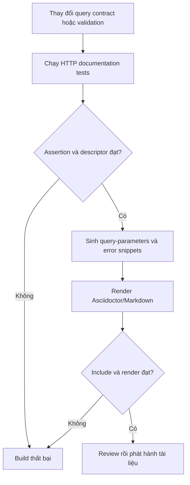

# Liên kết tham số với quy tắc validation

## Mục tiêu học tập

Sau bài này, bạn có thể:

- Mô tả query parameter trong Spring REST Docs bằng queryParameters(...) và parameterWithName(...).
- Phân biệt descriptor tài liệu hóa với validation được ứng dụng thực thi: một bên mô tả hợp đồng, bên kia quyết định request có hợp lệ hay không.
- Liên kết tên, kiểu, tính bắt buộc, giá trị mặc định, giới hạn, enum và định dạng của query parameter với quy tắc kiểm tra tương ứng.
- Viết documentation test cho truy vấn hợp lệ và truy vấn không hợp lệ, ghi lại cả response lỗi nếu đó là hành vi cần công bố.
- Xử lý các trường hợp query parameter tùy chọn, nhiều giá trị, URL encoding và phân trang mà không mô tả sai hành vi.

## 1. Query parameter không chỉ là phần văn bản sau dấu ?

Query parameter thường truyền tiêu chí lọc, phân trang, sắp xếp hoặc lựa chọn representation. Ví dụ:

```http
GET /api/orders?page=0&size=20&status=PAID HTTP/1.1
Accept: application/json
```

Trong request này, page xác định chỉ số trang, size xác định số phần tử tối đa được yêu cầu trong một trang, status lọc theo trạng thái đơn hàng.

Một trang API hữu ích phải trả lời nhiều hơn câu hỏi “tham số tên gì?”:

| Khía cạnh | Câu hỏi cần mô tả |
| --- | --- |
| Kiểu dữ liệu | Số nguyên, chuỗi, ngày, enum hay danh sách? |
| Tính bắt buộc | Có cần gửi không? Có thể lặp lại không? |
| Giá trị mặc định | Khi bỏ qua tham số, server sử dụng giá trị nào? |
| Miền giá trị | Giá trị nhỏ nhất/lớn nhất hoặc tập giá trị hợp lệ là gì? |
| Ngữ nghĩa | Tham số lọc, sắp xếp hay điều khiển phân trang? |
| Tương tác | Hai tham số có phụ thuộc hoặc loại trừ nhau không? |
| Lỗi | Giá trị sai định dạng hoặc ngoài giới hạn trả về status và error body nào? |

Vì vậy, tài liệu query parameter cần gắn với quy tắc validation thực tế. Nếu trang ghi size tối đa là 100 nhưng server chấp nhận 500, tài liệu và hành vi đã mâu thuẫn.

## 2. Phân biệt descriptor của REST Docs với validation của ứng dụng

Đây là hai cơ chế khác nhau, dù có thể được dùng trong cùng một documentation test.

| Cơ chế | Vai trò | Ví dụ |
| --- | --- | --- |
| queryParameters(...) | Khai báo tham số cần xuất hiện trong snippet và mô tả cho người đọc | parameterWithName("size").description("Số phần tử mỗi trang") |
| Validation/binding của Spring | Phân tích, chuyển đổi và kiểm tra giá trị request | size phải là số nguyên trong khoảng 1 đến 100 |
| Assertion trong test | Xác minh kết quả ứng dụng trả về với request cụ thể | status().isBadRequest() khi size=500 |

**REST Docs không tự áp dụng giới hạn validation.** Descriptor parameterWithName("size") không làm server từ chối size=500; nó chỉ mô tả query parameter. Muốn bảo đảm giới hạn đó tồn tại, phải cấu hình validation trong ứng dụng và viết test xác nhận.

Ngược lại, validation chạy đúng cũng chưa đủ để tạo tài liệu. Nếu test không khai báo queryParameters(...), người đọc có thể không có bảng giải thích về page, size hay status.

### 2.1. Ví dụ một hợp đồng có thể kiểm chứng

Giả sử endpoint liệt kê đơn hàng có quy tắc:

| Tham số | Kiểu | Bắt buộc? | Giá trị mặc định | Quy tắc |
| --- | --- | --- | --- | --- |
| page | Integer | Không | 0 | Bắt đầu từ 0, không âm |
| size | Integer | Không | 20 | Trong khoảng 1 đến 100 |
| status | Enum | Không | Không lọc theo trạng thái | Chỉ nhận NEW, PAID, CANCELLED |
| sort | String | Không | createdAt,desc | Chỉ nhận field và chiều sắp xếp được API cho phép |

Ví dụ request hợp lệ:

```http
GET /api/orders?page=0&size=20&status=PAID&sort=createdAt,desc HTTP/1.1
Accept: application/json
```

Ví dụ lỗi:

```http
GET /api/orders?page=-1&size=500 HTTP/1.1
Accept: application/json
```

Nếu hợp đồng quy định các giá trị ngoài giới hạn là không hợp lệ, ứng dụng cần trả về status và error body nhất quán, ví dụ 400 Bad Request. Status và cấu trúc lỗi cụ thể phải lấy từ hành vi thật của ứng dụng, không được suy đoán chỉ từ bảng trên.

## 3. Mô tả query parameter bằng Spring REST Docs

Với MockMvc, queryParameters(...) nhận các ParameterDescriptor được tạo qua parameterWithName(...).

```java
queryParameters(
    parameterWithName("page")
        .description("Chỉ số trang, bắt đầu từ 0"),
    parameterWithName("size")
        .description("Số phần tử tối đa trong một trang"),
    parameterWithName("status")
        .description("Chỉ lọc các đơn hàng theo trạng thái được hỗ trợ")
)
```

Descriptor xác định tên và nội dung mô tả. Chúng không tự mang đủ mọi quy tắc như min/max, default, enum hoặc điều kiện kết hợp. Hãy viết các chi tiết đó trong description(...) hoặc phần thuyết minh bên cạnh bảng.

Một descriptor đầy đủ hơn:

```java
queryParameters(
    parameterWithName("page")
        .description("Chỉ số trang, bắt đầu từ 0; mặc định là 0"),
    parameterWithName("size")
        .description("Số phần tử mỗi trang; mặc định 20, trong khoảng 1 đến 100"),
    parameterWithName("status")
        .description("Trạng thái lọc: NEW, PAID hoặc CANCELLED; bỏ qua để lấy mọi trạng thái")
)
```

Nội dung mô tả phải được đối chiếu với code validation và test. Nếu quy tắc thay đổi, không chỉ sửa câu chữ: cần thay đổi implementation/test khi cần và sinh lại snippet.

### 3.1. Query parameter tùy chọn

Nếu một tham số có thể vắng mặt trong request hợp lệ, có thể dùng optional():

```java
queryParameters(
    parameterWithName("page")
        .description("Chỉ số trang; mặc định 0")
        .optional(),
    parameterWithName("size")
        .description("Số phần tử mỗi trang; mặc định 20")
        .optional()
)
```

optional() mô tả rằng parameter có thể không xuất hiện trong request được tài liệu hóa. Nó không tự thiết lập default value trong ứng dụng, không bỏ qua validation và không có nghĩa mọi giá trị đều được chấp nhận. Giá trị mặc định phải được triển khai ở controller/service hoặc tầng thích hợp và được kiểm tra bằng test.

Ví dụ nếu controller khai báo @RequestParam(defaultValue = "20") int size, test bỏ size cần xác minh rằng ứng dụng thực sự xử lý như khi nhận size=20 nếu đó là hợp đồng mong muốn.

### 3.2. Query parameter lặp hoặc mang nhiều giá trị

Một số API cho phép cùng một tên xuất hiện nhiều lần:

```http
GET /api/orders?status=NEW&status=PAID HTTP/1.1
```

Ứng dụng có thể bind tham số này thành danh sách, chẳng hạn List<OrderStatus>. Descriptor vẫn mô tả một tên parameter:

```java
queryParameters(
    parameterWithName("status")
        .description("Một hoặc nhiều trạng thái cần lọc; tham số có thể lặp lại")
)
```

Chỉ viết “có thể lặp lại” nếu server thực sự hỗ trợ cách truyền đó. Một số API định nghĩa danh sách bằng dấu phẩy (status=NEW,PAID), một số dùng repeated key, một số dùng JSON body. Test nên gửi đúng định dạng mà hợp đồng chọn.

## 4. Liên kết quy tắc validation với kiểu và miền giá trị

Validation query parameter thường có nhiều tầng:

1. **Parsing/conversion:** chuyển chuỗi query thành kiểu Java. Ví dụ page=abc không thể bind thành integer nếu không có converter đặc biệt.
2. **Ràng buộc miền giá trị:** số nguyên phải không âm, size phải có giới hạn.
3. **Ràng buộc danh sách giá trị:** enum hoặc tên field sort phải thuộc tập cho phép.
4. **Ràng buộc liên tham số:** from phải nhỏ hơn hoặc bằng to; cursor có thể loại trừ page.
5. **Quy tắc nghiệp vụ:** caller có quyền lọc theo một trạng thái nhất định hay không.

### 4.1. Phân trang: min/max và default

Ví dụ controller đơn giản dùng default value và kiểm tra miền giá trị tường minh:

```java
@GetMapping("/api/orders")
OrderPage search(
        @RequestParam(defaultValue = "0") int page,
        @RequestParam(defaultValue = "20") int size) {

    if (page < 0) {
        throw new InvalidQueryParameterException("page must be >= 0");
    }
    if (size < 1 || size > 100) {
        throw new InvalidQueryParameterException("size must be between 1 and 100");
    }
    return orderService.search(page, size);
}
```

Đây là minh họa quy tắc xử lý, không phải khuyến nghị rằng mọi controller phải tự viết if. Dự án có thể dùng Bean Validation trên method parameter, request model hoặc validator riêng; cấu hình method validation phụ thuộc phiên bản Spring và cách ứng dụng bật validation. Điều quan trọng là test phải chứng minh được hành vi HTTP sau khi parsing/validation.

### 4.2. Enum và allowlist cho sort

Không nên cho client truyền tùy ý tên cột database hoặc biểu thức truy vấn nếu API chỉ hỗ trợ một số trường sort. Ví dụ:

```java
enum OrderStatus {
    NEW, PAID, CANCELLED
}

enum OrderSortField {
    CREATED_AT, TOTAL_AMOUNT
}
```

Nếu API nhận sort=createdAt,desc, hãy mô tả chính xác tên trường công khai, chiều asc/desc được hỗ trợ và mặc định. Tên enum Java không nhất thiết là chuỗi mà API công bố; converter hoặc mapping có thể quyết định cách biểu diễn.

### 4.3. Ngày tháng và khoảng thời gian

Ví dụ query:

```http
GET /api/orders?from=2026-01-01&to=2026-01-31 HTTP/1.1
```

Cần ghi rõ:

- Định dạng ngày, ví dụ YYYY-MM-DD, hay timestamp ISO-8601.
- Múi giờ áp dụng nếu có thời gian.
- Hai đầu khoảng có tính bao gồm hay không.
- from/to có thể bỏ riêng lẻ không.
- Hành vi khi from lớn hơn to.

Không ghi “ISO date” một cách mơ hồ nếu API yêu cầu offset, timezone hoặc precision cụ thể. Hãy dùng ví dụ request và test cho định dạng được hỗ trợ.

## 5. Ví dụ đầy đủ: test hợp lệ và test validation lỗi bằng MockMvc

Giả sử endpoint liệt kê đơn hàng theo page và size, với page >= 0, 1 <= size <= 100, default lần lượt là 0 và 20. Response thành công có page, size và content.

### 5.1. Test cho request hợp lệ

Ví dụ dưới đây dùng JUnit Jupiter, Spring MVC Test và spring-restdocs-mockmvc. Phần controller/service được lược giản để tập trung vào query parameters:

```java
@ExtendWith(RestDocumentationExtension.class)
class OrderSearchDocumentationTest {
    private MockMvc mvc;

    @BeforeEach
    void setUp(RestDocumentationContextProvider context) {
        mvc = MockMvcBuilders.standaloneSetup(new OrderController())
                .setControllerAdvice(new ApiExceptionHandler())
                .apply(documentationConfiguration(context))
                .build();
    }

    @Test
    void searchOrders() throws Exception {
        mvc.perform(get("/api/orders")
                        .queryParam("page", "0")
                        .queryParam("size", "20")
                        .accept(MediaType.APPLICATION_JSON))
                .andExpect(status().isOk())
                .andExpect(jsonPath("$.page").value(0))
                .andExpect(jsonPath("$.size").value(20))
                .andDo(document("orders-search",
                        queryParameters(
                                parameterWithName("page")
                                        .description("Chỉ số trang, bắt đầu từ 0"),
                                parameterWithName("size")
                                        .description("Số phần tử mỗi trang, từ 1 đến 100")
                        ),
                        responseFields(
                                fieldWithPath("page").description("Trang được trả về"),
                                fieldWithPath("size").description("Kích thước trang"),
                                fieldWithPath("content").description("Danh sách đơn hàng")
                        )
                ));
    }
}
```

Trong ví dụ, test gửi page và size, kiểm tra giá trị phản hồi rồi ghi lại query parameter và response field. Cần bổ sung các static import tương ứng như get, status, jsonPath, queryParameters, parameterWithName, responseFields, fieldWithPath, document và cấu hình class ứng dụng của dự án.

### 5.2. Test cho giá trị không hợp lệ

Với size=500, test lỗi có thể xác minh status và cấu trúc error body:

```java
@Test
void rejectsSizeAboveMaximum() throws Exception {
    mvc.perform(get("/api/orders")
                    .queryParam("page", "0")
                    .queryParam("size", "500")
                    .accept(MediaType.APPLICATION_JSON))
            .andExpect(status().isBadRequest())
            .andExpect(jsonPath("$.code").value("INVALID_QUERY_PARAMETER"))
            .andDo(document("orders-search-invalid-size",
                    queryParameters(
                            parameterWithName("page")
                                    .description("Chỉ số trang, bắt đầu từ 0"),
                            parameterWithName("size")
                                    .description("Số phần tử mỗi trang, từ 1 đến 100")
                    ),
                    responseFields(
                            fieldWithPath("code").description("Mã lỗi"),
                            fieldWithPath("message").description("Thông tin lỗi")
                    )
            ));
}
```

400 và các trường code, message trong ví dụ là hợp đồng giả định. Hãy thay bằng status/error body mà ứng dụng thực sự trả. Nếu test chỉ mong đợi 400 nhưng controller advice trả một cấu trúc khác, assertion phải phản ánh thiết kế thực tế thay vì chỉnh tài liệu cho qua.

Hai test tạo hai nhóm snippet:

```text
build/generated-snippets/
├── orders-search/
│   ├── http-request.adoc
│   ├── query-parameters.adoc
│   └── response-fields.adoc
└── orders-search-invalid-size/
    ├── http-request.adoc
    ├── http-response.adoc
    ├── query-parameters.adoc
    └── response-fields.adoc
```

Đường dẫn và danh sách snippet phụ thuộc cấu hình và template. Tạo snippet lỗi riêng giúp người đọc biết không chỉ tham số hợp lệ mà còn kết quả khi gửi giá trị ngoài miền.

## 6. Default value: mô tả và kiểm chứng hai request khác nhau

Nếu page và size có default, nên kiểm tra request không truyền chúng:

```java
@Test
void appliesDefaultPagination() throws Exception {
    mvc.perform(get("/api/orders")
                    .accept(MediaType.APPLICATION_JSON))
            .andExpect(status().isOk())
            .andExpect(jsonPath("$.page").value(0))
            .andExpect(jsonPath("$.size").value(20));
}
```

Với test này, queryParameters(...) có thể mô tả hai tham số tùy chọn:

```java
queryParameters(
    parameterWithName("page")
        .description("Chỉ số trang; mặc định 0")
        .optional(),
    parameterWithName("size")
        .description("Số phần tử mỗi trang; mặc định 20")
        .optional()
)
```

Nếu test trước đó có gửi page và size, descriptor có thể khai báo tính tùy chọn như một phần của hợp đồng chung; tuy vậy, nên có test riêng cho trường hợp vắng mặt để chứng minh default. Việc optional() không thay thế assertion page=0 và size=20.

## 7. Query parameter phức hợp và tương tác giữa các tham số

Một số API có quy tắc cần xét nhiều tham số cùng lúc:

| Query | Quy tắc cần mô tả/kiểm tra |
| --- | --- |
| from, to | from không lớn hơn to; định dạng ngày và múi giờ rõ ràng |
| minPrice, maxPrice | Giá trị không âm; cận dưới không vượt cận trên |
| status | Chỉ nhận enum được công bố; cách truyền nhiều giá trị cần rõ |
| sort | Tên trường thuộc allowlist; hướng sắp xếp thuộc asc/desc |
| page, cursor | Nếu hai chế độ phân trang loại trừ nhau thì request gửi đồng thời phải được xử lý rõ |

Descriptor có thể mô tả từng query parameter, nhưng quan hệ giữa chúng thường cần giải thích thêm trong phần prose và được kiểm tra bằng test riêng.

Ví dụ test cho khoảng ngày đảo ngược:

```java
@Test
void rejectsInvertedDateRange() throws Exception {
    mvc.perform(get("/api/orders")
                    .queryParam("from", "2026-02-01")
                    .queryParam("to", "2026-01-01"))
            .andExpect(status().isBadRequest());
}
```

Test này mới khẳng định status ở tình huống đó; nếu tài liệu cần mô tả lỗi cụ thể, hãy assert error code/message và thêm descriptor response fields cho error body.

## 8. URL encoding và cách đọc giá trị thực tế

Query string được truyền trong URI nên ký tự đặc biệt có thể phải URL-encode. Ví dụ giá trị tìm kiếm C++ & Java không nên ghép chuỗi URI bằng tay mà không xử lý encoding, vì & phân cách các tham số.

Với MockMvc, có thể dùng builder để thêm giá trị:

```java
mvc.perform(get("/api/orders")
        .queryParam("q", "C++ & Java"))
```

Mock request builder xử lý việc tạo request parameter phù hợp cho test; khi viết tài liệu, hãy xem snippet http-request để bảo đảm giá trị thể hiện đúng điều client cần gửi. Với test gửi qua server thật, cần bảo đảm URI được encode đúng theo client và server.

Phải phân biệt query value rỗng (q=), parameter vắng mặt và parameter có chuỗi "null"; đây là những request khác nhau. Nếu API có hành vi riêng cho các trường hợp này, hãy kiểm tra bằng test và mô tả.

## 9. Biên soạn snippet thành tài liệu Asciidoctor

Sau khi test sinh snippet, trang AsciiDoc có thể include:

```asciidoc
== Tìm kiếm đơn hàng

Endpoint hỗ trợ phân trang với page bắt đầu từ 0.
Kích thước trang mặc định là 20 và không vượt quá 100.

=== Query parameters
include::{snippets}/orders-search/query-parameters.adoc[]

=== HTTP request
include::{snippets}/orders-search/http-request.adoc[]

=== HTTP response
include::{snippets}/orders-search/http-response.adoc[]

=== Tham số không hợp lệ
Khi size vượt giới hạn, API trả lỗi theo hợp đồng validation.
include::{snippets}/orders-search-invalid-size/http-response.adoc[]
```

Thuộc tính {snippets} cần trỏ đến thư mục output thực tế. Các câu về default, min/max và ý nghĩa lọc do tác giả viết; cần đối chiếu với implementation/test. Asciidoctor chỉ ghép và render, không tự chạy validation.

Nếu dùng Markdown, cần template snippet phù hợp và cơ chế include/ghép được renderer hỗ trợ. Cú pháp include::{snippets}/...[] ở trên thuộc Asciidoctor, không phải Markdown chuẩn.

## 10. Tích hợp build và CI

Luồng cơ bản:



Với Gradle, bảo đảm test tạo snippet trước khi Asciidoctor đọc. Ví dụ ý tưởng Groovy DSL:

```groovy
def snippetsDir = file("$buildDir/generated-snippets")

tasks.named('test') {
    outputs.dir snippetsDir
}

tasks.named('asciidoctor') {
    inputs.dir snippetsDir
    dependsOn tasks.named('test')
}
```

Đây là phần minh họa dependency task, không phải build script đầy đủ. Dự án cần plugin Asciidoctor, Spring REST Docs dependency và version tương thích, cấu hình snippets attribute, đồng thời bảo đảm task dùng đúng output directory. Khi build CI, nên dùng output sạch và kiểm tra missing include để tránh phát hành tài liệu từ snippet cũ.

## 11. Các lỗi thường gặp

| Biểu hiện | Nguyên nhân có thể | Cách xử lý |
| --- | --- | --- |
| Bảng query parameter thiếu status | Test không mô tả parameter hoặc chưa gửi parameter trong kịch bản | Kiểm tra request và khai báo descriptor phù hợp |
| Test tài liệu thất bại vì query parameter chưa được mô tả | Request có parameter mới nhưng queryParameters(...) chưa cập nhật | Xác nhận contract, bổ sung descriptor hoặc điều tra request |
| Descriptor có parameter không xuất hiện | Request test không gửi parameter đó | Gửi parameter nếu kịch bản yêu cầu hoặc đánh dấu optional khi hợp đồng cho phép |
| Tài liệu ghi default 20 nhưng server trả default khác | Prose/descriptor không gắn với validation hoặc behavior thực | Sửa implementation hoặc tài liệu theo quyết định hợp đồng; thêm default test |
| size=500 vẫn được chấp nhận | Validation thiếu hoặc tầng test chưa đưa validation vào | Bổ sung validator/cấu hình và test ở đúng phạm vi |
| status=UNKNOWN không bị từ chối như mong đợi | Enum converter/custom binding hoặc error handler chưa được kiểm tra | Test giá trị thực tế và cập nhật quy tắc |
| Query có dấu & bị tách thành nhiều tham số | URL encoding sai | Dùng URI builder/client phù hợp và kiểm tra request snippet |
| Test thành công nhưng tài liệu lỗi vẫn thiếu | Chỉ có test happy path | Bổ sung test validation/error và snippet riêng |

## 12. Checklist liên kết query parameter với validation

- [ ] Mỗi query parameter được mô tả bằng tên và ý nghĩa dễ hiểu.
- [ ] Kiểu dữ liệu, tính bắt buộc và cách truyền nhiều giá trị được nêu rõ.
- [ ] Giá trị mặc định được kiểm chứng bằng request không truyền parameter.
- [ ] Min/max, enum, format, allowlist và quy tắc liên tham số được mô tả.
- [ ] Validation thực tế trả status/error body phù hợp với hợp đồng.
- [ ] Test có assertion cho cả giá trị hợp lệ và các trường hợp sai quan trọng.
- [ ] Descriptor queryParameters(...) khớp request được gửi và không che giấu thay đổi mới.
- [ ] Snippet mới được render từ cùng build; tài liệu không dùng output cũ.

## 13. Bài tập thực hành

Endpoint tìm kiếm sản phẩm hỗ trợ:

```http
GET /api/products?q=notebook&page=0&size=20&sort=price,asc
```

Hợp đồng giả định:

- q tùy chọn, chuỗi tìm kiếm tối đa 80 ký tự.
- page mặc định 0, không âm.
- size mặc định 20, từ 1 đến 50.
- sort chỉ cho phép price,asc; price,desc; name,asc; name,desc.

Hãy thực hiện:

1. Viết queryParameters(...) mô tả cả bốn tham số, gồm default và giới hạn.
2. Viết test cho request hợp lệ và kiểm tra server áp dụng đúng page/size.
3. Viết test cho size=0, size=51 và page=-1; xác nhận status/error body theo implementation.
4. Viết test cho query q vượt 80 ký tự và sort không nằm trong allowlist.
5. Thêm test không truyền page, size để kiểm chứng default.
6. Nếu API cho phép query lặp lại hoặc hỗ trợ encoding đặc biệt, thiết kế test thể hiện chính xác hành vi đó.
7. Sinh snippet, include vào Asciidoctor rồi chạy build từ output sạch.

**Câu hỏi tự kiểm tra:** Chỉ khai báo parameterWithName("size").description("Tối đa 50") có bảo đảm server từ chối size=51 không? Không. Descriptor chỉ mô tả; phải có validation trong ứng dụng và test chứng minh response khi gửi giá trị không hợp lệ.

## Kết luận

Liên kết query parameter với validation đòi hỏi hai lớp đồng bộ: **Spring REST Docs mô tả tên và ý nghĩa tham số**, còn ứng dụng thực thi quy tắc về kiểu, default, miền giá trị, enum, định dạng và mối quan hệ giữa các tham số. Documentation test cần gửi request đại diện, assert kết quả hợp lệ/lỗi và dùng queryParameters(...) để sinh snippet tương ứng. Khi thay đổi validation, cập nhật test và phần diễn giải rồi sinh lại tài liệu qua build/CI. Descriptor tự nó không thay thế validation; chỉ khi cả hai cùng phản ánh một hợp đồng đã xác nhận, tài liệu query parameter mới đáng tin cậy cho người tích hợp.
