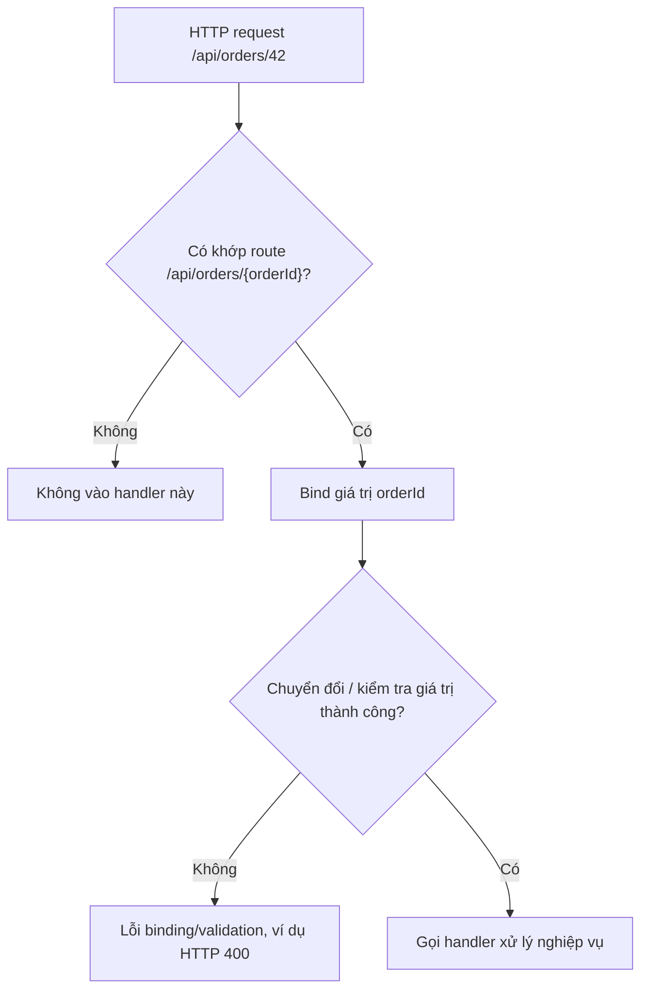

# Path parameter bắt buộc theo bản chất định tuyến

## Mục tiêu bài học

Trong **Spring REST Docs**, tài liệu REST API được tạo từ những request/response đã chạy qua bài kiểm thử HTTP với **MockMvc**, **WebTestClient** hoặc **REST Assured**. Trước khi mô tả biến đường dẫn bằng `pathParameters(...)`, cần hiểu một nguyên tắc quan trọng: **biến nằm trong mẫu đường dẫn của một route thường là thành phần bắt buộc để request khớp route đó**.

Ví dụ, `GET /api/orders/{orderId}` đòi hỏi một đoạn đường dẫn ở vị trí `{orderId}`. Request `GET /api/orders/42` có đoạn đó; `GET /api/orders` thì không. Việc đánh dấu một tham số là *optional* trong tài liệu hay trong chữ ký phương thức Java không tự tạo ra một route mới.

Sau bài này, bạn sẽ biết:

- Phân biệt tính bắt buộc khi **khớp URI với route**, khi **bind vào `@PathVariable`** và khi **kiểm tra snippet Spring REST Docs**.
- Hiểu vì sao `@PathVariable(required = false)` không tự khiến `/orders/{id}` khớp `/orders`.
- Viết bài kiểm thử MockMvc chứng minh trường hợp có và thiếu path segment, rồi tạo snippet `path-parameters.adoc`.
- Thiết kế hai route rõ ràng nếu muốn hỗ trợ cả danh sách và chi tiết.
- Phân biệt tham số đường dẫn với query parameter có thể tùy chọn và chọn cách tài liệu hóa phù hợp.
- Tích hợp snippet vào tài liệu Asciidoctor/Markdown và quy trình build, CI.

## 1. Vì sao path parameter thường bắt buộc?

Giả sử ứng dụng khai báo:

```java
@GetMapping("/api/orders/{orderId}")
OrderResponse findOne(@PathVariable("orderId") Long orderId) {
    // ...
}
```

Mẫu URI (URI template) được ánh xạ tới handler là `/api/orders/{orderId}`. Một request cần có đoạn tương ứng với `{orderId}` để khớp mẫu đó.

| Request | Khớp route `GET /api/orders/{orderId}`? | Ý nghĩa |
| --- | --- | --- |
| `GET /api/orders/42` | Có | `orderId` nhận giá trị chuỗi `42`; sau đó có thể được chuyển thành `Long` |
| `GET /api/orders` | Không | Thiếu hẳn đoạn đường dẫn dành cho `orderId` |
| `GET /api/orders?orderId=42` | Không | `orderId` ở đây là **query parameter**, không thay thế đoạn `/{orderId}` |
| `GET /api/orders/abc` | Có ở bước khớp đường dẫn | Có đoạn biến, nhưng việc chuyển `abc` thành `Long` thường gây phản hồi HTTP 400 |
| `POST /api/orders/42` | Không khớp mapping **GET** này | Đường dẫn có thể đúng nhưng HTTP method khác |

**Lưu ý về mã HTTP:** với một controller chỉ có route GET chi tiết ở trên, request `GET /api/orders` thường nhận **404 Not Found** vì không tìm được handler tương ứng. Khi ứng dụng còn có những route khác, hoặc có cấu hình xử lý lỗi riêng, mã phản hồi phụ thuộc toàn bộ hệ thống. Chẳng hạn method không được hỗ trợ cho một đường dẫn đã có mapping có thể dẫn đến **405 Method Not Allowed**.

Hãy tách rõ hai giai đoạn:



Spring REST Docs chỉ thực thi việc tài liệu hóa trên request được test; thư viện **không thay đổi thuật toán định tuyến** của Spring MVC hoặc WebFlux.

## 2. Ba lớp “bắt buộc” rất dễ nhầm

Khi đọc code, bạn có thể gặp `{orderId}`, `@PathVariable(required = false)` và `parameterWithName("orderId").optional()`. Chúng tồn tại ở **ba lớp khác nhau**.

| Lớp | Nơi khai báo | Tác dụng thực tế |
| --- | --- | --- |
| **Định tuyến** | `@GetMapping("/api/orders/{orderId}")` | Quyết định đường dẫn request nào khớp handler |
| **Liên kết tham số Java** | `@PathVariable(required = true/false)` | Quy định cách xử lý khi handler đã được chọn nhưng giá trị cho biến cần bind không có |
| **Mô tả và kiểm chứng tài liệu** | `pathParameters(parameterWithName("orderId").optional())` | Điều chỉnh descriptor và việc kiểm tra snippet REST Docs |

### 2.1. @PathVariable(required = false) không tự mở rộng route

Đoạn code sau **không có nghĩa** là endpoint tự nhận cả `/api/orders`:

```java
@GetMapping("/api/orders/{orderId}")
OrderResponse findOne(
        @PathVariable(value = "orderId", required = false) Long orderId) {
    // ...
}
```

Đối với `GET /api/orders`, handler ở trên vốn không khớp do mẫu URI vẫn chứa đoạn `/{orderId}`. Spring không gọi handler chỉ để gán `orderId = null`.

Thuộc tính `required = false` chỉ có ý nghĩa khi handler có thể được chọn trong tình huống không có giá trị biến cần bind. Một trường hợp là **chủ động khai báo nhiều mẫu đường dẫn** cho cùng handler; tuy nhiên, với hai hành vi nghiệp vụ khác nhau như lấy danh sách và xem chi tiết, hai handler riêng thường rõ nghĩa và dễ tài liệu hóa hơn.

### 2.2. optional() trong Spring REST Docs cũng không đổi route

Ví dụ:

```java
pathParameters(
    parameterWithName("orderId")
        .description("Mã đơn hàng cần xem")
        .optional()
)
```

`optional()` là thuộc tính của **descriptor tài liệu**. Nó không tạo ra đường dẫn `/api/orders`, không sửa `@GetMapping`, và không làm cho ứng dụng chấp nhận thiếu path segment. Hãy chỉ dùng `optional()` khi thực sự có lý do từ hợp đồng API và cách kiểm thử cụ thể; đừng dùng nó để che giấu một bất nhất giữa route và tài liệu.

### 2.3. Tham số query có thể tùy chọn theo nghĩa khác

Với endpoint:

```text
GET /api/orders?status=OPEN
```

`status` là **query parameter**. Nếu controller khai báo:

```java
@GetMapping("/api/orders")
List<OrderResponse> list(
        @RequestParam(value = "status", required = false) String status) {
    // ...
}
```

thì cả `GET /api/orders` và `GET /api/orders?status=OPEN` đều dùng **cùng mẫu đường dẫn `/api/orders`**. Không xuất hiện hay biến mất đoạn URI nào. Khi sinh tài liệu, hãy mô tả `status` trong nhóm tham số truy vấn phù hợp với phiên bản Spring REST Docs, **không đặt vào `pathParameters(...)`**.

## 3. Ví dụ kiểm thử MockMvc: một route có path parameter bắt buộc

Ví dụ sử dụng **Java 17+**, **Spring Boot 3.x**, **JUnit 5** và Spring REST Docs dành cho MockMvc. Khai báo Gradle tối thiểu ở dự án đã có cơ chế quản lý dependency:

```groovy
dependencies {
    testImplementation 'org.springframework.boot:spring-boot-starter-test'
    testImplementation 'org.springframework.restdocs:spring-restdocs-mockmvc'
}
```

Nếu dùng Maven, thay dependency tương đương và cấu hình thư mục snippet trong `target/generated-snippets`.

### 3.1. Controller chỉ có route chi tiết

Tạo `OrderController.java`:

```java
import org.springframework.web.bind.annotation.GetMapping;
import org.springframework.web.bind.annotation.PathVariable;
import org.springframework.web.bind.annotation.RestController;

@RestController
class OrderController {

    @GetMapping("/api/orders/{orderId}")
    OrderResponse getOrder(@PathVariable("orderId") Long orderId) {
        return new OrderResponse(orderId, "OPEN");
    }
}

record OrderResponse(Long id, String status) {}
```

Để tập trung vào định tuyến, controller minh họa trả dữ liệu giả lập. Trong sản phẩm thực tế, thông thường handler sẽ gọi service/repository để tìm đơn hàng; việc đơn hàng có thật hay không là **điều kiện nghiệp vụ** khác với việc đường dẫn có khớp route hay không.

### 3.2. Test có đoạn đường dẫn và sinh snippet

Tạo `OrderControllerDocumentationTest.java` cùng package với controller:

```java
import org.junit.jupiter.api.Test;
import org.springframework.beans.factory.annotation.Autowired;
import org.springframework.boot.test.autoconfigure.restdocs.AutoConfigureRestDocs;
import org.springframework.boot.test.autoconfigure.web.servlet.WebMvcTest;
import org.springframework.http.MediaType;
import org.springframework.test.web.servlet.MockMvc;

import static org.springframework.restdocs.mockmvc.MockMvcRestDocumentation.document;
import static org.springframework.restdocs.mockmvc.RestDocumentationRequestBuilders.get;
import static org.springframework.restdocs.request.RequestDocumentation.parameterWithName;
import static org.springframework.restdocs.request.RequestDocumentation.pathParameters;
import static org.springframework.test.web.servlet.result.MockMvcResultMatchers.jsonPath;
import static org.springframework.test.web.servlet.result.MockMvcResultMatchers.status;

@WebMvcTest(OrderController.class)
@AutoConfigureRestDocs(outputDir = "build/generated-snippets")
class OrderControllerDocumentationTest {

    @Autowired
    MockMvc mockMvc;

    @Test
    void documentGetOneOrder() throws Exception {
        mockMvc.perform(get("/api/orders/{orderId}", 42L)
                .accept(MediaType.APPLICATION_JSON))
            .andExpect(status().isOk())
            .andExpect(jsonPath("$.id").value(42))
            .andExpect(jsonPath("$.status").value("OPEN"))
            .andDo(document("order-detail-get",
                pathParameters(
                    parameterWithName("orderId")
                        .description("Mã định danh đơn hàng cần xem")
                )
            ));
    }

    @Test
    void missingPathSegmentDoesNotMatchDetailRoute() throws Exception {
        mockMvc.perform(get("/api/orders")
                .accept(MediaType.APPLICATION_JSON))
            .andExpect(status().isNotFound());
    }

    @Test
    void invalidLongPathValueReturnsBadRequest() throws Exception {
        mockMvc.perform(get("/api/orders/not-a-number")
                .accept(MediaType.APPLICATION_JSON))
            .andExpect(status().isBadRequest());
    }
}
```

Trong ví dụ độc lập này, `GET /api/orders` nhận **404** do controller không cung cấp route danh sách; còn `GET /api/orders/not-a-number` nhận **400** do giá trị không chuyển đổi được thành `Long`. Nếu ứng dụng bổ sung handler khác hoặc xử lý ngoại lệ tùy chỉnh, các kết quả cụ thể có thể khác.

**Tại sao dùng `RestDocumentationRequestBuilders.get(...)`?** Builder này cung cấp URI template cho Spring REST Docs, giúp thư viện biết rằng biến tên `orderId` xuất hiện trong request. Nếu chỉ dùng chuỗi `/api/orders/42` đã mở rộng, tên biến không còn hiển thị trên đường dẫn và việc tạo snippet path parameters có thể thất bại.

Trong đoạn test:

- `get("/api/orders/{orderId}", 42L)` truyền giá trị `42L` vào biến `orderId`.
- `parameterWithName("orderId")` dùng **tên biến trong template**, không dùng `"42"` hay `"{orderId}"`.
- `description(...)` trình bày ý nghĩa của ID trong tài liệu.
- `document("order-detail-get", ...)` tạo snippet từ request/response đã thực thi.

### 3.3. Kết quả đầu ra

Sau khi chạy test thành công, thư mục `build/generated-snippets/order-detail-get/` chứa các snippet theo cấu hình, trong đó có:

```text
build/
└── generated-snippets/
    └── order-detail-get/
        ├── http-request.adoc
        ├── http-response.adoc
        ├── curl-request.adoc
        └── path-parameters.adoc
```

Danh sách trên chỉ là phần minh họa; các tệp request/response khác có thể cũng được tạo. `path-parameters.adoc` ghi một dòng tương đương:

| Parameter | Description |
| --- | --- |
| `orderId` | Mã định danh đơn hàng cần xem |

Trên URL thực, giá trị `42` là một ví dụ; trong bảng tài liệu, **`orderId`** là tên biến ổn định mà người dùng API cần điền.

## 4. Nếu muốn thiếu ID vẫn hợp lệ, hãy thiết kế route phù hợp

Một API thường cần cả hai hành vi:

| Endpoint | Ý nghĩa |
| --- | --- |
| `GET /api/orders` | Lấy danh sách đơn hàng |
| `GET /api/orders/{orderId}` | Lấy một đơn hàng theo ID |

Cách viết rõ ràng là tạo hai mapping:

```java
@RestController
class OrderQueryController {

    @GetMapping("/api/orders")
    List<OrderResponse> listOrders() {
        return List.of(new OrderResponse(42L, "OPEN"));
    }

    @GetMapping("/api/orders/{orderId}")
    OrderResponse getOrder(@PathVariable("orderId") Long orderId) {
        return new OrderResponse(orderId, "OPEN");
    }
}
```

Khi đó, `GET /api/orders` **hợp lệ vì có route danh sách riêng**; điều đó không biến `{orderId}` của route chi tiết thành một path parameter tùy chọn.

Trường hợp muốn dùng cùng một handler cho hai mẫu đường dẫn, Spring MVC có thể khai báo hai pattern:

```java
@GetMapping({"/api/orders", "/api/orders/{orderId}"})
Object getOrders(
        @PathVariable(value = "orderId", required = false) Long orderId) {
    if (orderId == null) {
        return List.of(new OrderResponse(42L, "OPEN"));
    }
    return new OrderResponse(orderId, "OPEN");
}
```

Đây là **hai URL pattern** được chỉ định tường minh, có thể được xử lý bởi cùng một method. `required = false` giúp giá trị Java chấp nhận vắng mặt khi handler xử lý mẫu không có biến. Cách này có thể phù hợp với nghiệp vụ đơn giản, nhưng cần cân nhắc tính rõ ràng của kiểu dữ liệu trả về, response status, và hợp đồng API cho từng trường hợp.

### 4.1. Tài liệu hóa mỗi trường hợp đúng với request

Với hai route độc lập, tạo snippet riêng cho từng hành vi:

```java
// Bài kiểm thử route chi tiết:
mockMvc.perform(get("/api/orders/{orderId}", 42L))
    .andExpect(status().isOk())
    .andDo(document("order-detail-get",
        pathParameters(
            parameterWithName("orderId")
                .description("Mã đơn hàng cần xem")
        )));

// Bài kiểm thử route danh sách:
mockMvc.perform(get("/api/orders"))
    .andExpect(status().isOk())
    .andDo(document("orders-list-get"));
```

Đoạn trên chỉ là phần **minh họa đặt trong test đã cấu hình MockMvc REST Docs**; giả định controller có cả hai route. Ở bài kiểm thử danh sách, URL không có biến đường dẫn nên **không cần snippet `pathParameters(...)`**. Nếu có `status`, `page` hay `size` sau dấu `?`, hãy tài liệu hóa chúng bằng nhóm query parameters tương ứng.

Tài liệu API nên cho người đọc thấy rõ khi nào gọi collection endpoint và khi nào gọi item endpoint, thay vì ngụ ý có thể bỏ đoạn `/{orderId}` của route chi tiết.

## 5. Spring REST Docs kiểm chứng điều gì?

Trong chế độ mặc định nghiêm ngặt của `pathParameters(...)`, Spring REST Docs đối chiếu các descriptor với những biến đường dẫn của request có URI template. Ví dụ:

```java
pathParameters(
    parameterWithName("orderId").description("Mã đơn hàng")
)
```

| Tình huống | Kết quả |
| --- | --- |
| Template có `{orderId}`, descriptor tên `orderId` | Đúng tên, có thể sinh snippet |
| Template có `{orderId}`, descriptor tên `id` | Sai tên; khai báo tài liệu không khớp |
| Template có `{orderId}`, không khai báo `orderId` | Biến chưa được tài liệu hóa; chế độ nghiêm ngặt báo lỗi |
| Template có `{orderId}` và `{lineId}`, chỉ mô tả `orderId` | Thiếu descriptor cho `lineId` |
| Chỉ có `{orderId}`, lại khai báo `lineId` | Mô tả tham số không có trong template |
| Descriptor được đánh dấu `ignored()` | Biến được nhận diện nhưng không xuất hiện trong bảng snippet |

Điểm quan trọng: REST Docs có thể phát hiện *tên biến thiếu hoặc thừa trong tài liệu*, nhưng **không tự chứng minh hợp đồng định tuyến là đúng về nghiệp vụ**. Test routing và các assert response vẫn cần được viết tường minh.

### 5.1. ignored() khác optional()

```java
pathParameters(
    parameterWithName("tenantId").ignored(),
    parameterWithName("orderId")
        .description("Mã đơn hàng thuộc tenant")
)
```

Với template `/api/tenants/{tenantId}/orders/{orderId}`, `ignored()` cho biết bạn biết có biến `tenantId`, nhưng quyết định không hiển thị descriptor này trong bảng. Nó không loại bỏ yêu cầu phải cung cấp đoạn `tenantId` khi gọi route.

Ngược lại, `optional()` đánh dấu descriptor là không bắt buộc trong kiểm chứng của Spring REST Docs. Nó **không biến URI template thành route linh hoạt**, không tạo giá trị mặc định và không sửa hành vi bind của `@PathVariable`. Khi endpoint có hai mẫu URI khác nhau, cách dễ hiểu nhất là kiểm thử và tài liệu hóa hai request đó một cách tách bạch.

### 5.2. Có nên dùng relaxedPathParameters(...)?

Một số bài kiểm thử cũ có thể dùng `relaxedPathParameters(...)` để không yêu cầu mô tả hết những biến đường dẫn đang có. Nhưng khi URI được mở rộng, ví dụ từ `/api/orders/{orderId}` thành `/api/stores/{storeId}/orders/{orderId}`, biến `storeId` có thể bị bỏ sót khỏi tài liệu mà không gây lỗi. Khi mục tiêu là tài liệu **có thể kiểm chứng từ test**, nên ưu tiên `pathParameters(...)` và khai báo đầy đủ.

## 6. Biến có giá trị nhưng không hợp lệ khác với biến bị thiếu

Đối với `/api/orders/{orderId}`, ba trường hợp dưới đây dẫn đến những vấn đề khác nhau:

1. **Không có đoạn biến:** `GET /api/orders` không khớp route chi tiết. Nếu không có handler khác, thường là 404.
2. **Có đoạn biến nhưng sai kiểu:** `GET /api/orders/abc` có thể khớp mẫu đường dẫn, sau đó thất bại khi Spring chuyển chuỗi `abc` thành `Long`, thường là 400.
3. **Có ID hợp lệ về cú pháp nhưng không tồn tại trong dữ liệu:** `GET /api/orders/9999` vẫn khớp route và được bind; service có thể quyết định trả 404 vì **không tìm thấy tài nguyên**.

Trong API thực tế, nên có test riêng cho từng trường hợp liên quan. `pathParameters(...)` mô tả biến; **kiểm thử controller, validation và service** mới xác định hệ thống trả đúng lỗi trong từng kịch bản.

Nếu ID là UUID hoặc mã nghiệp vụ, có thể ghi rõ định dạng trong mô tả:

```java
parameterWithName("orderId")
    .description("UUID của đơn hàng, ví dụ "
        + "550e8400-e29b-41d4-a716-446655440000")
```

Mô tả này cung cấp quy ước cho người dùng nhưng không tự kích hoạt kiểm tra định dạng. Đặc biệt, URL encoding cho các ký tự đặc biệt trong một path segment cần được xử lý đúng ở HTTP client/server, không thể giải quyết bằng cách thay đổi descriptor tài liệu.

## 7. Gắn snippet trong WebTestClient hoặc REST Assured

Nguyên tắc **có segment thì mới khớp route chứa biến** không đổi giữa các test client. Chỉ có cách thiết lập Spring REST Docs và chỗ gọi `document(...)` khác nhau.

### 7.1. WebTestClient

Trong test đã gắn `documentationConfiguration(...)` cho WebTestClient:

```java
webTestClient.get()
    .uri("/api/orders/{orderId}", 42L)
    .exchange()
    .expectStatus().isOk()
    .expectBody()
    .consumeWith(document("order-detail-webtestclient",
        pathParameters(
            parameterWithName("orderId")
                .description("Mã đơn hàng cần xem")
        )
    ));
```

Trong đoạn này, `document(...)` được import từ `WebTestClientRestDocumentation`; các phương thức `pathParameters(...)` và `parameterWithName(...)` vẫn thuộc `RequestDocumentation`.

### 7.2. REST Assured

Trong test sử dụng `RequestSpecification spec` đã được cấu hình REST Docs:

```java
given(spec)
    .filter(document("order-detail-rest-assured",
        pathParameters(
            parameterWithName("orderId")
                .description("Mã đơn hàng cần xem")
        )
    ))
    .pathParam("orderId", 42L)
    .when()
    .get("/api/orders/{orderId}")
    .then()
    .statusCode(200);
```

`document(...)` ở đây được import từ `RestAssuredRestDocumentation`. `pathParam("orderId", 42L)` gán **giá trị request**; `parameterWithName("orderId")` mô tả **tên biến**.

Với cả hai công cụ, hãy có bài kiểm thử riêng cho trường hợp thiếu segment nếu contract API yêu cầu quan sát trạng thái đó; `document(...)` không thay thế các assert routing và response.

## 8. Biên soạn tài liệu Asciidoctor và tích hợp build/CI

Giả sử test sinh `build/generated-snippets/order-detail-get/path-parameters.adoc`. Trong `src/docs/asciidoc/index.adoc`:

```asciidoc
= Orders API
:toc: left

== Lấy đơn hàng theo ID

`GET /api/orders/{orderId}`

=== Path parameters

include::{snippets}/order-detail-get/path-parameters.adoc[]

=== HTTP request

include::{snippets}/order-detail-get/http-request.adoc[]

=== HTTP response

include::{snippets}/order-detail-get/http-response.adoc[]
```

Trong build, cần cung cấp thuộc tính Asciidoctor `snippets` trỏ tới thư mục đã sinh. Ví dụ Gradle Groovy DSL, **khi plugin `org.asciidoctor.jvm.convert` đã được cấu hình**:

```groovy
def snippetsDir = file('build/generated-snippets')

tasks.named('test') {
    outputs.dir snippetsDir
}

tasks.named('asciidoctor') {
    dependsOn tasks.named('test')
    inputs.dir snippetsDir
    attributes 'snippets': snippetsDir
}
```

Trong CI, cho bước dựng tài liệu chạy sau các bài kiểm thử REST Docs. Nếu test đứt vì tên biến không khớp hoặc snippet chưa được tạo, pipeline nên dừng trước khi phát hành tài liệu. Snippet được sinh lại từ test; không chỉnh sửa trực tiếp tệp trong `generated-snippets`.

Đối với tài liệu **Markdown**, cú pháp `include::{snippets}/...[]` của Asciidoctor không được Markdown chuẩn hiểu trực tiếp. Bạn cần bước chuyển đổi hoặc hệ thống nhúng phù hợp với trình dựng tài liệu đang dùng.

## 9. Lỗi thường gặp

| Dấu hiệu | Nguyên nhân | Cách xử lý |
| --- | --- | --- |
| Gọi `/orders` nhưng handler `/orders/{id}` không chạy | Thiếu đoạn đường dẫn để khớp route | Truyền ID, hoặc thiết kế route `/orders` riêng |
| Đặt `@PathVariable(required = false)` mà `/orders` vẫn trả 404 | `required = false` không thay đổi mẫu URI | Khai báo thêm mapping không có biến nếu cần |
| Test `/orders/abc` trả 400 | Bind `abc` sang kiểu `Long` thất bại | Cung cấp giá trị đúng kiểu hoặc xử lý validation/exception |
| `path-parameters.adoc` không sinh | Chưa có `document(...)`, sai builder hoặc thiếu cấu hình REST Docs | Sử dụng test client tích hợp REST Docs với URI template |
| Descriptor bị báo không tìm thấy | Viết `parameterWithName("id")` khi template dùng `{orderId}` | Khai báo đúng `parameterWithName("orderId")` |
| Biến mới không xuất hiện trong tài liệu | Dùng khai báo bỏ sót hoặc cấu hình relaxed | Dùng `pathParameters(...)` nghiêm ngặt, mô tả mọi biến |
| Trang HTML thiếu bảng path parameters | Đường dẫn snippet hoặc thứ tự chạy test/Asciidoctor sai | Kiểm tra `snippets` và phụ thuộc tác vụ build |

## 10. Bài thực hành

Thiết kế API quản lý tài khoản:

```text
GET /api/accounts/{accountId}/transactions/{transactionId}
GET /api/accounts/{accountId}/transactions
```

Hãy thực hiện:

1. Giải thích vì sao request `GET /api/accounts/12/transactions` **không khớp route chi tiết** đầu tiên, nhưng có thể khớp route danh sách thứ hai.
2. Viết hai phương thức `@GetMapping` phù hợp; route danh sách có thể nhận query parameter `fromDate` tùy chọn.
3. Viết test MockMvc cho chi tiết, sử dụng `get("/api/accounts/{accountId}/transactions/{transactionId}", 12L, 77L)`; assert response và sinh snippet bằng hai descriptor:

   ```java
   pathParameters(
       parameterWithName("accountId")
           .description("Mã tài khoản sở hữu giao dịch"),
       parameterWithName("transactionId")
           .description("Mã giao dịch cần xem")
   )
   ```

4. Tạo test cho route danh sách không có `transactionId`; chỉ tài liệu hóa `accountId` như path parameter của route đó.
5. Thử gọi `GET /api/accounts/12/transactions/not-a-number` khi `transactionId` khai báo kiểu `Long`; quan sát sự khác biệt giữa **thiếu đoạn đường dẫn** và **giá trị không chuyển đổi được**.
6. Nhúng snippet `path-parameters.adoc` của cả hai bài test vào hai phần tài liệu Asciidoctor tương ứng.

**Tiêu chí hoàn thành:** từng request khớp đúng route; test có assert cho status/response; snippet ghi chính xác các biến của từng URI template; hiểu rằng việc thêm `optional()` vào descriptor không làm biến trên route chi tiết trở nên tùy chọn.

## Ghi nhớ

Một path parameter nằm trong mẫu như `/api/orders/{orderId}` là thành phần phải có **để request khớp chính mẫu đó**. `@PathVariable(required = false)` điều chỉnh binding, còn `parameterWithName(...).optional()` điều chỉnh mô tả/kiểm chứng trong Spring REST Docs; cả hai không tự tạo route bỏ qua đoạn `/{orderId}`. Hãy thiết kế rõ các URI được chấp nhận, viết test cho từng hành vi, tài liệu hóa biến bằng `pathParameters(...)` và đưa snippet vào build/CI để tài liệu REST API phản ánh hợp đồng đã được kiểm thử.

**Tham khảo:** [Spring REST Docs Reference](https://docs.spring.io/spring-restdocs/reference/), [Spring REST Docs RequestDocumentation API](https://docs.spring.io/spring-restdocs/docs/current/api/org/springframework/restdocs/request/RequestDocumentation.html) và [Spring Framework: URI patterns](https://docs.spring.io/spring-framework/reference/web/webmvc/mvc-controller/ann-requestmapping.html).
