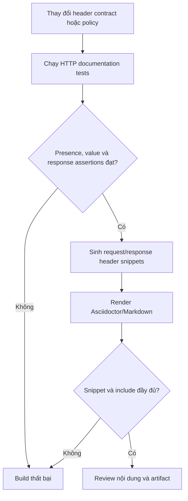

# Header bắt buộc, tùy chọn và giá trị mặc định

## Mục tiêu học tập

Sau bài này, bạn có thể:

- Phân biệt header bắt buộc, header tùy chọn và header có giá trị mặc định trong hợp đồng REST API.
- Mô tả header request/response bằng Spring REST Docs với `requestHeaders(...)`, `responseHeaders(...)` và `headerWithName(...)`.
- Sử dụng `optional()` đúng nghĩa và hiểu vì sao nó không thay thế validation hoặc cấu hình mặc định của ứng dụng.
- Viết HTTP test cho trường hợp có header, thiếu header và giá trị header không hợp lệ.
- Phân biệt header vắng mặt, header có giá trị rỗng và header được server tự thêm; kiểm tra behavior thay vì suy đoán từ code.
- Bảo vệ token, cookie và dữ liệu nhạy cảm khi sinh snippet và phát hành tài liệu.

## 1. Header là một phần của hợp đồng HTTP

Header truyền metadata về request hoặc response. Nó có thể chỉ ra media type, xác thực, cache, điều kiện cập nhật, định danh truy vết hoặc thông tin liên quan đến tài nguyên.

Ví dụ request:

```http
POST /api/orders HTTP/1.1
Content-Type: application/json
Accept: application/json
Authorization: Bearer <access-token>
Idempotency-Key: 7b1a4b8d-0c1f-4c92-a09a-82a3b7b1a001

{"customerId":7,"quantity":2}
```

Ví dụ response:

```http
HTTP/1.1 201 Created
Content-Type: application/json
Location: /api/orders/43
X-Request-Id: req-8f21

{"id":43,"status":"CREATED"}
```

Người tích hợp cần biết header nào phải gửi, header nào được phép bỏ qua, giá trị nào được chấp nhận, và server có trả header nào để client sử dụng hay không.

### 1.1. Phân loại theo hướng

| Nhóm | Ví dụ | Vai trò |
| --- | --- | --- |
| Request header | `Accept`, `Content-Type`, `Authorization`, `If-Match` | Client gửi metadata hoặc điều kiện để server xử lý request |
| Response header | `Content-Type`, `Location`, `ETag`, `Cache-Control` | Server mô tả response hoặc hướng dẫn client xử lý tiếp |
| Header theo ứng dụng | `Idempotency-Key`, `X-Request-Id`, `X-Tenant-Id` | Quy tắc riêng của API, cần mô tả theo hợp đồng thực tế |

Không phải mọi header đều cần được đưa vào bảng tài liệu. Hãy ưu tiên header ảnh hưởng đến việc tích hợp, hành vi hoặc xử lý response. Tránh công bố header nội bộ không dành cho consumer.

## 2. Header bắt buộc, tùy chọn và mặc định

Ba khái niệm này trả lời ba câu hỏi khác nhau:

- **Bắt buộc (required):** client phải gửi header trong request thuộc tình huống đó; nếu thiếu, API có thể từ chối hoặc xử lý theo quy tắc đã công bố.
- **Tùy chọn (optional):** client có thể gửi hoặc bỏ qua header; server xử lý cả hai trường hợp theo hợp đồng.
- **Có giá trị mặc định (default):** khi client bỏ qua header, server áp dụng một giá trị/hành vi mặc định đã xác định. Default có thể được thực hiện bởi ứng dụng, framework hoặc tầng trung gian.

| Ví dụ | Phân loại có thể gặp | Điều cần công bố |
| --- | --- | --- |
| `Content-Type` của endpoint chỉ nhận JSON | Bắt buộc trong request có body | Media type được hỗ trợ và phản hồi khi gửi sai/thiếu |
| `Accept` nếu API chỉ trả JSON | Có thể tùy chọn nếu server mặc định JSON | Giá trị client có thể gửi và representation server chọn |
| `Authorization` cho endpoint bảo vệ | Bắt buộc theo security policy | Scheme, credential cần gửi, cách xử lý thiếu/sai quyền |
| `If-Match` trên thao tác cập nhật có điều kiện | Bắt buộc nếu API yêu cầu optimistic concurrency | Ý nghĩa validator, phản hồi khi thiếu hoặc không khớp |
| `X-Client-Locale` | Có thể tùy chọn | Server chọn locale mặc định nào khi không có header, nếu có cam kết |
| `Idempotency-Key` | Bắt buộc hoặc tùy chọn tùy thiết kế thao tác | Phạm vi key, thời gian hiệu lực và behavior khi gửi lặp |

Đây là các ví dụ minh họa. Tính bắt buộc và default phải được xác định theo **hợp đồng endpoint cụ thể**, không thể suy ra chỉ từ tên header hoặc thói quen của một framework.

### 2.1. Không nhầm “không được mô tả” với “tùy chọn”

Một header không xuất hiện trong bảng tài liệu chưa chắc là optional. Có thể tác giả quên mô tả, test chưa gửi header, hoặc header không thuộc phạm vi tài liệu của snippet đó.

Để tuyên bố một header tùy chọn, cần xác định:

1. Client có được phép bỏ qua không?
2. Nếu bỏ qua, server làm gì?
3. Nếu gửi, giá trị và định dạng nào hợp lệ?
4. Có điều kiện nào khiến header bắt buộc chỉ trong một số thao tác?
5. Test nào xác minh được từng trường hợp?

## 3. Mô tả request header bằng Spring REST Docs

Spring REST Docs sử dụng `requestHeaders(...)` cùng `headerWithName(...)` để tạo snippet mô tả request header.

```java
requestHeaders(
    headerWithName("Content-Type")
        .description("Media type của request body; endpoint nhận application/json"),
    headerWithName("Authorization")
        .description("Bearer access token của caller")
)
```

Descriptor xác định tên header và phần giải thích. Nó không tự yêu cầu client gửi header ở mọi endpoint, không tự sinh token, và không cấu hình security.

### 3.1. Header bắt buộc trong test

Giả sử endpoint tạo đơn hàng yêu cầu `Content-Type: application/json` và `Idempotency-Key`. Test gửi các header đó và ghi tài liệu:

```java
mockMvc.perform(post("/api/orders")
        .contentType(MediaType.APPLICATION_JSON)
        .header("Idempotency-Key", "test-order-001")
        .content("""
            {"customerId":7,"quantity":2}
            """))
    .andExpect(status().isCreated())
    .andDo(document("orders-create",
        requestHeaders(
            headerWithName("Content-Type")
                .description("Media type của request body; phải là application/json"),
            headerWithName("Idempotency-Key")
                .description("Khóa chống tạo thao tác trùng theo chính sách API")
        )
    ));
```

Ví dụ giả định endpoint có policy idempotency. Trong dự án thật, cần bổ sung response fields/headers và assertion phù hợp; fixture `test-order-001` phải không gây phụ thuộc thứ tự test. Không dùng khóa idempotency thật từ production.

### 3.2. Header tùy chọn với `optional()`

Nếu header được phép vắng mặt trong một exchange hợp lệ, descriptor có thể đánh dấu:

```java
requestHeaders(
    headerWithName("X-Client-Locale")
        .description("Locale mong muốn; nếu bỏ qua, server dùng locale mặc định")
        .optional()
)
```

`optional()` cho biết header có thể không xuất hiện trong request được tài liệu hóa. Đây là metadata của descriptor, không phải cấu hình ứng dụng để tự điền header mặc định.

Ví dụ nếu API cam kết locale mặc định là `vi-VN`, vẫn cần test không gửi `X-Client-Locale` và xác minh nội dung response hoặc behavior tương ứng. Nếu chỉ test request có header, descriptor optional một mình không chứng minh server xử lý trường hợp vắng mặt.

### 3.3. Header không có giá trị mặc định ở phía client

Một API có thể không yêu cầu client gửi `X-Request-Id`; server/gateway tự sinh request ID và trả về trong response. Khi đó:

- `X-Request-Id` không phải request header bắt buộc của client.
- Nếu client tự gửi correlation ID, cần mô tả quy tắc tiếp nhận/ghi đè theo behavior thực tế.
- Response có thể luôn chứa `X-Request-Id`; cần test và mô tả response header riêng.

Đừng ghi một request header vào danh sách bắt buộc chỉ vì test harness đã tự động thêm header đó.

## 4. Phân biệt header vắng mặt, rỗng và giá trị mặc định

Ba request dưới đây có thể dẫn đến hành vi khác nhau:

```http
GET /api/orders HTTP/1.1
Accept: application/json
```

```http
GET /api/orders HTTP/1.1
Accept: application/json
X-Client-Locale:
```

```http
GET /api/orders HTTP/1.1
Accept: application/json
X-Client-Locale: vi-VN
```

- Request thứ nhất không có header `X-Client-Locale`.
- Request thứ hai có header nhưng giá trị rỗng.
- Request thứ ba có header với giá trị cụ thể.

Nếu contract nói header optional, điều đó không tự cho biết giá trị rỗng được chấp nhận hay không. Cần xác minh cách server xử lý cả trường hợp absent và empty nếu người dùng API có thể gặp chúng.

Tương tự, default không phải là một header được tự động gửi trong request. Default có thể là hành vi nội bộ của server khi đọc request không có header.

## 5. Header mặc định: phải kiểm chứng ở đúng phía

Default có thể tồn tại ở nhiều tầng:

| Nguồn default | Ví dụ | Nơi cần xác minh |
| --- | --- | --- |
| Client library | Client tự thêm `Accept` hoặc `User-Agent` | Request thực tế được gửi ra |
| API gateway/proxy | Thêm correlation header hoặc rewrite header | Integration test qua gateway hoặc bằng chứng cấu hình phù hợp |
| Spring/application | Chọn locale hoặc media type khi header vắng mặt | MVC/WebFlux test với cấu hình ứng dụng |
| Response policy | Server luôn trả `Cache-Control` hoặc `X-Request-Id` | Assertion response header trong HTTP test |

Đừng gán default cho API chỉ vì một client cụ thể tự thêm header. Tài liệu REST API mô tả nghĩa vụ và hành vi của provider/consumer ở ranh giới đã chọn.

### 5.1. Ví dụ test xác minh default locale

Giả sử ứng dụng trả response được bản địa hóa theo `X-Client-Locale`, mặc định `vi-VN`. Một test có thể bỏ header:

```java
@Test
void usesDefaultLocaleWhenHeaderIsAbsent() throws Exception {
    mockMvc.perform(get("/api/catalog")
                    .accept(MediaType.APPLICATION_JSON))
            .andExpect(status().isOk())
            .andExpect(jsonPath("$.locale").value("vi-VN"));
}
```

Test này mới chứng minh response trong context đang test chứa locale `vi-VN`. Nếu locale được chọn ở gateway hoặc một service ngoài application context, test cô lập có thể không đủ; cần kiểm thử qua đúng tầng tạo default.

## 6. Mô tả response header

Đối với response header, dùng `responseHeaders(...)`:

```java
responseHeaders(
    headerWithName("Location")
        .description("URI của đơn hàng vừa được tạo"),
    headerWithName("X-Request-Id")
        .description("Mã truy vết request để đối chiếu log")
)
```

Test cần xác minh header thực sự có trong response:

```java
mockMvc.perform(post("/api/orders")
        .contentType(MediaType.APPLICATION_JSON)
        .content("""
            {"customerId":7,"quantity":2}
            """))
    .andExpect(status().isCreated())
    .andExpect(header().string("Location", "/api/orders/43"))
    .andExpect(header().exists("X-Request-Id"))
    .andDo(document("orders-create",
        responseHeaders(
            headerWithName("Location")
                .description("URI của đơn hàng vừa được tạo"),
            headerWithName("X-Request-Id")
                .description("Mã truy vết request")
        )
    ));
```

Trong test thực tế, nếu `X-Request-Id` được sinh ngẫu nhiên, assertion chỉ kiểm tra presence hoặc định dạng nếu đó là điều hợp đồng đảm bảo; tránh cố định một giá trị không ổn định. Nếu header được tạo ở gateway, test phải đi qua gateway mới có thể chứng minh behavior đó.

## 7. Header bắt buộc không đồng nghĩa chỉ có descriptor

Một lỗi phổ biến là cho rằng khai báo:

```java
requestHeaders(
    headerWithName("Authorization")
        .description("Bearer token")
)
```

sẽ khiến API từ chối request thiếu `Authorization`. Điều đó không đúng. Descriptor chỉ tạo bảng mô tả; hành vi bắt buộc phải được thực thi bởi security/configuration và xác nhận bằng test.

Ví dụ test cho endpoint được bảo vệ:

```java
@Test
void rejectsMissingAuthorizationHeader() throws Exception {
    mockMvc.perform(get("/api/me")
                    .accept(MediaType.APPLICATION_JSON))
            .andExpect(status().isUnauthorized());
}
```

Test trên cần security filter chain được nạp trong test context. Nếu dùng `standaloneSetup` không có security configuration, kết quả có thể không phản ánh ứng dụng thật.

Một test khác có token hợp lệ có thể tạo snippet thành công:

```java
mockMvc.perform(get("/api/me")
        .header(HttpHeaders.AUTHORIZATION, "Bearer test-token")
        .accept(MediaType.APPLICATION_JSON))
    .andExpect(status().isOk())
    .andDo(document("current-user",
        requestHeaders(
            headerWithName(HttpHeaders.AUTHORIZATION)
                .description("Bearer access token; bắt buộc với endpoint này")
        )
    ));
```

`test-token` là giá trị giả minh họa. Cách tạo authentication test nên dùng cơ chế test security được dự án hỗ trợ thay vì phát hành token thật hoặc phụ thuộc vào một credential đã hết hạn.

## 8. Header và validation giá trị

Có mặt header chưa có nghĩa giá trị hợp lệ. Ví dụ:

| Header | Kiểm tra sự hiện diện | Kiểm tra giá trị |
| --- | --- | --- |
| `Content-Type` | Request có header không? | Có thuộc media type hỗ trợ không? |
| `Authorization` | Credential có được gửi không? | Token hợp lệ, hết hạn, issuer/scope đúng không? |
| `If-Match` | Conditional header có mặt không? | ETag có khớp representation hiện tại không? |
| `Idempotency-Key` | Key có được gửi không? | Định dạng, độ dài, phạm vi và reuse policy có hợp lệ không? |
| `X-Client-Locale` | Header có mặt không? | Locale có thuộc allowlist được hỗ trợ không? |

Spring REST Docs mô tả tên header và descriptor; validation là hành vi của ứng dụng. Cần assertion riêng cho giá trị sai:

```java
@Test
void rejectsUnsupportedContentType() throws Exception {
    mockMvc.perform(post("/api/orders")
                    .contentType(MediaType.TEXT_PLAIN)
                    .content("customerId=7"))
            .andExpect(status().isUnsupportedMediaType());
}
```

Status cụ thể phụ thuộc endpoint và cách xử lý lỗi thực tế. Không suy đoán status từ bảng ví dụ; hãy chạy test trên cấu hình ứng dụng phù hợp và assert kết quả contract đã xác định.

## 9. Header nhạy cảm và bảo vệ snippet

Không đưa credential thật vào tài liệu. Các header cần đặc biệt cẩn trọng:

- `Authorization`
- `Cookie` và `Set-Cookie`
- Header chứa API key hoặc chữ ký
- Header nội bộ có định danh tenant, user hoặc thông tin vận hành nhạy cảm

Biện pháp:

1. Dùng fixture/token giả dành riêng cho test.
2. Không lấy request nguyên vẹn từ production rồi đưa vào snippet.
3. Áp dụng preprocessors hoặc cơ chế che dữ liệu của Spring REST Docs khi cần.
4. Kiểm tra lại `http-request`, `request-headers` và `http-response` trước khi phát hành.
5. Không công bố header nội bộ nếu consumer không cần biết.

Ví dụ cấu hình preprocessor có thể che header xác thực:

```java
document("current-user",
    preprocessRequest(removeHeaders("Authorization")),
    requestHeaders(
        headerWithName("Authorization")
            .description("Bearer access token; bắt buộc")
    )
)
```

Nếu loại bỏ giá trị header khỏi HTTP snippet, bảng descriptor vẫn mô tả header cần có; cần đảm bảo nội dung đầu ra không vô tình lộ credential. API test cũng nên dùng giá trị giả, bởi preprocessor không phải lý do để đưa bí mật production vào test.

## 10. Ghép request/response header snippet bằng Asciidoctor

Sau khi documentation test sinh snippet, trang AsciiDoc có thể include:

```asciidoc
== Tạo đơn hàng

Endpoint yêu cầu JSON request body và khóa idempotency theo chính sách API.

=== Request headers
include::{snippets}/orders-create/request-headers.adoc[]

=== HTTP request
include::{snippets}/orders-create/http-request.adoc[]

=== Response headers
include::{snippets}/orders-create/response-headers.adoc[]

=== HTTP response
include::{snippets}/orders-create/http-response.adoc[]
```

Thuộc tính `{snippets}` cần trỏ đúng output directory. Asciidoctor ghép nội dung; nó không xác minh header có bắt buộc hay default ở server hay không. Những điều đó đến từ hợp đồng, test và phần diễn giải do tác giả viết.

Với Markdown, cần template snippet và công cụ include/ghép phù hợp. Markdown chuẩn không hỗ trợ cú pháp `include::{snippets}/...[]` của Asciidoctor.

## 11. Build và CI

Luồng kiểm tra header nên bao gồm test cho các trường hợp quan trọng, sinh snippet rồi render:



Với Gradle, cần đảm bảo task test sinh snippet trước task Asciidoctor:

```groovy
def snippetsDir = file("$buildDir/generated-snippets")

tasks.named('test') {
    outputs.dir snippetsDir
}

tasks.named('asciidoctor') {
    inputs.dir snippetsDir
    dependsOn tasks.named('test')
}
```

Đây là phần minh họa dependency giữa task; dự án cần plugin, dependency REST Docs và cấu hình snippets attribute phù hợp. Dùng output sạch khi phát hành để không include snippet cũ. Kiểm tra missing include và render error có thực sự làm CI thất bại.

## 12. Lỗi thường gặp

| Biểu hiện | Nguyên nhân có thể | Cách xử lý |
| --- | --- | --- |
| Test báo request header chưa được mô tả | Request có header mới nhưng descriptor chưa cập nhật | Xác nhận header thuộc contract; thêm descriptor hoặc điều tra header ngoài ý muốn |
| Descriptor header không tìm thấy trong request | Test không gửi header đó | Gửi header nếu required trong kịch bản; hoặc đánh dấu optional nếu hợp đồng cho phép |
| optional() nhưng server vẫn từ chối khi thiếu | Descriptor không cấu hình validation | Kiểm tra security/validation của ứng dụng và mô tả đúng contract |
| Tài liệu ghi default nhưng server không áp dụng | Default chỉ được ghi trong prose, chưa triển khai/test | Thêm behavior thực tế và test vắng header |
| Header có mặt nhưng giá trị sai vẫn được chấp nhận | Chưa có kiểm tra value hoặc test chưa bao phủ | Bổ sung validator/assertion theo contract |
| X-Request-Id không xuất hiện ở MockMvc | Header được thêm bởi gateway hoặc filter chưa được nạp | Chạy test qua đúng tầng tạo header |
| Snippet lộ token | Request dùng credential thật hoặc thiếu preprocess | Dùng dữ liệu giả, che header và review artifact |
| Tài liệu không có response headers | Test chỉ dùng requestHeaders | Khai báo responseHeaders và assert response header tương ứng |

## 13. Checklist tài liệu hóa header

- [ ] Xác định header thuộc request hay response.
- [ ] Phân loại rõ required, optional và default theo từng endpoint.
- [ ] Mô tả tên, định dạng, giá trị cho phép và ngữ nghĩa.
- [ ] Kiểm tra absent, empty và valid value khi các trường hợp đó có ý nghĩa.
- [ ] Dùng optional() chỉ cho header có thể vắng mặt theo contract.
- [ ] Viết assertion cho presence, value và response behavior.
- [ ] Test được chạy với filter/gateway/context cần thiết.
- [ ] Không lộ Authorization, Cookie, API key hoặc thông tin nhạy cảm.
- [ ] Sinh lại request/response header snippet và kiểm tra output.

## 14. Bài tập thực hành

Endpoint `GET /api/reports` có hợp đồng giả định:

- `Authorization` bắt buộc; caller phải có quyền `REPORT_READ`.
- `Accept` có thể bỏ qua; nếu vắng mặt server trả JSON.
- `X-Client-Locale` tùy chọn; mặc định `vi-VN`.
- Response luôn có `Content-Type` và `X-Request-Id`.

Hãy thực hiện:

1. Viết `requestHeaders(...)` mô tả ba request header, dùng `.optional()` cho những header được phép vắng mặt.
2. Viết test thiếu `Authorization` và test token hợp lệ; xác minh status/body theo security configuration thực tế.
3. Viết test bỏ `Accept`, kiểm tra representation/default media type server chọn.
4. Viết test bỏ `X-Client-Locale`, xác minh response dùng locale mặc định; sau đó test với locale hợp lệ khác.
5. Dùng `responseHeaders(...)` để mô tả `Content-Type` và `X-Request-Id`, đồng thời assert sự hiện diện/định dạng cần thiết.
6. Tạo snippet sao cho không chứa token thật; include các bảng header vào trang Asciidoctor và chạy build sạch.

**Câu hỏi tự kiểm tra:** Đánh dấu `Authorization` là `.optional()` trong descriptor có khiến endpoint chấp nhận request không có token không? Không. Descriptor chỉ mô tả khả năng header vắng mặt trong snippet; security policy và test mới quyết định request đó được chấp nhận hay bị từ chối.

## Kết luận

Header bắt buộc, tùy chọn và mặc định là các phần khác nhau của hợp đồng HTTP. Spring REST Docs dùng `requestHeaders(...)` và `responseHeaders(...)` để mô tả header; `optional()` chỉ nói header có thể vắng mặt trong exchange được tài liệu hóa, không cấu hình default hoặc validation cho server. Muốn tài liệu đáng tin, cần test riêng trường hợp header có/không có, giá trị hợp lệ/không hợp lệ và response header được tạo ở đúng tầng. Sau đó sinh snippet, che credential nhạy cảm, ghép với phần giải thích bằng Asciidoctor/Markdown và kiểm tra trên CI. Khi mô tả đúng nghĩa vụ của client và behavior của server, bảng header mới giúp người tích hợp gửi request và xử lý response chính xác.
