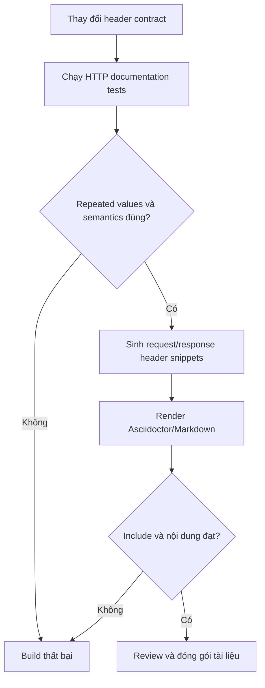

# Header lặp hoặc có nhiều giá trị

## Mục tiêu học tập

Sau bài này, bạn có thể:

- Phân biệt một header xuất hiện trên nhiều dòng với một header có danh sách giá trị phân tách bằng dấu phẩy.
- Hiểu cách Spring REST Docs mô tả một tên header bằng requestHeaders(...) và responseHeaders(...), kể cả khi HTTP exchange chứa nhiều giá trị.
- Viết test MockMvc cho request/response có header nhiều giá trị và kiểm tra đúng những gì client quan sát được.
- Nhận biết các header dạng list như Accept, Accept-Language, Cache-Control và Vary.
- Xử lý Set-Cookie như trường hợp đặc biệt không được gộp các giá trị cookie bằng dấu phẩy.
- Mô tả quy tắc lặp, thứ tự, giới hạn và cách diễn giải giá trị theo hợp đồng API.

## 1. Vì sao một header có thể có nhiều giá trị?

HTTP header không phải lúc nào cũng là một cặp tên/giá trị đơn giản. Một số field cho phép mang danh sách giá trị. Một số field có thể được gửi thành nhiều dòng cùng tên. Vì vậy, khi xem request hoặc response, bạn có thể gặp các dạng như:

**Một dòng chứa danh sách:**

```http
Accept: application/json, application/xml
```

**Nhiều dòng cùng tên:**

```http
X-Feature: preview
X-Feature: audit
```

**Nhiều dòng cookie trong response:**

```http
Set-Cookie: session=abc123; Path=/; HttpOnly; Secure
Set-Cookie: preference=compact; Path=/; SameSite=Lax
```

Các ví dụ trên không cùng một semantics:

- Accept là một field có cú pháp danh sách media range; các giá trị thường được biểu diễn bằng dấu phẩy trong cùng field line.
- X-Feature là header tùy biến trong ví dụ; contract của ứng dụng phải định nghĩa liệu nhiều dòng có được hỗ trợ và ý nghĩa của chúng.
- Set-Cookie thường xuất hiện nhiều lần, mỗi dòng biểu diễn một cookie riêng. Không gộp chúng thành một danh sách phân tách bằng dấu phẩy.

**Điều quan trọng khi viết tài liệu:** mô tả cách client được phép gửi và cần diễn giải header, không chỉ chép lại chuỗi header nhìn thấy trong một test.

## 2. Phân biệt repeated field lines với comma-separated values

Hai dạng sau có thể trông gần giống nhau nhưng không được xem là tương đương trong mọi trường hợp.

| Dạng | Ví dụ | Ý nghĩa |
| --- | --- | --- |
| Nhiều field line | X-Tag: priority và X-Tag: fragile | Cùng một tên header xuất hiện nhiều lần |
| Một field line có list | X-Tag: priority, fragile | Một giá trị field chứa danh sách được phân tách theo cú pháp của header |
| Nhiều cookie | Nhiều dòng Set-Cookie | Cookie riêng biệt; không gộp tùy tiện |

HTTP cho phép kết hợp một số field line cùng tên thành một field value phân tách bằng dấu phẩy nếu định nghĩa của field đó cho phép. Tuy nhiên, không phải field nào cũng có cú pháp list hoặc có thể kết hợp an toàn. Set-Cookie là trường hợp quan trọng cần giữ riêng từng dòng.

Không nên tự suy luận rằng header tùy biến X-Tag có thể lặp chỉ vì nó bắt đầu bằng X-. Tài liệu và implementation phải định nghĩa rõ:

- Client gửi nhiều field line hay một dòng có dấu phẩy?
- Server xem chúng là danh sách, nhiều giá trị độc lập hay từ chối request?
- Có thứ tự ưu tiên không?
- Có giới hạn số phần tử hoặc độ dài không?
- Nếu gửi cả hai cách, server xử lý thế nào?

## 3. Danh sách giá trị trong các header phổ biến

Một số header tiêu chuẩn có cú pháp cho phép nhiều thành phần:

| Header | Ví dụ | Ý nghĩa cần lưu ý |
| --- | --- | --- |
| Accept | application/json, application/problem+json | Các media range client chấp nhận; có thể có tham số q thể hiện trọng số ưu tiên |
| Accept-Language | vi-VN, en-US;q=0.8 | Danh sách ngôn ngữ và trọng số ưu tiên |
| Cache-Control | no-cache, no-store | Có thể gồm nhiều directive, mỗi directive có semantics riêng |
| Vary | Accept-Encoding, Accept-Language | Nêu các request header ảnh hưởng đến representation được cache |
| Allow | GET, HEAD, OPTIONS | Các method được hỗ trợ cho resource trong response tương ứng |
| Set-Cookie | Nhiều dòng riêng | Cookie riêng biệt; không xem dấu phẩy là delimiter để ghép nhiều cookie |

Danh sách giá trị không nhất thiết là một tập không có thứ tự. Ví dụ Accept và Accept-Language có thể dùng tham số q để thể hiện ưu tiên. Không được loại bỏ thứ tự hoặc trọng số trong tài liệu nếu chúng ảnh hưởng lựa chọn representation.

### 3.1. Dấu phẩy không phải delimiter chung cho mọi header

Không được viết một parser đơn giản kiểu value.split(",") cho mọi header. Một số cú pháp có quoted string hoặc tham số khiến dấu phẩy có thể xuất hiện trong thành phần dữ liệu. Cách parse phải theo định nghĩa của từng field.

Ví dụ, Set-Cookie có thể chứa thuộc tính Expires với ngày có dấu phẩy:

```http
Set-Cookie: session=abc123; Expires=Wed, 21 Oct 2026 07:28:00 GMT; Path=/
```

Nếu ghép hai Set-Cookie bằng dấu phẩy rồi tách lại, client có thể hiểu sai ranh giới cookie và thuộc tính Expires. Vì thế, mỗi cookie cần được giữ thành field line riêng.

## 4. Spring REST Docs mô tả header nhiều giá trị ra sao?

Spring REST Docs dùng descriptor theo tên header, không tạo một descriptor riêng cho từng giá trị của cùng một header:

```java
requestHeaders(
    headerWithName("X-Feature")
        .description("Các feature flag mà client yêu cầu; API cho phép gửi nhiều giá trị")
)
```

Hoặc với response:

```java
responseHeaders(
    headerWithName("Vary")
        .description("Các request header ảnh hưởng đến lựa chọn representation")
)
```

Descriptor giúp tạo bảng header và xác nhận header được mô tả phù hợp với HTTP exchange. Nó không tự quy định parser của header, không tự biến nhiều dòng thành danh sách theo semantics của ứng dụng, cũng không chứng minh thứ tự hoặc quy tắc ưu tiên có đúng hay không.

**Phần giải thích cần nói rõ định dạng.** Ví dụ: “Gửi một dòng X-Feature cho mỗi feature; server hợp nhất các giá trị thành tập feature được yêu cầu.” Chỉ viết nội dung này nếu implementation thực sự làm như vậy.

## 5. Thực hành với MockMvc: request có nhiều dòng cùng tên

Giả sử endpoint báo cáo nhận nhiều giá trị X-Feature. Trong test MockMvc, header(name, values...) có thể thiết lập nhiều giá trị cho cùng một request header:

```java
@Test
void acceptsRepeatedFeatureHeaders() throws Exception {
    mockMvc.perform(get("/api/report")
                    .header("X-Feature", "preview", "audit")
                    .accept(MediaType.APPLICATION_JSON))
            .andExpect(status().isOk())
            .andExpect(jsonPath("$.features[0]").value("preview"))
            .andExpect(jsonPath("$.features[1]").value("audit"))
            .andDo(document("report-repeated-features",
                    requestHeaders(
                            headerWithName("X-Feature")
                                    .description("Các feature được yêu cầu; có thể gửi nhiều giá trị")
                    )
            ));
}
```

Đây là ví dụ giả định về API tùy biến. Controller cần bind và xử lý header theo đúng cách ứng dụng đã thiết kế; các assertion về thứ tự chỉ phù hợp nếu thứ tự là một phần của contract. Nếu API xem các feature như tập không thứ tự, nên assert membership hoặc kết quả nghiệp vụ thay vì phụ thuộc vào index.

Khi đọc snippet http-request, hãy kiểm tra cách giá trị được hiển thị. Một số tầng HTTP/test có thể biểu diễn nhiều giá trị dưới dạng kết hợp, vì vậy snippet không nhất thiết bảo toàn cách client ban đầu viết từng field line. Nếu khác biệt này quan trọng, bổ sung mô tả prose và test ở tầng phù hợp.

### 5.1. Mô tả một header list-valued

Với Accept-Language, thường gửi một field line chứa danh sách và trọng số:

```java
mockMvc.perform(get("/api/catalog")
        .header("Accept-Language", "vi-VN, en-US;q=0.8")
        .accept(MediaType.APPLICATION_JSON))
    .andExpect(status().isOk())
    .andDo(document("catalog-language",
        requestHeaders(
            headerWithName("Accept-Language")
                .description("Danh sách ngôn ngữ ưu tiên; q là trọng số ưu tiên từ 0 đến 1")
        )
    ));
```

Không nên tạo hai descriptor Accept-Language chỉ vì header có hai language tag. Descriptor đại diện cho field; nội dung mô tả giải thích cú pháp list và trọng số.

## 6. Response header có nhiều giá trị

Server cũng có thể trả header lặp. Ví dụ một response có hai cookie:

```java
@Test
void returnsSeparateCookies() throws Exception {
    mockMvc.perform(get("/api/session"))
            .andExpect(status().isOk())
            .andExpect(header().exists("Set-Cookie"))
            .andDo(document("session-response",
                    responseHeaders(
                            headerWithName("Set-Cookie")
                                    .description("Cookie do server phát hành; mỗi cookie được trả trên field line riêng")
                    )
            ));
}
```

Test trên chỉ kiểm tra header hiện diện và sinh descriptor. Nếu contract yêu cầu hai cookie cụ thể, nên kiểm tra chúng theo cách giữ nguyên từng giá trị:

```java
MvcResult result = mockMvc.perform(get("/api/session"))
        .andExpect(status().isOk())
        .andReturn();

List<String> cookies = result.getResponse().getHeaders("Set-Cookie");

assertThat(cookies).hasSize(2);
assertThat(cookies).anyMatch(value -> value.startsWith("session="));
assertThat(cookies).anyMatch(value -> value.startsWith("preference="));
```

Đoạn kiểm tra dùng AssertJ; cần có dependency/assertion library phù hợp. Không nối các giá trị Set-Cookie bằng dấu phẩy để assert một chuỗi duy nhất. Với REST Docs, một descriptor headerWithName("Set-Cookie") mô tả field; hãy kiểm tra snippet đầu ra để chắc rằng giá trị được trình bày dễ hiểu và không tiết lộ cookie thật.

## 7. Thứ tự của nhiều giá trị

Không phải API nào cũng cần bảo toàn thứ tự:

| Loại header | Có thể cần giữ thứ tự? | Cách kiểm tra phù hợp |
| --- | --- | --- |
| Accept | Có thể ảnh hưởng ưu tiên, nhất là khi có q | Kiểm tra representation được chọn theo thứ tự/trọng số |
| Accept-Language | Có thể ảnh hưởng ngôn ngữ được chọn | Assert locale/representation theo quy tắc negotiation |
| X-Feature tùy biến | Tùy contract; nhiều API coi là tập | Assert thứ tự nếu được cam kết, nếu không kiểm tra tập giá trị |
| Vary | Thường mô tả các chiều ảnh hưởng cache; đừng dựa vào thứ tự chuỗi nếu contract không nói | Kiểm tra các token cần có và semantics cache |
| Set-Cookie | Mỗi cookie độc lập; client không nên phụ thuộc thứ tự trừ khi có quy tắc riêng | Kiểm tra từng field value/cookie tách biệt |

Nếu thứ tự quan trọng với client, ghi rõ trong phần mô tả và tạo test thể hiện nó. Nếu không quan trọng, tránh assertion cứng vào thứ tự vì có thể làm test mong manh khi framework thay đổi cách biểu diễn.

## 8. Kiểm tra header trùng lặp và chống nhập nhằng

Một API cần quyết định cách xử lý các trường hợp:

- Cùng header xuất hiện nhiều lần với giá trị khác nhau.
- Cùng header xuất hiện nhiều lần nhưng có giá trị trùng.
- Cùng tên header xuất hiện cả ở dạng nhiều dòng lẫn một dòng comma-separated.
- Header có giá trị rỗng.
- Một giá trị không hợp lệ xuất hiện giữa các giá trị hợp lệ.
- Số lượng hoặc tổng độ dài vượt giới hạn.

Ví dụ, nếu X-Feature chỉ nhận preview và audit, API cần xác định xử lý X-Feature: preview cùng X-Feature: unknown thế nào: từ chối toàn request, bỏ qua giá trị lạ hay xử lý theo một policy khác. Đừng để behavior phụ thuộc ngẫu nhiên vào thứ tự đọc header.

Test có thể minh họa:

```java
@Test
void rejectsUnknownFeatureValue() throws Exception {
    mockMvc.perform(get("/api/report")
                    .header("X-Feature", "preview", "unknown"))
            .andExpect(status().isBadRequest());
}
```

Status 400 ở đây chỉ là ví dụ contract. Với ứng dụng thật, hãy assert status và error body đã được thống nhất. Nếu cần tài liệu hóa lỗi, tạo snippet riêng cho tình huống đó.

## 9. Dùng REST Docs descriptor và snippet đúng cách

Ví dụ một đoạn document đầy đủ hơn:

```java
document("report-repeated-features",
    preprocessRequest(removeHeaders("Authorization")),
    requestHeaders(
        headerWithName("X-Feature")
            .description("Một hoặc nhiều feature; mỗi giá trị là một lần xuất hiện của header")
    ),
    responseHeaders(
        headerWithName("Vary")
            .description("Các request header ảnh hưởng đến representation")
    )
)
```

Đoạn trên chỉ minh họa cách tổ chức descriptor và preprocessor; chỉ đưa Authorization vào danh sách cần loại bỏ nếu request thực sự chứa nó. Không dùng preprocessor để che giấu một contract không rõ ràng. Nếu snippet đã gộp giá trị, phần mô tả vẫn cần nói rõ client nên gửi repeated line hay comma-separated list.

Không nên:

- Khai báo cùng một tên header thành nhiều descriptor chỉ để mô tả từng phần tử list.
- Ghi một giá trị mẫu là giá trị duy nhất được chấp nhận nếu API hỗ trợ danh sách.
- Dùng optional() để hàm ý header chấp nhận số lượng tùy ý.
- Dựa vào snippet duy nhất để suy ra thứ tự và quy tắc combine.
- Gộp Set-Cookie thành một chuỗi comma-separated.

Nên:

- Mô tả cú pháp, ví dụ và số lượng giá trị hợp lệ.
- Dùng test có nhiều giá trị và test biên.
- Assert semantics quan sát được, không chỉ header xuất hiện.
- Giữ riêng từng Set-Cookie trong test và tài liệu.
- Kiểm tra output snippet và giải thích mọi khác biệt do tầng HTTP biểu diễn.

## 10. Biên soạn snippet thành tài liệu Asciidoctor

Sau khi test sinh snippet, có thể include bảng request/response header:

```asciidoc
== Lọc báo cáo theo feature

Client có thể yêu cầu nhiều feature bằng cách gửi header X-Feature
nhiều lần. Mỗi giá trị phải thuộc tập feature được API hỗ trợ.

=== Request headers
include::{snippets}/report-repeated-features/request-headers.adoc[]

=== HTTP request
include::{snippets}/report-repeated-features/http-request.adoc[]

=== Response headers
include::{snippets}/report-repeated-features/response-headers.adoc[]
```

Thuộc tính {snippets} phải trỏ đúng output directory. Đoạn văn về repeated field line, cú pháp list, thứ tự và giới hạn là nội dung do tác giả viết; cần đối chiếu với implementation/test.

Với Markdown, cần template snippet và renderer hỗ trợ ghép/include. Cú pháp include::{snippets}/...[] ở ví dụ là của Asciidoctor, không phải Markdown chuẩn.

## 11. Build và CI

Luồng kiểm tra:



Với Gradle, test phải sinh snippet trước khi Asciidoctor đọc chúng:

```groovy
def snippetsDir = file("$buildDir/generated-snippets")

tasks.named('test') {
    outputs.dir snippetsDir
}

tasks.named('asciidoctor') {
    inputs.dir snippetsDir
    dependsOn tasks.named('test')
}
```

Đây là phần minh họa task dependency; dự án vẫn cần plugin, dependency REST Docs và cấu hình snippets attribute tương ứng. Dùng output sạch khi phát hành để loại snippet cũ và kiểm tra missing include là lỗi CI nếu trang yêu cầu đầy đủ.

## 12. Lỗi thường gặp

| Biểu hiện | Nguyên nhân có thể | Cách xử lý |
| --- | --- | --- |
| Bảng chỉ hiển thị một giá trị trong khi client gửi nhiều | Tầng test hoặc snippet biểu diễn các giá trị đã kết hợp | Xem HTTP exchange, mô tả rõ list/repeated semantics và test ở tầng phù hợp |
| Tài liệu mô tả một header list thành nhiều header khác nhau | Nhầm phần tử list với tên field | Dùng một descriptor cho tên header và giải thích cú pháp nhiều giá trị |
| Test phụ thuộc thứ tự nhưng API không cam kết thứ tự | Assertion quá chặt | Assert tập giá trị hoặc behavior thực sự được cam kết |
| Set-Cookie bị parse sai | Ghép nhiều cookie bằng dấu phẩy | Giữ từng field value riêng và kiểm tra từng cookie |
| API chấp nhận giá trị lạ | Chưa có validation danh sách/giới hạn | Bổ sung policy và test theo hợp đồng |
| Header có giá trị rỗng được hiểu như vắng mặt | Ứng dụng chưa phân biệt hai tình huống | Xác định behavior, thêm test absent/empty |
| Snippet có header nội bộ hoặc cookie nhạy cảm | Không lọc dữ liệu test hoặc thiếu preprocessor | Dùng giá trị giả, che dữ liệu và review artifact |

## 13. Checklist tài liệu hóa header nhiều giá trị

- [ ] Xác định header có cú pháp list, repeated field line hay chỉ một giá trị.
- [ ] Kiểm tra định nghĩa của header; không tự áp dụng quy tắc comma-separation cho mọi field.
- [ ] Ghi rõ client phải gửi repeated lines hay một field line chứa danh sách.
- [ ] Mô tả thứ tự, trọng số, số lượng tối đa và allowlist khi chúng thuộc contract.
- [ ] Có test cho một giá trị, nhiều giá trị và giá trị không hợp lệ.
- [ ] Dùng một descriptor cho tên header trong requestHeaders/responseHeaders.
- [ ] Giữ riêng nhiều Set-Cookie và kiểm tra từng cookie.
- [ ] Kiểm tra snippet sau khi sinh để xác nhận cách biểu diễn dễ hiểu.
- [ ] Không phát hành cookie, token hoặc header nội bộ nhạy cảm.

## 14. Bài tập thực hành

Endpoint GET /api/search hỗ trợ:

- Accept-Language theo danh sách ngôn ngữ có trọng số.
- X-Category được gửi nhiều lần để lọc theo nhiều category.
- Response có Vary: Accept-Language, X-Category.
- Một endpoint đăng nhập riêng trả về hai cookie: session và preference.

Hãy thực hiện:

1. Viết requestHeaders(...) mô tả Accept-Language và X-Category.
2. Tạo test gửi X-Category hai lần với hai giá trị hợp lệ, rồi kiểm tra kết quả lọc.
3. Tạo test cho một category không hợp lệ và xác minh status/error body theo contract.
4. Kiểm tra negotiation khi thay đổi q của Accept-Language.
5. Dùng responseHeaders(...) mô tả Vary và kiểm tra các token cần có.
6. Với response đăng nhập, kiểm tra Set-Cookie có hai field value riêng; không nối thành một chuỗi comma-separated.
7. Sinh snippet, review output và include các bảng header trong Asciidoctor.

**Câu hỏi tự kiểm tra:** Nếu snippet hiển thị X-Category: book, office, điều đó có chứng minh client phải gửi một dòng duy nhất không? Không. Cần xem request builder, HTTP exchange và hợp đồng của API để biết server chấp nhận một list trong một dòng hay nhiều field line. Tài liệu phải nói rõ hình thức gửi được hỗ trợ.

## Kết luận

Header lặp và header có nhiều giá trị cần được hiểu theo cú pháp của từng field. Một số header dùng danh sách phân tách bằng dấu phẩy; một số có thể xuất hiện trên nhiều field line; Set-Cookie phải giữ từng cookie riêng. Spring REST Docs mô tả tên header bằng một descriptor, còn semantics về cách gửi, thứ tự, giới hạn và validation phải được giải thích và kiểm tra bằng HTTP test. Khi test có nhiều giá trị, assert behavior thực tế, kiểm tra snippet sau khi sinh và ghép với phần Asciidoctor/Markdown, tài liệu sẽ giúp client gửi và diễn giải header đúng cách.
