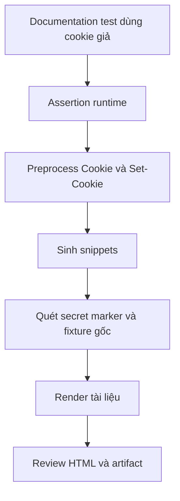

# Che giá trị session hoặc token trong snippet

## Mục tiêu học tập

Sau bài này, bạn có thể phân biệt Cookie request và Set-Cookie response, xác định giá trị session/token cần che, dùng preprocessor của Spring REST Docs cho đúng phía, giữ lại tên cookie và thuộc tính có ý nghĩa, xử lý response nhiều cookie và kiểm tra artifact trước khi phát hành.

## 1. Vì sao cookie cần được che?

Cookie thường mang trạng thái phiên, định danh đăng nhập hoặc token mà server dùng để nhận diện client. Nếu giá trị thật xuất hiện trong snippet, người đọc tài liệu hoặc người truy cập artifact có thể sao chép và sử dụng nó trong thời gian cookie còn hiệu lực.

Ví dụ request:

```http
GET /api/profile HTTP/1.1
Accept: application/json
Cookie: SESSION=8f7c9d0e-prod-session; theme=dark
```

Ví dụ response:

```http
HTTP/1.1 200 OK
Content-Type: application/json
Set-Cookie: SESSION=ab12cd34-session-secret; Path=/; HttpOnly; Secure; SameSite=Lax
Set-Cookie: refresh_token=eyJhbGciOi...; Path=/auth; HttpOnly; Secure; SameSite=Strict
```

SESSION và refresh_token trong ví dụ đại diện cho dữ liệu nhạy cảm. Người tích hợp thường cần biết tên cookie, mục đích, phạm vi, thời hạn và thuộc tính bảo mật; họ không cần giá trị xác thực thật.

Snippet có thể giữ thông tin hợp đồng trong khi thay giá trị bằng placeholder:

```http
Cookie: SESSION=<REDACTED>; theme=dark
```

```http
Set-Cookie: SESSION=<REDACTED>; Path=/; HttpOnly; Secure; SameSite=Lax
```

Tiền xử lý là một lớp bảo vệ cho pipeline tài liệu. Nó không thay thế fixture giả, quản lý secret, review artifact và kiểm soát quyền truy cập vào tài liệu.

## 2. Phân biệt Cookie và Set-Cookie

Hai header đi theo hai hướng khác nhau:

| Header | Hướng | Nội dung | Mục đích |
| --- | --- | --- | --- |
| Cookie | Request | Các cặp tên/giá trị cookie client gửi lại | Gửi thông tin cookie mà server đã cấp hoặc client quản lý |
| Set-Cookie | Response | Một cookie cùng các thuộc tính điều khiển | Yêu cầu client lưu, cập nhật hoặc xóa cookie |

Ví dụ client gửi:

```http
Cookie: SESSION=session-value; preference=compact
```

Server trả:

```http
Set-Cookie: SESSION=new-session-value; Path=/; HttpOnly; Secure
```

Trong request, Cookie thường chứa các cặp name=value. Các thuộc tính HttpOnly, Secure và SameSite được server thiết lập trong Set-Cookie ở response.

Không dùng cùng một cách xử lý cho cả hai mà không xem cấu trúc:

- Với Cookie, mục tiêu thường là thay giá trị của một hay nhiều cookie nhưng vẫn giữ tên cookie cần minh họa.
- Với Set-Cookie, cần giữ từng cookie và thuộc tính có ý nghĩa bảo mật; giá trị cookie cần được che riêng.

## 3. Giá trị nào cần che, thông tin nào nên giữ?

| Thành phần | Ví dụ | Cách xử lý thường phù hợp |
| --- | --- | --- |
| Session identifier | SESSION=... | Thay bằng placeholder; không công bố giá trị thực |
| Access/refresh token | access_token=... | Che giá trị; cân nhắc xóa nếu header không thuộc phạm vi hướng dẫn |
| CSRF token | XSRF-TOKEN=... | Che giá trị nhưng giữ cách client lấy/gửi token nếu đó là contract |
| Preference không nhạy cảm | theme=dark | Có thể giữ nếu hữu ích và không chứa dữ liệu cá nhân |
| Thuộc tính cookie | Path, HttpOnly, Secure, SameSite, Max-Age, Expires | Giữ nếu thuộc hành vi API cần tài liệu hóa |

Tên cookie và thuộc tính cho người tích hợp biết cookie hoạt động như thế nào. Giá trị session/token cần được thay bằng placeholder không thể sử dụng để tiếp tục phiên đăng nhập.

## 4. Tiền xử lý cookie trong Spring REST Docs

Spring REST Docs cho phép gắn operation preprocessor vào request hoặc response thông qua preprocessRequest(...) và preprocessResponse(...). Có thể:

- Thay giá trị header bằng placeholder.
- Xóa header không thuộc phạm vi tài liệu.
- Giữ nguyên header cần mô tả và làm sạch nội dung nhạy cảm.

Các thao tác thường gặp gồm modifyHeaders(...) để chỉnh header, removeHeaders(...) để loại bỏ header cụ thể và removeMatchingHeaders(...) để loại theo mẫu. Kiểm tra API tương ứng với phiên bản Spring REST Docs của dự án.

### 4.1. Thay request Cookie bằng giá trị mẫu

Nếu request chỉ cần minh họa một session cookie, có thể thay header trong preprocessor:

```java
import static org.springframework.restdocs.operation.preprocess.Preprocessors.modifyHeaders;
import static org.springframework.restdocs.operation.preprocess.Preprocessors.preprocessRequest;

mockMvc.perform(get("/api/profile")
        .cookie(new Cookie("SESSION", "documentation-session-secret"))
        .accept(MediaType.APPLICATION_JSON))
    .andExpect(status().isOk())
    .andDo(document("profile-get",
        preprocessRequest(
            modifyHeaders(headers ->
                headers.set("Cookie", "SESSION=<REDACTED>")
            )
        ),
        requestHeaders(
            headerWithName("Cookie")
                .description("Cookie phiên do server cấp; client gửi lại khi truy cập tài nguyên cần đăng nhập")
        )
    ));
```

Ví dụ minh họa việc giữ tên header và thay nội dung được ghi vào snippet. Test vẫn gửi cookie giả để ứng dụng thực hiện xác thực; preprocessor chỉ tác động lên exchange được ghi tài liệu. Cần kiểm tra API modifyHeaders và kiểu Headers của phiên bản REST Docs đang dùng để bảo đảm cách sửa header phù hợp.

Nếu request có nhiều cookie và muốn giữ một số cookie không nhạy cảm, hãy thay từng giá trị nhạy cảm theo tên cookie và giữ delimiter dấu chấm phẩy của request Cookie. Không thay toàn bộ header bằng một giá trị mẫu nếu điều đó làm mất các cookie khác mà client cần gửi theo hợp đồng.

### 4.2. Xóa request Cookie khi không cần tài liệu hóa

Nếu endpoint ví dụ không nhằm hướng dẫn cơ chế cookie và thông tin đăng nhập đã được giải thích ở phần khác, có thể loại header:

```java
import static org.springframework.restdocs.operation.preprocess.Preprocessors.removeHeaders;
import static org.springframework.restdocs.operation.preprocess.Preprocessors.preprocessRequest;

document("public-catalog",
    preprocessRequest(removeHeaders("Cookie"))
)
```

Khi xóa header, không nên đồng thời khai báo headerWithName("Cookie") trong requestHeaders(...) cho cùng snippet, vì header đã không còn trong exchange được REST Docs quan sát. Nếu cookie là một phần contract mà client cần gửi, hãy che giá trị thay vì xóa.

## 5. Che response Set-Cookie

Response Set-Cookie thường quan trọng đối với tài liệu đăng nhập, gia hạn phiên hoặc đăng xuất, vì nó cho client biết server phát hành và cấu hình cookie như thế nào.

Snippet trước khi che:

```http
Set-Cookie: SESSION=abc123-secret; Path=/; HttpOnly; Secure; SameSite=Lax
```

Snippet đã che:

```http
Set-Cookie: SESSION=<REDACTED>; Path=/; HttpOnly; Secure; SameSite=Lax
```

### 5.1. Thay giá trị nhưng giữ thuộc tính

Với một cookie đã biết cấu trúc, có thể thay header value bằng một giá trị đại diện:

```java
import static org.springframework.restdocs.operation.preprocess.Preprocessors.modifyHeaders;
import static org.springframework.restdocs.operation.preprocess.Preprocessors.preprocessResponse;

document("login",
    preprocessResponse(
        modifyHeaders(headers ->
            headers.set(
                "Set-Cookie",
                "SESSION=<REDACTED>; Path=/; HttpOnly; Secure; SameSite=Lax"
            )
        )
    ),
    responseHeaders(
        headerWithName("Set-Cookie")
            .description("Cookie phiên; HttpOnly và Secure được bật, SameSite là Lax")
    )
)
```

Đoạn này phù hợp với ví dụ chỉ có một Set-Cookie được mô tả. Giá trị thuộc tính phải được lấy từ contract/response thực tế; không chép SameSite=Lax hoặc Path=/ nếu server đang trả cấu hình khác.

### 5.2. Response có nhiều Set-Cookie

Một response có thể phát hành nhiều cookie:

```http
Set-Cookie: SESSION=session-secret; Path=/; HttpOnly; Secure
Set-Cookie: refresh_token=refresh-secret; Path=/auth; HttpOnly; Secure; SameSite=Strict
```

Snippet an toàn phải giữ hai field value riêng:

```http
Set-Cookie: SESSION=<REDACTED>; Path=/; HttpOnly; Secure
Set-Cookie: refresh_token=<REDACTED>; Path=/auth; HttpOnly; Secure; SameSite=Strict
```

Không thay toàn bộ header bằng một dòng duy nhất nếu điều đó vô tình xóa cookie thứ hai. Cách triển khai preprocessor cần đọc toàn bộ giá trị Set-Cookie, thay phần value sau dấu bằng cho từng cookie theo tên hoặc rule đã biết, rồi ghi lại danh sách giá trị riêng biệt. API chỉnh header cụ thể có thể khác theo abstraction/version; không ghép danh sách bằng dấu phẩy.

Nếu không thể bảo toàn chắc chắn từng field value bằng preprocessor đang dùng, lựa chọn an toàn là removeHeaders("Set-Cookie") và mô tả thuộc tính cookie ở phần prose hoặc ví dụ đã làm sạch được tạo riêng. Không phát hành nguyên giá trị session/token chỉ để giữ một snippet.

### 5.3. Vì sao không được gộp Set-Cookie bằng dấu phẩy?

Set-Cookie là trường hợp đặc biệt: nhiều cookie được trả bằng nhiều field line riêng. Thuộc tính Expires còn có thể chứa dấu phẩy trong ngày tháng:

```http
Set-Cookie: SESSION=abc; Expires=Wed, 21 Oct 2026 07:28:00 GMT; Path=/
Set-Cookie: preference=compact; Path=/
```

Nếu gộp các dòng rồi tách lại bằng dấu phẩy, parser có thể nhầm dấu phẩy trong Expires với ranh giới cookie. Hãy giữ mỗi cookie là một giá trị Set-Cookie riêng từ lúc test đến khi ghi snippet.

## 6. Test cookie với MockMvc

### 6.1. Test request gửi session cookie

MockMvc có thể tạo cookie trong request:

```java
@Test
void readsProfileWithSessionCookie() throws Exception {
    mockMvc.perform(get("/api/profile")
                    .cookie(new Cookie("SESSION", "documentation-session-secret"))
                    .accept(MediaType.APPLICATION_JSON))
            .andExpect(status().isOk())
            .andExpect(jsonPath("$.id").value("user-42"))
            .andDo(document("profile-get",
                    preprocessRequest(
                            modifyHeaders(headers ->
                                    headers.set("Cookie", "SESSION=<REDACTED>"))
                    ),
                    requestHeaders(
                            headerWithName("Cookie")
                                    .description("Cookie phiên do server cấp")
                    ),
                    responseFields(
                            fieldWithPath("id").description("Mã người dùng")
                    )
            ));
}
```

Assertion chạy trên response của ứng dụng; preprocessor chỉ làm sạch request được ghi snippet. Dùng session giả dành riêng cho test hoặc cơ chế security test phù hợp. Không dùng cookie lấy từ trình duyệt thật.

### 6.2. Test response phát hành cookie

Có thể kiểm tra response header trước khi ghi tài liệu:

```java
@Test
void loginSetsSecureSessionCookie() throws Exception {
    MvcResult result = mockMvc.perform(post("/api/login")
                    .contentType(MediaType.APPLICATION_JSON)
                    .content("""
                        {"username":"demo","password":"test-only-password"}
                        """))
            .andExpect(status().isOk())
            .andReturn();

    List<String> setCookies = result.getResponse().getHeaders("Set-Cookie");

    assertThat(setCookies)
            .anyMatch(value -> value.startsWith("SESSION=")
                    && value.contains("HttpOnly")
                    && value.contains("Secure"));
}
```

Đây là ví dụ dùng AssertJ. Trong test hoàn chỉnh, nối kết quả với document(...) và preprocessResponse(...) để snippet chỉ chứa giá trị đã che. Assertion nên kiểm tra các thuộc tính mà contract cam kết; đừng buộc một thuộc tính chỉ vì nó xuất hiện trong một ví dụ môi trường cụ thể.

### 6.3. Test đăng xuất hoặc xóa cookie

Server có thể yêu cầu client xóa cookie bằng cách trả Set-Cookie có giá trị rỗng và thời hạn hết hạn hoặc Max-Age=0, tùy cách triển khai:

```http
Set-Cookie: SESSION=; Path=/; Max-Age=0; HttpOnly; Secure
```

Đây không phải cookie session mới. Nó là chỉ thị cập nhật cookie để client loại bỏ cookie tương ứng. Tài liệu nên giải thích rõ khi endpoint logout trả header này. Test cần kiểm tra tên cookie, path/domain phù hợp và chỉ thị hết hạn mà ứng dụng thực sự sử dụng.

## 7. Session cookie, access token và refresh token

Tên cookie không đảm bảo mức độ nhạy cảm. Hãy xác định chức năng:

| Loại dữ liệu | Vai trò | Điều nên làm trong snippet |
| --- | --- | --- |
| Session ID | Tham chiếu phiên phía server | Che giá trị; giữ tên/thuộc tính nếu contract yêu cầu |
| Access token | Mang quyền truy cập trong thời hạn ngắn | Che toàn bộ token; không ghi token thật |
| Refresh token | Dùng để cấp access token mới | Che toàn bộ; xem xét loại khỏi ví dụ nếu không cần |
| CSRF token cookie | Tham gia cơ chế bảo vệ request giả mạo | Che giá trị nhưng giữ cách client lấy/gửi token nếu đó là contract |
| Preference cookie | Lưu lựa chọn hiển thị không nhạy cảm | Có thể giữ giá trị giả, không chứa dữ liệu cá nhân |

Nếu client phải đọc CSRF cookie rồi gửi token ở một header riêng, tài liệu cần giải thích mối quan hệ giữa hai bước. Chỉ che giá trị mà xóa luôn tên cookie hoặc header CSRF có thể làm ví dụ không còn đủ thông tin để tích hợp.

## 8. Tiền xử lý snippet không thay đổi cookie runtime

Spring REST Docs preprocessor chỉ thay đổi exchange được ghi vào snippet. Nó không thay đổi:

- Cookie server gửi thực sự cho client trong runtime.
- Thời gian sống hoặc phạm vi cookie.
- Cờ HttpOnly, Secure, SameSite.
- Quy tắc xác thực và quản lý session.
- Browser cookie jar hoặc hành vi gửi cookie ở request tiếp theo.

Ví dụ, thay Set-Cookie: SESSION=secret thành Set-Cookie: SESSION=<REDACTED> trong snippet không có nghĩa server đã thay đổi cookie thực tế. Assertion trong test vẫn có thể kiểm tra cookie thật trong response test; chỉ artifact tài liệu nhận giá trị đã che.

Đây là ranh giới quan trọng khi debug: nếu browser không lưu cookie, hãy kiểm tra response runtime và thuộc tính cookie; không chỉnh preprocessor để xử lý một lỗi runtime.

## 9. Chọn giữa thay giá trị và xóa cookie header

| Mục đích của trang | Cách xử lý phù hợp |
| --- | --- |
| Hướng dẫn client gửi session cookie | Giữ Cookie, thay giá trị session bằng placeholder |
| Hướng dẫn login và thuộc tính cookie server phát hành | Giữ Set-Cookie, che value, giữ thuộc tính |
| Endpoint public không liên quan đến cookie | Có thể xóa Cookie/Set-Cookie nếu chúng không thuộc ví dụ |
| Nhiều cookie có giá trị nhạy cảm | Che riêng từng cookie; nếu không bảo đảm được, xóa header và mô tả an toàn ở phần prose |
| Header có cookie preference không nhạy cảm | Có thể giữ giá trị giả nếu không tiết lộ thông tin cá nhân |

Không dùng removeHeaders("Cookie", "Set-Cookie") như rule toàn cục cho mọi endpoint. Cách đó có thể làm tài liệu login/session thiếu thông tin cần thiết. Ngược lại, không giữ mọi cookie chỉ vì muốn có snippet đầy đủ; hãy chọn theo mục tiêu của từng trang.

## 10. Include cookie snippet trong Asciidoctor

Sau khi documentation test tạo snippet, trang AsciiDoc có thể include:

```asciidoc
== Đăng nhập

Server phát hành session cookie sau khi xác thực thành công.
Giá trị cookie trong ví dụ đã được che; client phải lưu và gửi lại
cookie theo chính sách bảo mật của API.

=== Response headers
include::{snippets}/login/response-headers.adoc[]

=== HTTP response
include::{snippets}/login/http-response.adoc[]
```

Thuộc tính {snippets} cần trỏ đến thư mục snippet thực tế. Phần prose giải thích vòng đời cookie do tác giả viết; snippet thể hiện exchange đã được test và làm sạch.

Markdown có thể dùng nếu cấu hình template snippet và renderer hỗ trợ ghép file. Cú pháp include::{snippets}/...[] là directive Asciidoctor, không phải cú pháp Markdown chuẩn.

## 11. Build và CI: xác minh không rò rỉ cookie

Luồng gợi ý:



CI có thể:

1. Chạy documentation test với cookie/token giả.
2. Xóa thư mục generated snippets cũ trước build.
3. Sinh snippet request/response.
4. Tìm các giá trị fixture gốc đã biết như documentation-session-secret hoặc refresh-secret.
5. Xác nhận placeholder xuất hiện ở vị trí cần thiết và tên header/cookie vẫn được giữ.
6. Kiểm tra HttpOnly, Secure, SameSite, Path, Max-Age hoặc Expires nếu chúng thuộc contract.
7. Render Asciidoctor/Markdown rồi quét cả thư mục artifact sẽ phát hành.

Không chỉ quét file response-headers.adoc: giá trị cookie có thể xuất hiện trong http-response.adoc, curl-request.adoc, log test hoặc file debug khác. Phạm vi kiểm tra nên bao gồm toàn bộ output được đóng gói.

## 12. Lỗi thường gặp

| Biểu hiện | Nguyên nhân có thể | Cách xử lý |
| --- | --- | --- |
| Session ID xuất hiện trong http-request.adoc | Chưa preprocess request Cookie | Thay giá trị cookie hoặc xóa header nếu không thuộc tài liệu |
| Refresh token còn trong http-response.adoc | Chỉ xử lý request, bỏ qua response | Dùng preprocessResponse(...) cho Set-Cookie |
| Descriptor Cookie không tìm thấy header | Header đã bị remove trước khi tạo snippet | Thay value nếu vẫn cần mô tả; nếu xóa, bỏ descriptor tương ứng |
| Mất cookie thứ hai sau khi che | Preprocessor thay toàn bộ Set-Cookie bằng một giá trị duy nhất | Xử lý từng field value riêng biệt |
| Set-Cookie bị tách sai | Gộp cookie thành một chuỗi dấu phẩy | Giữ nhiều field value riêng; không split bằng dấu phẩy |
| Thuộc tính Secure/SameSite biến mất | Thay cả dòng bằng giá trị quá ngắn | Giữ các thuộc tính contract trong giá trị placeholder |
| Cookie logout bị hiểu là session mới | Không giải thích Max-Age=0 hoặc Expires trong quá khứ | Tài liệu hóa đây là chỉ thị xóa/cập nhật cookie |
| HTML không có secret nhưng snippet thô vẫn có | Chỉ kiểm tra file render | Quét toàn bộ generated snippets và artifact |

## 13. Checklist che session hoặc token trong cookie

- [ ] Phân biệt Cookie của request và Set-Cookie của response.
- [ ] Xác định cookie nào chứa session ID, access token, refresh token hoặc CSRF token.
- [ ] Dùng giá trị giả trong test; không dùng cookie từ browser hoặc production.
- [ ] Giữ tên cookie và thuộc tính cần công bố; thay value bằng placeholder khi phù hợp.
- [ ] Nếu xóa header, bỏ descriptor tương ứng và bổ sung phần giải thích cần thiết.
- [ ] Xử lý từng Set-Cookie riêng; không gộp bằng dấu phẩy.
- [ ] Kiểm tra Path, Domain, Max-Age, Expires, HttpOnly, Secure, SameSite theo contract.
- [ ] Xác minh assertion runtime độc lập với giá trị đã preprocess.
- [ ] Quét snippet thô và artifact cuối trong CI.

## 14. Bài tập thực hành

Một ứng dụng có ba endpoint:

- POST /api/login phát hành SESSION cookie và refresh_token.
- GET /api/profile yêu cầu client gửi lại SESSION.
- POST /api/logout trả cookie hết hạn để client xóa session.

Hãy thực hiện:

1. Viết test login, kiểm tra response có hai Set-Cookie riêng biệt.
2. Tạo snippet response đã che giá trị cả hai cookie nhưng giữ Path, HttpOnly, Secure và SameSite theo response thật.
3. Viết test profile gửi Cookie: SESSION=..., kiểm tra response và thay giá trị session trong snippet.
4. Viết test logout, xác nhận cookie được xóa bằng Max-Age=0 hoặc quy tắc hết hạn mà ứng dụng sử dụng.
5. Tạo preprocessor riêng cho request và response; không áp dụng nhầm request rule lên response.
6. Quét toàn bộ generated snippets để chắc rằng chuỗi session/token gốc không còn.
7. Include snippet đã làm sạch vào Asciidoctor và review trang render.

**Câu hỏi tự kiểm tra:** Có thể thay hai dòng Set-Cookie thành một dòng Set-Cookie: SESSION=<REDACTED>, refresh_token=<REDACTED> để tài liệu gọn hơn không? Không. Hai cookie cần giữ thành hai field value riêng; dấu phẩy còn có thể xuất hiện trong thuộc tính Expires. Hãy che từng cookie mà không làm thay đổi ranh giới và thuộc tính của chúng.

## Kết luận

Che session hoặc token trong snippet đòi hỏi phân biệt cookie request Cookie với cookie response Set-Cookie. Spring REST Docs có thể tiền xử lý hai phía độc lập: thay giá trị khi cần giữ tên cookie và thuộc tính bảo mật trong tài liệu, hoặc xóa header khi nó không thuộc phạm vi consumer. Với nhiều cookie, phải xử lý và giữ từng Set-Cookie riêng, không gộp bằng dấu phẩy. Dùng fixture giả, giữ những thông tin hợp đồng như Path, HttpOnly, Secure, SameSite khi cần, kiểm tra snippet thô và artifact render rồi tự động quét CI. Như vậy, tài liệu vẫn hướng dẫn đúng vòng đời cookie mà không tiết lộ thông tin có thể dùng để chiếm phiên hoặc truy cập tài khoản.
