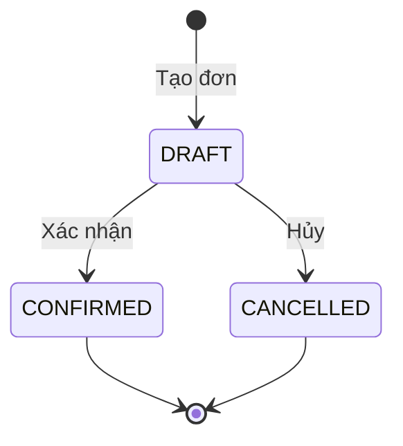

# Tài liệu viết tay giải thích ý nghĩa nghiệp vụ của tài nguyên

Một ví dụ HTTP được sinh từ kiểm thử có thể cho biết API đã nhận `GET /api/orders/42` và trả `200 OK` cùng JSON `{"status":"DRAFT","total":250000,"currency":"VND"}`. Tuy nhiên, chỉ nhìn vào response đó, người tích hợp chưa thể biết **DRAFT có nghĩa gì**, `total` đã bao gồm thuế hay chưa, đơn hàng nào người dùng được phép xem hoặc hành động tiếp theo là gì. Đây là khoảng trống mà **tài liệu do con người viết** cần giải thích.

Trong **Spring REST Docs**, tài liệu hoàn chỉnh kết hợp hai nguồn: **snippet sinh từ bài kiểm thử HTTP** và **phần giải thích hợp đồng nghiệp vụ do người viết tài liệu chịu trách nhiệm**. Snippet giúp ví dụ request, response, payload, tham số và header bám sát một operation thực tế; phần viết tay cung cấp mục đích, quy tắc, ngữ cảnh và quyết định nghiệp vụ mà một lần trao đổi HTTP không thể tự thể hiện.

Bài này thuộc chương **Mô hình tài liệu** của module `SPRING_REST_DOCS`, nơi chúng ta học tạo tài liệu REST API có thể kiểm chứng bằng **MockMvc**, **WebTestClient** hoặc **REST Assured**, biên soạn Asciidoctor/Markdown và đưa vào quy trình build, CI. Trọng tâm ở đây là **viết nội dung nghiệp vụ đủ rõ và gắn đúng với các snippet được kiểm chứng**.

## 1. Mục tiêu học tập

Học xong bài này, bạn có thể:

1. Phân biệt phần tài liệu **sinh từ test** với phần **phải diễn giải bằng lời**.
2. Viết mô tả resource có mục đích, danh tính, vòng đời và quy tắc sử dụng cụ thể.
3. Giải thích ý nghĩa nghiệp vụ của trạng thái, đơn vị, tiền tệ, ràng buộc và các lỗi HTTP.
4. Chèn các snippet Spring REST Docs vào trang tài liệu Asciidoctor theo một cấu trúc dễ hiểu.
5. Biết điều gì đã được kiểm tra trong test và điều gì chỉ là quy tắc cần thêm test/đánh giá.
6. Thiết lập quy trình cập nhật tài liệu viết tay khi hợp đồng API thay đổi.

## 2. Vì sao cần tài liệu viết tay khi đã có snippet?

Giả sử test tạo snippet response như sau:

```http
HTTP/1.1 200 OK
Content-Type: application/json

{
  "id": 42,
  "status": "DRAFT",
  "total": 250000,
  "currency": "VND"
}
```

Và bảng `response-fields.adoc` ghi:

| Field | Kiểu | Mô tả kỹ thuật cơ bản |
| --- | --- | --- |
| `id` | Number | Mã định danh đơn hàng |
| `status` | String | Trạng thái đơn hàng |
| `total` | Number | Tổng tiền |
| `currency` | String | Mã tiền tệ |

Bảng này hữu ích, nhưng chưa đủ cho quyết định tích hợp. Người đọc có thể hỏi:

- **Đơn hàng là gì?** Bản nháp giỏ hàng, yêu cầu đặt mua hay giao dịch đã thanh toán?
- **DRAFT nghĩa là gì?** Đơn hàng đã được đặt chỗ tồn kho chưa, đã được tính phí chưa?
- **250000 VND là bao nhiêu?** Giá đã bao gồm thuế và phí vận chuyển hay chưa?
- **Ai có quyền xem đơn hàng 42?** Chủ sở hữu, nhân viên hỗ trợ hay bất kỳ client có API key?
- **Khi nào được đổi trạng thái?** Từ `DRAFT` có thể xác nhận, hủy hoặc sửa?
- **Lỗi xử lý ra sao?** Khi không tìm thấy, không đủ quyền hoặc xung đột trạng thái thì API trả gì?

Không nên chờ snippet tự trả lời những câu hỏi đó. Một request/response mẫu **chỉ phản ánh điều xảy ra ở tình huống được test**, không chứa toàn bộ quy định nghiệp vụ, chính sách bảo mật hoặc ý nghĩa của dữ liệu.

### 2.1. Phân vai rõ ràng giữa ba lớp tài liệu

| Lớp | Nội dung chính | Nguồn và trách nhiệm |
| --- | --- | --- |
| **Ví dụ HTTP** | Method, path, header, body, status, response thực tế | Sinh từ operation trong test qua Spring REST Docs |
| **Bảng mô tả cấu trúc** | Tên/đường dẫn field, kiểu, tính bắt buộc, mô tả ngắn | Descriptor trong test như `responseFields(...)` |
| **Giải thích nghiệp vụ** | Mục đích resource, trạng thái, điều kiện, quyền truy cập, quy tắc tiền tệ, hành động tiếp theo | Do tác giả xác nhận với người nắm hợp đồng nghiệp vụ rồi viết vào trang tài liệu |

Các lớp **bổ sung cho nhau**, không tự động thay thế nhau. Ví dụ HTTP và descriptor có thể phát hiện nhiều thay đổi kỹ thuật; văn bản nghiệp vụ vẫn cần người cập nhật và xác minh.

## 3. Nội dung nghiệp vụ cần viết cho một tài nguyên

Một phần mô tả resource nên trả lời ít nhất các nhóm câu hỏi sau. Không phải API nào cũng cần tất cả, nhưng **mỗi quy tắc ảnh hưởng đến cách client sử dụng API cần có chỗ giải thích**.

| Nhóm thông tin | Cần làm rõ | Ví dụ với đơn hàng |
| --- | --- | --- |
| Danh tính và mục đích | Resource đại diện cho thực thể nào; được tạo và sử dụng để làm gì? | Đơn hàng thể hiện yêu cầu mua của khách |
| Phạm vi truy cập | Ai có thể xem hoặc thay đổi resource? | Người tạo và nhân viên có quyền phù hợp |
| Vòng đời | Trạng thái nào có thể tồn tại và chuyển đổi ra sao? | `DRAFT`, `CONFIRMED`, `CANCELLED` |
| Ràng buộc đầu vào | Field nào bắt buộc; giá trị hợp lệ và giới hạn là gì? | Không chấp nhận số lượng âm |
| Quy tắc tính toán | Cách tính tiền, thuế, phí, làm tròn, đơn vị | `total` là số tiền theo `currency` |
| Thời gian và tính nhất quán | Mốc thời gian, múi giờ, dữ liệu có cập nhật tức thời không? | `createdAt` theo ISO 8601, UTC nếu hợp đồng quy định |
| Tác động và tính lặp lại | Một thao tác có tạo side effect? Gọi lại có an toàn? | Xác nhận đơn có thể giữ tồn kho |
| Điều kiện lỗi | Khi nào trả `400`, `401`, `403`, `404`, `409`? | Không thể xác nhận đơn đã hủy |
| Liên hệ tới API khác | Sau khi đọc resource, nên dùng operation nào? | Xem dòng hàng, xác nhận hoặc hủy |

Danh sách trên là **khung kiểm tra nội dung**. Nếu API không có trạng thái hoặc không có tiền tệ thì không thêm quy tắc đó vào tài liệu cho đủ mục.

### 3.1. Danh tính khác với URI và representation

Ví dụ, `/api/orders/42` là một URI dùng để truy cập đơn hàng, còn JSON là **một biểu diễn** của đơn hàng tại một thời điểm. Đơn hàng trong nghiệp vụ có thể có thêm quyền truy cập, quy tắc tính tiền và các chuyển trạng thái mà JSON không liệt kê đầy đủ.

Một đoạn viết tay tốt có thể là:

> **Đơn hàng** ghi nhận yêu cầu mua các sản phẩm của một khách hàng. Mã `id` dùng để nhận diện đơn hàng khi truy vấn. Những thao tác được phép và thông tin hiển thị phụ thuộc vào trạng thái đơn hàng và quyền của người gọi.

Đoạn này định nghĩa **ý nghĩa** của resource trước khi hướng người đọc tới chi tiết HTTP. Khi viết cho hệ thống thực, cần thay những giả định chưa xác minh bằng nội dung đã được chủ sở hữu nghiệp vụ phê duyệt.

### 3.2. Diễn giải vòng đời, không chỉ liệt kê enum

Bảng response field có thể xác nhận `status` là chuỗi, nhưng client cần biết giá trị đó liên quan đến quyết định nghiệp vụ nào.

Trong **hợp đồng giả định của ví dụ học tập**, chúng ta thống nhất:

| Trạng thái | Ý nghĩa | Hành động tiếp theo được phép trong ví dụ |
| --- | --- | --- |
| `DRAFT` | Đơn đã hình thành nhưng khách chưa xác nhận yêu cầu mua | Có thể xác nhận hoặc hủy |
| `CONFIRMED` | Hệ thống đã chấp nhận yêu cầu mua | Không được chuyển ngược về `DRAFT` |
| `CANCELLED` | Đơn đã bị hủy; không tiếp tục quy trình mua | Không thể xác nhận lại |

Có thể minh họa bằng sơ đồ:



Đây là **vòng đời minh họa**, không phải các quy tắc mặc định của Spring REST Docs. Nếu sản phẩm thực cho phép hủy đơn sau xác nhận hoặc hoàn tiền, sơ đồ và diễn giải phải phản ánh đúng những luồng đó. Một test chỉ đọc `DRAFT` chưa chứng minh các chuyển trạng thái.

### 3.3. Nói rõ đơn vị và định nghĩa của con số

Một response có `"total":250000` và `"currency":"VND"` vẫn có thể gây hiểu nhầm. Để client tính toán đúng, hợp đồng phải chỉ ra:

- `total` biểu thị số tiền trước hay sau thuế, đã cộng phí vận chuyển chưa.
- Đơn vị biểu diễn là đơn vị tiền tệ hay đơn vị nhỏ nhất; cách làm tròn và số chữ số thập phân.
- `currency` theo chuẩn nào, có hỗ trợ nhiều loại tiền tệ không.
- Khi nào giá được cố định và khi nào có thể tính lại.

Ví dụ **chỉ khi nghiệp vụ đã chốt quy tắc**, tài liệu có thể ghi:

> Trong API minh họa, `total` là tổng giá trị sản phẩm đã áp dụng giảm giá, tính bằng đồng Việt Nam; phí giao hàng và thuế được tính riêng. Giá trị `currency` luôn là `VND`.

Câu trên là **một ví dụ quy tắc được giả định**, không suy ra từ JSON. Nếu nhóm sản phẩm quyết định `total` đã bao gồm thuế, phải sửa tài liệu, các phép tính và test liên quan.

### 3.4. Phân biệt các lỗi kỹ thuật và xung đột nghiệp vụ

Mã HTTP cho biết nhóm kết quả; tài liệu viết tay phải giải thích **điều kiện nghiệp vụ** gây ra kết quả đó.

| Status | Ý nghĩa HTTP tổng quát | Thông tin nghiệp vụ nên viết |
| --- | --- | --- |
| `400 Bad Request` | Dữ liệu yêu cầu không hợp lệ theo cách server xử lý | Field nào không hợp lệ, giới hạn ra sao, mã lỗi cụ thể |
| `401 Unauthorized` | Yêu cầu thiếu hoặc không có thông tin xác thực hợp lệ | Cơ chế xác thực, cách lấy/cập nhật thông tin xác thực |
| `403 Forbidden` | Danh tính đã biết nhưng không được thực hiện thao tác | Quyền nào cần có, giới hạn theo tài nguyên |
| `404 Not Found` | Server không tìm thấy representation thích hợp cho URI | Khi nào đơn hàng không tồn tại hoặc bị ẩn theo chính sách |
| `409 Conflict` | Yêu cầu xung đột trạng thái hiện tại của tài nguyên | Chuyển trạng thái nào bị từ chối; client cần đọc lại dữ liệu không |
| `422 Unprocessable Content` | Nội dung hợp cú pháp nhưng không thể xử lý theo ngữ nghĩa (nếu API dùng) | Quy tắc nghiệp vụ nào bị vi phạm, mã lỗi nào được trả |

Không gán mặc định mọi lỗi validation thành `400` hoặc mọi xung đột nghiệp vụ thành `409` nếu hợp đồng thực tế dùng mã khác. Trường hợp API cố tình trả `404` thay vì `403` để tránh tiết lộ sự tồn tại của tài nguyên cũng cần được giải thích ở mức không làm lộ thông tin bảo mật.

## 4. Ví dụ: viết trang nghiệp vụ cho tài nguyên đơn hàng

Ta sẽ dựng **hợp đồng minh họa** cho một API bán hàng. Tài liệu có hai phần: đoạn viết tay giải thích ý nghĩa resource và snippet chứa request/response được tạo từ test.

Giả định cho ví dụ:

1. `GET /api/orders/{orderId}` trả chi tiết đơn hàng khi mã tồn tại.
2. Đơn hàng mẫu `42` đang ở trạng thái `DRAFT`.
3. Response có `id`, `status`, `total` và `currency`.
4. Nếu mã không tồn tại trong fixture, controller trả `404 Not Found`.
5. Các quy tắc phân quyền, tính thuế và chuyển trạng thái phía trên **chưa được controller/test đơn giản bên dưới triển khai hoặc chứng minh**; chúng chỉ là phần diễn giải cần kiểm tra với hệ thống nghiệp vụ trước khi xuất bản thật.

### 4.1. Ví dụ HTTP từ một operation thành công

```http
GET /api/orders/42 HTTP/1.1
Accept: application/json
```

```http
HTTP/1.1 200 OK
Content-Type: application/json

{
  "id": 42,
  "status": "DRAFT",
  "total": 250000,
  "currency": "VND"
}
```

Từ một cặp request/response như trên, Spring REST Docs có thể tạo `http-request.adoc` và `http-response.adoc`, sau đó thêm `path-parameters.adoc`, `response-fields.adoc` theo descriptor.

Nhưng trang tài liệu vẫn cần thêm các câu như:

> Truy vấn này dành cho người gọi có quyền xem đơn hàng. Trạng thái `DRAFT` nghĩa là khách chưa xác nhận yêu cầu mua. Client có thể dùng trạng thái để quyết định hiển thị hành động “Xác nhận” nếu quyền truy cập và các điều kiện khác cho phép.

Khi chưa có test hoặc hợp đồng phân quyền, cách diễn đạt an toàn hơn là ghi mục **điều kiện truy cập cần xác minh**, thay vì khẳng định endpoint đã áp dụng chính sách đó.

## 5. Tạo snippet kiểm chứng bằng MockMvc

Để thấy rõ ranh giới giữa phần tự viết và phần sinh tự động, dưới đây là một test JUnit 5 đầy đủ theo phong cách Spring REST Docs 3.x. Ví dụ sử dụng Java 17+ và Jackson hỗ trợ `record`, chạy MockMvc ở chế độ `standaloneSetup`.

```java
import java.math.BigDecimal;

import org.junit.jupiter.api.BeforeEach;
import org.junit.jupiter.api.Test;
import org.junit.jupiter.api.extension.ExtendWith;
import org.springframework.http.MediaType;
import org.springframework.http.ResponseEntity;
import org.springframework.restdocs.RestDocumentationContextProvider;
import org.springframework.restdocs.RestDocumentationExtension;
import org.springframework.restdocs.payload.JsonFieldType;
import org.springframework.test.web.servlet.MockMvc;
import org.springframework.test.web.servlet.setup.MockMvcBuilders;
import org.springframework.web.bind.annotation.GetMapping;
import org.springframework.web.bind.annotation.PathVariable;
import org.springframework.web.bind.annotation.RestController;

import static org.springframework.restdocs.mockmvc.MockMvcRestDocumentation.document;
import static org.springframework.restdocs.mockmvc.MockMvcRestDocumentation.documentationConfiguration;
import static org.springframework.restdocs.mockmvc.RestDocumentationRequestBuilders.get;
import static org.springframework.restdocs.payload.PayloadDocumentation.fieldWithPath;
import static org.springframework.restdocs.payload.PayloadDocumentation.responseFields;
import static org.springframework.restdocs.request.RequestDocumentation.parameterWithName;
import static org.springframework.restdocs.request.RequestDocumentation.pathParameters;
import static org.springframework.test.web.servlet.result.MockMvcResultMatchers.jsonPath;
import static org.springframework.test.web.servlet.result.MockMvcResultMatchers.status;

@ExtendWith(RestDocumentationExtension.class)
class OrderDocumentationTest {

    private MockMvc mockMvc;

    @BeforeEach
    void setUp(RestDocumentationContextProvider provider) {
        mockMvc = MockMvcBuilders
            .standaloneSetup(new OrderController())
            .apply(documentationConfiguration(provider))
            .build();
    }

    @RestController
    static class OrderController {
        @GetMapping(
            value = "/api/orders/{orderId}",
            produces = MediaType.APPLICATION_JSON_VALUE
        )
        ResponseEntity<OrderView> getOrder(
                @PathVariable long orderId) {
            if (orderId != 42L) {
                return ResponseEntity.notFound().build();
            }

            return ResponseEntity.ok(
                new OrderView(
                    42L, "DRAFT",
                    new BigDecimal("250000"), "VND"
                )
            );
        }
    }

    record OrderView(
        long id, String status, BigDecimal total, String currency
    ) {}

    @Test
    void getOrder_success() throws Exception {
        mockMvc.perform(
                get("/api/orders/{orderId}", 42L)
                    .accept(MediaType.APPLICATION_JSON)
            )
            .andExpect(status().isOk())
            .andExpect(jsonPath("$.id").value(42))
            .andExpect(jsonPath("$.status").value("DRAFT"))
            .andExpect(jsonPath("$.currency").value("VND"))
            .andDo(document("orders-get-success",
                pathParameters(
                    parameterWithName("orderId")
                        .description("Mã đơn hàng cần xem")
                ),
                responseFields(
                    fieldWithPath("id")
                        .type(JsonFieldType.NUMBER)
                        .description("Mã định danh đơn hàng"),
                    fieldWithPath("status")
                        .type(JsonFieldType.STRING)
                        .description("Trạng thái hiện tại của đơn hàng"),
                    fieldWithPath("total")
                        .type(JsonFieldType.NUMBER)
                        .description("Giá trị tiền của đơn hàng"),
                    fieldWithPath("currency")
                        .type(JsonFieldType.STRING)
                        .description("Mã tiền tệ của tổng tiền")
                )
            ));
    }

    @Test
    void getOrder_notFound() throws Exception {
        mockMvc.perform(
                get("/api/orders/{orderId}", 999L)
                    .accept(MediaType.APPLICATION_JSON)
            )
            .andExpect(status().isNotFound())
            .andDo(document("orders-get-not-found",
                pathParameters(
                    parameterWithName("orderId")
                        .description("Mã đơn hàng cần xem")
                )
            ));
    }
}
```

**Cách đọc ví dụ:**

- `RestDocumentationExtension` và `documentationConfiguration(...)` thiết lập môi trường sinh tài liệu cho test.
- `RestDocumentationRequestBuilders.get(...)` giữ URI template `{orderId}` để `pathParameters(...)` mô tả đúng biến.
- `andExpect(...)` kiểm tra hành vi HTTP và một số giá trị nghiệp vụ quan trọng.
- `document("orders-get-success", ...)` sinh snippet từ operation thành công; `orders-get-not-found` là operation riêng cho `404`.
- `responseFields(...)` mô tả cấu trúc JSON quan sát được. Ở chế độ mô tả nghiêm ngặt thông dụng, test có thể thất bại nếu field chưa được mô tả hoặc field được yêu cầu lại không xuất hiện.

Cấu hình này chỉ dựng controller mẫu, không có database hay security filter. Vì vậy, kết quả test **chưa chứng minh** quyền truy cập, quy tắc tính thuế, giá trị `total` trong các hoàn cảnh khác hoặc mọi chuyển trạng thái. Đó chính là lý do tài liệu viết tay cần đồng bộ với các kiểm thử thích hợp ở những phạm vi khác.

### 5.1. Snippet được tạo ở đâu?

Với cấu hình build thường gặp, output có dạng:

```text
build/generated-snippets/
├── orders-get-success/
│   ├── http-request.adoc
│   ├── http-response.adoc
│   ├── path-parameters.adoc
│   └── response-fields.adoc
└── orders-get-not-found/
    ├── http-request.adoc
    ├── http-response.adoc
    └── path-parameters.adoc
```

Các file được liệt kê là **những mảnh liên quan đến bài học**; Spring REST Docs còn có thể tạo snippet mặc định khác như `curl-request.adoc`, `httpie-request.adoc` và body snippet tùy cấu hình. Maven thường xuất vào `target/generated-snippets`, Gradle thường vào `build/generated-snippets`.

Không giả định một file `response-fields.adoc` được tạo cho operation `404` khi test không khai báo `responseFields(...)` và response không có JSON body.

## 6. Ghép giải thích viết tay và snippet thành trang Asciidoctor

Ví dụ dưới đây là **tài liệu nguồn do tác giả viết**. Phần ngôn ngữ nghiệp vụ được viết trực tiếp; các đoạn HTTP và bảng field được lấy qua include từ output của test.

```asciidoc
[[orders]]
== Đơn hàng

Đơn hàng thể hiện yêu cầu mua sản phẩm của một khách hàng.
Mã id nhận diện đơn hàng trong các lần truy vấn tiếp theo.

=== Vòng đời đơn hàng

Trong hợp đồng minh họa:

* DRAFT: Đơn hàng được tạo nhưng chưa xác nhận.
* CONFIRMED: Yêu cầu mua đã được chấp nhận.
* CANCELLED: Đơn hàng đã hủy và không được xác nhận lại.

Đây là ý nghĩa trạng thái, không đồng nghĩa với việc đã thanh toán.

=== Tra cứu đơn hàng

Gọi GET /api/orders/{orderId} để đọc biểu diễn hiện tại
của một đơn hàng. Client phải tuân thủ quy tắc quyền truy cập
theo hợp đồng hệ thống.

==== Ví dụ request

include::{snippets}/orders-get-success/http-request.adoc[]

==== Path parameter

include::{snippets}/orders-get-success/path-parameters.adoc[]

==== Response thành công (200)

include::{snippets}/orders-get-success/http-response.adoc[]

==== Trường của response

include::{snippets}/orders-get-success/response-fields.adoc[]

Trong tài liệu chính thức, cần nêu rõ total bao gồm những
khoản nào, đơn vị tiền tệ và cách làm tròn.

==== Không tìm thấy (404)

include::{snippets}/orders-get-not-found/http-request.adoc[]

include::{snippets}/orders-get-not-found/http-response.adoc[]
```

Một trang tài liệu tốt không đơn thuần là hàng loạt lệnh `include`. **Tiêu đề và đoạn diễn giải giúp người đọc biết snippet này minh họa tình huống nào, điều kiện trước khi gọi và cách diễn giải kết quả**.

Ở đây `{snippets}` là attribute được cấu hình khi biên soạn Asciidoctor. Tên thư mục `orders-get-success`/`orders-get-not-found` phải khớp identifier trong `document(...)`. Nếu một test thay đổi identifier mà trang chưa đổi, quá trình render có thể bị lỗi include hoặc tiếp tục dùng output cũ nếu thư mục cũ còn tồn tại.

### 6.1. Khi xuất Markdown, giữ nguyên nguyên tắc nhưng đổi cơ chế nhúng

Cú pháp `include::{snippets}/...[]` **thuộc Asciidoctor**, không phải cú pháp Markdown chuẩn. Với tài liệu Markdown, có thể:

1. Biên soạn nguồn AsciiDoc thành định dạng đích được hệ thống hỗ trợ.
2. Dùng công cụ chèn/chuyển đổi nội dung snippet thành Markdown.
3. Cấu hình template snippet tương thích với pipeline Markdown, nếu dự án có giải pháp tương ứng.

Bất kể chọn cách nào, cần giữ ba thuộc tính: **snippet có nguồn từ operation test**, phần **giải thích nghiệp vụ do tác giả quản lý**, và **build có thể tạo lại trang hoàn chỉnh từ source hiện tại**.

### 6.2. Không lặp lại thông tin dễ bị lệch

Nếu `response-fields.adoc` đã nêu tên và kiểu `total`, phần viết tay nên bổ sung **quy tắc tính total** thay vì tạo một bảng sao chép y hệt. Khi có hai nơi cùng chứa ràng buộc bắt buộc, cần xác định nơi nào là chuẩn và cách kiểm tra đồng bộ.

Ví dụ không nên có:

> Bảng snippet: `total` là Number. Phần viết tay: `total` là String.

Mâu thuẫn đó khiến người dùng API không biết nên theo nguồn nào. Trước khi công bố, phải sửa code/test/descriptor hoặc diễn giải sai để tất cả cùng khớp hợp đồng.

## 7. Viết lời giải thích có thể thực thi bằng hành động

Một câu như “API hỗ trợ quản lý đơn hàng hiệu quả” ít giúp người đọc tích hợp. Cần viết lời giải thích đủ cụ thể để họ biết **khi nào gọi endpoint, phải gửi gì, mong đợi điều gì và làm gì tiếp theo**.

So sánh:

| Mô tả chung chung | Mô tả có ích cho người tích hợp |
| --- | --- |
| “Trạng thái đơn hàng cho biết tình trạng.” | “`DRAFT` nghĩa là khách chưa xác nhận yêu cầu mua; trong hợp đồng ví dụ, chỉ đơn hàng `DRAFT` mới được gọi thao tác xác nhận.” |
| “Tổng tiền của đơn hàng.” | “`total` được tính theo quy tắc tiền tệ và phạm vi phí/thuế được quy định trong mục Quy tắc tính tiền.” |
| “Có lỗi nếu không hợp lệ.” | “Khi xác nhận một đơn đã hủy, API trả trạng thái xung đột và mã lỗi nghiệp vụ theo hợp đồng; client nên tải lại trạng thái trước khi đề nghị người dùng thao tác tiếp.” |
| “Chỉ người được phép mới có thể xem.” | “Nêu rõ vai trò, phạm vi sở hữu, cơ chế ẩn tài nguyên và mã HTTP dùng cho từng trường hợp truy cập.” |

Những mô tả chi tiết ở cột phải **chỉ được đưa vào tài liệu sản phẩm như cam kết** sau khi kiểm tra với thiết kế và hành vi thực tế. Cột này minh họa chất lượng diễn giải cần đạt, không chứng minh chúng đã được triển khai trong controller mẫu.

### 7.1. Mô tả điều kiện, hậu quả và ngoại lệ

Đối với một hành động làm thay đổi trạng thái resource, tài liệu thường nên có ba nhóm thông tin:

- **Điều kiện trước:** ai được gọi, resource phải ở trạng thái nào, dữ liệu bổ sung phải thỏa điều kiện gì.
- **Hệ quả khi thành công:** trạng thái hoặc dữ liệu nào thay đổi; có tác động phụ nào như giữ tồn kho, gửi thông báo hay phát sinh thanh toán?
- **Ngoại lệ và xử lý:** trường hợp nào bị từ chối, mã lỗi/mã trạng thái nào được trả, client có thể thử lại hay cần chỉnh dữ liệu?

Chẳng hạn thao tác “Xác nhận đơn” có thể yêu cầu trạng thái `DRAFT` và tồn kho khả dụng. Nhưng **không suy từ tên `POST /confirm` rằng giao dịch chắc chắn đã thanh toán**; cần văn bản hợp đồng rõ ràng và các test tương ứng.

### 7.2. Làm rõ tính idempotent và tác động khi thử lại

Client có thể retry request do mạng chập chờn. Nếu một operation có tác động nghiệp vụ như tạo đơn hoặc thu tiền, tài liệu phải nói rõ chiến lược thử lại:

- Method có tính idempotent theo hợp đồng/HTTP semantics hay không?
- Có dùng `Idempotency-Key` hoặc cơ chế định danh yêu cầu tương đương?
- Nếu request đầu tiên đã thành công nhưng client không nhận response, lần gửi lại trả gì?
- Nếu cùng key đi với nội dung khác thì API phản hồi ra sao?

Không được khẳng định một operation `POST` tự động idempotent. Spring REST Docs có thể ghi lại header và response của **một tình huống retry được test**, nhưng **quy tắc retry và giao dịch** vẫn cần giải thích thủ công và có kiểm thử nhiều lần gọi.

## 8. Đối chiếu lời hứa nghiệp vụ với mức kiểm thử

Để tài liệu không hứa nhiều hơn hệ thống đảm bảo, hãy lập ma trận kiểm tra. Với controller MockMvc ở mục 5:

| Lời khẳng định | Đã được test mẫu xác nhận? | Việc cần làm |
| --- | --- | --- |
| `GET /api/orders/42` trả `200` | Có, trong cấu hình MockMvc standalone | Giữ assertion trạng thái |
| Response mẫu có `status = DRAFT` và `currency = VND` | Có với fixture `42` | Giữ assertion cho các giá trị quan trọng |
| `GET /api/orders/999` trả `404` | Có với fixture `999` | Đặt snippet riêng và mô tả trường hợp lỗi |
| Mọi mã đơn hàng không tồn tại đều trả `404` | Chưa | Bổ sung các ca có ý nghĩa hoặc test hợp đồng phù hợp |
| Chỉ chủ đơn được xem đơn | Chưa | Có test security/quyền sở hữu phù hợp với ứng dụng |
| `total` đã cộng thuế/phí theo quy tắc nêu trong tài liệu | Chưa | Xác minh quy tắc tính và viết test tính tiền |
| `DRAFT` được phép xác nhận, `CANCELLED` bị từ chối | Chưa | Viết test chuyển trạng thái và diễn giải lỗi |
| Client retry an toàn khi gửi yêu cầu tạo đơn | Chưa | Chốt chính sách idempotency và test gọi lặp |

**Tài liệu viết tay và test cùng mô tả một hợp đồng nhưng chứng minh những phần khác nhau.** Phần viết tay nên giải thích toàn bộ quy tắc đã được thống nhất; bộ kiểm thử cần tăng độ phủ theo những quy tắc có rủi ro hoặc ảnh hưởng tới client. Đừng dùng từ “đã được kiểm chứng” cho phần mà không có kiểm thử phù hợp.

### 8.1. Một ví dụ thay đổi API

Giả sử một phiên bản mới thay field `total` thành `grandTotal`.

- Test dùng `jsonPath("$.total")` (nếu có) sẽ phát hiện sai khác giá trị/đường dẫn.
- `responseFields(fieldWithPath("total"))` trong chế độ nghiêm ngặt có thể thất bại do field mô tả không còn xuất hiện hoặc có field mới.
- Snippet `http-response.adoc` sau khi test được cập nhật sẽ phản ánh JSON mới.
- Nhưng đoạn viết tay “`total` là tiền sau thuế” **không tự đổi tên hoặc tự sửa ý nghĩa**.

Vì vậy, khi thay schema, cần sửa **code, test, descriptor, các include liên quan và nội dung nghiệp vụ viết tay** theo hợp đồng mới. Nếu đổi ý nghĩa của `total` mà giữ nguyên field và kiểu Number, test cấu trúc có thể vẫn pass; test nghiệp vụ và rà soát tài liệu càng trở nên quan trọng.

## 9. Quy trình duy trì tài liệu viết tay trong build và CI

Một pipeline Spring REST Docs điển hình có thể tổ chức như sau:

```text
Thiết kế và thống nhất quy tắc nghiệp vụ
                    │
                    ▼
      Code + HTTP tests + descriptors
                    │
                    ▼
          Chạy kiểm thử HTTP
             │           │
            FAIL         PASS
             │           │
          Dừng CI     Sinh snippets
                         │
                         ▼
             Biên soạn Asciidoctor/Markdown
             + đoạn giải thích viết tay
                         │
                         ▼
         Kiểm tra include, link và rendering
                         │
                         ▼
             Review nội dung nghiệp vụ
                         │
                         ▼
               Công bố tài liệu
```

Build nên ràng buộc task biên soạn tài liệu phụ thuộc test sinh snippet, khai báo đường dẫn thư mục snippet là input và tái tạo đầu ra sạch trên CI. Với Gradle, output thường là `build/generated-snippets`; với Maven là `target/generated-snippets` theo cấu hình ví dụ thông dụng.

Kiểm tra từ CI thường giúp phát hiện test thất bại, thiếu snippet hoặc lỗi include. Tuy nhiên, **CI không thể tự xác nhận một mô tả thuế, quyền truy cập hoặc vòng đời đơn hàng là đúng chỉ bằng việc render thành công**. Cần có quy trình review nội dung tương ứng với trách nhiệm nghiệp vụ.

### 9.1. Một bảng kiểm soát thay đổi gọn

Khi hợp đồng API thay đổi, tác giả có thể tự hỏi:

1. **Request/response có đổi không?** Cập nhật assertion và descriptor.
2. **Ý nghĩa field có đổi không?** Sửa lời giải thích và các ví dụ sử dụng.
3. **Quy tắc chuyển trạng thái có đổi không?** Sửa sơ đồ vòng đời và các test chuyển trạng thái.
4. **Điều kiện truy cập có đổi không?** Xem lại mô tả phân quyền cùng security tests.
5. **Mã lỗi/điều kiện lỗi có đổi không?** Tạo hoặc cập nhật operation test lỗi và phần giải thích.
6. **Trang tài liệu có còn chèn đúng snippet không?** Kiểm tra identifier, include, link và output trên clean build.

Đối với thay đổi đáng kể, nên để người hiểu nghiệp vụ xác nhận nội dung trước khi publish. Một test có thể xanh trong khi lời giải thích sai, nhất là với quy tắc chưa được diễn đạt thành assertion.

## 10. Những lỗi thường gặp khi viết phần nghiệp vụ

| Dấu hiệu | Nguyên nhân | Cách khắc phục |
| --- | --- | --- |
| Trang chỉ có request/response và bảng field | Tưởng snippet tự mô tả toàn bộ resource | Thêm mục đích, quyền, vòng đời, ràng buộc và tình huống lỗi |
| Field `status` có ba giá trị nhưng không biết khi nào dùng | Chỉ liệt kê enum, không giải thích chuyển trạng thái | Viết bảng ý nghĩa và sơ đồ luồng nghiệp vụ đã được xác nhận |
| `total` bị hiểu khác giữa đội backend và frontend | Thiếu định nghĩa thuế, phí, đơn vị, làm tròn | Chốt một định nghĩa và ghi rõ trong tài liệu |
| Tài liệu nói mọi người đều xem được nhưng security chặn | Viết tay không kiểm tra cấu hình xác thực/phân quyền | Xác minh hợp đồng, bổ sung test phân quyền |
| Trang mô tả `409` nhưng không có ví dụ kiểm thử lỗi | Sao chép giả định chưa được thực hiện | Thêm test operation `409` hoặc bỏ lời khẳng định chưa đúng |
| Nội dung viết tay mâu thuẫn bảng snippet | Có hai bản mô tả không được cập nhật cùng nhau | Rà soát theo thay đổi hợp đồng; xác định nơi quản lý thuật ngữ |
| Thay đổi JSON nhưng snippet vẫn cũ | Bước render dùng generated snippets từ lần chạy trước | Buộc render phụ thuộc test và build sạch |
| Tài liệu Markdown hiển thị nguyên `include::{snippets}` | Dùng cú pháp Asciidoctor trong pipeline không hỗ trợ | Dùng công cụ chèn/chuyển đổi hợp lệ với Markdown |
| Viết “đã kiểm chứng” cho chính sách chưa được test | Nhầm ví dụ HTTP với chứng cứ bao phủ toàn hệ thống | Ghi rõ phạm vi test và bổ sung test cần thiết |
| Tài liệu có tên người dùng/token thật | Dữ liệu test được đưa thẳng vào snippet | Dùng fixture giả, che dữ liệu và kiểm tra output trước công bố |

## 11. Bài thực hành: viết lời giải thích giúp client dùng API đúng

Giả sử bạn đang tài liệu hóa `GET /api/orders/{orderId}`. Bài test đã chứng minh phản hồi `200` cho đơn hàng `DRAFT` và `404` cho một ID không tồn tại.

**Nhiệm vụ:**

1. Viết một đoạn mở đầu 3–5 câu: “Đơn hàng” là resource nào, ai sử dụng và trong hoàn cảnh nào.
2. Tạo bảng giải thích ý nghĩa của `DRAFT`, `CONFIRMED`, `CANCELLED` theo **quy tắc giả định rõ ràng**; nêu hành động nào được phép hoặc bị cấm.
3. Định nghĩa các câu hỏi còn thiếu về `total`, `currency`, thuế, phí và làm tròn; đánh dấu vấn đề cần xác nhận trước khi công bố.
4. Viết một mục “Truy cập và lỗi” phân biệt không tìm thấy, không có quyền và xung đột trạng thái theo hợp đồng dự kiến.
5. Dùng snippet `orders-get-success/http-request.adoc`, `http-response.adoc` và `response-fields.adoc` trong trang AsciiDoc; thêm snippet `404` dưới phần lỗi.
6. Lập bảng các **lời khẳng định có test hỗ trợ** và **lời khẳng định cần thêm test**, đặc biệt về phân quyền, tính tiền và chuyển trạng thái.
7. Giả sử đội sản phẩm đổi định nghĩa `total` thành “đã gồm phí giao hàng”. Chỉ ra phần lời viết tay, code tính tiền, assertion, descriptor và ví dụ nào cần được xem lại.

**Tiêu chí hoàn thành:** người đọc hiểu được **ý nghĩa của tài nguyên và cách ra quyết định khi dùng API**, truy ra được snippet từ operation test, đồng thời biết những quy tắc nào đã được chứng minh và những quy tắc nào cần xác nhận thêm.

## 12. Ghi nhớ

- Spring REST Docs tạo **snippet HTTP và bảng mô tả** từ các operation trong test; chúng phản ánh dữ liệu được quan sát và mô tả trong những tình huống đã kiểm tra.
- **Tài liệu viết tay giải thích ý nghĩa nghiệp vụ**: resource dùng làm gì, ai được truy cập, trạng thái có ý nghĩa gì, số tiền được tính ra sao, khi nào phát sinh lỗi và client nên xử lý thế nào.
- Ghép **snippet + diễn giải + tình huống lỗi** thành trang Asciidoctor hoặc Markdown giúp tài liệu vừa có ví dụ kiểm chứng được vừa có ngữ cảnh để sử dụng đúng.
- **Test pass không tự bảo đảm mọi quy tắc nghiệp vụ đã được kiểm chứng**. Cần biết phạm vi test, thêm kiểm thử phù hợp và rà soát lời viết tay khi hợp đồng thay đổi.
- Build và CI giúp tái tạo snippet, phát hiện lỗi kỹ thuật của tài liệu; **người chịu trách nhiệm nghiệp vụ** vẫn phải xác nhận các quy tắc và ý nghĩa trước khi công bố.
