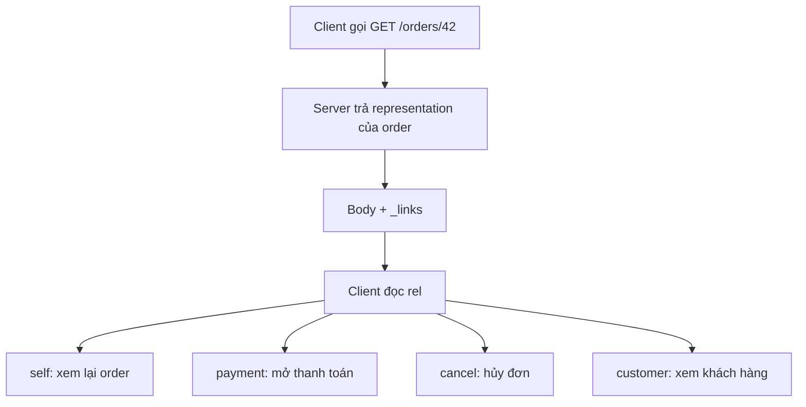

# Document liên kết HATEOAS trong response

## 1. Vì sao cần tài liệu hóa hypermedia links?

Một API REST dùng hypermedia cung cấp các liên kết ngay trong response để client khám phá những thao tác hoặc tài nguyên có liên quan. Client đọc quan hệ liên kết (*link relation*, viết tắt `rel`) rồi quyết định bước tiếp theo, thay vì phải tự ghép mọi URL từ quy ước đường dẫn.

**HATEOAS** (Hypermedia as the Engine of Application State) là ràng buộc kiến trúc trong đó response cung cấp hypermedia controls giúp client điều hướng trạng thái ứng dụng. Ví dụ, response của một đơn hàng có thể có `self`, `payment`, `cancel` và `customer`. Các relation cho biết liên kết dẫn tới loại tài nguyên hoặc hành động nào; giá trị `href` cho biết đích hiện tại.

Spring REST Docs hỗ trợ document những links này bằng `links(...)` và `linkWithRel(...)` trong `HypermediaDocumentation`. Snippet sinh ra có tên mặc định `links.adoc`, trình bày bảng quan hệ liên kết trong response. Điều này bổ sung cho snippet HTTP request/response và bảng mô tả JSON fields.



Ví dụ HAL response:

```json
{
  "id": 42,
  "status": "PENDING",
  "total": 125000,
  "_links": {
    "self": { "href": "/api/orders/42" },
    "payment": { "href": "/api/orders/42/payment" },
    "cancel": { "href": "/api/orders/42/cancel" },
    "customer": { "href": "/api/customers/7" }
  }
}
```

`_links` là vùng chứa link của HAL. Các chuỗi `self`, `payment`, `cancel` và `customer` là relation names; `href` là URL đích. Khi document links, ta mô tả quan hệ và ý nghĩa của từng link, không cần hard-code URL có thể thay đổi theo môi trường vào phần mô tả.

## 2. Chuẩn bị dependency và response có HAL links

Ví dụ dùng Spring Boot 3.x, Java 17+, JUnit 5, REST Assured và Spring REST Docs. Nếu dự án đã dùng Spring Boot BOM quản lý phiên bản, các dependency Gradle có thể khai báo:

```groovy
dependencies {
    implementation 'org.springframework.boot:spring-boot-starter-web'
    implementation 'org.springframework.boot:spring-boot-starter-hateoas'

    testImplementation 'org.springframework.boot:spring-boot-starter-test'
    testImplementation 'io.rest-assured:rest-assured'
    testImplementation 'org.springframework.restdocs:spring-restdocs-restassured'
}

tasks.named('test') {
    useJUnitPlatform()
}
```

`spring-boot-starter-hateoas` cung cấp Spring HATEOAS để xây dựng representation và links. `spring-restdocs-restassured` tích hợp HTTP tests với REST Docs; `rest-assured` gửi HTTP request và kiểm tra response. Khi dùng Maven, thêm artifact tương ứng; các thư viện kiểm thử dùng `<scope>test</scope>`. Hãy để BOM/parent phù hợp quản lý version của Spring Boot và Spring REST Docs.

Một endpoint Spring HATEOAS đơn giản có thể trả `EntityModel`:

```java
@RestController
@RequestMapping("/api/orders")
class OrderController {

    @GetMapping(value = "/{id}", produces = "application/hal+json")
    EntityModel<Order> getOrder(@PathVariable long id) {
        Order order = new Order(id, "PENDING", 125000);

        return EntityModel.of(order,
                linkTo(methodOn(OrderController.class).getOrder(id)).withSelfRel(),
                linkTo(methodOn(PaymentController.class).getPayment(id)).withRel("payment"),
                linkTo(methodOn(OrderController.class).cancelOrder(id)).withRel("cancel"));
    }

    @PostMapping("/{id}/cancel")
    ResponseEntity<Void> cancelOrder(@PathVariable long id) {
        return ResponseEntity.noContent().build();
    }
}
```

`Order` ở ví dụ là domain model minh họa có các thuộc tính `id`, `status`, `total`; `PaymentController` là controller tương ứng với link thanh toán. Trong ứng dụng thật, controller thường gọi service/repository và chỉ cung cấp `cancel` khi trạng thái đơn hàng cho phép. Các static import Spring HATEOAS thường dùng gồm `linkTo` và `methodOn` từ `WebMvcLinkBuilder`.

Spring HATEOAS tự tạo biểu diễn HAL cho `EntityModel` khi message converter phù hợp được cấu hình. Có thể kiểm tra response Content-Type là `application/hal+json` và payload có `_links` trước khi viết test tài liệu.

## 3. Document links bằng REST Assured

Spring REST Docs tự nhận diện link format theo Content-Type của response. Hai định dạng tích hợp sẵn là:

| Format | Cấu trúc link | Content-Type nhận diện mặc định |
| --- | --- | --- |
| Atom | Mảng `links` | Tương thích với `application/json` |
| HAL | Map `_links` | Tương thích với `application/hal+json` |

Nếu API dùng HAL nhưng response có Content-Type khác, truyền extractor rõ ràng qua `halLinks()`. Không yêu cầu phải tự viết parser cho HAL phổ biến.

Các static import chính:

```java
import static org.springframework.restdocs.hypermedia.HypermediaDocumentation.halLinks;
import static org.springframework.restdocs.hypermedia.HypermediaDocumentation.linkWithRel;
import static org.springframework.restdocs.hypermedia.HypermediaDocumentation.links;
import static org.springframework.restdocs.restassured.RestAssuredRestDocumentation.document;
```

Test REST Assured minh họa:

```java
@SpringBootTest(webEnvironment = SpringBootTest.WebEnvironment.RANDOM_PORT)
@ExtendWith(RestDocumentationExtension.class)
class OrderHypermediaDocumentationTest {

    @LocalServerPort
    private int port;

    private RequestSpecification specification;

    @BeforeEach
    void setUp(RestDocumentationContextProvider restDocumentation) {
        this.specification = new RequestSpecBuilder()
                .setBaseUri("http://localhost")
                .setPort(this.port)
                .addFilter(documentationConfiguration(restDocumentation))
                .build();
    }

    @Test
    void documentOrderLinks() {
        given(this.specification)
                .accept("application/hal+json")
                .filter(document("orders-get",
                        links(
                                linkWithRel("self").description("Chính đơn hàng này"),
                                linkWithRel("payment").description("Thông tin hoặc thao tác thanh toán"),
                                linkWithRel("cancel").description("Hủy đơn hàng"))))
        .when()
                .get("/api/orders/{id}", 42)
        .then()
                .statusCode(200)
                .contentType("application/hal+json")
                .body("id", equalTo(42))
                .body("_links.self.href", notNullValue())
                .body("_links.payment.href", notNullValue());
    }
}
```

Để đoạn test đầy đủ, bổ sung các static import và kiểu sau:

```java
import io.restassured.builder.RequestSpecBuilder;
import io.restassured.specification.RequestSpecification;
import org.junit.jupiter.api.BeforeEach;
import org.junit.jupiter.api.Test;
import org.junit.jupiter.api.extension.ExtendWith;
import org.springframework.boot.test.context.SpringBootTest;
import org.springframework.boot.test.web.server.LocalServerPort;
import org.springframework.restdocs.RestDocumentationContextProvider;
import org.springframework.restdocs.RestDocumentationExtension;

import static io.restassured.RestAssured.given;
import static org.hamcrest.Matchers.equalTo;
import static org.hamcrest.Matchers.notNullValue;
import static org.springframework.restdocs.restassured.RestAssuredRestDocumentation.documentationConfiguration;
```

Trong `.filter(document("orders-get", links(...)))`, identifier `orders-get` là tên thư mục snippet. `links(...)` tạo snippet `links.adoc`; `linkWithRel("payment")` mô tả link theo relation `payment`, không phụ thuộc `href` cụ thể. Assertion của REST Assured vẫn kiểm tra response thực tế. Test cần fixture và controller trả đúng các relation đã khai báo.

## 4. Ý nghĩa của `linkWithRel(...)` và descriptor

`linkWithRel(String rel)` tạo `LinkDescriptor` cho một link relation. Mỗi descriptor nên diễn tả ý nghĩa mà client có thể sử dụng:

```java
links(
    linkWithRel("self").description("Liên kết tới đơn hàng hiện tại"),
    linkWithRel("payment").description("Liên kết tới quy trình thanh toán"),
    linkWithRel("cancel").description("Liên kết để hủy đơn hàng"),
    linkWithRel("customer").description("Liên kết tới hồ sơ khách hàng"))
```

Mô tả nên nói rõ client có thể làm gì hoặc nhận được tài nguyên nào. Tránh mô tả chỉ lặp lại relation (`payment`: “payment link”), vì nó không giúp người đọc hiểu hành vi.

Nếu link trong response có thuộc tính `title`, có thể bỏ `.description(...)`; Spring REST Docs sẽ dùng `title` làm mô tả. Nếu link không có `title` mà descriptor cũng không có description, quá trình tạo snippet thất bại. Vì vậy, để tài liệu rõ nghĩa và ổn định, nên khai báo description tường minh cho các relation quan trọng.

Một số cách điều chỉnh descriptor:

| Cách khai báo | Tác dụng |
| --- | --- |
| `.description("...")` | Mô tả quan hệ liên kết trong bảng snippet. |
| `.optional()` | Cho phép link có thể không xuất hiện ở một số response. |
| `.ignored()` | Không đưa link vào bảng snippet và không làm test thất bại chỉ vì link đó xuất hiện. |

## 5. Strict links, optional links và ignored links

Mặc định, `links(...)` kiểm tra chặt chẽ danh sách link:

- Nếu response chứa một link chưa được mô tả, test thất bại.
- Nếu descriptor khai báo một link bắt buộc nhưng response không có link đó, test cũng thất bại.
- Nếu không muốn document link nhưng response có thể chứa nó, đánh dấu descriptor là `.ignored()`.
- Nếu link có thể có hoặc không tùy trạng thái resource, đánh dấu `.optional()`.

Ví dụ link `cancel` chỉ xuất hiện khi đơn hàng chưa được xử lý:

```java
links(
        linkWithRel("self").description("Đơn hàng hiện tại"),
        linkWithRel("payment").description("Thanh toán đơn hàng"),
        linkWithRel("cancel").description("Hủy đơn hàng").optional())
```

Ở response đã hoàn tất, `cancel` có thể vắng mặt mà không làm snippet thất bại; nếu link xuất hiện, nó vẫn được mô tả trong bảng. Chỉ dùng `.optional()` khi việc vắng mặt là hợp lệ theo hợp đồng API, không dùng để che việc server bỏ mất link bắt buộc.

Nếu muốn bỏ `curies` khỏi từng bảng link vì đã giải thích ở phần tổng quan:

```java
links(
        linkWithRel("self").ignored(),
        linkWithRel("curies").ignored(),
        linkWithRel("payment").description("Thanh toán đơn hàng"),
        linkWithRel("cancel").description("Hủy đơn hàng").optional())
```

`ignored()` giúp tránh lặp lại các relation thông dụng trong mọi snippet. Tuy vậy, cần tài liệu hóa chúng ở một nơi dễ tìm nếu người đọc cần hiểu cách điều hướng API.

## 6. Dùng `relaxedLinks(...)` khi chỉ muốn tập trung một phần links

Nếu response có nhiều links thay đổi theo phiên bản hoặc theo trạng thái nhưng test chỉ cần mô tả một tập con, có thể dùng `relaxedLinks(...)`:

```java
import static org.springframework.restdocs.hypermedia.HypermediaDocumentation.relaxedLinks;

.filter(document("orders-summary",
        relaxedLinks(
                linkWithRel("self").description("Đơn hàng hiện tại"),
                linkWithRel("payment").description("Quy trình thanh toán"))))
```

Ở chế độ relaxed, các link xuất hiện nhưng không được mô tả sẽ bị bỏ qua thay vì làm test thất bại. Tuy nhiên, một descriptor không optional mà không tìm thấy link tương ứng vẫn làm test thất bại. Điều này khác với `links(...)`, nơi link không được mô tả sẽ gây lỗi.

Không dùng `relaxedLinks(...)` chỉ để “làm xanh” test khi API vừa thêm relation mới mà chưa được review. Nó phù hợp khi chủ đích của test là document một phần link trong một scenario cụ thể và phần còn lại đã được mô tả ở nơi khác.

## 7. Khi response dùng HAL, Atom hoặc định dạng tùy chỉnh

Spring REST Docs nhận diện hai format theo Content-Type mặc định:

**HAL**: links nằm trong object `_links`, ví dụ:

```json
{
  "_links": {
    "self": { "href": "/orders/42" },
    "next": { "href": "/orders?page=1" }
  }
}
```

**Atom**: links nằm trong array `links`, ví dụ:

```json
{
  "id": "urn:example:orders:42",
  "links": [
    { "rel": "self", "href": "/orders/42" },
    { "rel": "next", "href": "/orders?page=1" }
  ]
}
```

Nếu Content-Type không phản ánh format hoặc API trả HAL dưới `application/json`, chỉ rõ extractor:

```java
links(halLinks(),
        linkWithRel("self").description("Tài nguyên hiện tại"),
        linkWithRel("next").description("Trang kế tiếp"))
```

Với Atom:

```java
links(atomLinks(),
        linkWithRel("self").description("Tài nguyên hiện tại"),
        linkWithRel("next").description("Trang kế tiếp"))
```

Nếu API sử dụng cấu trúc khác, có thể cài đặt `LinkExtractor` tùy chỉnh và truyền vào `links(customExtractor, ...)`. Extractor cần đọc đúng response structure và tạo các `Link` tương ứng; tránh xử lý JSON bằng regex vì thứ tự field, escape và nesting có thể thay đổi.

## 8. CURIEs và relation names

HAL có thể dùng CURIE để rút gọn URI relation, ví dụ:

```json
{
  "_links": {
    "curies": [{
      "name": "ea",
      "href": "https://example.com/rels/{rel}",
      "templated": true
    }],
    "self": { "href": "/orders/42" },
    "ea:find": { "href": "/orders{?id}", "templated": true }
  }
}
```

`ea:find` là relation có tiền tố `ea` được giải nghĩa qua CURIE `ea`; `templated: true` cho biết `href` là URI template còn có biến cần thay, không phải URL hoàn chỉnh để gọi nguyên trạng. Khi document, chọn cách mô tả relation đầy đủ theo định dạng mà API công bố; có thể document `curies` trong phần tổng quan và ignored link này ở các snippet khác nếu đã giải thích rõ.

Ví dụ:

```java
links(
        linkWithRel("self").description("Đơn hàng hiện tại"),
        linkWithRel("curies").ignored(),
        linkWithRel("ea:find").description("Tìm đơn hàng theo tiêu chí"))
```

Không nhầm relation name với tên thuộc tính JSON. `self` và `ea:find` là quan hệ liên kết; `_links` là container HAL. URI template và CURIE có vai trò riêng trong cách client khám phá API.

## 9. Kết hợp links snippet với body và field snippets

Hypermedia links chỉ mô tả một phần của response. Để người đọc hiểu resource, nên document cả body fields nếu các thuộc tính nghiệp vụ có ý nghĩa:

```java
.filter(document("orders-get",
        links(
                linkWithRel("self").description("Đơn hàng hiện tại"),
                linkWithRel("payment").description("Thanh toán đơn hàng"),
                linkWithRel("cancel").description("Hủy đơn hàng").optional()),
        responseFields(
                fieldWithPath("id").description("Mã đơn hàng"),
                fieldWithPath("status").description("Trạng thái xử lý"),
                fieldWithPath("total").description("Tổng tiền đơn hàng"))))
```

Với HAL response, các descriptor body thông thường tập trung vào fields nghiệp vụ. Link relation được xử lý riêng bằng `links(...)`; không cần tự mô tả từng `_links.*.href` bằng `fieldWithPath(...)` nếu mục tiêu là tạo bảng liên kết. Cách tách này giúp bảng links dễ đọc và ít phụ thuộc URL cụ thể.

Trong Asciidoctor, nhúng snippet:

```asciidoc
== Xem đơn hàng

=== HTTP response
include::{snippets}/orders-get/http-response.adoc[]

=== Links
include::{snippets}/orders-get/links.adoc[]

=== Response fields
include::{snippets}/orders-get/response-fields.adoc[]
```

Snippet `links.adoc` thường là bảng gồm relation, mô tả và thuộc tính liên quan do link extractor nhận diện. Kiểm tra file thực tế để xác nhận đúng cột theo format và phiên bản Spring REST Docs đang dùng.

## 10. Common links và tái sử dụng descriptor

HAL responses thường lặp lại links như `self` và `curies`. Nếu mô tả các link này trong mọi operation, tài liệu trở nên dài và lặp. Có thể định nghĩa một `LinksSnippet` dùng chung đã ignore common links, rồi bổ sung descriptor cụ thể cho từng operation:

```java
import org.springframework.restdocs.hypermedia.HypermediaDocumentation;
import org.springframework.restdocs.hypermedia.LinkDescriptor;
import org.springframework.restdocs.hypermedia.LinksSnippet;

static LinksSnippet linksIgnoringSelfAndCuries(LinkDescriptor... descriptors) {
    return HypermediaDocumentation.links(
            linkWithRel("self").ignored().optional(),
            linkWithRel("curies").ignored())
            .and(descriptors);
}
```

Sử dụng:

```java
.filter(document("orders-get",
        linksIgnoringSelfAndCuries(
                linkWithRel("payment").description("Thanh toán đơn hàng"),
                linkWithRel("cancel").description("Hủy đơn hàng").optional())))
```

Đây là cách tái sử dụng snippet descriptor được Spring REST Docs hỗ trợ. `self` được đánh dấu optional vì một số representation hoặc test response có thể không chứa nó; `curies` bị ignored nhưng không optional trong helper trên, do đó nếu dự án có response không mang `curies`, cần điều chỉnh descriptor cho phù hợp. Luôn giữ chính sách strict/optional/ignored phù hợp với hợp đồng thật.

## 11. Lỗi thường gặp khi document links

| Hiện tượng | Nguyên nhân | Cách khắc phục |
| --- | --- | --- |
| `links.adoc` không được tạo | Chưa đưa `links(...)` vào `document(...)`, hoặc response không có link format được nhận diện. | Kiểm tra filter, Content-Type và cấu trúc `_links`/`links`. |
| Không nhận diện HAL links | Content-Type không tương thích `application/hal+json`. | Dùng `links(halLinks(), ...)` để chỉ định extractor. |
| Test báo undocumented link | Response có relation mới chưa có descriptor trong strict `links(...)`. | Review relation và thêm descriptor hoặc ignore nếu chủ đích không document. |
| Test báo link bắt buộc không có | Descriptor khai báo relation nhưng response không chứa nó. | Kiểm tra trạng thái resource; đánh dấu `.optional()` chỉ khi vắng mặt hợp lệ. |
| Descriptor không có description gây lỗi | Link không có `title` và descriptor cũng không mô tả. | Thêm `.description(...)` rõ ràng. |
| Bảng links lặp `self`/`curies` | Common links được mô tả ở mọi operation. | Tài liệu hóa common links một lần và tái sử dụng snippet ignored common links. |
| Link URL bị đổi theo môi trường | Tài liệu gắn chặt `href` vào host test. | Dùng URI preprocessor phù hợp cho HTTP snippets; mô tả link theo rel, không dựa vào URL cụ thể. |
| Dùng relaxed links làm mất kiểm soát | Link mới xuất hiện nhưng không còn làm test thất bại. | Chỉ dùng `relaxedLinks(...)` cho scenario cố ý document một tập con. |

## 12. Checklist thực hành

- [ ] Endpoint trả representation có hypermedia links và Content-Type đúng với format.
- [ ] Đã xác định link format: HAL (`_links`) hay Atom (`links`).
- [ ] Đã thêm `links(...)` hoặc `links(halLinks(), ...)` vào `document(...)`.
- [ ] Mỗi relation quan trọng có `.description(...)` rõ nghĩa hoặc `title` phù hợp trong link.
- [ ] Link bắt buộc, optional và ignored được phân biệt đúng theo hợp đồng API.
- [ ] Đã cân nhắc `relaxedLinks(...)` và hiểu rõ việc bỏ qua links không được mô tả.
- [ ] CURIE và URI template được giải thích nếu API có dùng.
- [ ] Đã document thêm body fields khi response có dữ liệu nghiệp vụ cần hiểu.
- [ ] Đã kiểm tra `links.adoc` được sinh ra và include đúng vào tài liệu cuối.

Với Spring REST Docs, `links(...)` và `linkWithRel(...)` biến các hypermedia relations trong response thành một bảng tài liệu có thể kiểm chứng. Khi mô tả rõ ý nghĩa từng relation và dùng đúng strict, optional, ignored hoặc relaxed mode, người tích hợp biết cách khám phá API bằng links mà không phải đoán URL nội bộ.

## Tài liệu tham khảo

- [Spring REST Docs – Hypermedia](https://docs.spring.io/spring-restdocs/reference/documenting-your-api/hypermedia.html)
- [Spring REST Docs – HypermediaDocumentation API](https://docs.spring.io/spring-restdocs/docs/current/api/org/springframework/restdocs/hypermedia/HypermediaDocumentation.html)
- [Spring HATEOAS Reference](https://docs.spring.io/spring-hateoas/docs/current/reference/html/)
