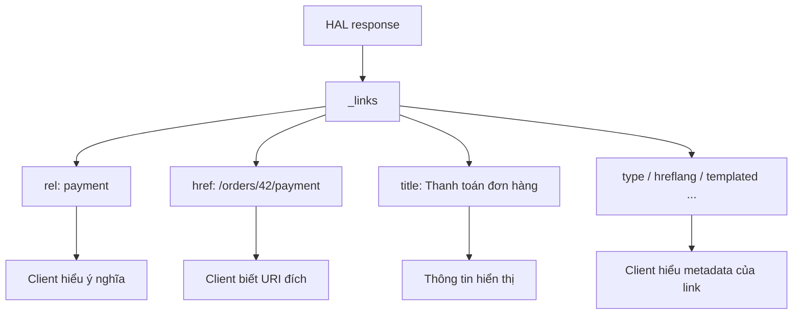

# Link relation, href và thuộc tính của liên kết

## 1. Ba thành phần cần phân biệt trong một hypermedia link

Trong API REST theo hướng hypermedia, response không chỉ trả dữ liệu mà còn cung cấp các liên kết để client khám phá tài nguyên và thao tác tiếp theo. Khi document bằng Spring REST Docs, cần hiểu rõ ba khái niệm: **relation (`rel`)**, **đích liên kết (`href`)** và **thuộc tính bổ sung của link**.

Ví dụ HAL response:

```json
{
  "id": 42,
  "status": "PENDING",
  "_links": {
    "self": {
      "href": "https://api.example.test/orders/42",
      "title": "Đơn hàng hiện tại",
      "type": "application/hal+json"
    },
    "payment": {
      "href": "https://api.example.test/orders/42/payment",
      "title": "Thanh toán đơn hàng",
      "type": "application/json",
      "hreflang": "vi"
    },
    "search": {
      "href": "https://api.example.test/orders{?status,page}",
      "templated": true,
      "title": "Tìm đơn hàng"
    }
  }
}
```

| Thành phần | Ví dụ | Vai trò |
| --- | --- | --- |
| `rel` | `self`, `payment`, `search` | Cho biết liên kết có quan hệ gì với resource hiện tại. |
| `href` | `/orders/42/payment` | URI đích mà client điều hướng tới; có thể là URI template. |
| `title` | `Thanh toán đơn hàng` | Nhãn thân thiện có thể hỗ trợ hiển thị hoặc mô tả link. |
| Thuộc tính bổ sung | `templated`, `type`, `hreflang` | Cung cấp metadata để client hiểu cách sử dụng hoặc nội dung đích của liên kết. |

`rel` là ý nghĩa của liên kết, không phải URL. `href` là đích cụ thể, không phải tên thao tác. Một relation có thể tiếp tục giữ nguyên dù URL thay đổi theo host, API version hoặc môi trường triển khai. Các thuộc tính bổ sung phụ thuộc định dạng hypermedia và hợp đồng API.



## 2. Cách Spring REST Docs biểu diễn các link

Spring REST Docs cung cấp các API chính:

- `links(...)` tạo snippet mô tả các link có trong response.
- `linkWithRel("...")` tạo descriptor cho một relation cụ thể.
- `halLinks()` và `atomLinks()` chỉ định cách trích xuất link nếu Content-Type không đủ để tự nhận diện format.
- `relaxedLinks(...)` cho phép bỏ qua các relation có trong response nhưng không được liệt kê trong descriptor.

Ví dụ:

```java
links(
        linkWithRel("self").description("Đơn hàng hiện tại"),
        linkWithRel("payment").description("Mở quy trình thanh toán"),
        linkWithRel("search").description("Tìm đơn hàng theo tiêu chí"))
```

Spring REST Docs tạo snippet `links.adoc`, thường là bảng về relation và mô tả. Nếu link có `title`, có thể bỏ `.description(...)`; REST Docs dùng `title` làm mô tả. Nếu cả descriptor lẫn link đều không có description/title, quá trình tạo snippet thất bại.

**Ranh giới cần nhớ:** `LinkDescriptor` của Spring REST Docs 3.0.6 được tạo từ `linkWithRel(rel)` và cung cấp description, optional/ignored cùng các descriptor attributes. Mô hình `Link` dùng khi trích xuất link có các giá trị `rel`, `href` và `title`. Snippet `links.adoc` tập trung mô tả relation; đừng giả định rằng nó tự tạo một cột riêng cho mọi thuộc tính HAL như `templated`, `type`, `hreflang`, `deprecation` hoặc `profile`.

Các thuộc tính HAL bổ sung vẫn hiện diện trong `http-response.adoc`/`response-body.adoc` nếu response được ghi đầy đủ. Có thể mô tả cấu trúc `_links` trong `responseFields(...)` để người đọc hiểu cả metadata mà bảng relation không thể hiện.

## 3. Document `rel` bằng `links(...)` và `linkWithRel(...)`

Ví dụ ứng dụng trả HAL response tại `GET /api/orders/{id}`. Test REST Assured có thể document relations như sau:

```java
given(this.specification)
        .accept("application/hal+json")
        .pathParam("id", 42)
        .filter(document("orders-get",
                links(
                        linkWithRel("self").description("Đơn hàng hiện tại"),
                        linkWithRel("payment").description("Thanh toán đơn hàng"),
                        linkWithRel("search").description("Tìm đơn hàng theo tiêu chí"))))
.when()
        .get("/api/orders/{id}")
.then()
        .statusCode(200)
        .contentType("application/hal+json");
```

Các static import cần thiết:

```java
import static org.springframework.restdocs.hypermedia.HypermediaDocumentation.linkWithRel;
import static org.springframework.restdocs.hypermedia.HypermediaDocumentation.links;
import static org.springframework.restdocs.restassured.RestAssuredRestDocumentation.document;
```

REST Docs tự nhận diện HAL links trong map `_links` khi response Content-Type tương thích `application/hal+json`. Nếu response dùng media type khác nhưng vẫn có cấu trúc HAL, chỉ rõ extractor:

```java
links(halLinks(),
        linkWithRel("self").description("Đơn hàng hiện tại"),
        linkWithRel("payment").description("Thanh toán đơn hàng"))
```

Đối với Atom, có thể dùng `atomLinks()`. Nếu API có format hypermedia riêng, triển khai `LinkExtractor` thay vì tự tách JSON bằng regex. Extractor tùy chỉnh cần chuyển cấu trúc response thành các đối tượng link mà REST Docs có thể document.

## 4. Document `href` và metadata bổ sung ở đâu?

Vì snippet links tập trung vào relation và description, người viết tài liệu nên giữ snippet HTTP response hoặc response body để người đọc thấy `href` thực tế và các thuộc tính bổ sung. Ví dụ trong Asciidoctor:

```asciidoc
== Lấy đơn hàng

=== HTTP response
include::{snippets}/orders-get/http-response.adoc[]

=== Links và ý nghĩa relation
include::{snippets}/orders-get/links.adoc[]
```

Trong ví dụ HAL, `http-response.adoc` thể hiện JSON thực tế, gồm `_links`, `href`, `title` và metadata của link. `links.adoc` cung cấp bảng relation/description dễ đọc. Hai snippet bổ trợ nhau:

| Snippet | Trả lời câu hỏi |
| --- | --- |
| `http-response.adoc` | Server trả status/header/body gì? `href` và metadata cụ thể là gì? |
| `links.adoc` | Mỗi relation có ý nghĩa gì và client nên dùng nó vào việc nào? |
| `response-fields.adoc` | Những trường dữ liệu nghiệp vụ trong resource có ý nghĩa gì? |

### Mô tả `_links` như một subsection

Nếu muốn có bảng field riêng mô tả cấu trúc `id`, `status` và phần `_links`, có thể sử dụng `subsectionWithPath("_links")`:

```java
responseFields(
        fieldWithPath("id").description("Mã đơn hàng"),
        fieldWithPath("status").description("Trạng thái đơn hàng"),
        subsectionWithPath("_links")
                .description("Các liên kết hypermedia và metadata tương ứng"))
```

Descriptor subsection coi các field con bên trong `_links` đã được bao phủ. Vì vậy không phải khai báo từng `href` lồng nhau trong cùng bảng. Snippet `response-fields.adoc` mô tả vùng liên kết ở mức cấu trúc; `links.adoc` mô tả relations theo ý nghĩa.

## 5. Ý nghĩa các thuộc tính link thường gặp

HAL link object có thể mang các thuộc tính khác ngoài `href`. Một số thuộc tính phổ biến:

| Thuộc tính | Ý nghĩa | Điều cần làm rõ trong tài liệu |
| --- | --- | --- |
| `href` | URI hoặc URI template của đích. | Path, query template và cách client tạo URI cuối cùng. |
| `templated` | Cho biết `href` là URI template. | Biến template nào cần cung cấp và cách encode giá trị. |
| `title` | Nhãn gợi ý cho liên kết. | Có thể dùng làm description khi descriptor không đặt mô tả riêng. |
| `type` | Media type mong đợi của resource đích. | Client nên xử lý định dạng nào khi dereference link. |
| `hreflang` | Ngôn ngữ của resource đích. | Giá trị ngôn ngữ và các lựa chọn được hỗ trợ. |
| `deprecation` | URI cung cấp thông tin về việc link/relation bị deprecated. | Link có còn nên được dùng không và hướng thay thế. |
| `name` | Tên phụ của liên kết theo format. | Cách phân biệt các link cùng quan hệ hoặc các lựa chọn. |
| `profile` | URI tới profile mô tả semantics hoặc representation. | Tài liệu profile và quy tắc client cần tuân theo. |

Không phải mọi format hoặc Link implementation đều hỗ trợ toàn bộ thuộc tính. Ví dụ trên là các metadata thường gặp trong HAL/Web Linking; hãy document thuộc tính thực tế mà API trả và client cần sử dụng. Đừng thêm `templated: false` hoặc `hreflang` vào ví dụ nếu server không phát ra chúng.

### URI tuyệt đối và URI tương đối

`href` có thể là URI tuyệt đối:

```json
{ "href": "https://api.example.test/orders/42/payment" }
```

Hoặc URI tương đối:

```json
{ "href": "/orders/42/payment" }
```

Khi dùng URI tương đối, client cần áp dụng quy tắc phân giải URI dựa trên base URI của representation hoặc request theo hợp đồng API. Vì vậy, tài liệu nên làm rõ base URI và ví dụ URL hoàn chỉnh nếu điều đó cần cho người tích hợp. Khi test chạy trên `localhost:<random-port>`, có thể dùng preprocessor chuẩn hóa URL trong snippet; không thay đổi path/rel của response thật.

## 6. URI template và `templated: true`

Một link có thể chứa biến để client cung cấp khi sử dụng:

```json
{
  "_links": {
    "search": {
      "href": "/api/orders{?status,page,size}",
      "templated": true,
      "title": "Tìm đơn hàng"
    }
  }
}
```

`templated: true` cho biết client phải mở rộng URI template trước khi gửi request. Với template trên, client có thể cung cấp `status=PAID`, `page=0`, `size=20` để tạo URL tương ứng:

```text
/api/orders?status=PAID&page=0&size=20
```

Khi document, không chỉ ghi “Tìm đơn hàng”. Nên mô tả ý nghĩa của query variables, giá trị được chấp nhận, mặc định và cách phân trang. Các URI template không nên bị đối xử như URL hoàn chỉnh để gọi nguyên trạng.

Snippet `links.adoc` mô tả relation và ý nghĩa; response snippet giữ `href` template và `templated`. Nếu cần một bảng riêng về query parameter thực tế mà endpoint nhận sau khi mở rộng URI, hãy document endpoint tìm kiếm đó bằng `queryParameters(...)` trong HTTP test tương ứng.

## 7. `title` và description: tránh nhầm ý nghĩa

`title` là thuộc tính của link trong representation. `description(...)` là nội dung do người viết test cung cấp cho descriptor Spring REST Docs.

```java
linkWithRel("payment")
        .description("Mở quy trình thanh toán cho đơn hàng")
```

Nếu bỏ `.description(...)`, REST Docs có thể sử dụng `title` từ link. Nhưng nếu link không có `title`, snippet không thể tự suy ra ý nghĩa và sẽ thất bại. Với API public, description tường minh thường tốt hơn vì:

- `title` có thể ngắn và phục vụ giao diện hiển thị.
- Description có thể diễn giải hành vi, điều kiện hoặc kết quả của thao tác.
- Một relation có thể được phát ra bởi nhiều trạng thái resource, nhưng ý nghĩa hợp đồng vẫn cần được giải thích thống nhất.

Ví dụ descriptor:

```java
links(
        linkWithRel("self").description("Truy xuất representation của đơn hàng này"),
        linkWithRel("payment").description("Bắt đầu hoặc tiếp tục thanh toán đơn hàng"),
        linkWithRel("cancel").description("Hủy đơn hàng khi còn ở trạng thái cho phép"))
```

## 8. Optional, ignored và strict links

Mặc định, `links(...)` kiểm tra chặt chẽ:

- Link xuất hiện trong response nhưng không có descriptor sẽ làm test thất bại.
- Descriptor bắt buộc nhưng link không xuất hiện cũng làm test thất bại.
- `optional()` cho phép một relation được mô tả nhưng không có trong mọi trạng thái.
- `ignored()` bỏ link khỏi snippet mà không làm test thất bại chỉ vì link đó xuất hiện.
- `relaxedLinks(...)` bỏ qua những link không được mô tả, nhưng relation được mô tả vẫn phải có trừ khi optional.

Ví dụ relation `cancel` chỉ xuất hiện khi đơn chưa được thanh toán:

```java
links(
        linkWithRel("self").description("Đơn hàng hiện tại"),
        linkWithRel("payment").description("Thanh toán đơn hàng"),
        linkWithRel("cancel").description("Hủy đơn hàng").optional(),
        linkWithRel("curies").ignored())
```

Nếu `curies` được mô tả ở trang tổng quan hypermedia, có thể ignore nó trong snippet từng endpoint. Không dùng relaxed mode để bỏ qua một relation mới mà chưa xác định nó có làm thay đổi hợp đồng API hay không.

## 9. Thuộc tính của `LinkDescriptor` khác thuộc tính của HAL link

Đây là điểm dễ nhầm khi thấy API `.attributes(...)`:

```java
import static org.springframework.restdocs.snippet.Attributes.key;

linkWithRel("payment")
        .description("Thanh toán đơn hàng")
        .attributes(key("example-note").value("Ví dụ metadata của snippet"));
```

`attributes(...)` kế thừa từ `AbstractDescriptor` và đính kèm các giá trị cho quá trình tạo snippet/template. Nó **không thêm thuộc tính HAL** như `type`, `hreflang`, `templated` vào response và không tự kiểm tra những thuộc tính đó. Muốn chứng minh response thực sự có các metadata ấy, kiểm tra HTTP response hoặc mô tả vùng `_links` bằng payload snippet.

Nếu cần hiển thị một cột tùy chỉnh trong `links.adoc`, có thể tạo custom snippet/template và cung cấp snippet attributes cho template. Tuy nhiên, cột mới phải được lấy từ dữ liệu đã trích xuất hoặc từ ngữ cảnh được kiểm soát; không nên giả vờ đó là metadata thật nếu extractor không cung cấp. Khi cần kiểm tra nhiều thuộc tính HAL theo từng link, có thể:

1. Giữ nguyên `http-response.adoc`/`response-body.adoc`, nơi payload hiển thị toàn bộ link objects.
2. Document `_links` bằng `subsectionWithPath("_links")`.
3. Xây dựng `LinkExtractor` tùy chỉnh hoặc snippet tùy chỉnh nếu bảng link cần thể hiện thêm `href`, `templated`, `type` hay `hreflang` dưới dạng cột.

`Link` trong Spring REST Docs 3.0.6 có model `rel`, `href`, `title`; `LinkDescriptor` dùng `rel`, description và cờ optional/ignored. Hãy xác định version đang dùng vì API và implementation có thể thay đổi giữa các dòng phát hành.

## 10. Ví dụ đầy đủ: document relation và giữ lại href/metadata

Giả sử test nhận HAL response như mục 1. Có thể kết hợp links snippet với body fields:

```java
given(this.specification)
        .accept("application/hal+json")
        .filter(document("orders-get",
                links(
                        linkWithRel("self").description("Đơn hàng hiện tại"),
                        linkWithRel("payment").description("Quy trình thanh toán"),
                        linkWithRel("search").description("Tìm đơn hàng theo tiêu chí")),
                responseFields(
                        fieldWithPath("id").description("Mã đơn hàng"),
                        fieldWithPath("status").description("Trạng thái xử lý"),
                        subsectionWithPath("_links")
                                .description("Các relation, href và metadata của links"))))
.when()
        .get("/api/orders/{id}", 42)
.then()
        .statusCode(200)
        .contentType("application/hal+json")
        .body("_links.payment.href", notNullValue())
        .body("_links.search.templated", equalTo(true));
```

Trong ví dụ:

- `links(...)` kiểm tra relation `self`, `payment`, `search` và tạo bảng `links.adoc`.
- `responseFields(...)` mô tả field nghiệp vụ và gom toàn bộ `_links` vào một subsection.
- `http-response.adoc` giữ payload HAL thực tế, gồm `href`, `title`, `type`, `hreflang` hoặc `templated` nếu server phát ra.
- `.then()` kiểm tra link payment có href và search đúng là URI template.

Các static import bổ sung cho ví dụ:

```java
import static org.springframework.restdocs.payload.PayloadDocumentation.subsectionWithPath;
import static org.hamcrest.Matchers.notNullValue;
import static org.hamcrest.Matchers.equalTo;
```

Với response schema phức tạp, hãy xác nhận rằng `subsectionWithPath("_links")` bao phủ đúng vùng payload và các descriptor khác không trùng lặp đường dẫn con. Nếu muốn kiểm tra từng thuộc tính chi tiết của riêng một relation, assertion cụ thể hoặc custom link snippet có thể cần thiết ngoài bảng links mặc định.

## 11. Nhúng snippet vào tài liệu cuối

Ví dụ Asciidoctor:

```asciidoc
== Xem đơn hàng

=== HTTP response
include::{snippets}/orders-get/http-response.adoc[]

=== Link relations
include::{snippets}/orders-get/links.adoc[]

=== Response fields
include::{snippets}/orders-get/response-fields.adoc[]
```

Ba snippet bổ sung cho nhau: HTTP response cho ví dụ thực, links cho ý nghĩa relation, response fields cho cấu trúc resource và `_links`. Nếu tài liệu dùng Markdown, phải có bước nhúng/chuyển đổi AsciiDoc thích hợp; Markdown thuần không xử lý `include::...[]`.

Trong CI, test tạo snippet cần chạy trước Asciidoctor. Nếu link descriptor hoặc assertion thất bại, không biên soạn và xuất bản snippet của lần chạy lỗi. Dùng output directory sạch cho mỗi build để tránh link cũ còn lại sau khi response thay đổi.

## 12. Lỗi thường gặp

| Hiện tượng | Nguyên nhân | Cách xử lý |
| --- | --- | --- |
| Không có `links.adoc` | Chưa gọi `links(...)` hoặc extractor không tìm thấy cấu trúc link. | Kiểm tra filter, Content-Type và vị trí `_links`/`links`. |
| Không nhận diện HAL | Response có HAL structure nhưng media type không tương thích. | Dùng `links(halLinks(), ...)`. |
| Bảng links có rel nhưng người đọc không hiểu `href` | Chỉ include `links.adoc`, bỏ `http-response.adoc`. | Include HTTP response hoặc response body để giữ href thực tế. |
| Metadata `templated`/`type` không thấy trong links table | Snippet mặc định tập trung relation và description. | Giữ response body, mô tả `_links` subsection hoặc tạo custom snippet/extractor. |
| Link thiếu description gây lỗi | Link không có `title` và descriptor không có description. | Thêm `.description(...)` rõ nghĩa. |
| Undocumented link | Response chứa relation chưa có descriptor ở strict mode. | Review relation và thêm descriptor, ignored hoặc relaxed mode có chủ đích. |
| Link bắt buộc không xuất hiện | Descriptor không optional nhưng relation vắng mặt trong response. | Kiểm tra trạng thái resource; chỉ dùng `.optional()` khi đó là hành vi hợp lệ. |
| Nghĩ `.attributes(...)` thêm HAL property | Nhầm metadata của snippet descriptor với dữ liệu trong response. | Kiểm tra raw response; dùng payload/custom snippet cho link property. |

## 13. Checklist thực hành

- [ ] Đã xác định từng `rel` và ý nghĩa của relation đối với resource hiện tại.
- [ ] Đã kiểm tra `href` là URI tuyệt đối, tương đối hay URI template.
- [ ] Đã ghi rõ ý nghĩa `templated`, `type`, `hreflang`, `title` hoặc metadata khác nếu API sử dụng.
- [ ] Đã dùng `links(...)` và `linkWithRel(...)` để document relation.
- [ ] Đã giữ `http-response.adoc` hoặc `response-body.adoc` để người đọc nhìn thấy href và link attributes thực tế.
- [ ] Đã cân nhắc `responseFields(subsectionWithPath("_links"))` hoặc custom snippet nếu cần mô tả cấu trúc link.
- [ ] Đã phân biệt descriptor attributes của REST Docs với properties của HAL link.
- [ ] Strict/optional/ignored/relaxed được chọn đúng theo hợp đồng API.
- [ ] Đã kiểm tra snippet `links.adoc` và bản tài liệu cuối sau khi test pass.

`rel` trả lời liên kết này có ý nghĩa gì; `href` trả lời client đi tới đâu; các thuộc tính bổ sung như `templated`, `type` và `hreflang` giải thích cách diễn giải hoặc sử dụng link. Khi kết hợp `links.adoc` với HTTP response và payload snippets, tài liệu Spring REST Docs giữ được cả ý nghĩa điều hướng lẫn chi tiết của từng liên kết.

## Tài liệu tham khảo

- [Spring REST Docs – Hypermedia](https://docs.spring.io/spring-restdocs/reference/documenting-your-api/hypermedia.html)
- [Spring REST Docs 3.0.6 – HypermediaDocumentation API](https://docs.spring.io/spring-restdocs/docs/current/api/org/springframework/restdocs/hypermedia/HypermediaDocumentation.html)
- [Spring REST Docs 3.0.6 – Link API](https://docs.spring.io/spring-restdocs/docs/current/api/org/springframework/restdocs/hypermedia/Link.html)
- [Spring REST Docs 3.0.6 – AbstractDescriptor API](https://docs.spring.io/spring-restdocs/docs/current/api/org/springframework/restdocs/snippet/AbstractDescriptor.html)
- [Spring HATEOAS Reference](https://docs.spring.io/spring-hateoas/docs/current/reference/html/)
