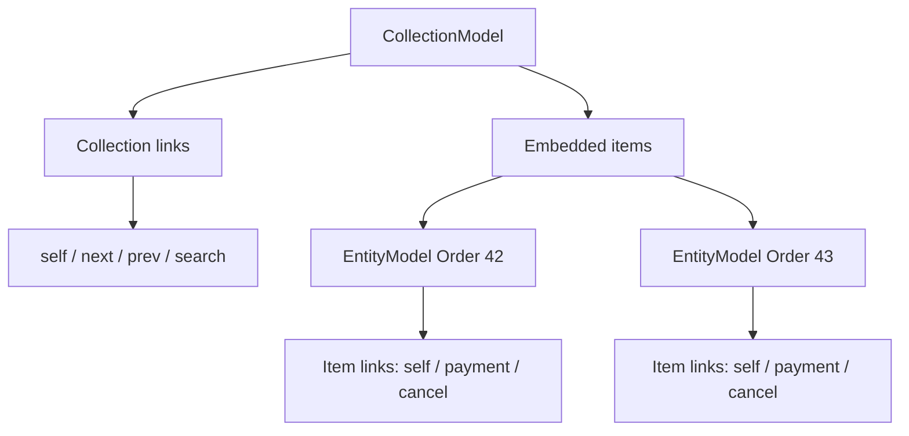

# Link descriptors cho collection và resource đơn

## 1. Hai cấp liên kết trong API hypermedia

Một API HATEOAS thường trả về cả **collection** (tập hợp tài nguyên) và **resource đơn** (một tài nguyên cụ thể). Mỗi cấp có thể có các liên kết phục vụ mục đích khác nhau:

- Link ở cấp collection dẫn tới chính collection, trang kế tiếp/trước, thao tác tìm kiếm hoặc các chức năng áp dụng cho toàn bộ tập hợp.
- Link ở cấp resource đơn dẫn tới chính resource, tài nguyên liên quan hoặc thao tác áp dụng cho resource đó, chẳng hạn xem chi tiết, chỉnh sửa, thanh toán hay hủy.

Spring HATEOAS thể hiện hai dạng này bằng `CollectionModel<T>` và `EntityModel<T>` (cả hai thuộc họ `RepresentationModel`). Một `CollectionModel<EntityModel<Order>>` có thể chứa links ở cấp collection và mỗi `EntityModel<Order>` trong danh sách lại có links riêng.

Spring REST Docs dùng `links(...)` và `linkWithRel(...)` để mô tả relation trong response. Mỗi snippet nên làm rõ đang mô tả **collection links** hay **item/resource links**. Nếu trộn các cấp, người đọc có thể hiểu nhầm `next` là link của một order hoặc hiểu `payment` của một order là thao tác áp dụng cho cả collection.



## 2. Nhận diện collection và resource đơn trong payload HAL

Ví dụ collection response:

```http
HTTP/1.1 200 OK
Content-Type: application/hal+json
```

```json
{
  "_embedded": {
    "orders": [
      {
        "id": 42,
        "status": "PENDING",
        "_links": {
          "self": { "href": "/api/orders/42" },
          "payment": { "href": "/api/orders/42/payment" }
        }
      },
      {
        "id": 43,
        "status": "PAID",
        "_links": {
          "self": { "href": "/api/orders/43" }
        }
      }
    ]
  },
  "_links": {
    "self": { "href": "/api/orders" },
    "next": { "href": "/api/orders?page=1" },
    "search": { "href": "/api/orders/search" }
  },
  "page": {
    "size": 20,
    "totalElements": 42,
    "totalPages": 3,
    "number": 0
  }
}
```

Trong ví dụ:

| Vị trí | Cấp | Ý nghĩa |
| --- | --- | --- |
| Root `_links.self` | Collection | URI của collection orders. |
| Root `_links.next` | Collection | Trang kế tiếp của collection. |
| Root `_links.search` | Collection | Điểm vào chức năng tìm kiếm order. |
| `_embedded.orders[0]._links.self` | Resource đơn | URI của order 42. |
| `_embedded.orders[0]._links.payment` | Resource đơn | Điểm vào thanh toán order 42. |
| `_embedded.orders[1]._links.self` | Resource đơn | URI của order 43. |

HAL đặt collection links ở `_links` cấp root và các resource nhúng ở `_embedded`. `CollectionModel` tương ứng với collection; `EntityModel` đại diện từng item có thể mang links riêng. `page` là metadata phân trang, không phải link. Không mô tả `page.number` như một URI relation.

Với resource đơn, payload thường có dạng:

```json
{
  "id": 42,
  "status": "PENDING",
  "_links": {
    "self": { "href": "/api/orders/42" },
    "payment": { "href": "/api/orders/42/payment" },
    "cancel": { "href": "/api/orders/42/cancel" }
  }
}
```

Ở đây, cả ba links đều thuộc order 42. `payment` và `cancel` không phải thao tác áp dụng cho toàn bộ collection.

## 3. Mô hình Spring HATEOAS: `CollectionModel` và `EntityModel`

Spring HATEOAS cung cấp các abstraction để gắn link mà không phải tự tạo chuỗi `_links`:

| Kiểu | Mục đích | Ví dụ |
| --- | --- | --- |
| `EntityModel<Order>` | Bao một domain object và links của resource đó. | Order 42 cùng `self`, `payment`, `cancel`. |
| `CollectionModel<EntityModel<Order>>` | Bao nhiều resource models và links của toàn collection. | Danh sách orders có `self`, `next`, `search`; từng order có links riêng. |
| `RepresentationModel<?>` | Base abstraction cho representation cần gắn links. | Các response model tùy chỉnh. |

Ví dụ controller có thể tạo collection với links ở cả hai cấp:

```java
@RestController
@RequestMapping("/api/orders")
class OrderController {

    @GetMapping
    CollectionModel<EntityModel<Order>> findAll() {
        List<EntityModel<Order>> items = List.of(
                toModel(new Order(42L, "PENDING")),
                toModel(new Order(43L, "PAID")));

        return CollectionModel.of(items,
                linkTo(methodOn(OrderController.class).findAll()).withSelfRel(),
                linkTo(methodOn(OrderController.class).search()).withRel("search"));
    }

    @GetMapping("/{id}")
    EntityModel<Order> findById(@PathVariable long id) {
        return toModel(loadOrder(id));
    }

    private EntityModel<Order> toModel(Order order) {
        return EntityModel.of(order,
                linkTo(methodOn(OrderController.class).findById(order.id())).withSelfRel(),
                linkTo(methodOn(PaymentController.class).pay(order.id())).withRel("payment"));
    }

    @GetMapping("/search")
    CollectionModel<EntityModel<Order>> search() {
        // Ví dụ rút gọn: triển khai tìm kiếm thực tế trong service.
        return CollectionModel.empty();
    }
}
```

Đây là minh họa về kiểu trả về và cách gắn link. `Order`, `PaymentController`, `loadOrder(...)` và `pay(...)` đại diện cho domain/service của ứng dụng; cần triển khai chúng hoặc thay bằng controller thật của dự án. Trong ứng dụng thực tế, nên dùng assembler riêng (ví dụ `RepresentationModelAssembler`) khi logic tạo `EntityModel` được tái sử dụng ở nhiều nơi.

## 4. Document links cấp collection bằng `links(...)`

Khi response là HAL collection, `links(halLinks(), ...)` mô tả các relation ở `_links` cấp root. Ví dụ REST Assured:

```java
given(this.specification)
        .accept("application/hal+json")
        .filter(document("orders-list",
                links(halLinks(),
                        linkWithRel("self").description("Collection đơn hàng hiện tại"),
                        linkWithRel("search").description("Tìm kiếm đơn hàng"),
                        linkWithRel("next").description("Trang kế tiếp của danh sách"))))
.when()
        .get("/api/orders")
.then()
        .statusCode(200)
        .contentType("application/hal+json");
```

`orders-list` là identifier của nhóm snippet. `links(...)` tạo `links.adoc` cho operation này. Các descriptor cần mô tả ý nghĩa của **collection relation**. Nếu API có `prev`, `first`, `last` hoặc `profile`, thêm descriptor tương ứng khi các link đó thuộc hợp đồng.

Static import:

```java
import static org.springframework.restdocs.hypermedia.HypermediaDocumentation.halLinks;
import static org.springframework.restdocs.hypermedia.HypermediaDocumentation.linkWithRel;
import static org.springframework.restdocs.hypermedia.HypermediaDocumentation.links;
import static org.springframework.restdocs.restassured.RestAssuredRestDocumentation.document;
```

HAL extractor tập trung vào `_links` ở cấp representation. Không mặc định rằng một lần gọi `links(halLinks(), ...)` sẽ tạo các bảng độc lập cho mọi `_links` lồng trong từng phần tử `_embedded`. Vì thế nên document collection-level links riêng và giữ raw response/body để người đọc xem embedded item links; nếu cần một bảng riêng cho từng item trong collection, dùng test resource đơn hoặc viết extractor/snippet có chủ đích cho cấu trúc lồng.

## 5. Document links của resource đơn

Với endpoint `GET /api/orders/{id}`, response là representation của một order. Khi đó, `links(...)` mô tả các relation ở cấp resource:

```java
given(this.specification)
        .accept("application/hal+json")
        .filter(document("orders-get",
                links(halLinks(),
                        linkWithRel("self").description("Đơn hàng hiện tại"),
                        linkWithRel("payment").description("Mở quy trình thanh toán"),
                        linkWithRel("cancel").description("Hủy đơn hàng khi còn cho phép"))))
.when()
        .get("/api/orders/{id}", 42)
.then()
        .statusCode(200)
        .contentType("application/hal+json");
```

Ở đây, `payment` và `cancel` gắn với order cụ thể. Nếu `cancel` chỉ xuất hiện trong một số trạng thái, đánh dấu `.optional()` khi sự vắng mặt đó hợp lệ:

```java
linkWithRel("cancel").description("Hủy đơn hàng").optional()
```

Không dùng optional nếu API bắt buộc phải cung cấp link đó trong trạng thái đang test; khi ấy việc link biến mất là lỗi hợp đồng cần được phát hiện.

## 6. Document cả body fields và links

Links cho biết client có thể đi đâu; body fields cho biết resource hiện tại chứa dữ liệu gì. Hai loại snippet bổ trợ cho nhau.

Ví dụ resource đơn:

```java
.filter(document("orders-get",
        links(halLinks(),
                linkWithRel("self").description("Đơn hàng hiện tại"),
                linkWithRel("payment").description("Thanh toán đơn hàng")),
        responseFields(
                fieldWithPath("id").description("Mã đơn hàng"),
                fieldWithPath("status").description("Trạng thái đơn hàng"),
                subsectionWithPath("_links").description("Các liên kết của đơn hàng"))))
```

Ví dụ collection response:

```java
.filter(document("orders-list",
        links(halLinks(),
                linkWithRel("self").description("Collection đơn hàng"),
                linkWithRel("next").description("Trang tiếp theo").optional()),
        responseFields(
                subsectionWithPath("_embedded").description("Danh sách resource đơn hàng"),
                subsectionWithPath("_links").description("Các liên kết ở cấp collection"),
                subsectionWithPath("page").description("Metadata phân trang"))))
```

`subsectionWithPath(...)` gom cấu trúc lồng nhau thành một descriptor. Với collection, điều này tránh phải mô tả từng item trong mảng như thể chúng là các field cố định của một object. Khi cần tài liệu hóa chi tiết `id`, `status` hay links của từng order, hãy dùng một response đơn `/orders/{id}` với descriptor cụ thể và một identifier riêng.

Các static import bổ sung:

```java
import static org.springframework.restdocs.payload.PayloadDocumentation.fieldWithPath;
import static org.springframework.restdocs.payload.PayloadDocumentation.responseFields;
import static org.springframework.restdocs.payload.PayloadDocumentation.subsectionWithPath;
```

## 7. Strict, optional, ignored và relaxed ở từng cấp

Spring REST Docs kiểm tra descriptor links so với các links mà extractor tìm thấy trong response:

- `links(...)` là chế độ strict: relation xuất hiện nhưng không có descriptor sẽ gây lỗi; descriptor bắt buộc mà response thiếu cũng gây lỗi.
- `.optional()` cho phép relation được mô tả nhưng vắng mặt ở một số trạng thái.
- `.ignored()` bỏ một relation khỏi bảng nhưng không gây lỗi chỉ vì relation đó xuất hiện.
- `relaxedLinks(...)` bỏ qua relation xuất hiện nhưng không được mô tả; các relation được mô tả vẫn phải có nếu không optional.

Chính sách strict/optional cần được áp dụng theo **operation đang document**. Ví dụ `next` có thể optional ở trang cuối collection, trong khi `payment` có thể optional theo trạng thái từng order. Không nên chuyển toàn bộ snippet sang relaxed chỉ vì một trong các relation thay đổi theo trạng thái.

Ví dụ collection có `next` tùy theo trang:

```java
links(halLinks(),
        linkWithRel("self").description("Collection hiện tại"),
        linkWithRel("next").description("Trang kế tiếp").optional(),
        linkWithRel("prev").description("Trang trước").optional())
```

Ví dụ resource đơn có action link tùy trạng thái:

```java
links(halLinks(),
        linkWithRel("self").description("Order hiện tại"),
        linkWithRel("payment").description("Thanh toán order").optional(),
        linkWithRel("cancel").description("Hủy order").optional())
```

Các link optional ở ví dụ chỉ hợp lệ nếu server thực sự ẩn/hiện chúng theo nghiệp vụ. Nếu mọi order `PENDING` luôn phải có `payment`, test cho trạng thái `PENDING` nên giữ descriptor `payment` bắt buộc.

## 8. Pagination: collection links và metadata phân trang

Một collection có thể mô tả phân trang bằng links như `first`, `prev`, `self`, `next`, `last`, đồng thời có metadata `page` riêng trong payload. Không nhầm hai thành phần này:

| Thành phần | Chức năng |
| --- | --- |
| `next` / `prev` / `first` / `last` | Các URI client có thể dereference để điều hướng trang. |
| `page.number` | Chỉ số trang hiện tại. |
| `page.size` | Số phần tử tối đa trong trang. |
| `page.totalElements` | Tổng số phần tử theo kết quả truy vấn. |
| `page.totalPages` | Tổng số trang. |

Ví dụ response có thể document links và metadata:

```java
links(halLinks(),
        linkWithRel("self").description("Trang hiện tại"),
        linkWithRel("first").description("Trang đầu"),
        linkWithRel("prev").description("Trang trước").optional(),
        linkWithRel("next").description("Trang tiếp theo").optional(),
        linkWithRel("last").description("Trang cuối"))
```

Phần metadata nên được mô tả trong `responseFields(...)` hoặc subsection `page`. Link `next` là hướng điều hướng, không phải phép cộng trực tiếp vào `page.number`; client nên theo href/relation mà server trả về thay vì tự dựng URL từ số trang.

## 9. Tái sử dụng common links mà vẫn phân biệt cấp

HAL collection và resource đơn có thể cùng có `self`, `curies`. Có thể định nghĩa snippet helper bỏ qua các relation chung rồi bổ sung link riêng cho operation:

```java
static LinksSnippet ignoreSelfAndCuries(LinkDescriptor... descriptors) {
    return HypermediaDocumentation.links(
            linkWithRel("self").ignored().optional(),
            linkWithRel("curies").ignored())
            .and(descriptors);
}
```

Dùng cho collection:

```java
ignoreSelfAndCuries(
        linkWithRel("next").description("Trang tiếp theo").optional(),
        linkWithRel("search").description("Tìm kiếm orders"))
```

Dùng cho resource đơn:

```java
ignoreSelfAndCuries(
        linkWithRel("payment").description("Thanh toán order"),
        linkWithRel("cancel").description("Hủy order").optional())
```

Helper chỉ bỏ các common relations khỏi bảng của từng operation; nó không làm cho collection links và item links trở thành cùng một nhóm. Tài liệu nên có phần overview giải thích `self`/`curies` một lần, sau đó các snippet riêng mô tả links đặc thù ở đúng cấp.

## 10. Kiểm tra links ở collection và item trong test

Với collection response, nên có assertion cho cả root links lẫn embedded item links nếu chúng thuộc hợp đồng cần kiểm chứng. Ví dụ REST Assured:

```java
given(this.specification)
        .accept("application/hal+json")
        .get("/api/orders")
.then()
        .statusCode(200)
        .body("_links.self.href", notNullValue())
        .body("_links.next.href", notNullValue())
        .body("_embedded.orders[0]._links.self.href", notNullValue())
        .body("_embedded.orders[0]._links.payment.href", notNullValue());
```

Assertion này xác minh những quan hệ ở cả hai cấp trong response; bản thân `links(...)` mặc định vẫn document các links được extractor trích ra theo phạm vi của nó. Nếu yêu cầu phải có bảng `links.adoc` riêng cho item trong collection, cần custom extractor/snippet hoặc document endpoint resource đơn để có operation response với item nằm ở root. Đừng giả định assertion vào `_embedded` đồng nghĩa `links(...)` đã tự tạo bảng mô tả mọi nested links.

Với API có số lượng item thay đổi, tránh phụ thuộc index `[0]` nếu thứ tự collection không được bảo đảm. Có thể chuẩn bị fixture ổn định, tìm item theo ID bằng matcher phù hợp hoặc kiểm tra một resource đơn riêng.

## 11. Kết hợp snippet trong tài liệu Asciidoctor

Nên trình bày collection và resource đơn thành các mục riêng:

```asciidoc
== Liệt kê đơn hàng

=== HTTP response
include::{snippets}/orders-list/http-response.adoc[]

=== Collection links
include::{snippets}/orders-list/links.adoc[]

=== Collection fields và pagination
include::{snippets}/orders-list/response-fields.adoc[]

== Xem một đơn hàng

=== HTTP response
include::{snippets}/orders-get/http-response.adoc[]

=== Resource links
include::{snippets}/orders-get/links.adoc[]

=== Resource fields
include::{snippets}/orders-get/response-fields.adoc[]
```

`http-response.adoc` giữ payload đầy đủ để người đọc nhìn thấy HAL `_embedded`, root `_links` và item `_links`. `links.adoc` mô tả các relation được khai báo cho operation; `response-fields.adoc` giải thích dữ liệu nghiệp vụ hoặc subsection. Thuộc tính `{snippets}` phải trỏ tới output directory đúng của build hiện tại.

Nếu tài liệu dùng Markdown, cần cơ chế include/chuyển đổi AsciiDoc tương ứng; Markdown thuần không tự xử lý directive `include::...[]`.

## 12. Lỗi thường gặp

| Hiện tượng | Nguyên nhân | Cách xử lý |
| --- | --- | --- |
| Collection snippet có `next` nhưng không mô tả từng order | Chỉ document root collection links. | Dùng response snippet cho `_embedded`, assertion item links hoặc test riêng resource đơn. |
| Link `payment` bị đưa vào bảng collection | Custom extractor đang trộn links lồng với root links hoặc descriptor không phân biệt ngữ cảnh. | Xác định cấp link; giữ root links và item links trong các snippet/test riêng. |
| `next` làm test thất bại ở trang cuối | Descriptor bắt buộc dù không có trang sau. | Đánh dấu optional khi sự vắng mặt đúng với contract của trang cuối. |
| `payment` không có ở order đã thanh toán | Link phụ thuộc trạng thái nhưng test dùng descriptor bắt buộc cho mọi trạng thái. | Viết test theo từng trạng thái và dùng optional đúng phạm vi. |
| Không document được `_embedded` | Cố dùng `links(...)` để mô tả toàn bộ nested collection body. | Dùng `responseFields(subsectionWithPath("_embedded"))` và giữ raw response; dùng custom extraction nếu cần bảng riêng. |
| Test phụ thuộc phần tử `[0]` | Thứ tự collection không được bảo đảm. | Fixture ổn định hoặc truy vấn resource bằng ID. |
| Snippet collection và resource ghi đè nhau | Dùng chung identifier. | Đặt tên riêng `orders-list`, `orders-get`. |

## 13. Checklist thực hành

- [ ] Đã xác định response đang là collection hay resource đơn.
- [ ] Đã phân biệt collection-level `_links` với links bên trong từng `_embedded` item.
- [ ] Collection links như `self`, `next`, `prev`, `search` được mô tả bằng descriptor riêng.
- [ ] Resource links như `self`, `payment`, `cancel` được document theo trạng thái của resource.
- [ ] Đã dùng `CollectionModel` và `EntityModel` phù hợp với cấu trúc representation nếu dùng Spring HATEOAS.
- [ ] Đã hiểu phạm vi của HAL link extractor và không giả định nó document mọi nested links.
- [ ] Đã dùng `subsectionWithPath("_embedded")`/`subsectionWithPath("_links")` khi cần mô tả cấu trúc payload.
- [ ] Pagination links được phân biệt với page metadata.
- [ ] Test có assertion cho các nested links quan trọng; identifier snippet không bị trùng.
- [ ] Tài liệu cuối có mục collection và resource đơn rõ ràng, chỉ publish khi test pass.

Collection và resource đơn có thể cùng chứa hypermedia links nhưng relation của chúng phục vụ các cấp điều hướng khác nhau. `CollectionModel` mô tả tập hợp và links phân trang/tìm kiếm; `EntityModel` mô tả một item và các thao tác liên quan đến item đó. Khi tách descriptor, snippet và test theo đúng cấp, người tích hợp sẽ hiểu chính xác link nào điều hướng collection và link nào áp dụng cho từng resource.

## Tài liệu tham khảo

- [Spring REST Docs – Hypermedia](https://docs.spring.io/spring-restdocs/reference/documenting-your-api/hypermedia.html)
- [Spring REST Docs – HypermediaDocumentation API](https://docs.spring.io/spring-restdocs/docs/current/api/org/springframework/restdocs/hypermedia/HypermediaDocumentation.html)
- [Spring HATEOAS – Fundamentals and Representation Models](https://docs.spring.io/spring-hateoas/docs/current/reference/html/)
- [Spring Data REST – CollectionModel and EntityModel](https://docs.spring.io/spring-data/rest/docs/3.7.7/reference/html/)
