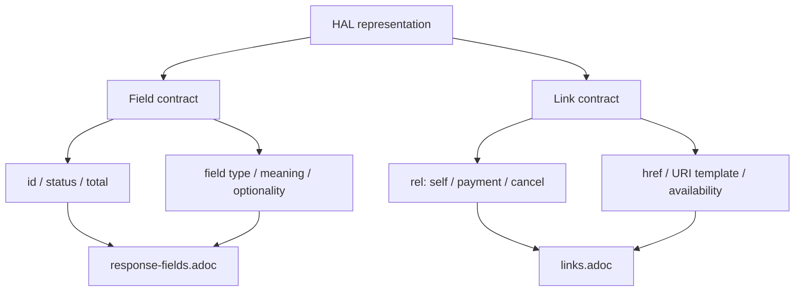

# Phân biệt link contract với field contract

## 1. Hai phần hợp đồng khác nhau trong một hypermedia response

Một REST API trả representation có hypermedia thường mang cả dữ liệu nghiệp vụ và các liên kết điều hướng. Khi document bằng Spring REST Docs, cần phân biệt **field contract** và **link contract**:

- **Field contract** mô tả cấu trúc dữ liệu: tên field, kiểu dữ liệu, ý nghĩa, field bắt buộc/tùy chọn và cấu trúc lồng nhau.
- **Link contract** mô tả khả năng điều hướng: relation nào được cung cấp, relation đó có ý nghĩa gì, khi nào xuất hiện, URI hoặc URI template có thể được dùng như thế nào.

Hai phần này bổ sung cho nhau. `responseFields(...)` giúp người đọc hiểu `id`, `status`, `total` hoặc một object lồng nhau. `links(...)` và `linkWithRel(...)` giúp họ hiểu `self`, `payment`, `cancel`, `next` hay `search` dùng để làm gì. Một bảng field không thay thế bảng links; một bảng links cũng không mô tả schema JSON của resource.

Ví dụ response HAL:

```json
{
  "id": 42,
  "status": "PENDING",
  "total": 125000,
  "_links": {
    "self": { "href": "/api/orders/42" },
    "payment": { "href": "/api/orders/42/payment" },
    "cancel": { "href": "/api/orders/42/cancel" }
  }
}
```

| Thành phần | Hợp đồng | Câu hỏi mà tài liệu cần trả lời |
| --- | --- | --- |
| `id` | Field contract | ID có kiểu gì, ý nghĩa và định dạng ra sao? |
| `status` | Field contract | Các giá trị trạng thái hợp lệ là gì? |
| `total` | Field contract | Giá trị tiền tệ có đơn vị nào, biểu diễn bằng kiểu gì? |
| `self` | Link contract | Relation này dẫn tới resource nào? |
| `payment` | Link contract | Client dùng link này để bắt đầu hoặc tiếp tục thanh toán như thế nào? |
| `cancel` | Link contract | Link có xuất hiện ở mọi trạng thái hay chỉ khi đơn còn được phép hủy? |
| `_links` | Cấu trúc representation | Các link được đặt ở đâu trong payload HAL? |



## 2. Field contract mô tả dữ liệu, không mô tả điều hướng

Field contract tập trung vào payload và semantics của dữ liệu. Với Spring REST Docs, các descriptor thường dùng gồm:

| API | Mục đích |
| --- | --- |
| `fieldWithPath("id")` | Mô tả một field có path cụ thể. |
| `.type(JsonFieldType.NUMBER)` | Công bố kiểu dữ liệu của field. |
| `.description("...")` | Giải thích ý nghĩa nghiệp vụ. |
| `.optional()` | Field có thể vắng mặt. |
| `.ignored()` | Không đưa field vào bảng và không yêu cầu mô tả field đó. |
| `subsectionWithPath("address")` | Mô tả/gom một vùng cấu trúc lồng nhau. |

Ví dụ response fields:

```java
responseFields(
        fieldWithPath("id")
                .type(JsonFieldType.NUMBER)
                .description("Mã đơn hàng"),
        fieldWithPath("status")
                .type(JsonFieldType.STRING)
                .description("Trạng thái xử lý đơn hàng"),
        fieldWithPath("total")
                .type(JsonFieldType.NUMBER)
                .description("Tổng tiền theo đơn vị tiền tệ của API"),
        fieldWithPath("note")
                .type(JsonFieldType.STRING)
                .description("Ghi chú của khách hàng")
                .optional())
```

Với descriptor chặt chẽ mặc định, field có trong payload nhưng không được mô tả có thể làm snippet generation thất bại; descriptor bắt buộc nhưng field không có trong payload cũng có thể gây lỗi. `.optional()` chỉ nên dùng khi field thực sự có thể vắng mặt theo hợp đồng. `.ignored()` không đồng nghĩa với optional: nó bỏ field khỏi tài liệu và bỏ qua việc mô tả field đó.

Nếu response có `customer.address.city`, có thể mô tả chi tiết từng path hoặc gom một vùng bằng `subsectionWithPath(...)`, tùy mục tiêu tài liệu. Không dùng subsection để tránh giải thích những field quan trọng mà client cần hiểu.

## 3. Link contract mô tả quan hệ và khả năng điều hướng

Link contract cần giải thích nhiều hơn một URL. Với HAL, các thông tin thường quan trọng gồm:

- **Relation (`rel`):** ý nghĩa của link đối với resource hoặc collection hiện tại.
- **Href:** URI đích; có thể tương đối, tuyệt đối hoặc là URI template.
- **Availability:** điều kiện hoặc trạng thái khiến link xuất hiện/vắng mặt.
- **Templating:** nếu `templated: true`, biến nào phải được cung cấp để mở rộng URI template.
- **Method và thao tác:** nếu client cần thực hiện hành động qua link, phải giải thích HTTP method, payload và kết quả theo tài liệu endpoint đích. Một HAL link thuần không tự khai báo đầy đủ HTTP method/body.

Spring REST Docs cung cấp `links(...)` và `linkWithRel(...)` để tạo snippet `links.adoc`:

```java
links(
        linkWithRel("self").description("Truy xuất representation của đơn hàng hiện tại"),
        linkWithRel("payment").description("Mở quy trình thanh toán cho đơn hàng"),
        linkWithRel("cancel").description("Hủy đơn hàng nếu trạng thái cho phép"))
```

`links.adoc` tập trung vào relation và description; nó không phải schema đầy đủ cho toàn bộ JSON link object. Hãy giữ `http-response.adoc`/`response-body.adoc` hoặc mô tả `_links` trong field snippet nếu người đọc cần xem `href` và thuộc tính HAL như `templated`, `type`, `hreflang`.

## 4. Hai snippet nên xuất hiện cùng nhau

Với response ở mục 1, có thể document đồng thời links và fields trong cùng operation:

```java
given(this.specification)
        .accept("application/hal+json")
        .filter(document("orders-get",
                links(halLinks(),
                        linkWithRel("self")
                                .description("Đơn hàng hiện tại"),
                        linkWithRel("payment")
                                .description("Mở quy trình thanh toán"),
                        linkWithRel("cancel")
                                .description("Hủy đơn hàng khi còn cho phép").optional()),
                responseFields(
                        fieldWithPath("id")
                                .type(JsonFieldType.NUMBER)
                                .description("Mã đơn hàng"),
                        fieldWithPath("status")
                                .type(JsonFieldType.STRING)
                                .description("Trạng thái xử lý"),
                        fieldWithPath("total")
                                .type(JsonFieldType.NUMBER)
                                .description("Tổng tiền đơn hàng"),
                        subsectionWithPath("_links")
                                .description("Các liên kết hypermedia của đơn hàng"))))
.when()
        .get("/api/orders/{id}", 42)
.then()
        .statusCode(200)
        .contentType("application/hal+json")
        .body("id", equalTo(42))
        .body("_links.self.href", notNullValue());
```

Các static import chính:

```java
import static org.springframework.restdocs.hypermedia.HypermediaDocumentation.halLinks;
import static org.springframework.restdocs.hypermedia.HypermediaDocumentation.linkWithRel;
import static org.springframework.restdocs.hypermedia.HypermediaDocumentation.links;
import static org.springframework.restdocs.payload.PayloadDocumentation.fieldWithPath;
import static org.springframework.restdocs.payload.PayloadDocumentation.responseFields;
import static org.springframework.restdocs.payload.PayloadDocumentation.subsectionWithPath;
import static org.springframework.restdocs.restassured.RestAssuredRestDocumentation.document;
import static org.hamcrest.Matchers.equalTo;
import static org.hamcrest.Matchers.notNullValue;
```

Ví dụ giả định server thực sự trả HAL response đúng schema đã mô tả. `links(...)` kiểm tra link relations; `responseFields(...)` kiểm tra field contract và gom `_links` thành một subsection. Assertion `body("_links.self.href", ...)` bổ sung kiểm tra link href thực tế. Test cần fixture ổn định và endpoint tương ứng.

Kết quả thường có các snippet:

```text
build/generated-snippets/orders-get/
  http-request.adoc
  http-response.adoc
  links.adoc
  response-fields.adoc
  ...
```

Các snippet này có vai trò riêng:

| Snippet | Vai trò |
| --- | --- |
| `http-response.adoc` | Giữ response thực, gồm status, headers và HAL body với `href`. |
| `links.adoc` | Diễn giải ý nghĩa của các link relations. |
| `response-fields.adoc` | Mô tả dữ liệu và cấu trúc representation. |

## 5. Đừng nhầm `_links` subsection với link contract

Có thể dùng:

```java
subsectionWithPath("_links")
        .description("Các liên kết hypermedia của đơn hàng")
```

Descriptor này nói rằng payload có một vùng `_links` và gom phần con thành subsection. Nó **không** giải thích relation `payment` dùng để làm gì, link `cancel` khi nào xuất hiện hay URI template cần biến nào. Những thông tin đó thuộc link contract và nên được mô tả bằng `links(...)`, tài liệu endpoint liên quan hoặc phần giải thích riêng.

Ngược lại, `links(...)` không thay thế `responseFields(...)` cho `id`, `status`, `total` hoặc các field nghiệp vụ khác. Một operation đầy đủ thường dùng cả hai:

```java
document("orders-get",
        links(halLinks(), /* LinkDescriptor... */),
        responseFields(/* FieldDescriptor... */))
```

Các dấu `/* ... */` trong đoạn trên chỉ biểu diễn vị trí truyền descriptor; cần thay bằng các descriptor thật như ví dụ đầy đủ ở mục 4.

## 6. Link cardinality và field optionality là hai quy tắc khác nhau

Field contract và link contract đều có thể nói đến việc “có hoặc không”, nhưng ngữ nghĩa khác nhau:

| Khái niệm | Descriptor Spring REST Docs | Ý nghĩa |
| --- | --- | --- |
| Field có thể vắng | `fieldWithPath("note").optional()` | Field `note` không phải lúc nào cũng xuất hiện trong JSON. |
| Link relation có thể vắng | `linkWithRel("cancel").optional()` | Relation `cancel` có thể không xuất hiện theo trạng thái resource. |
| Field bỏ qua | `fieldWithPath("internalCode").ignored()` | Không mô tả field này trong bảng fields. |
| Link bỏ qua | `linkWithRel("curies").ignored()` | Không đưa relation này vào bảng links. |

Ví dụ:

```java
responseFields(
        fieldWithPath("id").description("Mã đơn hàng"),
        fieldWithPath("note").description("Ghi chú").optional())
```

và:

```java
links(halLinks(),
        linkWithRel("self").description("Đơn hàng hiện tại"),
        linkWithRel("cancel").description("Hủy đơn hàng").optional())
```

Trong đó `note` là dữ liệu có thể không có; `cancel` là khả năng điều hướng có thể không được server cung cấp. Không suy luận link optional từ field optional hoặc ngược lại.

## 7. Link contract có thể thay đổi theo trạng thái resource

Ví dụ một order có trạng thái `PENDING` có `payment` và `cancel`; khi `PAID`, chỉ còn `self` và `receipt`:

```json
{
  "id": 42,
  "status": "PENDING",
  "_links": {
    "self": { "href": "/api/orders/42" },
    "payment": { "href": "/api/orders/42/payment" },
    "cancel": { "href": "/api/orders/42/cancel" }
  }
}
```

```json
{
  "id": 42,
  "status": "PAID",
  "_links": {
    "self": { "href": "/api/orders/42" },
    "receipt": { "href": "/api/orders/42/receipt" }
  }
}
```

Các field `id` và `status` thuộc field contract; các relation thay đổi theo state thuộc link contract. Có thể viết test riêng cho mỗi trạng thái để giữ tính nghiêm ngặt:

```java
// Scenario order đang chờ thanh toán
links(halLinks(),
        linkWithRel("self").description("Đơn hàng hiện tại"),
        linkWithRel("payment").description("Thanh toán đơn hàng"),
        linkWithRel("cancel").description("Hủy đơn hàng"))
```

```java
// Scenario order đã thanh toán
links(halLinks(),
        linkWithRel("self").description("Đơn hàng hiện tại"),
        linkWithRel("receipt").description("Xem hóa đơn"))
```

Đặt identifier riêng, ví dụ `orders-get-pending` và `orders-get-paid`. Không nhất thiết dùng một descriptor với tất cả links đều optional: nếu `payment` bắt buộc xuất hiện ở trạng thái `PENDING`, test của trạng thái đó nên phát hiện việc server vô tình bỏ link.

## 8. Link contract cho collection khác với item field contract

Collection response có field contract riêng cho metadata như `page.size`, `page.totalElements` và embedded resource structure. Link contract ở root có thể gồm `self`, `next`, `prev`, `search`; links trong từng embedded item lại thuộc contract của từng resource.

Ví dụ descriptor collection:

```java
document("orders-list",
        links(halLinks(),
                linkWithRel("self").description("Collection đơn hàng"),
                linkWithRel("next").description("Trang tiếp theo").optional(),
                linkWithRel("prev").description("Trang trước").optional()),
        responseFields(
                subsectionWithPath("_embedded").description("Các đơn hàng trong trang"),
                subsectionWithPath("_links").description("Liên kết ở cấp collection"),
                subsectionWithPath("page").description("Metadata phân trang")))
```

Không giả định link extractor mặc định tự tạo bảng `links.adoc` độc lập cho toàn bộ nested links trong `_embedded`. Hãy giữ raw HTTP response/body để thấy link thực tế trong item, assertion những links cần thiết hoặc document endpoint resource đơn riêng. Nếu cần một bảng tổng hợp item links, phải xây dựng extractor/snippet phù hợp với cấu trúc response.

## 9. Đưa hai hợp đồng vào trang tài liệu

Một trang Asciidoctor nên trình bày cả dữ liệu và khả năng điều hướng:

```asciidoc
== Xem đơn hàng

=== HTTP response
include::{snippets}/orders-get/http-response.adoc[]

=== Resource fields
include::{snippets}/orders-get/response-fields.adoc[]

=== Link relations
include::{snippets}/orders-get/links.adoc[]
```

Trình tự có thể thay đổi theo trải nghiệm người đọc, nhưng nội dung nên giải thích rõ:

1. Response trả dữ liệu gì và kiểu dữ liệu ra sao?
2. Resource có các relation nào và ý nghĩa từng relation?
3. Href cụ thể nằm ở đâu; link có template hoặc phụ thuộc trạng thái không?
4. Client nên làm gì tiếp theo khi có hoặc không có một relation?

Đối với một link dẫn tới endpoint khác, link contract nên tham chiếu tới phần tài liệu operation đích. Ví dụ `payment` dẫn tới `POST /api/orders/{id}/payment`; tài liệu của operation đó mô tả method, request body, status và response tương ứng. Bản thân relation `payment` không đủ để thay thế hợp đồng HTTP của endpoint thanh toán.

## 10. Versioning và thay đổi hợp đồng

Thay đổi field contract và link contract có tác động khác nhau:

| Thay đổi | Rủi ro với client | Cách document/test |
| --- | --- | --- |
| Thêm field tùy chọn | Thường ít phá vỡ nếu client bỏ qua field chưa biết. | Cập nhật descriptor và kiểm tra response fields. |
| Xóa hoặc đổi kiểu field bắt buộc | Có thể phá vỡ parser/client đang phụ thuộc. | Test schema nghiêm ngặt và cập nhật version/changelog. |
| Đổi tên relation | Có thể khiến client không tìm thấy thao tác tiếp theo. | Coi như thay đổi link contract; document quan hệ thay thế và giai đoạn chuyển tiếp. |
| Xóa link bắt buộc ở trạng thái cụ thể | Client có thể mất khả năng tiếp tục workflow. | Test links theo state; không đánh optional nếu contract yêu cầu link. |
| Đổi href nhưng giữ rel | Có thể tương thích nếu client dereference href nhận từ response. | Kiểm tra client không hard-code URL; giữ ví dụ href cập nhật. |
| Đổi URI template variables | Client cần cung cấp biến khác hoặc encode khác. | Document rõ template và test query/parameter sau khi mở rộng. |
| Thêm relation mới | Client có thể bỏ qua; tài liệu nên giải thích khả năng mới. | Strict `links(...)` phát hiện relation chưa mô tả để nhóm review. |

HATEOAS giúp client giảm phụ thuộc vào URL hard-code, nhưng không làm mọi thay đổi link tự động tương thích. Relation semantics, điều kiện xuất hiện, URI template và thao tác đích vẫn là một phần hợp đồng mà client cần hiểu.

## 11. Lỗi thường gặp

| Hiện tượng | Nguyên nhân | Cách xử lý |
| --- | --- | --- |
| Chỉ có `response-fields.adoc`, không có ý nghĩa links | Field contract đã mô tả `_links` như subsection nhưng chưa có links snippet. | Thêm `links(...)` và descriptor theo relation. |
| Chỉ có `links.adoc`, không hiểu payload resource | Chỉ mô tả relation nhưng bỏ field contract. | Thêm `responseFields(...)` cho dữ liệu nghiệp vụ. |
| Cho rằng `_links` subsection đã document mọi relation | Subsection chỉ mô tả cấu trúc lồng nhau. | Dùng `links(...)` riêng cho semantics điều hướng. |
| Đánh `cancel` optional ở mọi test | Không phân biệt state-specific contract. | Viết test theo trạng thái và giữ relation bắt buộc ở state cần có. |
| Relaxed fields/links làm bỏ qua schema thay đổi | Dùng relaxed mode để làm test xanh. | Review thay đổi trước, sau đó dùng relaxed có chủ đích. |
| Đổi href nhưng client bị lỗi | Client hard-code URL thay vì theo link relation. | Cải thiện client theo HATEOAS và cập nhật href trong response examples. |
| Relation dẫn tới endpoint chưa được document | Link contract không nối với HTTP operation đích. | Thêm trang tài liệu cho operation đích và liên kết chéo. |
| Collection links bị lẫn với item links | Không phân biệt root `_links` và links trong `_embedded`. | Tách collection/resource tests, identifier và snippets. |

## 12. Checklist review

- [ ] Field contract mô tả field nghiệp vụ, kiểu dữ liệu, ý nghĩa và optionality.
- [ ] Link contract mô tả relation, ý nghĩa và điều kiện xuất hiện.
- [ ] Href/URI template được giữ trong HTTP response snippet hoặc cách thể hiện phù hợp.
- [ ] `_links` subsection không bị nhầm với bảng relations `links.adoc`.
- [ ] Optional/ignored/relaxed được áp dụng độc lập cho field và link theo đúng semantics.
- [ ] Relation theo trạng thái resource có test/identifier riêng khi cần.
- [ ] Collection links và item links được phân biệt rõ.
- [ ] Các link dẫn tới operation khác tham chiếu được tới tài liệu HTTP tương ứng.
- [ ] Thay đổi schema hoặc relation được review như thay đổi hợp đồng.
- [ ] Test và snippet pass trước khi Asciidoctor/Markdown được biên soạn và publish.

Field contract nói representation chứa dữ liệu gì; link contract nói client có thể điều hướng và tiếp tục workflow như thế nào. Khi document cả `responseFields(...)` và `links(...)`, đồng thời giữ raw HTTP response để thể hiện `href`, Spring REST Docs tạo ra tài liệu vừa mô tả schema vừa giải thích cách khám phá API.

## Tài liệu tham khảo

- [Spring REST Docs – Hypermedia](https://docs.spring.io/spring-restdocs/reference/documenting-your-api/hypermedia.html)
- [Spring REST Docs – Request and Response Fields](https://docs.spring.io/spring-restdocs/reference/documenting-your-api/request-response-payloads.html)
- [Spring REST Docs – HypermediaDocumentation API](https://docs.spring.io/spring-restdocs/docs/current/api/org/springframework/restdocs/hypermedia/HypermediaDocumentation.html)
- [Spring HATEOAS Reference](https://docs.spring.io/spring-hateoas/docs/current/reference/html/)
