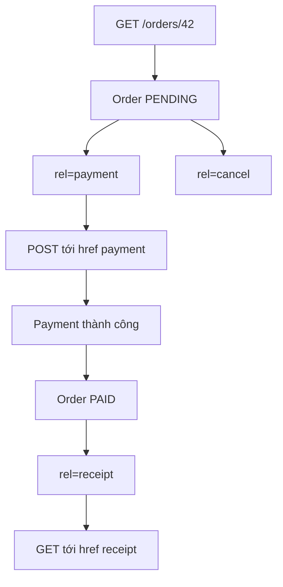

# Document hành động tiếp theo qua hypermedia

## 1. Tư duy từ response đến hành động tiếp theo

Một API hypermedia giúp client khám phá bước tiếp theo từ response mà server trả về. Thay vì tự ghép URL theo quy ước, client đọc link relation (`rel`), lấy URI đích (`href`) rồi gọi tài nguyên hoặc thao tác tương ứng. Spring REST Docs có thể document các quan hệ đó bằng `links(...)` và `linkWithRel(...)`, đồng thời document HTTP operation đích bằng các snippet request/response thông thường.

Trong module **Spring REST Docs**, mục tiêu là tạo tài liệu REST API có thể kiểm chứng từ HTTP tests bằng MockMvc, WebTestClient hoặc REST Assured. Khi document hành động tiếp theo, cần giúp người đọc trả lời được bốn câu hỏi:

1. Response hiện tại cung cấp những hành động hoặc liên kết nào?
2. Relation nào biểu thị hành động người dùng muốn thực hiện?
3. Client lấy URI đích ở đâu và có điều kiện nào để hành động xuất hiện?
4. Sau khi theo link, client phải gửi method, header, payload nào và xử lý response ra sao?

Ví dụ workflow đơn hàng:



Client khám phá link từ response ở mỗi bước. Khi trạng thái resource đổi, các relation có thể đổi theo; tài liệu cần thể hiện các transition quan trọng thay vì giả định mọi action luôn khả dụng.

## 2. Link cho biết đích và quan hệ, nhưng chưa mô tả toàn bộ HTTP action

Với HAL, link object phổ biến chứa `href`, có thể có `title`, `type`, `hreflang`, `templated` và metadata khác. Ví dụ:

```json
{
  "id": 42,
  "status": "PENDING",
  "_links": {
    "self": { "href": "/api/orders/42" },
    "payment": { "href": "/api/orders/42/payment", "title": "Thanh toán đơn hàng" },
    "cancel": { "href": "/api/orders/42/cancel", "title": "Hủy đơn hàng" }
  }
}
```

`payment` và `cancel` cho biết quan hệ điều hướng và URI đích. **Một HAL link cơ bản không tự khai báo đầy đủ HTTP method, request body, validation rules hoặc response status**. Vì vậy, không nên chỉ document link relation rồi coi như người tích hợp đã biết cách thực hiện action.

Tài liệu hoàn chỉnh cần nối các phần:

| Thành phần | Cần document |
| --- | --- |
| Link ở response nguồn | Relation, ý nghĩa, điều kiện xuất hiện; giữ `href` trong HTTP response snippet. |
| HTTP operation đích | Method, URI được dereference, headers, request parameters/body, status và response. |
| Workflow | Khi nào client theo link, kết quả action làm resource chuyển trạng thái nào, link nào xuất hiện tiếp. |
| Affordance/form (nếu API cung cấp) | Method, media type, input properties và quy tắc gửi dữ liệu do representation công bố. |

Nếu API dùng HAL-FORMS hoặc affordances, representation có thể công bố thêm thông tin về thao tác và form. Phần này bổ sung cho links; chỉ document những affordance thực sự có trong response và được server hỗ trợ.

## 3. Document action links trong response nguồn

Với response order `PENDING`, REST Assured có thể kiểm tra và document quan hệ `self`, `payment`, `cancel`:

```java
given(this.specification)
        .accept("application/hal+json")
        .filter(document("orders-get-pending",
                links(halLinks(),
                        linkWithRel("self")
                                .description("Đọc lại representation của đơn hàng"),
                        linkWithRel("payment")
                                .description("Bắt đầu hoặc tiếp tục thanh toán đơn hàng"),
                        linkWithRel("cancel")
                                .description("Hủy đơn hàng khi trạng thái còn cho phép")),
                responseFields(
                        fieldWithPath("id").description("Mã đơn hàng"),
                        fieldWithPath("status").description("Trạng thái xử lý"),
                        subsectionWithPath("_links")
                                .description("Các liên kết và hành động tiếp theo của đơn hàng"))))
.when()
        .get("/api/orders/{id}", 42)
.then()
        .statusCode(200)
        .contentType("application/hal+json")
        .body("status", equalTo("PENDING"))
        .body("_links.payment.href", notNullValue())
        .body("_links.cancel.href", notNullValue());
```

Các static import chính:

```java
import static org.springframework.restdocs.hypermedia.HypermediaDocumentation.halLinks;
import static org.springframework.restdocs.hypermedia.HypermediaDocumentation.links;
import static org.springframework.restdocs.hypermedia.HypermediaDocumentation.linkWithRel;
import static org.springframework.restdocs.payload.PayloadDocumentation.fieldWithPath;
import static org.springframework.restdocs.payload.PayloadDocumentation.responseFields;
import static org.springframework.restdocs.payload.PayloadDocumentation.subsectionWithPath;
import static org.springframework.restdocs.restassured.RestAssuredRestDocumentation.document;
import static org.hamcrest.Matchers.equalTo;
import static org.hamcrest.Matchers.notNullValue;
```

`links(...)` tạo snippet `links.adoc` mô tả ý nghĩa của relations. `responseFields(...)` mô tả dữ liệu nghiệp vụ và vùng `_links`; HTTP response snippet giữ payload thực tế để người đọc thấy `href`. Assertion kiểm tra trạng thái và sự hiện diện của các link quan trọng.

Nếu `cancel` chỉ xuất hiện trong một số trạng thái, dùng `.optional()` chỉ khi vắng mặt là hợp lệ trong scenario đang test. Với test cụ thể cho order `PENDING`, nếu hợp đồng yêu cầu luôn có `cancel`, giữ descriptor bắt buộc để phát hiện server bỏ mất action.

## 4. Document operation đích của từng action

Giả sử link `payment` dẫn tới endpoint thanh toán. Tài liệu operation đích phải cho người đọc biết chính xác cách sử dụng:

```http
POST /api/orders/42/payment HTTP/1.1
Content-Type: application/json
Accept: application/json
Idempotency-Key: docs-payment-42

{"method":"CARD"}
```

Response minh họa:

```http
HTTP/1.1 200 OK
Content-Type: application/json

{"paymentId":9001,"status":"AUTHORIZED"}
```

Test cho operation này document request/response như các HTTP test bình thường:

```java
given(this.specification)
        .contentType(ContentType.JSON)
        .accept(ContentType.JSON)
        .header("Idempotency-Key", "docs-payment-42")
        .body("{\"method\":\"CARD\"}")
        .filter(document("orders-payment",
                requestHeaders(
                        headerWithName("Idempotency-Key")
                                .description("Khóa chống xử lý trùng cho yêu cầu thanh toán")),
                requestFields(
                        fieldWithPath("method")
                                .description("Phương thức thanh toán được chọn")),
                responseFields(
                        fieldWithPath("paymentId")
                                .description("Mã giao dịch thanh toán"),
                        fieldWithPath("status")
                                .description("Trạng thái xử lý thanh toán"))))
.when()
        .post("/api/orders/{id}/payment", 42)
.then()
        .statusCode(200)
        .body("status", equalTo("AUTHORIZED"));
```

Ví dụ giả định endpoint hỗ trợ `POST`, nhận JSON và trả response như trên. Thay method, header, payload hoặc status theo hợp đồng thực tế. Nếu action đích trả `202 Accepted`, `201 Created` hoặc `204 No Content`, tài liệu phải dùng đúng status và body tương ứng.

Điểm quan trọng: link `payment` trong response nguồn không thay thế snippet `orders-payment`. Người đọc cần cả hai để hiểu quan hệ điều hướng và cách thực hiện HTTP action.

## 5. Dùng đúng identifier và liên kết chéo trong tài liệu

Đặt identifier riêng cho từng operation và trạng thái resource:

```text
generated-snippets/
  orders-get-pending/
    http-request.adoc
    http-response.adoc
    links.adoc
    response-fields.adoc
  orders-payment/
    http-request.adoc
    http-response.adoc
    request-headers.adoc
    request-fields.adoc
    response-fields.adoc
  orders-get-paid/
    http-request.adoc
    http-response.adoc
    links.adoc
    response-fields.adoc
  orders-receipt/
    http-request.adoc
    http-response.adoc
    response-fields.adoc
```

Trong Asciidoctor, có thể trình bày thành workflow theo thứ tự client thực hiện:

```asciidoc
== Quy trình thanh toán đơn hàng

=== 1. Đọc đơn hàng đang chờ thanh toán
include::{snippets}/orders-get-pending/http-response.adoc[]

==== Các action links khả dụng
include::{snippets}/orders-get-pending/links.adoc[]

=== 2. Thực hiện thanh toán
Theo relation `payment` trong response ở bước 1.

==== Request
include::{snippets}/orders-payment/http-request.adoc[]

==== Response
include::{snippets}/orders-payment/http-response.adoc[]

=== 3. Đọc đơn hàng sau thanh toán
include::{snippets}/orders-get-paid/http-response.adoc[]
include::{snippets}/orders-get-paid/links.adoc[]

=== 4. Lấy hóa đơn
Theo relation `receipt` trong response ở bước 3.
include::{snippets}/orders-receipt/http-request.adoc[]
include::{snippets}/orders-receipt/http-response.adoc[]
```

Đường dẫn include giúp người đọc đi từ response nguồn sang operation đích. Phần giải thích phải nói rõ client lấy `href` từ relation nào. Không yêu cầu client ghép `/api/orders/42/payment` từ chuỗi mẫu nếu API đã trả link động.

## 6. Mô tả action links có điều kiện theo trạng thái

Action links thường biểu diễn state transition. Ví dụ:

| Trạng thái hiện tại | Relations có thể có | Ý nghĩa |
| --- | --- | --- |
| `PENDING` | `self`, `payment`, `cancel` | Đọc order, thanh toán hoặc hủy. |
| `PAID` | `self`, `receipt`, `refund` | Đọc order, lấy hóa đơn hoặc yêu cầu hoàn tiền. |
| `CANCELLED` | `self` | Chỉ còn đọc representation. |

Document mỗi scenario bằng test/identifier riêng giúp thể hiện link nào phải có ở từng trạng thái:

```java
// Order PENDING: payment và cancel là action bắt buộc trong scenario này.
links(halLinks(),
        linkWithRel("self").description("Đọc đơn hàng"),
        linkWithRel("payment").description("Thanh toán đơn hàng"),
        linkWithRel("cancel").description("Hủy đơn hàng"))
```

```java
// Order PAID: receipt và refund thay cho payment/cancel.
links(halLinks(),
        linkWithRel("self").description("Đọc đơn hàng"),
        linkWithRel("receipt").description("Lấy hóa đơn"),
        linkWithRel("refund").description("Yêu cầu hoàn tiền"))
```

Các snippet trên là descriptor cho hai response khác nhau, không gắn đồng thời vào một request. Nếu một relation thực sự tùy chọn trong cùng scenario, đánh dấu `.optional()`. Nếu relation không cần đưa vào bảng nhưng có thể xuất hiện, dùng `.ignored()`; cần cân nhắc `relaxedLinks(...)` khi có chủ đích chỉ document một tập con. Không dùng relaxed mode để âm thầm bỏ qua một action mới mà chưa review.

## 7. Document điều kiện và kết quả của action

Link contract cần diễn giải điều kiện xuất hiện nếu client không thể thực hiện action trong mọi trạng thái. Ví dụ:

| Action relation | Điều kiện có thể công bố | Kết quả cần document |
| --- | --- | --- |
| `payment` | Order ở trạng thái có thể thanh toán và chưa hết hạn. | `paymentId`, trạng thái giao dịch, lỗi thanh toán. |
| `cancel` | Order chưa được giao hoặc chưa thanh toán, theo chính sách hệ thống. | Trạng thái `CANCELLED`, hoặc conflict nếu state đã đổi. |
| `receipt` | Thanh toán thành công và hóa đơn đã phát hành. | File/link hóa đơn, media type hoặc metadata tải xuống. |
| `refund` | Order đủ điều kiện hoàn tiền. | Mã yêu cầu hoàn tiền và trạng thái xử lý. |

Không nên chỉ ghi “link xuất hiện khi hợp lệ” nếu điều kiện nghiệp vụ quan trọng có thể diễn đạt rõ. Tuy nhiên, đừng tự suy diễn điều kiện từ tên relation; lấy điều kiện từ hợp đồng API và hành vi endpoint.

Test nên kiểm tra status và payload của operation đích, đồng thời test response nguồn theo trạng thái trước/sau action. Nếu trạng thái đổi không đồng bộ, chẳng hạn operation trả `202 Accepted`, document link theo dõi tác vụ (`status` hoặc `monitor`) và response xác nhận tiếp nhận yêu cầu.

## 8. HAL link và affordance/form không giống nhau

HAL link cơ bản thường cung cấp relation và URI đích. Nó không bắt buộc mô tả HTTP method hoặc request properties. Một số format hypermedia khác, chẳng hạn HAL-FORMS, có thể công bố template/form để mô tả thao tác và các input properties.

Ví dụ minh họa HAL-FORMS response (cần đối chiếu đúng schema/serializer mà ứng dụng sử dụng):

```json
{
  "_links": {
    "self": { "href": "/api/orders/42" }
  },
  "_templates": {
    "pay": {
      "method": "POST",
      "contentType": "application/json",
      "properties": [
        { "name": "method", "required": true, "type": "text" }
      ],
      "target": "/api/orders/42/payment"
    }
  }
}
```

Ở đây template `pay` công bố thêm thông tin về method, media type và properties. Nếu API thực sự trả HAL-FORMS, cần giữ raw response snippet để người đọc thấy template; document operation đích bằng request/response snippets để xác minh server thực sự chấp nhận dữ liệu theo template. Không giả định `links.adoc` mặc định tự diễn giải toàn bộ `_templates` thành bảng form.

Spring HATEOAS có API affordances để biểu diễn metadata thao tác khi xây dựng representation. Tuy nhiên, việc một controller tạo affordance không đồng nghĩa mọi client/format đều nhận cùng payload. Hãy kiểm tra response Content-Type và JSON/XML thực tế trước khi viết tài liệu về form fields hoặc method.

## 9. Dùng `links.adoc` cùng raw response và operation snippets

Ba lớp snippet có vai trò riêng:

| Snippet | Tác dụng trong workflow |
| --- | --- |
| `links.adoc` | Giải thích relation của action link trong response nguồn. |
| `http-response.adoc` | Cho thấy `href`, trạng thái resource, link metadata hoặc template thực tế. |
| `http-request.adoc` của operation đích | Chứng minh cách client gọi action bằng method, URI, headers và body. |
| `http-response.adoc` của operation đích | Cho biết kết quả thành công/lỗi sau action. |

Nếu chỉ include `links.adoc`, người đọc có thể hiểu `payment` làm gì nhưng chưa biết method/body. Nếu chỉ include operation đích, người đọc biết URL/method nhưng có thể nghĩ URL là đường dẫn cần hard-code. Kết hợp chúng cho thấy client nên **discover** URI từ response và áp dụng hợp đồng HTTP ở trang operation đích.

## 10. Versioning và thay đổi action links

Các thay đổi relation có thể ảnh hưởng client nhiều hơn thay đổi một field ít được sử dụng:

| Thay đổi | Tác động | Việc cần làm |
| --- | --- | --- |
| Thêm relation mới | Client cũ có thể bỏ qua; client mới có thêm khả năng. | Review semantics, document relation và test state phù hợp. |
| Xóa relation đang được client dùng | Client có thể mất bước điều hướng. | Xem như thay đổi hợp đồng; cung cấp transition/migration nếu cần. |
| Đổi ý nghĩa relation nhưng giữ tên | Client có thể thực hiện sai action. | Không tái sử dụng `rel` cho nghĩa khác; định nghĩa relation mới nếu semantics thay đổi. |
| Đổi `href` nhưng giữ relation | Client HATEOAS đúng cách thường theo URI mới từ response. | Cập nhật raw response snippet; test client không hard-code URI. |
| Thay link luôn có thành link tùy trạng thái | Workflow có thể không còn khả dụng ở một số trường hợp. | Document availability condition và test từng trạng thái. |
| Thay URI template | Client cần cung cấp biến/query khác. | Document template và test endpoint sau khi mở rộng URI. |

Link relation có thể là relation chuẩn hoặc relation mở rộng của API. Nếu dùng custom relation URI, cần công bố semantics ở nơi người tích hợp có thể tra cứu; tên relation không tự giải thích được ý nghĩa.

## 11. Lỗi thường gặp

| Hiện tượng | Nguyên nhân | Cách xử lý |
| --- | --- | --- |
| Chỉ có `links.adoc`, không biết cách POST action | HAL link không mô tả đầy đủ method/body. | Document operation đích bằng request/response snippets. |
| Tài liệu hard-code URL thay vì theo `href` | Chỉ copy đường dẫn trong ví dụ, không hướng client đọc relation. | Nêu rõ client lấy `href` từ `rel` trong response hiện tại. |
| `payment` xuất hiện cả khi order đã PAID | API hoặc test không kiểm tra link availability theo state. | Test và document response của từng trạng thái. |
| Action được mô tả nhưng endpoint đích không có tài liệu | Thiếu liên kết giữa link contract và operation contract. | Thêm phần operation đích với method, headers, body, status và response. |
| Assumed form properties nhưng response không công bố | Nhầm affordance với HAL link cơ bản. | Kiểm tra actual format; chỉ document form/template khi server thực sự trả. |
| Optional/relaxed khiến test không phát hiện mất action | Dùng descriptor lỏng quá mức. | Giữ relation bắt buộc trong scenario mà action phải có. |
| Snippet action bị ghi đè | Nhiều state/test dùng cùng identifier. | Dùng identifier riêng như `orders-get-pending`, `orders-get-paid`. |
| Action trả `202` nhưng tài liệu mô tả hoàn tất ngay | Không document asynchronous workflow. | Document status acceptance và link theo dõi operation nếu API cung cấp. |

## 12. Checklist thực hành

- [ ] Response nguồn có relation/action links rõ nghĩa và `href` có thể được client dereference.
- [ ] `links(...)`/`linkWithRel(...)` mô tả các relation quan trọng.
- [ ] Raw HTTP response được giữ để hiển thị `href` và metadata/template thực tế.
- [ ] Điều kiện xuất hiện của action link được mô tả và kiểm tra theo trạng thái resource.
- [ ] Operation đích được document với method, URI, request headers/body, status và response.
- [ ] Tài liệu nói rõ client lấy URI từ `href`, không tự ghép URL nếu link đã được server cung cấp.
- [ ] HAL link cơ bản được phân biệt với affordance/HAL-FORMS template.
- [ ] Action bất đồng bộ có status và link theo dõi được document nếu API hỗ trợ.
- [ ] Source response và target operation dùng identifier riêng, không ghi đè snippet.
- [ ] Test và descriptor đều pass trước khi biên soạn/publish tài liệu.

Document hành động tiếp theo qua hypermedia là document cả **điểm khám phá** lẫn **cách thực hiện hành động**. `links.adoc` giải thích relation mà client tìm thấy trong response; raw response cho thấy `href` hoặc template; tài liệu operation đích xác nhận method, payload và kết quả. Khi kết nối các phần này theo workflow và trạng thái resource, người tích hợp có thể điều hướng API dựa trên hypermedia thay vì phụ thuộc vào URL hard-code.

## Tài liệu tham khảo

- [Spring REST Docs – Hypermedia](https://docs.spring.io/spring-restdocs/reference/documenting-your-api/hypermedia.html)
- [Spring REST Docs – HTTP Request and Response Snippets](https://docs.spring.io/spring-restdocs/reference/documenting-your-api/default-snippets.html)
- [Spring HATEOAS Reference – Affordances](https://docs.spring.io/spring-hateoas/docs/current/reference/html/)
- [HAL Specification](https://stateless.group/hal_specification.html)
- [HAL-FORMS Specification](https://rwcbook.github.io/hal-forms/)
