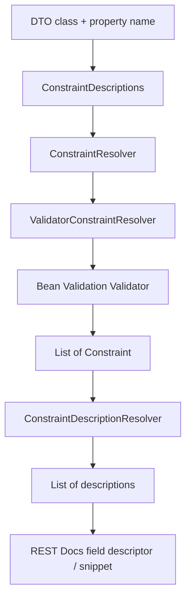

# ConstraintResolver và cách tìm ràng buộc

## Mục tiêu bài học

Trong module **SPRING_REST_DOCS**, tài liệu API cần mô tả không chỉ kiểu dữ liệu mà cả những điều kiện đầu vào server chấp nhận. Ví dụ, trường email có thể bắt buộc, phải đúng định dạng và có giới hạn độ dài. Nếu các quy tắc này được khai báo bằng Bean Validation, Spring REST Docs có thể đọc chúng để hỗ trợ tạo mô tả constraint trong snippet.

Bài này tập trung vào **ConstraintResolver**: cách Spring REST Docs tìm constraint trên một thuộc tính, cơ chế mặc định dùng Bean Validation Validator, cách thay Validator hoặc tự cài resolver, và cách đưa các mô tả tìm được vào request fields snippet.

Sau bài này, bạn có thể:

- Giải thích quan hệ giữa ConstraintResolver, ValidatorConstraintResolver, Constraint và ConstraintDescriptions.
- Dùng ConstraintDescriptions để lấy mô tả ràng buộc của một thuộc tính DTO.
- Hiểu giới hạn mặc định: Spring REST Docs hiện tìm property constraints.
- Tùy chỉnh Validator được dùng để tìm constraint.
- Cài ConstraintResolver riêng khi quy tắc của dự án không nằm trong mô hình Bean Validation mặc định.
- Phân biệt bước tìm constraint với bước chuyển constraint thành câu mô tả.
- Đưa mô tả constraint vào fieldWithPath(...).description(...) hoặc extra information của snippet.

## 1. Constraint trong tài liệu REST API

Giả sử API nhận request tạo người dùng:

```json
{
  "name": "An",
  "email": "an@example.com",
  "password": "secret123"
}
```

Các quy tắc đầu vào có thể gồm:

| Thuộc tính | Constraint | Ý nghĩa |
| --- | --- | --- |
| name | @NotBlank, @Size(min = 2, max = 80) | Không được trống, từ 2 đến 80 ký tự |
| email | @NotBlank, @Email | Bắt buộc và có định dạng email |
| password | @NotBlank, @Size(min = 8) | Bắt buộc, tối thiểu 8 ký tự |

Các điều kiện này có ý nghĩa với người gọi API. Khi tài liệu chỉ ghi name: string, người đọc chưa biết server từ chối chuỗi trống hay giới hạn độ dài thế nào.

Bean Validation cho phép thể hiện một phần quy tắc bằng annotation. Spring REST Docs cung cấp ConstraintDescriptions và các lớp resolver để lấy constraint trên thuộc tính, chuyển chúng thành văn bản và sử dụng văn bản ấy trong snippet.

**Giới hạn quan trọng:** Constraint descriptions là thông tin hỗ trợ biên soạn tài liệu. Chúng không tự thêm validation vào ứng dụng, không tự kiểm tra request HTTP và không bảo đảm mọi quy tắc nghiệp vụ của API đã được khai báo dưới dạng annotation.

## 2. Các thành phần trong cơ chế tìm constraint

Spring REST Docs tách trách nhiệm thành các thành phần:

| Thành phần | Trách nhiệm |
| --- | --- |
| Constraint | Biểu diễn một constraint đã tìm được, gồm tên và configuration |
| ConstraintResolver | Tìm constraint cho một thuộc tính của một lớp |
| ValidatorConstraintResolver | Cài đặt ConstraintResolver bằng Bean Validation Validator |
| ConstraintDescriptionResolver | Chuyển một Constraint thành câu mô tả |
| ResourceBundleConstraintDescriptionResolver | Lấy câu mô tả từ Java resource bundle |
| ConstraintDescriptions | Kết hợp tìm constraint và phân giải mô tả, trả về danh sách câu mô tả |

Sơ đồ luồng:



Hai việc cần phân biệt:

1. **Tìm ràng buộc:** thuộc tính email có annotation nào? Giá trị cấu hình của annotation là gì?
2. **Diễn giải ràng buộc:** Size(min=2,max=80) được viết thành câu nào để người gọi API hiểu?

ConstraintResolver giải quyết việc thứ nhất. ConstraintDescriptionResolver giải quyết việc thứ hai. ConstraintDescriptions phối hợp cả hai.

## 3. Cách dùng mặc định với ConstraintDescriptions

### 3.1. Khai báo DTO dùng Bean Validation

Ví dụ DTO:

```java
package com.example.users;

import jakarta.validation.constraints.Email;
import jakarta.validation.constraints.NotBlank;
import jakarta.validation.constraints.Size;

public class CreateUserRequest {

    @NotBlank
    @Size(min = 2, max = 80)
    private String name;

    @NotBlank
    @Email
    private String email;

    @NotBlank
    @Size(min = 8)
    private String password;

    // Constructor/getter/setter hoặc record accessors theo dự án
}
```

Trong Spring Boot 3/4, annotation Bean Validation thuộc namespace jakarta.validation. Dự án cần có implementation Bean Validation trên test/runtime classpath, ví dụ Hibernate Validator thông qua starter validation của Spring Boot, nếu bài test thực sự khởi tạo Validator.

### 3.2. Lấy mô tả theo tên thuộc tính

Dùng ConstraintDescriptions:

```java
import java.util.List;

import org.springframework.restdocs.constraints.ConstraintDescriptions;

class UserConstraintDocumentation {

    List<String> describeNameConstraints() {
        ConstraintDescriptions descriptions =
                new ConstraintDescriptions(CreateUserRequest.class);

        return descriptions.descriptionsForProperty("name");
    }
}
```

descriptionsForProperty("name") trả về danh sách chuỗi mô tả cho các constraint tìm được trên thuộc tính name. Với DTO ví dụ, danh sách mặc định chứa mô tả cho @NotBlank và @Size.

Constructor đơn giản:

```java
new ConstraintDescriptions(CreateUserRequest.class)
```

sử dụng ValidatorConstraintResolver với Validator ở cấu hình mặc định và ResourceBundleConstraintDescriptionResolver để lấy văn bản từ resource bundle.

Bạn không phải tự viết reflection để tìm annotation hoặc tự chuyển @Size thành văn bản trong trường hợp thông dụng.

### 3.3. Kết quả có thể thay đổi theo ngôn ngữ mô tả

Các mô tả mặc định do Spring REST Docs cung cấp bằng tiếng Anh. Nếu tài liệu API dùng tiếng Việt, nên cung cấp bản dịch bằng resource bundle thay vì ghép chuỗi tiếng Anh vào mô tả field.

## 4. ConstraintResolver mặc định tìm ràng buộc như thế nào?

Mặc định Spring REST Docs dùng một Bean Validation Validator thông qua ValidatorConstraintResolver. Resolver hỏi metadata Bean Validation cho class và thuộc tính được truyền vào.

API chính của interface:

```java
public interface ConstraintResolver {

    List<Constraint> resolveForProperty(String property, Class<?> clazz);
}
```

Phương thức nhận:

- property: tên thuộc tính cần tìm, ví dụ "email".
- clazz: lớp DTO chứa thuộc tính, ví dụ CreateUserRequest.class.

Phương thức trả về List<Constraint>. Nếu không tìm thấy constraint cho thuộc tính, danh sách rỗng được trả về; kết quả không phải null.

ValidatorConstraintResolver có hai constructor quan trọng:

```java
new ValidatorConstraintResolver()
```

Tạo resolver dùng Validator ở cấu hình mặc định của Bean Validation.

```java
new ValidatorConstraintResolver(validator)
```

Tạo resolver dùng Validator do ứng dụng cung cấp. Cách này hữu ích khi Validator đã được cấu hình với provider, mapping hoặc metadata phù hợp với dự án.

### 4.1. Phạm vi mặc định: property constraints

Tài liệu Spring REST Docs hiện hành ghi rõ: **currently, only property constraints are supported**. Resolver mặc định tập trung vào constraint gắn với thuộc tính của lớp.

Ví dụ được hỗ trợ:

```java
class CreateUserRequest {

    @NotBlank
    private String name;

    @Email
    private String email;
}
```

Không nên giả định cơ chế mặc định tự tổng hợp tất cả quy tắc sau:

- Class-level constraint gắn trên cả DTO.
- Cross-parameter constraint gắn trên nhóm tham số phương thức.
- Quy tắc nghiệp vụ chỉ nằm trong service hoặc database.
- Điều kiện được áp dụng động theo trạng thái hệ thống nhưng không có metadata Bean Validation tương ứng.
- Quy tắc trong schema OpenAPI hoặc JSON Schema chưa được ánh xạ vào Bean Validation.

Nếu tài liệu phải thể hiện các ràng buộc loại này, hãy bổ sung mô tả thủ công hoặc cài ConstraintResolver tùy chỉnh theo mô hình của dự án.

### 4.2. Constraint trên getter và field

Bean Validation hỗ trợ khai báo constraint trên field hoặc property accessor theo quy ước của nó. Resolver mặc định làm việc thông qua Bean Validation Validator/metadata, vì vậy nên tuân theo cách khai báo chuẩn của provider thay vì dựa vào reflection tự viết chỉ đọc field.

Tránh đặt constraint cùng lúc trên field và getter của cùng một thuộc tính nếu không có chủ đích rõ ràng. Bean Validation có thể phát hiện constraint ở cả hai nơi; việc lặp constraint có thể làm mô tả bị trùng hoặc khiến người đọc khó hiểu.

## 5. Tùy chỉnh Validator dùng để tìm constraint

Nếu dự án có Validator được cấu hình riêng, truyền Validator đó vào ValidatorConstraintResolver, rồi truyền resolver vào ConstraintDescriptions.

Ví dụ:

```java
import java.util.List;

import jakarta.validation.Validator;
import org.springframework.restdocs.constraints.ConstraintDescriptions;
import org.springframework.restdocs.constraints.ValidatorConstraintResolver;

class UserConstraintDocumentation {

    private final ConstraintDescriptions descriptions;

    UserConstraintDocumentation(Validator validator) {
        this.descriptions = new ConstraintDescriptions(
                CreateUserRequest.class,
                new ValidatorConstraintResolver(validator)
        );
    }

    List<String> describeEmail() {
        return this.descriptions.descriptionsForProperty("email");
    }
}
```

Validator có thể được lấy từ Spring context hoặc tạo theo cơ chế chuẩn Bean Validation. Ví dụ dùng Jakarta Validation:

```java
import jakarta.validation.Validation;
import jakarta.validation.Validator;

Validator validator = Validation
        .buildDefaultValidatorFactory()
        .getValidator();
```

Trong ứng dụng Spring, thường nên tái sử dụng Validator bean đã cấu hình thay vì tạo nhiều ValidatorFactory riêng. Nếu tự gọi buildDefaultValidatorFactory(), cần quản lý vòng đời ValidatorFactory và đóng factory khi không còn dùng.

### 5.1. Khi nào nên tùy chỉnh Validator?

- Ứng dụng sử dụng Validator/provider có cấu hình riêng cho constraint tùy biến.
- Có XML mapping hoặc provider-specific metadata cần được áp dụng.
- Muốn tài liệu hóa đúng tập constraint theo cấu hình Validator ứng dụng sử dụng.
- Bài test dùng DTO hoặc Validator khác với cấu hình mặc định của Bean Validation.

Tùy chỉnh Validator chỉ ảnh hưởng tới việc tìm metadata. Nó không tự đổi câu mô tả bằng tiếng Anh sang tiếng Việt; phần đó thuộc ConstraintDescriptionResolver.

## 6. Tự cài ConstraintResolver

Khi quy tắc đầu vào không thể tìm bằng Bean Validation Validator, bạn có thể triển khai interface ConstraintResolver của REST Docs.

Hợp đồng tối thiểu:

```java
public interface ConstraintResolver {
    List<Constraint> resolveForProperty(String property, Class<?> clazz);
}
```

Constraint là mô hình dữ liệu gồm tên constraint và một map configuration. Tên thường là fully qualified class name của annotation, ví dụ jakarta.validation.constraints.NotNull; map chứa các thuộc tính như min, max, regexp.

### 6.1. Ví dụ resolver theo metadata của hệ thống

Giả sử một dự án có rule metadata riêng cho request DTO. Ta có thể viết resolver đọc registry này:

```java
import java.util.List;
import java.util.Map;

import org.springframework.restdocs.constraints.Constraint;
import org.springframework.restdocs.constraints.ConstraintResolver;

final class ApiRuleConstraintResolver implements ConstraintResolver {

    private static final Map<String, Map<String, List<Constraint>>> RULES =
            Map.of(
                    "CreateUserRequest",
                    Map.of(
                            "name",
                            List.of(
                                    new Constraint(
                                            "com.example.validation.RequiredText",
                                            Map.of()
                                    ),
                                    new Constraint(
                                            "com.example.validation.TextLength",
                                            Map.of("min", 2, "max", 80)
                                    )
                            ),
                            "email",
                            List.of(
                                    new Constraint(
                                            "com.example.validation.EmailAddress",
                                            Map.of()
                                    )
                            )
                    )
            );

    @Override
    public List<Constraint> resolveForProperty(
            String property, Class<?> clazz) {

        Map<String, List<Constraint>> classRules =
                RULES.get(clazz.getSimpleName());

        if (classRules == null) {
            return List.of();
        }

        return classRules.getOrDefault(property, List.of());
    }
}
```

Đây là ví dụ minh họa cho registry metadata của ứng dụng, không phải resolver tự động hiểu mọi annotation Java. Trong hệ thống thực:

1. Có thể đọc rule từ registry tập trung, schema hoặc metadata do nhóm quản lý.
2. Dùng key ổn định cho class/field, tránh phụ thuộc getSimpleName() nếu các package có lớp trùng tên.
3. Trả về danh sách rỗng khi không có constraint.
4. Không trả null.
5. Chỉ đưa các thuộc tính có ý nghĩa vào configuration map.

### 6.2. Dùng resolver tùy chỉnh với ConstraintDescriptions

Truyền resolver vào constructor:

```java
ConstraintDescriptions descriptions = new ConstraintDescriptions(
        CreateUserRequest.class,
        new ApiRuleConstraintResolver()
);

List<String> nameDescriptions =
        descriptions.descriptionsForProperty("name");
```

Constructor này dùng resolver chỉ định để tìm constraint và vẫn dùng ResourceBundleConstraintDescriptionResolver mặc định để giải thích chúng. Vì vậy, các tên constraint tùy chỉnh phải có mô tả tương ứng trong resource bundle.

### 6.3. Điều gì không nên làm trong resolver?

- Truy vấn database hoặc gọi HTTP service trong resolveForProperty.
- Dựa vào giá trị request cụ thể để thay đổi metadata của field.
- Trả null thay cho danh sách rỗng.
- Tự chuyển constraint sang câu mô tả rồi nhét câu đó vào tên constraint.
- Nuốt lỗi cấu hình khiến tài liệu bỏ sót constraint mà không báo.

Resolver nên xác định được, dễ kiểm thử và chỉ chịu trách nhiệm tìm metadata.

## 7. Tùy chỉnh câu mô tả bằng resource bundle

Tìm được constraint chưa đủ; người đọc cần văn bản dễ hiểu. Mặc định, Spring REST Docs dùng ResourceBundleConstraintDescriptionResolver và resource bundle có base name:

org.springframework.restdocs.constraints.ConstraintDescriptions

Bạn có thể đặt file properties tương ứng trên classpath, ví dụ:

```text
src/
└── test/
    └── resources/
        └── org/
            └── springframework/
                └── restdocs/
                    └── constraints/
                        └── ConstraintDescriptions.properties
```

Key trong resource bundle là **tên fully qualified của constraint + .description**. Ví dụ:

```properties
jakarta.validation.constraints.NotNull.description=Không được để giá trị null.
jakarta.validation.constraints.NotBlank.description=Phải chứa ít nhất một ký tự không phải khoảng trắng.
jakarta.validation.constraints.Size.description=Độ dài phải nằm trong giới hạn cho phép.
jakarta.validation.constraints.Email.description=Phải có định dạng địa chỉ email hợp lệ.
```

Resource bundle trên nằm trong test resources nên phù hợp với tài liệu được tạo trong test. Nếu nhiều ứng dụng hoặc nhiều bộ tài liệu cùng dùng mô tả, có thể đặt tài nguyên tại main resources hoặc một module dùng chung tùy kiến trúc.

### 7.1. Ghi đè mô tả mặc định

Khi key đã tồn tại trong bundle, nội dung trong file properties được dùng để ghi đè văn bản mặc định. Có thể dùng nội dung theo ngôn ngữ tài liệu, ví dụ tiếng Việt ở trên.

### 7.2. Bổ sung mô tả cho constraint tùy chỉnh

Giả sử resolver trả về constraint tên com.example.validation.TextLength. Resource bundle cần có key:

```properties
com.example.validation.TextLength.description=Độ dài văn bản phải nằm trong khoảng cho phép.
```

Tên phải khớp với tên constraint trả về bởi resolver. Nếu không khớp, REST Docs không thể tìm mô tả tương ứng.

### 7.3. Dùng thuộc tính của constraint trong mô tả

Spring REST Docs cho phép tham chiếu các thuộc tính cấu hình của constraint bằng property placeholder. Ví dụ, mô tả mặc định của @Min có thể sử dụng thuộc tính value để đưa ngưỡng vào câu mô tả. Cách này giúp một mẫu mô tả dùng được cho nhiều giá trị cấu hình.

Với constraint tùy chỉnh, hãy kiểm tra tên thuộc tính được lưu trong configuration map và tên placeholder mà resource bundle sử dụng có khớp nhau. Không nên viết cứng min = 2 cho tất cả DTO nếu resolver đang đọc giới hạn khác nhau.

## 8. Tùy chỉnh ConstraintDescriptionResolver

Khi cần toàn quyền kiểm soát việc tạo câu mô tả, có thể triển khai ConstraintDescriptionResolver.

Interface có trách nhiệm nhận một Constraint và trả về chuỗi mô tả:

```java
public interface ConstraintDescriptionResolver {
    String resolveDescription(Constraint constraint);
}
```

Một triển khai đơn giản có thể xử lý một tập constraint riêng:

```java
import java.util.Map;

import org.springframework.restdocs.constraints.Constraint;
import org.springframework.restdocs.constraints.ConstraintDescriptionResolver;

final class VietnameseConstraintDescriptionResolver
        implements ConstraintDescriptionResolver {

    @Override
    public String resolveDescription(Constraint constraint) {
        return switch (constraint.getName()) {
            case "jakarta.validation.constraints.NotNull" ->
                    "Không được để giá trị null.";
            case "jakarta.validation.constraints.NotBlank" ->
                    "Không được rỗng hoặc chỉ chứa khoảng trắng.";
            case "jakarta.validation.constraints.Size" ->
                    describeSize(constraint.getConfiguration());
            default ->
                    "Áp dụng ràng buộc " + constraint.getName() + ".";
        };
    }

    private String describeSize(Map<String, Object> configuration) {
        Object min = configuration.get("min");
        Object max = configuration.get("max");

        return "Độ dài tối thiểu " + min + ", tối đa " + max + ".";
    }
}
```

Ví dụ trên đơn giản để minh họa interface. Trong dự án thực, cần xử lý thuộc tính có thể vắng mặt, kiểu dữ liệu khác nhau, locale, constraint lồng nhau và constraint chưa được hỗ trợ. Câu mô tả dự phòng không nên khiến người đọc hiểu nhầm rằng ràng buộc chưa biết đã được diễn giải đầy đủ.

### 8.1. Kết hợp resolver tùy chỉnh

ConstraintDescriptions có constructor cho phép truyền cả hai resolver:

```java
ConstraintDescriptions descriptions = new ConstraintDescriptions(
        CreateUserRequest.class,
        new ApiRuleConstraintResolver(),
        new VietnameseConstraintDescriptionResolver()
);
```

Hai resolver có thể được tùy chỉnh độc lập:

- Custom ConstraintResolver quyết định tìm constraint nào.
- Custom ConstraintDescriptionResolver quyết định viết constraint đó thành câu nào.

Nếu chỉ muốn đổi ngôn ngữ, thường không cần thay ConstraintResolver; resource bundle là cách đơn giản hơn. Nếu muốn lấy metadata từ nguồn khác, mới cần cân nhắc tự cài ConstraintResolver.

## 9. Đưa constraint descriptions vào snippet REST Docs

ConstraintDescriptions không tự tạo một snippet riêng tên constraints. Ứng dụng có thể dùng danh sách mô tả trong descriptor của payload hoặc extra information.

### 9.1. Ghép vào field description

Ví dụ với MockMvc:

```java
import java.util.List;

import org.springframework.restdocs.constraints.ConstraintDescriptions;

import static org.springframework.restdocs.payload.PayloadDocumentation.fieldWithPath;
import static org.springframework.restdocs.payload.PayloadDocumentation.requestFields;

ConstraintDescriptions constraints =
        new ConstraintDescriptions(CreateUserRequest.class);

List<String> emailConstraints =
        constraints.descriptionsForProperty("email");

this.mockMvc.perform(post("/api/users")
                .contentType(MediaType.APPLICATION_JSON)
                .content("""
                        {
                          "name": "An",
                          "email": "an@example.com",
                          "password": "secret123"
                        }
                        """))
        .andExpect(status().isCreated())
        .andDo(document("users-create",
                requestFields(
                        fieldWithPath("name")
                                .description("Tên người dùng."),
                        fieldWithPath("email")
                                .description("Email. " +
                                        String.join(" ", emailConstraints)),
                        fieldWithPath("password")
                                .description("Mật khẩu.")
                )));
```

Test tạo request snippet và mô tả field email được ghép thêm các constraint đã tìm. Có thể áp dụng tương tự với responseFields, nhưng chỉ nên làm vậy nếu constraint thực sự mô tả payload response; thông thường Bean Validation input constraints gắn với request DTO.

### 9.2. Ghép constraint cho nhiều field bằng helper

```java
String describeWithConstraints(
        ConstraintDescriptions descriptions,
        String property,
        String baseDescription) {

    List<String> rules = descriptions.descriptionsForProperty(property);
    if (rules.isEmpty()) {
        return baseDescription;
    }

    return baseDescription + " " + String.join(" ", rules);
}
```

Sau đó dùng:

```java
fieldWithPath("name").description(
        describeWithConstraints(
                descriptions,
                "name",
                "Tên người dùng."
        ))
```

Tạo ConstraintDescriptions một lần cho mỗi DTO và tái sử dụng nếu có thể. Tránh khởi tạo Validator hoặc đọc resource bundle lặp lại cho mọi field nếu không cần.

### 9.3. Đưa constraint thành extra information

Thay vì ghép tất cả vào một câu dài, có thể dùng Attributes của REST Docs để thêm thông tin riêng vào snippet template, ví dụ thuộc tính constraints:

```java
fieldWithPath("email")
        .description("Địa chỉ email của người dùng.")
        .attributes(key("constraints")
                .value(String.join("; ", emailConstraints)))
```

Khi dùng cách này, template snippet phải được tùy chỉnh để hiển thị attribute đó. Việc đặt attribute trong descriptor không tự bảo đảm template mặc định sẽ render nó. Nếu không muốn sửa template, ghép mô tả vào description(...) là cách trực tiếp hơn.

## 10. Khác biệt giữa tìm constraint và validate request

| Hoạt động | Thành phần | Kết quả |
| --- | --- | --- |
| Validate request khi ứng dụng nhận HTTP | Spring MVC/WebFlux + Bean Validation | Request hợp lệ hoặc lỗi validation |
| Tìm constraint cho tài liệu | ConstraintResolver | Danh sách constraint metadata của thuộc tính |
| Tạo câu mô tả | ConstraintDescriptionResolver | Chuỗi mô tả có thể đưa vào tài liệu |
| Kiểm chứng tài liệu | REST Docs test + descriptor | Snippet được tạo hoặc test thất bại khi request/descriptor không khớp |

Một DTO có @Size(max = 80) không có nghĩa controller chắc chắn trả HTTP 400 khi chuỗi dài hơn 80 ký tự. Điều đó còn phụ thuộc endpoint có áp dụng @Valid/@Validated, Validator, exception handling và luồng xử lý thực tế.

Ngược lại, ConstraintDescriptions có thể đọc annotation để tạo câu mô tả ngay cả khi test không gửi request sai. Nó chỉ đọc metadata, không chạy validation trên payload test.

## 11. Giới hạn và lưu ý thiết kế

### 11.1. Constraint không phải toàn bộ hợp đồng API

Bean Validation không mô tả mọi quy tắc:

- Email phải thuộc domain được phép có thể là quy tắc nghiệp vụ trong service.
- Mã sản phẩm phải duy nhất có thể phụ thuộc database.
- Trạng thái đơn hàng chỉ cho phép sửa ở một giai đoạn có thể phụ thuộc trạng thái hiện tại.
- Quyền truy cập một field có thể phụ thuộc user đăng nhập.

Những điều kiện này cần được ghi trong phần mô tả API hoặc biểu diễn bằng metadata riêng. Không nên nói tài liệu đã đầy đủ chỉ vì ConstraintDescriptions đã đọc hết annotation.

### 11.2. Property constraints và nested object

Với DTO có cấu trúc lồng nhau:

```java
class CreateOrderRequest {

    @NotNull
    @Valid
    private CustomerInput customer;
}

class CustomerInput {

    @NotBlank
    private String name;
}
```

Validation có thể cascade sang object con nhờ @Valid. Tuy nhiên, cơ chế mô tả constraint mặc định được tài liệu REST Docs nêu là tìm constraint theo property của class được yêu cầu; đừng giả định nó tự đệ quy toàn bộ object graph và tự ghép constraint vào mọi đường dẫn JSON như customer.name. Muốn tài liệu hóa nested path, có thể truy vấn ConstraintDescriptions cho class con rồi ánh xạ thủ công sang field path REST Docs.

### 11.3. Validation groups

Bean Validation có groups và group sequence. Một constraint có thể chỉ áp dụng trong group cụ thể. Khi tài liệu mô tả API theo nhiều luồng (tạo mới, cập nhật, duyệt), cần xác nhận Validator và resolver đang phản ánh đúng tập metadata mà ứng dụng dùng. Không suy diễn mọi group đều được áp dụng cho mọi request.

### 11.4. Constraint tùy chỉnh

Với annotation tự tạo, cần bảo đảm:

- Constraint có tên thống nhất trong resolver.
- Mọi thuộc tính cần thiết được đưa vào configuration.
- Resource bundle hoặc description resolver biết cách diễn giải constraint.
- Test xác minh mô tả sinh ra có ý nghĩa với người dùng API.

## 12. Lỗi thường gặp khi tìm và mô tả constraint

| Triệu chứng | Nguyên nhân khả dĩ | Hướng xử lý |
| --- | --- | --- |
| descriptionsForProperty trả danh sách rỗng | Thuộc tính không có constraint hoặc tên property sai | Kiểm tra DTO, tên property và nơi khai báo annotation |
| Không tìm được constraint từ annotation | Thiếu Bean Validation provider hoặc Validator sai cấu hình | Kiểm tra dependency validation và Validator truyền vào resolver |
| Constraint tùy chỉnh không có mô tả | Thiếu key resource bundle hoặc sai tên fully qualified | Kiểm tra key constraint-class.description |
| Mô tả không có giá trị min/max như mong muốn | Map configuration thiếu thuộc tính hoặc placeholder sai | Đối chiếu tên attribute từ constraint |
| Một field có constraint bị lặp | Annotation đặt cả trên field và getter | Chọn access strategy nhất quán |
| Rule class-level không xuất hiện | Resolver mặc định tập trung vào property constraints | Bổ sung mô tả riêng hoặc dùng resolver tùy chỉnh |
| Nested property không được mô tả | Chưa truy vấn class con hoặc chưa ánh xạ JSON path | Tạo helper cho nested DTO và ánh xạ field path |
| Tài liệu có constraint nhưng endpoint không validate | DTO có annotation nhưng handler chưa kích hoạt validation | Kiểm tra @Valid/@Validated và xử lý lỗi thực tế |
| Mô tả tiếng Anh lẫn trong tài liệu tiếng Việt | Chỉ dịch một số key resource bundle | Bổ sung bản dịch cho constraint đang dùng và kiểm tra output |
| Snippet không hiển thị extra information | Template mặc định không render attribute tùy chỉnh | Sửa snippet template hoặc ghép mô tả vào field description |

## 13. Bài thực hành

1. Tạo DTO CreateUserRequest với @NotBlank, @Size, @Email như phần 3.
2. Viết test tạo ConstraintDescriptions và lấy mô tả của name, email, password.
3. Tạo resource bundle ConstraintDescriptions.properties với mô tả tiếng Việt.
4. Chạy test và quan sát kết quả từ descriptionsForProperty.
5. Dùng danh sách mô tả bổ sung fieldWithPath("email").description(...) trong request fields snippet.
6. Tạo constraint tùy chỉnh hoặc metadata rule riêng và cài ConstraintResolver trả về Constraint có configuration.
7. Bổ sung key mô tả cho constraint mới hoặc tạo ConstraintDescriptionResolver riêng; xác minh snippet có câu mong muốn.
8. Thử class-level constraint để quan sát giới hạn resolver mặc định, sau đó ghi rõ quy tắc bằng mô tả thủ công hoặc resolver chuyên biệt.

**Câu hỏi tự đánh giá**

1. ConstraintResolver và ConstraintDescriptionResolver khác nhau ở đâu?
2. Vì sao Spring REST Docs dùng Bean Validation Validator theo mặc định?
3. resolveForProperty nhận tham số nào và trả về kiểu dữ liệu gì?
4. Vì sao constraint gắn trên class không nhất thiết xuất hiện khi gọi descriptionsForProperty?
5. Khi nào nên truyền Validator tùy chỉnh vào ValidatorConstraintResolver?
6. Tên key trong resource bundle được tạo từ thông tin nào?
7. Vì sao ConstraintDescriptions không tự động kiểm tra request HTTP?
8. Khi nào nên cài ConstraintResolver riêng thay vì chỉ tùy chỉnh resource bundle?

## Tài liệu tham khảo chính thức

- [Spring REST Docs — Bean Validation Constraints](https://docs.spring.io/spring-restdocs/reference/documenting-your-api/constraints.html): tìm constraint mặc định, phạm vi property constraints, mô tả bằng resource bundle và sử dụng trong snippet.
- [ConstraintResolver API](https://docs.spring.io/spring-restdocs/api/java/org/springframework/restdocs/constraints/ConstraintResolver.html): hợp đồng resolveForProperty.
- [ConstraintDescriptions API](https://docs.spring.io/spring-restdocs/api/java/org/springframework/restdocs/constraints/ConstraintDescriptions.html): constructor, resolver tùy chỉnh và descriptionsForProperty.
- [ValidatorConstraintResolver API](https://docs.spring.io/spring-restdocs/api/java/org/springframework/restdocs/constraints/ValidatorConstraintResolver.html): dùng Bean Validation Validator mặc định hoặc Validator do ứng dụng cung cấp.
- [Constraint API](https://docs.spring.io/spring-restdocs/api/java/org/springframework/restdocs/constraints/Constraint.html): tên constraint và configuration map.
- [Jakarta Bean Validation](https://jakarta.ee/specifications/bean-validation/): mô hình constraint, Validator, metadata, groups và cascade validation.

**Kết luận thực hành:** Bắt đầu với ConstraintDescriptions mặc định để đọc constraint của từng property. Chỉ thay ValidatorConstraintResolver khi cần Validator khác; chỉ tự cài ConstraintResolver khi nguồn metadata không phù hợp với Bean Validation mặc định. Dùng resource bundle để dịch mô tả, rồi đưa các câu mô tả vào field descriptor hoặc template snippet. Cách tách này giữ rõ ranh giới giữa tìm metadata, diễn giải và kiểm thử hành vi HTTP.
