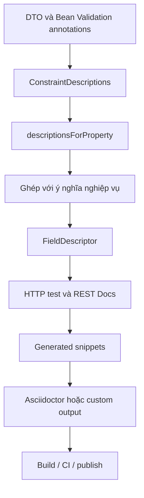
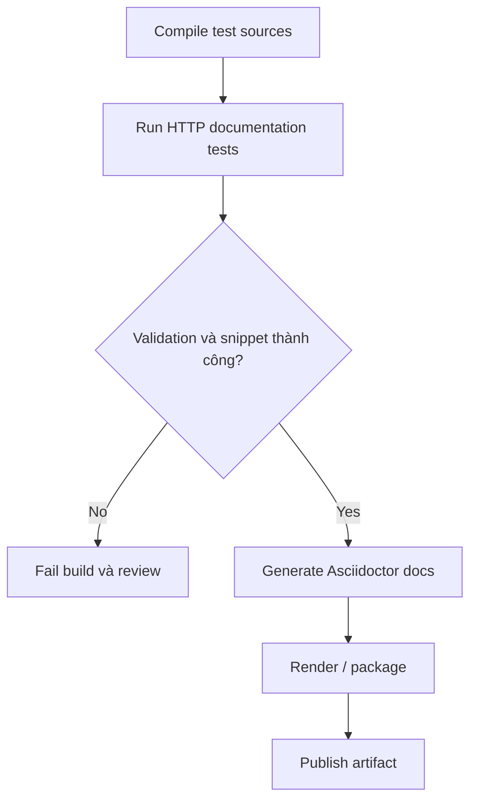

# Dùng constraint descriptions trong generated snippets

## 1. Từ Bean Validation đến tài liệu được sinh

Trong module **SPRING_REST_DOCS**, các bài kiểm thử HTTP bằng MockMvc, WebTestClient hoặc REST Assured tạo ra generated snippets để biên soạn tài liệu REST API. Một bảng field hữu ích cần thể hiện cả ý nghĩa nghiệp vụ và các giới hạn dữ liệu mà client phải tuân thủ.

Ví dụ, request tạo tài khoản có thể chứa:

```json
{
  "displayName": "Lan Nguyen",
  "email": "lan@example.test",
  "age": 25
}
```

DTO khai báo quy tắc:

```java
class CreateAccountRequest {
    @NotBlank
    @Size(min = 2, max = 60)
    String displayName;

    @NotBlank
    @Email
    String email;

    @NotNull
    @Min(18)
    @Max(120)
    Integer age;
}
```

Nếu chỉ viết `description("Tên hiển thị")`, bảng tài liệu không thể hiện giới hạn độ dài hoặc quy tắc không được để trống. Spring REST Docs có `ConstraintDescriptions` để lấy mô tả từ Bean Validation metadata; ta có thể ghép các câu đó vào `FieldDescriptor` trước khi generated snippet được tạo.

Luồng tổng quát:



Điểm quan trọng: `ConstraintDescriptions` cung cấp danh sách câu mô tả, nhưng không tự động chèn chúng vào mọi snippet. Bài kiểm thử phải chủ động kết hợp dữ liệu trả về với `requestFields(...)` hoặc `responseFields(...)`, hoặc dùng custom snippet/template nếu muốn có cột riêng.

## 2. Lấy danh sách mô tả theo property

Ví dụ cơ bản:

```java
import java.util.List;

import org.springframework.restdocs.constraints.ConstraintDescriptions;

ConstraintDescriptions constraints =
        new ConstraintDescriptions(CreateAccountRequest.class);

List<String> displayNameRules =
        constraints.descriptionsForProperty("displayName");

List<String> emailRules =
        constraints.descriptionsForProperty("email");

List<String> ageRules =
        constraints.descriptionsForProperty("age");
```

Tên truyền vào `descriptionsForProperty` là **tên property Java** của class được truyền vào `ConstraintDescriptions`. Không dùng JSON path nếu nó khác tên property.

Ví dụ:

```java
class CreateAccountRequest {
    @JsonProperty("display_name")
    @NotBlank
    @Size(min = 2, max = 60)
    String displayName;
}
```

Truy vấn metadata vẫn dùng `descriptionsForProperty("displayName")`. Descriptor JSON dùng `fieldWithPath("display_name")` vì đó là tên key trên wire. Đây là hai hệ tên khác nhau, cần nối đúng tại bước xây dựng snippet.

Kết quả là danh sách mô tả; mỗi constraint có thể đóng góp một câu. Không dựa vào thứ tự danh sách để mang ý nghĩa nghiệp vụ riêng. Nếu thứ tự câu hiển thị quan trọng, có thể sắp xếp hoặc định dạng kết quả ở lớp ứng dụng tài liệu.

## 3. Ghép descriptions vào request-fields snippet

Cách trực tiếp là nối các constraint descriptions vào business description của field:

```java
ConstraintDescriptions constraints =
        new ConstraintDescriptions(CreateAccountRequest.class);

String displayNameDescription =
        "Tên hiển thị của tài khoản. "
        + String.join("; ",
            constraints.descriptionsForProperty("displayName"));

String emailDescription =
        "Địa chỉ email dùng để đăng nhập và liên hệ. "
        + String.join("; ",
            constraints.descriptionsForProperty("email"));

String ageDescription =
        "Tuổi của chủ tài khoản. "
        + String.join("; ",
            constraints.descriptionsForProperty("age"));

requestFields(
    fieldWithPath("displayName").description(displayNameDescription),
    fieldWithPath("email").description(emailDescription),
    fieldWithPath("age").description(ageDescription)
)
```

Nội dung bảng sinh ra có thể tương tự:

| Path | Type | Description |
| --- | --- | --- |
| displayName | String | Tên hiển thị của tài khoản. Không được để trống; độ dài từ 2 đến 60 ký tự |
| email | String | Địa chỉ email dùng để đăng nhập và liên hệ. Không được để trống; phải là email hợp lệ |
| age | Number | Tuổi của chủ tài khoản. Không được null; giá trị từ 18 đến 120 |

Câu cụ thể phụ thuộc resource bundle, locale, Bean Validation provider và phiên bản constraint resolver của dự án. Bảng trên chỉ minh họa nội dung mong đợi.

### 3.1. Dùng helper để tránh lặp

Trong một test suite, không nên lặp biểu thức `String.join` cho mọi field:

```java
static String describeWithConstraints(
        String businessMeaning,
        List<String> rules) {

    if (rules == null || rules.isEmpty()) {
        return businessMeaning;
    }

    return businessMeaning + " Ràng buộc: "
            + String.join("; ", rules);
}
```

Dùng helper:

```java
ConstraintDescriptions constraints =
        new ConstraintDescriptions(CreateAccountRequest.class);

requestFields(
    fieldWithPath("displayName").description(
        describeWithConstraints(
            "Tên hiển thị của tài khoản",
            constraints.descriptionsForProperty("displayName"))),
    fieldWithPath("email").description(
        describeWithConstraints(
            "Địa chỉ email liên hệ",
            constraints.descriptionsForProperty("email"))),
    fieldWithPath("age").description(
        describeWithConstraints(
            "Tuổi của chủ tài khoản",
            constraints.descriptionsForProperty("age")))
)
```

Helper nên ở trong test support hoặc lớp tiện ích dành cho tài liệu. Tránh đặt nó vào domain model chỉ để phục vụ snippet.

Nếu muốn biết constraint nào đang thiếu description, có thể kiểm tra danh sách rỗng và fail trong bước chuẩn bị tài liệu đối với property bắt buộc phải có ràng buộc. Không nên coi mọi danh sách rỗng là lỗi: một property có thể không có Bean Validation constraint theo thiết kế.

## 4. Ví dụ MockMvc hoàn chỉnh: sinh request-fields.adoc

Ví dụ dưới đây kết hợp DTO, Bean Validation, `ConstraintDescriptions` và Spring REST Docs MockMvc. Test gửi payload hợp lệ, kiểm tra status và ghi tài liệu request fields.

```java
import jakarta.validation.Valid;
import jakarta.validation.constraints.Email;
import jakarta.validation.constraints.Max;
import jakarta.validation.constraints.Min;
import jakarta.validation.constraints.NotBlank;
import jakarta.validation.constraints.NotNull;
import jakarta.validation.constraints.Size;

import org.junit.jupiter.api.BeforeEach;
import org.junit.jupiter.api.Test;
import org.junit.jupiter.api.extension.ExtendWith;
import org.springframework.http.MediaType;
import org.springframework.http.ResponseEntity;
import org.springframework.restdocs.RestDocumentationContextProvider;
import org.springframework.restdocs.constraints.ConstraintDescriptions;
import org.springframework.restdocs.junit.jupiter.RestDocumentationExtension;
import org.springframework.test.web.servlet.MockMvc;
import org.springframework.test.web.servlet.setup.MockMvcBuilders;
import org.springframework.web.bind.annotation.PostMapping;
import org.springframework.web.bind.annotation.RequestBody;
import org.springframework.web.bind.annotation.RestController;

import static org.springframework.restdocs.mockmvc.MockMvcRestDocumentation.document;
import static org.springframework.restdocs.mockmvc.MockMvcRestDocumentation.documentationConfiguration;
import static org.springframework.restdocs.payload.PayloadDocumentation.fieldWithPath;
import static org.springframework.restdocs.payload.PayloadDocumentation.requestFields;
import static org.springframework.test.web.servlet.request.MockMvcRequestBuilders.post;
import static org.springframework.test.web.servlet.result.MockMvcResultMatchers.status;

@ExtendWith(RestDocumentationExtension.class)
class CreateAccountDocumentationTest {

    private MockMvc mockMvc;

    private final ConstraintDescriptions constraints =
            new ConstraintDescriptions(CreateAccountRequest.class);

    @BeforeEach
    void setUp(RestDocumentationContextProvider documentation) {
        mockMvc = MockMvcBuilders.standaloneSetup(new AccountController())
                .apply(documentationConfiguration(documentation))
                .build();
    }

    @Test
    void documentCreateAccountRequest() throws Exception {
        mockMvc.perform(post("/api/accounts")
                        .contentType(MediaType.APPLICATION_JSON)
                        .accept(MediaType.APPLICATION_JSON)
                        .content("""
                            {
                              "displayName": "Lan Nguyen",
                              "email": "lan@example.test",
                              "age": 25
                            }
                            """))
                .andExpect(status().isCreated())
                .andDo(document("accounts-create",
                        requestFields(
                                fieldWithPath("displayName")
                                        .description(describeWithConstraints(
                                                "Tên hiển thị tài khoản",
                                                constraints.descriptionsForProperty(
                                                        "displayName"))),
                                fieldWithPath("email")
                                        .description(describeWithConstraints(
                                                "Địa chỉ email liên hệ",
                                                constraints.descriptionsForProperty(
                                                        "email"))),
                                fieldWithPath("age")
                                        .description(describeWithConstraints(
                                                "Tuổi chủ tài khoản",
                                                constraints.descriptionsForProperty(
                                                        "age")))
                        )
                ));
    }

    static String describeWithConstraints(
            String meaning,
            java.util.List<String> rules) {
        return rules.isEmpty()
                ? meaning
                : meaning + ". Ràng buộc: " + String.join("; ", rules);
    }

    record CreateAccountRequest(
            @NotBlank @Size(min = 2, max = 60) String displayName,
            @NotBlank @Email String email,
            @NotNull @Min(18) @Max(120) Integer age) {}

    @RestController
    static class AccountController {
        @PostMapping("/api/accounts")
        ResponseEntity<Void> create(
                @Valid @RequestBody CreateAccountRequest request) {
            return ResponseEntity.status(201).build();
        }
    }
}
```

Sau khi test chạy thành công, generated snippets có thể nằm dưới:

```text
build/generated-snippets/
└── accounts-create/
    ├── http-request.adoc
    ├── http-response.adoc
    └── request-fields.adoc
```

Đường dẫn có thể khác theo cấu hình của dự án; Maven thường sử dụng `target/generated-snippets`. Snippet `request-fields.adoc` chứa description cuối cùng đã ghép constraints. REST Docs không cần biết câu được lấy từ annotation hay viết thủ công: nó nhận `FieldDescriptor` đã hoàn chỉnh.

## 5. Dùng constraint descriptions trong response-fields snippet

Có thể áp dụng cùng kỹ thuật cho response fields, nhưng chỉ khi các constraint thực sự là cam kết của **response contract**.

Ví dụ response DTO:

```java
record AccountResponse(
    @NotBlank
    @Size(min = 2, max = 60)
    String displayName,

    @NotBlank
    @Email
    String email,

    @NotNull
    @Min(18)
    @Max(120)
    Integer age
) {}
```

Lấy mô tả từ class response:

```java
ConstraintDescriptions responseConstraints =
        new ConstraintDescriptions(AccountResponse.class);

responseFields(
    fieldWithPath("displayName").description(
        describeWithConstraints(
            "Tên hiển thị của tài khoản",
            responseConstraints.descriptionsForProperty("displayName"))),
    fieldWithPath("email").description(
        describeWithConstraints(
            "Email được liên kết với tài khoản",
            responseConstraints.descriptionsForProperty("email"))),
    fieldWithPath("age").description(
        describeWithConstraints(
            "Tuổi của chủ tài khoản",
            responseConstraints.descriptionsForProperty("age")))
)
```

Không đơn giản dùng constraint từ request DTO để mô tả response DTO nếu hai mô hình khác nhau. Dữ liệu gửi vào có thể bị chuẩn hóa, biến đổi hoặc che bớt trước khi trả về. Tài liệu response phải phản ánh những điều server bảo đảm thực sự khi gửi response.

Tương tự, annotation đặt trên response class không tự bảo đảm runtime validator đã kiểm tra object trước khi serialize. Nếu hợp đồng yêu cầu giá trị response luôn hợp lệ, cần có test/assertion kiểm chứng.

## 6. Dùng constraint với nested property và tên JSON khác Java

Với DTO lồng nhau:

```java
class CreateOrderRequest {
    @Valid
    CustomerInput customer;

    static class CustomerInput {
        @NotBlank
        @Size(max = 80)
        String displayName;

        @NotBlank
        @Email
        String email;
    }
}
```

Có thể tạo `ConstraintDescriptions` cho nested type:

```java
ConstraintDescriptions customerConstraints =
        new ConstraintDescriptions(
                CreateOrderRequest.CustomerInput.class);

List<String> displayNameRules =
        customerConstraints.descriptionsForProperty("displayName");
```

Sau đó gắn mô tả vào JSON path lồng:

```java
requestFields(
    fieldWithPath("customer")
        .description("Thông tin khách hàng đặt hàng"),
    fieldWithPath("customer.displayName")
        .description(describeWithConstraints(
                "Tên hiển thị khách hàng",
                customerConstraints.descriptionsForProperty("displayName"))),
    fieldWithPath("customer.email")
        .description(describeWithConstraints(
                "Email khách hàng",
                customerConstraints.descriptionsForProperty("email")))
)
```

Ở đây:

- `ConstraintDescriptions` lấy metadata từ Java type `CustomerInput`.
- `descriptionsForProperty("displayName")` nhận tên field Java.
- `fieldWithPath("customer.displayName")` trỏ tới JSON path trong request.
- `@Valid` trên property `customer` yêu cầu Bean Validation cascade vào object con khi runtime validation diễn ra.

Nếu property Java đổi tên hoặc JSON serializer thay tên field, phải cập nhật đúng phía tương ứng. Constraint lookup và JSON path không tự đồng bộ tên.

## 7. Tách business description và constraints bằng descriptor attributes

Ghép mọi câu vào một description là cách đơn giản. Nếu muốn bảng tài liệu có cột riêng cho **Constraints**, hãy giữ hai loại dữ liệu tách biệt bằng descriptor attributes:

```java
import static org.springframework.restdocs.snippet.Attributes.key;

List<String> rules =
        constraints.descriptionsForProperty("displayName");

requestFields(
    fieldWithPath("displayName")
        .description("Tên hiển thị của tài khoản")
        .attributes(key("constraints").value(rules))
)
```

Metadata attribute không tự xuất hiện trong template snippet mặc định. Cần tạo custom snippet template đọc attribute `constraints` rồi render thành cột riêng. Khi cấu hình template:

- Chỉ render khi attribute hiện diện.
- Xử lý danh sách rỗng để không tạo dấu phân cách thừa.
- Escape nội dung khi render HTML/Asciidoctor/Markdown theo đúng cú pháp đích.
- Giữ description nghiệp vụ độc lập để có thể tái sử dụng.
- Kiểm tra output thực tế vì template là một phần của build.

Ví dụ bảng mục tiêu:

| Path | Type | Description | Constraints |
| --- | --- | --- | --- |
| displayName | String | Tên hiển thị của tài khoản | Không để trống; dài từ 2 đến 60 ký tự |
| email | String | Địa chỉ liên hệ | Không để trống; email hợp lệ |
| age | Number | Tuổi chủ tài khoản | Không null; từ 18 đến 120 |

Bảng trên là minh họa thiết kế. Muốn sinh bảng như vậy, dự án phải cấu hình template và ánh xạ attributes; chỉ gọi `attributes(...)` chưa đủ để thay đổi snippet mặc định.

## 8. Đưa generated snippets vào Asciidoctor

Một file Asciidoctor có thể nhúng các snippet đã sinh:

```adoc
= Account API
:snippets: build/generated-snippets

== Tạo tài khoản

=== HTTP request
include::{snippets}/accounts-create/http-request.adoc[]

=== Request fields và giới hạn dữ liệu
include::{snippets}/accounts-create/request-fields.adoc[]

=== HTTP response
include::{snippets}/accounts-create/http-response.adoc[]
```

Nếu tài liệu có nhiều endpoint, tổ chức các phần theo resource/operation và dùng đúng snippet identifier. Không copy nội dung bảng từ output vào tài liệu thủ công nếu snippet có thể được include trực tiếp; cách include giúp tài liệu luôn gắn với lần chạy test mới nhất.

Generated snippets mặc định của Spring REST Docs là Asciidoctor. Khi dự án xuất bản tài liệu Markdown:

1. Xác định cách chuyển đổi snippet Asciidoctor sang Markdown hoặc tạo custom template Markdown.
2. Bảo đảm bảng, ký tự đặc biệt và code inline được escape đúng cú pháp Markdown.
3. Dùng cùng dữ liệu constraints đầu vào cho cả hai định dạng để không lệch nội dung.
4. Kiểm tra bản render cuối chứ không chỉ kiểm tra file snippet trung gian.

Đổi phần mở rộng `.adoc` thành `.md` không thực hiện chuyển đổi cú pháp.

## 9. Làm cho mô tả constraint nhất quán giữa nhiều endpoint

Một DTO có thể được dùng bởi nhiều endpoint, hoặc nhiều DTO có cùng ý nghĩa nghiệp vụ. Tổ chức helper để giảm khác biệt:

```java
final class ConstraintSnippetDescriptions {

    private ConstraintSnippetDescriptions() {}

    static String forProperty(
            ConstraintDescriptions source,
            String javaProperty,
            String businessMeaning) {

        List<String> rules =
                source.descriptionsForProperty(javaProperty);

        if (rules.isEmpty()) {
            return businessMeaning;
        }

        return businessMeaning + ". Ràng buộc: "
                + String.join("; ", rules);
    }
}
```

Ví dụ dùng:

```java
ConstraintDescriptions constraints =
        new ConstraintDescriptions(CreateAccountRequest.class);

requestFields(
    fieldWithPath("displayName").description(
        ConstraintSnippetDescriptions.forProperty(
            constraints,
            "displayName",
            "Tên hiển thị tài khoản"))
)
```

Chỉ chia sẻ helper hoặc descriptor khi Java property và contract thực sự tương đương. Hai field cùng tên `code` có thể là mã bưu chính, mã sản phẩm hoặc mã xác thực với constraint khác nhau. Tái sử dụng description sai domain sẽ tạo tài liệu có vẻ đồng nhất nhưng không đúng.

Nếu nhiều module cần cùng cách diễn đạt, đặt resource bundle và helper trong test support có quản lý phiên bản rõ ràng. Không đưa phụ thuộc Spring REST Docs vào domain production chỉ để tạo tài liệu.

## 10. Kiểm chứng constraint thực thi và snippet không bị lỗi thời

Có hai việc riêng cần kiểm tra:

**Runtime validation:** Bean Validation có thực sự từ chối dữ liệu vi phạm không?

**Documentation generation:** generated snippet có chứa mô tả tương ứng từ metadata hiện tại không?

Một test tài liệu với request hợp lệ chỉ chứng minh snippet được tạo từ một payload hợp lệ. Nó không chứng minh tất cả trường hợp sai bị từ chối.

Ví dụ test invalid:

```java
mockMvc.perform(post("/api/accounts")
        .contentType(MediaType.APPLICATION_JSON)
        .content("""
            {
              "displayName": " ",
              "email": "not-an-email",
              "age": 15
            }
            """))
    .andExpect(status().isBadRequest());
```

Để test này có ý nghĩa, ứng dụng phải có validation provider, controller validation được kích hoạt và exception handler ánh xạ lỗi về status đã công bố. Trong standalone MockMvc, cần cấu hình validator/controller advice tương ứng nếu setup không tự đăng ký chúng. Với Spring Boot application context, kiểm thử qua cấu hình thực tế thường thể hiện đầy đủ hơn.

Một chiến lược kiểm thử rõ ràng:

| Test | Mục tiêu | Snippet |
| --- | --- | --- |
| Request hợp lệ | Sinh field table có constraint description | `request-fields.adoc` |
| Request sai | Chứng minh constraint được thực thi và lỗi trả đúng contract | Error response snippet nếu có |
| Response hợp lệ | Sinh response fields nếu response có constraint contract | `response-fields.adoc` |
| Constraint mới | Bắt buộc review mô tả khi DTO thêm annotation | Generated snippets diff |
| Resource bundle đổi | Kiểm tra câu mô tả đã cập nhật | Generated snippets diff |

## 11. Tích hợp build và CI

Một pipeline tài liệu nên chạy test sinh snippet trước bước Asciidoctor:



Những thay đổi cần được review trong CI:

- Thêm annotation constraint nhưng snippet không thay đổi: kiểm tra property lookup, resource bundle và cách ghép description.
- Sửa min/max hoặc regex nhưng câu mô tả vẫn giữ giá trị cũ: kiểm tra placeholder và nguồn metadata.
- Đổi locale mặc định giữa máy developer và CI: cố định locale/resource bundle cho kết quả ổn định.
- Thêm custom constraint nhưng thiếu key description: fail theo policy hoặc dùng fallback rõ ràng.
- Template mới không render attribute: kiểm tra generated snippet sau render.
- Tài liệu được biên soạn trước khi snippet cập nhật: sửa task dependency để test chạy trước Asciidoctor.

Không nên cập nhật snapshot generated snippet bằng tay để làm CI qua nếu chưa hiểu nguyên nhân thay đổi. Hãy chạy lại test tạo snippet từ code và metadata hiện tại.

## 12. Lỗi thường gặp

| Hiện tượng | Nguyên nhân | Cách xử lý |
| --- | --- | --- |
| Snippet không có câu constraint | Chưa ghép kết quả `descriptionsForProperty` vào descriptor | Nối vào description hoặc gắn attribute/template |
| Lookup trả danh sách rỗng | Sai Java property name hoặc property không có constraint | Kiểm tra DTO và tên property |
| JSON path khác tên Java property | Nhầm lookup constraint với path trên wire | Dùng tên Java cho lookup, JSON path cho FieldDescriptor |
| Dùng request DTO mô tả response | Input và output có thể có contract khác | Lấy constraint từ response model và kiểm chứng |
| Cột Constraints không xuất hiện | Chỉ gắn attribute, vẫn dùng template mặc định | Tạo custom snippet template |
| Mô tả vẫn là giới hạn cũ | Template/resource bundle ghi cứng số | Dùng placeholder từ cấu hình constraint |
| Test snippet pass nhưng API vẫn nhận dữ liệu sai | Documentation không thay thế runtime validation | Thêm test invalid và cấu hình @Valid/provider |
| Kết quả locale khác nhau giữa CI và local | Dựa vào default locale | Chỉ định locale và resource bundle |
| Generated snippet không cập nhật | Chạy Asciidoctor trước test hoặc dùng output cũ | Thiết lập task dependency và xóa output stale theo quy trình build |
| Constraint custom không có câu mô tả | Thiếu key bundle hoặc custom resolver | Bổ sung message/fallback và test |

## 13. Bài thực hành

Dùng `CreateAccountRequest` ở mục 4:

1. Lấy constraint descriptions cho `displayName`, `email` và `age`.
2. Ghép các câu đó vào `requestFields` và sinh snippet `accounts-create/request-fields.adoc`.
3. Đổi `@Size(max = 60)` thành `@Size(max = 40)`; chạy test và xác nhận mô tả generated snippet thay đổi.
4. Đổi Java property `displayName` thành JSON key `display_name` bằng annotation serializer; đảm bảo constraint lookup dùng tên Java còn descriptor dùng JSON path.
5. Tạo DTO nested có `customer.email`; dùng `ConstraintDescriptions` trên nested type và ghép vào path JSON.
6. Đưa danh sách constraint vào descriptor attribute `constraints`, tạo custom template có cột riêng và kiểm tra output.
7. Thêm response DTO riêng, chỉ đưa response constraints vào `responseFields` khi đó là cam kết output thực.
8. Gửi request vi phạm `@NotBlank`, `@Email` và `@Min`; kiểm tra API từ chối dữ liệu bằng status/error contract.
9. Chạy test và Asciidoctor theo đúng thứ tự, kiểm tra generated snippets và trang HTML cuối.
10. Chuyển nội dung bảng sang Markdown bằng template/converter, không đổi đuôi file đơn thuần.

**Tiêu chí hoàn thành:** bạn lấy được constraint descriptions từ DTO, ghép chúng vào request/response field descriptors, sinh được snippet có giới hạn dữ liệu rõ ràng, phân biệt runtime validation với documentation generation và bảo đảm Asciidoctor/CI luôn dùng snippet mới.

## Tài liệu tham khảo

- [Spring REST Docs — Bean Validation Constraints](https://docs.spring.io/spring-restdocs/reference/documenting-your-api/constraints.html): cách lấy constraint descriptions và sử dụng trong tài liệu.
- [Spring REST Docs — Request and Response Payloads](https://docs.spring.io/spring-restdocs/reference/documenting-your-api/request-response-payloads.html): khai báo `requestFields`, `responseFields` và field descriptors.
- [Spring REST Docs — Customizing Snippets](https://docs.spring.io/spring-restdocs/reference/customizing-requests-and-responses.html): tùy chỉnh snippet/template cho output.
