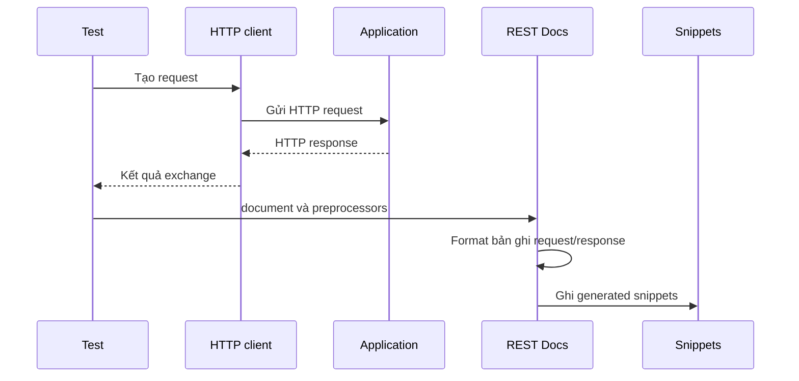

# Pretty printing cho request và response

## 1. Vì sao cần pretty print trong REST Docs?

Trong module **SPRING_REST_DOCS**, các bài kiểm thử HTTP với MockMvc, WebTestClient hoặc REST Assured tạo generated snippets để mô tả request và response. Snippet được include vào tài liệu Asciidoctor hoặc chuyển đổi sang định dạng xuất bản khác.

Một payload JSON hợp lệ có thể chỉ nằm trên một dòng:

```json
{"orderId":"ORD-42","status":"CONFIRMED","customer":{"id":"CUS-7","name":"Lan"},"totalAmount":250000}
```

Nội dung đúng về dữ liệu nhưng khó đọc trong `http-request.adoc` hoặc `http-response.adoc`. Pretty printing định dạng lại JSON/XML để có xuống dòng và thụt lề:

```json
{
  "orderId": "ORD-42",
  "status": "CONFIRMED",
  "customer": {
    "id": "CUS-7",
    "name": "Lan"
  },
  "totalAmount": 250000
}
```

Spring REST Docs cung cấp `Preprocessors.prettyPrint()` để áp dụng định dạng đẹp cho nội dung request hoặc response trước khi tạo snippet. Nó giúp người đọc nắm cấu trúc payload nhanh hơn và giúp diff trong code review dễ quan sát hơn.

Pretty printing là bước xử lý biểu diễn tài liệu. Nó không phải validation, không thay đổi contract API và không gửi lại request.

## 2. Preprocessor và OperationPreprocessor

Preprocessor nhận operation request/response đã được ghi lại và trả về phiên bản đã xử lý để REST Docs sinh snippets.

| API | Vai trò |
| --- | --- |
| `OperationPreprocessor` | Hợp đồng xử lý operation request hoặc response |
| `OperationRequestPreprocessor` | Preprocessor dành cho request |
| `OperationResponsePreprocessor` | Preprocessor dành cho response |
| `Preprocessors.prettyPrint()` | Tạo preprocessor định dạng nội dung được hỗ trợ như JSON/XML |
| `preprocessRequest(...)` | Gắn preprocessor vào request của operation |
| `preprocessResponse(...)` | Gắn preprocessor vào response của operation |

Import pretty print:

```java
import static org.springframework.restdocs.operation.preprocess.Preprocessors.prettyPrint;
```

Trong MockMvc, gắn preprocessor vào `document(...)`:

```java
.andDo(document("orders-get",
    preprocessRequest(prettyPrint()),
    preprocessResponse(prettyPrint())
))
```

Cấu hình này xử lý request và response đã capture trước khi sinh snippets cho operation `orders-get`. Nếu chỉ muốn format response, chỉ truyền `preprocessResponse(prettyPrint())`. Nếu chỉ muốn format request, chỉ truyền `preprocessRequest(prettyPrint())`.

Không cần format cả hai phía nếu chỉ một phía khó đọc. Chọn theo nhu cầu tài liệu.

## 3. Pretty print cho request

Client có thể gửi JSON compact:

```json
{"name":"Lan Nguyen","email":"lan@example.test","roles":["USER","EDITOR"]}
```

Test MockMvc:

```java
import static org.springframework.restdocs.mockmvc.MockMvcRestDocumentation.document;
import static org.springframework.restdocs.mockmvc.MockMvcRestDocumentation.preprocessRequest;
import static org.springframework.restdocs.operation.preprocess.Preprocessors.prettyPrint;

mockMvc.perform(post("/api/accounts")
        .contentType(MediaType.APPLICATION_JSON)
        .content("""
            {"name":"Lan Nguyen","email":"lan@example.test","roles":["USER","EDITOR"]}
            """))
    .andExpect(status().isCreated())
    .andDo(document("accounts-create",
        preprocessRequest(prettyPrint())
    ));
```

Snippet HTTP request sẽ trình bày body với cấu trúc dễ đọc hơn, trong khi request controller nhận vẫn là payload của test. Nếu muốn response được định dạng đồng thời, thêm `preprocessResponse(prettyPrint())`.

Pretty print hữu ích với object lồng, mảng và nhiều field. Với body nhị phân, multipart hoặc định dạng không được hỗ trợ, không nên kỳ vọng formatter tạo được JSON có thụt lề.

## 4. Pretty print cho response

API có thể trả JSON compact do serializer tối ưu kích thước:

```json
{"id":"ORD-42","status":"CONFIRMED","items":[{"sku":"BK-01","quantity":2},{"sku":"BK-02","quantity":1}]}
```

Áp dụng riêng cho response:

```java
.andDo(document("orders-get",
    preprocessResponse(prettyPrint())
))
```

Snippet `http-response.adoc` sẽ có body xuống dòng và thụt lề. Cấu trúc và giá trị JSON vẫn giữ nguyên.

Với error response, pretty print cũng giúp object và array lỗi dễ đọc. Tuy nhiên, nó không che thông tin nhạy cảm. Nếu body chứa token hoặc dữ liệu nội bộ không được công bố, cần xử lý bằng response contract hoặc preprocessor redaction riêng.

## 5. Ví dụ MockMvc đầy đủ

Ví dụ dùng JUnit Jupiter, MockMvc và Spring REST Docs. Controller trả JSON order response; test sinh request/response snippets đã pretty print.

```java
import java.util.Map;

import org.junit.jupiter.api.BeforeEach;
import org.junit.jupiter.api.Test;
import org.junit.jupiter.api.extension.ExtendWith;
import org.springframework.http.MediaType;
import org.springframework.restdocs.RestDocumentationContextProvider;
import org.springframework.restdocs.RestDocumentationExtension;
import org.springframework.test.web.servlet.MockMvc;
import org.springframework.test.web.servlet.setup.MockMvcBuilders;
import org.springframework.web.bind.annotation.GetMapping;
import org.springframework.web.bind.annotation.RestController;

import static org.springframework.restdocs.mockmvc.MockMvcRestDocumentation.document;
import static org.springframework.restdocs.mockmvc.MockMvcRestDocumentation.documentationConfiguration;
import static org.springframework.restdocs.mockmvc.MockMvcRestDocumentation.preprocessRequest;
import static org.springframework.restdocs.mockmvc.MockMvcRestDocumentation.preprocessResponse;
import static org.springframework.restdocs.operation.preprocess.Preprocessors.prettyPrint;
import static org.springframework.test.web.servlet.request.MockMvcRequestBuilders.get;
import static org.springframework.test.web.servlet.result.MockMvcResultMatchers.status;

@ExtendWith(RestDocumentationExtension.class)
class OrderPrettyPrintDocumentationTest {

    private MockMvc mockMvc;

    @BeforeEach
    void setUp(RestDocumentationContextProvider documentation) {
        mockMvc = MockMvcBuilders.standaloneSetup(new OrderController())
                .apply(documentationConfiguration(documentation))
                .build();
    }

    @Test
    void getOrderUsesPrettyPrintedSnippets() throws Exception {
        mockMvc.perform(get("/api/orders/42")
                        .accept(MediaType.APPLICATION_JSON))
                .andExpect(status().isOk())
                .andDo(document("orders-get",
                        preprocessRequest(prettyPrint()),
                        preprocessResponse(prettyPrint())
                ));
    }

    @RestController
    static class OrderController {
        @GetMapping(value = "/api/orders/42",
                    produces = MediaType.APPLICATION_JSON_VALUE)
        Map<String, Object> getOrder() {
            return Map.of(
                    "orderId", "ORD-42",
                    "status", "CONFIRMED",
                    "customer", Map.of("id", "CUS-7", "name", "Lan"),
                    "totalAmount", 250000
            );
        }
    }
}
```

Trong ứng dụng thực, mapping có thể tổng quát thành `@GetMapping("/api/orders/{id}")` và dùng `@PathVariable`. Ví dụ cố định path để tập trung vào preprocessor. Generated snippets của operation `orders-get` thường gồm `http-request.adoc` và `http-response.adoc` cùng các snippet khác tùy cấu hình.

Preprocessor không thay thế assertion status/body. Hãy tiếp tục kiểm tra contract bằng assertion; pretty print chỉ tác động đến nội dung tài liệu hóa.

## 6. Kết hợp pretty print với field descriptors

Pretty print thường dùng cùng request/response field snippets:

```java
.andDo(document("orders-create",
    preprocessRequest(prettyPrint()),
    preprocessResponse(prettyPrint()),
    requestFields(
        fieldWithPath("customerId").description("Mã khách hàng"),
        fieldWithPath("items").description("Danh sách dòng hàng"),
        fieldWithPath("items[].sku").description("Mã sản phẩm"),
        fieldWithPath("items[].quantity").description("Số lượng")
    ),
    responseFields(
        fieldWithPath("orderId").description("Mã đơn hàng"),
        fieldWithPath("status").description("Trạng thái đơn hàng")
    )
))
```

Hai nhóm snippet có nhiệm vụ khác nhau:

- `http-request.adoc` và `http-response.adoc` hiển thị HTTP message, gồm body đã format.
- `request-fields.adoc` và `response-fields.adoc` mô tả path, kiểu và ý nghĩa field.

Pretty print không thay thế field descriptors. Body đã xuống dòng vẫn có thể khó hiểu nếu thiếu giải thích các field nghiệp vụ, đơn vị, optional/null hoặc semantics của array. Ngược lại, khai báo `requestFields` không tự làm body HTTP trong snippet dễ đọc hơn.

## 7. Pretty print cho XML và giới hạn nội dung

XML compact:

```xml
<order><id>ORD-42</id><status>CONFIRMED</status><total>250000</total></order>
```

Sau định dạng:

```xml
<order>
  <id>ORD-42</id>
  <status>CONFIRMED</status>
  <total>250000</total>
</order>
```

Hãy bảo đảm request/response khai báo Content-Type phù hợp, ví dụ `application/json` hoặc `application/xml`, và body thật sự là JSON/XML hợp lệ.

Không nên áp dụng mù quáng cho `text/plain` có ý nghĩa whitespace, `application/octet-stream`, multipart chứa binary, payload streaming hoặc định dạng tùy biến. Với các loại body này, giữ nguyên nội dung hoặc viết preprocessor chuyên biệt. Formatter không thể đoán cấu trúc của payload tùy ý.

## 8. Preprocessor chạy ở đâu trong HTTP lifecycle?



Preprocessor xử lý operation mà REST Docs dùng để ghi tài liệu sau khi exchange được capture. Nó không thay đổi request body mà test gửi tới application, không thay đổi dữ liệu controller đã parse và không thay đổi response mà client nhận.

Vì vậy:
- API trả sai JSON thì pretty print không sửa lỗi nghiệp vụ.
- Assertion fail thì pretty print không làm test pass.
- Snippet có output khác thì kiểm tra preprocessor và Content-Type.
- Muốn thay đổi dữ liệu thực gửi/nhận thì phải thay đổi client/application hoặc test setup, không phải pretty print tài liệu.

## 9. Kết hợp với preprocessor khác

REST Docs có các preprocessor khác để sửa header, loại header, thay đổi URI, mask dữ liệu hoặc thay body. Có thể kết hợp nhiều processor:

```java
import static org.springframework.restdocs.operation.preprocess.Preprocessors.removeHeaders;
import static org.springframework.restdocs.operation.preprocess.Preprocessors.prettyPrint;

.andDo(document("accounts-get",
    preprocessRequest(prettyPrint()),
    preprocessResponse(
        removeHeaders("X-Internal-Trace"),
        prettyPrint()
    )
))
```

Kiểm tra API/overload của phiên bản REST Docs dự án đang dùng. Thứ tự processor có thể quan trọng nếu bước trước thay đổi body hoặc Content-Type mà bước sau cần đọc.

Loại header khỏi bản ghi tài liệu không xóa header khỏi HTTP response thật. Nếu header nhạy cảm đang được gửi qua mạng, cần kiểm soát ở server/client. Pretty print tự nó không mask giá trị; hãy dùng masking/redaction preprocessor phù hợp khi cần che dữ liệu trong snippet.

## 10. WebTestClient và REST Assured

Pretty print là API preprocessor chung nên ý tưởng tương tự với các HTTP test client được hỗ trợ.

### 10.1. WebTestClient

```java
webTestClient.get()
        .uri("/api/orders/42")
        .exchange()
        .expectStatus().isOk()
        .expectBody()
        .consumeWith(document("orders-get",
                preprocessResponse(prettyPrint())));
```

Vị trí `document` và overload cụ thể phụ thuộc integration/version đang dùng. Để preprocess request, thêm `preprocessRequest(prettyPrint())` vào document configuration phù hợp.

### 10.2. REST Assured

```java
given(spec)
    .filter(document("orders-get",
            preprocessRequest(prettyPrint()),
            preprocessResponse(prettyPrint())))
    .when()
    .get("/api/orders/42")
    .then()
    .statusCode(200);
```

Cách gắn filter cần đúng integration REST Assured của Spring REST Docs. Dù dùng client nào, pretty print chỉ định dạng representation ghi vào snippets; assertion và semantics HTTP không thay đổi.

## 11. Asciidoctor và build/CI

Sau khi test tạo snippets, Asciidoctor include HTTP exchange:

```adoc
= Order API
:snippets: build/generated-snippets

== Xem đơn hàng

=== Request và response
include::{snippets}/orders-get/http-request.adoc[]
include::{snippets}/orders-get/http-response.adoc[]
```

Với Gradle, output thường là `build/generated-snippets`; với Maven thường là `target/generated-snippets`. Kiểm tra cấu hình thực tế và dùng cùng thư mục trong test và Asciidoctor.

Quy trình build nên biên dịch test, chạy HTTP documentation tests, áp dụng preprocessors khi sinh snippets, rồi mới chạy Asciidoctor và đóng gói tài liệu. Trong review, pretty printing có thể làm diff lớn hơn do chuyển body một dòng thành nhiều dòng. Xác nhận đó là thay đổi trình bày và cấu trúc/giá trị contract không đổi.

## 12. Lỗi thường gặp

| Hiện tượng | Nguyên nhân | Cách xử lý |
| --- | --- | --- |
| Snippet vẫn chỉ có một dòng | Chưa gắn request/response preprocessor hoặc gắn sai phía | Kiểm tra document configuration |
| Request đã format nhưng response chưa format | Chỉ gọi request preprocessor | Bổ sung response preprocessor nếu cần |
| JSON formatter không xử lý body | Content-Type sai hoặc JSON không hợp lệ | Kiểm tra Content-Type và payload |
| XML hiển thị không như mong đợi | Media type không nhận diện hoặc XML lỗi | Khai báo đúng XML content type |
| Text body bị đổi whitespace | Formatter không phù hợp nội dung | Không pretty print text/stream/binary |
| Nghĩ API đã nhận body được format | Nhầm operation preprocessor với HTTP client | Kiểm tra request gốc và server |
| Field table không tự thay đổi | Mong pretty print mô tả field | Dùng requestFields/responseFields |
| Token vẫn lộ trong snippet | Pretty print không mask dữ liệu | Dùng masking/redaction hoặc sửa fixture |
| Asciidoctor không tìm thấy snippet | Task chạy trước test hoặc include sai identifier | Sửa dependency và include path |
| Diff snippet lớn | Chuyển output một dòng sang format nhiều dòng | Review như thay đổi presentation |

## 13. Bài thực hành

Dùng endpoint `GET /api/orders/42` và `POST /api/orders`:

1. Tạo test GET trả JSON compact; sinh snippet ban đầu chưa pretty print.
2. Thêm `preprocessResponse(prettyPrint())` và so sánh body trong `http-response.adoc`.
3. Với POST, thêm `preprocessRequest(prettyPrint())` và quan sát `http-request.adoc`.
4. Bật cả request và response pretty print; xác nhận field descriptors vẫn hoạt động.
5. Trả error response có object và array lồng; kiểm tra output sau formatting.
6. Tạo endpoint XML với Content-Type phù hợp và thử pretty print.
7. Thử text/plain hoặc body nhị phân; xác định khi nào cần giữ nguyên nội dung.
8. Thêm header nội bộ và preprocessor loại header khỏi snippet; xác nhận HTTP exchange gốc của application không bị thay đổi.
9. Include snippet vào Asciidoctor và chạy task sau documentation tests.
10. Review generated diff, xác nhận chỉ presentation thay đổi và payload contract giữ nguyên.

**Tiêu chí hoàn thành:** bạn biết lấy `prettyPrint()` từ Preprocessors, gắn nó riêng cho request/response, hiểu preprocessor tác động lên bản ghi REST Docs chứ không phải HTTP exchange thật, kết hợp với field descriptors và processor khác, đồng thời tích hợp output vào Asciidoctor/CI.

## Tài liệu tham khảo

- [Spring REST Docs — Preprocessing](https://docs.spring.io/spring-restdocs/reference/documenting-your-api/preprocessing.html): preprocess request/response trước khi tạo snippets.
- [Spring REST Docs — Preprocessors API](https://docs.spring.io/spring-restdocs/api/java/org/springframework/restdocs/operation/preprocess/Preprocessors.html): `prettyPrint()` và các helper preprocessor.
- [Spring REST Docs — MockMvc API](https://docs.spring.io/spring-restdocs/api/java/org/springframework/restdocs/mockmvc/MockMvcRestDocumentation.html): `preprocessRequest`, `preprocessResponse` và tích hợp document với MockMvc.
