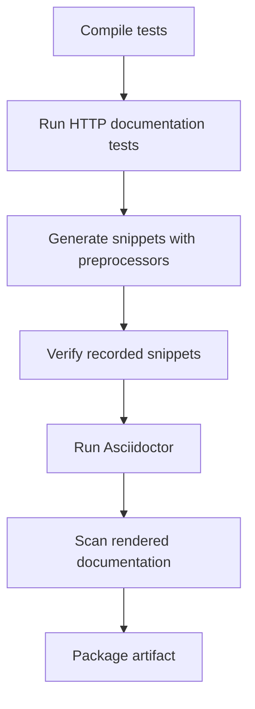

# Kiểm tra preprocessor không làm sai bằng chứng

## 1. Preprocessor và bằng chứng tài liệu

Trong module **SPRING_REST_DOCS**, các bài kiểm thử HTTP bằng MockMvc, WebTestClient hoặc REST Assured vừa kiểm chứng API vừa tạo generated snippets để biên soạn Asciidoctor/Markdown. Preprocessor có thể chuẩn hóa URI, pretty print body, thay header hoặc che giá trị nhạy cảm trước khi ghi snippet.

Cần phân biệt **HTTP exchange gốc** với **recorded operation đã preprocessing**. Test assertion xác nhận server/client exchange thật trong môi trường test; snippet thể hiện bản ghi đã qua các biến đổi được cho phép. Không dùng snippet thay cho assertion contract, và cũng không cho rằng assertion HTTP tự chứng minh snippet đã che secret.

Ví dụ response gốc:

```json
{"orderId":"ORD-42","status":"CONFIRMED","accessToken":"test-secret-marker-987"}
```

Snippet sau khi mask:

```json
{
  "orderId": "ORD-42",
  "status": "CONFIRMED",
  "accessToken": "[REDACTED]"
}
```

Giá trị token được thay có chủ đích; các field contract còn lại phải giữ nguyên. Đây là nguyên tắc để thiết kế test cho preprocessor.

## 2. Lập policy trước khi kiểm thử

Trước khi cấu hình processor, liệt kê thành phần được phép thay đổi và những invariants phải giữ:

| Thành phần | Biến đổi được phép | Invariant cần kiểm tra |
| --- | --- | --- |
| URI | Đổi scheme/host/port sang public base URI | Path và query giữ nguyên |
| Authorization | Thay token bằng placeholder | Tên header còn nếu client cần xác thực |
| Header nội bộ | Xóa nếu không thuộc contract | Header contract như Content-Type vẫn còn |
| JSON/XML | Pretty print hoặc mask field đã chỉ định | Cấu trúc và giá trị không nhạy cảm giữ nguyên |
| Status code | Thông thường không thay đổi | Khớp status đã assert |
| Content-Type | Thông thường không thay đổi | Mô tả đúng representation |

Ví dụ policy: đổi localhost thành api.example.com; giữ path/query; thay Authorization bằng Bearer [REDACTED]; xóa X-Internal-Node; giữ status, Content-Type và field nghiệp vụ.

## 3. Tách assertion HTTP và verification snippet

HTTP assertion phải thực hiện trên exchange gốc trước bước document:

```java
mockMvc.perform(get("/api/orders/42")
        .accept(MediaType.APPLICATION_JSON))
    .andExpect(status().isOk())
    .andExpect(content().contentTypeCompatibleWith(
            MediaType.APPLICATION_JSON))
    .andExpect(jsonPath("$.orderId").value("ORD-42"))
    .andExpect(jsonPath("$.status").value("CONFIRMED"))
    .andDo(document("orders-get",
        preprocessResponse(prettyPrint())
    ));
```

Những assertion này kiểm tra status, media type và field từ response mà MockMvc nhận. Pretty print chỉ áp dụng ở bước ghi documentation. Nếu assertion thất bại, test phải fail dù formatter vẫn có thể tạo được output trông đẹp.

Nhóm assertion thứ hai kiểm tra generated output: URI chuẩn hóa đúng; header được thay/xóa đúng policy; marker secret gốc không còn; placeholder ở đúng field; body vẫn parse được; snippet cần thiết được tạo và Asciidoctor include đúng identifier.

## 4. Kiểm tra JSON invariants

Khi chỉ pretty print, đừng so sánh raw JSON string vì whitespace và thứ tự key object có thể đổi. Parse cả hai body thành JSON tree rồi so sánh:

```java
JsonNode original = objectMapper.readTree(originalBody);
JsonNode documented = objectMapper.readTree(prettyPrintedBody);
assertEquals(original, documented);
```

So sánh JSON tree bỏ qua whitespace và thứ tự member object nhưng vẫn giữ thứ tự phần tử array. Đây là phép kiểm tra phù hợp cho formatting thuần túy.

Khi body còn được mask, so sánh các invariant không nhạy cảm và kiểm tra placeholder riêng:

```java
assertEquals(original.path("orderId"), documented.path("orderId"));
assertEquals(original.path("status"), documented.path("status"));
assertEquals("[REDACTED]", documented.path("accessToken").asText());
assertFalse(documented.toString().contains("test-secret-marker-987"));
assertTrue(documented.has("accessToken"));
```

Nếu contract yêu cầu key được giữ, phân biệt key vắng với key có giá trị null. Kiểm tra placeholder nằm đúng path; việc tìm chuỗi [REDACTED] ở bất kỳ đâu chưa đủ chứng minh mask đúng.

## 5. Kiểm tra header policy

Ví dụ giữ Authorization nhưng thay token; xóa header nội bộ khỏi response:

```java
.andDo(document("accounts-get",
    preprocessRequest(
        modifyHeaders()
            .set("Authorization", "Bearer [REDACTED]")
    ),
    preprocessResponse(
        modifyHeaders().remove("X-Internal-Node")
    )
))
```

Verification cần xác nhận Authorization vẫn xuất hiện với placeholder nếu client cần gửi xác thực; X-Internal-Node bị loại khỏi response snippet; Content-Type và header contract khác vẫn còn; header gốc trong HTTP exchange không bị nhầm với bản ghi đã xử lý.

Header descriptor cần tương thích với recorded operation sau preprocessing. Nếu xóa một header mà descriptor yêu cầu, snippet có thể thiếu thông tin hoặc tài liệu không còn phản ánh policy.

## 6. Kiểm tra modifyUris() giữ path/query

Ví dụ biến đổi được mong đợi:

```text
Before: http://localhost:8080/api/orders/42?expand=items
After:  https://api.example.com/api/orders/42?expand=items
```

Kiểm tra từng thành phần URI từ documented output, không lấy URI request gốc để kết luận processor đúng:

```java
URI documented = URI.create(documentedUri);
assertEquals("https", documented.getScheme());
assertEquals("api.example.com", documented.getHost());
assertEquals("/api/orders/42", documented.getRawPath());
assertEquals("expand=items", documented.getRawQuery());
```

Nếu API dùng gateway prefix, percent-encoded path hoặc query encoding đặc biệt, hãy kiểm tra các trường hợp đó. Đừng decode/encode lại tùy tiện vì có thể thay đổi semantics.

## 7. Thứ tự processor và dữ liệu biên

Processor sau có thể nhận representation đã thay đổi bởi processor trước. Ví dụ regex được viết cho body compact có thể cần được kiểm tra lại khi pretty print chạy trước. Processor parse body còn phụ thuộc Content-Type. Hãy kiểm tra output cuối cùng sau khi kết hợp processor, không giả định các thứ tự là tương đương.

| Fixture | Rủi ro | Kết quả cần xác nhận |
| --- | --- | --- |
| JSON compact/pretty | Regex phụ thuộc whitespace | Mask đủ giá trị |
| Escaped quote | Regex kết thúc string sớm | JSON vẫn hợp lệ |
| Nested object/array | Chỉ mask root hoặc phần tử đầu | Che mọi path theo policy |
| Null/missing field | Processor giả định luôn có string | Xử lý theo contract |
| Body rỗng | Parser thất bại | Không lỗi ngoài ý muốn |
| XML/text/binary | JSON parser xử lý sai media type | Không parse nhầm định dạng |

Dùng marker giả đặc trưng trong fixture. Không dùng credential thật để thử masking.

## 8. Ví dụ MockMvc: xác nhận response gốc trước document

```java
@ExtendWith(RestDocumentationExtension.class)
class PreprocessorEvidenceTest {
    private MockMvc mockMvc;

    @BeforeEach
    void setUp(RestDocumentationContextProvider documentation) {
        mockMvc = MockMvcBuilders.standaloneSetup(new TokenController())
                .apply(documentationConfiguration(documentation))
                .build();
    }

    @Test
    void documentsMaskedToken() throws Exception {
        mockMvc.perform(get("/api/token")
                        .accept(MediaType.APPLICATION_JSON))
                .andExpect(status().isOk())
                .andExpect(jsonPath("$.tokenType").value("Bearer"))
                .andExpect(jsonPath("$.accessToken")
                        .value("test-secret-marker-987"))
                .andDo(document("token-get",
                        preprocessResponse(
                                replacePattern(
                                    Pattern.compile(
                                      "\"accessToken\"\\s*:\\s*\"[^\"]+\""),
                                    "\"accessToken\":\"[REDACTED]\"")
                        )
                ));
    }
}
```

Test này xác nhận response gốc chứa marker giả và status/type đúng. Nó chưa tự đọc snippet để xác nhận masking. Cần một verification task/test chạy sau documentation test để đọc file output và kiểm tra placeholder, marker gốc cùng các field quan trọng.

## 9. Kiểm tra generated snippets sau khi ghi

Verification test có thể đọc snippet được sinh:

```java
Path snippet = generatedSnippets
        .resolve("token-get")
        .resolve("http-response.adoc");
String output = Files.readString(snippet, StandardCharsets.UTF_8);
assertTrue(output.contains("[REDACTED]"));
assertFalse(output.contains("test-secret-marker-987"));
assertTrue(output.contains("tokenType"));
```

Đây là ý tưởng kiểm chứng; cung cấp generatedSnippets từ cấu hình build và bảo đảm verification chạy sau task sinh snippet. Với nhiều operation, có thể scan toàn bộ output directory bằng một danh sách marker giả đã định nghĩa. Báo rõ file vi phạm để người review truy ngược được.

Nếu output được tạo bằng custom template, kiểm tra cả artifact cuối. Template có thể render dữ liệu khác với snippet mặc định.

## 10. Preprocessing không thay thế API security

| Yêu cầu | Assertion trên HTTP exchange | Preprocessor |
| --- | --- | --- |
| Client cần gửi Authorization | Kiểm tra xác thực hoạt động | Mask giá trị, giữ tên header |
| Response có access token theo contract | Kiểm tra field/value thật | Mask token trong tài liệu nếu policy yêu cầu |
| API không được trả passwordHash | Xác nhận field absent trong response | Không dùng masking để che lỗi rò rỉ |

Ví dụ API không được trả password hash:

```java
mockMvc.perform(get("/api/profile"))
    .andExpect(status().isOk())
    .andExpect(jsonPath("$.passwordHash").doesNotExist());
```

Nếu chỉ mask passwordHash trong snippet, client vẫn nhận field đó. Assertion trên response thật phải bắt lỗi. Cũng kiểm tra fixture, HTTP logging, test report, failure logs và CI artifacts vì secret có thể lộ ngoài generated snippets.

## 11. Status, Content-Type và header invariants

Preprocessor thường thay body/header hoặc URI trong representation tài liệu. Không nên âm thầm đổi status hoặc media type để response trông hợp lệ. Verification nên xác nhận status snippet khớp status đã assert; Content-Type mô tả đúng body; header contract không bị remove; URI chỉ thay phần đã định nghĩa; body sau processing còn parse được; field descriptors vẫn khớp payload.

Khi thay body, cân nhắc các metadata liên quan representation như Content-Length hoặc Content-Encoding. Không giữ metadata cũ nếu nó không còn đúng, cũng không xóa header contract tùy tiện. Xác minh output và chọn processor phù hợp với semantics của header.

## 12. Regression test và build/CI

Chia kiểm chứng thành các tầng:

1. **Unit test preprocessor:** regex, JSON mask và URI transform với fixture biên.
2. **HTTP documentation test:** xác minh exchange gốc rồi gọi document(...).
3. **Generated snippet verification:** kiểm tra placeholder, secret marker, path/query và header.
4. **Asciidoctor build:** xác nhận include đúng snippet hiện tại và render thành công.
5. **Artifact scan:** tìm marker nhạy cảm giả trong output có khả năng publish.



CI nên fail nếu marker gốc còn trong snippet, placeholder ở sai field, URI sai base, header contract bị mất hoặc Asciidoctor include file không tồn tại. Đặt verification sau task sinh snippets bằng dependency rõ ràng; tránh chạy song song trước khi file được ghi.

## 13. Checklist review preprocessor

- [ ] Policy nêu rõ phần nào được phép thay đổi.
- [ ] Test assert status/header/body của HTTP exchange gốc.
- [ ] Generated snippet được kiểm tra độc lập sau preprocessing.
- [ ] URI scheme/host/port đúng và path/query được giữ.
- [ ] Header contract quan trọng vẫn có.
- [ ] Header nội bộ được xử lý đúng phía.
- [ ] Secret marker gốc không còn trong generated snippets.
- [ ] Placeholder đúng key/path và giữ cấu trúc cần thiết.
- [ ] JSON/XML vẫn parse được sau processing.
- [ ] Dữ liệu không nhạy cảm không bị thay nhầm.
- [ ] Custom processor có fixture nested/array/null/empty/malformed.
- [ ] Status và Content-Type khớp contract.
- [ ] Asciidoctor chạy sau snippet generation.
- [ ] Artifact cuối được scan trước publish.

## 14. Bài thực hành

Dùng endpoint GET /api/token và GET /api/orders/42:

1. Assert status, Content-Type và field response gốc trước document(...).
2. Gắn replacePattern(...) để mask access token với JSON compact và pretty.
3. Kiểm tra http-response.adoc có [REDACTED] đúng accessToken và không có marker gốc.
4. Thêm Authorization request header; dùng modifyHeaders().set(...) và xác nhận tên header còn.
5. Xóa X-Internal-Node khỏi response snippet nhưng giữ Content-Type.
6. Dùng modifyUris() đổi base URI; kiểm tra path/query còn nguyên.
7. Thử nested JSON và array có marker ở nhiều phần tử.
8. Tạo passwordHash không được phép trả và assert field absent ở response gốc.
9. Đảo thứ tự hai processor; kiểm tra output và giải thích khác biệt.
10. Chạy snippet verification, Asciidoctor và artifact scan trong CI; xác nhận pipeline fail khi marker gốc còn.

**Tiêu chí hoàn thành:** phân biệt HTTP exchange gốc với recorded operation đã preprocessing; viết assertion cho contract trước document; xác minh snippet theo invariants/policy; kiểm tra header, URI, JSON masking, dữ liệu biên và thứ tự processor; đặt verification sau snippet generation trong CI.

## Tài liệu tham khảo

- [Spring REST Docs — Preprocessing](https://docs.spring.io/spring-restdocs/reference/documenting-your-api/preprocessing.html): operation preprocessors và chỉnh representation trước khi tạo snippets.
- [Spring REST Docs — Preprocessors API](https://docs.spring.io/spring-restdocs/api/java/org/springframework/restdocs/operation/preprocess/Preprocessors.html): prettyPrint, modifyHeaders, replacePattern và URI modification.
- [Spring REST Docs — OperationPreprocessor API](https://docs.spring.io/spring-restdocs/api/java/org/springframework/restdocs/operation/preprocess/OperationPreprocessor.html): hợp đồng xử lý recorded operation.
- [Spring Framework — MockMvc testing](https://docs.spring.io/spring-framework/reference/testing/spring-mvc-test-framework.html): kiểm tra HTTP request/response trong test.
