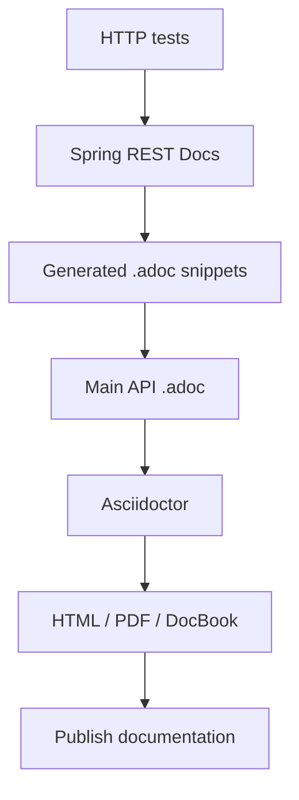
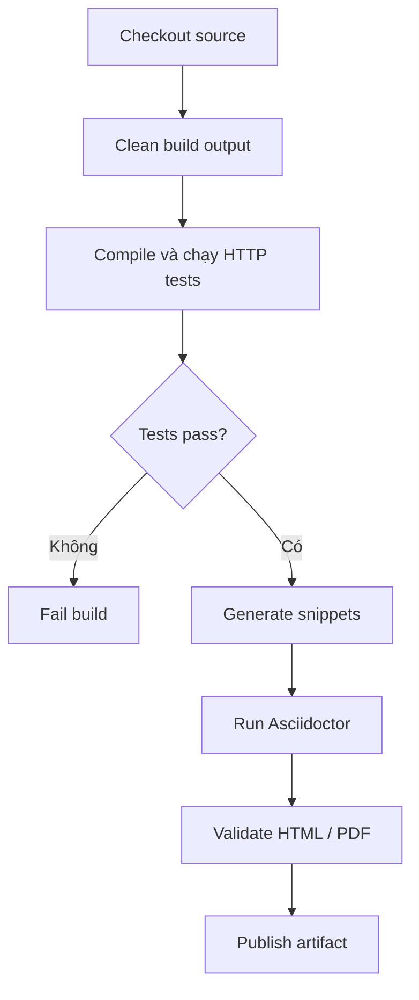

# Vì sao Asciidoctor là định dạng mặc định

## 1. Vai trò của Asciidoctor trong Spring REST Docs

Spring REST Docs tạo tài liệu REST API có thể kiểm chứng từ các bài kiểm thử HTTP bằng MockMvc, WebTestClient hoặc REST Assured. Test thực thi request, xác nhận response và sinh các snippet mô tả method, URI, headers, payload, parameters, fields hoặc hypermedia links. Sau đó, người viết ghép những snippet này thành tài liệu API hoàn chỉnh.

Trong workflow chuẩn của Spring REST Docs, **AsciiDoc và Asciidoctor là lựa chọn biên soạn tự nhiên** vì snippet mặc định được sinh dưới dạng các file `.adoc`, còn Asciidoctor hỗ trợ nhúng trực tiếp những file này vào một tài liệu lớn bằng chỉ thị `include::...[]`.

Ví dụ snippet được tạo sau một test:

```text
build/generated-snippets/
  books-get/
    http-request.adoc
    http-response.adoc
    curl-request.adoc
    path-parameters.adoc
    response-fields.adoc
```

Tài liệu chính có thể viết:

```asciidoc
= Books API

== Lấy sách theo ID

=== Request
include::{snippets}/books-get/http-request.adoc[]

=== Response
include::{snippets}/books-get/http-response.adoc[]

=== Response fields
include::{snippets}/books-get/response-fields.adoc[]
```

Khi Asciidoctor xử lý tài liệu, nội dung snippet được chèn vào đúng vị trí. Người viết có thể thêm phần giải thích, cảnh báo, bảng tổng hợp, ví dụ nghiệp vụ hoặc liên kết giữa các operation xung quanh nội dung sinh tự động.



## 2. Vì sao Asciidoctor phù hợp hơn việc tự chép snippet?

Asciidoctor không phải một công cụ sinh HTTP snippet. Spring REST Docs đảm nhiệm việc ghi lại và kiểm chứng request/response; Asciidoctor đảm nhiệm việc biên soạn, hợp nhất nội dung và render tài liệu. Hai công cụ giải quyết hai phần khác nhau nhưng ghép với nhau rất tự nhiên.

| Nhu cầu | Asciidoctor hỗ trợ như thế nào |
| --- | --- |
| Nhúng snippet đã sinh | `include::{snippets}/...[]` đọc trực tiếp file `.adoc`. |
| Tổ chức nhiều endpoint | Heading, section, table of contents và cross-reference. |
| Bổ sung giải thích | Paragraph, list, admonition, source block và bảng. |
| Dùng lại nội dung | Include một file hoặc đoạn nội dung ở nhiều vị trí. |
| Thay đổi output theo môi trường | Attributes như `{snippets}`, `{project-version}`, `{api-base-url}`. |
| Tạo tài liệu nhiều định dạng | Asciidoctor có thể render HTML, DocBook và PDF qua toolchain phù hợp. |
| Tự động hóa | Plugin Gradle/Maven có thể chạy sau test trong build pipeline. |

Nếu tự chép request/response vào một file Markdown, nội dung có thể nhanh chóng lệch khỏi test. Khi test thay đổi nhưng người viết quên cập nhật ví dụ, tài liệu không còn phản ánh API đã kiểm chứng. Việc include snippet giúp bản tài liệu sử dụng trực tiếp output của test hiện tại.

## 3. AsciiDoc và Asciidoctor không phải cùng một khái niệm

Hai tên thường được dùng cạnh nhau nhưng có vai trò khác:

- **AsciiDoc** là ngôn ngữ đánh dấu văn bản dùng để viết tài liệu có cấu trúc. File thường có phần mở rộng `.adoc` hoặc `.asciidoc`.
- **Asciidoctor** là bộ xử lý/implementation cho AsciiDoc, dùng để parse tài liệu nguồn và render ra output như HTML hoặc DocBook. PDF thường cần thêm Asciidoctor PDF hoặc toolchain tương ứng.

Trong một dự án Spring REST Docs:

```text
src/docs/asciidoc/api.adoc             # File nguồn do nhóm biên soạn
build/generated-snippets/books-get/   # Snippets do test sinh ra
build/docs/asciidoc/html5/api.html     # Ví dụ output HTML
```

File `api.adoc` là nơi nhóm kiểm soát cấu trúc và văn phong. Các file trong `generated-snippets` là đầu ra được tạo từ test và thường không chỉnh sửa thủ công. Asciidoctor hợp nhất chúng khi build tài liệu.

## 4. Điểm mạnh cốt lõi: include snippet mà không sao chép nội dung

Chỉ thị `include::` cho phép nhúng file snippet:

```asciidoc
=== HTTP request
include::{snippets}/books-get/http-request.adoc[]

=== HTTP response
include::{snippets}/books-get/http-response.adoc[]
```

`{snippets}` là một document attribute. Build cần gán nó tới đúng thư mục output của Spring REST Docs. Ví dụ có thể đặt trực tiếp trong file nguồn:

```asciidoc
:snippets: ../../../build/generated-snippets
```

Hoặc truyền attribute từ Gradle/Maven để không phụ thuộc đường dẫn tương đối trong file nguồn. Khi chạy CI hoặc dùng output directory khác, chỉ cần cập nhật giá trị attribute.

Đường dẫn include được phân giải theo ngữ cảnh Asciidoctor và cấu hình `include` của dự án. Vì vậy hãy kiểm tra file đã tồn tại và `{snippets}` trỏ đúng nơi trước khi biên soạn.

## 5. Ghép snippet với nội dung do người viết quản lý

Tài liệu API cần nhiều hơn request và response thô. Asciidoctor cho phép kết hợp nội dung giải thích với snippet:

```asciidoc
== Tạo sách

Endpoint này tạo một tài nguyên sách mới. Client gửi JSON body và nhận về
HTTP 201 cùng URI của tài nguyên vừa tạo.

=== Request
include::{snippets}/books-create/http-request.adoc[]

=== Request fields
include::{snippets}/books-create/request-fields.adoc[]

=== Response
include::{snippets}/books-create/http-response.adoc[]

=== Response headers
include::{snippets}/books-create/response-headers.adoc[]

=== Response fields
include::{snippets}/books-create/response-fields.adoc[]
```

Snippet cung cấp ví dụ HTTP và bảng được kiểm chứng bởi test. Phần văn bản do nhóm viết giải thích tại sao client cần gọi endpoint, điều kiện nghiệp vụ, giới hạn, lỗi thường gặp và cách dùng các operation liên quan.

## 6. Asciidoctor hỗ trợ attributes để quản lý tài liệu linh hoạt

Attributes cho phép dùng một giá trị ở nhiều nơi mà không phải sửa từng đoạn. Ví dụ:

```asciidoc
= {service-name} API
:service-name: Book Service
:snippets: build/generated-snippets
:api-version: v1
:api-base-url: https://api.example.test/{api-version}

API base URL: `{api-base-url}`.
```

Trong dự án lớn, các attributes hữu ích thường gồm:

| Attribute | Mục đích |
| --- | --- |
| `snippets` | Thư mục chứa generated snippets. |
| `project-version` | Phiên bản dịch vụ hoặc API được tài liệu hóa. |
| `api-base-url` | Base URL dùng trong phần ví dụ/giải thích. |
| `source-highlighter` | Bộ tô màu syntax cho code block khi output hỗ trợ. |
| `toc` | Điều khiển mục lục. |

Không nên đặt URL môi trường test ngẫu nhiên làm base URL công bố. Nếu test chạy ở `localhost:<random-port>`, có thể chuẩn hóa URI trong Spring REST Docs preprocessor hoặc trình bày base URL công khai bằng attribute riêng. Hai giá trị phục vụ mục tiêu khác nhau.

## 7. Tài liệu có cấu trúc và điều hướng tốt

AsciiDoc hỗ trợ heading, cross-reference và mục lục. Với tài liệu có nhiều API, có thể chia theo resource hoặc use case:

```asciidoc
= Store API
:toc:
:toclevels: 3
:sectnums:
:snippets: build/generated-snippets

include::common/overview.adoc[]

== Books
include::operations/books-list.adoc[]
include::operations/books-get.adoc[]
include::operations/books-create.adoc[]

== Orders
include::operations/orders-get.adoc[]
include::operations/orders-pay.adoc[]
```

Mỗi file operation có thể nhúng snippet theo identifier riêng. Cấu trúc này giúp nhiều người cùng biên soạn và giảm việc một file nguồn trở nên quá dài.

Cross-reference cho phép điều hướng đến section hoặc anchor khác:

```asciidoc
Xem thêm phần <<authentication, Xác thực>> trước khi gọi endpoint tạo đơn hàng.

[[authentication]]
== Xác thực
```

## 8. Render HTML, PDF và các định dạng khác

Asciidoctor xử lý một nguồn AsciiDoc thành các output phù hợp với nhu cầu phát hành:

| Output | Khi nên dùng |
| --- | --- |
| HTML | Tài liệu developer portal, tra cứu online, search và điều hướng. |
| PDF | Tài liệu cần tải xuống, lưu trữ hoặc phân phối ngoại tuyến. |
| DocBook | Làm đầu vào cho một publishing pipeline khác. |

HTML là lựa chọn phổ biến cho API documentation vì người dùng có thể xem code, bảng và link trên trình duyệt. PDF cần cấu hình thêm Asciidoctor PDF và font phù hợp. Không phải mọi output đều được tạo chỉ bằng cùng một lệnh mặc định; hãy cài plugin/backend tương ứng.

## 9. Vì sao Spring REST Docs không bắt buộc Asciidoctor?

Từ “mặc định” ở đây nên hiểu là **đường đi được hỗ trợ trực tiếp và thuận tiện nhất**, không phải giới hạn kỹ thuật bắt buộc.

Spring REST Docs tạo snippets dưới dạng AsciiDoc theo các template mặc định. Do vậy, Asciidoctor có thể include trực tiếp mà không cần chuyển đổi. Tuy nhiên:

- Có thể tùy biến snippet templates để sinh nội dung theo yêu cầu.
- Có thể chuyển đổi các snippet `.adoc` sang Markdown hoặc format khác trong một pipeline riêng.
- Có thể dùng hệ thống publishing khác nếu xử lý được snippet, include và các thành phần tài liệu tương ứng.
- Có thể lưu nội dung tài liệu nguồn ở dạng khác, miễn là có bước tích hợp output của Spring REST Docs.

Nếu dự án chọn Markdown, cần xác định cách xử lý file `.adoc` được sinh ra. Markdown processor thông thường không hiểu chỉ thị `include::...[]` và cũng không tự render cú pháp AsciiDoc. Một số lựa chọn là chạy Asciidoctor trước rồi chuyển output phù hợp, viết bước chuyển đổi snippet, hoặc tùy biến templates cho định dạng đích. Hãy kiểm tra kết quả cuối để bảo đảm không mất bảng, code block, link hoặc formatting.

| Tiêu chí | Asciidoctor | Markdown thuần |
| --- | --- | --- |
| Dùng trực tiếp snippet `.adoc` | Có, bằng `include::`. | Không, cần chuyển đổi hoặc cơ chế include tương thích. |
| Attributes và cross-reference | Hỗ trợ tích hợp. | Phụ thuộc Markdown processor/extension. |
| Độ đơn giản cho README ngắn | Có thể nhiều tính năng hơn nhu cầu. | Thường đơn giản và quen thuộc. |
| Tài liệu API nhiều operation | Phù hợp với include và cấu trúc tài liệu lớn. | Phù hợp nếu repository đã có publishing pipeline Markdown tốt. |

## 10. Tích hợp Asciidoctor trong Gradle

Một cấu hình Gradle phổ biến dùng plugin Asciidoctor JVM:

```groovy
plugins {
    id 'java'
    id 'org.asciidoctor.jvm.convert' version '3.3.2'
}

configurations {
    asciidoctorExt
}

ext {
    snippetsDir = file('build/generated-snippets')
}

dependencies {
    testImplementation 'org.springframework.restdocs:spring-restdocs-mockmvc'
    asciidoctorExt 'org.springframework.restdocs:spring-restdocs-asciidoctor'
}

tasks.named('test') {
    outputs.dir snippetsDir
}

tasks.named('asciidoctor') {
    inputs.dir snippetsDir
    configurations 'asciidoctorExt'
    dependsOn tasks.named('test')
    attributes 'snippets': snippetsDir
}
```

Đây là ví dụ cấu hình rút gọn. Dự án cần quản lý version tương thích của plugin và Spring REST Docs; đồng thời cấu hình MockMvc/REST Assured/WebTestClient để ghi snippet vào đúng `snippetsDir`. Nếu dùng output mặc định khác, hãy đồng bộ giữa nơi test ghi snippet và attribute `snippets` của Asciidoctor.

Lệnh build:

```bash
./gradlew clean test asciidoctor
```

`asciidoctor` phụ thuộc `test`, vì vậy build phải chạy test trước. Nếu test hoặc descriptor thất bại, Gradle sẽ không tiếp tục task biên soạn phụ thuộc vào nó.

## 11. Tích hợp Asciidoctor trong Maven

Maven có thể dùng Spring REST Docs Maven Plugin hoặc Asciidoctor Maven Plugin để tích hợp snippets vào lifecycle. Một cấu hình thường cần:

1. Test chạy và sinh snippets vào `target/generated-snippets`.
2. Plugin Asciidoctor nhận thư mục này qua attribute `snippets`.
3. Tác vụ render chạy sau pha test, trong lifecycle phù hợp.
4. Output HTML/PDF được đóng gói hoặc publish.

Ví dụ cấu trúc AsciiDoc:

```asciidoc
= Catalog API
:snippets: target/generated-snippets

== Lấy sản phẩm
include::{snippets}/products-get/http-request.adoc[]
include::{snippets}/products-get/http-response.adoc[]
```

Cấu hình Maven plugin cụ thể phụ thuộc phiên bản Maven và plugin được chọn. Hãy tham khảo tài liệu plugin để đặt execution sau test và không chạy render từ snippet cũ.

## 12. Đưa Asciidoctor vào CI/CD

Pipeline nên bảo đảm snippet được sinh từ lần test hiện tại và chỉ được biên soạn khi test thành công:



Thực tế, snippet thường được tạo ngay trong bước test thay vì là một task độc lập. Sơ đồ thể hiện thứ tự logic: dọn output, chạy test, xác nhận kết quả, biên soạn và phát hành. Không publish tài liệu nếu test đỏ; filter có thể đã ghi một số snippet trước khi assertion cuối cùng thất bại.

Các kiểm tra CI hữu ích:

- Thư mục snippet sạch trước khi test bắt đầu.
- Mọi identifier được include đều tồn tại sau khi test pass.
- Không có token, cookie hoặc dữ liệu nhạy cảm trong snippet.
- HTML không còn lỗi include hoặc cross-reference.
- Các file output là artifact của đúng commit/build hiện tại.

## 13. Lỗi thường gặp

| Hiện tượng | Nguyên nhân | Cách xử lý |
| --- | --- | --- |
| Asciidoctor báo không tìm thấy file include | `{snippets}` sai hoặc test chưa tạo identifier tương ứng. | Kiểm tra output directory, tên snippet và dependency giữa test với Asciidoctor. |
| HTML hiển thị nguyên văn `include::...[]` | File không được xử lý bởi Asciidoctor hoặc include bị tắt. | Chạy đúng Asciidoctor task và kiểm tra include configuration. |
| Tài liệu có snippet cũ | Build không clean output hoặc test không chạy đầy đủ. | Xóa generated snippets trước test và chỉ dùng artifact của build hiện tại. |
| Markdown không render snippet | Markdown engine không hiểu cú pháp AsciiDoc. | Thêm bước chuyển đổi hoặc chuyển nguồn biên soạn sang AsciiDoc. |
| PDF lỗi font/ký tự tiếng Việt | PDF backend hoặc font chưa được cấu hình. | Cấu hình Asciidoctor PDF và font có glyph tiếng Việt; kiểm tra output sau render. |
| Nội dung lặp hoặc thứ tự kỳ lạ | Include cùng snippet nhiều lần hoặc tổ chức section không nhất quán. | Tách file operation, kiểm tra include và heading hierarchy. |
| Tài liệu publish dù test fail | Publish job không phụ thuộc kết quả test. | Thiết lập dependency/gating giữa test, Asciidoctor và publish. |

## 14. Checklist lựa chọn Asciidoctor

- [ ] Đã hiểu Spring REST Docs sinh các snippet `.adoc` từ HTTP tests.
- [ ] Đã dùng `include::{snippets}/...[]` để nhúng snippet trực tiếp.
- [ ] File AsciiDoc chính tách biệt nội dung do người viết quản lý và nội dung sinh tự động.
- [ ] Attributes như `{snippets}` được cấu hình tới đúng output directory.
- [ ] Đã chọn output phù hợp: HTML, PDF hoặc DocBook.
- [ ] Build chạy test trước Asciidoctor và chỉ dùng snippet của lần chạy hiện tại.
- [ ] CI xác nhận include/cross-reference không lỗi trước khi publish.
- [ ] Nếu chọn Markdown, đã có bước chuyển đổi hoặc tích hợp tương thích với snippet `.adoc`.

Asciidoctor là lựa chọn mặc định thuận tiện trong Spring REST Docs vì nó dùng trực tiếp định dạng snippet mà framework sinh ra, hỗ trợ include và cung cấp công cụ tổ chức tài liệu API quy mô lớn. Lợi ích quan trọng nhất là giảm sao chép thủ công: HTTP test tạo nội dung có thể kiểm chứng, còn Asciidoctor ghép nội dung đó thành tài liệu dễ đọc và có thể tự động hóa. Dự án vẫn có thể chọn Markdown hoặc định dạng khác nếu chủ động xây dựng bước tích hợp tương ứng.

## Tài liệu tham khảo

- [Spring REST Docs – Getting Started](https://docs.spring.io/spring-restdocs/reference/getting-started.html)
- [Spring REST Docs – Documenting Your API](https://docs.spring.io/spring-restdocs/reference/documenting-your-api.html)
- [Spring REST Docs – Gradle Plugin](https://docs.spring.io/spring-restdocs/reference/getting-started.html#getting-started-build-configuration-gradle)
- [Asciidoctor Documentation](https://docs.asciidoctor.org/)
- [Asciidoctor Gradle Plugin](https://docs.asciidoctor.org/gradle-plugin/latest/)
