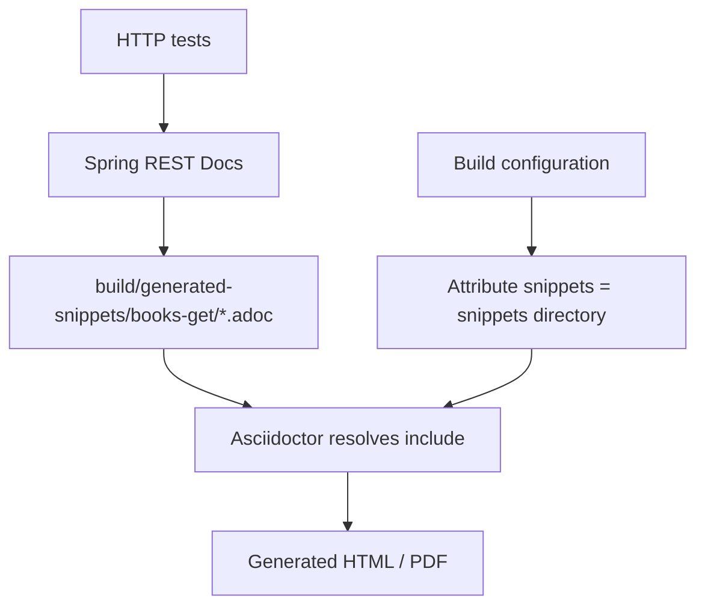

# Định nghĩa thuộc tính snippets trong tài liệu

## 1. `snippets` dùng để làm gì?

Spring REST Docs tạo các snippet từ những HTTP test dùng MockMvc, WebTestClient hoặc REST Assured. Snippet thường nằm trong thư mục build, ví dụ `build/generated-snippets` với Gradle hoặc `target/generated-snippets` với Maven. Tài liệu AsciiDoc chính cần biết thư mục này ở đâu để nhúng các file như `http-request.adoc`, `http-response.adoc`, `request-fields.adoc` và `response-fields.adoc`.

Trong Asciidoctor, **attribute `snippets` là biến chứa đường dẫn tới thư mục generated snippets**. Có thể dùng biến này trong include macro:

```asciidoc
=== HTTP request
include::{snippets}/books-get/http-request.adoc[]

=== HTTP response
include::{snippets}/books-get/http-response.adoc[]
```

Khi xử lý tài liệu, Asciidoctor thay `{snippets}` bằng giá trị attribute đã được cấu hình. Nhờ đó, tài liệu không phải ghi lặp đường dẫn tuyệt đối hoặc đường dẫn build cụ thể ở mọi include.



## 2. Attribute `snippets` được cung cấp tự động như thế nào?

Khi cấu hình `spring-restdocs-asciidoctor` đúng cách trong build, Spring REST Docs tự cấu hình attribute `snippets` để trỏ tới thư mục snippets theo build tool:

| Build tool | Thư mục snippets mặc định | Attribute được cấu hình tới |
| --- | --- | --- |
| Gradle | `build/generated-snippets` | `build/generated-snippets` |
| Maven | `target/generated-snippets` | `target/generated-snippets` |

Với Gradle, thêm `spring-restdocs-asciidoctor` vào configuration dành cho Asciidoctor, thường là `asciidoctorExt`. Với Maven, thêm dependency này vào plugin Asciidoctor. Khi tích hợp được nạp, không cần khai báo thủ công `:snippets:` trong mọi file `.adoc`.

Ví dụ tài liệu không cần gán path bằng tay:

```asciidoc
= Books API

== Lấy sách

include::{snippets}/books-get/http-request.adoc[]
include::{snippets}/books-get/http-response.adoc[]
```

Nếu attribute không được cấu hình tự động, Asciidoctor thường báo không thể resolve `{snippets}` hoặc không tìm thấy file include. Khi đó hãy kiểm tra dependency/plugin trước; chỉ thêm attribute thủ công nếu dự án chủ động không dùng integration hoặc cần ghi đè vị trí mặc định.

## 3. Cấu hình với Gradle

Ví dụ Gradle dùng plugin Asciidoctor JVM và Spring REST Docs:

```groovy
plugins {
    id 'java'
    id 'org.asciidoctor.jvm.convert' version '3.3.2'
}

configurations {
    asciidoctorExt
}

ext {
    snippetsDir = file('build/generated-snippets')
}

dependencies {
    testImplementation 'org.springframework.restdocs:spring-restdocs-mockmvc'
    asciidoctorExt 'org.springframework.restdocs:spring-restdocs-asciidoctor'
}

tasks.named('test') {
    outputs.dir snippetsDir
    useJUnitPlatform()
}

tasks.named('asciidoctor') {
    inputs.dir snippetsDir
    configurations 'asciidoctorExt'
    dependsOn tasks.named('test')
}
```

Trong ví dụ, `snippetsDir` chỉ định nơi test ghi snippet và cũng được khai báo là output của task `test`. `asciidoctorExt` đưa extension Spring REST Docs vào classpath của Asciidoctor; extension này tự cấu hình attribute `snippets` theo convention Gradle. `inputs.dir` giúp Gradle theo dõi đầu vào; `dependsOn test` bảo đảm test chạy trước khi tài liệu được render.

Nếu dùng REST Assured hoặc WebTestClient, thay dependency test tích hợp tương ứng:

```groovy
testImplementation 'org.springframework.restdocs:spring-restdocs-restassured'
// hoặc
testImplementation 'org.springframework.restdocs:spring-restdocs-webtestclient'
```

Không thêm cả ba module nếu dự án không dùng cả ba test clients. Quản lý version của Spring REST Docs đồng nhất bằng BOM hoặc version catalog theo cấu hình dự án.

Chạy:

```bash
./gradlew clean test asciidoctor
```

## 4. Cấu hình với Maven

Với Maven, `spring-restdocs-asciidoctor` được khai báo như dependency của Asciidoctor Maven Plugin. Cấu hình ví dụ:

```xml
<build>
    <plugins>
        <plugin>
            <groupId>org.asciidoctor</groupId>
            <artifactId>asciidoctor-maven-plugin</artifactId>
            <version>2.2.6</version>
            <executions>
                <execution>
                    <id>generate-api-docs</id>
                    <phase>prepare-package</phase>
                    <goals>
                        <goal>process-asciidoc</goal>
                    </goals>
                    <configuration>
                        <backend>html</backend>
                        <doctype>book</doctype>
                    </configuration>
                </execution>
            </executions>
            <dependencies>
                <dependency>
                    <groupId>org.springframework.restdocs</groupId>
                    <artifactId>spring-restdocs-asciidoctor</artifactId>
                    <version>${spring-restdocs.version}</version>
                </dependency>
            </dependencies>
        </plugin>
    </plugins>
</build>
```

Khi integration được cấu hình trong plugin, attribute `snippets` trỏ tới `target/generated-snippets`. Test phải được chạy trước pha `prepare-package`, thường qua `mvn clean package` hoặc `mvn clean verify`. Phiên bản plugin ở ví dụ cần được quản lý theo bộ công cụ Maven của dự án; không sao chép version một cách máy móc nếu dự án đã có version catalog hoặc parent POM.

## 5. Khai báo thủ công khi cần

Nếu không dùng `spring-restdocs-asciidoctor`, hoặc cố ý dùng một thư mục output khác, có thể khai báo attribute trong file AsciiDoc:

```asciidoc
:snippets: build/generated-snippets
```

Hoặc truyền từ Gradle:

```groovy
tasks.named('asciidoctor') {
    attributes 'snippets': snippetsDir
}
```

Hoặc từ Maven plugin:

```xml
<attributes>
    <snippets>${project.build.directory}/generated-snippets</snippets>
</attributes>
```

Chọn một nguồn cấu hình rõ ràng. Nếu extension đã tự cung cấp `snippets`, không cần khai báo trùng lặp trừ khi muốn override. Khi đổi thư mục, phải đồng bộ cả nơi test ghi snippet và nơi Asciidoctor đọc chúng.

Đường dẫn tương đối trong attribute cần được đánh giá theo working directory/base directory của quá trình Asciidoctor. Tránh giả định mọi đường dẫn đều được phân giải tương đối với file `.adoc`; hãy kiểm tra output thực tế sau build.

## 6. Cấu trúc đường dẫn include

Một include hoàn chỉnh gồm ba phần:

```asciidoc
include::{snippets}/books-get/http-request.adoc[]
```

| Phần | Ý nghĩa |
| --- | --- |
| `include::` | Asciidoctor include macro. |
| `{snippets}` | Attribute chứa thư mục gốc của generated snippets. |
| `books-get` | Operation identifier đã truyền vào `document("books-get", ...)`. |
| `http-request.adoc` | Tên snippet cần nhúng. |
| `[]` | Phần thuộc tính của include macro; có thể trống nếu không cần tùy chọn. |

Tên thư mục operation lấy từ identifier được truyền vào `document(...)`. Ví dụ:

```java
filter(document("books-get"))
```

sẽ ghi snippet dưới `.../books-get/`. Nếu dùng identifier `books-get-200`, đường dẫn include cũng phải dùng `books-get-200`:

```asciidoc
include::{snippets}/books-get-200/http-response.adoc[]
```

Tên snippet cần khớp đúng file được tạo. Ví dụ `response-fields.adoc` khác `response-body.adoc`; không đoán tên file từ nội dung.

## 7. Phân biệt attribute `snippets` toàn cục với tùy chọn `snippets` của operation macro

Spring REST Docs cung cấp macro `operation::` thông qua extension `spring-restdocs-asciidoctor`. Khi extension đã được cấu hình, có thể nhúng toàn bộ hoặc một số snippet của một operation:

```asciidoc
operation::books-get[]
```

Hoặc chỉ chọn các snippet:

```asciidoc
operation::books-get[snippets='curl-request,http-request,http-response']
```

Hai cách dùng chữ `snippets` ở đây có ý nghĩa khác nhau:

| Cách dùng | Ý nghĩa |
| --- | --- |
| `{snippets}` | Attribute Asciidoctor toàn cục chứa đường dẫn tới thư mục gốc generated snippets. |
| `snippets='curl-request,http-request'` trong `operation::...[]` | Danh sách tên snippet muốn include cho operation đó, không phải đường dẫn thư mục. |

Operation macro giúp giảm nhiều dòng include lặp lại. Tuy nhiên, nếu cần bố cục hoặc tiêu đề riêng cho từng snippet, include tường minh vẫn dễ kiểm soát hơn.

## 8. Kết hợp với Asciidoctor attributes khác

Có thể khai báo nhiều attribute trong tài liệu chính:

```asciidoc
= Orders API
:toc:
:toclevels: 3
:sectnums:
:snippets: build/generated-snippets
:api-version: v1
:api-base-url: https://api.example.test/{api-version}

Base URL: `{api-base-url}`.

== Lấy đơn hàng
include::{snippets}/orders-get/http-request.adoc[]
include::{snippets}/orders-get/http-response.adoc[]
```

Khi dùng Spring REST Docs integration, có thể bỏ dòng `:snippets:` nếu extension đã tự cấu hình attribute. `api-base-url` là attribute do dự án tự định nghĩa; nó không thay đổi địa chỉ mà HTTP test gọi và không tự xác nhận môi trường deployment.

Không đặt token, mật khẩu hoặc dữ liệu bí mật làm attribute trong file được commit. Attributes có thể được đưa vào HTML/PDF cuối cùng.

## 9. Lỗi thường gặp khi khai báo `snippets`

| Hiện tượng | Nguyên nhân thường gặp | Cách xử lý |
| --- | --- | --- |
| Asciidoctor báo attribute `{snippets}` không được thay thế | Extension chưa được nạp hoặc attribute chưa khai báo. | Kiểm tra dependency `spring-restdocs-asciidoctor` trong đúng plugin/configuration; khai báo thủ công khi cần. |
| `include file not found` | Sai đường dẫn gốc, operation identifier hoặc filename. | Kiểm tra thư mục build và tên snippet thực tế. |
| Có snippet nhưng include không thấy | Test ghi sang thư mục khác với attribute `snippets`. | Đồng bộ `snippetsDir`, REST Docs output và Asciidoctor attribute. |
| Gradle incremental build bỏ qua thay đổi | Task chưa khai báo đúng inputs/outputs. | Khai báo `test.outputs.dir snippetsDir` và `asciidoctor.inputs.dir snippetsDir`. |
| Maven lấy snippet từ build cũ | Không clean output hoặc lifecycle render không phụ thuộc test. | Dùng `mvn clean package`/`verify`, cấu hình test trước `prepare-package`. |
| `operation::...[]` không nhận diện | Thiếu `spring-restdocs-asciidoctor` hoặc extension không có trên Asciidoctor classpath. | Kiểm tra `asciidoctorExt` của Gradle hoặc dependency của Maven plugin. |
| Include đúng file nhưng thiếu nội dung | Test sinh snippet rỗng/không chạy hoặc identifier khác. | Xác nhận HTTP test pass và snippet thuộc đúng operation. |
| Override attribute gây trỏ sai | Khai báo `:snippets:` hoặc build attribute khác với convention tự động. | Chỉ giữ một cấu hình chủ đích và xác minh giá trị cuối cùng. |

## 10. Checklist thực hành

- [ ] Đã biết test ghi snippet ở `build/generated-snippets` (Gradle) hay `target/generated-snippets` (Maven), hoặc thư mục tùy chỉnh nào.
- [ ] Đã thêm `spring-restdocs-asciidoctor` vào đúng classpath/plugin configuration.
- [ ] Đã hiểu extension có thể tự cấu hình attribute `snippets`.
- [ ] Nếu khai báo thủ công, attribute trỏ đúng thư mục snippets của build hiện tại.
- [ ] Operation identifier trong `document(...)` khớp tên thư mục trong include.
- [ ] Tên file snippet trong include khớp file đã sinh.
- [ ] Đã phân biệt `{snippets}` toàn cục với tùy chọn `snippets='...'` của `operation::`.
- [ ] Gradle/Maven chạy test trước Asciidoctor và theo dõi đúng inputs/outputs.
- [ ] Build sạch và tài liệu render thành công trước khi publish.

Attribute `snippets` là cầu nối giữa thư mục output của Spring REST Docs và file AsciiDoc chính. Khi cấu hình đúng một lần ở build, người viết chỉ cần tham chiếu `{snippets}` trong include; operation identifier và tên snippet xác định nội dung được nhúng. Việc đồng bộ nơi ghi, nơi đọc và thứ tự test–Asciidoctor giúp tài liệu luôn lấy đúng snippet của lần build hiện tại.

## Tài liệu tham khảo

- [Spring REST Docs – Getting Started](https://docs.spring.io/spring-restdocs/tutorial/getting-started/index.html)
- [Spring REST Docs 3.0.6 – Reference: Working with Asciidoctor](https://docs.spring.io/spring-restdocs/docs/current/reference/htmlsingle/)
- [Spring REST Docs – Asciidoctor integration and operation macro](https://docs.spring.io/spring-restdocs/docs/current/reference/htmlsingle/)
- [Asciidoctor – Include Directive](https://docs.asciidoctor.org/asciidoc/latest/directives/include/)
