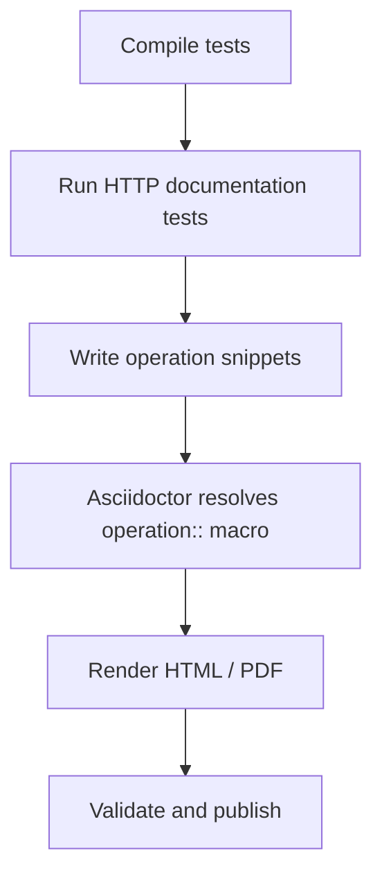

# operation block macro của Spring REST Docs

## 1. `operation::` là gì?

Spring REST Docs tạo các snippet `.adoc` từ HTTP tests dùng MockMvc, WebTestClient hoặc REST Assured. Mỗi lần gọi `document("operation-id", ...)` tạo một thư mục mang identifier đó trong generated snippets. Một operation có thể tạo nhiều file: `curl-request.adoc`, `http-request.adoc`, `http-response.adoc`, `request-fields.adoc`, `response-fields.adoc`, `links.adoc` và những snippet khác tùy descriptor được khai báo.

Khi biên soạn tài liệu, có thể include từng file bằng `include::{snippets}/...[]`. Nhưng nếu muốn đưa nhiều snippet của cùng operation vào tài liệu, Spring REST Docs cung cấp **operation block macro**:

```asciidoc
operation::books-get[]
```

Macro này được cung cấp bởi extension `spring-restdocs-asciidoctor`. Target của macro là **operation identifier** đã dùng trong `document(...)`. Ở dạng đơn giản, nó include tất cả snippets đã sinh cho operation đó và tạo section có tiêu đề phù hợp cho từng snippet.

Ví dụ test:

```java
given(this.specification)
        .filter(document("books-get",
                pathParameters(
                        parameterWithName("id").description("Mã sách")),
                responseFields(
                        fieldWithPath("id").description("Mã sách"),
                        fieldWithPath("title").description("Tên sách"))))
.when()
        .get("/api/books/{id}", 42)
.then()
        .statusCode(200);
```

Và trong file AsciiDoc:

```asciidoc
== Lấy sách theo ID

operation::books-get[]
```

Identifier `books-get` phải khớp chính xác với tên operation truyền vào `document(...)`. Macro không tự chạy test và không tự tạo snippet; nó chỉ đưa các file đã tồn tại vào tài liệu Asciidoctor.

## 2. Extension cần thiết để macro hoạt động

`operation::` không phải macro chuẩn có sẵn trong mọi môi trường Asciidoctor. Spring REST Docs đăng ký macro khi dependency `spring-restdocs-asciidoctor` được thêm vào đúng classpath của plugin Asciidoctor.

Với Gradle, cấu hình extension thường dùng:

```groovy
plugins {
    id 'org.asciidoctor.jvm.convert' version '3.3.2'
}

configurations {
    asciidoctorExt
}

dependencies {
    asciidoctorExt 'org.springframework.restdocs:spring-restdocs-asciidoctor:3.0.6'
}

tasks.named('asciidoctor') {
    configurations 'asciidoctorExt'
}
```

Trong dự án thực tế cần khai báo `spring-restdocs-asciidoctor` cùng version với những module Spring REST Docs đang dùng. Cấu hình hoàn chỉnh còn cần task `test` sinh snippet, khai báo snippets directory là output/input và đặt Asciidoctor phụ thuộc test.

Với Maven, thêm `spring-restdocs-asciidoctor` trong dependency của `asciidoctor-maven-plugin`:

```xml
<plugin>
    <groupId>org.asciidoctor</groupId>
    <artifactId>asciidoctor-maven-plugin</artifactId>
    <version>2.2.6</version>
    <dependencies>
        <dependency>
            <groupId>org.springframework.restdocs</groupId>
            <artifactId>spring-restdocs-asciidoctor</artifactId>
            <version>${spring-restdocs.version}</version>
        </dependency>
    </dependencies>
</plugin>
```

Dependency phải nằm trên classpath extension của plugin, không chỉ ở test classpath của ứng dụng. Nếu chỉ thêm dependency `spring-restdocs-mockmvc` hoặc `spring-restdocs-restassured`, các HTTP snippets vẫn có thể được sinh nhưng macro `operation::` chưa chắc được đăng ký.

## 3. Include tất cả snippets của một operation

Dạng ngắn nhất:

```asciidoc
operation::orders-get[]
```

Target `orders-get` tương ứng với:

```java
document("orders-get", ...)
```

Macro include những snippet có sẵn trong thư mục operation đó. Ví dụ sau test có thể có:

```text
build/generated-snippets/
└── orders-get/
    ├── curl-request.adoc
    ├── http-request.adoc
    ├── http-response.adoc
    ├── httpie-request.adoc
    ├── path-parameters.adoc
    └── response-fields.adoc
```

Tập file thực tế phụ thuộc test và những snippet đã cấu hình. Nếu test không tạo `links.adoc`, macro không thể sinh nội dung links thay cho test. Vì vậy, cần xem thư mục output sau test khi chẩn đoán một section bị thiếu.

## 4. Chọn một phần snippets bằng thuộc tính `snippets`

Macro hỗ trợ thuộc tính `snippets`. Giá trị là danh sách cách nhau bằng dấu phẩy; mỗi mục là tên file snippet **bỏ phần mở rộng `.adoc`**:

```asciidoc
operation::books-get[snippets='curl-request,http-request,http-response']
```

Ví dụ trên chỉ include:

- `curl-request.adoc`
- `http-request.adoc`
- `http-response.adoc`

Đây tương đương với include tường minh:

```asciidoc
[[example_curl_request]]
== Curl request
include::{snippets}/books-get/curl-request.adoc[]

[[example_http_request]]
== HTTP request
include::{snippets}/books-get/http-request.adoc[]

[[example_http_response]]
== HTTP response
include::{snippets}/books-get/http-response.adoc[]
```

Không đưa `.adoc` vào danh sách `snippets`. Các giá trị phải là tên snippet, không phải đường dẫn và cũng không phải operation identifier khác.

## 5. Tiêu đề section được tạo tự động

Với mỗi snippet được include bằng operation macro, Spring REST Docs tạo một section với tiêu đề tương ứng. Một số tiêu đề mặc định:

| Tên snippet | Tiêu đề mặc định |
| --- | --- |
| `curl-request` | Curl Request |
| `http-request` | HTTP request |
| `http-response` | HTTP response |
| `httpie-request` | HTTPie request |
| `links` | Links |
| `request-body` | Request body |
| `request-fields` | Request fields |
| `response-body` | Response body |
| `response-fields` | Response fields |

Với snippet không nằm trong danh sách có tiêu đề riêng, macro tạo tiêu đề bằng cách thay dấu `-` bằng khoảng trắng và viết hoa chữ đầu. Ví dụ `custom-snippet` trở thành `Custom snippet`.

Tiêu đề section giúp gom snippet theo operation mà không cần tự tạo nhiều heading và include. Nếu tài liệu cần cách diễn đạt tiếng Việt, có thể tùy chỉnh title bằng document attribute.

## 6. Đổi tiêu đề snippet bằng document attributes

Tên attribute có mẫu:

```text
operation-{snippet}-title
```

Ví dụ đổi tiêu đề snippet `curl-request`:

```asciidoc
:operation-curl-request-title: Ví dụ gọi bằng cURL

== Lấy sách
operation::books-get[snippets='curl-request,http-request,http-response']
```

Có thể đổi nhiều title:

```asciidoc
:operation-curl-request-title: Request bằng cURL
:operation-http-request-title: HTTP request gửi tới server
:operation-http-response-title: HTTP response từ server
:operation-response-fields-title: Các trường dữ liệu trả về
```

Tên snippet trong attribute phải khớp chính xác tên file bỏ `.adoc`. Ví dụ `operation-response-fields-title` điều chỉnh title cho `response-fields.adoc`. Attribute này chỉ đổi tiêu đề section do macro tạo; nó không thay nội dung snippet hoặc tên file trong thư mục output.

## 7. Dùng operation macro cho nhiều endpoint

Một tài liệu API có thể tổ chức theo resource hoặc use case:

```asciidoc
= Book Store API
:toc:
:toclevels: 3
:sectnums:

== Books

=== Danh sách sách
operation::books-list[snippets='http-request,http-response,query-parameters,response-fields']

=== Chi tiết sách
operation::books-get[snippets='curl-request,http-request,http-response,path-parameters,response-fields']

=== Tạo sách
operation::books-create[snippets='http-request,request-fields,http-response,response-fields']

== Orders

=== Xem đơn hàng
operation::orders-get[snippets='http-request,http-response,links,response-fields']
```

Cách này giữ phần biên soạn chính ngắn và dễ quét. Các operation identifier cần độc lập, ổn định và trùng với identifier trong test. Nếu cùng endpoint có nhiều scenario như `200`, `404` hoặc `409`, nên dùng identifier riêng (ví dụ `books-get-200`, `books-get-404`) để tránh ghi đè snippet.

## 8. Khi nào nên dùng operation macro, khi nào include từng snippet?

| Nhu cầu | Cách phù hợp |
| --- | --- |
| Muốn hiển thị nhanh toàn bộ snippet của operation | `operation::id[]` |
| Chỉ cần một vài snippet | `operation::id[snippets='...']` |
| Cần đặt lời giải thích giữa từng snippet | Include tường minh từng file. |
| Cần đổi thứ tự hiển thị hoặc nhóm thành các section lớn | Include tường minh hoặc chia operation macro thành nhóm. |
| Cần tùy chỉnh title mặc định | Dùng `operation-{snippet}-title`. |
| Cần format một bảng đặc biệt bằng thuộc tính AsciiDoc như `cols` | Include trực tiếp file snippet để gắn thuộc tính ngay trước include. |

Operation macro thuận tiện cho cấu trúc lặp lại, nhưng không bắt buộc phải dùng cho toàn bộ tài liệu. Có thể kết hợp macro cho các endpoint đơn giản và include tường minh cho những phần cần chú thích hoặc bố cục riêng.

Ví dụ cần định dạng cột links table:

```asciidoc
=== Link relations
[cols="1,3"]
include::{snippets}/orders-get/links.adoc[]
```

Include trực tiếp cho phép kiểm soát thuộc tính table đặt ngay trước file; nếu operation macro tự sinh section mặc định mà chưa đủ linh hoạt cho trường hợp đó, hãy include thủ công snippet tương ứng.

## 9. Operation macro và attribute `{snippets}` có vai trò khác nhau

Hai tính năng thường được dùng cùng nhau nhưng không thay thế nhau:

| Thành phần | Vai trò |
| --- | --- |
| `{snippets}` | Attribute chứa thư mục gốc của generated snippets, dùng trong include path. |
| `operation::books-get[]` | Macro nhận diện operation identifier và include snippets tương ứng. |
| `snippets='http-request,http-response'` | Tùy chọn của operation macro, xác định những file snippet nào cần include. |
| `operation-http-response-title` | Attribute đổi title section cho snippet có tên `http-response`. |

`spring-restdocs-asciidoctor` thường tự cấu hình `{snippets}` theo build tool và đồng thời đăng ký operation macro. Nếu include thủ công, cần `{snippets}`. Nếu dùng operation macro, target là operation identifier nên không phải tự viết đường dẫn từng file.

## 10. Snippet tùy chỉnh cũng có thể được include

Ngoài snippet chuẩn, dự án có thể tạo custom snippet (ví dụ `example-errors.adoc` hoặc `authorization-notes.adoc`) theo cơ chế template/snippet phù hợp. Khi custom snippet được ghi vào thư mục operation và có tên `custom-snippet.adoc`, operation macro có thể chọn:

```asciidoc
operation::books-get[snippets='http-request,http-response,custom-snippet']
```

Macro dùng tên snippet file bỏ phần mở rộng `.adoc`. Title mặc định của `custom-snippet` là `Custom snippet`; có thể đổi bằng:

```asciidoc
:operation-custom-snippet-title: Ghi chú bổ sung
```

Lưu ý: macro chỉ include snippet đã tồn tại. Nếu custom snippet chưa được tạo trong test/build, việc đưa tên nó vào danh sách không tự tạo nội dung; cần bảo đảm task/test sinh file trước khi chạy Asciidoctor.

## 11. Build order và CI

Operation macro cần generated snippets có sẵn trước khi Asciidoctor xử lý. Build phải chạy test trước:



Với Gradle, khai báo output/input và dependency:

```groovy
ext {
    snippetsDir = file('build/generated-snippets')
}

tasks.named('test') {
    outputs.dir snippetsDir
}

tasks.named('asciidoctor') {
    inputs.dir snippetsDir
    configurations 'asciidoctorExt'
    dependsOn tasks.named('test')
}
```

Với Maven, đặt Asciidoctor vào phase sau test, ví dụ `prepare-package`, và để `spring-restdocs-asciidoctor` trên plugin classpath. CI cần dùng output của build hiện tại, không tái sử dụng snippets cũ khi test thất bại. Operation macro không thay thế việc gating: nó không biết assertion của test đã pass hay chưa.

## 12. Lỗi thường gặp

| Hiện tượng | Nguyên nhân | Cách xử lý |
| --- | --- | --- |
| `operation::` không được nhận diện | Thiếu `spring-restdocs-asciidoctor` trên classpath plugin. | Kiểm tra `asciidoctorExt` của Gradle hoặc dependency của Maven plugin. |
| Macro không include snippet | Operation identifier không tồn tại hoặc test chưa tạo snippets. | So sánh target với `document("...")` và kiểm tra output directory. |
| Một snippet không xuất hiện | Tên snippet trong danh sách sai hoặc test không sinh file đó. | Bỏ `.adoc` trong danh sách và xác nhận file thực tế. |
| Chỉ thấy một vài section | Macro được cấu hình `snippets='...'` nên chỉ include những mục được chọn. | Thêm tên snippet cần thiết hoặc bỏ thuộc tính để include tất cả snippet hiện có. |
| Tiêu đề section không đúng ý | Chưa khai báo attribute title đúng tên. | Dùng `operation-{snippet}-title`. |
| Tiêu đề sinh ra bằng tiếng Anh | Đang dùng default title. | Định nghĩa title attributes bằng tiếng Việt. |
| `operation::` chạy cục bộ nhưng lỗi CI | Plugin classpath khác hoặc snippets chưa được sinh. | Đồng bộ plugin dependency và task ordering. |
| Snippet của scenario khác bị dùng nhầm | Trùng identifier hoặc output cũ. | Identifier riêng cho từng scenario và clean output trước test. |
| Không format được bảng như mong muốn | Macro tạo section mặc định, không đặt thuộc tính ngay cạnh table include. | Include snippet riêng và dùng AsciiDoc table attributes. |

## 13. Checklist thực hành

- [ ] Đã thêm `spring-restdocs-asciidoctor` vào đúng classpath Asciidoctor plugin.
- [ ] Target của `operation::` khớp operation identifier trong `document(...)`.
- [ ] Đã chọn include tất cả snippets hay danh sách chọn lọc.
- [ ] Nếu dùng `snippets='...'`, mỗi mục là filename không có `.adoc`.
- [ ] Đã hiểu macro tạo section/title cho mỗi snippet được include.
- [ ] Các title attributes có dạng `operation-{snippet}-title`.
- [ ] Test tạo đủ snippet trước khi Asciidoctor chạy.
- [ ] Identifier riêng cho các status/scenario để tránh ghi đè.
- [ ] Dùng include tường minh ở những nơi cần bố cục hoặc table formatting riêng.
- [ ] CI chỉ render/publish từ snippets của build hiện tại đã pass.

Operation block macro giúp gom các snippet thuộc cùng một HTTP operation vào tài liệu AsciiDoc bằng một dòng `operation::id[]`. Dùng thuộc tính `snippets` để chọn file, các title attributes để đổi tiêu đề và include tường minh khi cần tùy biến bố cục. Macro chỉ xử lý việc đưa snippet vào tài liệu; độ chính xác vẫn đến từ HTTP tests và quy trình build chạy test thành công trước Asciidoctor.

## Tài liệu tham khảo

- [Spring REST Docs 3.0.6 – Working with Asciidoctor, Including Multiple Snippets for an Operation](https://docs.spring.io/spring-restdocs/docs/current/reference/htmlsingle/)
- [Spring REST Docs – Getting Started: Build Configuration](https://docs.spring.io/spring-restdocs/reference/getting-started.html)
- [Asciidoctor – Document Attributes](https://docs.asciidoctor.org/asciidoc/latest/attributes/document-attributes/)
- [Asciidoctor – Include Directive](https://docs.asciidoctor.org/asciidoc/latest/directives/include/)
