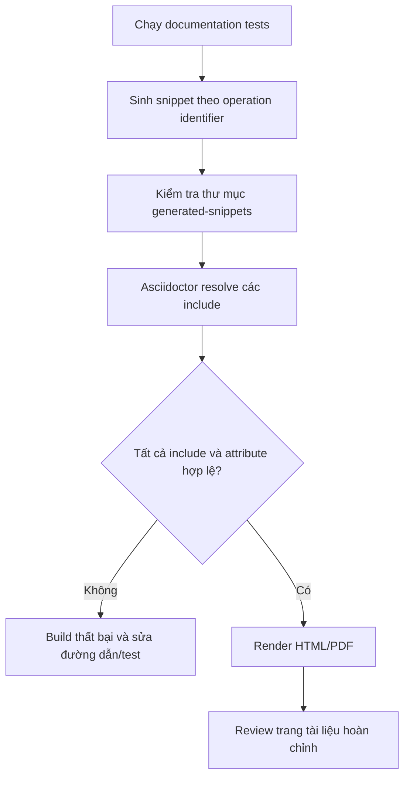

# Nhúng một operation gồm nhiều snippet

## Mục tiêu học tập

Sau bài này, bạn có thể:

- Giải thích cách document identifier gom các snippet của một HTTP exchange.
- Nhúng nhiều snippet của cùng một operation vào Asciidoctor theo thứ tự dễ theo dõi.
- Kết hợp HTTP request/response với path parameter, query parameter, header, request/response fields và links.
- Dùng attribute để tránh lặp đường dẫn snippet và tổ chức include có thể tái sử dụng.
- Chia trang tài liệu theo resource và use case mà không làm lẫn snippet giữa các operation.
- Phát hiện include bị thiếu, snippet cũ và lỗi đường dẫn trong build.

## 1. Operation và snippet trong Spring REST Docs

Trong Spring REST Docs, lời gọi document(...) ghi lại một HTTP exchange dưới một document identifier. Identifier xác định thư mục chứa các snippet được sinh ra cho exchange đó.

Ví dụ test:

```java
mockMvc.perform(get("/api/orders/{id}", 42)
        .queryParam("expand", "items")
        .header("X-Request-Id", "req-documentation-001")
        .accept(MediaType.APPLICATION_JSON))
    .andExpect(status().isOk())
    .andDo(document("orders-get",
        pathParameters(
            parameterWithName("id").description("Mã đơn hàng")
        ),
        queryParameters(
            parameterWithName("expand")
                .description("Thông tin bổ sung cần mở rộng")
        ),
        requestHeaders(
            headerWithName("X-Request-Id")
                .description("Mã truy vết request")
        ),
        responseHeaders(
            headerWithName("Content-Type")
                .description("Media type của response")
        ),
        responseFields(
            fieldWithPath("id").description("Mã đơn hàng"),
            fieldWithPath("status").description("Trạng thái đơn hàng"),
            fieldWithPath("items").description("Các dòng hàng trong đơn")
        )
    ));
```

Sau khi test chạy, output thường nằm trong thư mục tương tự:

```text
build/
└── generated-snippets/
    └── orders-get/
        ├── curl-request.adoc
        ├── http-request.adoc
        ├── http-response.adoc
        ├── path-parameters.adoc
        ├── query-parameters.adoc
        ├── request-headers.adoc
        ├── response-headers.adoc
        └── response-fields.adoc
```

Danh sách file thực tế phụ thuộc snippet/template được cấu hình và descriptor mà test sử dụng. Nếu test không khai báo requestFields(...), REST Docs không tự sinh request-fields.adoc cho operation đó. Không nên đoán một file tồn tại chỉ vì operation khác có file cùng tên.

Điểm cần nhớ:

- Một identifier như orders-get gom các snippet của một exchange.
- Mỗi descriptor hoặc snippet template tương ứng tạo ra một file riêng.
- Asciidoctor include từng file theo ý đồ trình bày của trang.
- Nhiều include có thể cùng dùng một identifier để tạo một phần tài liệu hoàn chỉnh.

## 2. Vì sao nên nhúng nhiều snippet của cùng một operation?

Một trang API thường cần thể hiện nhiều mặt của request:

| Câu hỏi của người tích hợp | Snippet phù hợp |
| --- | --- |
| Gọi endpoint bằng method và URI nào? | http-request.adoc hoặc curl-request.adoc |
| Path parameter có ý nghĩa gì? | path-parameters.adoc |
| Query parameter nào được hỗ trợ? | query-parameters.adoc |
| Header nào cần gửi? | request-headers.adoc |
| Request body có field nào? | request-fields.adoc |
| Response trả status và header nào? | http-response.adoc, response-headers.adoc |
| Response JSON có cấu trúc gì? | response-fields.adoc |
| Resource có link điều hướng nào? | links.adoc |

Chỉ include HTTP request và HTTP response có thể chưa đủ giải thích contract. Ngược lại, chỉ include các bảng descriptor mà không có exchange mẫu khiến người đọc khó hình dung cách kết hợp chúng. Trang tốt thường dùng nhiều snippet bổ trợ cho cùng một operation.

Không phải operation nào cũng cần tất cả snippet. Chỉ include những file test thực sự sinh ra và có ích cho consumer.

## 3. Chuẩn bị đường dẫn snippet bằng Asciidoctor attribute

Thay vì viết lặp đường dẫn đầy đủ, đặt attribute trỏ tới thư mục generated-snippets:

```asciidoc
:snippets: {project-root}/build/generated-snippets
```

Nếu project-root chưa được cấu hình hoặc file AsciiDoc nằm ở vị trí khác, truyền attribute snippets từ task build hoặc dùng đường dẫn tương đối đúng với vị trí file. Dùng một nguồn cấu hình thống nhất để tránh đường dẫn trong file và task mâu thuẫn.

Có thể đặt fallback:

```asciidoc
ifndef::snippets[]
:snippets: ../../build/generated-snippets
endif::[]
```

Đoạn fallback là ví dụ; số cấp ../ phải khớp vị trí file AsciiDoc và output directory của dự án. Nếu task đã truyền attribute snippets, giá trị từ build nên được ưu tiên.

### 3.1. Attribute riêng cho từng operation

Trong một trang có nhiều operation, có thể tạo attribute trỏ đến từng thư mục:

```asciidoc
:order-get: {snippets}/orders-get
:order-create: {snippets}/orders-create
:order-delete: {snippets}/orders-delete
```

Sau đó include:

```asciidoc
include::{order-get}/http-request.adoc[]
include::{order-get}/response-fields.adoc[]
```

Cách này hữu ích khi cùng một operation xuất hiện ở nhiều vị trí hoặc được chia thành nhiều phần. Đặt tên attribute theo resource/action; tránh tên chung như op1 hoặc snippet-dir.

## 4. Ghép nhiều snippet thành một phần API hoàn chỉnh

Một thứ tự thường dễ đọc:

1. Mô tả ngắn về mục đích endpoint và điều kiện gọi.
2. Bảng path/query parameter.
3. Bảng request header và request fields nếu có.
4. HTTP request mẫu để người đọc thấy cách kết hợp.
5. Response header và response fields.
6. HTTP response mẫu để kết thúc exchange.

Ví dụ AsciiDoc cho operation GET /api/orders/{id}:

```asciidoc
== Lấy thông tin đơn hàng

Endpoint trả về chi tiết một đơn hàng theo mã định danh.
Caller cần có quyền đọc đơn hàng tương ứng.

=== Path parameters
include::{snippets}/orders-get/path-parameters.adoc[]

=== Query parameters
include::{snippets}/orders-get/query-parameters.adoc[]

=== Request headers
include::{snippets}/orders-get/request-headers.adoc[]

=== HTTP request
include::{snippets}/orders-get/http-request.adoc[]

=== Response headers
include::{snippets}/orders-get/response-headers.adoc[]

=== Response fields
include::{snippets}/orders-get/response-fields.adoc[]

=== HTTP response
include::{snippets}/orders-get/http-response.adoc[]
```

Tất cả include trên dùng cùng identifier orders-get. Các bảng descriptor giải thích từng phần của exchange và HTTP snippet cung cấp ví dụ tổng thể.

Trong dự án thật, nếu request không có query parameter hoặc không có header cần mô tả, bỏ phần include tương ứng. Đừng giữ một include chỉ vì template trang có sẵn; Asciidoctor sẽ báo lỗi khi file snippet không tồn tại.

## 5. Ghép request body và response body

Với operation có JSON request body, test có thể sinh http-request.adoc và request-fields.adoc. Bảng fields giúp tra cứu từng field; HTTP request cho biết payload được đặt trong request như thế nào.

Ví dụ:

```asciidoc
== Tạo đơn hàng

=== Request fields
include::{snippets}/orders-create/request-fields.adoc[]

=== HTTP request
include::{snippets}/orders-create/http-request.adoc[]

=== Response fields
include::{snippets}/orders-create/response-fields.adoc[]

=== HTTP response
include::{snippets}/orders-create/http-response.adoc[]
```

Nếu raw payload quá dài hoặc nhạy cảm, có thể chỉ include bảng field và dùng preprocessor làm sạch request body trước khi ghi snippet. Với response, response-fields.adoc mô tả cấu trúc; http-response.adoc thể hiện status, header và payload trong một exchange.

Không giả định request-body.adoc hoặc response-body.adoc luôn được tạo. Chỉ include khi dự án đã cấu hình template tương ứng và file thực sự xuất hiện trong output.

## 6. Nhúng links và snippet bổ sung

Một số API trả resource links để client điều hướng. Nếu test dùng links(...) và sinh links.adoc, có thể đưa bảng liên kết cạnh response fields:

```asciidoc
=== Resource links
include::{snippets}/orders-get/links.adoc[]

=== Response fields
include::{snippets}/orders-get/response-fields.adoc[]
```

Các snippet như request-parts.adoc, request-headers.adoc, response-headers.adoc, path-parameters.adoc hoặc query-parameters.adoc chỉ xuất hiện khi test tạo chúng. Có thể chọn nhóm snippet theo loại operation:

| Loại operation | Nhóm snippet thường dùng |
| --- | --- |
| GET resource | path/query parameters, request headers, response fields, links, HTTP exchange |
| POST JSON | request fields, request headers, response fields, response headers, HTTP exchange |
| Multipart upload | request-parts, part fields/body, response fields, HTTP exchange |
| Conditional update | request headers như If-Match, response headers như ETag, status/response snippet |
| Error response | request context, response fields lỗi, response headers, HTTP response |

## 7. Tách operation thành các phần dễ đọc trên trang dài

Một trang resource có thể chứa nhiều operation:

```asciidoc
= Orders API

include::orders/list.adoc[leveloffset=+1]

include::orders/get.adoc[leveloffset=+1]

include::orders/create.adoc[leveloffset=+1]

include::orders/cancel.adoc[leveloffset=+1]
```

Mỗi file con tập trung vào một operation và include snippet tương ứng. Cách tách này giúp trang cấp resource dễ điều hướng, mỗi operation dễ review và prose nằm gần snippet mà nó giải thích.

Nếu dùng include lồng nhau, cấu hình leveloffset cẩn thận để heading không bị nhảy cấp hoặc trùng cấp. Thống nhất quy ước heading giữa trang cha và trang con.

## 8. Tạo test có đủ snippet cho một operation

Ví dụ test MockMvc cho GET order có path parameter, query parameter, header và response fields:

```java
@Test
void getOrder() throws Exception {
    mockMvc.perform(get("/api/orders/{id}", 42)
                    .queryParam("expand", "items")
                    .header("X-Request-Id", "req-doc-001")
                    .accept(MediaType.APPLICATION_JSON))
            .andExpect(status().isOk())
            .andExpect(jsonPath("$.id").value(42))
            .andDo(document("orders-get",
                    pathParameters(
                            parameterWithName("id")
                                    .description("Mã đơn hàng")
                    ),
                    queryParameters(
                            parameterWithName("expand")
                                    .description("Các phần thông tin cần mở rộng")
                    ),
                    requestHeaders(
                            headerWithName("X-Request-Id")
                                    .description("Mã truy vết request")
                    ),
                    responseHeaders(
                            headerWithName("Content-Type")
                                    .description("Media type của response")
                    ),
                    responseFields(
                            fieldWithPath("id")
                                    .description("Mã đơn hàng"),
                            fieldWithPath("status")
                                    .description("Trạng thái đơn hàng"),
                            fieldWithPath("items")
                                    .description("Các dòng hàng")
                    )
            ));
}
```

Test này là ví dụ cấu trúc, cần static imports, fixture và controller phù hợp với dự án. Để trang Asciidoctor include được snippet, test phải chạy thành công trong build và dùng đúng output directory đã cấu hình.

Một operation có thể dùng nhiều invocation document(...) nếu test cố ý ghi nhiều exchange, nhưng mỗi identifier cần phản ánh một kịch bản rõ ràng. Không ghi các request có behavior khác nhau vào cùng identifier nếu chúng khiến snippet khó hiểu hoặc ghi đè/không ổn định.

## 9. Tổ chức snippet cho response lỗi

Response lỗi thường có cấu trúc riêng. Dùng identifier riêng để snippet thành công và lỗi không trộn lẫn:

```asciidoc
== Hành vi lỗi

=== Không tìm thấy đơn hàng
Khi mã đơn hàng không tồn tại, API trả về 404.

==== Error response fields
include::{snippets}/orders-get-not-found/response-fields.adoc[]

==== HTTP response
include::{snippets}/orders-get-not-found/http-response.adoc[]
```

Identifier orders-get-not-found cho phép assertion status/error body độc lập. Nếu error format dùng chung trên nhiều endpoint, có thể tạo phần giải thích chung và include snippet cụ thể tại từng endpoint.

## 10. Tái sử dụng include mà không che khuất ngữ cảnh

Asciidoctor hỗ trợ include file và attribute substitution. Có thể tạo partial cho phần lặp lại:

```asciidoc
// _http-exchange.adoc
=== HTTP request
include::{operation-snippets}/http-request.adoc[]

=== HTTP response
include::{operation-snippets}/http-response.adoc[]
```

Trang operation thiết lập attribute trước khi include partial:

```asciidoc
:operation-snippets: {snippets}/orders-get
include::_http-exchange.adoc[]
```

Partial cần biết context của attribute và tên snippet mà operation thực sự tạo. Đừng biến mọi trang thành nhiều tầng include nếu điều đó khiến reviewer khó truy ra file snippet nguồn. Với trang ngắn, include trực tiếp thường dễ hiểu hơn.

### 10.1. Tránh lỗi attribute bị dùng nhầm

Đặt attribute trước nơi sử dụng nó. Khi partial được tái sử dụng với nhiều operation, đặt lại attribute cho từng lần include và render kiểm tra:

```asciidoc
:operation-snippets: {snippets}/orders-get
include::_request-response.adoc[]

:operation-snippets: {snippets}/orders-create
include::_request-response.adoc[]
```

Thử render với nhiều operation liên tiếp và xem đường dẫn include thực tế, tránh để partial thứ hai dùng lại thư mục của partial đầu.

## 11. Kiểm soát custom snippet

Spring REST Docs có snippet mặc định; dự án cũng có thể cấu hình custom snippet template để tạo bảng/nội dung theo style guide.

Khi dùng custom snippet:

- Xác định operation identifier như bình thường.
- Đặt tên template hoặc snippet rõ ràng theo API integration của phiên bản đang dùng.
- Kiểm tra file output thực tế và quy ước tên.
- Include đúng tên file đã sinh.
- Giữ template ổn định để nhiều operation có thể dùng chung.

Ví dụ khái niệm:

```java
andDo(document("orders-get",
    customSnippet(),
    pathParameters(...)
))
```

customSnippet() ở đây là placeholder minh họa, không phải API có sẵn để copy. Trong dự án, thay bằng class Snippet thực tế đã triển khai và cấu hình. Không include một file custom snippet chỉ dựa trên tên class; hãy xác nhận tên file được ghi ra.

## 12. Lỗi thường gặp khi nhúng nhiều snippet

| Biểu hiện | Nguyên nhân có thể | Cách khắc phục |
| --- | --- | --- |
| Asciidoctor báo include file không tồn tại | Test chưa sinh snippet hoặc tên file include sai | Chạy đúng test, đọc output directory và sửa path |
| Một operation lấy nhầm response fields của operation khác | Attribute snippets trỏ nhầm thư mục hoặc copy nhầm identifier | Đặt attribute operation rõ ràng và review đường dẫn |
| Bảng parameter xuất hiện nhưng HTTP request không có tham số | Descriptor/prose và request fixture không cùng kịch bản | Đồng bộ test request, descriptor và nội dung giải thích |
| Snippet response fields không sinh | Test không khai báo responseFields(...) hoặc không đi tới document(...) | Kiểm tra assertion và descriptor trong test |
| Include cũ vẫn render sau khi xóa test | Generated snippets còn file stale từ build trước | Dùng clean output hoặc xóa output theo build task |
| Trang dài và lặp thông tin | Include mọi snippet mà không có cấu trúc | Nhóm theo request, response, error và use case |
| Partial dùng nhầm operation path | Attribute được đặt sai vị trí hoặc không được đặt lại | Đặt attribute trước include và render kiểm tra nhiều lần |
| Tên file snippet bị đoán sai | Nhầm tên descriptor với tên output | Kiểm tra thư mục output thay vì đoán |

## 13. Kiểm tra build và CI

Luồng build tài liệu cần bảo đảm test tạo snippet trước khi Asciidoctor include chúng:



Ví dụ Gradle dependency:

```groovy
def snippetsDir = file("$buildDir/generated-snippets")

tasks.named('test') {
    outputs.dir snippetsDir
}

tasks.named('asciidoctor') {
    inputs.dir snippetsDir
    dependsOn tasks.named('test')
}
```

Đây là phần minh họa quan hệ task; dự án cần plugin Asciidoctor, REST Docs dependency và cấu hình attribute snippets phù hợp. Task test và Asciidoctor phải dùng cùng output path. Nếu chỉ chạy Asciidoctor mà chưa có snippet, include sẽ thất bại.

Lệnh build minh họa:

```bash
./gradlew clean test asciidoctor
```

Trên Windows có thể dùng gradlew.bat. Với Maven, cấu hình plugin execution trong lifecycle sao cho test sinh snippet trước goal Asciidoctor.

CI nên kiểm tra documentation test đã chạy, output có thư mục operation cần thiết, những snippet được include tồn tại, không có snippet stale và Asciidoctor render thành công. Review HTML cuối để xác nhận đúng thứ tự, không lặp nội dung và không trỏ nhầm operation.

## 14. Checklist nhúng nhiều snippet của một operation

- [ ] Mỗi exchange có document identifier rõ ràng và ổn định.
- [ ] Xác định snippet thực sự được sinh bởi test.
- [ ] Đặt snippets attribute trỏ đúng output directory.
- [ ] Dùng cùng operation identifier cho các snippet thuộc một exchange.
- [ ] Sắp xếp include theo luồng request → response.
- [ ] Include parameter/header/field/link snippet khi chúng giúp hiểu contract.
- [ ] Đặt response lỗi dưới identifier riêng.
- [ ] Chia trang thành partial khi trang resource có nhiều operation.
- [ ] Đặt/reset attribute đúng trước khi include partial.
- [ ] Không đoán tên file; đọc output generated-snippets.
- [ ] Chạy clean test asciidoctor trên CI và review trang render.

## 15. Bài tập thực hành

API orders có ba kịch bản:

- GET /api/orders/{id}: trả chi tiết đơn hàng, hỗ trợ query expand.
- POST /api/orders: nhận JSON body để tạo đơn hàng.
- GET /api/orders/{id} với mã không tồn tại: trả error 404.

Hãy thực hiện:

1. Viết documentation test cho GET thành công với identifier orders-get.
2. Tạo descriptor cho path parameter, query parameter, request header và response fields.
3. Viết test POST với identifier orders-create, mô tả request fields, response headers và response fields.
4. Viết test 404 riêng với identifier orders-get-not-found.
5. Chạy test và ghi lại danh sách file snippet thực tế từng identifier sinh ra.
6. Viết AsciiDoc include nhiều snippet của orders-get theo thứ tự path/query/header/request/response headers/response fields/HTTP response.
7. Tách orders-create và error scenario thành file con nếu trang resource trở nên dài.
8. Chạy clean test asciidoctor và xác nhận không còn include thiếu hoặc trỏ nhầm operation.

**Câu hỏi tự kiểm tra:** Có thể include request-fields.adoc của orders-create trong phần GET orders-get chỉ vì cả hai đều thao tác với Order không? Không. Snippet thuộc về exchange và document identifier cụ thể. Chỉ include snippet của operation phù hợp với phần đang mô tả; nếu dùng lại một bảng field chung, cần tạo nội dung dùng chung có chủ đích thay vì trỏ sang snippet của request khác.

## Kết luận

Một operation trong Spring REST Docs có thể sinh nhiều snippet cùng nằm dưới document identifier của exchange. Asciidoctor ghép chúng thành phần tài liệu hoàn chỉnh bằng cách include từng file: request, parameter, header, field, links và response. Hãy thiết lập attribute snippets dùng chung, nhóm snippet theo operation, sắp xếp include theo luồng người tích hợp thực hiện và tách error exchange bằng identifier riêng. Tên file phải được xác nhận từ generated output, không được đoán. Khi test tạo snippet trước Asciidoctor, đường dẫn include được kiểm tra trong CI và trang render được review, tài liệu sẽ nhất quán với HTTP exchange đã kiểm thử và dễ bảo trì khi API thay đổi.
