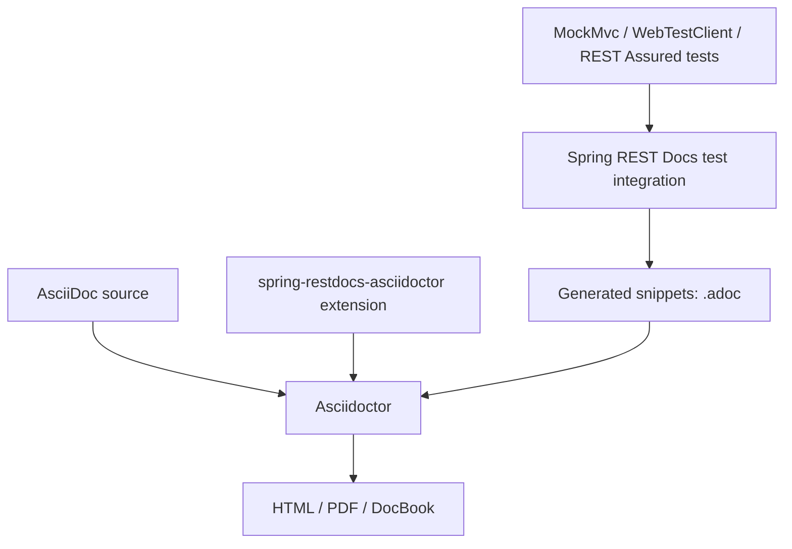
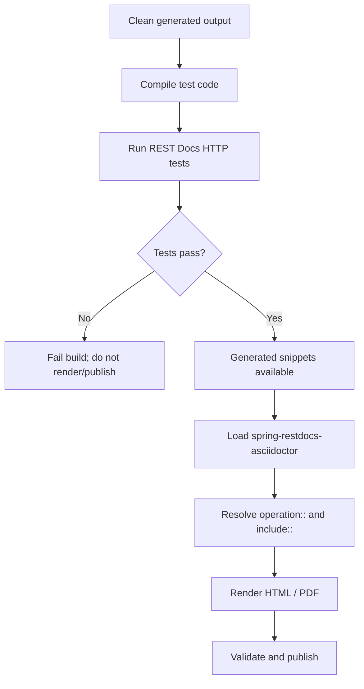

# spring-restdocs-asciidoctor extension

## 1. Extension này giải quyết việc gì?

Spring REST Docs tạo tài liệu REST API có thể kiểm chứng từ các bài kiểm thử HTTP bằng MockMvc, WebTestClient hoặc REST Assured. Các test thực thi request, xác nhận response và ghi generated snippets như `http-request.adoc`, `http-response.adoc`, `request-fields.adoc`, `response-fields.adoc` hoặc `links.adoc`.

Artifact **`spring-restdocs-asciidoctor`** tích hợp Spring REST Docs với Asciidoctor. Khi được đặt trên classpath của Asciidoctor processor, extension đăng ký các khả năng dành riêng cho Spring REST Docs, nổi bật là:

- Operation block macro `operation::...[]` để đưa snippets của một operation vào tài liệu.
- Attribute và cơ chế phân giải snippets directory trong quá trình biên soạn.
- Các thuộc tính hỗ trợ trình bày operation snippets, chẳng hạn đổi title của từng snippet.

Extension thuộc giai đoạn **biên soạn tài liệu**. Nó không gửi HTTP request, không chạy JUnit test, không xác minh assertion và không tự sinh snippets. Những công việc đó do module tích hợp REST Docs tương ứng và test đảm nhiệm.



## 2. Phân biệt ba dependency thường gặp

Tên các artifact gần nhau nhưng có trách nhiệm khác nhau:

| Artifact | Vai trò | Được dùng ở đâu? |
| --- | --- | --- |
| `spring-restdocs-mockmvc` | Tích hợp Spring REST Docs với MockMvc. | Test compile/runtime. |
| `spring-restdocs-restassured` | Tích hợp Spring REST Docs với REST Assured. | Test compile/runtime. |
| `spring-restdocs-webtestclient` | Tích hợp Spring REST Docs với WebTestClient. | Test compile/runtime. |
| `spring-restdocs-asciidoctor` | Cung cấp extension/macro cho Asciidoctor. | Classpath plugin/configuration chạy Asciidoctor. |

Ví dụ dự án dùng REST Assured cần artifact `spring-restdocs-restassured` để filter `document(...)` ghi snippets. Để dùng `operation::orders-get[]` khi biên soạn file `.adoc`, cần thêm `spring-restdocs-asciidoctor` vào classpath của Asciidoctor plugin. Chỉ khai báo extension ở `testImplementation` không bảo đảm Asciidoctor nạp được macro.

## 3. Cấu hình extension với Gradle

Ví dụ cấu hình Gradle dùng plugin Asciidoctor JVM:

```groovy
plugins {
    id 'java'
    id 'org.asciidoctor.jvm.convert' version '3.3.2'
}

configurations {
    asciidoctorExt
}

dependencies {
    testImplementation 'org.springframework.restdocs:spring-restdocs-mockmvc:3.0.6'
    asciidoctorExt 'org.springframework.restdocs:spring-restdocs-asciidoctor:3.0.6'
}

def snippetsDir = layout.buildDirectory.dir('generated-snippets')

tasks.named('test') {
    outputs.dir snippetsDir
    useJUnitPlatform()
}

tasks.named('asciidoctor') {
    configurations 'asciidoctorExt'
    inputs.dir snippetsDir
    dependsOn tasks.named('test')
    attributes 'snippets': snippetsDir.get().asFile
}
```

Trong ví dụ này:

1. `asciidoctorExt` là configuration để đưa extension vào classpath của Asciidoctor task.
2. `spring-restdocs-asciidoctor` đăng ký operation macro và các khả năng tích hợp.
3. `snippetsDir` là nơi test được cấu hình để ghi snippets.
4. `test.outputs.dir` khai báo generated snippets là output của test task.
5. `asciidoctor.inputs.dir` khai báo cùng thư mục là input của task render.
6. `dependsOn test` bảo đảm test chạy trước khi Asciidoctor đọc snippets.
7. `attributes 'snippets': ...` đặt attribute đường dẫn mà các macro/include dùng.

Các version trong ví dụ là một bộ version minh họa đồng nhất; hãy sử dụng version tương thích với Spring Boot, Spring Framework và Gradle plugin của dự án. Có thể quản lý version bằng BOM hoặc version catalog thay vì lặp trực tiếp trong dependency string.

Nếu dự án đã có cấu hình `snippets` ở nơi khác, giữ một nguồn cấu hình nhất quán. Việc khai báo extension và việc gán đường dẫn snippets là hai trách nhiệm liên quan nhưng không nên để các giá trị xung đột.

## 4. Cấu hình extension với Maven

Với Maven, extension phải nằm trong dependencies của **Asciidoctor Maven Plugin**, không chỉ ở dependencies của ứng dụng. Ví dụ:

```xml
<plugin>
    <groupId>org.asciidoctor</groupId>
    <artifactId>asciidoctor-maven-plugin</artifactId>
    <version>2.2.6</version>
    <executions>
        <execution>
            <id>generate-api-docs</id>
            <phase>prepare-package</phase>
            <goals>
                <goal>process-asciidoc</goal>
            </goals>
            <configuration>
                <backend>html</backend>
                <attributes>
                    <snippets>${project.build.directory}/generated-snippets</snippets>
                </attributes>
            </configuration>
        </execution>
    </executions>
    <dependencies>
        <dependency>
            <groupId>org.springframework.restdocs</groupId>
            <artifactId>spring-restdocs-asciidoctor</artifactId>
            <version>${spring-restdocs.version}</version>
        </dependency>
    </dependencies>
</plugin>
```

`spring-restdocs.version` nên được khai báo tập trung ở `properties` hoặc quản lý bằng dependency management. Đường dẫn `target/generated-snippets` phải khớp nơi test ghi output. Với Maven multi-module, xác định rõ module nào tạo snippets và module nào chạy Asciidoctor; `${project.build.directory}` ở module docs có thể khác `target` của module test.

Chạy build bắt đầu từ `clean` để tránh dùng snippets cũ:

```bash
mvn clean verify
```

Pha `prepare-package` chạy sau pha `test` trong lifecycle chuẩn. Nếu project tùy chỉnh lifecycle, hãy xác nhận Asciidoctor chỉ chạy sau khi các HTTP tests cần thiết hoàn tất thành công.

## 5. Sử dụng operation block macro

Khi extension đã được nạp, file AsciiDoc có thể gọi:

```asciidoc
== Lấy sách theo ID

operation::books-get[]
```

`books-get` phải khớp identifier trong test:

```java
filter(document("books-get",
        pathParameters(
                parameterWithName("id").description("Mã sách")),
        responseFields(
                fieldWithPath("id").description("Mã sách"),
                fieldWithPath("title").description("Tên sách"))))
```

Operation macro include những snippets có sẵn thuộc thư mục `books-get` và tạo section tương ứng cho từng snippet. Macro không thể tạo snippet mà test chưa sinh. Nếu test chỉ tạo request/response và response fields, không thể kỳ vọng macro tự tạo `request-fields.adoc` hoặc `links.adoc`.

## 6. Chọn một số snippet và đổi title

Có thể giới hạn các file được include:

```asciidoc
operation::books-get[snippets='curl-request,http-request,http-response,response-fields']
```

Danh sách là tên snippet bỏ phần mở rộng `.adoc`, phân cách bằng dấu phẩy. Đây là tên file trong operation directory, không phải đường dẫn thư mục.

Title section có thể được đổi bằng document attributes theo mẫu:

```asciidoc
:operation-curl-request-title: Ví dụ gọi bằng cURL
:operation-http-request-title: HTTP request gửi tới server
:operation-http-response-title: HTTP response nhận được
:operation-response-fields-title: Các trường dữ liệu trả về

operation::books-get[snippets='curl-request,http-request,http-response,response-fields']
```

Attribute `operation-{snippet-name}-title` tác động đến tiêu đề section do macro tạo. Nó không sửa tên file và không thay đổi nội dung snippet gốc. Nếu cần bố cục xen kẽ lời giải thích giữa các snippet, có thể include file riêng lẻ thay vì dùng một operation macro.

## 7. Attribute `snippets` và operation macro

Hai cách dùng có liên quan nhưng khác ý nghĩa:

```asciidoc
include::{snippets}/books-get/http-request.adoc[]

operation::books-get[]
```

| Thành phần | Ý nghĩa |
| --- | --- |
| `{snippets}` | Attribute chứa thư mục gốc của generated snippets. |
| `include::` | Macro Asciidoctor đọc một file tại đường dẫn chỉ định. |
| `operation::` | Macro Spring REST Docs nhận operation identifier và include snippets thuộc operation đó. |
| `snippets='http-request,http-response'` | Chọn file snippet được operation macro include. |
| `operation-http-response-title` | Đổi tiêu đề section cho snippet `http-response`. |

Extension cung cấp operation macro; giá trị snippets directory cần được cấu hình đúng với nơi test ghi output. Với include tường minh, người viết sử dụng `{snippets}` trong path. Với operation macro, target là operation identifier, không phải đường dẫn vật lý.

## 8. Tổ chức tài liệu lớn bằng operation macro và include

Có thể dùng operation macro cho những endpoint có cấu trúc tiêu chuẩn:

```asciidoc
= Store API
:toc:
:toclevels: 3
:sectnums:

== Books

=== Danh sách sách
operation::books-list[snippets='http-request,http-response,query-parameters,response-fields']

=== Chi tiết sách
operation::books-get[snippets='http-request,http-response,path-parameters,response-fields']

=== Tạo sách
operation::books-create[snippets='http-request,request-fields,http-response,response-fields']
```

Với một operation có giải thích đặc thù, include từng snippet:

```asciidoc
=== Thanh toán đơn hàng

Client lấy URI thanh toán từ relation `payment` trong response của order.

==== Request
include::{snippets}/orders-payment/http-request.adoc[]

==== Response
include::{snippets}/orders-payment/http-response.adoc[]
```

Kết hợp hai cách giúp giữ tài liệu ngắn cho endpoint thông thường và kiểm soát chi tiết nơi cần workflow hoặc hướng dẫn nghiệp vụ.

## 9. Extension không thay thế HTTP test integration

Một lỗi cấu hình hay gặp là chỉ thêm `spring-restdocs-asciidoctor` rồi kỳ vọng test bắt đầu sinh snippet. Thực tế cần đủ hai phía:

| Phía test | Phía biên soạn |
| --- | --- |
| Thêm `spring-restdocs-mockmvc`, `spring-restdocs-restassured` hoặc `spring-restdocs-webtestclient` theo client sử dụng. | Thêm `spring-restdocs-asciidoctor` vào classpath Asciidoctor plugin. |
| Cấu hình REST Docs filter/extension cho test. | Cấu hình Asciidoctor plugin và extension. |
| Gọi `document("operation-id", ...)` trong request test. | Gọi `operation::operation-id[]` hoặc include snippet trực tiếp. |
| Chạy test để sinh file snippet. | Chạy Asciidoctor sau khi snippet đã có. |

Nếu thiếu phía test, macro không có dữ liệu để include. Nếu thiếu phía Asciidoctor, test vẫn có thể tạo file snippets nhưng operation macro không được nhận diện.

## 10. Quản lý generated snippets và thứ tự build

Một pipeline an toàn cần bảo đảm snippets thuộc chính lần build đang chạy:



Với Gradle, khai báo `asciidoctor` phụ thuộc `test`, đồng thời chỉ rõ generated snippets là input/output của task. Với Maven, đặt plugin render ở pha sau `test`. Nếu test thất bại sau khi một document filter đã ghi snippet, file vẫn có thể còn; không được render/publish chỉ vì thư mục có file.

Không chỉnh sửa thủ công trong `build/generated-snippets` hoặc `target/generated-snippets`. Nếu nội dung generated cần đổi, hãy sửa test descriptor, preprocessor hoặc custom snippet template rồi chạy lại test.

## 11. Kiểm tra extension đã được nạp

Khi build báo `operation::` không được nhận diện hoặc include không resolve, kiểm tra theo thứ tự:

1. `spring-restdocs-asciidoctor` có nằm trong classpath plugin Asciidoctor không?
2. Gradle đã đưa `asciidoctorExt` vào `configurations` của task chưa?
3. Maven dependency đã nằm trong dependencies của `asciidoctor-maven-plugin` chưa?
4. Version extension có đồng bộ với version Spring REST Docs ở test không?
5. Task test đã chạy và tạo operation directory tương ứng chưa?
6. Attribute `snippets` có trỏ đúng output directory không?
7. Operation ID và tên snippet có khớp chính xác file trên đĩa không?

Nếu `include::{snippets}/...[]` chạy được nhưng `operation::...[]` không được nhận diện, thường cần kiểm tra classpath extension/macro trước. Nếu cả hai đều không tìm thấy file, xem lại output directory và task ordering.

## 12. Lỗi thường gặp

| Hiện tượng | Nguyên nhân | Cách khắc phục |
| --- | --- | --- |
| `operation::` không được nhận diện | Extension chưa được nạp vào Asciidoctor plugin. | Thêm `spring-restdocs-asciidoctor` vào `asciidoctorExt` hoặc plugin dependencies của Maven. |
| Test sinh snippet nhưng macro không có nội dung | Operation ID sai hoặc test chưa tạo output cho operation đó. | So sánh `document("...")` với target của macro; kiểm tra thư mục snippets. |
| Include thủ công được nhưng `operation::` lỗi | Classpath có AsciiDoc files nhưng thiếu macro extension. | Xác nhận extension có mặt trong classpath thực thi Asciidoctor. |
| Macro chạy nhưng một section bị thiếu | Snippet không được test sinh hoặc bị loại khỏi danh sách `snippets`. | Kiểm tra output và tên snippet được chọn. |
| `snippets` trỏ tới thư mục sai | Test và Asciidoctor dùng hai output directory khác nhau. | Đồng bộ test output, build attribute và plugin configuration. |
| Build local được nhưng CI lỗi | Plugin classpath/version hoặc task ordering khác nhau. | Dùng cấu hình build được commit, clean output và chạy cùng lifecycle. |
| Dùng nhầm version giữa các artifact | Các module Spring REST Docs không đồng bộ. | Quản lý version tập trung bằng BOM/property/version catalog phù hợp. |
| Tài liệu được render từ snippet cũ | Generated directory không được làm sạch hoặc test bị bỏ qua. | Clean output và chỉ publish khi test build hiện tại pass. |

## 13. Checklist thực hành

- [ ] Đã thêm module test integration đúng với MockMvc, WebTestClient hoặc REST Assured.
- [ ] Đã thêm `spring-restdocs-asciidoctor` vào classpath Asciidoctor plugin.
- [ ] Version của các artifact Spring REST Docs được quản lý nhất quán.
- [ ] Đã cấu hình snippets directory trùng với nơi test ghi output.
- [ ] Operation ID trong `operation::...[]` khớp `document("...")`.
- [ ] Đã kiểm tra danh sách snippet cần include và title attributes nếu có.
- [ ] Đã phân biệt operation macro với include file trực tiếp.
- [ ] Asciidoctor chạy sau các HTTP tests và chỉ đọc output của build hiện tại.
- [ ] CI không render/publish tài liệu khi test hoặc descriptor thất bại.
- [ ] Đã xác minh HTML/PDF cuối có đủ section và không có include bị thiếu.

`spring-restdocs-asciidoctor` là cầu nối giữa snippets do HTTP tests sinh ra và tài liệu AsciiDoc được render. Đặt extension đúng classpath giúp Asciidoctor hiểu operation macro và các thuộc tính dành cho Spring REST Docs; cấu hình build bảo đảm macro đọc đúng thư mục snippets. Khi phân tách rõ test integration, extension biên soạn và task render, tài liệu được tạo từ kết quả kiểm thử của đúng lần build thay vì các ví dụ chép tay hoặc output cũ.

## Tài liệu tham khảo

- [Spring REST Docs – Getting Started](https://docs.spring.io/spring-restdocs/reference/getting-started.html)
- [Spring REST Docs – Asciidoctor Integration and Operation Macro](https://docs.spring.io/spring-restdocs/docs/current/reference/htmlsingle/)
- [Spring REST Docs – Documenting Your API](https://docs.spring.io/spring-restdocs/reference/documenting-your-api.html)
- [Asciidoctor Gradle Plugin](https://docs.asciidoctor.org/gradle-plugin/latest/)
- [Asciidoctor Maven Plugin](https://github.com/asciidoctor/asciidoctor-maven-plugin)
