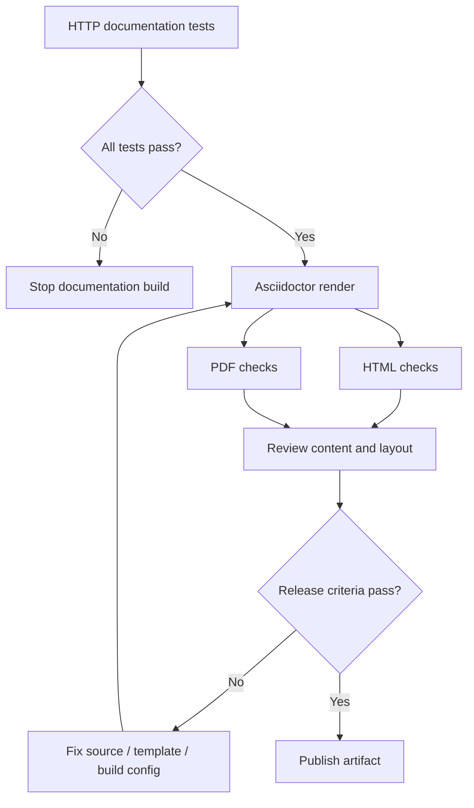
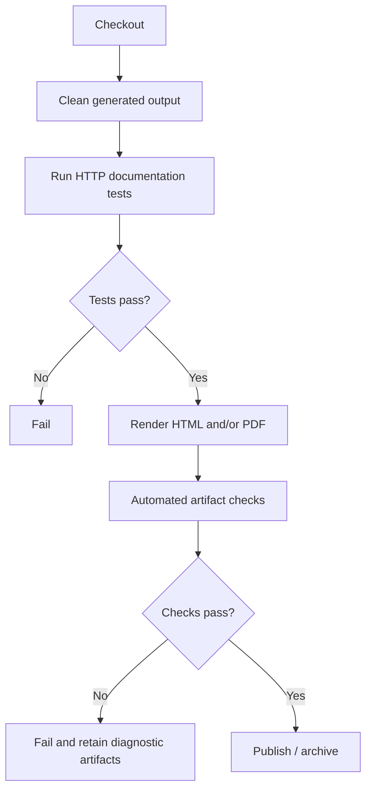

# Kiểm tra output HTML hoặc PDF

## 1. Vì sao phải kiểm tra tài liệu sau khi render?

Spring REST Docs tạo tài liệu REST API có thể kiểm chứng từ các bài kiểm thử HTTP với MockMvc, WebTestClient hoặc REST Assured. Các test sinh snippet request, response, headers, parameters, fields và hypermedia links; Asciidoctor ghép snippet với phần giải thích do nhóm biên soạn để tạo tài liệu HTML hoặc PDF.

Việc test pass và Asciidoctor chạy thành công là điều kiện cần, nhưng chưa đủ để khẳng định tài liệu phát hành đã tốt. Build có thể thành công trong khi HTML vẫn thiếu một section, anchor không hoạt động, hình ảnh không tải hoặc bố cục bị vỡ trên màn hình nhỏ. PDF có thể render nhưng chữ tiếng Việt bị thay font, bảng tràn lề, code bị cắt, tiêu đề đứng lẻ ở cuối trang hoặc liên kết không bấm được.

Do đó, cần kiểm tra **artifact cuối cùng** sau khi render. Hãy kiểm tra cả nội dung kỹ thuật và cách người đọc tiếp nhận thông tin:

| Tầng kiểm tra | Câu hỏi cần trả lời |
| --- | --- |
| Build và nguồn | Test có pass? Snippet có thuộc build hiện tại? Include có resolve? |
| Nội dung HTML/PDF | Có đủ operation, request/response, field tables và liên kết không? |
| Cấu trúc | Heading, mục lục, anchor và điều hướng có chính xác không? |
| Trình bày | Bảng, code, hình ảnh, font và ngắt trang có dễ đọc không? |
| Phát hành | Artifact đúng phiên bản, đường dẫn, metadata và không lộ dữ liệu nhạy cảm không? |



## 2. Xác nhận đúng artifact và đúng lần build

Trước khi mở HTML hoặc PDF, hãy xác nhận build đã chạy từ source hiện tại và dùng snippets vừa sinh. Thư mục thường gặp:

| Build tool | Snippets | HTML output thường gặp | PDF output thường gặp |
| --- | --- | --- | --- |
| Gradle | `build/generated-snippets/` | `build/docs/asciidoc/html5/` | Tùy cấu hình Asciidoctor PDF, thường trong `build/docs/asciidoc/pdf/`. |
| Maven | `target/generated-snippets/` | `target/generated-docs/` hoặc output directory plugin đã cấu hình. | Tùy cấu hình PDF backend/plugin. |

Đường dẫn cụ thể do cấu hình dự án quyết định. Không giả định mọi dự án đều có cùng output path; xem log task và cấu hình plugin của chính dự án.

Với Gradle, một lệnh minh họa:

```bash
./gradlew clean test asciidoctor
```

Với Maven:

```bash
mvn clean verify
```

Nếu PDF là task riêng, gọi task đã được dự án cấu hình, ví dụ task Asciidoctor PDF. Bản thân lệnh `asciidoctor` tạo HTML không tự động bảo đảm PDF cũng được tạo.

Khi kiểm tra artifact, xác nhận:

- Build kết thúc với exit code 0.
- Các HTTP documentation tests đã chạy, không bị skip ngoài dự kiến.
- Generated snippets có timestamp/output thuộc lần build vừa chạy.
- Asciidoctor đọc đúng source file và đúng `{snippets}` directory.
- HTML/PDF được tạo mới ở output directory đã cấu hình.
- Không dùng file còn sót từ lần build trước để lấp chỗ trống của test vừa thất bại.

## 3. Kiểm tra HTML: nội dung và cấu trúc

HTML thường là định dạng phát hành chính cho developer portal. Sau render, hãy mở trang bằng trình duyệt và kiểm tra các mục sau.

### Nội dung operation

Đối chiếu cấu trúc trang với tài liệu nguồn và generated snippets:

- Tất cả resource/operation cần công bố đều có section.
- Mỗi operation có đúng method, URI, request và response.
- Path/query parameters, headers, request fields và response fields xuất hiện ở đúng vị trí.
- Hypermedia links có `links.adoc` khi test đã sinh snippet đó.
- Status code và payload lỗi quan trọng không bị bỏ quên.
- Ví dụ không lấy nhầm snippet từ scenario khác.

Đừng chỉ đếm file trong `generated-snippets`. Hãy đọc nội dung HTML đã render để phát hiện section include nhầm, include trùng hoặc heading rỗng.

### Heading và mục lục

Kiểm tra:

- Heading có phân cấp hợp lý (`h1`, `h2`, `h3`...), không nhảy cấp tùy tiện.
- Mục lục phản ánh đúng các section hiện có.
- Tên operation trong mục lục đủ rõ để tìm kiếm.
- Anchor/cross-reference dẫn tới đúng section, không trỏ nhầm hoặc không tồn tại.
- Không có section rỗng do operation macro/include tham chiếu tới nội dung không được sinh.

Nếu có nhiều file AsciiDoc được include lồng nhau, hãy kiểm tra thứ tự heading sau khi Asciidoctor hợp nhất chúng. Cấp heading ở file con có thể tạo cấu trúc khác dự định nếu file cha đã ở cấp section sâu.

### Code block và HTTP snippets

Kiểm tra request/response có hiển thị đầy đủ:

- Method, URI, HTTP status và headers không bị cắt.
- JSON/XML có indentation, dấu ngoặc và ký tự escape dễ đọc.
- Code block có monospace font, syntax highlighting nếu đã cấu hình.
- Dòng dài như Authorization, URL hoặc JSON path không làm vỡ layout.
- Placeholder nhạy cảm vẫn rõ nghĩa, còn token/cookie thật không xuất hiện.

## 4. Kiểm tra HTML: links, hình ảnh và tài nguyên

Một trang mở được không có nghĩa mọi tài nguyên bên trong đều tải được. Hãy kiểm tra:

| Thành phần | Điều cần xác nhận |
| --- | --- |
| `include` | Không còn lỗi include, section thiếu hoặc nội dung bị nhúng sai. |
| Internal links | Anchor tồn tại và link điều hướng đúng section. |
| External links | URL đúng, không có typo hoặc link cũ. |
| CSS | Stylesheet tải thành công, table/code/admonition hiển thị đúng. |
| Images | Đường dẫn tương đối đúng, ảnh không broken và có kích thước phù hợp. |
| JavaScript (nếu có) | Mục lục, search hoặc navigation hoạt động. |
| Download links | File đính kèm hoặc OpenAPI artifact có thể tải nếu được công bố. |

Nếu tài liệu được đặt trong subpath của portal, cần kiểm tra relative URL. Một link ảnh hoạt động khi mở `file://` cục bộ chưa chắc hoạt động khi trang được publish dưới `/docs/api/v1/`.

## 5. Kiểm tra responsive và khả năng tiếp cận HTML

Tài liệu API thường chứa bảng có nhiều cột, URI dài và code block. Hãy kiểm tra ít nhất:

- Màn hình desktop chiều rộng thường dùng.
- Cửa sổ hẹp hoặc thiết bị di động.
- Phóng to trình duyệt (zoom) để xem nội dung còn sử dụng được.
- Bảng có thể cuộn hoặc xuống dòng hợp lý, không làm mất cột.
- Code block không che mất nút điều hướng hoặc tràn toàn bộ trang.
- Màu chữ/nền đủ tương phản, trạng thái link nhận biết được.
- Hình ảnh có văn bản thay thế phù hợp nếu mang thông tin.
- Heading theo thứ tự, liên kết có tên dễ hiểu và nội dung không chỉ phân biệt bằng màu.

Không cần biến bài kiểm tra này thành một kiểm toán accessibility đầy đủ cho mọi lần build. Tuy nhiên, những lỗi làm người đọc không thể truy cập request/response hoặc điều hướng tài liệu cần được sửa trước khi phát hành.

## 6. Kiểm tra HTML bằng công cụ tự động

Một số kiểm tra có thể đưa vào CI:

| Kiểm tra | Mục đích | Công cụ/ví dụ |
| --- | --- | --- |
| Artifact exists | Xác nhận file HTML được tạo. | Kiểm tra file trong output directory. |
| HTML validation | Phát hiện markup không hợp lệ. | Validator phù hợp với HTML output. |
| Broken links | Phát hiện link/anchor không tồn tại. | Link checker chạy trên site đã render. |
| Missing assets | Phát hiện CSS/JS/image không tải. | Link checker hoặc browser-based smoke test. |
| Text assertions | Xác nhận section quan trọng có mặt. | `grep`/script kiểm tra tiêu đề hoặc operation ID trong HTML. |

Ví dụ kiểm tra đơn giản trong shell CI sau khi đã biết output path:

```bash
test -s build/docs/asciidoc/html5/index.html
grep -q "Lấy sách theo ID" build/docs/asciidoc/html5/index.html
grep -q "HTTP response" build/docs/asciidoc/html5/index.html
```

Các lệnh trên chỉ là smoke checks: `test -s` xác nhận file không rỗng, `grep` xác nhận chuỗi xuất hiện. Chúng không chứng minh markup hợp lệ, liên kết hoạt động hay bố cục đẹp. Dùng path và title đúng với cấu hình thực tế của dự án.

Validator/link checker có thể báo lỗi với URL cần authentication, endpoint nội bộ hoặc liên kết ngoài tạm thời không truy cập được. Cấu hình allowlist/skip có lý do và tránh biến một cảnh báo không liên quan thành lỗi giả; cũng không được bỏ qua mọi lỗi link.

## 7. Kiểm tra PDF: trang, lề và ngắt trang

PDF thường được dùng khi cần tải xuống, lưu trữ hoặc phân phối ngoại tuyến. Sau khi render, kiểm tra:

- Khổ giấy và hướng trang đúng với cấu hình.
- Lề trang đủ rộng, nội dung không bị cắt.
- Header/footer, số trang và title không chồng lên nội dung.
- Heading không nằm đơn độc ở cuối trang nếu có thể tránh.
- Bảng không bị chia cột hoặc tràn lề; nếu phải ngắt trang, header bảng vẫn dễ hiểu.
- Code block dài được ngắt hoặc chuyển trang mà không mất dòng.
- URL dài và JSON path không bị cắt khiến người đọc không thể sao chép.
- Trang cuối không có trang trắng ngoài ý muốn.

Ví dụ PDF có thể mở tốt trong viewer nhưng một bảng response fields rộng ba cột vẫn tràn lề do cột description chứa văn bản dài. Cần kiểm tra những trang có bảng rộng, code block và snippet HTTP nhiều header thay vì chỉ xem trang bìa.

## 8. Kiểm tra PDF: font và tiếng Việt

Với tài liệu tiếng Việt, font là hạng mục quan trọng. Hãy xác nhận:

- Chữ có đầy đủ dấu, không thành ô vuông hoặc ký tự thay thế.
- Chữ hoa/thường, dấu tổ hợp và punctuation hiển thị đúng.
- Font được nhúng hoặc được xử lý theo chính sách PDF của dự án.
- Font monospace trong code block hiển thị được ký tự cần dùng.
- In đậm/in nghiêng không làm mất glyph hoặc đổi font ngoài ý muốn.
- Khi copy text từ PDF, nội dung không bị đảo thứ tự hoặc mất dấu một cách nghiêm trọng.

Nếu dùng Asciidoctor PDF, cấu hình font family và font files theo tài liệu của backend. Không khẳng định chỉ cần đặt `font-family` là đủ: font phải có glyph tiếng Việt và backend phải tìm được đúng file. Hãy render thử các từ có đủ dấu, ví dụ “Tùy chỉnh bảng”, “đơn hàng”, “ngữ nghĩa”, cùng code có dấu ngoặc và ký tự đặc biệt nếu dự án cho phép.

## 9. Kiểm tra PDF bằng công cụ tự động

Một số công cụ hữu ích trong pipeline PDF:

| Công cụ | Có thể xác nhận | Không thể thay thế |
| --- | --- | --- |
| `pdfinfo` | Số trang, kích thước trang, metadata cơ bản. | Kiểm tra trực quan lề, font và bố cục. |
| `pdftotext` | Có thể trích text để tìm title, operation hoặc ký tự bị thiếu. | Xác nhận trang render đẹp hoặc link bấm được. |
| PDF validator/preflight | Một số thuộc tính kỹ thuật, font embedding hoặc chuẩn PDF theo cấu hình công cụ. | Đánh giá nội dung có dễ đọc với người dùng không. |
| PDF viewer/render-to-image | Kiểm tra hình ảnh từng trang. | Kiểm tra ngữ nghĩa hay nội dung test nguồn. |

Ví dụ các lệnh kiểm tra cơ bản nếu công cụ Poppler có sẵn:

```bash
pdfinfo build/docs/asciidoc/pdf/api.pdf
pdftotext build/docs/asciidoc/pdf/api.pdf - | grep "Lấy sách theo ID"
```

Tên và đường dẫn PDF phụ thuộc plugin/backend. Đây là ví dụ minh họa, cần thay bằng artifact thật của dự án. `pdftotext` hữu ích để kiểm tra có nội dung nhưng không phát hiện hết lỗi glyph, vị trí chữ hoặc tràn trang.

## 10. So sánh kiểm tra HTML và PDF

| Hạng mục | HTML | PDF |
| --- | --- | --- |
| Nội dung operation và snippets | Kiểm tra section, include, heading. | Kiểm tra text và trang chứa section. |
| Điều hướng | TOC, anchors, external links. | Bookmark, hyperlinks và page references nếu được tạo. |
| Bảng | Responsive width, overflow, CSS. | Lề, column width, row split, repeated header. |
| Code | Wrap/scroll, syntax highlighting. | Font monospace, line wrapping và page breaks. |
| Font | Web fonts và fallback. | Font có glyph và embedding/availability. |
| Media | CSS, JS, images. | Hình ảnh được nhúng và độ phân giải. |
| Khả năng truy cập | Heading, contrast, alt text, keyboard. | Reading order, text extraction và document tags nếu yêu cầu. |

Không nên dùng một tiêu chí duy nhất cho cả hai output. Một bảng có thể tốt trên HTML responsive nhưng khó đọc trong PDF; ngược lại PDF có thể trình bày đẹp trên trang giấy nhưng website lại cuộn ngang quá nhiều.

## 11. Quy trình review thực tế

Một lượt review có thể theo thứ tự:

1. Chạy clean build với HTTP tests và Asciidoctor task.
2. Xác nhận test pass, generated snippets và HTML/PDF đều là output mới.
3. Kiểm tra tổng quan mục lục, các operation và section bắt buộc.
4. Mở một số trang đại diện: endpoint GET, POST có body, endpoint lỗi, response có headers, operation có hypermedia links.
5. Kiểm tra các bảng dài, code block dài, URL dài và nội dung tiếng Việt.
6. Kiểm tra links, images, cross-reference và navigation.
7. Với PDF, xem nhiều trang đầu/giữa/cuối và những trang có bảng/code lớn; dùng render-to-image nếu cần.
8. Ghi lại lỗi theo file nguồn, snippet, template, stylesheet hoặc cấu hình PDF tương ứng rồi render lại.

Không cần mở thủ công mọi operation nếu tài liệu lớn và đã có kiểm tra tự động tốt. Tuy nhiên, phải có lựa chọn đại diện cho các loại nội dung khác nhau và kiểm tra các khu vực đã thay đổi.

## 12. Đưa kiểm tra output vào CI/CD

Pipeline gợi ý:



Các bước tự động nên ưu tiên kiểm tra có thể tái lập:

- Test/descriptor pass.
- Generated snippets được tạo từ build hiện tại.
- Asciidoctor không có lỗi include hoặc unresolved reference quan trọng.
- Output HTML/PDF tồn tại và không rỗng.
- Các section/operation thiết yếu có trong artifact.
- Asset nội bộ và internal links không bị hỏng.
- PDF có số trang hợp lệ và trích xuất được các chuỗi tiếng Việt/operation quan trọng.
- Không có credential hoặc dữ liệu nhạy cảm trong artifact.

Kiểm tra trực quan vẫn nên là một bước review trước khi phát hành phiên bản lớn hoặc thay đổi stylesheet/template/font. Có thể lưu ảnh render của các trang đại diện làm artifact review trong CI.

## 13. Lỗi thường gặp

| Hiện tượng | Nguyên nhân | Hướng xử lý |
| --- | --- | --- |
| HTML tạo thành công nhưng thiếu operation | File nguồn không include operation hoặc identifier sai. | Đối chiếu `document("...")`, include và HTML output. |
| Mục lục có anchor không hoạt động | ID trùng, anchor đổi hoặc heading không được sinh. | Kiểm tra anchor và cross-reference trong source/rendered HTML. |
| CSS/ảnh không hiển thị sau publish | Đường dẫn asset tương đối sai hoặc base path thay đổi. | Kiểm tra URL từ subpath deploy và output package. |
| HTML vỡ trên mobile | Bảng hoặc code block rộng, CSS thiếu responsive rule. | Kiểm tra ở viewport hẹp và chỉnh stylesheet/table layout. |
| PDF mất dấu tiếng Việt | Font không có glyph hoặc backend không dùng font đã cấu hình. | Chọn font hỗ trợ tiếng Việt, cấu hình font catalog/theme và render lại. |
| PDF tràn bảng | Cột mô tả/URI/code chiếm quá nhiều chiều rộng. | Điều chỉnh `cols`, table width, cỡ chữ hoặc chia nội dung. |
| Code block bị cắt giữa trang | Khối code dài và quy tắc page break không phù hợp. | Chỉnh layout, giảm ví dụ hoặc tách thành đoạn dễ đọc. |
| PDF có trang trắng | Page break, section break hoặc layout/theme. | Kiểm tra source quanh trang trước/sau và PDF theme. |
| Text extraction thiếu ký tự | Font encoding/ToUnicode hoặc glyph mapping không phù hợp. | Kiểm tra font embedding và PDF output; so sánh hình ảnh render. |
| CI xanh nhưng tài liệu cũ | Task cache/output stale hoặc publish nhầm artifact. | Clean output, kiểm tra timestamp/build ID và dependency task. |

## 14. Checklist trước khi phát hành

- [ ] HTTP documentation tests chạy và pass từ source hiện tại.
- [ ] Snippet directory sạch và thuộc đúng build.
- [ ] Asciidoctor không báo lỗi include hoặc cross-reference nghiêm trọng.
- [ ] HTML/PDF được tạo mới, đúng output path và không rỗng.
- [ ] Mọi operation quan trọng có request/response và descriptor cần thiết.
- [ ] TOC, heading, anchors và links hoạt động.
- [ ] CSS, hình ảnh và asset tải đúng sau publish path.
- [ ] Bảng và code block hiển thị tốt trên desktop và viewport hẹp.
- [ ] PDF không tràn lề, mất dấu, cắt code hoặc có page break bất hợp lý.
- [ ] Font tiếng Việt hiển thị đúng; text extraction đạt mức cần thiết.
- [ ] Không lộ token, cookie, dữ liệu cá nhân hoặc host nội bộ ngoài ý muốn.
- [ ] Artifact gắn đúng version/commit và CI chỉ publish khi các kiểm tra bắt buộc pass.

Kiểm tra output HTML hoặc PDF là bước xác nhận cuối cùng rằng tài liệu Spring REST Docs không chỉ được sinh ra mà còn dùng được. HTTP tests kiểm chứng ví dụ; Asciidoctor ghép nội dung; kiểm tra artifact xác nhận người đọc thực sự nhìn thấy và sử dụng được tài liệu. Kết hợp smoke checks tự động với review trực quan có mục tiêu sẽ giảm nguy cơ phát hành tài liệu thiếu operation, link hỏng, bảng tràn hoặc lỗi font tiếng Việt.

## Tài liệu tham khảo

- [Spring REST Docs – Getting Started](https://docs.spring.io/spring-restdocs/reference/getting-started.html)
- [Spring REST Docs – Documenting Your API](https://docs.spring.io/spring-restdocs/reference/documenting-your-api.html)
- [Asciidoctor – User Manual](https://docs.asciidoctor.org/)
- [Asciidoctor PDF – Theming and Fonts](https://docs.asciidoctor.org/pdf-converter/latest/)
- [Poppler Utilities – pdfinfo and pdftotext](https://poppler.freedesktop.org/)
