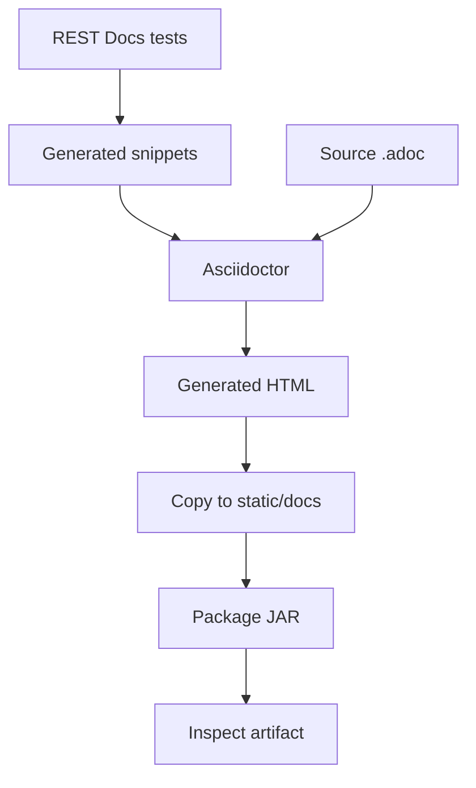

# Chạy tạo tài liệu trước khi đóng gói

## 1. Mục tiêu

**Spring REST Docs** tạo tài liệu REST API từ test HTTP dùng MockMvc, WebTestClient hoặc REST Assured. Test sinh snippet cho request, response, payload, header, parameter và multipart part. Asciidoctor ghép các snippet vào HTML.

Trong Spring Boot JAR, HTML có thể được đóng gói như static resource:

```text
BOOT-INF/classes/static/docs/
├── index.html
├── images/
└── css/
```

Với static resource mapping mặc định, `static/docs/index.html` có thể được phục vụ tại `/docs/index.html`.

Build cần thực hiện theo chuỗi: test sinh snippets → Asciidoctor tạo HTML → copy HTML vào output resources → package JAR/WAR → kiểm tra archive. Chạy riêng `asciidoctor` chỉ tạo HTML trong output directory, không tự đưa HTML vào JAR.

## 2. Phân biệt snippets và generated documentation

- **Generated snippets:** file do test sinh, thường ở `build/generated-snippets` (Gradle) hoặc `target/generated-snippets` (Maven).
- **Generated documentation:** HTML được biên soạn từ file `.adoc` và snippets, thường ở `build/docs/asciidoc` hoặc `target/generated-docs`.

Ví dụ:

```text
project/
├── src/docs/asciidoc/index.adoc
├── src/test/java/...DocumentationTest.java
└── build/
    ├── generated-snippets/users-get/
    ├── docs/asciidoc/index.html
    └── libs/application.jar
```

Không chỉnh sửa trực tiếp generated snippets hay HTML. Cập nhật test/descriptor hoặc file nguồn Asciidoctor rồi chạy lại build.

## 3. Luồng thực thi



Nếu thiếu task dependency, package có thể chạy trước khi HTML sẵn sàng hoặc JAR không chứa docs. Khai báo quan hệ rõ ràng thay vì phụ thuộc thứ tự gọi lệnh thủ công.

## 4. Gradle: test, Asciidoctor và snippets

Ví dụ Gradle Groovy DSL; thay version placeholder bằng các phiên bản tương thích với dự án:

```groovy
plugins {
    id 'java'
    id 'org.springframework.boot' version '3.x.y'
    id 'org.asciidoctor.jvm.convert' version '4.x.y'
}

configurations {
    asciidoctorExt
}

dependencies {
    testImplementation 'org.springframework.restdocs:spring-restdocs-mockmvc'
    asciidoctorExt 'org.springframework.restdocs:spring-restdocs-asciidoctor'
}
```

Nếu dùng WebTestClient hoặc REST Assured, thêm dependency tích hợp tương ứng. `spring-restdocs-asciidoctor` cung cấp thuộc tính `snippets` để file Asciidoctor tham chiếu thư mục generated snippets.

Khai báo output/input và dependency:

```groovy
ext {
    snippetsDir = file("$buildDir/generated-snippets")
}

tasks.named('test') {
    outputs.dir snippetsDir
}

tasks.named('asciidoctor') {
    inputs.dir snippetsDir
    configurations 'asciidoctorExt'
    dependsOn tasks.named('test')
}
```

`test.outputs.dir` khai báo nơi test tạo snippets. `asciidoctor.inputs.dir` khai báo snippets là input. `dependsOn test` đảm bảo test hoàn tất trước khi tạo tài liệu. Cú pháp cấu hình có thể khác theo version plugin; giữ nguyên quan hệ input/output/dependency.

Ví dụ `src/docs/asciidoc/index.adoc`:

```asciidoc
= User API
:toc: left

== GET /users/{id}

=== HTTP request
include::{snippets}/users-get/http-request.adoc[]

=== HTTP response
include::{snippets}/users-get/http-response.adoc[]

=== Response fields
include::{snippets}/users-get/response-fields.adoc[]
```

`{snippets}` được REST Docs Asciidoctor extension cấu hình để trỏ tới snippets directory. Chạy bước sinh tài liệu:

```bash
./gradlew clean test asciidoctor
```

Kiểm tra cả snippets và HTML output. Đây chưa phải xác nhận HTML nằm trong JAR.

## 5. Gradle: copy HTML vào bootJar

Cho task `bootJar` phụ thuộc `asciidoctor` và copy output vào `static/docs`:

```groovy
tasks.named('bootJar') {
    dependsOn tasks.named('asciidoctor')

    from(tasks.named('asciidoctor').map { it.outputDir }) {
        into 'static/docs'
    }
}
```

`dependsOn` bảo đảm tạo docs trước khi package. `from(...){ into 'static/docs' }` thêm HTML và tài nguyên liên quan vào classpath static resources trong JAR.

Chạy:

```bash
./gradlew clean bootJar
```

Hoặc `./gradlew clean build` nếu task build chính bao gồm `bootJar`. Nếu JAR có `BOOT-INF/classes/static/docs/index.html`, Spring Boot thường phục vụ tại `/docs/index.html`. Không công khai tài liệu nội bộ nếu chưa có authentication/authorization.

## 6. Maven: tạo HTML trong prepare-package

Spring REST Docs hướng dẫn bind Asciidoctor vào phase `prepare-package`, sau `test` và trước `package`. Ví dụ trong `pom.xml`:

```xml
<dependencies>
    <dependency>
        <groupId>org.springframework.restdocs</groupId>
        <artifactId>spring-restdocs-mockmvc</artifactId>
        <scope>test</scope>
    </dependency>
</dependencies>

<build>
    <plugins>
        <plugin>
            <groupId>org.asciidoctor</groupId>
            <artifactId>asciidoctor-maven-plugin</artifactId>
            <version>2.2.1</version>
            <executions>
                <execution>
                    <id>generate-api-docs</id>
                    <phase>prepare-package</phase>
                    <goals>
                        <goal>process-asciidoc</goal>
                    </goals>
                    <configuration>
                        <backend>html</backend>
                        <doctype>book</doctype>
                    </configuration>
                </execution>
            </executions>
            <dependencies>
                <dependency>
                    <groupId>org.springframework.restdocs</groupId>
                    <artifactId>spring-restdocs-asciidoctor</artifactId>
                    <version>4.x.y</version>
                </dependency>
            </dependencies>
        </plugin>
    </plugins>
</build>
```

Thay version minh họa bằng version Spring REST Docs phù hợp. Dependency `spring-restdocs-asciidoctor` nằm trong plugin để extension có mặt khi xử lý `.adoc`. Nguồn Maven thường là `src/main/asciidoc` và output thường là `target/generated-docs`.

## 7. Maven: copy HTML vào resources

Tạo HTML trong `prepare-package` chưa đủ. Cần copy output HTML vào thư mục resources của ứng dụng dưới `static/docs`. Khai báo `maven-resources-plugin` sau plugin Asciidoctor nếu cả hai cùng bind vào phase đó; Maven thực hiện các goal trong cùng phase theo thứ tự khai báo.

Ví dụ cấu hình:

```xml
<plugin>
    <groupId>org.apache.maven.plugins</groupId>
    <artifactId>maven-resources-plugin</artifactId>
    <executions>
        <execution>
            <id>copy-generated-api-docs</id>
            <phase>prepare-package</phase>
            <goals>
                <goal>copy-resources</goal>
            </goals>
            <configuration>
                <outputDirectory>${project.build.outputDirectory}/static/docs</outputDirectory>
                <resources>
                    <resource>
                        <directory>${project.build.directory}/generated-docs</directory>
                    </resource>
                </resources>
            </configuration>
        </execution>
    </executions>
</plugin>
```

Thay `OUTPUT_DIRECTORY` bằng Maven property `project.build.outputDirectory` theo cú pháp property của Maven trong file thực tế. Nếu output Asciidoctor đã tùy chỉnh, sửa resource directory cho đúng. Copy HTML đã biên soạn, không copy generated snippets thô.

Chạy:

```bash
./mvnw clean package
```

Maven chạy test, tạo HTML ở prepare-package, copy vào resources rồi đóng gói ở package.

## 8. Task graph và lifecycle

Gradle cần quan hệ:

```text
test
  └── creates build/generated-snippets

asciidoctor
  ├── dependsOn test
  ├── reads generated-snippets
  └── creates HTML

bootJar
  ├── dependsOn asciidoctor
  └── copies HTML to BOOT-INF/classes/static/docs
```

Trong multi-module build, nếu module khác sinh snippets, khai báo dependencies/input-output giữa projects. Task được khai báo không có nghĩa nó tự chạy; nó phải nằm trong dependency graph của task đích hoặc được gọi trực tiếp.

Maven:

| Phase | Công việc |
| --- | --- |
| `test` | Test sinh snippets |
| `prepare-package` | Asciidoctor tạo HTML; resources plugin copy HTML vào output resources |
| `package` | Maven tạo JAR/WAR |

Chỉ chạy `mvn test` thì prepare-package và package không chạy. Dùng `mvn package` hoặc `mvn verify` để đi qua các phase này.

## 9. Kiểm tra archive và HTTP

Liệt kê nội dung JAR:

```bash
jar tf build/libs/application.jar
```

Với Maven:

```bash
jar tf target/application.jar
```

Với Spring Boot executable JAR, tìm:

```text
BOOT-INF/classes/static/docs/index.html
BOOT-INF/classes/static/docs/images/...
BOOT-INF/classes/static/docs/css/...
```

PowerShell có thể lọc:

```powershell
jar tf build/libs/application.jar | Select-String 'BOOT-INF/classes/static/docs'
```

Xác minh index, CSS, script và ảnh đều có mặt; link tương đối không trỏ về thư mục build; HTML đã include snippets; nội dung đúng API version. Sau đó chạy JAR và thử `http://localhost:8080/docs/index.html`.

Nếu HTTP trả 404, trước tiên kiểm tra archive có file chưa. Nếu file có trong JAR, kiểm tra context path, Spring Security và static resource mapping. Lỗi 404 không nhất thiết là lỗi Asciidoctor.

## 10. Tránh stale snippets và build không tái lập

Asciidoctor có thể đọc snippets cũ nếu thư mục output còn sót lại dù test operation tương ứng không chạy.

Biện pháp:

- Dùng clean build trong CI: `./gradlew clean bootJar` hoặc `./mvnw clean package`.
- Bảo đảm Asciidoctor phụ thuộc test sinh snippets.
- Khai báo snippet directory là output của test và input của Asciidoctor trong Gradle.
- Không commit generated snippets nếu quy trình không yêu cầu.
- Không để các test độc lập ghi cùng operation ID và snippet filename với nội dung khác nhau.
- Dùng fixture xác định và cập nhật mọi `include` khi đổi operation ID.

CI nên build từ checkout sạch để không phụ thuộc artifact cũ trên máy developer.

## 11. Chọn cách phát hành tài liệu

| Cách | Khi phù hợp | Lưu ý |
| --- | --- | --- |
| Nhúng HTML vào JAR/WAR | Docs cần cùng version ứng dụng | Tăng kích thước; bảo vệ nếu là nội bộ |
| Artifact docs riêng | Docs có vòng đời/quyền truy cập khác | Version hóa và publish riêng |
| Site/portal | Cần tìm kiếm và trải nghiệm độc lập | Cần pipeline deploy docs |

Nếu nhúng trong JAR, docs và API code đi cùng version. Nếu publish riêng, cần version strategy. Không đưa endpoint nội bộ, sample credentials hoặc dữ liệu thật lên static public route.

## 12. Lỗi thường gặp

| Triệu chứng | Nguyên nhân | Cách xử lý |
| --- | --- | --- |
| HTML có trong build nhưng không có trong JAR | Chưa copy output vào archive | Thêm `bootJar.from` hoặc Maven resources copy |
| JAR package trước khi HTML sinh xong | Thiếu task dependency | Gradle `bootJar dependsOn asciidoctor`; Maven bind vào `prepare-package` |
| Asciidoctor thiếu snippet | Test chưa chạy hoặc operation ID sai | Đảm bảo test là dependency và kiểm tra snippets |
| JAR chứa docs cũ | Snippets/HTML cũ còn lại | Clean build |
| Maven copy thư mục rỗng | Resources plugin chạy trước Asciidoctor cùng phase | Đặt resources plugin sau Asciidoctor |
| HTML thiếu ảnh/CSS | Copy thiếu output hoặc flatten sai | Copy toàn bộ output và giữ cấu trúc |
| URL /docs trả 404 | Resource sai vị trí hoặc bị security/context path chặn | Kiểm tra archive và HTTP mapping |
| JAR quá lớn | Đóng gói file không cần thiết | Chỉ package docs cần phát hành |

## 13. Bài thực hành

1. Viết test `GET /users/{id}` dùng MockMvc và sinh request/response snippets.
2. Tạo `src/docs/asciidoc/index.adoc` và include snippets qua `{snippets}`.
3. Cấu hình Gradle để `asciidoctor` phụ thuộc `test`.
4. Cấu hình `bootJar` phụ thuộc `asciidoctor` và copy output vào `static/docs`.
5. Chạy `./gradlew clean bootJar`.
6. Dùng `jar tf` xác minh JAR có `BOOT-INF/classes/static/docs/index.html`.
7. Chạy ứng dụng, truy cập `/docs/index.html`.
8. Lặp lại với Maven: Asciidoctor ở `prepare-package` và resources plugin copy HTML.
9. Chạy `./mvnw clean package` và kiểm tra archive.

**Tiêu chí hoàn thành:** giải thích vì sao tạo HTML chưa đồng nghĩa package; khai báo đúng thứ tự test → Asciidoctor → copy resources → JAR; kiểm tra archive và URL runtime; phân biệt lỗi snippet, copy và static resource.

## 14. Câu hỏi tự kiểm tra

**1. Vì sao phải chạy Asciidoctor trước khi tạo JAR?**

HTML phải được tạo trước khi copy vào output resources và trước khi package đưa resources vào archive.

**2. Gradle cần cấu hình gì để docs nằm trong Spring Boot JAR?**

Cho `bootJar` phụ thuộc `asciidoctor` và copy output directory vào `static/docs`.

**3. Maven nên chạy Asciidoctor ở phase nào?**

`prepare-package`, sau test và trước package.

**4. Vì sao Maven resources plugin nên đặt sau Asciidoctor?**

Cả hai cùng chạy trong prepare-package; khai báo resources plugin sau giúp copy sau khi HTML được sinh.

**5. Làm sao chứng minh docs có trong artifact?**

Dùng `jar tf` và xác minh có `BOOT-INF/classes/static/docs/index.html` hoặc classpath location tương ứng.

**6. Có nên package generated snippets thay cho HTML không?**

Không mặc định. Snippets là đầu vào cho Asciidoctor; artifact thường chứa HTML/PDF đã biên soạn.

## Tài liệu tham khảo

- [Spring REST Docs — Getting Started, Packaging the Documentation](https://docs.spring.io/spring-restdocs/tutorial/getting-started/index.html): cấu hình Asciidoctor, prepare-package, bootJar và copy HTML vào static/docs.
- [Spring REST Docs — Reference Documentation](https://docs.spring.io/spring-restdocs/docs/current/reference/htmlsingle/): cấu hình test, snippets, Asciidoctor và packaging.
- [Spring Boot — Static Content](https://docs.spring.io/spring-boot/reference/web/servlet.html#web.servlet.spring-mvc.static-content): phục vụ static resources từ classpath.

