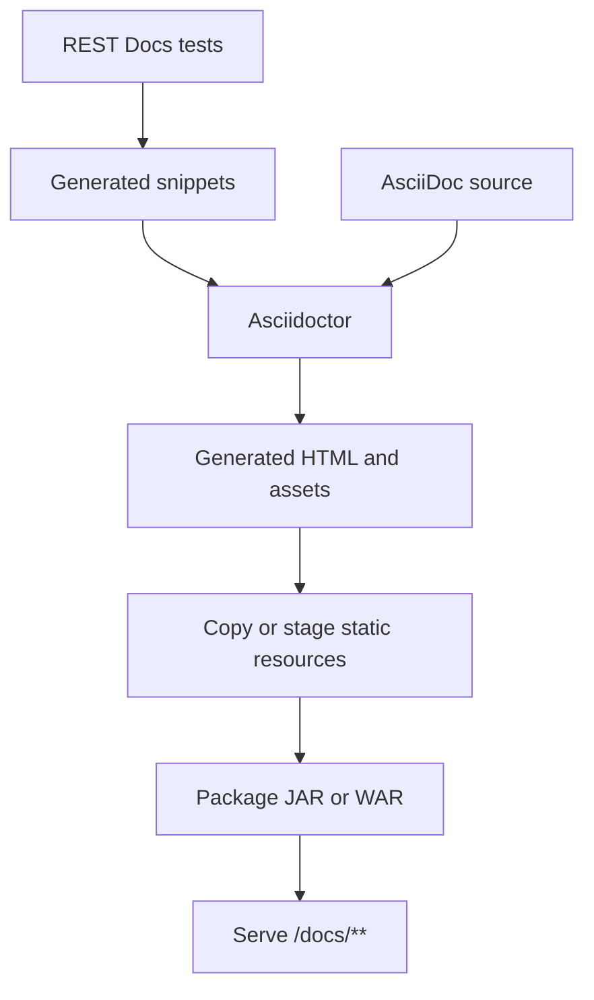

# Copy generated documentation vào static resources

## 1. Mục tiêu

**Spring REST Docs** tạo tài liệu REST API từ test HTTP bằng MockMvc, WebTestClient hoặc REST Assured. Test sinh snippets cho request, response, payload, header, parameter và multipart part; Asciidoctor ghép snippets cùng file nguồn thành HTML.

Để Spring Boot phục vụ HTML từ ứng dụng, tài liệu phải nằm trong classpath static resources. Vị trí mong muốn trong executable JAR:

```text
BOOT-INF/classes/static/docs/
├── index.html
├── css/site.css
├── js/navigation.js
└── images/endpoint-flow.png
```

Với static resource mapping mặc định, `static/docs/index.html` có thể được phục vụ tại `/docs/index.html`. Chỉ tạo HTML trong thư mục output của Asciidoctor chưa đủ; phải copy toàn bộ tài liệu và assets đến vị trí được đóng gói.

Bài học hướng dẫn chọn source/destination, cấu hình copy với Gradle và Maven, giữ cấu trúc tương đối, nối copy với task/lifecycle packaging và xác minh archive/runtime.

## 2. Phân biệt snippets, HTML và static resources

| Loại | Ví dụ | Vai trò |
| --- | --- | --- |
| Test source | `src/test/java` | Thực thi request và sinh snippets |
| Generated snippets | `build/generated-snippets` hoặc `target/generated-snippets` | Đầu vào Asciidoctor |
| Generated documentation | `build/docs/asciidoc` hoặc `target/generated-docs` | HTML đã biên soạn và assets |
| Staging resources | `build/generated-docs/static/docs` | Bản copy chuẩn bị đóng gói |
| Archive location | `BOOT-INF/classes/static/docs` | Classpath static resources trong JAR |

Nguồn copy phải là **output của Asciidoctor**, không phải generated snippets. Các file `request-parts.adoc`, `response-fields.adoc` là đầu vào; `index.html` và CSS/ảnh đã biên soạn mới là nội dung phát hành cho client.



Không copy riêng `index.html` nếu trang dùng CSS, JavaScript, ảnh hoặc font. Copy cả directory tree và giữ đường dẫn tương đối.

## 3. Xác định đúng output directory

Với Gradle, kiểm tra `outputDir` của task `asciidoctor`. Tùy cấu hình plugin/backend, HTML có thể nằm trực tiếp trong `build/docs/asciidoc` hoặc thư mục con như `html5`.

Với Maven, output thường nằm trong `target/generated-docs` khi dùng cấu hình Spring REST Docs Getting Started. Nếu dự án tùy chỉnh output directory, bước copy phải dùng đúng thư mục đó.

Không suy ra output directory chỉ từ tên task. Xem cấu hình Asciidoctor và log build. Nếu HTML nằm trong thư mục con, copy từ thư mục chứa entry point cùng toàn bộ assets tương ứng.

## 4. Gradle: staging bằng task Sync

Dùng task kiểu `Sync` để copy output Asciidoctor vào thư mục staging riêng dưới `build/`:

```groovy
def generatedDocsDir = layout.buildDirectory.dir('generated-docs')

tasks.register('copyApiDocs', Sync) {
    dependsOn tasks.named('asciidoctor')
    from(tasks.named('asciidoctor').map { it.outputDir })
    into(generatedDocsDir.map { it.dir('static/docs') })
}
```

- `dependsOn asciidoctor` bảo đảm HTML đã tạo trước khi copy.
- `from(...)` lấy toàn bộ output của Asciidoctor.
- `into(...)` đặt bản copy tại `build/generated-docs/static/docs`.
- `Sync` đồng bộ destination theo source; file cũ ở đích nhưng không còn ở nguồn sẽ được loại bỏ.

Destination phải là staging directory riêng do build quản lý. Không đặt Sync vào thư mục chứa tài liệu viết tay hoặc file người dùng, vì Sync có thể xóa file không có trong source.

### 4.1. Vì sao dùng staging?

Staging tách output Asciidoctor khỏi bản copy chuẩn bị đóng gói. Có thể kiểm tra nội dung hoặc bổ sung file cần thiết trước khi archive được tạo. Đây vẫn là generated output; không chỉnh sửa thủ công vì lần build sau có thể ghi đè.

```text
build/
├── docs/asciidoc/
│   ├── index.html
│   └── css/site.css
└── generated-docs/
    └── static/docs/
        ├── index.html
        └── css/site.css
```

## 5. Gradle: đưa staging vào bootJar

Cho `bootJar` phụ thuộc task copy, sau đó thêm staging vào archive dưới `static/docs`:

```groovy
tasks.named('bootJar') {
    dependsOn tasks.named('copyApiDocs')
    from(generatedDocsDir.map { it.dir('static/docs') }) {
        into 'static/docs'
    }
}
```

Archive dự kiến:

```text
BOOT-INF/classes/static/docs/index.html
BOOT-INF/classes/static/docs/css/site.css
BOOT-INF/classes/static/docs/images/endpoint-flow.png
```

Task graph:

```text
test
  └── generated-snippets
        └── asciidoctor
              └── generated HTML
                    └── copyApiDocs (Sync)
                          └── build/generated-docs/static/docs
                                └── bootJar
```

Khi chạy `./gradlew bootJar`, Gradle thực hiện test, Asciidoctor, copy staging rồi package theo dependency graph.

### 5.1. Tránh vòng phụ thuộc processResources

Không nên máy móc thêm staging vào `sourceSets.main.resources` rồi buộc `processResources` phụ thuộc task copy docs. Asciidoctor phụ thuộc test, trong khi test cần main classes/resources; điều này có thể tạo chu trình:

```text
processResources
    → copyApiDocs
        → asciidoctor
            → test
                → classes
                    → processResources
```

Ví dụ trên đưa staging trực tiếp vào `bootJar`. Task này chạy sau test/Asciidoctor nên tránh vòng phụ thuộc qua `processResources`. Nếu cần phục vụ docs ở môi trường development từ output classes, hãy thiết kế riêng và kiểm tra task graph.

### 5.2. Chạy và kiểm tra Gradle

Chạy:

```bash
./gradlew clean bootJar
```

Hoặc `./gradlew clean build` nếu task build chính bao gồm `bootJar`. Có thể kiểm tra riêng staging bằng:

```bash
./gradlew clean test asciidoctor copyApiDocs
```

Sau đó kiểm tra `build/generated-docs/static/docs`. Nếu staging đúng nhưng JAR thiếu docs, kiểm tra `bootJar.from` và task dependency.

## 6. Maven: copy-resources vào output directory

Luồng Maven phổ biến:

1. Test REST Docs sinh snippets ở phase `test`.
2. Asciidoctor chạy ở `prepare-package` và tạo HTML, thường trong `target/generated-docs`.
3. `maven-resources-plugin:copy-resources` chạy sau Asciidoctor trong cùng phase.
4. `package` tạo JAR/WAR từ output directory.

Ví dụ plugin copy:

```xml
<plugin>
    <groupId>org.apache.maven.plugins</groupId>
    <artifactId>maven-resources-plugin</artifactId>
    <executions>
        <execution>
            <id>copy-generated-api-docs</id>
            <phase>prepare-package</phase>
            <goals>
                <goal>copy-resources</goal>
            </goals>
            <configuration>
                <outputDirectory>
                    ${project.build.outputDirectory}/static/docs
                </outputDirectory>
                <resources>
                    <resource>
                        <directory>${project.build.directory}/generated-docs</directory>
                        <filtering>false</filtering>
                    </resource>
                </resources>
            </configuration>
        </execution>
    </executions>
</plugin>
```

Trong `pom.xml` thực tế, dùng Maven property `project.build.outputDirectory` làm phần đầu của output path, và `project.build.directory` nối với `/generated-docs` làm source. Các giá trị mặc định thường tương ứng `target/classes` và `target/generated-docs`.

Đặt resources plugin **sau plugin Asciidoctor** trong `pom.xml` khi cả hai cùng chạy ở `prepare-package`. Maven thực hiện goal trong cùng phase theo thứ tự khai báo. Nếu copy chạy trước Asciidoctor, destination có thể rỗng hoặc còn bản cũ.

`filtering=false` giữ nguyên HTML, ảnh, font và dữ liệu nhị phân, tránh thay placeholder ngoài ý muốn. Nếu output Asciidoctor được tùy chỉnh, cập nhật source directory cho khớp.

Chạy:

```bash
./mvnw clean package
```

`mvn test` không chạy `prepare-package`, do đó không tạo/copy HTML vào output resources.

## 7. Giữ cấu trúc assets

HTML có thể tham chiếu CSS, JavaScript và ảnh bằng đường dẫn tương đối:

```html
<link rel="stylesheet" href="css/site.css">
<script src="js/navigation.js"></script>

```

Nguồn:

```text
generated-docs/
├── index.html
├── css/site.css
├── js/navigation.js
└── images/endpoint-flow.png
```

Đích:

```text
static/docs/
├── index.html
├── css/site.css
├── js/navigation.js
└── images/endpoint-flow.png
```

Nếu chỉ copy `index.html`, link sẽ hỏng. Nếu flatten mọi file vào một thư mục, relative path không còn đúng. Copy toàn bộ output directory và giữ nguyên cấu trúc con. Nếu Asciidoctor sinh nhiều trang, copy tất cả trang cần phát hành. Chỉ đưa format cần dùng vào static route, không gom log, snippets thô hoặc file tạm.

## 8. Overwrite, stale files và clean build

- **Stale files:** destination còn file của build trước dù source hiện tại đã xóa/đổi tên.
- **Overwrite không mong muốn:** destination trùng thư mục do developer quản lý và task ghi đè file thủ công.

Gradle `Sync` với staging riêng đồng bộ destination theo source. Maven `copy-resources` copy file mới nhưng không nhất thiết xóa mọi file cũ ở đích; clean build trong CI giúp loại bỏ output cũ.

Nguyên tắc:

1. Dùng destination trong build output, không dùng `src/main/resources` làm nơi sinh file mặc định.
2. Dùng clean build trong CI.
3. Không để tài liệu viết tay trong staging directory do task quản lý.
4. Không copy snippets nếu mục tiêu là HTML phát hành.
5. Không để nhiều module ghi chung destination khi chưa có ownership rõ.
6. Khi đổi output directory, loại bỏ/configure lại đích cũ để JAR không gom hai bản.

## 9. Kiểm tra từng tầng sau khi copy

| Tầng | Cần xác minh | Ví dụ |
| --- | --- | --- |
| Test | Snippet được sinh | `build/generated-snippets/users-get/http-response.adoc` |
| Asciidoctor | HTML được tạo | `build/docs/asciidoc/index.html` |
| Gradle staging | Toàn bộ cây HTML được copy | `build/generated-docs/static/docs/index.html` |
| Maven resources | HTML ở output resources | `target/classes/static/docs/index.html` |
| Archive | HTML nằm trong JAR | `BOOT-INF/classes/static/docs/index.html` |

Liệt kê JAR:

```bash
jar tf build/libs/application.jar
```

Với Maven:

```bash
jar tf target/application.jar
```

Tìm các entry:

```text
BOOT-INF/classes/static/docs/index.html
BOOT-INF/classes/static/docs/css/site.css
BOOT-INF/classes/static/docs/images/endpoint-flow.png
```

Không chỉ kiểm tra index. Xác minh ít nhất một asset để biết cấu trúc con được giữ nguyên.

## 10. Kiểm tra URL runtime

Khi docs nằm trên classpath static resources, thử:

```text
http://localhost:8080/docs/index.html
```

Nếu trả 404:

1. Kiểm tra archive có `BOOT-INF/classes/static/docs/index.html` không.
2. Kiểm tra tên file có đúng `index.html` không.
3. Kiểm tra context path/servlet path.
4. Kiểm tra Spring Security có chặn request không.
5. Kiểm tra static resource mapping có bị tùy biến không.

Nếu HTML trả 200 nhưng CSS/ảnh 404, kiểm tra relative path và xác nhận thư mục con đã được copy. HTTP 403 thường liên quan đến chính sách bảo vệ tài liệu.

## 11. Lỗi thường gặp

| Triệu chứng | Nguyên nhân | Cách khắc phục |
| --- | --- | --- |
| JAR không có `static/docs/index.html` | Task copy chưa chạy hoặc ngoài task graph | Cho bootJar phụ thuộc copy task hoặc bind Maven copy vào prepare-package |
| Staging rỗng | Source directory sai hoặc Asciidoctor chưa chạy | Kiểm tra outputDir và dependency |
| Chỉ có index, thiếu CSS/ảnh | Chỉ copy file entry point | Copy toàn bộ output directory |
| CSS/ảnh 404 | Flatten đường dẫn hoặc copy sai relative path | Giữ cấu trúc thư mục nguồn |
| JAR chứa HTML cũ | Stale output ở destination | Clean build; dùng Sync với staging Gradle |
| Maven copy trước Asciidoctor | Thứ tự plugin không phù hợp | Đặt resources plugin sau Asciidoctor cùng phase |
| Gradle circular dependency | processResources phụ thuộc copy trong khi copy phụ thuộc test | Đưa staging vào bootJar thay vì tạo vòng processResources/test |
| HTML bị biến đổi | Maven resource filtering bật không cần thiết | Đặt filtering false |
| Tài liệu sai URL | Copy vào sai classpath location | Đóng gói dưới static/docs |
| JAR phình to | Copy cả file tạm hoặc snippets | Chỉ copy tài liệu cần phát hành |

## 12. Bài thực hành

1. Viết REST Docs test cho `GET /users/{id}` và sinh snippets.
2. Tạo `src/docs/asciidoc/index.adoc` include request, response và response fields.
3. Xác định output directory thực tế của Asciidoctor.
4. Tạo Gradle `Sync` task phụ thuộc Asciidoctor, copy toàn bộ output vào `build/generated-docs/static/docs`.
5. Cho `bootJar` phụ thuộc `copyApiDocs` và đưa staging vào archive dưới `static/docs`.
6. Chạy `./gradlew clean bootJar`; kiểm tra JAR có index và ít nhất một asset.
7. Lặp lại với Maven: Asciidoctor ở `prepare-package`; resources plugin copy sau đó vào `target/classes/static/docs`.
8. Chạy `./mvnw clean package` và kiểm tra archive bằng `jar tf`.
9. Chạy ứng dụng, thử `/docs/index.html` cùng một CSS/ảnh.
10. Xóa một asset trong source, clean build và xác minh file cũ không còn trong staging/JAR.

**Tiêu chí hoàn thành:** phân biệt snippets, HTML output và static resources; cấu hình đúng source/destination; giữ cấu trúc assets; nối copy với packaging; xác minh archive và URL runtime.

## 13. Câu hỏi tự kiểm tra

**1. Nên copy thư mục nào vào static resources?**

Output directory của Asciidoctor chứa HTML đã biên soạn và assets. Không copy generated snippets nếu mục tiêu là trang HTML.

**2. Vì sao không chỉ copy index.html?**

Trang có thể tham chiếu CSS, JavaScript, ảnh và font. Cần copy toàn bộ cây output và giữ relative path.

**3. Gradle dùng task nào để đồng bộ staging?**

Dùng task `Sync` phụ thuộc Asciidoctor, lấy outputDir làm source và đặt đích riêng dưới `build`.

**4. Vì sao đưa staging vào bootJar thay vì processResources?**

Asciidoctor phụ thuộc test; test lại cần main classes/resources. Buộc processResources chờ Asciidoctor có thể tạo vòng dependency. Đưa staging vào bootJar tránh vòng đó.

**5. Maven copy docs ở phase nào?**

Bind `maven-resources-plugin:copy-resources` vào `prepare-package` sau Asciidoctor và trước package.

**6. Làm sao xác minh copy thành công?**

Kiểm tra staging/output resources, liệt kê archive bằng `jar tf`, rồi truy cập trang và một asset qua HTTP.

## Tài liệu tham khảo

- [Spring REST Docs — Getting Started](https://docs.spring.io/spring-restdocs/tutorial/getting-started/index.html): sinh snippets, cấu hình Asciidoctor và packaging tài liệu.
- [Spring REST Docs — Reference Documentation](https://docs.spring.io/spring-restdocs/docs/current/reference/htmlsingle/): test, snippets và biên soạn tài liệu.
- [Gradle User Manual — Working With Files](https://docs.gradle.org/current/userguide/working_with_files.html): Copy/Sync task và output directory.
- [Maven Resources Plugin — copy-resources](https://maven.apache.org/plugins/maven-resources-plugin/copy-resources-mojo.html): copy resources trong Maven lifecycle.
- [Spring Boot — Static Content](https://docs.spring.io/spring-boot/reference/web/servlet.html#web.servlet.spring-mvc.static-content): phục vụ static resources từ classpath.

