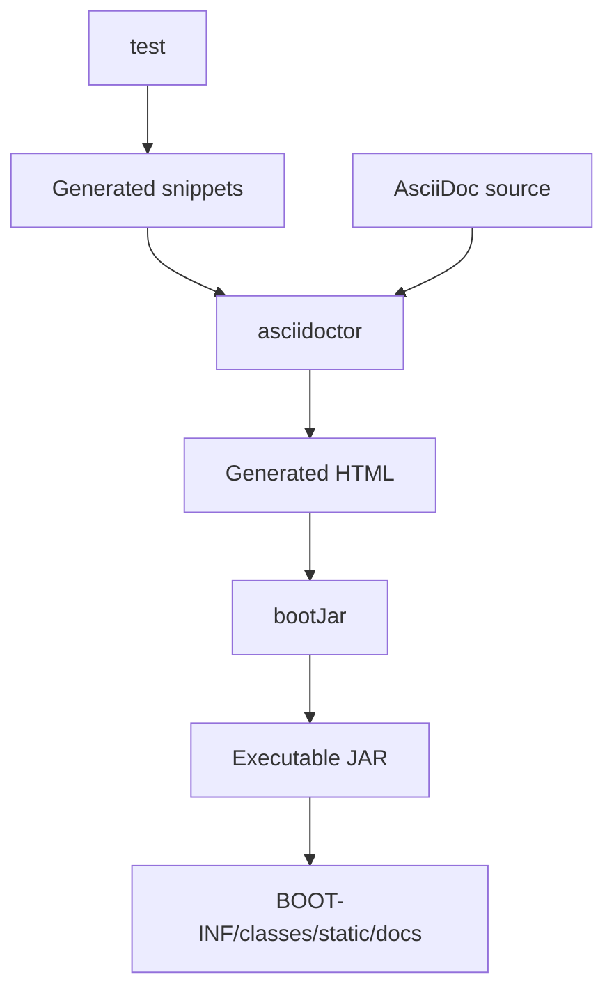

# bootJar phụ thuộc asciidoctor trong Gradle

## 1. Mục tiêu

Trong **Spring REST Docs**, test HTTP bằng MockMvc, WebTestClient hoặc REST Assured sinh snippet cho request, response, payload, header, parameter và multipart part. Asciidoctor ghép các snippet với file nguồn AsciiDoc để tạo tài liệu HTML.

Với ứng dụng Spring Boot, HTML có thể được nhúng vào executable JAR và phục vụ như static content. Task đóng gói cần chạy sau task biên soạn tài liệu, đồng thời đưa output HTML vào archive.

Hai cấu hình cốt lõi:

- `dependsOn asciidoctor`: bảo đảm Asciidoctor hoàn tất trước khi bootJar đóng gói.
- `from(asciidoctor.outputDir) { into 'static/docs' }`: lấy tài liệu đã sinh và thêm vào JAR dưới classpath path `static/docs`.

Dependency chỉ bảo đảm thứ tự, không tự thêm file vào archive. Còn `from` mới chỉ định nội dung cần đóng gói. Cần cả hai để build tái lập.

## 2. Task graph

Luồng build:



Có hai dependency:

1. `asciidoctor` phụ thuộc `test` để snippets mới được sinh trước khi biên soạn.
2. `bootJar` phụ thuộc `asciidoctor` để HTML được tạo trước khi đóng gói.

Nếu chỉ cấu hình bootJar phụ thuộc Asciidoctor nhưng Asciidoctor không phụ thuộc test, tài liệu có thể dùng snippets cũ hoặc thiếu snippets. Vì vậy, cần cấu hình đủ chuỗi test → Asciidoctor → bootJar.

## 3. Cấu hình plugin và dependency

Ví dụ Gradle Groovy DSL. Bộ version minh họa dựa trên Spring REST Docs 4.0.1 Getting Started, dùng Asciidoctor plugin 4.0.5 và AsciidoctorJ 3.0.0. Thay phiên bản Spring Boot bằng version tương thích với project.

```groovy
plugins {
    id 'java'
    id 'org.springframework.boot' version '3.x.y'
    id 'org.asciidoctor.jvm.convert' version '4.0.5'
}

asciidoctorj {
    version = '3.0.0'
}

configurations {
    asciidoctorExt
}

dependencies {
    testImplementation 'org.springframework.restdocs:spring-restdocs-mockmvc:4.0.1'
    asciidoctorExt 'org.springframework.restdocs:spring-restdocs-asciidoctor:4.0.1'
}
```

`3.x.y` là placeholder cho version Spring Boot của ứng dụng. Nếu dùng WebTestClient hoặc REST Assured, thêm dependency tích hợp tương ứng với client test.

`spring-restdocs-asciidoctor` nằm trong configuration `asciidoctorExt` để extension có mặt trên classpath Asciidoctor. Extension cấu hình thuộc tính `snippets` để file AsciiDoc tham chiếu tới thư mục snippets.

## 4. Khai báo thư mục snippets và dependency Asciidoctor

```groovy
ext {
    snippetsDir = file('build/generated-snippets')
}

tasks.named('test') {
    outputs.dir snippetsDir
}

tasks.named('asciidoctor') {
    inputs.dir snippetsDir
    configurations 'asciidoctorExt'
    dependsOn tasks.named('test')
}
```

| Cấu hình | Vai trò |
| --- | --- |
| `snippetsDir` | Thư mục chứa snippet do test sinh |
| `test.outputs.dir` | Khai báo output của test cho Gradle |
| `asciidoctor.inputs.dir` | Khai báo snippets là input Asciidoctor |
| `configurations 'asciidoctorExt'` | Nạp extension REST Docs |
| `dependsOn test` | Chạy test trước khi tạo tài liệu |

Khai báo input/output giúp Gradle theo dõi incremental build. Khi snippets thay đổi, Gradle có thông tin để đánh giá lại task Asciidoctor.

### 4.1. AsciiDoc source include snippets

Ví dụ `src/docs/asciidoc/index.adoc`:

```asciidoc
= User API
:toc: left

== GET /users/{id}

=== HTTP request
include::${snippets}/users-get/http-request.adoc[]

=== HTTP response
include::${snippets}/users-get/http-response.adoc[]

=== Response fields
include::${snippets}/users-get/response-fields.adoc[]
```

`${snippets}` là token thay thế trong ví dụ; file AsciiDoc thực tế dùng thuộc tính `snippets` do Spring REST Docs Asciidoctor extension cung cấp.

Một test có thể sinh snippets của operation `users-get`:

```java
mockMvc.perform(get("/users/{id}", "42"))
    .andExpect(status().isOk())
    .andDo(document("users-get",
        responseFields(
            fieldWithPath("id").description("Mã người dùng"),
            fieldWithPath("name").description("Tên người dùng")
        )
    ));
```

Khi test thành công, các snippet như `http-request.adoc`, `http-response.adoc` và `response-fields.adoc` được tạo theo handler đã cấu hình. Nếu operation ID đổi mà include không cập nhật, Asciidoctor có thể báo thiếu snippet.

## 5. Cấu hình bootJar phụ thuộc asciidoctor

Sau khi cấu hình Asciidoctor, thêm dependency và source copy vào task `bootJar`:

```groovy
tasks.named('bootJar') {
    dependsOn tasks.named('asciidoctor')

    from(tasks.named('asciidoctor').map { it.outputDir }) {
        into 'static/docs'
    }
}
```

Task `bootJar` chờ `asciidoctor`, lấy output directory của task, thêm nội dung vào archive và đặt dưới `static/docs`.

Cấu hình Groovy DSL ngắn gọn cũng có thể viết:

```groovy
bootJar {
    dependsOn asciidoctor
    from(asciidoctor.outputDir) {
        into 'static/docs'
    }
}
```

Cả hai ví dụ diễn đạt cùng một ý tưởng. Dạng `tasks.named` phù hợp với cấu hình task provider; dạng `bootJar { ... }` phù hợp với convention DSL đang được dùng trong một số project. Chọn một cách theo build hiện tại, tránh cấu hình copy trùng lặp.

### 5.1. dependsOn làm gì?

`dependsOn` mô tả dependency của task. Khi `bootJar` được gọi, Gradle phải thực hiện `asciidoctor` trước. Nếu Asciidoctor phụ thuộc `test` thì test cũng chạy trước.

Dependency chỉ xác định quan hệ thực thi trong task graph; nó không tự thêm HTML vào JAR.

### 5.2. from và into làm gì?

Trong `from(...){ into 'static/docs' }`:

- `from` chọn nguồn nội dung cần thêm vào archive.
- `into` chỉ định prefix/path bên trong archive.

Nếu output directory có:

```text
index.html
css/site.css
images/endpoint-flow.png
```

thì JAR dự kiến có:

```text
BOOT-INF/classes/static/docs/index.html
BOOT-INF/classes/static/docs/css/site.css
BOOT-INF/classes/static/docs/images/endpoint-flow.png
```

Copy toàn bộ directory tree để CSS, JavaScript, ảnh và font giữ nguyên đường dẫn tương đối.

## 6. Xác định outputDir của Asciidoctor

Không giả định HTML luôn nằm ở một thư mục cố định. Output phụ thuộc phiên bản plugin, backend và cấu hình task. Source Gradle mặc định thường ở `src/docs/asciidoc`; output được task `asciidoctor` quản lý.

Dùng thuộc tính `asciidoctor.outputDir` của chính task trong cấu hình copy thay vì hardcode path như `build/docs/asciidoc/html5`. Điều này giữ cho nguồn copy gắn với task tạo tài liệu.

Có thể chạy riêng để kiểm tra output:

```bash
./gradlew clean test asciidoctor
```

Xác minh có `index.html` và assets trong output directory. Nếu project tùy chỉnh backend hoặc outputDir, kiểm tra cấu trúc thực tế trước khi điều chỉnh.

## 7. bootJar, jar và bootWar

Spring Boot Gradle plugin cung cấp `bootJar` để tạo executable JAR. Task `jar` tiêu chuẩn của Java plugin đóng gói classes/resources theo cấu trúc JAR thông thường và không nhất thiết tạo launcher executable của Spring Boot.

Nếu phát hành executable JAR, cấu hình `bootJar`. Nếu ứng dụng đóng gói WAR, dùng task `bootWar` và gắn dependency/copy vào đúng task package. Không cấu hình nhầm `jar` khi pipeline thực tế phát hành `bootJar`.

Với executable JAR, resources trên classpath thường nằm dưới `BOOT-INF/classes`. Vì vậy `into 'static/docs'` tạo ra đường dẫn `BOOT-INF/classes/static/docs`.

## 8. Chạy task và xem dependency graph

Chạy task đích:

```bash
./gradlew clean bootJar
```

Thứ tự logic: test sinh snippets; Asciidoctor tạo HTML; bootJar lấy HTML, đặt dưới static/docs và đóng gói.

Có thể chạy riêng task để chẩn đoán:

```bash
./gradlew clean test
./gradlew asciidoctor
./gradlew bootJar
```

Trong CI, nên gọi task đích `bootJar` hoặc `build` với dependency graph hoàn chỉnh. Các lệnh tách rời hữu ích khi xác định lỗi từng bước nhưng không nên là cơ chế duy nhất bảo đảm thứ tự.

Dùng dry-run để xem task graph:

```bash
./gradlew bootJar --dry-run
```

Xác nhận `test` và `asciidoctor` nằm trong graph trước `bootJar`. Task UP-TO-DATE hoặc FROM-CACHE vẫn có thể nằm trong graph dù không thực thi lại.

## 9. Xác minh executable JAR

Liệt kê archive:

```bash
jar tf build/libs/application.jar
```

Tìm các entry:

```text
BOOT-INF/classes/static/docs/index.html
BOOT-INF/classes/static/docs/css/site.css
BOOT-INF/classes/static/docs/images/endpoint-flow.png
```

PowerShell có thể lọc:

```powershell
jar tf build/libs/application.jar | Select-String 'BOOT-INF/classes/static/docs'
```

Nếu JAR có HTML nhưng thiếu CSS/ảnh, kiểm tra output directory và bảo đảm `from` lấy toàn bộ thư mục chứ không chỉ file entry point.

Đừng kết luận package thành công chỉ vì thư mục build có HTML. Bằng chứng cuối cùng là entry static docs thực sự nằm trong archive.

## 10. Kiểm tra URL runtime

Chạy ứng dụng:

```bash
java -jar build/libs/application.jar
```

Mở:

```text
http://localhost:8080/docs/index.html
```

Nếu trả 404:

1. Kiểm tra JAR có `BOOT-INF/classes/static/docs/index.html`.
2. Kiểm tra file entry point tên `index.html`.
3. Kiểm tra context path hoặc servlet path.
4. Kiểm tra Spring Security có chặn docs không.
5. Kiểm tra static resource mapping có bị tùy biến.

Nếu HTML trả 200 nhưng CSS/ảnh 404, kiểm tra đường dẫn tương đối và xác nhận assets cũng có trong JAR. URL có thể chứa context path như `/api/docs/index.html`.

## 11. Lỗi thường gặp

| Triệu chứng | Nguyên nhân | Cách xử lý |
| --- | --- | --- |
| JAR thiếu docs | Chỉ khai báo dependency, chưa thêm nguồn bằng `from` | Thêm outputDir vào archive dưới `static/docs` |
| Asciidoctor chạy sau bootJar | Thiếu dependency bootJar → asciidoctor | Khai báo `dependsOn` rõ ràng |
| Asciidoctor thiếu snippets | Chưa phụ thuộc test hoặc chưa khai báo snippets input/output | Khai báo `asciidoctor.dependsOn test` và snippetsDir |
| Tài liệu có snippet cũ | Output cũ còn sót hoặc operation test không chạy | Clean build và kiểm tra operation ID |
| Chỉ có index, thiếu assets | Chỉ copy file entry point | Copy toàn bộ outputDir |
| Archive path sai | `into` đặt sai prefix | Dùng `into 'static/docs'` |
| Task graph không có Asciidoctor | Cấu hình sai task name hoặc dependency | Kiểm tra plugin và task provider |
| Dùng jar thay vì bootJar | Pipeline tạo archive không phải executable JAR | Cấu hình task package thực tế |
| URL docs trả 404 | Resource sai classpath path hoặc bị security chặn | Kiểm tra archive, context path và security rules |

## 12. Tích hợp CI

Trong CI, task đích nên là task phát hành artifact:

```bash
./gradlew clean bootJar
```

Pipeline kiểm tra tối thiểu:

1. Checkout source sạch.
2. Chạy `./gradlew clean bootJar`.
3. Bảo đảm test tạo snippets hoặc output cache hợp lệ.
4. Kiểm tra JAR có `BOOT-INF/classes/static/docs/index.html`.
5. Kiểm tra ít nhất một CSS/ảnh được đóng gói.
6. Nếu có smoke test, chạy ứng dụng và gọi `/docs/index.html`.
7. Lưu JAR đã xác minh làm artifact phát hành.

Không commit snippets/HTML tự sinh chỉ để làm CI pass, trừ khi repository có quy trình yêu cầu. Build nên tái tạo tài liệu từ test và source AsciiDoc.

## 13. Bài thực hành

1. Cấu hình Spring REST Docs và Asciidoctor plugin.
2. Tạo `snippetsDir` tại `build/generated-snippets`.
3. Khai báo `test.outputs.dir snippetsDir`.
4. Cấu hình `asciidoctor.inputs.dir snippetsDir`, extension configuration và `dependsOn test`.
5. Viết test `GET /users/{id}` sinh request, response và response fields snippets.
6. Tạo `src/docs/asciidoc/index.adoc` include các snippets.
7. Cấu hình `bootJar` phụ thuộc `asciidoctor`.
8. Dùng `from(asciidoctor.outputDir)` và `into 'static/docs'` để thêm HTML vào archive.
9. Chạy `./gradlew clean bootJar` và kiểm tra task graph bằng `--dry-run`.
10. Dùng `jar tf` xác minh JAR có index và asset.
11. Chạy ứng dụng, mở `/docs/index.html` và xác nhận tài liệu hiển thị.
12. Làm test document thất bại; xác minh bootJar không đóng gói tài liệu mới từ test lỗi.

**Tiêu chí hoàn thành:** giải thích sự khác nhau giữa dependency và file inclusion; cấu hình đúng test → asciidoctor → bootJar; xác định outputDir; chứng minh HTML và assets nằm trong executable JAR.

## 14. Câu hỏi tự kiểm tra

**1. Vì sao bootJar phải phụ thuộc asciidoctor?**

Để tài liệu được biên soạn xong trước khi executable JAR được tạo.

**2. dependsOn có tự đưa HTML vào JAR không?**

Không. Nó chỉ mô tả thứ tự. Dùng `from(outputDir)` để thêm file và `into 'static/docs'` để đặt đúng archive path.

**3. Vì sao asciidoctor cần phụ thuộc test?**

Để snippets mới được sinh trước khi Asciidoctor include chúng.

**4. from và into có vai trò gì?**

`from` chọn output directory làm nguồn; `into` đặt nội dung trong JAR dưới `static/docs`.

**5. Vì sao không hardcode output path?**

Output phụ thuộc plugin/backend/configuration. Dùng `asciidoctor.outputDir` giúp copy theo output thực tế của task.

**6. Làm sao xác nhận tài liệu nằm trong JAR?**

Dùng `jar tf` và kiểm tra entry `BOOT-INF/classes/static/docs/index.html` cùng assets.

## Tài liệu tham khảo

- [Spring REST Docs 4.0.1 — Getting Started, Packaging the Documentation](https://docs.spring.io/spring-restdocs/tutorial/getting-started/index.html): cấu hình Gradle, Asciidoctor phụ thuộc test và ví dụ bootJar phụ thuộc Asciidoctor.
- [Spring REST Docs — Reference Documentation](https://docs.spring.io/spring-restdocs/docs/current/reference/htmlsingle/): test-generated snippets và biên soạn tài liệu.
- [Gradle User Manual — Task Dependencies](https://docs.gradle.org/current/userguide/controlling_task_execution.html#sec:depending_on_tasks): task dependency và execution graph.
- [Spring Boot — Static Content](https://docs.spring.io/spring-boot/reference/web/servlet.html#web.servlet.spring-mvc.static-content): phục vụ static resources từ classpath.

