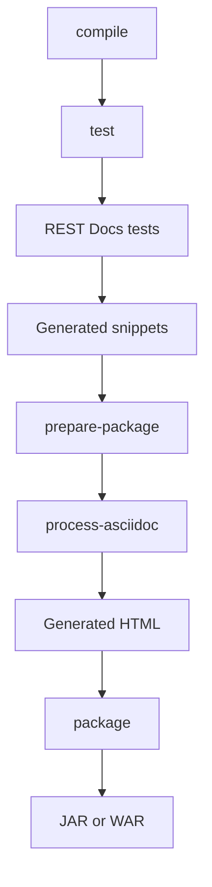

# prepare-package và process-asciidoc trong Maven

## 1. Vai trò trong quy trình Spring REST Docs

**Spring REST Docs** tạo tài liệu REST API từ các bài kiểm thử HTTP bằng MockMvc, WebTestClient hoặc REST Assured. Test gửi request, xác minh response và sinh snippets như HTTP request/response, request/response fields, parameters, headers và multipart parts. Asciidoctor kết hợp snippets với phần mô tả do người viết biên soạn để tạo HTML.

Trong Maven cần phân biệt hai khái niệm:

- **Lifecycle phase** `prepare-package`: thời điểm trong Maven lifecycle để tạo tài liệu trước bước package.
- **Plugin goal** `process-asciidoc`: thao tác của Asciidoctor Maven Plugin để xử lý file AsciiDoc và sinh HTML.

Cấu hình chuẩn gắn goal `process-asciidoc` vào phase `prepare-package`. Khi chạy `mvn package`, Maven đi qua các phase trước đó, bao gồm test; sau đó Asciidoctor tạo HTML, rồi Maven đóng gói JAR/WAR.

Bài học này trình bày lifecycle, plugin configuration, source/output directories, snippets extension, thứ tự plugin khi copy tài liệu vào JAR, lệnh build và cách chẩn đoán lỗi.

## 2. Maven lifecycle: test, prepare-package và package

| Phase | Vai trò |
| --- | --- |
| `test` | Chạy test REST Docs và sinh snippets |
| `prepare-package` | Chuẩn bị nội dung cần đóng gói; Asciidoctor biên soạn tài liệu |
| `package` | Đóng gói output thành JAR/WAR |
| `verify` | Chạy các bước kiểm tra sau package nếu dự án cấu hình |

Maven chạy tuần tự các phase trước phase được yêu cầu. Do đó, `mvn package` đi qua test và prepare-package trước khi package. `mvn test` dừng ở test, không gọi prepare-package và package.



`prepare-package` là lifecycle phase; `process-asciidoc` là goal của plugin. Phase xác định thời điểm goal được chạy trong lifecycle.

## 3. Source và output directory mặc định

Với cấu hình Spring REST Docs Maven thông thường:

| Nội dung | Đường dẫn |
| --- | --- |
| Test source | `src/test/java` |
| AsciiDoc source | `src/main/asciidoc` |
| Generated snippets | `target/generated-snippets` |
| Generated HTML | `target/generated-docs` |
| Compiled classes/resources | `target/classes` |
| Final JAR | `target/*.jar` |

Ví dụ cấu trúc:

```text
project/
├── pom.xml
├── src/
│   ├── main/
│   │   ├── java/
│   │   └── asciidoc/
│   │       └── index.adoc
│   └── test/java/...DocumentationTest.java
└── target/
    ├── generated-snippets/users-get/
    │   ├── http-request.adoc
    │   ├── http-response.adoc
    │   └── response-fields.adoc
    ├── generated-docs/
    │   └── index.html
    └── classes/
```

Generated snippets và generated HTML là hai loại output khác nhau. Test tạo snippets; Asciidoctor đọc snippets cùng file nguồn `.adoc` để tạo HTML. Không copy snippets vào static resources nếu mục tiêu là phát hành trang tài liệu hoàn chỉnh.

Nếu dự án tùy chỉnh source directory hoặc output directory, đồng bộ cấu hình Asciidoctor, đường dẫn include và bước copy. Không giả định output vẫn nằm trong thư mục mặc định sau khi đã thay đổi cấu hình.

## 4. Dependency test của Spring REST Docs

Ví dụ dùng MockMvc:

```xml
<dependencies>
    <dependency>
        <groupId>org.springframework.restdocs</groupId>
        <artifactId>spring-restdocs-mockmvc</artifactId>
        <version>${spring-restdocs.version}</version>
        <scope>test</scope>
    </dependency>
</dependencies>
```

Thay token phiên bản bằng Maven property tương ứng của dự án. Dependency ở scope `test` vì Spring REST Docs được gọi trong test, không phải runtime code của ứng dụng.

Nếu dùng client khác, chọn integration tương ứng:

| Test client | Artifact |
| --- | --- |
| MockMvc | `spring-restdocs-mockmvc` |
| WebTestClient | `spring-restdocs-webtestclient` |
| REST Assured | `spring-restdocs-restassured` |

Không cần khai báo tất cả integration nếu dự án chỉ sử dụng một client.

## 5. Cấu hình Asciidoctor Maven Plugin

Khai báo `asciidoctor-maven-plugin` trong `build/plugins` và bind goal `process-asciidoc` vào `prepare-package`:

```xml
<build>
    <plugins>
        <plugin>
            <groupId>org.asciidoctor</groupId>
            <artifactId>asciidoctor-maven-plugin</artifactId>
            <version>3.2.0</version>
            <executions>
                <execution>
                    <id>generate-api-documentation</id>
                    <phase>prepare-package</phase>
                    <goals>
                        <goal>process-asciidoc</goal>
                    </goals>
                    <configuration>
                        <backend>html</backend>
                        <doctype>book</doctype>
                    </configuration>
                </execution>
            </executions>
            <dependencies>
                <dependency>
                    <groupId>org.asciidoctor</groupId>
                    <artifactId>asciidoctorj</artifactId>
                    <version>3.0.0</version>
                </dependency>
                <dependency>
                    <groupId>org.springframework.restdocs</groupId>
                    <artifactId>spring-restdocs-asciidoctor</artifactId>
                    <version>${spring-restdocs.version}</version>
                </dependency>
            </dependencies>
        </plugin>
    </plugins>
</build>
```

Ý nghĩa:

- `groupId` và `artifactId` xác định Asciidoctor Maven Plugin.
- `version` là version của plugin, độc lập với version Spring REST Docs.
- `execution.id` định danh execution.
- `phase` liên kết execution với lifecycle phase `prepare-package`.
- `goal` chọn thao tác `process-asciidoc`.
- `backend` chọn định dạng đầu ra, ví dụ HTML.
- `doctype` chọn cấu trúc tài liệu, ví dụ book.
- Plugin dependency `spring-restdocs-asciidoctor` nạp extension Spring REST Docs trong lúc xử lý AsciiDoc.

Ví dụ này dùng Asciidoctor Maven Plugin 3.2.0 và pin AsciidoctorJ 3.0.0 trong plugin dependencies để tương thích với Spring REST Docs 4.x extension. Các version cần được đối chiếu với release thực tế của project. Khi nâng major version Spring REST Docs, hãy đọc Getting Started của đúng release để kiểm tra yêu cầu AsciidoctorJ và plugin.

### 5.1. Tại sao cần spring-restdocs-asciidoctor?

Đây là plugin dependency, không thay thế dependency test. Extension cấu hình thuộc tính `snippets` trỏ tới generated snippets directory mặc định của Maven là `target/generated-snippets`. Nó cũng cung cấp macro liên quan của Spring REST Docs cho Asciidoctor.

### 5.2. File AsciiDoc include snippets

Tạo `src/main/asciidoc/index.adoc`:

```asciidoc
= User API
:toc: left

== GET /users/{id}

Endpoint trả về thông tin người dùng theo ID.

=== HTTP request
include::{snippets}/users-get/http-request.adoc[]

=== HTTP response
include::{snippets}/users-get/http-response.adoc[]

=== Response fields
include::{snippets}/users-get/response-fields.adoc[]
```

Thư mục `users-get` phải trùng operation ID trong test. Nếu ID đổi, cập nhật các macro include tương ứng.

## 6. Test REST Docs chạy trước Asciidoctor

Test sinh snippets khi thực thi request. Ví dụ MockMvc:

```java
@Test
void getUserDocumentsResponse() throws Exception {
    mockMvc.perform(get("/users/{id}", "42"))
        .andExpect(status().isOk())
        .andDo(document("users-get",
            responseFields(
                fieldWithPath("id").description("Mã người dùng"),
                fieldWithPath("name").description("Tên người dùng")
            )
        ));
}
```

Khi Maven chạy phase test, test framework thực thi test và Spring REST Docs ghi snippets dưới `target/generated-snippets/users-get` theo cấu hình output mặc định.

Sau đó, prepare-package gọi Asciidoctor. Nếu test thất bại, Maven dừng trước prepare-package; tài liệu không được biên soạn từ lần test thất bại. Điều này giúp tài liệu phát hành phản ánh hành vi API đã được test xác minh.

Nếu dùng Maven Surefire, kiểm tra test naming convention và cấu hình skip. Tham số `-DskipTests` có thể bỏ qua thực thi test; khi đó không nên cho rằng snippets vừa được tái tạo.

## 7. Build và xác minh output

Chạy Maven Wrapper:

```bash
./mvnw clean package
```

Hoặc Maven cài trên máy:

```bash
mvn clean package
```

Sau build, kiểm tra:

```text
target/
├── generated-snippets/users-get/
├── generated-docs/
│   └── index.html
└── application.jar
```

Dấu hiệu thành công:

1. Documentation test chạy và sinh operation snippets.
2. Asciidoctor xử lý `index.adoc` thành HTML.
3. HTML xuất hiện trong `target/generated-docs`.
4. Maven tiếp tục tới package và tạo JAR/WAR.

Có thể gọi riêng goal để chẩn đoán:

```bash
./mvnw asciidoctor:process-asciidoc
```

Goal trực tiếp không tự bảo đảm test chạy trước. Trong pipeline chuẩn, gọi `package` hoặc `verify` để Maven thực hiện lifecycle theo đúng thứ tự.

## 8. Đưa HTML vào JAR để Spring Boot phục vụ static content

Nếu muốn tài liệu được phục vụ cùng ứng dụng, copy HTML từ `target/generated-docs` vào output resources trước package. Spring Boot sẽ thấy nội dung dưới classpath `static/docs`.

Thêm `maven-resources-plugin` sau plugin Asciidoctor trong `build/plugins`:

```xml
<plugin>
    <groupId>org.apache.maven.plugins</groupId>
    <artifactId>maven-resources-plugin</artifactId>
    <executions>
        <execution>
            <id>copy-generated-docs</id>
            <phase>prepare-package</phase>
            <goals>
                <goal>copy-resources</goal>
            </goals>
            <configuration>
                <outputDirectory>
                    ${project.build.outputDirectory}/static/docs
                </outputDirectory>
                <resources>
                    <resource>
                        <directory>
                            ${project.build.directory}/generated-docs
                        </directory>
                    </resource>
                </resources>
            </configuration>
        </execution>
    </executions>
</plugin>
```

Thay các token trên bằng Maven properties: `project.build.outputDirectory` và `project.build.directory` tương ứng. Output directory mặc định thường là `target/classes`; build directory thường là `target`. Đích cuối cùng là `target/classes/static/docs`.

Maven chạy các goal cùng phase theo thứ tự khai báo trong POM. Vì thế resource plugin phải đứng sau Asciidoctor: trước tiên HTML được tạo, sau đó mới copy vào output resources. Spring Boot Maven Plugin đóng gói resources đó vào JAR.

Nếu không cần phục vụ tài liệu qua chính ứng dụng, có thể chỉ giữ HTML ở `target/generated-docs` và publish thư mục ấy như artifact docs riêng; khi đó không cần copy vào static resources.

## 9. Vì sao process-asciidoc gắn với prepare-package?

`process-asciidoc` cần chạy sau khi snippets được sinh nhưng trước package. `prepare-package` phù hợp vì Maven đã đi qua phase test và chưa đóng gói artifact.

| Lệnh | Các bước liên quan | Kết quả |
| --- | --- | --- |
| `mvn test` | Chạy test | Có snippets; chưa gọi prepare-package |
| `mvn prepare-package` | Chạy các phase trước đó và prepare-package | Có snippets và HTML nếu test không bị skip |
| `mvn package` | Chạy tới package | HTML đã tạo; artifact được đóng gói |
| `mvn verify` | Chạy qua package và verify | Thực hiện cả quality checks được cấu hình |

Không bind Asciidoctor vào package nếu HTML phải được copy vào resources ở prepare-package. Bind vào prepare-package giúp tài liệu sẵn sàng trước bước đóng gói.

## 10. Tài nguyên đi kèm và source/output

Asciidoctor thường đọc `src/main/asciidoc/*.adoc` và sinh `target/generated-docs/*.html`. Tài liệu có thể tham chiếu CSS, ảnh, JavaScript hoặc file được include. Khi copy vào static resources, copy toàn bộ output directory chứ không chỉ `index.html`.

```text
target/generated-docs/
├── index.html
├── css/site.css
├── images/sequence.png
└── js/navigation.js
```

Sau khi copy:

```text
target/classes/static/docs/
├── index.html
├── css/site.css
├── images/sequence.png
└── js/navigation.js
```

Không đặt output generated vào `src/main/resources`. Source tree nên được quản lý trong version control; generated output nên nằm trong `target` để clean build loại bỏ được.

## 11. Lỗi thường gặp

| Triệu chứng | Nguyên nhân | Cách xử lý |
| --- | --- | --- |
| Asciidoctor thiếu snippet | Test chưa chạy, bị skip hoặc operation ID sai | Kiểm tra test output và tên include |
| HTML không được tạo khi chạy `mvn test` | prepare-package chưa được gọi | Chạy `mvn package` hoặc goal riêng để chẩn đoán |
| HTML cũ còn sót | Build không clean hoặc snippets cũ được dùng | Chạy `mvn clean package` |
| Không tìm thấy file nguồn | Source directory sai hoặc sai suffix | Dùng `src/main/asciidoc` hoặc cấu hình source phù hợp |
| `{snippets}` không nhận diện | Extension REST Docs chưa nằm trong plugin dependencies | Thêm `spring-restdocs-asciidoctor` vào plugin |
| JAR không có docs | Chưa copy generated-docs vào output resources | Thêm resources plugin copy-resources |
| Maven copy thư mục rỗng | Resources plugin đứng trước Asciidoctor cùng phase | Đặt resources plugin sau plugin Asciidoctor |
| CSS/ảnh bị thiếu | Chỉ copy file entry point | Copy toàn bộ output directory |
| Không sinh snippets nhưng build vẫn chạy | Test bị skip hoặc Surefire không nhận diện test class | Kiểm tra Maven flags và naming convention |
| Plugin version không tương thích | Version AsciidoctorJ/REST Docs không phù hợp | Theo Getting Started của release đang dùng |

## 12. Bài thực hành

Tạo project Maven Spring Boot có endpoint `GET /users/{id}`:

1. Thêm `spring-restdocs-mockmvc` ở test scope.
2. Thêm `asciidoctor-maven-plugin` và bind `process-asciidoc` vào `prepare-package`.
3. Thêm `spring-restdocs-asciidoctor` trong plugin dependencies.
4. Tạo `src/main/asciidoc/index.adoc` và include snippets theo operation ID `users-get`.
5. Viết MockMvc test dùng `document("users-get", ...)` để sinh request, response và response-fields snippets.
6. Chạy `./mvnw clean test`; xác nhận snippets có nhưng HTML ở prepare-package chưa được tạo.
7. Chạy `./mvnw clean package`; xác nhận HTML được tạo ở `target/generated-docs`.
8. Nếu muốn phục vụ docs từ Spring Boot, thêm resources plugin sau Asciidoctor để copy vào output resources `static/docs`.
9. Dùng `jar tf` kiểm tra JAR có `BOOT-INF/classes/static/docs/index.html`.
10. Chạy ứng dụng, truy cập `/docs/index.html` và kiểm tra CSS/ảnh nếu có.

**Tiêu chí hoàn thành:** giải thích được phase prepare-package và goal process-asciidoc; biết test sinh snippets trước Asciidoctor; xác định source/output directories; cấu hình extension; hiểu thứ tự plugin khi copy static resources; kiểm tra được HTML và JAR.

## 13. Câu hỏi tự kiểm tra

**1. `prepare-package` là gì?**

Lifecycle phase chạy sau test và trước package, phù hợp để tạo tài liệu trước khi JAR/WAR được đóng gói.

**2. `process-asciidoc` là gì?**

Goal của Asciidoctor Maven Plugin để xử lý file AsciiDoc và tạo HTML.

**3. Vì sao goal được bind vào prepare-package?**

Để snippets đã được test sinh ra trước đó và HTML được tạo trước package.

**4. Maven mặc định lưu snippets và HTML ở đâu?**

Snippets ở `target/generated-snippets`; HTML ở `target/generated-docs`.

**5. spring-restdocs-asciidoctor có vai trò gì?**

Nó cung cấp extension để Asciidoctor hiểu thuộc tính snippets và macro của Spring REST Docs.

**6. Vì sao resources plugin phải khai báo sau Asciidoctor?**

Cả hai cùng chạy ở prepare-package; copy phải diễn ra sau khi HTML được sinh.

**7. Lệnh `mvn test` có tạo HTML không?**

Không theo lifecycle binding này. Nó dừng ở test; cần chạy `mvn package` để tới prepare-package.

## Tài liệu tham khảo

- [Spring REST Docs — Getting Started](https://docs.spring.io/spring-restdocs/tutorial/getting-started/index.html): dependency test, Asciidoctor Maven Plugin, goal process-asciidoc, phase prepare-package và output directories.
- [Spring REST Docs — Packaging the Documentation](https://docs.spring.io/spring-restdocs/docs/current/reference/htmlsingle/): thứ tự Asciidoctor/resources plugin và copy HTML vào static/docs.
- [Asciidoctor Maven Plugin](https://docs.asciidoctor.org/maven-tools/latest/): cấu hình plugin, execution, goal và output.
- [Maven Build Lifecycle](https://maven.apache.org/guides/introduction/introduction-to-the-lifecycle.html): thứ tự phase test, prepare-package và package.

